# 221B

A console for Kubernetes clusters with two assistants built in:

- **Sherlock** answers questions about the cluster: why a pod is pending, what blocks a drain, who can read Secrets.
- **Watson** runs `kubectl` and `helm` commands, and only after you approve each change. It shows their output the way a terminal would.

<p align="center">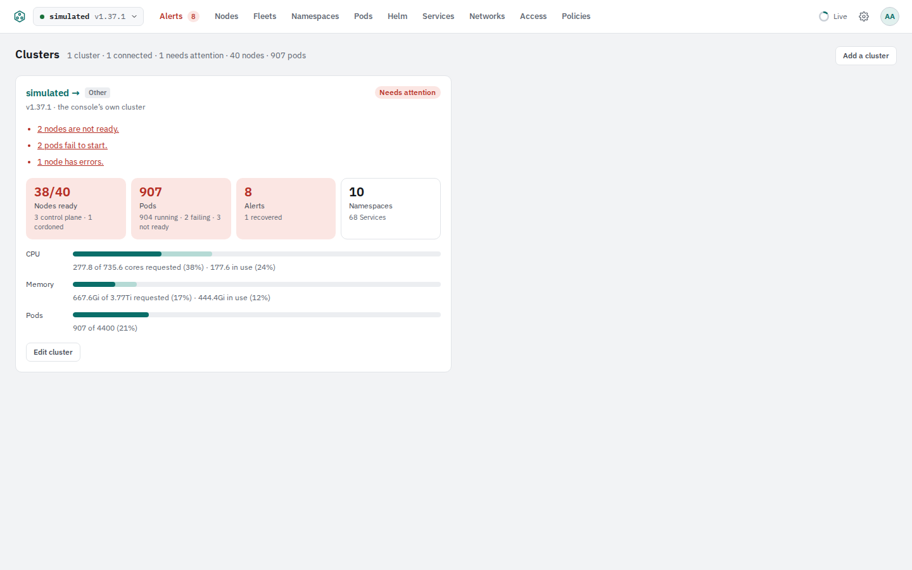</p>

## Screenshots

From the simulated cluster (`make screenshots`; the Screenshots workflow retakes them on a branch). Click one to see it full size.

| | | |
|---|---|---|
| [](docs/screenshots/home.png)<br>**Home**: every cluster at a glance | [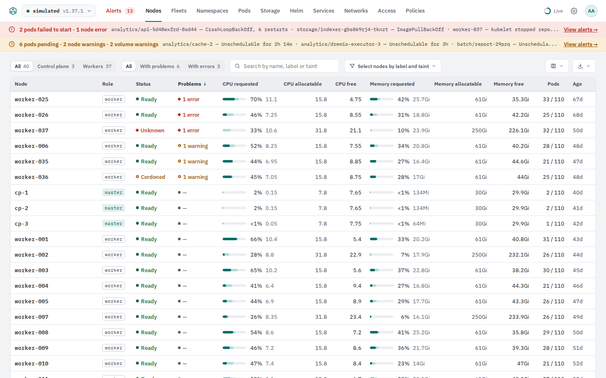](docs/screenshots/nodes.png)<br>**Nodes**, live | [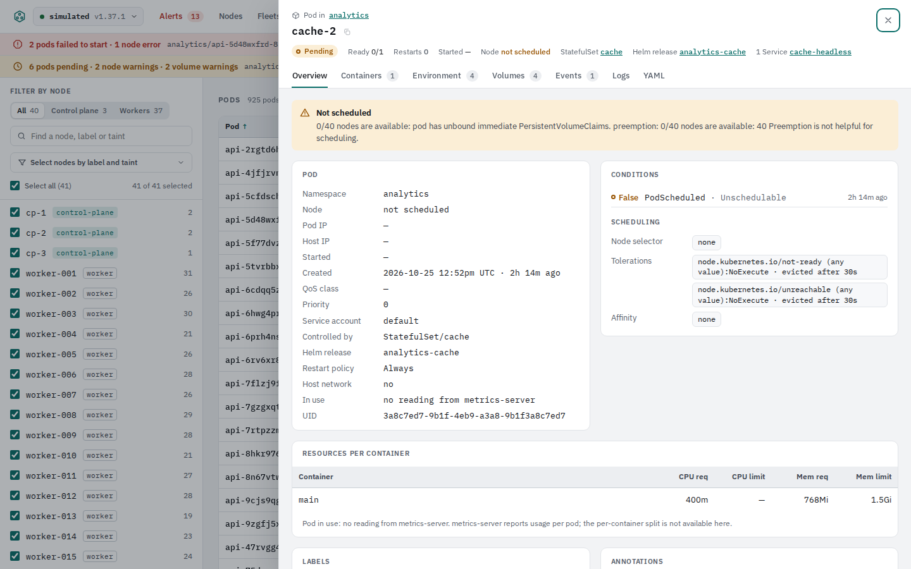](docs/screenshots/pod-details.png)<br>**Pod details** with events and logs |
| [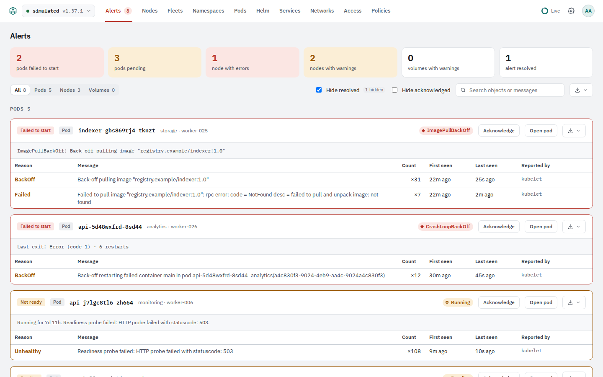](docs/screenshots/alerts.png)<br>**Alerts**: active, acknowledged, resolved | [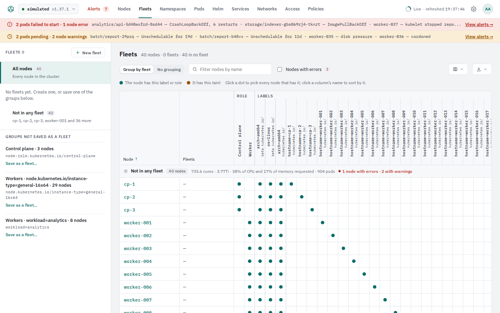](docs/screenshots/fleets.png)<br>**Fleets** by labels and taints | [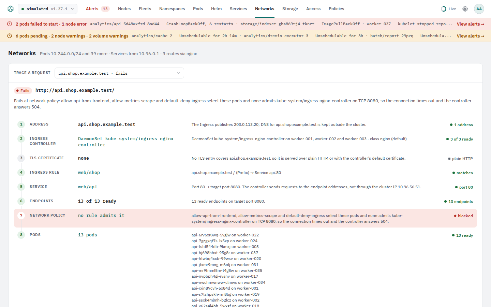](docs/screenshots/networks.png)<br>**Networks**: a route traced to the pod |
| [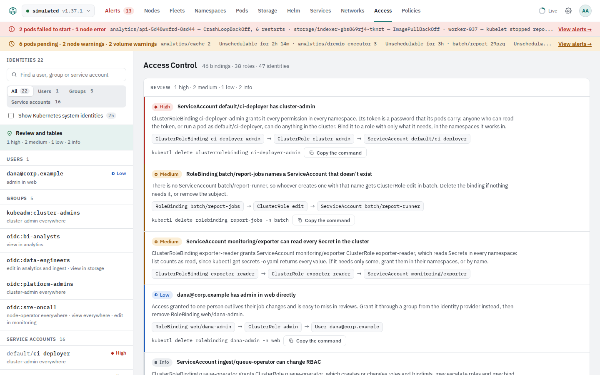](docs/screenshots/access.png)<br>**Access**: who can do what | [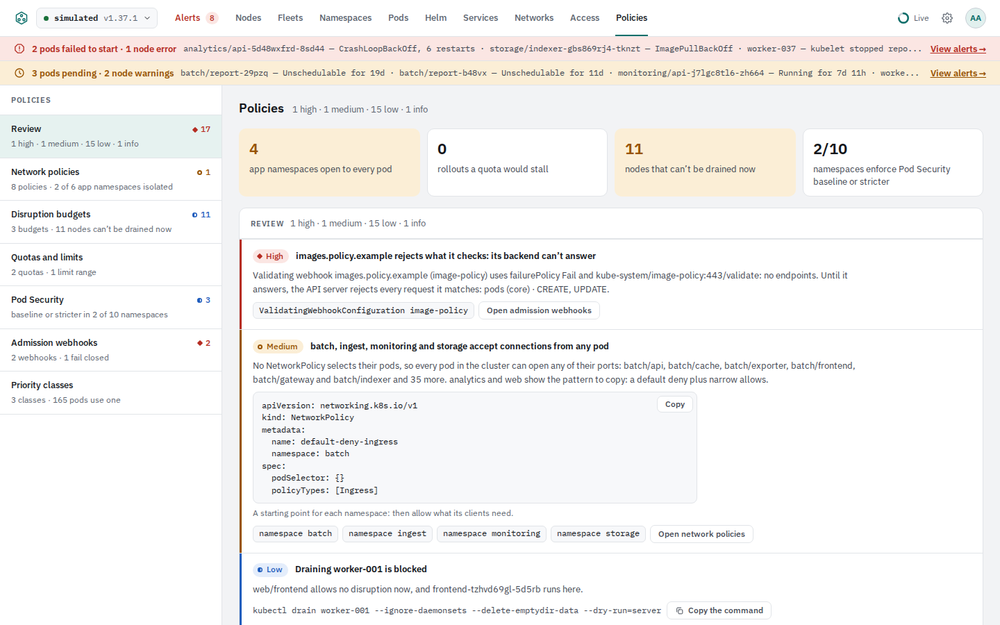](docs/screenshots/policies.png)<br>**Policies** and drainability | [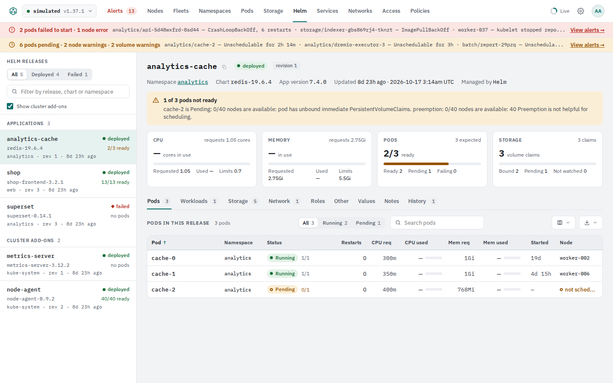](docs/screenshots/helm.png)<br>**Helm** releases |
| [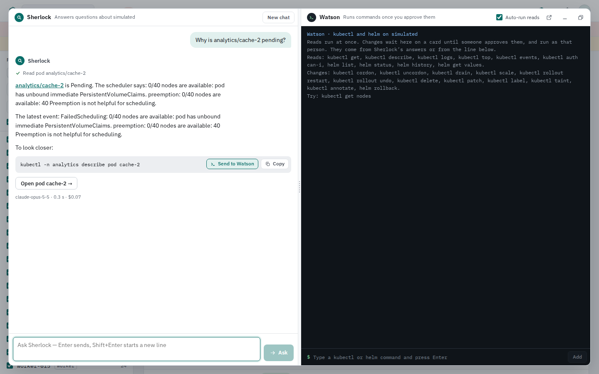](docs/screenshots/sherlock.png)<br>**Sherlock** answers from live state | [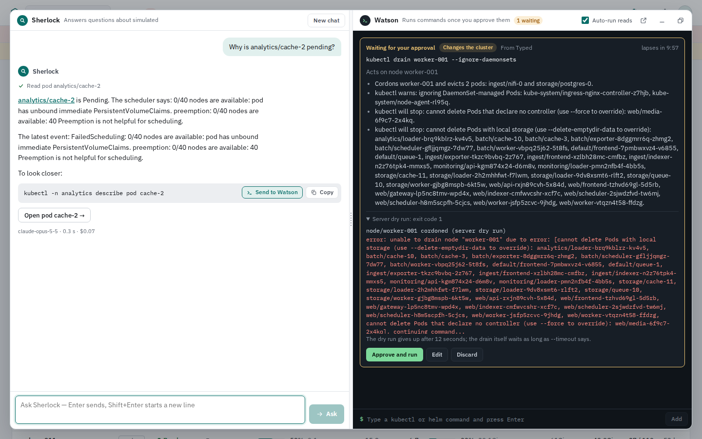](docs/screenshots/watson-approval.png)<br>**Watson**: a change waits on its approval card | [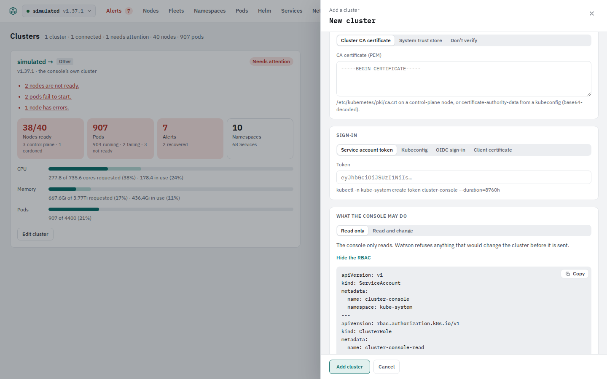](docs/screenshots/add-cluster.png)<br>**Add a cluster**, with the RBAC it needs |
| [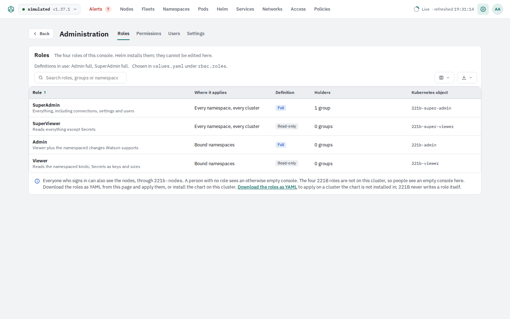](docs/screenshots/admin-roles.png)<br>**Administration → Roles** | [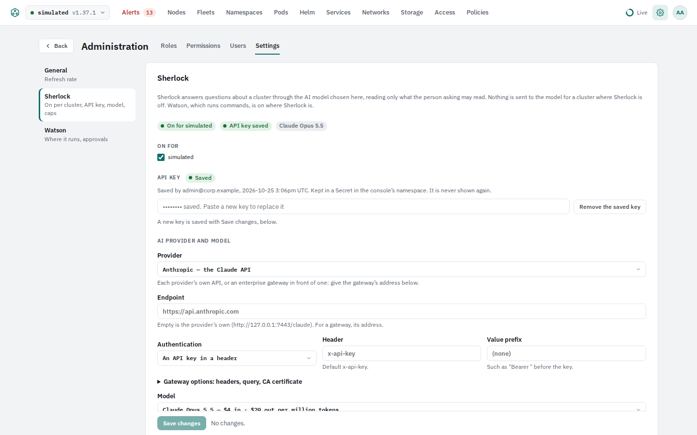](docs/screenshots/admin-settings.png)<br>**Administration → Settings**: refresh, Sherlock, Watson | |

## Status

221B is built in seven phases, each ending in a review; see [docs/requirements.md](docs/requirements.md). **Phase 1** brought a Go server and a React app in one image, a Helm chart, and the **Nodes tab** working live against a real cluster, read-only. **Phase 2** adds the everyday read-only screens: **Namespaces** (what each one holds, by kind), **Pods** (with filters by node, namespace and status, and details with containers, environment, volumes, events and live logs), **Services** (with the External columns and the endpoints behind each one) and **Helm** (releases with their history, notes and values), details and a YAML view of every object, links between the tabs, and label and taint filters on Nodes. **Phase 3** made it safe to share: sign-in, what each person sees decided by Kubernetes RBAC, several clusters in one installation, and an audit log. **Phase 4** adds the analysis tabs: **Fleets** (nodes grouped by labels and taints), **Alerts** (pods failing to start or pending, node problems and warning events, by object), **Networks** (each Ingress route traced hop by hop to the pod that answers), **Access** (who can do what, with risky roles and bindings flagged) and **Policies** (network policies with a connection checker, which nodes can be drained, quotas, Pod Security, admission webhooks and priority classes), and a **home page** with every cluster's health and use at a glance. **Phase 5** adds **Sherlock**, which answers questions about a cluster from its live state through the AI model an administrator picks (the Claude API by default, or OpenAI and any OpenAI-compatible API, Amazon Bedrock or Google Vertex AI, directly or through an enterprise gateway), reading only what the person asking may read, never sending Secret values, and changing nothing; it docks at the bottom of every tab or moves to a window of its own, and an administrator turns it on per cluster with an API key and spending caps. **Phase 6** adds **Watson**, beside Sherlock: it runs kubectl and helm reads at once, printing what the CLIs print, and holds every change (cordon, drain, scale, restarts and rollbacks, pod deletes, labels, Helm rollbacks) on an approval card with the objects it touches, a server-side dry run and its impact, until someone approves it; the change then runs as the approver, never through a shell, read-only clusters refuse it, production clusters can require a second person, and everything is audited. **Phase 6.1** brought four fixed roles for people (SuperAdmin, SuperViewer, Admin, Viewer) as Kubernetes ClusterRoles bound to groups by the chart, LDAP and local groups, a first-run page, and an **Administration** area with Roles, Permissions, Users and Settings; **Phases 6.2 to 6.5** followed from reviews: Watson beside Sherlock only, roles shared by consoles in one cluster, node Actions sent to Watson, password changes, and Alerts split into active, acknowledged and resolved. How it fits together, and why, is in [docs/architecture.md](docs/architecture.md); the review guide for Phase 6 is [docs/phase-6-review.md](docs/phase-6-review.md).

The design prototype in `design/` remains the specification for every screen, including the ones later phases build.

## Install and set up

Three steps: deploy the console into a cluster, set up that cluster (the "local" one), then add other clusters. Each step names what to check before going on. You need `kubectl` and `helm` 3.14 or later with access to the cluster, and this repository checked out (`git clone https://github.com/ucesys/221b`).

### 1. Deploy

1. **Make a namespace for the console**, of its own: the console keeps its cluster connections as Secrets there.

   ```sh
   kubectl create namespace 221b
   kubectl label namespace 221b pod-security.kubernetes.io/enforce=restricted   # optional; 221B passes it
   ```

2. **Let the cluster pull the image.** The image is private while the repository is, so give the namespace a GitHub token that can read packages:

   ```sh
   kubectl -n 221b create secret docker-registry ghcr \
     --docker-server=ghcr.io --docker-username=<github-user> --docker-password=<token with read:packages>
   ```

3. **Install the chart.** `clusterName` is the name shown in the top bar. `service.type=LoadBalancer` puts the console on the network at port 8081 when the cluster has a load balancer controller (MetalLB, kube-vip, a cloud provider); leave it out to reach the console with `kubectl port-forward` only.

   ```sh
   helm install k8s-console deploy/helm/221b -n 221b \
     --set clusterName=staging \
     --set image.tag=main \
     --set 'imagePullSecrets[0].name=ghcr' \
     --set service.type=LoadBalancer
   ```

   This installs the console, its read-only account, and the four roles for people (see [Four roles](#reference) below). The roles' names are fixed, one set per cluster: a second console in another namespace uses the first one's.

4. **Wait for it and find its address.**

   ```sh
   kubectl -n 221b rollout status deploy/k8s-console-221b
   kubectl -n 221b get svc k8s-console-221b          # EXTERNAL-IP, port 8081
   kubectl -n 221b logs deploy/k8s-console-221b | grep -m1 serving   # the build that runs
   ```

   Without a load balancer: `kubectl -n 221b port-forward svc/k8s-console-221b 8080:8081` and use <http://localhost:8080>.

5. **Create the first administrator.** Open `http://<EXTERNAL-IP>:8081` in a browser. With no user yet, the console shows the first-run page: choose a username (lowercase) and a password of at least 12 characters. It asks for a setup token only when the chart was installed with `auth.setupToken` (or `auth.setupTokenSecret`); then enter that value. This first user is a **SuperAdmin**. Other people are added on **Administration → Users**, or come from your directory with `auth.mode=ldap` or `oidc` (see [Sign-in](#reference)).

   **Check:** the home page shows the cluster with its nodes, pods and alerts, and the top bar says *Live* ([screenshot](docs/screenshots/home.png)).

To upgrade after a `git pull`, keep your settings and take the chart's new defaults: `helm upgrade k8s-console deploy/helm/221b -n 221b --reset-then-reuse-values` (plain `--reuse-values` keeps the old chart's defaults too). Images tagged `main`, `pr-<number>` and `branch-<name>` move to every new build, so the console pulls the image again on every restart and upgrade; to pin one build use `image.tag=sha-<commit>`. To remove it: `helm uninstall k8s-console -n 221b`. Users, connections and Sherlock's key that the console created are Secrets in its namespace that the uninstall leaves; delete the namespace to remove them too.

### 2. Set up the local cluster

The cluster the console runs in is the connection named `local`. The chart has already installed the roles there; what is left is who gets which role, and whether Sherlock and Watson work there.

1. **Check the roles.** Open the gear in the top bar → **Administration → Permissions**. It should say *The roles on this cluster match the definitions shipped with 221B*. From a shell, `kubectl get clusterrole | grep '^221b-'` lists `221b-super-admin`, `221b-super-viewer`, `221b-admin`, `221b-viewer` and `221b-nodes`.

2. **Give people roles.** SuperAdmin and SuperViewer apply everywhere; Admin and Viewer apply in the namespaces a group is bound to. Bindings come only from values, so this is a `helm upgrade`:

   ```yaml
   # roles.yaml
   auth:
     local:
       groups:
         - { name: web-readers,  role: viewer, namespaces: [web] }
         - { name: checkout-ops, role: admin,  namespaces: [checkout, web] }
   ```

   ```sh
   helm upgrade k8s-console deploy/helm/221b -n 221b --reset-then-reuse-values -f roles.yaml
   ```

   Then on **Administration → Users**, create local users and add them to a group, or give them SuperAdmin or SuperViewer. With a directory, list its groups per role under `auth.ldap.roles` (or `auth.oidc.roles`) instead. The namespaces named must exist.

3. **Turn on Sherlock**, if you want questions answered and Watson available. **Administration → Settings → Sherlock** ([screenshot](docs/screenshots/admin-settings.png)): choose the AI provider (the Claude API by default), save its API key, tick the clusters Sherlock may answer about, and set spending caps. Watson, which runs `kubectl` and `helm`, appears wherever Sherlock is on.

4. **Decide whether Watson may change this cluster.** By default (`localCluster.mode=read`) Watson runs reads here and refuses every change. To allow changes, each approved on a card and run as the person who approves it:

   ```sh
   helm upgrade k8s-console deploy/helm/221b -n 221b --reset-then-reuse-values --set localCluster.mode=write
   ```

   For a deployment that can never change anything, set both definitions read-only instead: `--set rbac.roles.admin.template=readOnly --set rbac.roles.superAdmin.template=readOnly` with `localCluster.mode=read`.

   **Check:** sign in as a Viewer: the tabs show only the namespaces of their groups, plus the nodes.

### 3. Set up a remote cluster

The console reaches another cluster's API server directly with an account you create there, and reads it as each signed-in person. Nothing in the console writes RBAC, so the four roles have to be put on that cluster by someone with admin rights. Run the commands below with **that cluster's** admin kubeconfig (`--kubeconfig remote.yaml`, or `--context`).

1. **Create the console's account there.** In the console, open **Add a cluster** (home page) → *What the console may do* → **Show the RBAC the console's account needs**, choose *Read only* (or *Read and change* if Watson may change that cluster), and copy the YAML into `console-account.yaml` ([screenshot](docs/screenshots/add-cluster.png)). It creates the ServiceAccount `kube-system/cluster-console`, read access to everything the tabs show, and the right to read as each signed-in person (impersonation and access reviews).

   ```sh
   kubectl --kubeconfig remote.yaml apply -f console-account.yaml
   ```

2. **Make it a token and get the cluster's CA certificate.**

   ```sh
   kubectl --kubeconfig remote.yaml -n kube-system create token cluster-console --duration=8760h
   kubectl --kubeconfig remote.yaml config view --raw --minify \
     -o jsonpath='{.clusters[0].cluster.certificate-authority-data}' | base64 -d
   ```

   If its kubeconfig names a CA file (`certificate-authority:`) instead of data, use that file. If the API server's certificate comes from a public CA, choose *System trust store* in step 4 instead. The console warns a week before the token expires.

3. **Put the four roles on that cluster.** On **Administration → Roles** ([screenshot](docs/screenshots/admin-roles.png)), click **Download the roles as YAML**: `221b-roles.yaml` holds the four ClusterRoles and `221b-nodes` in the definitions this deployment uses, the bindings of the reserved groups (`221b:superadmins`, `221b:superviewers`, `221b:console-users`) and a RoleBinding for each group in your values. Any namespace those RoleBindings name must exist there first.

   ```sh
   kubectl --kubeconfig remote.yaml apply -f 221b-roles.yaml
   kubectl --kubeconfig remote.yaml get clusterrole | grep '^221b-'
   ```

   Until the roles are there, people see nothing on that cluster. After a change to the role lists in your values, download the YAML again and apply it to each remote cluster.

4. **Add the cluster in the console.** **Add a cluster**, then fill in:
   - *Name* (shown in the console only), *Environment* and an optional *Description*;
   - *API server*: the `server:` address from its kubeconfig, for example `https://10.0.0.10:6443`;
   - *Certificate authority*: *Cluster CA certificate*, and paste the PEM from step 2;
   - *Sign-in*: *Service account token*, and paste the token from step 2 (*Kubeconfig*, *OIDC sign-in* and *Client certificate* work too);
   - *What the console may do*: *Read only*, or *Read and change* to let Watson change it.

   Click **Test connection**: it checks the address, TLS, sign-in, Kubernetes and permissions one by one and says which step fails and why. Then **Add cluster**. The connection is kept as a Secret in the console's namespace, and its credential never comes back to a browser.

5. **Check it and turn Sherlock on there.** The new cluster is on the home page and in the cluster menu in the top bar. With it selected, **Administration → Permissions** should say the roles match. To have Sherlock (and Watson) on it, tick it in **Administration → Settings → Sherlock**. A cluster's tile on the home page has **Edit cluster** to change the connection later; removing a cluster deletes its stored credential.

## Security: why an AI model cannot hurt the cluster

An AI model can be wrong with confidence: it can invent a pod name, pick the wrong namespace, misread a log, or propose a command that would make things worse. 221B is built on the assumption that this *will* happen. The model is never trusted to be right; it is kept away from anything that changes the cluster, and every change has to pass a human and then Kubernetes itself. Each layer below holds on its own, so a mistake has to get past all of them to do harm.

1. **The model only reads, and only what the person asking may read.** Sherlock gets a fixed set of read-only tools. Each tool call runs through the console's own API *as the signed-in person* (Kubernetes impersonation), so the model sees exactly what that person's RBAC lets them see and nothing more. Secret values are never sent to it (only key names and sizes), and text that looks like a credential in logs, YAML or the question is replaced by `[REDACTED]` before it leaves the console. Nothing is sent at all for a cluster where Sherlock is off.

2. **The model cannot run commands.** When a fix needs a change, Sherlock writes the commands as text in its answer. It has no tool that runs them. A person has to send them to Watson.

3. **Watson runs a short, fixed list of commands, and never through a shell.** `kubectl` and `helm` are compiled into the server and called directly; no shell is started, so pipes, redirections, `;`, `$(…)`, variables and arguments after `--` are refused rather than interpreted. Each command and each flag is checked against an allow-list:
   - reads: `kubectl get`, `describe`, `logs`, `top`, `events`, `auth can-i`; `helm list`, `status`, `history`, `get values`;
   - changes: `kubectl cordon`, `uncordon`, `drain`, `scale`, `rollout restart`, `rollout undo`, `delete pod`, `label`, `annotate`; `helm rollback`.

   Everything else (`apply`, `create`, `edit`, `patch`, `exec`, `port-forward`, `delete` of anything but pods, `helm install` or `upgrade`, any RBAC change) is refused with the rule that refused it. A hallucinated command or flag fails here, before it reaches the cluster.

4. **Every change waits on an approval card** ([screenshot](docs/screenshots/watson-approval.png)). The card shows the exact command, the objects it touches, the result of a **server-side dry run** and its impact (for example, which pods a drain evicts and which disruption budgets block it). A made-up object name shows up here as a dry run that fails. The approval lapses after ten minutes, or sooner if any of those objects change, so an old card cannot run against a cluster that has moved on. On production clusters an administrator can require a **second person** to approve (Administration → Settings → Watson).

5. **The change runs as the person who approved it, and Kubernetes decides.** Watson does not use the console's own account for changes: it impersonates the approver, so the API server applies *their* RBAC. If they may not do it, Kubernetes refuses it, whatever the card said. People get their rights only from the four ClusterRoles and the bindings the Helm chart renders from values; nothing in the console, in Sherlock or in Watson can create or edit a role or binding (the console's account has no write on RBAC at all). The groups the console may assert on the local cluster are limited to the ones in your values plus `221b:superadmins`, `221b:superviewers`, `221b:console-users` and `system:authenticated`, so it cannot claim `system:masters` for anyone.

6. **Clusters and roles can be switched to read-only** at three independent levels (next section): the role definitions, each cluster connection, and the console's own Kubernetes account.

7. **Drift is caught and everything is recorded.** The console compares the live `221b-*` roles with the definitions it ships; with `rbac.enforce=strict` it refuses every change on a cluster whose roles were edited to allow more. Every question, command, approval, refusal, lapse and result is in the audit log with the person's name, the cluster and the outcome (`kubectl -n 221b logs deploy/k8s-console-221b | grep '"watson.'`), and is sent to `audit.webhook.url` if set.

What remains trusted is the console server itself and its namespace: it holds the connections' credentials and may impersonate. Give it a namespace of its own, limit who can read Secrets or exec into pods there, and keep the network policy on.

### Lock it down to read-only

For a deployment where nothing can change any cluster through the console, even when a person approves it, set all three levels. Each one alone already stops changes; together they mean a mistake in one is still caught by the others.

| Level | Read-only setting | What refuses a change |
|---|---|---|
| Role definitions | `rbac.roles.admin.template=readOnly`, `rbac.roles.superAdmin.template=readOnly` | The Kubernetes API server: the four roles have no write verb (SuperAdmin keeps `get`, `list`, `watch` on everything) |
| Cluster connection | `localCluster.mode=read`; *Read only* on each remote connection | Watson: refuses every change on that cluster before a card is made |
| Console account | the chart's read-only ClusterRole; `cluster-console-read` on remote clusters | The Kubernetes API server: the console's own account cannot write, so even with sign-in off nothing runs |

1. **Install or upgrade the local cluster read-only.**

   ```yaml
   # read-only.yaml
   localCluster:
     mode: read                 # Watson refuses every change here
   rbac:
     roles:
       admin:
         template: readOnly     # Admin: read their namespaces, change nothing
       superAdmin:
         template: readOnly     # SuperAdmin: read everything, change nothing
     enforce: strict            # refuse changes if anyone edits a 221b-* role to allow more
   auth:
     mode: local                # keep sign-in on (local, ldap or oidc), never none
   secrets:
     read: false                # optional: the console and the roles get nothing on Secrets
   ```

   ```sh
   helm upgrade --install k8s-console deploy/helm/221b -n 221b --reset-then-reuse-values -f read-only.yaml
   ```

   The chart refuses to render the contradiction of read-only roles with `localCluster.mode=write`, and of `auth.mode=none` with write mode and any read-only role, so a typo in values cannot quietly reopen changes.

2. **Check it with Kubernetes, not with the console.**

   ```sh
   kubectl get clusterrole -l 221b/managed=true -L 221b/definition          # every role says readOnly
   kubectl auth can-i delete pods -A --as=probe --as-group=221b:superadmins  # no
   kubectl auth can-i patch deployments -A --as=probe --as-group=221b:superadmins  # no
   kubectl auth can-i --list --as=system:serviceaccount:221b:k8s-console-221b | grep -v -E 'get|list|watch'
   ```

   The last line shows the console account's only writes: its settings ConfigMap and its connection Secrets, both in its own namespace. In the console, **Administration → Roles** says *Definitions in use: Admin read-only, SuperAdmin read-only*, and a change sent to Watson is refused with *read-only cluster*.

3. **Do the same on every remote cluster.** In step 1 of [Set up a remote cluster](#3-set-up-a-remote-cluster), choose **Read only** so the console's account there is bound to `cluster-console-read` (get, list and watch only). Download the roles YAML from this read-only deployment (it carries the definitions in use, so `readOnly`) and apply it there. In the connection editor, set *What the console may do* to **Read only**. Then check:

   ```sh
   kubectl --kubeconfig remote.yaml get clusterrole -l 221b/managed=true -L 221b/definition
   kubectl --kubeconfig remote.yaml auth can-i --list --as=system:serviceaccount:kube-system:cluster-console
   ```

   On a remote cluster the generated account may impersonate any group. To narrow it to the same groups as the local cluster, replace its `groups` impersonation rule with one that lists them under `resourceNames`; the list to copy is in the local cluster's console ClusterRole (`kubectl get clusterrole 221b-k8s-console-221b -o yaml`).

To open changes again later, reverse one level at a time (for example `localCluster.mode=write` with `rbac.roles.admin.template=full`), so it is always a deliberate `helm upgrade` that shows up in your change history.

## Reference

**Images** are tagged `main` and `sha-<commit>` from the main branch, `pr-<number>` for each pull request, and `branch-<name>` when CI is run by hand on another branch. `hack/push-prebuilt.sh` pushes a build made on your own machine as `prebuilt-<tree>`; CI then tests that build instead of making one, and publishes it for `linux/amd64` only.

**Sign-in** is on from Phase 3: every page and API call needs a signed-in person (the health probes and `/metrics` excepted). `auth.mode` is one of:

- `local` (the default): accounts kept by the console, for evaluations and clusters without a provider. On a fresh install with no user, the console shows a first-run page that creates the first SuperAdmin; if you set `auth.setupToken` (or `auth.setupTokenSecret`) it asks for that code, otherwise leave the field blank. Passwords are at least 12 characters; `221b hash-password` prints a hash for `auth.local.users`.
- `oidc`: people sign in with your OpenID Connect provider (Okta, Microsoft Entra ID, Google, Keycloak, Dex, …). Set `auth.oidc.issuer`, `clientID` and `clientSecret` (or `existingSecret`), register `https://<the console's host>/signin/callback` with the provider, and add `groups` to `auth.oidc.scopes` if it needs that to send groups. List provider groups per role under `auth.oidc.roles`; without it, every group in the token reaches Kubernetes by its own name and `auth.admins` / `auth.adminGroups` are the SuperAdmins, as before.
- `ldap`: people sign in with their directory account. Configure `auth.ldap` (URL with `ldaps://` or `startTLS`, search base DNs and filters) and keep the search account's password in a Secret named by `auth.ldap.existingSecret` (key `bind-password`). Only members of a group listed under `auth.ldap.roles` may sign in.
- `none`: sign-in off, as before Phase 3; everyone who reaches the console is a SuperAdmin, so expose it only where that is acceptable.

**Four roles** (Phase 6.1; see [docs/roles-and-users.md](docs/roles-and-users.md) and ADR-59): SuperAdmin and SuperViewer apply in every namespace; Admin and Viewer apply in the namespaces their group is bound to. They are Kubernetes ClusterRoles (`221b-super-admin`, `221b-super-viewer`, `221b-admin`, `221b-viewer`, and `221b-nodes` for everyone) that the chart installs and binds to groups, so Kubernetes, not the console, limits what the console and Watson can do. Bindings come only from values: `auth.ldap.roles` and `auth.oidc.roles` (a group with its namespaces per role) and `auth.local.groups` (a name, a role and namespaces; local users are put in them with `groups`, or on the Users page). Nothing in the console or Watson creates a binding, so changing who is Admin or Viewer in a namespace is a `helm upgrade`. `rbac.roles.admin.template` and `rbac.roles.superAdmin.template` choose `full` or `readOnly`; both `readOnly` with `localCluster.mode: read` is a fully protected, read-only deployment. `rbac.enforce: strict` makes Watson refuse changes on a cluster whose live roles differ from these. The Administration area (the account menu) has Roles, Permissions, Users and Settings pages, and the YAML of the four roles can be downloaded for clusters the chart is not installed on. Administrators who upgrade from an earlier release keep working: `auth.admins` and `auth.adminGroups` still make SuperAdmins. Sessions end after 8 hours without a request (`auth.sessionIdle`). Every sign-in, sign-out and change is in the audit log, one JSON line on the console's standard output (`kubectl -n 221b logs deploy/k8s-console-221b | grep '"action"'`), and goes to a webhook if `audit.webhook.url` is set.

**What each person sees** is what Kubernetes lets them see: the console reads logs and YAML as them (by impersonation) and, before a row reaches them, asks Kubernetes whether they may list that kind in that namespace. Kubernetes knows local users as `221b-local:<name>` and directory users as `221b-ldap:<name>`, always in the group `221b:console-users`; OIDC users keep the names their provider gives. The four roles are the normal way to give access; RBAC you write yourself for those names works too, and the console follows a change within `auth.kubernetes.accessTTL` (2 minutes). If your API servers add a prefix to OIDC names (`--oidc-username-prefix`, `--oidc-groups-prefix`), set `auth.kubernetes.userPrefix` and `groupPrefix` to the same. A person with no RBAC at all sees empty tabs; the console's own account reads everything, and grants only what the tabs show.

**Other clusters** are added in the console, from **Add a cluster** on the home page or the cluster menu in the top bar (SuperAdmins only; step by step in [Set up a remote cluster](#3-set-up-a-remote-cluster)): the cluster's API server address, its CA certificate (or the image's trust store), and how the console signs in there, with a ServiceAccount token, a kubeconfig context or a client certificate. The editor shows the RBAC to grant that account and tests the connection step by step (address, TLS, sign-in, Kubernetes, permissions) before saving. Each connection is kept as a Secret in the console's namespace (`kubectl -n 221b get secrets -l app.kubernetes.io/component=cluster-connection`), the credential never comes back out, and removing the cluster deletes it. The cluster the console runs in is the connection named `local`, with its own credentials. A token that expires within a week is flagged in the menu and on the cluster page. Give the console a namespace of its own: the Role that lets it keep connections covers every Secret in that namespace.

**To put it on the network** instead, add `--set service.type=LoadBalancer`. With a load balancer controller (MetalLB, kube-vip, a cloud provider) the Service gets an address that answers on port 8081; `kubectl -n 221b get svc k8s-console-221b` shows it. Without one, every node still answers on the node port shown there, and `--set 'service.externalIPs={10.0.0.21,10.0.0.22}'` with your nodes' addresses makes them answer on 8081 as well. The network policy lets anyone reach an exposed Service unless `networkPolicy.ingressFrom` lists who may. For TLS, publish it through an Ingress: `--set ingress.enabled=true --set ingress.host=console.example.com --set ingress.tls.enabled=true --set ingress.tls.secretName=<certificate Secret>`; plain HTTP is then redirected and the session cookie marked Secure. Without TLS, sessions travel in the clear.

To upgrade after a `git pull`, keep your settings and take the chart's new defaults: `helm upgrade k8s-console deploy/helm/221b -n 221b --reset-then-reuse-values` (plain `--reuse-values` keeps the old chart's defaults too, so new ones never apply). To see what it may read: `kubectl auth can-i --list --as=system:serviceaccount:221b:k8s-console-221b`. To remove it: `helm uninstall k8s-console -n 221b`.

CPU and memory in use come from [metrics-server](https://github.com/kubernetes-sigs/metrics-server) when the cluster has it; without it, the tabs say so and show everything else. Each node's uptime comes from its kubelet, read through the API server once per boot; that needs `get` on `nodes/proxy`, which the chart grants unless you set `kubeletStats=false`.

**Secrets** are read by default (`secrets.read`), so that each namespace lists its Secrets by key name and size and the Helm tab can read release records, which Helm keeps in Secrets. The server keeps only key names and sizes, the names, issuer and validity of a TLS Secret's certificate (which the Networks tab checks; `tls.key` is never read), decodes release records with credential-looking values masked, and never shows, logs or exports a Secret's value; CI plants a known value and checks it appears nowhere. `--set secrets.read=false` grants the console nothing on Secrets at all: namespaces then list no Secrets and there is no Helm tab.

**Watson** shows only where Sherlock is on, and runs reads in any cluster. It changes the cluster the console runs in only when installed with `--set localCluster.mode=write`, and another cluster only when its connection is set to *Read and change*. With sign-in on, each change runs as the person who approves it, so their own RBAC decides; with `auth.mode=none`, changes run as the console's ServiceAccount, which the chart then binds to the built-in `edit` ClusterRole (`localCluster.writeClusterRole`) and a small role to cordon and drain nodes.

**Every table** sorts by any column, picks columns and exports what is on screen to Excel, CSV or JSON, with the same controls everywhere. Column choices are kept in your browser. The search box suggests names, labels, nodes, namespaces and statuses as you type. Rows are keyboard-navigable: Enter opens a row's details, the arrow keys move between rows and into a row's links, and Escape closes the details.

**Settings** (the gear in the top bar opens Administration; Settings is one of its pages, for SuperAdmins) hold the refresh rate, for everyone, and Sherlock's and Watson's settings; the theme is personal and in the account menu. For the refresh rate, the server reads the cluster and updates every open console at the same moment, 3 seconds apart by default, and keeps the choice in its ConfigMap (`k8s-console-221b`) so it survives restarts and upgrades. Nodes and pods are watched, so the rate adds no requests to the API server for them.

## Develop

You need Go 1.26, Node.js 24 and make. Docker, kind, kubectl and helm are needed only for the image and the kind tests.

```sh
make dev-sim     # the console on http://127.0.0.1:8080 against a simulated cluster, with a second one to add (http://127.0.0.1:7444)
make test        # Go and browser unit tests
make lint        # gofmt, go vet, tsc and eslint
make e2e-sim     # browser end-to-end tests against the simulator (Chromium; set E2E_BROWSERS for more)
make image       # the container image
make help        # everything else
```

**Against a real cluster from a laptop**, with your own kubeconfig and permissions:

```sh
make build
bin/221b -kubeconfig ~/.kube/config -context my-cluster -cluster-name my-cluster
```

**The browser app with hot reload:** run `make dev-sim` in one terminal and `npm run dev` in `web/` in another, then open <http://localhost:5173>; Vite sends API calls to the server on port 8080.

**The simulator** (`bin/221b-sim`) serves enough of the Kubernetes API for the server's real informers: every kind the console watches, with namespaces full of workloads, Services, Ingresses, ConfigMaps, Secrets and Helm release records, pod logs and metrics, plus the kubelets' boot times through the node proxy and a ConfigMap for the settings. It takes `-nodes`, `-pods` and `-churn`, and `POST /sim/...` changes things: cordon a node, make it not ready, reboot it, crash a pod, delete a pod, give a Service an external IP, take the API server down. See `server/internal/sim`.

**The kind tests** that CI runs: `IMAGE=ghcr.io/ucesys/221b:dev hack/e2e-kind.sh 1.37` after `make image TAG=dev`. `hack/scale-kind.sh` runs the 500-node, 15,000-pod scale test with kwok.

## Layout

| Path | What it is |
|---|---|
| `server/` | The Go server: `cmd/221b` (the console) and `cmd/221b-sim` (the simulated API server), with packages under `internal/` |
| `web/` | The browser app (TypeScript, React, Vite), with unit tests next to the code and browser tests in `e2e/` |
| `deploy/helm/221b` | The Helm chart |
| `hack/` | Scripts CI runs: chart checks, the kind end-to-end run, the RBAC check (with and without Secrets) and the scale test |
| `design/` | The prototype: `Main.dc.html` is a Claude Design artboard with the template, logic and sample data in one file |
| `docs/` | Requirements, architecture and decision records, and their images |

## What the design covers

- **Clusters.** A cluster menu in the top bar switches between clusters and edits their connections: API server, CA certificate, sign-in (service account token, kubeconfig, OIDC or client certificate), and whether the console may only read or also change things. Connections can be tested, added and removed.
- **Tabs.** Nodes, Fleets, Namespaces, Pods, Helm and Alerts stay in the bar. Services, Networks, Access and Policies sit under **More**, which takes more tabs as the window narrows.
- **Sherlock and Watson** share a panel at the bottom of every tab. It can be resized, maximized or minimized to an icon.
- **Fleets** group nodes by their labels and taints, with one column per label and per taint.
- **Networks** traces a request from a hostname to the pod that answers it.
- **Access** reviews RBAC: who can do what, and each identity's effective permissions.
- **Policies** covers network policies (with a "can A connect to B" checker), disruption budgets and whether each node can be drained, quotas, Pod Security, admission webhooks and priority classes.
- **Every table** sorts by any column and exports to Excel, CSV or JSON.

The prototype's sample cluster, `lakehouse-prod`, runs Dremio, Nessie, MinIO, Superset, Longhorn, kube-prometheus-stack, cert-manager and ingress-nginx on 10 nodes, with a few realistic problems to find.

## License

Licensed under the Apache License, Version 2.0. See [LICENSE](LICENSE).
