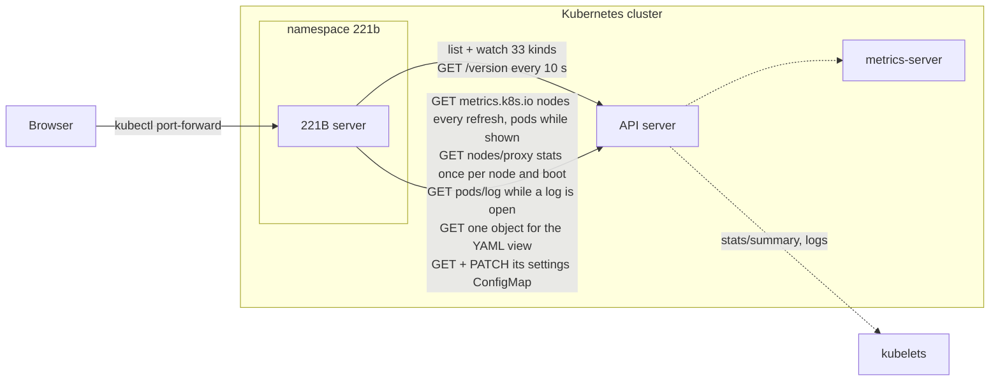

# 221B Architecture

This document describes 221B as built through Phase 12: its parts, how data moves through them, the security model and the ways it can be deployed. The decision records at the end explain each choice in the Architecture table of the [requirements](requirements.md#architecture), plus the decisions each phase made. It was the document for review item P1-01 and is kept current for every review since.

## In one paragraph

221B is one Go server and a browser app, shipped as one container image and installed with a Helm chart. The server keeps a watched, in-memory copy of the cluster's nodes, pods, workloads, Services, Helm releases and the other kinds each namespace lists, trimmed to what the screens use; it builds the rows each tab shows as *views*, the Phase 4 analyses among them (fleets, alerts, access, policies and the path of a request), and on a shared refresh tick sends every open browser the changes to the views it is showing, at the same moment, over Server-Sent Events. Browsers never see a Kubernetes object, only rows, except in the YAML view, which the server serves with managed fields removed and Secret values replaced by their sizes. Secrets are read only to list their keys and sizes and to decode Helm's release records, with credential-looking values masked before they enter the cache; a chart setting withholds Secrets altogether. The server runs inside the cluster it shows, with a ServiceAccount that can read the kinds the tabs show, pod logs, metrics and the kubelets' stats, and write two things in its own namespace: its settings ConfigMap and the Secrets that hold its connections to other clusters, each of which it watches the same way, as one more cluster in the menu (Phase 3). People sign in with the organization's OpenID Connect provider (or local accounts, for evaluations) and open it through `kubectl port-forward`, an exposed Service or an Ingress with TLS; every sign-in and every change to a connection is written to an audit log. Sherlock (Phase 5) answers questions about a cluster: the server keeps a conversation per session and cluster, sends the question to the Claude API with a set of read-only tools, runs each tool the model asks for as the person asking, through the console's own API, scrubs what they return of anything that looks like a credential, and streams the answer, with links to the objects it relied on, to every window of the session. It is off for every cluster until an administrator turns it on and gives it an API key, which is kept in a Secret; spending caps stop new questions when reached, and each question is audited with its tools and tokens. Watson (Phase 6) runs kubectl and helm commands: the server parses each one against a fixed list of reads and changes, refuses anything else (a shell is never started), runs reads at once and holds every change on an approval card with the objects it touches, a server-side dry run and its impact, until someone approves it; it then runs as the approver, with kubectl's own command packages and the Helm SDK in-process, impersonating that person. A card lapses after 10 minutes or as soon as the objects it acts on change; read-only clusters refuse every change; production clusters can require a second person; every command, approval, refusal and result is audited.

## Components



| Part | Where | What it does |
| --- | --- | --- |
| Entry point | `server/cmd/221b` | Reads flags and environment, connects, wires the parts below together, serves HTTP and shuts down cleanly on SIGTERM. `main.go` keeps the flags, the order of the wiring and the server; each feature is wired by a `wireX` method in a file of its own (`auth.go`, `clusters.go`, `settings.go`, `sherlock.go`, `ssh.go`, `automation.go`, `jobs.go`, `issues.go`, `knowledge.go`, `cards.go`, `casework.go`, `backupparts.go`, `api.go`, …), which reads what the features before it opened. |
| Configuration | `server/internal/config` | Flags with environment fallbacks (`CLUSTER_NAME`, `LISTEN`, `KUBECONFIG_PATH`, `KUBE_CONTEXT`, `API_SERVER`, `REFRESH`, `SETTINGS_CONFIGMAP`, `CONNECTIONS_SECRETS`, `KUBELET_STATS`, `SECRETS_READ`, `HEALTH_INTERVAL`, `LOG_LEVEL`, `LOG_FORMAT`, and for Phase 3 `AUTH_MODE`, `OIDC_*`, `LOCAL_USERS_FILE`, `ADMINS`, `ADMIN_GROUPS`, `SESSION_IDLE`, `SESSION_MAX`, `AUDIT_WEBHOOK_URL`, `AUDIT_WEBHOOK_TOKEN`, `HTTPS_REDIRECT`, and for Phase 5 `SHERLOCK_API_URL`, `SHERLOCK_SECRET` and `SHERLOCK_API_KEY`, the last from the environment only, and for Phase 6 `LOCAL_MODE`, whether Watson may change the console's own cluster). |
| Shared settings | `server/internal/settings` | The settings everyone shares, the refresh rate and each cluster's fleets (P4-01): validated, kept in a ConfigMap in the cluster (or in memory on a laptop), re-read every minute so a `kubectl edit` takes effect, and pushed to every browser when they change. |
| Sign-in and sessions | `server/internal/auth` | The sign-in page, the OIDC relying party (discovery, the code flow with PKCE and a nonce, ID token verification against the provider's keys), local accounts with PBKDF2 password hashes, sessions in memory with idle and absolute expiry, the two roles, and the gate every request passes (P3-01, P3-03). `server/internal/oidcsim` is the simulated provider the tests sign in through. |
| Audit log | `server/internal/audit` | One JSON record per sign-in, sign-out, settings change and connection change on standard output, and the same records to a webhook from a bounded queue (P3-10). |
| Per-person access | `server/internal/access` | What each signed-in person may see in each cluster (P3-02): verdicts from SubjectAccessReviews per resource and namespace, kept for a while, which the live store filters rows, usage and totals by, per subscriber. `kube.Person` and the impersonated clients live in `server/internal/kube`. |
| Cluster connections | `server/internal/clusters` | The connections to other clusters (P3-05 to P3-09): their specs and credentials in Secrets of the console's namespace (or in memory), validation of a draft and what each credential says about itself (a token's account and expiry, a kubeconfig's context, a certificate's subject), the five-step connection test, and a manager that runs one `kube.Cluster` and one live store per connection, the console's own cluster among them as `local`. |
| Kind registry and cluster connection | `server/internal/kube` | `kinds.go` lists every kind the console watches, with its API group, how it is cached (a typed informer with a transform, or metadata only) and its indexes. `cluster.go` chooses in-cluster, kubeconfig or URL mode, runs one informer per kind, checks the API server's health, reads node usage from metrics-server on every poll and pod usage while a tab wants it, reads each node's boot time from its kubelet once per boot, and reads and patches the settings ConfigMap. `secrets.go` turns Secrets into key names and sizes, reads a TLS Secret's certificate for its names, issuer and validity (never the key), and decodes Helm release records with credentials masked; `logs.go` streams pod logs; `yaml.go` serves one object as YAML with managed fields removed and Secret values hidden. |
| Row builders | `server/internal/nodes`, `server/internal/views` | `nodes` turns one node and the pods on it into a Nodes row (Phase 1). `views` builds the Phase 2 rows: pods, namespaces and what each holds by kind, Services with their endpoints, Helm releases with their history, and the details behind each row (a pod's containers, environment, volumes, events and owner chain; a Service's ports, endpoints and the pods behind them; a release's resources, values and notes). Phase 4 adds the analysis views: `alerts.go` (pods failing to start, pending and recovered, node problems, warning events by object), `access.go` (roles, bindings with their findings, ServiceAccounts), `policies.go` with `psa.go`, `drain.go`, `quota.go` and `hooks.go` (network policies and the connection checker, drains, disruption budgets, quotas and rollouts, Pod Security, webhooks, priority classes) and `networks.go` (each Ingress route traced hop by hop, nodes' addresses, the cluster's network facts). |
| Analyses | `server/internal/fleets`, `server/internal/rbac`, `server/internal/netpol`, `server/internal/psa` | The logic the Phase 4 views share, each kept apart so Sherlock can call it in Phase 5: `fleets` validates fleets and works out their members and totals; `rbac` matches RBAC rules the way the API server's authorizer does and names what a role can do (everything, change RBAC, escalate, bind, impersonate, read Secrets, exec, create pods, act as ServiceAccounts); `netpol` decides whether a NetworkPolicy lets a connection through, both sides, with named ports, port ranges and `ipBlock`; `psa` is the API server's own Pod Security checks, copied from `k8s.io/pod-security-admission` (see its README). |
| Live store | `server/internal/live` | Keeps the rows of every *view* as encoded JSON with a version per view, collects change notices from the informers, and on each refresh tick polls the cluster, recomputes the rows the changes touched and publishes one delta per changed view to the browsers showing it, followed by a refresh event. Views nobody shows are not built; per-namespace views are built when a browser opens them and dropped a minute after the last browser leaves. |
| HTTP API | `server/internal/api` | The JSON API: snapshots and the event stream by view, details for pods, Services and releases, pod logs, the YAML view, the settings endpoint, the cluster connections, health, readiness and Prometheus metrics, and the security headers on every response. Every data route exists twice: under `/api/v1/` for the console's own cluster and under `/api/v1/clusters/{id}/` for any connection. |
| Sherlock | `server/internal/sherlock` | Phase 5. The Claude Messages API client (streaming, tool use, retries on overload), the conversations (one per session and cluster, kept in memory for the session, trimmed to fit, repaired when an answer is stopped part way), the answer loop (the model's reply, the tools it asks for, their results back, at most 12 rounds), the system prompt, the scrubbing of credentials from what the tools return, the check of the answer's links against what the tools showed, the models offered with their list prices, the spend counted per day and month against the caps, and the API key's storage. The tools themselves are `server/internal/sherlocktools`, which `api` wires: 27 reads, most of them the console's own API called in-process with the asking person's session. |
| Platform | `server/internal/platform` | Which Kubernetes distribution a cluster runs (RKE2, K3s, kubeadm, kind, EKS, GKE, AKS, OpenShift, Talos), on which operating systems and kernels, with which network plugin, load balancer, storage, GPU plugin and node monitoring, read from the cluster's cache; and the guidance on each for Sherlock's prompt, one file per distribution, operating system and add-on in `sections/`. |
| Watson | `server/internal/watson` | Phase 6. `parse.go` splits a command line the way a shell would quote it, without running one, refuses shell syntax, and checks the command, its flags and arguments against the fixed list of supported commands; `kubectl.go` runs kubectl's own cobra commands (`k8s.io/kubectl` v0.37) in-process through a `RESTClientGetter` that impersonates the person, with fatal errors caught instead of exiting; `helm.go` runs the Helm SDK's actions (`helm.sh/helm/v4`) and prints their results as the helm CLI does, with values masked; `impact.go` works out each change's targets, impact (pods a drain evicts and the budgets it meets, replicas before and after, what a rollback adds and removes) and the guards that void its card when its objects change; `service.go` keeps every person's commands per cluster, queues them, runs the dry run and the command, streams their output, lapses cards and writes the audit records. The HTTP routes are `server/internal/api/watson.go`. |
| Fake Claude API and evaluation | `server/internal/fakeclaude`, `server/cmd/221b-eval`, `hack/sherlock-eval.sh` | A stand-in for the Messages API that streams scripted answers calling the tools as a model would and records every request, served by the simulator at `/claude` for the tests. `221b-eval` finds the prototype's sample problems in a cluster, asks Sherlock about each and grades the answers by the facts they must name (P5-06); a nightly workflow runs it against the real API. |
| Issue service | `server/internal/issues` | Phase 12 (docs/issues.md). Reports, known issues and services, the matching of a report to them, the timers, an `Investigator` interface, API tokens, and its own HTTP API under `/api/issues/v1/`, kept in the ConfigMap `<release>-issues`; `internal/api/issues.go` mounts it and says who is calling (ADR-83 to ADR-87). |
| Watson cards | `server/internal/cards` | Phase 12. The agents' proposals as durable cards in the ConfigMap `<release>-proposals` (`<release>-cases` before CF-104, copied over once at start, ADR-152): dedup, expiry, the re-check at approval, approvals (an agent never counts as a person), Watson's console actions (hosts, fleets, Automation parameters, records), standing approvals and notification channels; `internal/api/cards.go` serves them under `/api/v1/aiops/` and runs kubectl and helm through Watson (ADR-99 to ADR-102). |
| Jobs | `server/internal/jobs`, `server/internal/investigate` | Phase 12. The agents on their own: a registry of kinds of jobs, their settings, the schedules and the alerts watched on the leader, budgets, the runs with their findings and proposals in the ConfigMap `<release>-runs`, and the HTTP API under `/api/v1/jobs`, `/runs` and `/findings`, mounted by `internal/api/jobs.go`, which also gives the agents the read-only toolbox of the reader identity. `investigate` is the issue service's `Investigator`, as the report triage job (ADR-90 to ADR-93). |
| Cases (work items) | `server/internal/casework` | Phase 12. Since wave 5, 221B's work on each case (the case itself is the issue service's, ADR-113 to ADR-115), in the ConfigMap `<release>-casework`: opened by hand, from a finding or an alert, the case analysis job (the Troubleshooter over the jobs' machinery) with its suggested fix and the cards it proposes, the close with its RCA, kept on the case (CF-44), reopening, the exceptions and fixes, and the HTTP API under `/api/v1/aiops/cases`, mounted by `internal/api/casework.go` (ADR-105 to ADR-107). |
| Browser app files | `server/internal/ui` | Serves the built browser app, embedded in the binary, and the report page (`report.html`) at `/report`. |
| AIOps | `web/src/components/aiops`, `web/src/lib/cases.ts`, `web/src/lib/reportLink.ts` | Phase 12. The third area of the browser app, called AIOps in the console since CF-91, and in its addresses (`#/aiops/…`, area id `aiops`), folder and API (`/api/v1/aiops/`) since CF-104 (ADR-152); the addresses of before (`#/cases/…`) open their new places. Three tabs, across clusters, shown to whoever has something in them: Inbox; Jobs (Schedule, Runs, Validation rules; CF-89); Mycroft (Wiki, Known issues, Exceptions, Fixes; MY-01). The older tabs' addresses (Runs, Reports, Known issues, Knowledge) open their new places; the links into the report page hand their text over in the browser (ADR-88, ADR-89). |
| Simulator | `server/internal/sim`, `server/cmd/221b-sim` | A fake Kubernetes API server serving every kind the console watches, with namespaces full of workloads, Services, Helm release records and planted Secrets, pod logs and metrics, an admin API to break things, and outages on demand. For Watson it also serves discovery, server-side tables, field selectors, creates, updates, patches, deletes, evictions and the scale subresource, with dry runs, and plays the controllers just enough to see a change land: cordoned nodes, Deployments rolling out new ReplicaSets, pods replaced and scheduled, budgets counted. Used for development, tests and the scale test. |
| Browser app | `web/` | TypeScript and React. `lib/router.ts` maps the URL hash to a cluster, a tab and its filters (`#/pods` is the console's own cluster, `#/c/<id>/pods` another); `api/live.ts` subscribes to the views a screen shows and follows the event stream of the cluster open; `api/clusters.ts` and `components/ClusterMenu.tsx`, `ClusterPage.tsx` and `ClusterEditor.tsx` are the cluster menu, page and connection editor; `api/details.ts` fetches the details behind a row and refetches them on every refresh; `lib/table.ts` and `lib/useTable.ts` hold the one table model every tab uses (sorting, search terms with suggestions, column choices, exports); `columns/` defines each table's columns; `components/` holds the screens, the shared `DataTable`, `SearchBox`, `ColumnsMenu` and `ExportMenu`, the details drawers, the log view and the YAML view. Phase 4's tabs are `FleetsTab` with `FleetEditor`, `AlertsTab`, `NetworksTab`, `AccessTab` with `RbacPanel` and `PoliciesTab` with `PolicyPanel`; `lib/rbac.ts` works out who can do what from the access rows, with the same rule matching as `server/internal/rbac`. Phase 5's Sherlock is `components/Sherlock.tsx` (the pane and the Ask Sherlock button), `SherlockSettings.tsx` (the administrator's settings), `api/sherlock.ts` (the conversation's event stream and the calls), `lib/markdown.tsx` (answers rendered as React elements, never as HTML) and `lib/sherlock.ts` (where a cited object opens, and the windows' coordination). Phase 6 adds `components/Dock.tsx` (Sherlock and Watson docked side by side, resized, maximized, minimized and popped out), `AssistantWindow.tsx` (both panes in one window of their own), `Watson.tsx` (the terminal, the approval card, and the buttons that hand Watson a command), `WatsonSettings.tsx` and `api/watson.ts` (the commands' event stream and the calls). |
| Chart | `deploy/helm/221b` | Deployment, Service, ServiceAccount, ClusterRole and binding, the settings ConfigMap with a Role and binding for it and for the connection Secrets, the sign-in Secret (local accounts, the OIDC client secret, the webhook token), an optional Ingress, NetworkPolicy. `secrets.read` decides whether Secrets are granted and read at all; `connections.store` whether connections live in Secrets or in memory; `localCluster.mode` whether Watson may change the cluster the console runs in, and with sign-in off which ClusterRole it changes it with (`localCluster.writeClusterRole`). |
| CI scripts | `hack/` | Chart checks, the kind end-to-end run, the RBAC check (with and without Secrets) and the kwok scale run. |

## Data flow

```mermaid
sequenceDiagram
  participant K as API server
  participant I as Informers (cache)
  participant S as Live store
  participant H as Event stream
  participant B as Browser
  B->>H: GET /api/v1/events?views=pods,namespaces
  K->>I: list, then watch, one informer per kind
  I->>I: trim each object (transform); Secrets to keys and sizes
  I->>S: changed keys per view (collected until the tick)
  Note over S: refresh tick, every 3 s by default
  S->>K: GET node metrics; pod metrics while a tab wants them
  S->>S: rebuild the changed rows of the views shown, compare JSON
  S->>H: rows v+1 per changed view, usage, then refresh
  H->>B: event: rows, event: refresh
  B->>B: apply if v+1 for that view, else reopen for a snapshot
```

1. **Listing and watching.** client-go informers list and watch every kind in the registry: 16 kinds in full through typed informers (nodes, namespaces, pods, Deployments, StatefulSets, DaemonSets, ReplicaSets, Jobs, CronJobs, Services, EndpointSlices, Ingresses, PersistentVolumeClaims, ConfigMaps, Secrets and events), and 11 kinds that the Namespaces tab only lists by name as metadata-only informers (ControllerRevisions, Endpoints, NetworkPolicies, ServiceAccounts, Roles, RoleBindings, PodDisruptionBudgets, HorizontalPodAutoscalers, ResourceQuotas, LimitRanges and Leases), which the API server serves as `PartialObjectMetadata` so their bodies never leave it. On Kubernetes 1.35 and later lists arrive as streams (`sendInitialEvents` with a bookmark marking the end); older servers fall back to an ordinary list. Watches resume from the last resource version after a drop and relist by themselves after a `410 Gone`.
2. **Trimming.** A transform drops what no screen uses before an object enters the cache: managed fields, the last-applied annotation, and most of each spec. A pod keeps what the pod details show: containers with their images, environment (a variable taken from a Secret keeps the reference, never a value), volumes, conditions and container states, plus the resources needed to compute requests and limits. A ConfigMap keeps only its key names. A Secret keeps only its key names and each value's size, and a Helm release record (a Secret of type `helm.sh/release.v1`) is decoded into the release's chart, status, history and values, with every string under a credential-looking key (`password`, `token`, `secret`, `apiKey`, `privateKey`, `cert`, `auth`, `license` and the like) and every PEM private key replaced by a marker before caching (P2-07). This is what keeps the server under 1 GiB at Phase 1 scale with every kind watched (X-09; ADR-18, ADR-20).
3. **Views and change notices.** The store keeps *views*: `nodes`, `pods`, `namespaces`, `services`, `helm` and one `ns:<name>` view per namespace. An event on an object marks the views and keys it affects: a pod marks its own row in `pods`, its node's row in `nodes`, its namespace's rows in `namespaces` and `ns:<name>`, the Services selecting it and the release owning it. Health, metrics and boot-time changes mark the cluster state. The `pods` and `ns:<name>` views are *lazy*: nothing is built for them until a browser subscribes, and a namespace's view is dropped a minute after the last browser leaves it (ADR-19).
4. **The refresh tick.** Every refresh interval (3 seconds by default; the Settings page changes it for everyone, from 1 second to 10 minutes) the store polls what is not watched: node usage from metrics-server always, and pod usage only while some browser shows the Pods tab or a Helm release. It then rebuilds the marked rows of the views that have subscribers, encodes each as JSON and compares it with the previous encoding. Only rows that changed go into a view's delta, so a pod restarting sends one row to the Pods tab, one to the Nodes tab and one to its namespace. Pod usage goes out apart from the rows, as a `usage` map, so a change in CPU does not re-send a row. Every 30 seconds the tick also rebuilds every row, for problems that depend on time. One `rows` event per changed view, and then a `refresh` event stamped with the tick's time and every view's version, go to every browser at once. News about the connection to the API server does not wait for the tick; it goes out within 250 ms as a `meta` event, as do the counts in the tab bar.
5. **Requests and limits** follow the scheduler's rules (`k8s.io/component-helpers/resource`): the larger of the init containers and the app containers, sidecar init containers added to both, plus pod overhead, and during an in-place resize the larger of what is asked for and what the kubelet has allocated. Terminated pods do not count, as in `kubectl describe node`.
6. **Deltas.** Each view's delta has a version one higher than that view's last. A browser that misses one (a version jumps) reopens the stream and gets a fresh snapshot of its views. A browser that falls 64 events behind is sent a snapshot instead of the backlog, so one slow tab cannot hold memory on the server.
7. **The event stream.** `GET /api/v1/events?views=nodes,pods` (at most 8 views) starts with a `snapshot` event (the rows and version of each view, pod usage where it applies, the cluster state, the settings, the counts for the tab bar and the time of the last refresh), then `rows` events per view, `meta` events for the cluster state and counts, and a `refresh` event on every tick, a comment every 15 seconds so proxies keep it open, and `retry: 3000` so a browser reconnects by itself. The browser opens one stream for the views its screen shows and reopens it when it moves to a tab that needs others. It is gzip-compressed when the browser accepts it; the snapshot of 500 nodes is about 850 KB of JSON and 75 KB compressed, and of 15,000 pods about 8.7 MB and 1 MB.
8. **Details.** Opening a row fetches its details once (`/api/v1/pods/…`, `/api/v1/services/…`, `/api/v1/helm/…`) and again on every refresh tick while it is open, so an open drawer follows the cluster; a 404 while open means the object is gone, and the drawer says so (P2-04). Pod logs stream from the API server's `pods/log` endpoint through the server to the browser, batched into events of up to 500 lines every 200 ms, with at most 50 streams open at once per server and lines over 1 MiB split (ADR-21). The YAML view asks the API server for the one object live, so it is as fresh as `kubectl get -o yaml`, with `managedFields` removed and, for a Secret, every value replaced by `<N bytes, hidden by 221B>` (ADR-22).
9. **The browser** keeps the rows of each view in memory, sorts and filters them on the client, and renders every table with one component: an ARIA grid whose rows are focusable, with the arrow keys moving between rows and into a row's links, that renders only the rows in view (plus a margin) once a table passes 100 rows, so the Pods tab with 15,000 pods costs what a screenful does (ADR-23, which supersedes ADR-12). Every table has the same Columns and Export (Excel, CSV, JSON) menus and the same search box, which suggests names, labels, nodes, namespaces and statuses as you type (ADR-24).

**Connection status.** The server asks the API server for `/version` every 10 seconds with a 5-second timeout. One failure turns the status red with the cause in plain words, within about 15 seconds of the API server going away (P1-11). While it is away, the informers wait for it, checking every second, instead of retrying with client-go's backoff, so they resume or relist within a second or two of its return (P1-10). The last known rows stay on screen throughout, marked as such.

**Metrics.** On every refresh the server reads `metrics.k8s.io/v1beta1/nodes`, and `…/pods` while a browser shows the Pods tab or a Helm release; one request each however many browsers are open. If metrics-server is missing or failing, the tables still work and say why usage is not shown (P1-12).

**Uptime.** The Node object does not say when a node booted. Each kubelet does, in its Summary API, which the API server proxies at `/api/v1/nodes/<name>/proxy/stats/summary`; the server reads it once per node and bootID (ADR-17). The read needs `get` on `nodes/proxy`, which the chart grants when `kubeletStats` is on (the default).

**Helm releases.** Helm 3 keeps each release revision as a Secret named `sh.helm.release.v1.<release>.v<n>` holding a base64-encoded, gzip-compressed JSON record: the chart's metadata, the release's status, notes, the values the user supplied and the rendered manifest. The server decodes these as they enter the cache, keeps the chart, status, times, notes, masked values and the kinds and names in the manifest, and discards the manifest's bodies. The Helm tab lists one row per release (its latest revision) and the details show the revision history as `helm history` does, the notes and the user-supplied values with credentials masked (P2-06, P2-07). The pods of a release are matched by the labels Helm charts set (`app.kubernetes.io/instance` and `app.kubernetes.io/managed-by`) and the `meta.helm.sh/release-name` annotation, and, for charts that set neither on their pods, by their owners: a pod whose owner chain reaches a workload named in the release manifest belongs to the release (asked at the Phase 2 review, when a release showed no pods that `kubectl get pods -n <ns>` listed). With `secrets.read=false` there are no release records, so the Helm tab is hidden (P2-10).

**Shared settings.** The refresh rate and the fleets are settings everyone shares, so they live on the server: in the cluster, as `settings.json` in a ConfigMap the chart creates empty and never writes, so `helm upgrade` keeps what was saved and `helm uninstall` removes it; on a laptop or with the simulator, in memory. The theme is per browser and stays in `localStorage`, as do each table's column choices, also for people who sign in (ADR-40, superseded).

## API

All responses carry the security headers below. Every path needs a signed-in session (P3-01) except the health probes, `/metrics`, the sign-in pages and the app's static files; without one the API answers 401 and a page shows the sign-in page. Every endpoint is `GET` except the sign-in forms, sign-out and `PUT /api/v1/settings`, `PUT /api/v1/fleets`, `POST /api/v1/alerts/ack`, Sherlock's `POST` and `PUT` paths and `DELETE /api/v1/sherlock/key`, which change the shared settings or a conversation, the only thing 221B writes to the cluster (X-03) apart from Watson's approved changes, and Watson's `POST` and `PUT` paths; every request that changes anything is refused when the browser says another site made it (X-06).

| Path | Returns |
| --- | --- |
| `/signin` | The sign-in page: a button to the OIDC provider, or the local account form (`POST` with `email`, `password` and `next`). `/signin/start?next=…` begins the OIDC flow (state, nonce and PKCE in a short-lived cookie) and `/signin/callback` ends it; both bring the person back to `next`. `POST /signout` ends the session. |
| `/api/v1/me` | Who is signed in: the sign-in mode, the person (subject, username, email, name, groups), whether they are an administrator (P3-03), how they signed in and the idle lifetime of sessions. |
| `/api/v1/snapshot?views=nodes,pods` | The rows and version of each view asked for (`nodes` by default; `pods`, `namespaces`, `services`, `helm`, `ns:<namespace>`, and from Phase 4 `fleets`, `alerts`, `access`, `policies` and `networks`), pod usage where it applies, the cluster state, the settings, the counts for the tab bar and the time of the last refresh. |
| `/api/v1/nodes/{name}` | One Nodes row. |
| `/api/v1/pods/{namespace}/{name}` | A pod's details: containers and their states, environment (Secret references, never values), volumes, events, owner chain, conditions, scheduling and usage. 404 once the pod is gone. |
| `/api/v1/pods/{namespace}/{name}/log` | The pod's log: `container`, `previous`, `tail` and `timestamps` as `kubectl logs` takes them; `download=1` sends it as a file; `follow=1` streams it as Server-Sent Events (`log` events carrying arrays of lines, then `end` with the reason). |
| `/api/v1/services/{namespace}/{name}` | A Service's details: ports, endpoints with the pods and nodes behind them, Ingresses publishing it, events, and why a LoadBalancer is pending. |
| `/api/v1/helm/{namespace}/{name}` | A release's details: history, notes, user-supplied values with credentials masked (and the list of masked keys), resources by kind with their state, pods and their usage. A pod belongs to the release by Helm's labels or annotation, or when its owners lead to a workload in the release manifest. 404 when Secrets are not read. |
| `/api/v1/objects/{kind}/{namespace}/{name}` | Any other object's details, from the cache: the row, facts by kind (replicas and strategy, schedule, rules, capacity, keys and sizes, …), conditions, labels, annotations, owner chain, events, the Helm release it belongs to, and for a workload the pods it controls with their usage. `kind` is the registry name or the Kind (`deployments` or `Deployment`). 404 for an unknown kind, a missing object, or a Secret when they are not read. |
| `/api/v1/yaml/{kind}/{name}`, `/api/v1/yaml/{kind}/{namespace}/{name}` | The object as YAML (`application/yaml`), read live, with `managedFields` removed and Secret values replaced by their sizes; `download=1` sends it as a file. `kind` is the registry name (`pods`, `deployments`, …). 404 for Secrets when they are not read. |
| `/api/v1/netcheck?from=<ns>/<pod>&to=<ns>/<pod>&port=<n or name>&protocol=TCP` | Whether a connection is let through by the NetworkPolicies (P4-04): for each side, the policies that select the pod, whether it is isolated, the policies that admit the connection, and the verdict. `toService=<ns>/<service>` with a Service port checks each pod behind it instead. Answers what the policies say; whether the network plugin enforces them is on the Policies tab. |
| `/api/v1/alerts/ack` | `POST` with `{"key": "pod:web/api-0", "acknowledge": true}`, for anyone signed in who may list the alert's object: acknowledges the alert as it is now, for everyone, or takes that back, and writes an audit record (`alert.ack`, `alert.unack`). The acknowledgement is kept with the settings and lapses when the alert changes or clears (ADR-39). `/api/v1/clusters/{id}/alerts/ack` for a connection. |
| `/api/v1/fleets` | `PUT` with `{"fleets": [...]}` (each a name, color, description, labels and taints), for administrators: validates and saves the cluster's fleets with the settings and writes an audit record (P4-01). `/api/v1/clusters/{id}/fleets` for a connection. |
| `/api/v1/home` | Every cluster at a glance, for the home page: each connection's state and version, and, as the person may see them, its nodes (ready, a cordoned node among them, control plane, cordoned, with errors or warnings), the CPU and memory its nodes can take, have requested and use, its pods (Unknown ones too), namespaces and Services, its claims (bound, under Needs attention, red), and its alerts by kind (nodes not ready apart from ready nodes with errors, Unknown pods apart from failing ones), acknowledged and recovered; and whether Sherlock can answer about it for this person (`sherlock`), which shows its Find deficiencies button. |
| `/api/v1/sherlock` | Sherlock in this cluster for the person asking: whether questions can be asked, whether it is on and has a key, why not, whether a spending cap is reached, and the model. `/api/v1/clusters/{id}/sherlock` for a connection, as for every path below. |
| `/api/v1/sherlock/events` | The person's conversation about the cluster as Server-Sent Events: `status`, then `conversation` with every message, then `answer` with the last message as it arrives (at most every 50 ms) and `conversation` again when messages are added or the chat starts over. Every window of the session gets the same stream (P5-08). A `ui` event carries a UI action (P6U-17) to the console window it names: `{id, window, answer, action, input}`; windows that connect later do not get earlier ones. |
| `/api/v1/sherlock/conversation` | The conversation as it is now, as JSON, for scripts such as the evaluation. |
| `/api/v1/sherlock/ask` | `POST` with `{"question": "…", "window": "…", "view": "…"}` (4,000 characters at most; the window whose view Sherlock may change and its view state, 2,000 characters, both optional): starts an answer, `202` with the conversation. `409` while Sherlock is off, has no key or is still answering; `429` with the cap's message when a spending cap is reached. |
| `/api/v1/sherlock/ui/{id}` | `POST`: a console window's result of a UI action, `{applied, dropped, error, label, link, view}`. `204`, or `404` when no action of the poster's own conversation waits for it: another person's session, an unknown id, or a result after the 5 seconds the action waits (P6U-17). |
| `/api/v1/sherlock/stop`, `/api/v1/sherlock/new` | `POST`: stops the answer in progress, keeping what arrived; starts the conversation over. |
| `/api/v1/sherlock/config` | For administrators. `GET`: the settings (on or off per cluster, the provider, the model and, for a model not on the list, its prices, the daily and monthly caps in US dollars), the provider in force with its defaults filled in, whether the chart fixes it (`providerLocked`) and whether it needs a stored credential (`needsKey`), whether a credential is set, by whom and where it is kept (never the key), the spend today and this month, the models offered with their prices, and the clusters. `PUT` with the settings saves them with the shared settings and writes an audit record (`sherlock.settings`) naming what changed, the provider by its kind and address only. A provider is refused (`400`) when it is not one of the four kinds or its address, headers, query or CA certificate are malformed, and (`403`) when the chart fixes it. |
| `/api/v1/sherlock/key` | For administrators. `PUT` with `{"key": "…"}` saves the provider's credential in the Secret `<release>-sherlock`: an API key for header authentication, AWS keys as JSON (`accessKeyId`, `secretAccessKey`, optional `sessionToken`) for Bedrock, or a service account's key file for Vertex AI, each checked for its shape; `DELETE` removes it. Both are audited (`sherlock.key`), without the key. `409` when the chart supplies the key (`sherlock.existingSecret`). |
| `/api/v1/watson` | Watson in this cluster for the person: whether it runs here, whether the cluster is read-only and how to change that, whether changes need a second person, the prompt, how long a card lasts, and the commands it runs. `/api/v1/clusters/{id}/watson` for a connection, as for every Watson path below. |
| `/api/v1/watson/events` | The person's commands on the cluster as Server-Sent Events: `status`, then `items` with every command, then `item` as one changes (its new output lines only, at most every 60 ms) and `gone` when one is cleared. Every window of the session gets the same stream (P6-09). Cards waiting for a second person show to every other signed-in person. |
| `/api/v1/assistants/events` | The two streams above on one connection, their events named `sherlock-status`, `sherlock-conversation`, …, `watson-items`, … (ADR-56). The browser uses this one; each part starts again with its status and full state whenever the stream connects. |
| `/api/v1/watson/commands` | `POST` with `{"command": "…", "from": "…", "why": "…", "run": true}`: parses the line (several, one per line, from Sherlock), refuses what Watson does not run, starts reads at once when `run` is set, and puts each change on a card, working out its impact and server dry run as the requester; `202` with the commands. `GET …/{id}` is one command with all its output, for scripts. |
| `/api/v1/watson/commands/{id}/approve`, `…/discard`, `…/stop` | `POST`: approves a card (it is checked again, then queued to run as the approver), discards it, or stops a command while it runs. `PUT /api/v1/watson/commands/{id}` with `{"command": "…"}` edits a card's command, which makes a new card. `POST /api/v1/watson/clear` removes the person's finished commands. |
| `/api/v1/watson/config` | For administrators. `GET` and `PUT` with `{"twoPerson": true}`: whether changes on production clusters need a second person (P6-07), kept with the shared settings and audited (`watson.settings`). |
| `/api/v1/settings` | `GET`: the settings in force, where they are kept (`configmap` or `memory`) and when they last changed. A SuperAdmin gets all of them; anyone else no Sherlock or Watson settings, each cluster's fleets where they may list its nodes, and the acknowledgements of alerts they may see. Snapshots and streams carry less: the shared fields and the cluster's own fleets, without node names for someone who may not list nodes. `PUT` with `{"refreshSeconds": n}` (1 to 600, JSON only), for administrators, saves and applies them for everyone and writes an audit record; Sherlock's and Watson's settings are refused here and change on their own routes. |
| `/api/v1/clusters` | `GET`: every connection as the cluster menu shows it (name, environment, description, API server, how the certificate is checked and the console signs in, what the credential says about itself, the state of its watches, version, node and pod counts, whether the credential expires within a week or has, the last test). Never a credential. `POST` with a draft (the same fields plus the credential: `token`, `kubeconfig` and `context`, `certPem` and `keyPem`, `caPem`), for administrators, validates it, inspects the credential, saves it, starts the connection and answers 201 with its summary, or 400 with `{"error", "field"}`. |
| `/api/v1/clusters/test` | `POST` with a draft (and `id` when it edits a saved connection, whose credential is used for fields left empty): runs the five-step test (address, TLS, sign-in, Kubernetes, permissions) and answers the steps, a verdict, the version and node count, who the credential signs in as and whether it may impersonate. For administrators. |
| `/api/v1/clusters/{id}` | `GET`: one connection's summary. `PUT`: a change; credential fields left empty keep the saved credential, a changed method needs a new one. `DELETE`: stops the connection and deletes its Secret (`local`, the console's own cluster, cannot be removed; only its name, environment and description can change). `POST …/test` tests the saved connection and keeps the result for its page. Administrators only; everything is audited. |
| `/api/v1/clusters/{id}/…` | Every data route above (`snapshot`, `events`, `nodes`, `pods`, `services`, `helm`, `objects`, `yaml`, pod logs) for that connection; `local` is the console's own cluster. 404 for an unknown connection, 503 for one that could not start. |
| `/api/v1/events?views=…` | The event stream described above, for up to 8 views. |
| `/healthz` | `ok` while the process runs (liveness). |
| `/readyz` | `ok` once nodes, pods and namespaces have been listed the first time (readiness); the other kinds fill in behind it. It stays ready during a later API server outage, so the console stays reachable to say so. |
| `/metrics` | Prometheus text: HTTP requests by route and code, change delay from watch event to browser (histogram), rows and version per view, browsers per view, cached objects per kind, open event and log streams, API server and metrics-server state, and memory. |
| `/` | The browser app. Hashed assets are cached for a year; `index.html` is never cached. |

## Security model

**What the server can read.** The chart's ClusterRole allows `get`, `list` and `watch` on the 33 kinds above (Phase 4 added the RBAC kinds, priority classes, admission webhook configurations and IngressClasses, and reads roles, bindings, ServiceAccounts, NetworkPolicies, disruption budgets, quotas and limit ranges in full instead of by name), `get` on `pods/log`, `get` and `list` on `metrics.k8s.io` nodes and pods, and, with `kubeletStats` on, `get` on `nodes/proxy`. Secrets are in that list only while `secrets.read` is on (the default); off, the ClusterRole names no Secrets, the server starts no Secret informer, the Namespaces tab lists none, the YAML view refuses them and the Helm tab is hidden, since Helm keeps its release records in Secrets (P2-10). A namespaced Role allows `get` and `patch` on its own settings ConfigMap, by name, and `get`, `list`, `create`, `update` and `delete` on the Secrets of its own namespace, where the connections to other clusters are kept (`connections.store: memory` drops that grant and keeps them in memory). Kubernetes cannot grant Secrets by name prefix, so the console should have a namespace of its own, as the chart's notes say. With sign-in on, the ClusterRole also allows `impersonate` on users and groups and `create` on `subjectaccessreviews`, to read as each person (P3-02). Nothing else: no `exec`, no writes to workloads (Watson's changes run as the person who approves them; see below), no ClusterRoles, PersistentVolumes or CRDs, no impersonation of ServiceAccounts or UIDs. CI checks the grants with `kubectl auth can-i` against the installed ServiceAccount in both settings, checks that the API server refuses a pod deletion, and with Secrets off that it refuses listing Secrets (`hack/check-rbac.sh`).

**What the server keeps of a Secret.** The Secret transform runs inside the informer before an object is stored, so what reaches the cache is the Secret's name, type, labels, key names and each value's size, for a Helm release record its decoded contents with credential-looking values masked, and for a `kubernetes.io/tls` Secret what its certificate says publicly, as any TLS client sees it: subject, issuer, DNS names and validity (ADR-35). `tls.key` is never parsed. Annotations can carry values too: `kubectl apply` keeps the whole object, values included, in `kubectl.kubernetes.io/last-applied-configuration`, and tools such as kapp keep their own copy. That annotation, and any annotation holding one of the Secret's values in raw or base64 form, is replaced by its size, in the cache and in the YAML view alike. The server never holds a Secret value in memory after the transform returns, never logs one (the logs name objects, not their contents) and never serves one: rows and details carry keys and sizes, the YAML view replaces every value with `<N bytes, hidden by 221B>`, and an environment variable taken from a Secret shows the Secret's name and key. CI plants a Secret with a known value and a Helm release with a known password in the simulated cluster and checks that neither value appears in any API response, event stream, export or the server's log (P2-07, `web/e2e/secrets.spec.ts`).

**What a browser can see (P3-02).** Rows and details, and YAML without managed fields or Secret values. The pods on a node, the pods behind a Service and the pods of a release are the same pod rows. With sign-in on, a person sees what Kubernetes lets them see, not what the console's account can: the console watches everything once, with its own account, and before a row reaches a person it asks Kubernetes, with a `SubjectAccessReview` naming that person's user and groups, whether they may `list` that resource in that namespace, keeping the answers for `auth.kubernetes.accessTTL` (2 minutes) so a stream costs one review per namespace and resource it shows, not one per row. A pod, Service or namespace row needs `list` on pods or services in its namespace; a Helm release `list` on secrets there, where Helm keeps it; a node row `list` on nodes cluster-wide; the objects of one namespace each their own resource. The tab totals and exports follow the same rows, a node row's problems no longer name pods in namespaces the person may not list, and details, logs and YAML of what they may not list answer 403. Logs and YAML are read live *as the person*, with impersonation headers, so the API server applies their RBAC directly. The chart's ClusterRole therefore grants the console `impersonate` on users and groups and `create` on `subjectaccessreviews` (never on ServiceAccounts or UIDs), and only with sign-in on. Nothing is written in anyone's name. Two things stay cluster-wide, as counts: a node's pod counts and the number of unscheduled pods. With `auth.mode: none` there is nobody to read as, and the console shows what it sees.

**Who can open it (P3-01, P3-03).** Everyone signs in: with an OpenID Connect provider (`auth.mode: oidc`), or with accounts the console keeps itself (`auth.mode: local`), for evaluations and clusters without a provider. The sign-in page is served by the server, with no app code; the OIDC flow is the authorization code flow with PKCE and a nonce, and the ID token is verified against the provider's published keys (RSA and ECDSA signatures; never a shared secret). A session is a random 256-bit identifier in an `HttpOnly`, `SameSite=Lax` cookie, marked `Secure` when the request came over TLS (directly, or through a proxy that sets `X-Forwarded-Proto`), and kept in the server's memory: it ends after `auth.sessionIdle` without activity (8 hours by default; what the page asks by itself does not count, so a tab left open is signed out, a wall display too), after `auth.sessionMax` whatever happens (7 days), at sign-out, or when the server restarts, which signs everyone out. Administrators (`auth.admins` by username, `auth.adminGroups` by group) change the settings and manage cluster connections; everyone else uses the tabs and sees the cluster menu without Edit, Add or Remove. `auth.mode: none` keeps the console open as it was before Phase 3, with everyone an anonymous administrator, for development and the simulator; the chart's notes and the server's log warn about it. The chart can still expose the Service as a LoadBalancer or NodePort (`service.type`), or through an Ingress with TLS (`ingress`), behind which plain HTTP is redirected (P3-11).

**Other clusters (P3-05 to P3-09).** An administrator adds a cluster in the console: its API server address, how its certificate is checked (a pasted CA certificate, the image's trust store, or none, with a warning), how the console signs in (a ServiceAccount token, a kubeconfig context, or a client certificate and key; OIDC is reserved and refused for now), and whether the console may only read there or also change things in later phases. The server validates the draft, reads what the credential says about itself (the token's account and expiry, the kubeconfig's user and cluster, the certificate's subject and expiry), saves the spec and the credential in one Secret named `<release>-cluster-<id>` in the console's namespace, and starts the same informers and live store for it as for the cluster it runs in. The credential never returns to the browser: the API and the editor show only what it says about itself, and replacing it is the only way to touch it. A token or certificate that expires within a week is flagged in the menu, on the cluster page and in a banner, and an expired or failing connection shows why on its page with a *Fix the connection* action (P3-07). Removing a connection asks again (and, for a production cluster, for its name typed) and deletes the Secret with it (P3-08). The connection test runs the five steps the prototype shows, each against the real address: TCP and TLS to the API server, `/version` with the credential, the version and node count, and `SelfSubjectAccessReview`s for what the console will read, for impersonation and, in read-and-change mode, for the writes (P3-06). Every add, change, test and removal is audited with the cluster's id.

**What Sherlock sends to the model's API (Phase 5, providers from the Phase 6 review).** Nothing, for a cluster where an administrator has not turned Sherlock on. Where it is on, a question sends the provider in force (the Claude API at `sherlock.apiURL`, `https://api.anthropic.com`, unless the settings or `sherlock.provider` name another; ADR-58) the system prompt (how to answer; the cluster's name, version and distribution and, as far as the person may list nodes and kube-system's DaemonSets, the operating systems and kernels of its nodes by name and its add-ons, with guidance on each; the date), the definitions of the 23 tools, the conversation so far, and what each tool returned while answering. Every tool reads, and reads as the person asking: most are the console's own API called in-process with their session, so they return exactly the rows and details that person's tabs show and nothing of namespaces they may not list (P5-02); the events tool asks the same access reviews, and logs and YAML are read with impersonation as in the tabs. No tool writes, and the interface they reach has no method that could (P5-07). Secret values never reach the tools, since the cache holds only key names and sizes; Helm release values are left out of the release tool altogether; and every result passes through a scrubber that replaces with `[REDACTED]` what looks like a credential: private keys, bearer and basic credentials, JSON Web Tokens, passwords in URLs, the values of keys and environment variables named like secrets, and the token shapes of the common clouds and forges, and the API key itself (P5-03). Results are cut at 24,000 characters. The answer's links are checked against the objects the tools returned, so an answer cannot point a person at an object they cannot see or that does not exist. The credential is kept in a Secret in the console's namespace, read at start, used only to authenticate to the provider (the `x-api-key` header for the Claude API, a header of the administrator's choosing for a gateway, an AWS signature for Bedrock, a Google access token for Vertex AI) and never sent to a browser; with none saved, Bedrock and Vertex AI use the pod's own cloud identity (IRSA or EKS Pod Identity, Workload Identity); the chart can supply it from a Secret of your own instead. Each question writes one audit record naming the person, the cluster, the question (scrubbed), the model, the tools it called and the tokens and dollars it used; spending caps per day and per month stop new questions at the cap (P5-05).

**What Sherlock sees of the screen and may change there (Phase 6, Sherlock UI control).** A question from a console window carries that window's view state (P6U-02): the cluster, tab, path and filters, each table on screen with its id, search text, sort, shown and hidden columns, how many rows it shows of how many and the names of the first ones, and the open details pane with only "open", "loading" or "not available". It is at most 2,000 characters, scrubbed like a tool result, and goes to the Claude API inside `<console-view>` with the question. Eight UI actions (`server/internal/sherlock/ui_actions.json`, which the browser imports too) follow the 22 cluster tools: `view_state` reads the view again; `view_open`, `view_filter`, `view_search`, `view_sort`, `view_columns`, `view_details` and `view_highlight` change it, unless an administrator has turned view changes off (P6U-14). The server sends each to the window named with the question as a `ui` event and waits up to 5 seconds for the window's result, which returns the new view state to the model. In the browser, `lib/uiControl.ts` checks each action against what the tab and table accept and applies it the way the person's own clicks would: the route for tabs, filters and details, and the table registry (`lib/tables.ts`, filled by `useTable`) for search, sort, columns and the highlight. No action clicks, types, reads the page or fetches anything; what a tab or details pane then shows comes through the same access-filtered API (P6U-07). At most 10 actions per answer; once the person changes the view during an answer, the answer's later actions are dropped and the model is told (P6U-09). The answer lists what it changed, with Undo, which restores the view from before its first change (P6U-10). Column changes are not saved (P6U-11). A drawer Sherlock opens stops above the dock and is not modal, so the answer and the question box stay in reach; focus stays where it was. Each question's audit record lists its UI actions and whether each was applied, dropped, refused or found no window (P6U-15).

**What Watson may change (Phase 6).** Watson runs a fixed list of commands (P6-02) and refuses everything else with the rule that refused it: a tool or verb it does not run (`not supported`), a flag it does not take or one that would reach past it (`--kubeconfig`, `--as`, `--token`, `--server`, `--raw`, a file, a watch or follow, `-v`; `flag`), shell syntax outside quotes, pipes, redirections, `;`, `&&`, backquotes and `$` (`shell`), a Secret printed with its values (`secret values`), and a change on a read-only cluster (`read-only cluster`). The line is split the way a shell would quote it, but no shell or other process is ever started (P6-03): kubectl's own command code and the Helm SDK run inside the server, against a client that impersonates the person, so the API server applies that person's RBAC to every request (P6-05). A read runs as the person who sent it. A change first runs as a server-side dry run, as the person who asked, and waits on a card; whoever approves it is who it runs as. A card is checked again when it is approved and every 3 seconds until then: it lapses after 10 minutes, or as soon as one of the objects it acts on changes the way the command depends on (a node's schedulability, taints and labels; a workload's template or replicas; the pods on a node being drained; a release's revision), so nobody approves a change to a state they did not see (P6-04). With *second person* on (Settings) a change on a production cluster cannot be approved by the person who asked for it; another signed-in person sees its card and approves it, and it runs as them (P6-07). A cluster connected read-only, and the console's own cluster unless the chart sets `localCluster.mode: write`, refuses every change before anything is sent. With sign-in off there is nobody to impersonate, so changes run as the console's own ServiceAccount, which the chart then binds to `localCluster.writeClusterRole` (the built-in `edit` role) and a role to cordon, drain and label nodes; with sign-in on the console is granted nothing more than impersonation. Commands, cards and their output live in the server's memory for 12 hours (200 per person and cluster, 2 MB of output each) and do not survive a restart. Every command, approval, refusal, lapse and result is one audit record naming the person, the cluster and the command (P6-08).

**Who did what (P3-10).** Every sign-in, failed sign-in, sign-out, settings change and connection change is one JSON record on the server's standard output, naming the person (subject, email, name), the action, its target and outcome, the time and the address it came from; the ordinary logs go to standard error, so the two can be routed apart. The same records go to a webhook when `audit.webhook.url` is set, with a bearer token, three tries each, and a bounded queue that drops with a warning and a counter on `/metrics` rather than block the console. No record carries a credential or a password.

**Network.** The NetworkPolicy allows no inbound traffic except from peers listed in `networkPolicy.ingressFrom`, or from anyone when the Service is exposed and no peers are listed (port-forward and kubelet probes are not affected by NetworkPolicy), and outbound traffic only on API servers' ports (443 and 6443 by default; other clusters' API servers are reached through the same ports, so add theirs when they listen elsewhere) and to DNS, which a cluster given by name needs. With OIDC sign-in, an audit webhook or Sherlock (`sherlock.egress`, on by default) it also allows HTTPS out (`networkPolicy.outboundPorts`, narrowed by `networkPolicy.outboundCIDRs`). 221B makes no other outbound calls: no telemetry, the fonts are bundled, and the Claude API is called only for clusters an administrator turned Sherlock on for (X-16).

**Container.** A distroless static image with no shell or package manager, running as user 65532 with a read-only root filesystem, no privilege escalation, all capabilities dropped and the RuntimeDefault seccomp profile. It passes the Pod Security `restricted` profile, which CI enforces on the test namespace (X-05). The server sizes Go's memory limit to 90% of the container's.

**Browser.** A strict Content Security Policy (`default-src 'self'`, no inline scripts or styles, `frame-ancestors 'none'`), `X-Content-Type-Options: nosniff`, `X-Frame-Options: DENY`, `Referrer-Policy: no-referrer`, and cross-origin opener and resource policies (X-06). The server answers only to `localhost`, IP addresses, its Service's DNS names, the Ingress host and names set in `allowedHosts`; any other `Host` is refused, so a web page cannot read the console through DNS rebinding while someone has a port-forward open. Every request that changes anything (the settings, the connections, sign-out) is refused when the browser's `Sec-Fetch-Site` or `Origin` header says another site made it, and the session cookie is `SameSite=Lax`, so another site cannot ride a session either (X-06). The local sign-in form cannot rely on those headers (a form post carries `Origin: null` under the referrer policy, and plain HTTP to a non-local address no `Sec-Fetch-Site` at all), so it carries a token that a `SameSite=Strict` cookie set with the page must match; a form posted from another site has neither. Log and YAML downloads are plain `GET`s of what the page already shows. Password guessing against local accounts is slowed to five attempts a minute per account and thirty per address, and unknown accounts take as long to refuse as wrong passwords.

**Supply chain.** GitHub Actions are pinned to commit SHAs and downloaded tools to checksums. CI checks dependency licenses (no GPL, AGPL or LGPL), audits the shipped npm packages, and scans the image with Grype, failing on any high or critical finding (P1-04, P1-05).

## Deployment modes

| Mode | How | Used for |
| --- | --- | --- |
| In the cluster | `helm install`; the in-cluster ServiceAccount | The test deployment and production. |
| On a laptop, against a real cluster | `221b -kubeconfig ~/.kube/config -context <name> -cluster-name <name>` | Development. Shows the same cluster as the in-cluster mode (P1-08), with your own permissions; `-secrets-read=false` runs it without touching Secrets. |
| On a laptop, simulated | `make dev-sim` | Development and the browser tests, with no cluster at all. |
| Management mode | `helm install`, then *Add a cluster* in the console | One installation connected to several clusters with stored credentials (P3-09); the cluster it runs in is the connection `local`. On a laptop the same works against the simulator, with connections kept in memory unless `-connections-secrets` names a namespace. |

The image is published to `ghcr.io/ucesys/221b` for `linux/amd64` and `linux/arm64`: `main` and `sha-<commit>` from main, `pr-<number>` from this repository's pull requests, and `branch-<name>` with `sha-<commit>` from a run started by hand on another branch (never `main`). A build pushed with `hack/push-prebuilt.sh` as `prebuilt-<tree>`, labelled with the git tree it was built from, is taken by CI for that same tree: it passes the same size, user and vulnerability checks, is the image every test runs, and is published as it is, for `linux/amd64` only; a release is always built by CI. The package is private while the repository is, so a cluster pulling it needs an image pull secret (see the [README](../README.md#try-it-on-a-cluster)). `main`, `pr-<number>` and `branch-<name>` are moving tags, so for them the chart sets `imagePullPolicy: Always` and stamps the pod template with the release revision, which makes every `helm upgrade` restart the console on the tag's latest build; a release, a `sha-` tag or `image.digest` names one build for good and is pulled once.

## Operations

- **Probes.** Liveness on `/healthz`, readiness on `/readyz` (see above).
- **Logs.** Structured JSON on standard error, one line per event; client-go's own logging goes to the same log. The log names objects and errors, never their contents: no Secret value, no pod log line.
- **Metrics.** `/metrics`, listed above. `b221_change_delay_seconds` measures X-07's freshness from the server's side; `b221_rows{view}` and `b221_view_subscribers{view}` show what is built and watched; `b221_cached_objects{kind}` the size of each cache; `b221_log_streams` the logs open; `b221_api_server_up` and `b221_metrics_available` the connection.
- **Settings.** `kubectl -n 221b get configmap k8s-console-221b -o jsonpath='{.data.settings\.json}'` shows what is saved; editing it takes effect within a minute, and deleting the key returns to the chart's `refresh`.
- **Connections.** `kubectl -n 221b get secrets -l app.kubernetes.io/component=cluster-connection` lists the clusters added in the console, one Secret each (`spec.json` and the credential's keys); they survive upgrades and go with `helm uninstall` only if deleted first, since the chart does not own them. `b221_connections` and `b221_connection_up{cluster}` on `/metrics` say how many there are and which answer.
- **Resources.** Requests 100m CPU and 256 MiB; limits 1 CPU and 1 GiB. At 500 nodes and 15,000 pods with every kind watched the server uses about 360 MiB, and about 450 MiB while a browser has the Pods tab open, since that view's rows are kept as JSON ready to send.
- **Shutdown.** On SIGTERM the server stops accepting connections, ends the event and log streams and exits within 10 seconds.
- **Tabs.** Each open tab holds one HTTP connection for its event stream, and one more while a log is open, and browsers allow six connections per host over plain HTTP. Through one port-forward, a seventh waits until another closes. A Phase 3 Ingress with HTTP/2 removes the limit.

## Scale

Phase 1's target is 500 nodes and 15,000 pods (P1-18). CI measures it on every pull request with kwok in kind, on a 2-core runner that is also running the cluster: the first screen of nodes shows in about 130 ms, a sort takes about 30 ms (median), and the server uses about 300 MiB with every Phase 2 kind watched (against the simulator, whose pods carry more, about 360 MiB, and 450 MiB with the Pods tab open). The job fails if the first screen takes 2 seconds, a sort 200 ms, or the server 1 GiB. Against the simulator with the same numbers, the Pods tab shows its first rows 1.1 seconds after opening, a sort of 15,000 pods takes about 65 ms, a search narrows them in about 200 ms, and the page holds about 35 MB of JavaScript heap, because only the rows in view are rendered.

Phase 7's 5,000 nodes and 150,000 pods will need the second change the design allows for: sending each browser only the rows its screen shows, instead of every row of a view.

## Testing

| Level | What | Where |
| --- | --- | --- |
| Unit | Row building and problem detection for every view, Secret summaries and Helm decoding with masking, the store's views, subscriptions, lazy views and tick paths, the API including details, logs, YAML, the settings endpoint's checks and the cluster connection endpoints with their role checks, configuration, the settings service and its ConfigMap storage, the OIDC flow and every token refusal, local accounts, sessions, connection specs and credentials, the Secret store against the simulator, the connection test's steps and the manager; the table model, exports (Excel, CSV, JSON), search suggestions, the router with its cluster prefix, the live store, the grid's keyboard behaviour, credentials as the editor reads them, formatting and the Excel writer in the browser | `go test ./...`, `npm test` |
| Integration | The real client-go informers against the simulator: streaming lists, metadata-only lists, watch recovery, outages, metrics on and off, boot times and a reboot, the proxy refused, the caches holding only what the transforms keep | `server/internal/kube` |
| Browser, simulated | Every tab's behaviour: navigation and the More menu at every width, the Nodes tab with the label and taint picker, the Pods tab with its filters, details, logs and a pod deleted while open, the Namespaces tab against `kubectl get` counts, the Services tab with a pending LoadBalancer, the Helm tab against `helm list` and `helm history`, the YAML view, the planted Secret appearing nowhere, the same Columns, Export and search controls on every table, the Settings dialog, live updates, outage and recovery, sign-in and sign-out through the simulated provider with the audit records they write, a viewer's limits, a second simulated cluster added through the editor with a bad address and a wrong token refused at their steps, fixed, switched to with the tab and filters kept, tested from its page and removed with its Secret, a person limited to two namespaces seeing only those everywhere and the limit lifted without a reload, accessibility (axe, WCAG 2.2 AA on every screen in both themes) and keyboard use, in Chromium, Firefox and WebKit | `make e2e-sim`, `web/e2e` |
| Browser, real cluster | The chart in kind on Kubernetes 1.35, 1.36 and 1.37 with metrics-server: install within 60 seconds with local accounts, permissions, port-forward, sign-in and the audit log, settings saved in the ConfigMap, boot times from every kubelet, the console's own Helm release shown with its values, the same browser tests with kubectl and helm making the changes (the kind cluster added a second time as another connection through its in-cluster address, with a real token and CA; a developer bound to the view role in one namespace seeing only it, in every tab, search and export, refused the rest by name, and seeing a new RoleBinding take effect without a reload), an upgrade that keeps the settings, an upgrade to `secrets.read=false` checked against the API server and the console, and uninstall | `hack/e2e-kind.sh` |
| Analyses (Phase 4), against the cluster itself | In kind, each analysis checked against what Kubernetes does: 21 RBAC cases against `kubectl auth can-i`; the connection checker against real connections between pods under policies kindnet enforces; drain verdicts against `kubectl drain --dry-run=server`; Pod Security against the API server's warnings for `kubectl label --dry-run=server`; quotas against the API server's own `status.used`; the Networks trace broken hop by hop, its policy hop against a real connection; fleets joining within 5 seconds of a label change; injected faults (an image that cannot be pulled, a pod no node can take, an out-of-memory kill) on the Alerts tab within 30 seconds. In the simulator, the same specs against staged objects | `web/e2e/{rbac,policies,networks,fleets,alerts}.spec.ts` |
| Sherlock (Phase 5) | Against the fake Claude API, in the simulator and in kind: the panel docked, resized, maximized, minimized and in a window of its own; answers streaming from the tools with every cited link opening its object; planted Secret values, Helm passwords and credentials in logs absent from every request the API received; a person limited to some namespaces learning nothing of the others; a spending cap stopping questions; stopping an answer; the audit records; the settings for administrators only. In Go: the client against the fake, the conversation loop, scrubbing, citations, prices and caps, the tools reading as the person, and the toolset's names. Nightly, against the real API: the evaluation set | `web/e2e/sherlock.spec.ts`, `server/internal/sherlock`, `server/internal/api/sherlock_test.go`, `hack/sherlock-eval.sh`. Phase 6 review: an administrator switches the provider to an OpenAI-compatible gateway on the Settings page, with a header and prices, and an alert's Troubleshoot and a home card's Find deficiencies are answered through it (`sherlock.spec.ts`); in Go, each provider's request and streamed answer (Chat Completions, the Bedrock event stream with its checksums, Vertex AI), AWS Signature Version 4 against the published example, IRSA, Pod Identity and Google token exchanges against stand-ins, a private CA, the chart's provider and lock, and the review tool. |
| Watson (Phase 6) | In the simulator and in kind: typed reads printing what kubectl prints, compared byte for byte with the real kubectl and helm in kind; every supported read and change run through Watson and checked against the cluster afterwards (cordon, uncordon, drain, scale, rollout restart and undo, label, annotate, taint, delete pod, and in kind a Helm rollback of a release the test installs); shell syntax refused; the Cordon and Drain buttons' cards with their targets, impact and dry run; a card lapsing when its node changes; a read-only connection refusing a change by name; a developer's approval refused by Kubernetes; the second-person rule; a helm rollback's card; Sherlock's command sent to Watson; the pane in a window of its own approving there; the audit records; accessibility. In Go: the parser and every refusal, every command against the simulator, the card's impact and guards, lapses, queues, stop, and the API's roles | `web/e2e/watson.spec.ts`, `server/internal/watson`, `server/internal/api/watson_test.go` |
| Sherlock UI control (Phase 6) | `sherlock-ui.spec.ts`, against the fake Claude API, which runs the tool calls a question scripts as `[[tool {input}]]`: each action, docked and from Sherlock's own window; focus kept; Undo; columns back after a reload; refusals with nothing changed and a link for another cluster; markup kept as text; yielding to the person's own change; only the asking window changing; an object the person may not see reported only as not available; view changes off; every table registered; WCAG 2.2 AA. Go: the `ui` event and result round trip, another session's and a late result refused, the 5-second timeout, no window, the 10-action limit, the switch, scrubbing, one audit record. Vitest: the two lists agree, input checks, the table registry and 10,000 rows sorted and searched in under 200 ms. Nightly: UI tasks graded by the view they leave, and planted instructions never followed (`221b-eval`). |
| Scale | 500 nodes and 15,000 pods with kwok | `hack/scale-kind.sh`, `web/e2e/scale.spec.ts` |

## Decision records

Records 1 to 9 cover the Architecture table in the requirements; 10 to 17 were made while building Phase 1, 18 to 24 while building Phase 2, 25 to 31 while building Phase 3, 32 to 41 while building Phase 4 and at its review, 42 to 48 while building Phase 5, and 49 to 55 while building Phase 6. Proposed records are not decided yet; they are listed so the review can see where they fit.

### ADR-1: Go for the server

- **Status:** Accepted.
- **Context:** The server talks to Kubernetes all day, and later phases need Helm releases, kubectl's drain and describe logic, and Pod Security checks.
- **Decision:** Go, with client-go.
- **Consequences:** The libraries Kubernetes itself uses (client-go, the Helm SDK, kubectl's packages, the Pod Security admission library) are available as code rather than as shell-outs. Phases 1 and 2 use client-go and `component-helpers`; Helm's release records are decoded without the Helm SDK (ADR-20).

### ADR-2: TypeScript and React for the browser app

- **Status:** Accepted.
- **Context:** The prototype is a set of screens built from repeated parts: tables, cards, drawers, menus.
- **Decision:** TypeScript and React 19, built with Vite. No UI component library: the prototype's stylesheet is used as is (`web/src/styles/design.css`), so screens match it by construction.
- **Consequences:** The bundle is small. Matching the prototype is a matter of markup, not of overriding a library's styles.

### ADR-3: One image, with the browser app inside the Go binary

- **Status:** Accepted.
- **Context:** Two images would mean two things to version, scan and keep in step.
- **Decision:** The browser app is built first and embedded in the binary with `go:embed`; the image holds only that binary.
- **Consequences:** One version, one scan, one thing to deploy (P1-05). The app and the API always come from the same build, so their data shapes cannot drift apart in production.

### ADR-4: A Helm chart for deployment

- **Status:** Accepted.
- **Context:** Test and production installs should differ only in settings.
- **Decision:** A Helm chart in `deploy/helm/221b`, tested by `helm lint`, schema validation against Kubernetes 1.35 and 1.37, and real installs in kind.
- **Consequences:** `helm install`, `upgrade` and `uninstall` are the supported lifecycle; CI proves uninstall leaves nothing behind (P1-06). The chart requires `clusterName`, since the API server has no reliable name for its cluster.

### ADR-5: Informers on the server, Server-Sent Events to the browser

- **Status:** Accepted.
- **Context:** Changes must show within 5 seconds (X-07), and many people may watch the same cluster.
- **Decision:** One informer per resource type per cluster, shared by every viewer; deltas go to browsers over Server-Sent Events.
- **Alternatives:** Browser polling (slower and heavier on the API server); WebSockets (two-way, which nothing yet needs, and harder through proxies). SSE reconnects by itself and works through ordinary HTTP proxies.
- **Consequences:** The API server's load does not grow with viewers. Changes reach the screen on the next refresh tick (ADR-16), so within 3 seconds by default. Phase 2 kept the one stream per tab and made it carry several views (ADR-19).

### ADR-6: Rows are built on the server

- **Status:** Accepted.
- **Context:** Raw objects are large and can carry sensitive values.
- **Decision:** The server turns objects into rows; browsers receive only rows.
- **Consequences:** Secret handling (X-01) has one place to get right in every phase. Payloads are small, and the problem rules live in one tested place. Sorting and filtering stay in the browser, where they are instant at Phase 1 scale. The YAML view (ADR-22) is the one place a browser sees an object, and it passes through the same filter.

### ADR-7: In-cluster ServiceAccount with a read-only ClusterRole

- **Status:** Accepted; widened in Phase 2 by what its screens need.
- **Context:** The console shows the cluster it runs in and changes nothing.
- **Decision:** The chart creates a ServiceAccount bound to a ClusterRole with read verbs on exactly the kinds the tabs show. Phase 1 granted nodes, pods and node metrics; Phase 2 adds the 25 other kinds, pod logs and pod metrics, and Secrets behind the `secrets.read` setting (ADR-20).
- **Consequences:** No credentials to store. Every widening is listed in the chart and checked by CI in both Secret settings (X-02, P2-10). The uptime in the node details added `get` on `nodes/proxy` (ADR-17), and the shared settings a Role on one ConfigMap (ADR-16).

### ADR-8: Sign-in and per-person access by impersonation (Phase 3)

- **Status:** Accepted (Phase 3): sign-in, sessions, roles and the audit log are ADR-25 to ADR-28, the connections ADR-29 and ADR-30, and per-person access ADR-31.
- **Decision:** OIDC sign-in, and calls to Kubernetes made as the signed-in person through impersonation, so Kubernetes RBAC decides what each person sees and the audit log names them.

### ADR-9: The Claude API is called only from the server (Phase 5)

- **Status:** Accepted, built in Phase 5.
- **Decision:** Sherlock's calls go from the server; the key lives in a Kubernetes Secret (`<release>-sherlock`, or one the chart is given); browsers never hold the key or send cluster data for prompts. The server streams the API's answer and passes the text on.
- **Consequences:** The key and the cluster's data stay on the server, which applies one person's access to what the model reads. The server needs HTTPS out to the API, which the chart's NetworkPolicy allows (`sherlock.egress`).

### ADR-10: Distroless static base image

- **Status:** Accepted.
- **Context:** The image must be small, non-root and clean of vulnerabilities (P1-05, X-05).
- **Decision:** `gcr.io/distroless/static-debian13:nonroot`, with a statically linked binary (`CGO_ENABLED=0`), built for amd64 and arm64 by cross-compiling.
- **Consequences:** No shell, so debugging uses `kubectl debug` with an ephemeral container. The scan has almost nothing to find besides the Go binary itself, which stays current by building with the latest Go patch release.

### ADR-11: A simulated API server for development and tests

- **Status:** Accepted; extended in Phase 2 to every kind the console watches.
- **Context:** Many behaviors (an API server outage, a node that stops reporting, 15,000 pods, a Helm release with a failed revision, a planted Secret) are slow or awkward to produce on a real cluster, and development should not need one.
- **Decision:** `221b-sim` implements just enough of the Kubernetes API (list and watch with resource versions, streaming lists, metadata-only lists, bookmarks, `410 Gone`, node and pod metrics, pod logs with follow) for client-go's real informers to run against it, with namespaces full of workloads, Services, Ingresses, ConfigMaps, Secrets and Helm release records, plus an admin API to make changes and outages.
- **Consequences:** Integration tests use the real client-go code paths in seconds, and the browser tests run without a cluster in every browser. The same tests run against kind with real Kubernetes, so the simulator cannot hide a difference for long.

### ADR-12: No table virtualization in Phase 1

- **Status:** Superseded by ADR-23 in Phase 2.
- **Context:** At 500 rows, the measured cost of rendering every row was small once off-screen rows skipped layout and paint.
- **Decision then:** Render every row, with `content-visibility: auto` on rows.
- **What changed:** The Pods tab holds 15,000 rows at Phase 1 scale, and rendering them all took seconds and hundreds of megabytes of browser memory. ADR-23 renders only the rows in view.

### ADR-13: Excel export written in the browser, without a library

- **Status:** Accepted; CSV added in Phase 2 (ADR-24).
- **Context:** Every table exports to Excel (X-13); spreadsheet libraries are large, and some carry license or security baggage.
- **Decision:** A small writer (`web/src/lib/xlsx.ts`, ported from the prototype) that produces a valid `.xlsx`: an uncompressed ZIP of five XML parts, with typed numeric cells, a frozen header and filters.
- **Consequences:** No dependency, a few kilobytes of code, and the export contains exactly the rows, columns and order on screen, which the browser tests check.

### ADR-14: Bundled fonts

- **Status:** Accepted.
- **Context:** The prototype loads IBM Plex from Google Fonts. That is a third-party request at runtime, which X-06 and X-16 rule out.
- **Decision:** Bundle IBM Plex Sans and Mono (Latin and Latin Extended) from the `@fontsource` packages, served by 221B itself.
- **Consequences:** The app looks the same with no outbound requests and works in clusters with no internet access. The fonts are under the SIL Open Font License.

### ADR-15: Kubernetes versions under test

- **Status:** Accepted (open question 3 in the requirements, settled with the proposed answer).
- **Decision:** CI installs the chart in kind on every minor release maintained upstream, today 1.35, 1.36 and 1.37, and validates the chart's manifests against the oldest and newest.
- **Consequences:** When a new minor release ships and the oldest goes out of support, the matrix in `hack/lib.sh` moves with them.

### ADR-16: One refresh rate for everyone, kept on the server

- **Status:** Accepted.
- **Context:** The console should update at a rate people can choose, every open console should update at the same moment, and the choice must not multiply requests to the Kubernetes API with the number of browsers.
- **Decision:** The server publishes on a shared tick: it polls metrics-server, rebuilds the changed rows and sends every browser the same deltas and a `refresh` event. The rate is a shared setting, changed in the Settings dialog through `PUT /api/v1/settings` and kept in a ConfigMap in the console's namespace (the chart creates it empty and never writes its data, so upgrades keep it); the server re-reads it every minute and pushes changes to every browser through the stream. The theme stays per browser.
- **Alternatives:** A per-browser rate (browsers would disagree, and nothing would stop one from polling fast); a rate in `values.yaml` only (a change would need a `helm upgrade` and a restart); settings in the Deployment's environment (the server cannot write its own Deployment without far wider permissions).
- **Consequences:** The Kubernetes API sees one metrics read per tick and the watches, whatever the number of viewers; changes wait up to one tick (3 seconds by default, so still within X-07's 5 seconds) while connection news goes out at once. The console gained its first write, scoped by a Role to one named ConfigMap (X-03), and its first state-changing endpoint, protected against cross-site requests by taking JSON only and checking `Sec-Fetch-Site` and `Origin` (X-06). Anyone who can reach the console can change the rate, until Phase 3 brings sign-in.

### ADR-17: Node uptime from the kubelets' Summary API

- **Status:** Accepted; `kubeletStats` in the chart turns it off.
- **Context:** The node details should show how long a node has been up. Kubernetes keeps no boot time in the Node object, and metrics-server does not report one. A kubelet reports its node's boot time in its Summary API, which the API server proxies.
- **Decision:** Read `/api/v1/nodes/<name>/proxy/stats/summary` once per node and bootID, a few nodes at a time, and show the uptime from it. Grant `get` on `nodes/proxy` in the ClusterRole, behind `kubeletStats: true`.
- **Alternatives:** The Ready condition's transition time (restarts of the kubelet and brief outages reset it, so it is not uptime); node events such as `Rebooted` (expire after an hour); talking to the kubelets directly (blocked by the network policy and the kubelets' certificates).
- **Consequences:** A handful of requests per node over its whole life, none while the API server is down or a kubelet is not reporting. `get` on `nodes/proxy` is a wider grant than the rest of the role, since it reaches a kubelet's other read-only endpoints; it is what monitoring agents hold, and `--set kubeletStats=false` withholds it at the cost of the uptime, which the node details then say.

### ADR-18: A kind registry, with typed informers for what screens read and metadata-only informers for the rest

- **Status:** Accepted.
- **Context:** Phase 2 shows 27 kinds. The Namespaces tab lists every object of every kind, but for most kinds it needs only a name, an age and a count; reading whole Roles, Leases or ControllerRevisions into memory would cost memory for nothing and widen what the server holds.
- **Decision:** One registry (`kube.Kinds`) names every kind with its API group, resource and how it is cached. Kinds whose contents a screen shows run a typed informer with a transform that keeps the fields the screens use. Kinds listed by name only run a metadata informer: the API server is asked for `PartialObjectMetadata`, so their bodies never leave it. Every view, detail, index and the YAML view go through the registry, so adding a kind is one line and one transform.
- **Alternatives:** Dynamic (unstructured) informers for everything (every object held as a map, several times the memory of a typed struct, and no transforms); listing on demand instead of watching (slower screens, and a load on the API server that grows with viewers).
- **Consequences:** At 500 nodes and 15,000 pods with every kind watched the server stays at about 360 MiB, 450 MiB with the Pods tab open (X-09). The metadata-only kinds cost a few hundred bytes each. A new screen that needs a kind's contents promotes it to a typed informer with a transform, and the chart's ClusterRole lists the same registry.

### ADR-19: One live store with named views, built only while shown

- **Status:** Accepted.
- **Context:** Phase 1 had one table. Phase 2 has five tabs and one table per namespace, each with its own rows, and a browser shows one or two of them at a time. Building every view for every tick would cost most of the server's time on rows nobody is looking at, and sending every browser every view would multiply the stream's size.
- **Decision:** The store keeps named views (`nodes`, `pods`, `namespaces`, `services`, `helm`, `ns:<name>`), each with its own rows, version and change set. A browser subscribes to the views its screen shows, over its one stream, and gets a snapshot of those and deltas for those only. `pods` and the per-namespace views are lazy: built when the first browser subscribes, kept while any browser shows them, dropped a minute after the last leaves. Pod metrics are polled only while a view that shows them has a subscriber.
- **Alternatives:** One stream per view (more connections per tab, against the six-per-host limit through a port-forward); building every view always (simple, but the server's tick would scale with the number of namespaces rather than with what is shown); fetching per-namespace tables with plain requests instead of the stream (no live updates in the Namespaces tab).
- **Consequences:** The tick costs what the open tabs cost. A browser moving between tabs reopens its stream once with a new view list, which takes a snapshot of the new views (about a second for 15,000 pods). The counts in the tab bar come from the caches, not from views, so they are right even for views nobody shows. The metrics name views (`b221_rows{view}`, `b221_view_subscribers{view}`), so an operator can see what is being built.

### ADR-20: Secrets are read, reduced to keys and sizes as they enter the cache, and Helm release records are decoded with credentials masked

- **Status:** Accepted (open question 4 in the requirements, settled at the Phase 1 review); `secrets.read` in the chart turns it off.
- **Context:** The Namespaces tab lists Secrets by key name and size, and the Helm tab needs release records, which Helm 3 keeps in Secrets. X-01 forbids a Secret value from being shown, logged, exported or kept in the browser, and the safest way to meet that is for the server not to hold values either.
- **Decision:** The Secret informer's transform replaces each Secret with a summary (name, type, key names, value sizes) before it is stored, and decodes a Helm release record into the release's chart, status, history, notes and values, with every string under a credential-looking key and every PEM private key replaced by a marker, listing the keys it masked. The rendered manifest keeps only the kinds and names of the objects. Annotations that can carry a value (kubectl's last-applied configuration, and any annotation holding one of the values) are replaced by their size. The YAML view, which reads live, replaces every value with `<N bytes, hidden by 221B>` and hides the same annotations. `secrets.read=false` removes Secrets from the ClusterRole, starts no Secret informer and hides the Helm tab.
- **Alternatives:** Not reading Secrets at all (no Helm tab, and `kubectl get secrets` is how people check a Secret's keys); reading them on demand without caching (every list of a namespace would fetch its Secrets, with the values passing through the server each time); masking values by key name only (a value that is a PEM key under an innocent name would show).
- **Consequences:** The server's memory holds no Secret value after the transform, and the planted-value test (P2-07) checks every API response, the stream, the exports and the log. Masking is by key name and content, so a credential under an unusual key (`dbPass` is caught by `pass`; `connectionString` is not) can show in the Helm values; the masked keys are listed in the details so the gap is visible, and the pattern is one regular expression to extend. With Secrets off, the Helm tab is gone rather than empty, since the console cannot know the releases exist.

### ADR-21: Pod logs stream through the server, batched, with a cap on open streams

- **Status:** Accepted.
- **Context:** The pod details show logs live (P2-04). A browser cannot read the API server's `pods/log` endpoint itself (no credentials, and the network policy), and a busy pod can log thousands of lines a second.
- **Decision:** `GET /api/v1/pods/{ns}/{name}/log` proxies `kubectl logs`' options (container, previous, tail, timestamps), as one response for a download or as Server-Sent Events with `follow=1`, where lines are batched into events of up to 500 lines every 200 ms. The server allows 50 open log streams at once and splits lines over 1 MiB. The stream ends when the browser closes it, the pod goes, or the API server ends it, with an `end` event that says why.
- **Alternatives:** WebSockets (no advantage for a one-way stream); polling with `sinceTime` (gaps and duplicates); keeping log history on the server (X-16 says logs are read live, and it would be the first store of workload data).
- **Consequences:** Logs start within a second of opening the tab and cost one request on the API server per open log, which the cap bounds. Each open log holds one browser connection, which counts against the six-per-host limit through a port-forward.

### ADR-22: The YAML view reads the object live and filters it on the way out

- **Status:** Accepted.
- **Context:** The YAML view must match `kubectl get -o yaml` apart from managed fields and Secret values (P2-08). The caches hold trimmed objects (ADR-18), so they cannot serve it.
- **Decision:** `GET /api/v1/yaml/{kind}/…` fetches the one object from the API server when asked, removes `managedFields`, replaces a Secret's `data` and `stringData` values with their sizes, and renders it as YAML in the field order `kubectl` uses. Metadata-only kinds are fetched in full for the view, since the request is for one object.
- **Alternatives:** Serving the cached object (incomplete by design); caching full objects for the view (the memory ADR-18 saves).
- **Consequences:** One `get` per view opened, which the ClusterRole's `get` verb already covers. The YAML is as fresh as the request, and the only transformation is the two the requirement names; the browser tests compare it with `kubectl get -o yaml`.

### ADR-23: One table component, an ARIA grid that renders only the rows in view

- **Status:** Accepted; supersedes ADR-12.
- **Context:** Every tab shows a table, several of them inside one screen, and the Pods tab holds 15,000 rows at Phase 1 scale. The tables must sort, filter, pick columns and export the same way everywhere (X-13), and work by keyboard and screen reader (X-12). Rows now hold links (a pod's namespace, node, Service and release), and a row that is itself a button must not contain other controls.
- **Decision:** `DataTable` renders every table: an ARIA `grid` with a header row of `columnheader`s carrying `aria-sort`, rows that are focusable `row`s with `aria-selected` and the first cell as `rowheader`, Enter opening a row, the arrow keys moving between rows and into a row's links, and Home and End jumping to the ends. Tables above 100 rows render only the rows in view plus a margin, with spacers keeping the scroll height, so 15,000 pods cost what a screenful does; the grid carries `aria-rowcount` and each row `aria-rowindex`, so assistive technology knows the table's true size. `useTable` holds the model every tab shares: sort, search, hidden columns (remembered per table in `localStorage`) and the rows on screen, which is what the exports take.
- **Alternatives:** A table library (the prototype's markup and styles would be replaced by the library's, and the grid and virtualization each come with opinions); rendering every row with `content-visibility` (ADR-12; too slow and too much memory at 15,000 rows).
- **Consequences:** The scale test's first screen of nodes shows in 170 ms and the Pods tab's first rows in about a second with 15,000 pods. Browser find and a screen reader's table navigation see only the rendered rows; the search box and the grid's own navigation cover the rest. Tests count a table's rows through its `data-total` rather than its DOM.

### ADR-24: Search suggestions, CSV export and the same controls on every table

- **Status:** Accepted (asked for at the Phase 1 review).
- **Context:** The Phase 1 search box took free text and the Export menu offered Excel and JSON. The review asked for the search to fill in as you type, for CSV, and for every table's Columns and Export controls to be the same.
- **Decision:** Each table's columns declare the *terms* a row can be found by (its name, labels, taints, node, namespace, status, chart…), and the search box suggests the terms that match what is typed, from the rows on screen, as a listbox the keyboard and mouse can pick from; a picked term is added as a word, so several can be combined. Export offers Excel, CSV (UTF-8 with a byte-order mark and CRLF line ends, so Excel opens it directly) and JSON, of exactly the rows and columns on screen, from one `ExportMenu` and one `ColumnsMenu` used by every table.
- **Consequences:** The same filter, column and export behaviour on every tab, with one set of tests. Suggestions come from what is loaded, so they are instant and never ask the server.

### ADR-25: OIDC sign-in without a client library, and sessions in the server's memory

- **Status:** Accepted (Phase 3).
- **Context:** P3-01 asks for sign-in with any OIDC provider and sessions in Secure, HttpOnly, SameSite cookies with an idle expiry. The usual Go library brings a JOSE dependency the module cannot build offline, and the part of OIDC a relying party needs is small.
- **Decision:** The server implements the relying party itself on the standard library and `golang.org/x/oauth2`, which client-go already brings: discovery, the authorization code flow with PKCE (S256) and a nonce, a JWKS cache that refetches on an unknown key, and ID token verification that accepts only asymmetric signatures (RS, PS and ES families), checks issuer, audience, expiry, issue time and nonce, and reads the username and groups from configurable claims. Sessions are random identifiers kept in memory with their user, groups and role, swept every minute; the cookie carries only the identifier.
- **Consequences:** No new dependency and a small, readable verifier with tests for every refusal (another key, wrong issuer or audience, expired, wrong nonce, `alg: none`, a tampered payload). A restart signs everyone out, which a sign-in puts right in seconds. (Phase 7: sessions are shared by the replicas and survive a restart; ADR-61.) The sign-in page is server-rendered, so no app code loads before sign-in, and it starts the OIDC flow from a link because Chrome applies the page's `form-action` policy to a form's redirects.

### ADR-26: Two console roles, from the provider's claims

- **Status:** Superseded by ADR-59 (Phase 6.1).
- **Context:** P3-03 asks for admins who manage connections and settings, and everyone else.
- **Decision:** A person is an administrator when their username or subject is in `auth.admins` or one of their groups in `auth.adminGroups`, decided at sign-in and kept in the session. The settings endpoint checks the role; the browser disables what a viewer cannot do and says why. With sign-in off everyone is an anonymous administrator.
- **Consequences:** Roles follow the provider: moving someone out of the admin group takes effect at their next sign-in, within the idle lifetime at most. What a person may see in a cluster is not a console role but Kubernetes RBAC, applied by impersonation (ADR-8).

### ADR-27: An audit log on standard output, and a webhook

- **Status:** Accepted (Phase 3).
- **Context:** P3-10 asks for a record of sign-ins and connection changes (and later Sherlock questions and Watson commands) naming who, what, when and which cluster: JSON lines on standard output, plus an optional webhook.
- **Decision:** An `audit` package writes one JSON object per event to standard output, under a mutex, while the ordinary structured logs stay on standard error. A webhook receives the same events from a bounded queue, three tries each with back-off, and drops with a warning and a metric rather than hold up a request. Records name the person (subject, email, name), the action, target, detail, outcome, time and source address, and never a credential.
- **Consequences:** `kubectl logs` and any log pipeline see the records; a SIEM gets them pushed. Later phases add their actions to the same stream.

### ADR-28: Local accounts for evaluations, and a simulated provider for the tests

- **Status:** Accepted (Phase 3).
- **Context:** Reviews and evaluations happen on clusters without an identity provider, and CI must exercise the OIDC flow without one either.
- **Decision:** `auth.mode: local` keeps accounts in the chart's values (or an existing Secret), with passwords as PBKDF2-SHA256 hashes (600,000 iterations, from the standard library) that `221b hash-password` prints; the server never sees or stores a plain password. The simulator serves a small OIDC provider at `/oidc` (discovery, keys, a sign-in form with fixed accounts, the code flow with PKCE, RS256 ID tokens), which the browser tests sign in through, and which the Go tests use in-process; the kind tests install the chart with local accounts.
- **Consequences:** A console can be reviewed with nothing but the chart; production is expected to use a provider. The simulated provider is not for anything but tests, and says so on its page.

### ADR-29: Connections to other clusters are Secrets in the console's namespace, run like the cluster it lives in

- **Status:** Accepted (Phase 3).
- **Context:** P3-07 asks for credentials stored in Kubernetes Secrets in 221B's namespace that never return to the browser; P3-09 for one installation that connects directly to other clusters' API servers, with the cluster it runs in as one connection among them.
- **Decision:** Each connection is one Secret, `<release>-cluster-<id>`, labelled as a cluster connection, holding the spec as JSON and the credential under its own keys (`token`, `kubeconfig` and `context`, `tls.crt` and `tls.key`, `ca.crt`). The chart's Role grants the console `get`, `list`, `create`, `update` and `delete` on Secrets in its namespace, and nothing on Secrets elsewhere beyond what `secrets.read` already allows; the console should therefore have a namespace to itself. A manager starts the same `kube.Cluster` and live store for every connection as for the local one, with its own `rest.Config` built from the spec and credential, and registers the cluster the server was started against as the connection `local`, whose credentials are the console's own and cannot be replaced, only its name, environment and description. The API serves every data route under `/api/v1/clusters/{id}/` as well as unprefixed for `local`, and the browser keeps one event stream per cluster, opening the cluster's as it is switched to. A credential is read once, when saved, for what it says about itself (account, expiry, context, subject), and only that summary is ever served; a draft's empty credential fields mean "keep the saved one". Removing a connection deletes its Secret. On a laptop, or with `connections.store: memory`, the same manager keeps connections in memory.
- **Consequences:** No database and nothing new to back up: the Secrets go where the namespace goes, survive upgrades (the chart does not own them) and are readable to whoever can read Secrets in that namespace, which is the usual Kubernetes stance on credentials. Every connection costs what the local cluster costs in memory, so the limits scale with the clusters added; Phase 7's scale work applies per connection. OIDC as a cluster sign-in method is stored but refused until the renewal flow is built; tokens, kubeconfigs and certificates cover the clusters at hand.

### ADR-30: The connection test runs on the server, step by step, against the real address

- **Status:** Accepted (Phase 3).
- **Context:** P3-06 asks for the prototype's five steps (address, TLS, sign-in, Kubernetes, permissions), each failure reported at its step with its cause.
- **Decision:** `POST /api/v1/clusters/test` builds the connection from the draft (or the saved credential for fields left empty) and runs the steps in order on the server, where the console will connect from: a TCP dial of the address, a TLS handshake checked the way the connection will check it (pasted CA, system trust store, or not at all, which is reported as a warning), `/version` with the credential (a 401 or 403 is the sign-in step's failure) and a `SelfSubjectReview` for who the account is, the version and node count, and `SelfSubjectAccessReview`s for every verb the console will use, for impersonation of users and groups, and in read-and-change mode for the writes later phases make. Steps after a failure are reported as not reached. The browser reveals the steps one by one and keeps the last test of a saved connection on its page.
- **Consequences:** The test says what the connection will do, not what the browser's network allows, which is what matters when the console runs in a cluster and the person's laptop does not. A failed test does not block saving: a cluster may be down for a while, and the page then shows why with the way to fix it.

### ADR-31: One cache for everyone, filtered per person by access reviews; live reads impersonated

- **Status:** Accepted (Phase 3).
- **Context:** P3-02 asks that calls to Kubernetes be made as the signed-in person so Kubernetes RBAC decides what each person sees, and that a person without rights to a namespace sees none of its pods anywhere, search and export included. Watching the cluster once per person would multiply the informers, the memory and the API server's load by the number of people signed in, against X-09.
- **Decision:** The console keeps watching everything once, with its own account, and filters at the edge. Each stream and snapshot carries a filter for its person: a set of verdicts, one per resource and namespace, obtained by `SubjectAccessReview`s the console creates for that person's user and groups (`list` is the verb that makes a row theirs), asked before the stream opens and again as the verdicts age (`accessTTL`, 2 minutes), with a fresh snapshot when any answer changes, so an RBAC change reaches an open page within the TTL. Rows, usage and totals are filtered per subscriber as they are sent, browsers with the same person sharing one encoding; node rows have the pods of hidden namespaces removed from their problems. Reads that go to the API server anyway, logs and YAML, are made as the person with impersonation headers; `system:authenticated` is added to their groups as the API server would, and configurable prefixes match what the API servers' OIDC configuration puts before names. The console's account needs `impersonate` on users and groups and `create` on reviews, granted by the chart only with sign-in on; it is never allowed to impersonate ServiceAccounts or UIDs.
- **Consequences:** Memory and API server load do not grow with the people signed in beyond one review per namespace and resource per person per TTL, and what a person sees is Kubernetes' answer, not a copy of RBAC kept in the console. The verdict is per namespace, so someone who may list pods in a namespace sees every pod there, as `kubectl get pods -n` would show them. Aggregate counts (a node's pods, unscheduled pods) stay cluster-wide. Until the first reviews answer nothing is shown rather than everything, and a console whose account cannot create reviews shows nobody anything and says so, which the connection test warns about.

### ADR-32: Fleets are definitions kept with the settings; membership is worked out from the nodes

- **Status:** Accepted (Phase 4).
- **Context:** P4-01 asks for groups of nodes by label and taint selectors, saved with 221B's settings, and that a new node with matching labels joins its fleet within 5 seconds.
- **Decision:** A fleet is a name, a colour, a description and a set of labels and taints; it is kept per cluster in the settings ConfigMap, next to the refresh rate. Membership is never stored: a node belongs to every fleet whose labels and taints it all has, worked out by the server whenever the nodes change (`fleets` view) and by the browser for a draft in the editor. Only administrators change fleets; each change is audited.
- **Consequences:** A node joins or leaves a fleet by changing its own labels or taints, on the next tick, with nothing to keep in sync. A node can be in several fleets or none, and the tab says which nodes are in none and which label groups could become fleets. The settings stay small (at most 100 fleets of 50 labels and taints each).

### ADR-33: Who can do what is worked out from the RBAC objects, with the API server's matching, in the server and the browser

- **Status:** Accepted (Phase 4).
- **Context:** P4-03 asks for risk flags, answers to "who can do this" for any verb, resource and namespace, and each identity's effective permissions, matching `kubectl auth can-i`. Asking the API server (`SubjectAccessReview`) answers one question for one identity; the matrix and "who can" need thousands.
- **Decision:** The console reads ClusterRoles, Roles and both kinds of bindings (now typed informers) and evaluates them itself with the API server's rule matching: verbs, API groups, resources, `*`, `*/subresource`, `resourceNames`, aggregated ClusterRoles through their stored rules, a ClusterRoleBinding everywhere and a RoleBinding in its namespace. The server's `rbac` package names what each role and binding can do and flags the risky ones; the browser's `lib/rbac.ts` answers "who can" and draws the permissions matrix from the rows the person may see, without a round trip per question. CI checks 21 sampled questions against `kubectl auth can-i` in kind.
- **Consequences:** Answers are instant and cover groups and ServiceAccounts as well as users. They are what RBAC grants: other authorizers (a webhook, ABAC, the Node authorizer) are not modelled, `system:masters` is flagged as allowed everything, and a person who may not list some bindings sees answers from the ones they may. Sherlock in Phase 5 calls the server's package.

### ADR-34: Pod Security uses the API server's own checks, copied; drains and policies follow kubectl's and the API server's logic

- **Status:** Accepted (Phase 4).
- **Context:** P4-05 and P4-06 ask that drain verdicts match a server-side dry-run drain and Pod Security results match the API server's warnings. Re-implementing the Pod Security standards would drift with every release.
- **Decision:** The `api` and `policy` packages of `k8s.io/pod-security-admission` are copied into `server/internal/psa` (Apache 2.0, headers kept, a README saying how to update), since the module is not vendored and would bring the admission machinery with it. The Policies tab evaluates each namespace's pods at baseline and restricted with them and words the warnings as the API server does. Drains follow `kubectl drain`'s filters (DaemonSet pods ignored, mirror pods skipped, emptyDir allowed with the flag, unmanaged pods refused) and the eviction API's budget checks (pods that are not running ignore budgets, more than one budget is an error, 0 disruptions allowed waits). The connection checker evaluates NetworkPolicies on both sides, as the network plugin would.
- **Consequences:** The verdicts are the API server's and kubectl's, checked in kind against `kubectl label --dry-run=server` and `kubectl drain --dry-run=server`. A new Kubernetes release with new Pod Security checks needs the files copied again. Whether the network plugin enforces policies is detected from the plugin's DaemonSet in `kube-system` and said on the tab; the checker answers what the policies say.

### ADR-35: A TLS Secret's certificate is read for its public facts

- **Status:** Accepted (Phase 4).
- **Context:** P4-02 traces a request through its TLS certificate, as the prototype does: which names it covers and when it expires. The certificate is in a Secret, and ADR-20 keeps only key names and sizes of Secrets.
- **Decision:** For Secrets of type `kubernetes.io/tls` only, the Secret transform parses `tls.crt` as it enters the cache and keeps its subject, issuer, DNS names and validity, or why it could not be read. `tls.key` is never parsed and no PEM is kept. Off with `secrets.read`, the Networks tab says the certificate was not checked.
- **Consequences:** The trace names an expired certificate, one for other hosts, a missing Secret or a Secret that is not a TLS Secret. What is kept is what every client connecting to the host is shown anyway. CI checks that neither the key nor the certificate's bytes appear in the summary.

### ADR-36: The path of a request is traced from the objects, without sending one

- **Status:** Accepted (Phase 4).
- **Context:** P4-02 asks for each Ingress hostname's path, hop by hop, with the failing hop red and its cause named. The console runs in the cluster but should not make requests to the applications it shows (X-03).
- **Decision:** The `networks` view follows each Ingress rule and path through the objects: the address in the Ingress status, its IngressClass and the controller's pods (found by the labels the common controllers use; cloud controllers are named and not followed), the TLS Secret's certificate, the rule, the Service and port, its EndpointSlices, the NetworkPolicies between a ready controller pod and a backend pod (with the connection checker), and the pods. The first failing hop gives the verdict. DNS is not looked up: the Address hop says what the Ingress publishes and that DNS is kept outside the cluster.
- **Consequences:** Nothing is sent to applications or resolvers, and the trace updates on the tick like any view. It cannot see what only a request would show (a backend answering 500, a DNS record pointing elsewhere, a controller's own configuration); the tab says so. Controllers it does not know are reported as not checked rather than guessed.

### ADR-37: The analyses are views, built only while their tab is open

- **Status:** Accepted (Phase 4).
- **Context:** The analysis tabs read many kinds at once (the Policies tab nine), and the tab bar shows a badge for alerts and findings.
- **Decision:** `alerts`, `access`, `policies` and `networks` are lazy views like `pods` (ADR-19): built when a browser opens the tab, marked changed by the kinds they read, dropped a minute after the last browser leaves. Each row is filtered per person by the resource it comes from (ADR-31). The Alerts badge and banners need the `alerts` view on every tab; the Access and Policies badges show only while their tab is open.
- **Consequences:** A console nobody looks at the analyses of costs nothing for them. The Access and Policies counts are not in the tab bar until those tabs have been opened, a deliberate trade against building them for every page.

### ADR-38: One object's details open over the tab you are on

- **Status:** Accepted (Phase 4 review).
- **Context:** Links to one node, pod, Service or object went to that object's tab, so following a link from a fleet, an alert or a trace left the page you were working on. The node details shortened the Nodes table while the other drawers lay over theirs.
- **Decision:** A link to a single object adds `peek=‹target›` to the current page's URL (`node:‹name›`, `pod:‹ns›/‹name›`, `service:‹ns›/‹name›`, `object:‹Kind›/‹ns›/‹name›`, `policy:‹key›`), and the app draws that object's details pane over whatever tab is open, the same pane its own tab draws. A link whose result is several objects (a node's pods, a namespace, a fleet's nodes) still goes to the tab that lists them, filtered; a Helm release is a page of its own and still opens on the Helm tab. Every details pane, the node's included, now lies over the page with a backdrop rather than beside the table.
- **Consequences:** Closing a pane leaves the tab as it was, filters and scroll included, and the URL can be shared. A pane opened from inside another pane replaces it on top; Escape closes the top one. Links carry `data-peek`, so the target is added to the page as it is when clicked, not as it was drawn.

### ADR-39: Acknowledged alerts are shared, kept with the settings, and lapse when the alert changes

- **Status:** Accepted (Phase 4 review).
- **Context:** An alert someone is already handling should leave the banners and the tab's count without disappearing from the Alerts tab.
- **Decision:** Anyone signed in who may list an alert's object acknowledges it with `POST /api/v1/alerts/ack`. The acknowledgement is shared by everyone: it names who and when, is kept per cluster with the settings (in the settings ConfigMap, at most 500 at a time) and is audited. It holds the alert's fingerprint (its severity, status and, for a node, its problems), and the alert row carries it only while the fingerprint matches: a pod that fails differently, a node with another problem or an alert that clears and comes back is unacknowledged again. Lapsed acknowledgements are dropped when the next one is saved. Acknowledged alerts stay on the Alerts tab, marked, after the unacknowledged ones; they leave the banners and the tab's count.
- **Consequences:** One person's acknowledgement spares everyone the banner, which is what an on-call team expects, and anyone can take it back. Nothing is written to the cluster's objects. More restarts of the same failure keep an alert acknowledged, so an acknowledged crash loop does not come back on its own until it changes.

### ADR-40: Column choices follow the person when they are signed in

- **Status:** Superseded at the Phase 6 review: column choices are kept in each browser again, signed in or not, and the server keeps no preferences (`/api/v1/prefs` and the chart's `preferences.perUser` are gone). Keys named `prefs.*.json` left in the settings ConfigMap by earlier versions are no longer read and can be deleted.
- **Context:** Which columns each table shows was kept in each browser's storage, so a person's choices did not follow them to another browser, and two people sharing one browser shared them.
- **Decision:** With sign-in on and `preferences.perUser` on (the default), a person's preferences are kept on the server, in the settings ConfigMap under a key per person (`prefs.<hash of the sign-in method and subject>.json`, 16 KiB at most), and read and written with `GET` and `PUT /api/v1/prefs`; the app saves a change a moment after it is made. The first time a person's preferences are empty, the browser's own become theirs. Without sign-in, or with the option off, each browser keeps its own. Fleets, acknowledgements and the refresh rate stay shared settings, the same for everyone.
- **Consequences:** A person's columns are the same in every browser and nobody else's. Writing them is not audited: they change nothing anyone else sees. The ConfigMap holds a key per person who has changed a column, which stays well inside its size limit for the teams the console is meant for.

### ADR-41: The console opens on every cluster at a glance

- **Status:** Accepted (Phase 4 review).
- **Context:** With several clusters connected, the first question is which of them needs attention, which no single cluster's tab answers.
- **Decision:** `#/` is a home page, reached from the logo: a card per cluster with its health, tiles for its nodes ready, pods ready, alerts and claims bound (figures only, since the second Toolbox review), and what its nodes' CPU, memory and pod room hold, from `GET /api/v1/home`, which sums the views the console already keeps, filtered by what the person may see. It asks again every 5 seconds while open. A cluster's tabs open on Alerts, now the first tab.
- **Consequences:** No new watches or calls to the clusters: the page costs a pass over each cluster's nodes and alerts rows per request. A cluster that is not connected shows its state and why, and leads to its connection.

### ADR-42: Sherlock's conversations live on the server, per session and cluster

- **Status:** Accepted (Phase 5).
- **Context:** An answer takes seconds to a minute; the panel can move to another window (P5-08); a reload should not lose the conversation. The requirements' open question proposed that conversations last for the session.
- **Decision:** The server keeps one conversation per session and cluster, in memory, with the messages as the browser shows them and the history as the API expects it. A question is a `POST`; the answer is worked out on the server and every window of the session follows it on one event stream. Conversations are dropped when the session ends or after 12 hours unused; the history sent is trimmed oldest question first when it grows past about 360,000 characters. Stopping an answer cancels the request to the API and leaves the history as the API expects it.
- **Consequences:** Closing the page does not stop an answer, which still counts against the caps. Conversations do not survive a restart, and with several replicas they live on the leader, which the others forward to (ADR-60).

### ADR-43: The tools are the console's own API, called as the person asking

- **Status:** Accepted (Phase 5).
- **Context:** Sherlock must learn nothing a person could not see in the tabs (P5-02), and the analyses already exist as views and endpoints.
- **Decision:** Most tools call the console's own `GET` endpoints in-process, with the asking person's session attached: snapshots of the views (nodes, pods, alerts, fleets, networks, access, policies, Helm), the details of a node, pod, Service, release or object, logs, YAML and the connection checker. They are filtered by the same access reviews and read live with the same impersonation as the tabs. Two tools read the cache directly with the same checks: events, and who can do what (worked out from the access rows the person may see, with `server/internal/rbac`). The tool list is fixed in a test, so a new tool is a reviewed change.
- **Consequences:** A tool sees exactly what the person's tabs show, no more, and every fix to a view's filtering applies to Sherlock too. In-process calls pass through the request metrics, so Sherlock's reads show on `/metrics` under the routes they use.

### ADR-44: What leaves for the Claude API is scrubbed, and Helm values do not leave at all

- **Status:** Accepted (Phase 5).
- **Context:** Secret values never reach the cache (ADR-20), but logs, events, environment variables and annotations can still carry credentials an application should not have printed (P5-03).
- **Decision:** Every tool result is scrubbed before it is sent: patterns for private keys, authorization headers and bearer tokens, JSON Web Tokens, passwords in URLs, `key=value` pairs whose key names a secret, and the token shapes of AWS, GitHub, GitLab, Slack, Google and OpenAI-style keys; JSON and YAML results are scrubbed value by value, so a field or environment variable named like a secret loses its value and the rest stays readable; the API key itself is removed wherever it appears. The release tool leaves out Helm values, since people put credentials there under any name, and the rendered notes, which are made from them.
- **Consequences:** The scrubber errs on removing too much: a value that merely looks like a token is replaced too. It cannot know every format, which is why Secrets themselves never reach it and the tests plant credentials in the simulator's logs and check every request the fake API receives.

### ADR-45: An answer links only to objects the tools showed

- **Status:** Accepted (Phase 5).
- **Context:** Answers cite the objects they rely on as links into the console (P5-04), and a model can name objects that do not exist or that the person cannot see.
- **Decision:** The model writes links as `221b://Kind/namespace/name`. The server records every object each tool returned, and when the answer ends keeps only the links to those, turning any other into its plain label. The browser opens a pod, node, Service or other object in its details pane over the current tab, a Helm release or namespace on its tab, and, from Sherlock's own window, in the main window.
- **Consequences:** Every link opens its object. A link made while the answer streams may still point nowhere for a moment, until the answer ends.

### ADR-46: Spend is counted from the tokens at list price, with caps per day and month

- **Status:** Accepted (Phase 5).
- **Context:** Administrators set daily and monthly spending caps (P5-05); the API reports tokens, not dollars.
- **Decision:** Each response's input, cache-write, cache-read and output tokens are priced at the model's list price (published prices as of October 2026, in `models.go`; an unlisted model at the highest listed price) and added to today's and this month's totals (UTC), kept in the settings ConfigMap. A question is refused once a total reaches its cap, with a message saying which cap and when it lifts; an answer in progress stops at the next round. The system prompt and tool definitions are marked for the API's prompt cache.
- **Consequences:** The totals are the console's estimate; the account's bill is the authority, and discounts or other uses of the same key are not seen. A cap can be passed by the answer that reaches it.

### ADR-47: Sherlock in a window of its own

- **Status:** Accepted (Phase 5, asked for Phases 5 and 6 as P5-08 and P6-09).
- **Context:** On-call engineers want the conversation on a second monitor while the tabs stay on the first.
- **Decision:** The panel's pop-out button opens `#/sherlock` (or `#/c/<id>/sherlock`) in a new window with the pane alone. Since the conversation lives on the server (ADR-42), the window simply follows the same stream. The windows talk over a `BroadcastChannel`: the separate window says hello every 2 seconds and goodbye when it closes, and the main window then shows an icon to bring it forward or dock it back; Ask Sherlock buttons in the main window post their question and bring the other window forward; a link clicked there opens in the main window; the separate window follows the main window to another cluster.
- **Consequences:** Without `BroadcastChannel` or pop-ups the button is not offered or says the browser refused. Watson (P6-09) can reuse the same coordination.

### ADR-48: Tests talk to a fake Claude API, and a nightly run measures the real one

- **Status:** Accepted (Phase 5).
- **Context:** Pull requests cannot spend money or depend on a model's wording, but P5-06 asks how often the real model finds the cause.
- **Decision:** The simulator serves a fake Messages API at `/claude`: it streams scripted answers that call the tools a model would for the question's shape (a pod, its logs, a namespace, a release, who can, the alerts) and records every request. Like the current models, it thinks before each reply and keeps the thinking to itself (an empty thinking block with a signature, and a redacted one before a tool call), and it refuses a request that does not send those blocks back exactly as they came, as the real API does. The browser and Go tests run against it, in the simulator and in kind. `221b-eval` finds ten sample problems in the simulator (a pending pod, an image pull error, a crash loop whose log names its cause, an out-of-memory kill, a node down, disk pressure, a failed Helm upgrade, a LoadBalancer without an address, a drain blocked by a budget and a rollout a quota would stall), asks Sherlock about each and grades each answer by the facts it must name; a nightly workflow runs it with the repository's `ANTHROPIC_API_KEY` and fails below 9 of 10, and pull requests run it against the fake to keep it working.
- **Consequences:** The pull-request tests check the plumbing, the security properties and the interface, not the model's judgement, which only the nightly run measures. The nightly run costs a few dollars with the default model.

### ADR-49: Watson runs kubectl's and Helm's own code in-process, never a shell

- **Status:** Accepted (Phase 6).
- **Context:** P6-01 asks for output identical to the CLIs', and P6-03 for no shell. Shipping the `kubectl` and `helm` binaries and starting them would give the output for free, but each start is a process that reads its own configuration and environment, and the image has no shell to quote arguments safely.
- **Decision:** The server imports `k8s.io/kubectl` (v0.37) and `helm.sh/helm/v4` (v4.3). For kubectl it builds the command's own cobra command under a root `kubectl`, gives it a factory whose `RESTClientGetter` returns the cluster's REST config with the person's impersonation headers, and runs it with the parsed arguments, writing to the command's output; kubectl's fatal-error handler is replaced with a panic the runner catches, since it would otherwise exit the server. For Helm it calls the SDK's actions (list, status, history, get values, rollback) with a configuration from the same getter and prints the results the way the helm CLI does, with the same table and YAML writers. Arguments are split with shell-like quoting, but nothing is ever run through a shell, and flags that would point a command elsewhere (`--kubeconfig`, `--server`, `--as`, `--token`, files) are refused.
- **Consequences:** The output is the CLIs' own, as kind tests show against the real binaries. kubectl's and Helm's packages add about 16 MB to the image, so P1-05's limit rises from 60 MB to 80 MB (ADR-55). Commands that read files, start editors or attach to pods are out of reach by construction. A kubectl upgrade is a module upgrade, tested like any other.

### ADR-50: Commands and cards live on the server, per person and cluster

- **Status:** Accepted (Phase 6).
- **Context:** A card raised in the main window must be approvable in a separate window (P6-09) and by a second person (P6-07), and a long drain must keep running when a tab closes.
- **Decision:** The Watson service keeps every command in memory: who sent it and from where, its card (targets, impact, dry run, expiry), who approved it, its status and its output lines. Each person's commands on a cluster run one after another, in a queue; reads run as soon as they arrive. The browser follows a per-cluster event stream with the person's commands and, with the second-person rule on, the cards others wait on. Commands are kept for 12 hours, 200 per person and cluster, with output capped at 2 MB each.
- **Consequences:** Like Sherlock's conversations (ADR-42), commands and pending cards do not survive a restart; a command running then is cut off, which the audit log shows as a command without a result. With several replicas the service runs on the leader, which the others forward to (ADR-60).

### ADR-51: A card says what a change will do before anyone approves it, and lapses when that stops being true

- **Status:** Accepted (Phase 6).
- **Context:** P6-04 asks for the exact command, its objects, a server-side dry run and the impact, and for the approval to lapse after 10 minutes or when the objects change.
- **Decision:** When a change arrives the service works out its targets (the objects its arguments or selector name) and its impact from the live cluster, as the person asking: for a drain, kubectl's own drain helper lists the pods it would evict, with the warnings it would print and the disruption budgets those pods meet; for scale, the replicas before and after; for a restart or an undo, the pods replaced and the revisions involved; for a label or annotation, what changes, with what a node label means for the pods that select it; for a Helm rollback, the revisions and the objects it adds and removes. Then the command itself runs with `--dry-run=server` (a drain's dry run is given 12 seconds, since a budget can make it wait). Each target contributes a guard, a digest of the parts of the object the command depends on, and the card lapses when any guard's digest changes, checked every 3 seconds and again at approval, or after 10 minutes.
- **Consequences:** The impact is read once, when the card appears; the guards then make sure it still holds. A change that touches many objects reads each; a selector matching hundreds of nodes makes a long card, which is the point.

### ADR-52: A change runs as the person who approves it

- **Status:** Accepted (Phase 6).
- **Context:** P6-05 says the approver's own rights decide, and P6-07 that with the second-person rule on nobody approves their own change.
- **Decision:** The dry run runs as the requester; the change runs as the approver, impersonated, so Kubernetes refuses what that person may not do and the refusal is printed as kubectl prints it. Read-only clusters refuse a change before it is parsed further, naming the rule and how to allow changes. The second-person rule is a shared setting, applied to clusters whose environment is production; there the requester sees "Waiting for a second person" and every other signed-in person sees the card. With sign-in off there is no person, so changes run as the console's own account, and the chart grants it write access only when asked to (`localCluster.mode: write`).
- **Consequences:** The approver is accountable for the change and the audit log names both. A person without write access can still prepare a card for someone who has it.

### ADR-53: One button path for every change

- **Status:** Accepted (Phase 6).
- **Context:** P6-06 asks that buttons and Sherlock's fixes go through the same card.
- **Decision:** Every control that changes something (Cordon, Uncordon and Drain on a node, and Send to Watson on a command in Sherlock's answer, an RBAC fix or a policy fix) only sends the command line to Watson, with where it came from and why. The command then follows the same path as one typed at the prompt. The browser has no other way to change a cluster.
- **Consequences:** A button's command is visible and editable on its card before it runs. New buttons in Phase 7 need no new server code.

### ADR-54: Sherlock and Watson share one dock and one window

- **Status:** Accepted (Phase 6, extends ADR-47; changed at the Phase 6 review).
- **Context:** The prototype docks Watson beside Sherlock, and P6-09 asks for Watson in a window of its own. As built first, each pane could leave on its own, share a window or split apart again; at the review, one window for both was asked for.
- **Decision:** One dock holds both panes side by side, with a grip between them; on a narrow screen a switch shows one at a time. One button moves both to a single window of their own (`#/assistants`; `#/sherlock` and `#/watson` open the same window), with Sherlock only where it is on, and one button docks both back. While the window is open the main window shows an icon to bring it forward or dock them here. Ask Sherlock and the buttons that send Watson a command bring the window forward, where the answer or the card waits.
- **Consequences:** Watson is in the dock wherever it runs, even with Sherlock off. Its stream is open while a tab shows the dock (ADR-56).

### ADR-55: The image may be up to 200 MB

- **Status:** Accepted (Phase 6, changes P1-05). Raised in Phase 8.
- **Context:** P1-05 set 60 MB. kubectl's command packages and the Helm SDK (ADR-49) bring the image to about 70 MB. By the end of Phase 7 it was 79.96 MB, and the Storage tab (Phase 8) brings it to 80.3 MB.
- **Decision:** The limit was 80 MB in Phase 6; from Phase 8 it is 200 MB, as you decided, checked in CI as before.
- **Consequences:** A larger download on first install; nothing else changes. The image is far from the limit again, so a feature no longer fails CI by a few hundred kilobytes; the Image job still reports the size of every build.

### ADR-56: A page holds two event streams

- **Status:** Accepted (changed at the Phase 6 review).
- **Context:** A browser opens at most six connections to a host over HTTP/1.1, for all its tabs, and an event stream holds one for as long as it is open. With Watson's stream beside the live views' and Sherlock's, each page held three: two tabs used every connection, and a third tab, or a page opened in another window, waited without loading. The browser tests in Firefox showed it as pages that never finished loading. Behind an Ingress with TLS the browser speaks HTTP/2 and the limit does not apply, but a port-forward or a plain-HTTP Service does not.
- **Decision:** Sherlock and Watson share one stream per cluster, `assistants/events`, with their events named `sherlock-…` and `watson-…`. In the browser both panels subscribe to it; it opens with the first, once the page has loaded, and closes with the last. A panel that joins an open stream connects it again, so every panel starts from its status and full state. The live views keep their own stream, which reconnects when the views change. Sherlock's and Watson's own streams stay, for other clients and tests.
- **Consequences:** A page holds two connections, as before Phase 6, so three tabs fit in HTTP/1.1. A browser test checks that a page holds exactly these two.

### ADR-57: Sherlock changes the view through typed actions run in the asking window

- **Status:** Accepted (Phase 6, Sherlock UI control).
- **Context:** Questions such as "show me the crash-looping pods in web" are best answered on the screen the person has open. A model could drive the page as a person does, with screenshots and clicks, but that is slow, breaks with the layout, could reach Approve and run, and leaves only clicks in the audit.
- **Decision:** The model loop stays on the server (ADR-42, ADR-44). Sherlock gets eight UI actions from one list that the server and the browser share. The server cannot run them: it sends each to the console window named with the question, as a `ui` event on the conversation's stream, and waits up to 5 seconds for the result that window posts to `/api/v1/sherlock/ui/{id}` with the asking session. A question asked in Sherlock's own window names the main window that opened it. The browser checks each action against the filters each tab declares and the columns each table has, and applies it through the route and a registry of the tables on screen. With each question goes a small structured view state, never a screenshot.
- **Consequences:** The worst a bad instruction can do is change a filter in one person's own window, which Undo puts back. Nothing a UI action does can change a cluster or shared settings, since the browser's only way to do that is Watson's card. Tables built without `useTable` (the Namespaces tab's kind cards, the Fleets matrix, the alert cards' event lists, the release history on Namespaces) cannot be sorted by Sherlock; their tabs' filters can be set. With several replicas the action waits on the leader, which answers every conversation (ADR-60).

### ADR-58: Sherlock speaks to four kinds of API, at any address

- **Status:** Accepted (Phase 6 review).
- **Context:** Many organizations reach AI models only through their own gateway (LiteLLM, Portkey, Kong, an API management product), often in front of Amazon Bedrock, Azure OpenAI or Google Vertex AI, with their own keys, headers and certificate authority, and some may use only a model their cloud provides.
- **Decision:** The conversation keeps the Messages API's shape (ADR-42). A provider is one of four kinds, each translated at the edge: `anthropic` (the Messages API), `openai` (Chat Completions, which OpenAI, Azure OpenAI, vLLM, Ollama and most gateways speak), `bedrock` (the Converse stream, its binary event stream read in Go) and `vertex` (Claude through `streamRawPredict`, other models through its OpenAI-compatible endpoint). Every kind takes an endpoint, so a gateway is the same provider at another address, with a credential sent in a header of the administrator's choosing, extra headers, a query string and a CA bundle. Bedrock signs with SigV4 from saved keys, the environment, IRSA or EKS Pod Identity; Vertex AI uses a service account key, Workload Identity or the metadata server. All of it is done with the standard library, so no cloud SDK enters the image (ADR-55). The provider is part of the shared settings and can be set or fixed by the chart (`sherlock.provider`, `sherlock.lockProvider`). The spending caps use the listed price of a Claude model, or prices the administrator gives for another; a model with no price counts at the highest listed one.
- **Consequences:** The tools, scrubbing, citations and caps are the same for every provider; what changes is where the request goes. The nightly evaluations (P5-06 and the UI tasks) measure Claude models; another model may find fewer causes or use the UI actions less well, which the settings do not hide. Extended thinking is dropped when a conversation moves to a provider that cannot replay it.

### ADR-59: Four fixed roles, as ClusterRoles bound to groups by the chart

- **Status:** Accepted (Phase 6.1). Replaces ADR-26.
- **Context:** Two console roles (ADR-26) said who could change settings but not what anyone, including Watson, could do in a cluster, and left a model's mistaken command limited only by the approver's own rights. Organizations also sign people in from a directory (LDAP) or from local accounts, and need a fully read-only deployment that cannot be talked out of it.
- **Decision:** There are four roles and no others: SuperAdmin, SuperViewer, Admin and Viewer. Each is a ClusterRole (`221b-super-admin`, `221b-super-viewer`, `221b-admin`, `221b-viewer`, plus `221b-nodes` for everyone) rendered by the chart from one definition (`internal/roles`, `files/roles.json`), which the server embeds too, so the Roles and Permissions pages show exactly what a cluster is given. Admin and SuperAdmin have a full and a read-only definition, chosen in values; read-only roles with `localCluster.mode: read` make a fully protected deployment, and the chart refuses contradictory combinations. Every person is sent to Kubernetes as `221b-local:` or `221b-ldap:` names (OIDC keeps `auth.kubernetes` prefixes) in the reserved group `221b:console-users` plus their groups, so Kubernetes RBAC is the limit for the console and for Watson, which also refuses RBAC kinds. Admin and Viewer are bound per namespace by RoleBindings the chart renders from `auth.ldap.roles`, `auth.oidc.roles` and `auth.local.groups`, always to a group; SuperAdmin and SuperViewer are held in 221B and applied through `221b:superadmins` and `221b:superviewers`. Nothing at run time writes RBAC. The console may impersonate only the listed groups, the reserved ones and `system:authenticated` (OIDC without role lists stays unrestricted for compatibility). A drift check every 5 minutes compares the live ClusterRoles with the definitions in use; `rbac.enforce: strict` makes Watson refuse changes to a drifted cluster.
- **Consequences:** What a role may do is reviewable and testable in one place, and a hallucinated or hostile command is limited by the cluster, not by the console's good behavior. Changing who holds Admin or Viewer in a namespace is a deployment change, by design. Someone with their own `cluster-admin` binding or a ServiceAccount token is outside the limit (the pages show such bindings). The console's account can still impersonate any user name.

### ADR-60: Several replicas elect one to run Sherlock and Watson; the others forward to it

- **Status:** Accepted (Phase 7, P7-02). Changes the consequences of ADR-42, ADR-50 and ADR-57. Changed by ADR-70: the leader reads the clusters too, and every data request is forwarded to it.
- **Context:** Two or more replicas keep the console up through a node drain or a pod replacement. Most of what a replica serves is rebuilt from its own watch of the cluster, or read from Kubernetes, and any replica can answer it. Sherlock's conversations (ADR-42), Watson's commands and cards (ADR-50) and Sherlock's waiting UI actions (ADR-57) live in one process's memory: a card raised through one replica must be seen and approved through any, including by a second person (P6-07), so routing each browser to a replica of its own would not do. Moving them to shared storage would mean every streamed line of an answer or a command written to the API server.
- **Decision:** The replicas hold a Kubernetes Lease (`<fullname>-leader`, created empty by the chart so `helm uninstall` removes it) with client-go's leader election. The holder's identity is its pod name and the address of its HTTP server (`pod@10.42.0.7:8080`, from the downward API), so every replica knows where the leader is. Every request is checked for a session on the replica that receives it; then, on a follower, Sherlock's and Watson's routes (for every cluster), the assistants' shared stream and their administrator settings go through a reverse proxy to the leader, which checks the session again and serves them. Streams pass through event by event, and end when the leader changes, so the browser reconnects to the new one. The follower tells the leader the person's address in a header the leader believes only with a token the replicas share (a Secret the chart makes once), so the audit log and the sign-in limits see the person, not the replica. A leader that stops gives the Lease up on its way out, so another replica leads within a couple of seconds; one that dies loses it after 15 seconds. The Lease is always used, with one replica too, since a rolling update runs two for a while.
- **Consequences:** No new storage, and Sherlock and Watson keep running in one process as before. Losing the leader loses what losing the only replica did before: open conversations and cards not yet run, which the audit log shows. Requests to Sherlock and Watson through a follower take one more hop inside the cluster; the network policy lets the replicas reach each other on the console's port. While no replica leads, those requests answer 503 and the page retries.

### ADR-61: The replicas share sessions, accounts, settings and connections through Kubernetes

- **Status:** Accepted (Phase 7, P7-02). Changes the consequences of ADR-25 and ADR-28.
- **Context:** Without sticky routing, a person's requests reach every replica in turn. Sign-ins, local accounts, the settings (with fleets and acknowledgements) and the cluster connections were each read once and kept in one process's memory, so a replica would not know a session another made, would bring back a user another deleted, or would undo a setting another saved.
- **Decision:** Each of them lives in the Kubernetes object it is kept in, which every replica watches, and is written with the object's resource version, so two replicas changing it at once cannot lose either change: the writer that loses re-reads and applies its change again. A change made through one replica reaches the others within seconds. Ending a session (sign-out, a password change, a disabled account) ends it everywhere.
- **Consequences:** A restart or an upgrade no longer signs everyone out. The console writes to the API server on sign-in and sign-out and when a session's idle time is extended, a few writes a minute for a busy console. `connections.store=memory` keeps everything in one process and so allows one replica only; the chart refuses more.

### ADR-62: Sherlock's prompt describes the cluster asked about: its distribution, operating systems and add-ons

- **Status:** Accepted (after Phase 7).
- **Context:** One console manages clusters of different kinds: RKE2 on Debian and RHEL next to EKS on Bottlerocket, say. A prompt that names only the cluster and its version leaves Sherlock to give generic advice, or another distribution's commands and file paths, and to stop at Kubernetes when the cause lies in the node's operating system or hardware.
- **Decision:** Each question is answered with a prompt in three blocks. The first, how Sherlock works, is the same for every cluster. The second describes the cluster the conversation belongs to, detected from that cluster's cache when the question is asked: the distribution (from the version, the nodes' provider IDs and labels, and kubeadm's static pods), the nodes grouped by OS image and kernel, the runtime, and the add-ons (from DaemonSet and Deployment names, IngressClasses and the storage classes claims use); then the guidance for that distribution, each add-on and each OS family found, and none other. The third is the time. The node facts are included only when the person may list nodes, the add-ons only when they may list DaemonSets in kube-system; the distribution, which the version shows everyone, always.
- **Consequences:** The first two blocks are cached by the model's API, the first across clusters and the second per cluster, so a question costs less than when the time led the prompt and changed it every minute. Facts hold nothing that changes minute to minute, such as which nodes are ready, so the cluster's block stays cached until a node joins, leaves or is upgraded. A distribution or OS not recognised gets the facts and the general instructions only. Adding one is a file in `server/internal/platform/sections` and a line in its detection.

### ADR-63: Volume usage comes from the kubelets' Summary API, read by the console's own account

- **Status:** Accepted (Phase 8, ST-08). Extends ADR-17.
- **Context:** Neither a claim nor a volume says how full it is. Only the kubelet of the node that mounts it knows, in its Summary API (`pods[].volume[]`, matched by `pvcRef`). The other sources are worse: metrics-server carries no volume figures, Prometheus may not be installed, and running `df` in a pod is an exec that a Viewer may not do and the console never does. Reading the Summary API as each person would need `get` on `nodes/proxy` in every role, which also opens a shell into the kubelet; roles.go keeps it out of every template.
- **Decision:** The server reads `/api/v1/nodes/<node>/proxy/stats/summary` with its own ServiceAccount, under the `get` on `nodes/proxy` that `kubeletStats` already grants for uptime: at most every 30 seconds, once per node that runs a pod with a claim, whatever the number of claims, keeping a node's last figures when it does not answer. A person sees the figures only on the claims they may list; the claims themselves are filtered by the access reviews of the other views, and the drawer's endpoints check `list` on claims in the namespace as the person.
- **Consequences:** No role gains a right. A namespace-bound person sees the usage of their own claims, which is the default of the open question in storage.md (one line to change if not). `kubeletStats=false` turns usage off with uptime, and the heading says so. A claim no running pod mounts, and a Block volume, show —. The kubelets measure volumes about once a minute, so the 30 seconds show nothing stale by more than that.

### ADR-64: The Storage tab's Needs attention is a superset of the Alerts tab's volume alerts

- **Status:** Accepted (Phase 8, ST-09, ST-21).
- **Context:** The Alerts tab is driven by events and object states: a claim Pending with a Warning event, a claim whose class does not exist, a Lost claim. The Storage tab can say more: a volume Released and keeping its data, a volume Failed, a volume 85% full. Alerts that are not events would need their own acknowledgement and resolution rules, and a Released volume can stay so for months by design.
- **Decision:** The Alerts tab keeps its volume alerts as they are. The Storage tab's Needs attention filter covers them and adds Released and Failed volumes and usage at 85% or more; a claim the ST-14 rules do not flag and that is not plainly well (Bound, no reason line, its pods well) is also put to the Alerts tab's own rule (`claimAlert`), so a claim alerted on is always a row that needs attention, such as a Bound claim whose pod cannot mount it. A unit test holds the two together. The alert banner's volume items and the Alerts tab's Open volume action open the Storage drawer, where the rest is.
- **Consequences:** A nearly full volume does not raise an alert or reach a webhook; it shows on the Storage tab and in Sherlock's `list_volumes`. Making one an alert later is a rule in alerts.go, not a change to the tab.

### ADR-65: A fleet is a set of labels and taints or a list of nodes; picked nodes join and leave through either

- **Status:** Accepted (after Phase 7).
- **Context:** Administrators want to pick nodes and put them in a fleet, or take them out. Until now a fleet was a set of labels and taints, kept by the console, and a node was in it because it had them (P4-01). Putting a node in two such fleets means giving it both fleets' labels, and taking a shared label off takes it out of several: picking nodes became editing labels.
- **Decision:** A fleet is either kind. A fleet of labels and taints (the default, as before) takes every node that has them, now and later, and schedulers can select on them. A list (`kind: nodes`) names its nodes; it is kept with the console's settings, changes nothing in the cluster, and a node may be on any number of lists. Nodes picked on the Fleets tab make a list by default, or a fleet of a label only they have, or of a new label put on them. Adding picked nodes to a list or removing them saves the list; for a fleet of labels and taints the dialog shows the commands, one per label or taint naming every node that needs it, and what else they change (fleets the nodes leave, pods a taint keeps off or evicts), and hands them to Watson, which gained `kubectl taint` for nodes, so each runs only once someone approves its card. Where Watson cannot run them, the dialog copies them. Only administrators, who may change fleets, see the picks.
- **Consequences:** A list does not follow the cluster: a new node joins only when someone adds it, and a node that leaves the cluster stays listed, shown as gone, until someone takes it off. A fleet of labels and taints changes members when the commands run, not when the dialog closes. Removing a label Kubernetes sets (a `kubernetes.io` key) is allowed, with a warning that the kubelet may put it back.

### ADR-66: A Toolbox session runs as the person who asked, opened by a Watson card

- **Status:** Accepted (Phase 9).
- **Context:** Shells, commands, port forwards and debug pods reach inside workloads and nodes. Watson's changes run as the person who approves them (P6-05), so the approver carries the change. A session is used by the person who asked for it, for as long as it lasts, often minutes after the approval.
- **Decision:** A session is asked for through a dialog that makes a Watson card, the only way the browser changes a cluster (X-03). The card shows the server's dry run where Kubernetes has one (ephemeral containers, Jobs, pods) and the access review as the requester where it has none (exec, port forward). Once approved, the session runs as the requester, impersonated, so Kubernetes decides what it may do, and it ends with the requester's sign-in, after its idle timeout, or at its limit. The approver's name is on the session and in its audit records. The sessions live on the leader (ADR-60); every window of the person follows them on the assistants' stream; terminals attach over a WebSocket checked like the other writes (X-06).
- **Consequences:** An approver approves a purpose and a duration, not each keystroke; production and node tools need a second person for that reason. A session is lost when the leader restarts: it ends, saying so, and anything it created is deleted or reaches its deadline.
- **Amended (October 26, 2026 review):** A Tools menu cannot hallucinate: what its dialog sends is what the person chose, nothing written unseen by a model. So the dialog's button is the approval and the session opens at once, as the person; a Watson card remains only where a second person must approve (the two-person rule on production, or `toolbox.nodeShell.approval: always`; node shells default to `cluster` since the second pass of that review). The menu's fixed changes (cordon, uncordon, drain, delete a pod) go to `watson/actions` as an action and a name, never as text; the server writes the kubectl line and Watson runs it as the person without a card to approve, so it still shows in Watson's list and the audit log. Sherlock may still only open a dialog, and its action no longer offers the free-text command tools.

- **Amended (October 28, 2026 review):** the person's own dialog is no longer the approval: every session and every Tools action is a card the person approves in Watson, as a typed change is; a second person where the rules say so. The October 26 amendment that let them run at once is reversed.

### ADR-67: Port forwards reach the person's computer through a `221b` command and one WebSocket

- **Status:** Accepted (Phase 9).
- **Context:** A browser cannot listen on a port. The person needs any program on their computer to reach a pod's port, while the console keeps owning the session: its limits, its end, and its audit.
- **Decision:** The `221b` command listens on a local port and carries each TCP connection to the console over one WebSocket, framed as open, data and close per connection. The console opens the kubelet's port forward as the person, a stream pair per connection, and counts connections and bytes, never the data. The command signs in with a token made for that one forward, shown only in its owner's pane and ending with it; it talks only to the console, never to Kubernetes.
- **Consequences:** No kubeconfig or cluster credential reaches the person's computer. The token in the pane is a credential for one forward: anyone who copies it can use that forward until it ends. `221b login` with a token kept in the keychain is left for later.

### ADR-68: An application's chart comes from a git repository the console fetches itself, and Watson deploys it as the person

- **Status:** Accepted (Phase 10).
- **Context:** People wanted to install and upgrade charts from GitHub at a branch or a tag, see where each release came from, whether the cluster still matches it, and what an upgrade would change. The image has no git, helm or kubectl binary, and every change must run as the person who asks (ADR-66).
- **Decision:** The server fetches the repository with go-git, shallow and in memory, loads the chart with the Helm SDK, and renders it on the console for comparisons. Installs, upgrades and uninstalls are Watson commands (`helm install|upgrade|uninstall … --git URL --path DIR --ref NAME [--tag] --app`), so the dry run, the card, the approval rules, the audit and the output are the ones every change has, and the SDK runs them through the impersonating client. What the console keeps about an application (its source, the commit deployed, its values file, parameters and token) is a record in a Secret of the console's namespace, beside the cluster connections (ADR-27). Drift is computed on request, as the person, by reading each object of the manifest and checking that what the manifest sets is what the cluster has.
- **Alternatives:** Running the helm binary (no binary in the image, and no impersonation); a GitOps controller (Argo CD, Flux) in the cluster (another system to install and secure, and changes that no longer run as the person); downloading GitHub tarballs (no branches or tags listing, GitHub only, API rate limits).
- **Consequences:** The console reaches the repository host over HTTPS (the egress the chart already allows for Sherlock). A chart's dependencies must be vendored under `charts/`: the console fetches no chart repository. A repository is cloned at depth one per install, upgrade, card or comparison, in memory, so a very large repository is slow. Records live only on the console: the Helm release itself is Helm's, and a release installed elsewhere can be adopted by setting its source.

### ADR-69: A Secret's value is shown only behind a chart switch, one at a time, as the person, audited

- **Status:** Accepted (Phase 10). Amends ADR-20 and X-01.
- **Context:** Admins asked to see and change Secrets from the console. X-01 says a value is never shown, and the cache keeps only keys and sizes (ADR-20), which CI proves with a planted value.
- **Decision:** Editing needs no value: an Admin or SuperAdmin replaces, adds or removes keys blind, written as them with the impersonating client, so Kubernetes decides. Showing a value is a separate, deliberate choice of whoever installs the chart: `secrets.reveal` (off by default) lets the server read one key live, as the person, hand it to that browser with `Cache-Control: no-store`, and write `secret.reveal` with the key's name to the audit log. Nothing changes in the cache, the exports, the logs, the YAML view or Sherlock's prompt, which still carry no value.
- **Alternatives:** Showing values to SuperAdmins always (the switch keeps the default as it was, and a console whose operator never turned it on still shows nothing); keeping values in the cache for a Secrets page (every leak test would have to change, and a replica would hold every value in memory).
- **Consequences:** A person with Kubernetes rights on a Secret who may not read it in the console (a Viewer) gains nothing. The planted-value test now also covers the editing endpoints. An operator who turns revealing on accepts that the audit log, not the cache, is the record of who saw what.

### ADR-70: Only the leader reads the clusters; standbys keep their watches warm, or none

- **Status:** Accepted (0.10.2, P7-09). Changes ADR-60.
- **Context:** With two replicas, the Helm release page's CPU and memory in use flickered to — every few seconds. The browser's event stream stayed on one replica, which read pod usage from metrics-server because that stream subscribed to the Helm view; the page's refetches of the release's details went through the Service to either replica, and the other, with no subscriber, read no pod usage and emptied its figures on every poll. The pod and object drawers had the same fault. Besides, every replica read every cluster on its own: 32 cluster-wide informers, each with a full list at start, metrics-server on every refresh, the kubelets through the API server's node proxy, a health check and a role-drift check, so a second replica doubled the load on every API server. The watches themselves are cheap, served from the API server's watch cache; the lists and the polling are what cost.
- **Decision:** The leader (ADR-60) reads the clusters and serves all the data. Every API request but the replica-local ones is forwarded to it, as Sherlock's and Watson's were: the person's own session and the account administration stay local, and sign-in, set-up, the probes, the metrics and the UI are outside the API and local too; a new route is forwarded unless listed as local. A chart value, `replicas.warmStandby` (on by default), says what the other replicas do. On, they keep their watches open and poll nothing (no metrics-server, kubelet, health or role checks), so a new leader serves at once; off, they run no informers and start them on winning the Lease, serving after their first list. Warm is the default because a rolling upgrade moves the leader every time, and a cold standby would give every upgrade a gap; cold is for very large clusters, where the standby's memory matters. A warm standby is ready as before (its local cluster listed); a cold one is ready once it knows the leader. A cold standby that loses the Lease exits and starts afresh, since a stopped informer cannot start again and the store, the API and Watson hold the cluster; a warm one only stops its pollers. The role checks run on the leader only, once at once when it becomes it, so the audit log has one record per drift.
- **Alternatives:** Session affinity on the Service (the stream and the fetches would land together, but every replica would still read every cluster, and a follower's figures would still depend on its own subscribers); shared storage for the figures (every metrics-server read written to the API server); keeping a pod's last usage in the browser (hides the fault without removing the double reading).
- **Consequences:** Kubernetes sees one reader however many replicas there are, and the flicker is gone. Data requests through a follower take one more hop, as the assistants' did; a forwarded stream holds a connection on both replicas, and the cap on open streams (200) is now the console's, since every stream ends on the leader. Losing the leader costs viewers a reconnect (warm) or a reconnect and one list (cold). A follower's `/metrics` shows its own, mostly empty, view figures and `b221_leader 0`, so dashboards pick the leader's. A single replica, with no Lease, always leads and reads as before.

### ADR-71: The console keeps its audit log, and backs itself up

- **Status:** Accepted (0.10.2, M2-01, M2-06).
- **Context:** The audit log went to standard output and a webhook (P3-10): complete, but nowhere a SuperAdmin could read it from the console. And what the console keeps of its own (settings, users, connections, applications, records) lived in a ConfigMap and Secrets of its namespace, with no way to carry it to another installation but copying Kubernetes objects, credentials and all.
- **Decision:** The audit log gains a store: the newest events under one key of the settings ConfigMap (`audit-log.json`), capped by count and by bytes, each replica adding what it recorded every couple of seconds over the version it read, as the Toolbox's session records are kept (TB-45). Administration › Audit log reads it, with a word search and filters. The stream and the webhook stay the full record. A backup is one JSON file (`221b-backup/1`) the server composes from its own stores, with every credential left out by construction (the types in the file have no field for one) and a `leftOut` list saying so; a restore applies the parts picked and reports what is left to do by hand, connections above all, which are never restored because their credentials are not there to restore.
- **Alternatives:** Reading the audit log from the pod's standard output (needs cluster access and loses it on a restart); a database for the log (another thing to run); backing up by exporting the ConfigMap and Secrets (carries credentials, and a file format nobody chose). Restoring connections with their credentials from a backup (would put credentials in a file).
- **Consequences:** The settings ConfigMap grows by up to about 600 KiB, well within its 1 MiB. The Audit log page shows the newest 2,000 events; older ones are in the stream. A backup names people and clusters, so it is kept like the audit log. A restored user has no password until a SuperAdmin sets one; a restored application has no repository token until one is pasted again.

### ADR-72: SSH to nodes through a console-held certificate authority

- **Status:** Accepted (0.11.1, Phase 11, SSH-01 to SSH-08).
- **Context:** A node shell (TB-31) runs in a pod the kubelet starts, so it is useless on a NotReady node, which is when a person most needs to get on it. SSH is the out-of-band path. The questions were how a node comes to trust the console, what goes on the node, and how a person's access is given and taken away.
- **Decision:** A console holds one SSH certificate authority (an ed25519 key in a Secret of its namespace). Pairing a node is a node command (the same privileged pod as a node shell, which a SuperAdmin may already run) that adds the authority's public key, puts the console's principal in the principals file of the chosen, existing login user, and writes an sshd drop-in, then prints the node's host key, which the console pins. A session gets a certificate signed for it alone, a few minutes long, for the principal the pairing recorded, with the person and the session in its key ID, so sshd's log on the node names them; the connection is checked against the pinned host key. Unpairing removes what pairing wrote. The SSH tools are Toolbox tools, so they carry its limits, recording, approvals and audit.
- **Several consoles on one node:** two consoles in a cluster may pair the same node, so the files are shared and each console owns lines, not files. A console is named `<namespace>.<release>` (a namespace has no dots, so no two names meet however the dashes fall). `ca.pub`, which `TrustedUserCAKeys` reads as a list, holds one line per console tagged `221b-console=<name>` in the key's comment; `principals-<user>` holds one line per console, `221b-superadmins-<name>`. Pairing replaces this console's lines, removing its principal from every file so that pairing as another user still drops the old account, and deletes files left empty. Unpairing removes the lines, and the drop-in and the directory only with the last key. A lock serialises the scripts on a node, because each rewrites the files and a rollback puts back what it found. Pairings made with the old shared principal `221b-superadmins` have an untagged line; they keep working, since `Pairing.Principal` says what to sign for, and another console leaves them alone; when their own console pairs again, the line, found by its key, goes with that principal.
- **Alternatives:** Per-node or per-person keys in `authorized_keys` (every change touches every node; no expiry; nothing in the node's log says who). Bootstrapping with a sudo user's password over SSH (puts a password through the console; unneeded while the node pod can reach every cluster node; kept for later, for hosts outside the cluster). Host certificates signed by the same authority instead of pinned host keys (cleaner for a reinstalled node, more to install; later, if pinning proves a nuisance).
- **Consequences:** Nothing personal and nothing long-lived goes on a node; removing a person from the console removes their access. A node must run OpenSSH with a `sshd_config.d` include (every current distribution) and its login user must exist. A reinstalled node shows a new host key and must be paired again. A console's principal keeps its certificates from another console's login user, but sshd does not tie a key in `TrustedUserCAKeys` to a principal: whoever holds one console's private key could sign for another's principal on a node they share, so the consoles of one node trust each other's Secrets as far as that node goes. Consoles in different clusters with the same namespace and release have one name, and the later pairing of a node they share replaces the earlier. The authority's Secret is one more thing the console's ServiceAccount reads and writes in its namespace; a laptop console keeps the key in memory and loses its pairings on restart.

### ADR-73: Automation runs approved scripts over Phase 11's SSH, from a ConfigMap of its own

- **Status:** Proposed (0.11.1, Phase 11 part 2, AU-01 to AU-14).
- **Context:** People asked for Ansible's reach (run something on many nodes, safely, again and again) without Ansible: no module library, no playbooks, scripts written by Sherlock and reviewed by people. The questions were what the unit of work is, what is approved, how a script's privilege is enforced when an AI wrote it, and where the records live.
- **Decision:** A script is one shell file with a `# 221b:` header (description, parameters, privilege, dry run). Its versions are immutable and hashed; a version is approved once, by a SuperAdmin, by two on a cluster with the two-person rule, and any run of an approved version needs only a SuperAdmin's permission. Runs go through Phase 11's pairings: the pairing's login user, a certificate signed per connection with the run in its key ID, the pinned host keys. Privilege `none` and every dry run are wrapped in `runuser -u nobody`, so the limit holds whatever the script does. The engine owns batches, the failure limit, reboot and wait, and cancel, and runs on the leader. Scripts, fleet and node parameters and the newest 200 runs live in the ConfigMap `<release>-automation` through the key-value storage of ADR-71; output stays in memory, or beside the transcripts on their volume.
- **Alternatives:** Ansible or ansible-runner underneath (one more runtime and image, and its module model is what the AI replaces). Approval per run (people approve code once elsewhere; a check on every run turns into a click). Custom resources for scripts and runs (RBAC for free, but a CRD install and an etcd object per run; kept for when Fleet roles need it). The settings ConfigMap (shared, 1 MiB, already pressed by the audit log and session history).
- **Consequences:** Nothing new goes on a node: a node is reached only once paired, and Automation never pairs one. A `privilege none` script and a dry run need `runuser` on the node (util-linux, on every common distribution). A version used on production needs two SuperAdmins once, while an SSH session there needs a second person each time. Output of a run outlives a restart only on the transcript volume. A run in progress when the leader stops is marked interrupted, not resumed.

### ADR-74: Agents of one purpose each, with Sherlock at the front desk

- **Status:** Accepted (0.12.0, Phase 12, AI-02, AI-05 to AI-07).
- **Context:** One Sherlock with every tool and one model served every question, from a crash loop to a script review to an RBAC audit. A cheap model for digests and a careful one for root causes could not both be had, a script could only be reviewed by the model that wrote it, and every instruction for every purpose sat in one prompt.
- **Decision:** A fixed catalog of agents in `server/internal/ai`, each with one purpose and the tools that purpose takes; an administrator may give fewer, never more. Package `sherlock` stays the engine: a question is answered by an agent the engine asks `Options.Agent` for (its client, model and price, caps, instructions, tools and the agents it may hand work to). Sherlock answers every question and may call `hand_over(agent, task, context)`, which runs the receiver's own rounds, with its own instructions and tools, as the person asking, and returns its answer as the tool's result. A chain is at most three deep, never asks one agent twice, charges each call to the receiver, and stops at the first spent budget. The hand-overs are blocks of the answer's message, so every window sees them stream. Only Sherlock gets the view actions; the others may suggest a view in words. Each agent call is audited as `ai.agent`.
- **Alternatives:** Agents as separate conversations the browser addresses (the person would have to route); letting any agent change the view (two writers of one screen); free-form agents defined by administrators (a prompt with no purpose, and tool sets no review fixed).
- **Consequences:** A question may cost several models' calls; the caps hold each. Hand-overs run one after another in the asking agent's round, so a chain is as slow as its parts. The tool list stays fixed in tests, now with `node_facts` and `automation_runs` added for the Host doctor and the Automation author, and three tools of the engine's own (`hand_over`, `ask_knowledge`, `check_command`).

### ADR-75: Providers in a list, each credential in a Secret of its own; the agents in a ConfigMap of their own

- **Status:** Accepted (0.12.0, Phase 12, AI-01, AI-03, AI-15, AI-17). Extends ADR-58.
- **Context:** Organizations reach different models through different gateways, and an independent script review wants another provider than the author's. Sherlock's one provider lived in the settings and its key in `<release>-sherlock`.
- **Decision:** The provider Sherlock had stays where it was and is the default provider: its settings in the settings ConfigMap, its key in its Secret, the chart's `sherlock.provider` and `sherlock.lockProvider` as before. Other providers are listed in a new ConfigMap, `<release>-ai`, each with its credential in a Secret `<release>-ai-<id>`, read by every replica and reloaded every ten seconds. The same ConfigMap keeps the agents' settings, their instructions with their versions and drafts, the test cases and the pilots' log, each key within the console's layout. The Script reviewer is refused on the Automation author's provider until a SuperAdmin confirms a single-provider console.
- **Alternatives:** Moving the default provider into the new ConfigMap (an upgrade would have to migrate, and a rollback would lose it); all credentials in one Secret (one leak, every key).
- **Consequences:** An upgrade changes nothing stored; a rollback to 0.11 finds Sherlock as it was, without the other agents. A backup carries the AI keys with a placeholder where a provider has a credential, and a restored provider needs its credential again. The network policy's egress for Sherlock covers the other providers on 443; another port needs `networkPolicy.outboundPorts`.
- **Amended (AI-22, KI-2):** `Providers.DefaultID` names the provider agents that name none use (*Make default*), and `Providers.DefaultRemoved` hides the provider Sherlock had once it is removed, with its key; its settings stay in the settings ConfigMap. A rollback to 0.11 after that finds Sherlock without a key.

### ADR-76: One ledger, every agent's share counted, under the overall caps

- **Status:** Accepted (0.12.0, Phase 12, AI-04). Extends ADR-46.
- **Context:** Each agent has a budget of its own, and the organization still wants one limit on what all of them spend.
- **Decision:** The spend ledger of ADR-46 keeps, beside its totals, each agent's share of the day and the month, in the same key. A call is charged to the agent that made it, at its model's price on its provider. A round may start only when the overall caps (Sherlock's caps of before, now *Overall limits*) and the agent's own allow it; a hand-over is refused when the receiver's, or the caller's, budget is spent, and that stops the whole chain.
- **Consequences:** The shares add up to the totals. As before, a cap can be passed by the round that reaches it.

### ADR-77: Instructions in three layers, with the chart's baseline and the console's override

- **Status:** Accepted (0.12.0, Phase 12, AI-08 to AI-10). Changes ADR-62's first block.
- **Context:** Administrators edited Sherlock's whole built-in instructions (R2-05 review), which put its safety rules within reach of an edit and left a GitOps-managed console no way to set them from values.
- **Decision:** An agent's instructions are its fixed core (a file per agent under `server/internal/ai/prompts`, embedded, plus the rules every agent keeps), the list of agents it may hand work to, and the house instructions; the cluster's block that follows has the notes for every cluster and for that cluster. The chart's `agents.<agent>.instructions`, mounted from a ConfigMap and read at start, is the baseline of the house instructions. An edit made in the console is an override kept in `<release>-ai` with the hash of the baseline it was made over: *In sync* without one, *Edited in app* with one, *Baseline changed* when an upgrade brought a new baseline under it, which is flagged and never applied over the edit until a SuperAdmin keeps the edit or takes the baseline. An override equal to the deployed baseline is dropped. The drawer copies the text as values, for moving it into the chart by hand.
- **Alternatives:** Writing edits back to git (the console holds no repository credential for its own chart); letting the chart's value win at every upgrade (an edit made in an incident would be lost silently).
- **Consequences:** Sherlock's instructions of before, which replaced the built-in text, now add to it; they are carried over once as its house instructions, and the built-in text itself is not. A change of baseline restarts the console, through a checksum of the rendered values.

### ADR-78: An edit goes live through recorded tests, a pilot and a second SuperAdmin

- **Status:** Accepted (0.12.0, Phase 12, AI-11 to AI-14).
- **Context:** An edit to an agent's instructions changes every later answer, and a model's behaviour cannot be read from the text.
- **Decision:** An edit is a draft, with a revision that never repeats. *Test* first says what it would cost, then runs in the background on the leader: the agent's test cases (those that ship and those saved from conversations) with the draft, answering from the recorded tool results through a toolbox that replays them, so nothing reads or changes the cluster; each case checks the tools called, the agents asked, a refusal, that no credential or planted secret is in the answer, and grades its points with a second call to the same model. It also replays the latest real answers with their recorded results, side by side. *Pilot* serves the draft, for a set time, to the people or clusters chosen, and logs both versions' answers for rating. *Make live* needs a tested draft (or a restored version) and, where another SuperAdmin exists, that person's approval through the two-person requests (`twoperson.KindPrompt`); the approval applies only to the revision asked for. Every live version is kept, and restores in one click. At a start with a changed baseline the leader tests it once and flags failures on the agent.
- **Alternatives:** Evaluating against the live cluster (results that change by the minute, and reads as the tester); blocking a start on a failed baseline test (an outage for a prompt).
- **Consequences:** Tests cost money, charged to the agent, and the fake Claude API in CI grades points by their words. A real model's judgement is still measured only by the nightly evaluation (ADR-48).

### ADR-79: Automation's model calls are made by its agents

- **Status:** Accepted (0.12.0, Phase 12, AI-18).
- **Context:** Automation asked Sherlock's model to write, fix and review scripts and to weigh variable changes.
- **Decision:** Drafting and fixing are the Automation author's calls, reviewing a version the Script reviewer's, and weighing a variable change the Change planner's, each with its model, provider, budget and instructions. A draft is always given to the Script reviewer, when it is on, before it is shown.
- **Consequences:** A console with one provider reviews with the same model unless a SuperAdmin chooses otherwise (ADR-75). The draft's answer carries the review; the Automation pages show it as they are extended.

### ADR-80: A backup is made of parts each package registers

- **Status:** Accepted (0.12.0, Phase 12, BK-01 to BK-03). Extends ADR-71. Amended by ADR-137: secrets are carried sealed with the install's key rather than as placeholders.
- **Context:** The backup of ADR-71 was written in one function of the API that knew every store: settings, users, connections, applications, records. Phase 12 adds AI agents and prompts, jobs and their runs, reports and known issues, and knowledge settings, each in a package of its own, and a backup must hold all of them without the backup code learning each one, and without a format change each time.
- **Decision:** Package `backup` keeps a registry of parts. A package registers a `Part` once it is set up: a name (the part's key in the file and in a restore's choice), a label and what restoring it does, an order, an export that returns the part as JSON with every secret as the placeholder (`backup.Secret`), and a restore that applies it, never saves a placeholder over a secret the console has and refuses a secret in the file (`backup.Keep`), holding what it brings back to the checks the console's own pages make. An optional `Check` runs on every restore of a file holding the part, picked or not, to say what stays undone. The console's own parts are registered the same way, by the API. The file is the header and one key per part, so the format stays `221b-backup/2`: a console reading a part it does not know names it and leaves it. An optional part (chat conversations) is exported only when asked. `GET /api/v1/admin/backup/parts` lists the parts for the page.
- **Alternatives:** A format version per release (every restore would need every converter); each package writing a file of its own (a restore of one moment would be several downloads); exporting the ConfigMaps and Secrets (ADR-71's reasons stand).
- **Consequences:** A package that keeps something must register a part, or it is not in the backup: the review of a new store checks for it. A part's name is part of the file format once released. Parts are applied in their order, so a part that needs another (pairings after hosts) takes a higher one. The tests read the console's own parts through a typed view of the file.

### ADR-81: Scheduled backups go to S3 from the leader, with the console's own S3 client

- **Status:** Accepted (0.12.0, Phase 12, BK-04 to BK-08, BK-10 to BK-14).
- **Context:** A backup that depends on someone pressing *Download backup* is not taken on the day it is needed. Administrators asked for backups on a schedule to object storage, Amazon S3 or an S3-compatible store (MinIO, Ceph) on premises, with retention, encryption and a restore from the bucket. The console runs several replicas (ADR-60), any of which may stop at any moment, and its image should not grow by the AWS SDK's megabytes for five calls.
- **Decision:** The settings (destination, credentials' source, schedule, retention, encryption) are a key of the settings ConfigMap, `backup-s3.json`; the access key and the passphrase are one key of the Secret `<release>-backup`, written like Sherlock's key and never sent back. The leader looks at the schedule every 30 seconds; a time come is recorded as handled in `backup-s3-status.json` before the run starts, so a new leader does not run it again, and a time missed while no replica led runs once within an hour, else is let go and audited. The schedule is package `schedule` (presets and cron, in a time zone), shared with the jobs. The client is package `s3` over package `awsv4`, which signs with SigV4 (moved out of Sherlock's Bedrock code) and finds the pod's identity (IRSA's web identity, EKS Pod Identity, the environment). Retention deletes only the console's own file names under the prefix. A restore from the bucket reads the file on the server and hands it to the page, which picks parts and restores it through the same `POST /api/v1/admin/restore` as an uploaded file.
- **Alternatives:** The AWS SDK for Go (about 10 MB more in the image, and its credential chain reads more than the console means to); a CronJob in the chart that calls the console (one more object, a token for it, and the schedule outside the page); one schedule per replica with a lock (the Lease already says who leads); Kubernetes VolumeSnapshots (the console keeps no volume of its own).
- **Consequences:** Only the S3 API, not GCS's or Azure's own (both have S3-compatible endpoints or gateways). A backup is built in memory, as the download is: a few megabytes for a busy console. A run cut short by a restart is recorded as failed and not retried before the next time. With `sherlock.egress` off, or an endpoint on another port, `backup.s3.egressCIDRs` must name the endpoint for the network policy.

### ADR-82: A backup may also be encrypted on the console, with a passphrase the administrator holds

- **Status:** Accepted (0.12.0, Phase 12, BK-09).
- **Context:** SSE-S3 and SSE-KMS protect a file at rest in the bucket, but anyone the bucket's policy lets read it reads it in clear. A backup holds no secret, yet it names people, clusters, releases and the audit log, and some administrators keep backups in buckets others administer.
- **Decision:** With *encrypt* on, the gzipped file is sealed with AES-256-GCM under a key derived with scrypt (N=32768, r=8, p=1, a random salt) from a passphrase kept in the console's Secret, which the administrator also keeps elsewhere. The file starts with one readable line naming the method, the parameters, the salt and the nonce, authenticated with the content, and its name ends in `.enc`. The console opens such a file from the bucket, or uploaded, with its saved passphrase; the browser never sees the passphrase.
- **Alternatives:** age or OpenPGP (a dependency, or a format to implement, for one use); a KMS key the console calls (AWS-only, and the bucket's SSE-KMS already does that); a key file rather than a passphrase (harder to keep in a password manager).
- **Consequences:** A passphrase lost is every encrypted backup lost: the page says so. A console restoring another's encrypted backup needs that passphrase saved first. Changing the passphrase does not re-encrypt older files; they open only with the old one. The file can be opened outside the console with the first line's recipe (scrypt, then AES-256-GCM with the line as additional data).

### ADR-83: The issue service is a component of its own, with its own API, mounted by 221B

- **Status:** Accepted (0.12.0, Phase 12, docs/issues.md, IS-23).
- **Context:** People who use what the clusters run report problems in their own words, and want to be told how each stands. The service that takes them could serve more than one console, and later ship apart from 221B; it must not grow into the console's sessions, roles and clusters.
- **Decision:** `server/internal/issues` holds the records, the matching, the storage, the timers and an HTTP handler of its own, versioned under `/api/issues/v1/` and described in `docs/issues-api.yaml`. Whoever mounts it says who each request is from as a `Caller` (a person, and whether they may report, triage and administer) and hands it a key-value backend, an audit sink and an `Investigator`. 221B mounts it in `internal/api/issues.go`, maps the session's roles to a `Caller`, forwards its paths to the leader like the rest of the API (ADR-70), and serves the report page as a second entry of the browser app, `report.html`, at `/report`. Changes raise events (`OnChange`) that later parts subscribe to: cases, notifications, Confluence.
- **Alternatives:** Routes in `internal/api` beside the others (quicker, but the service would read sessions and roles directly, and could not be taken out). A separate binary and Deployment now (another thing to install, sign in to and secure before anyone has asked for it apart).
- **Consequences:** The package has no import of the console's auth, roles or clusters, and its tests run it alone. The report page shares the console's sign-in, tokens and theme, and its bundle shares the console's React and styles as a common chunk.

### ADR-84: Reports live in a ConfigMap of their own, trimmed by retention and by size

- **Status:** Accepted (0.12.0, IS-17).
- **Context:** Reports, known issues and services need to survive restarts and be shared by the replicas. The console keeps its other records in ConfigMaps of its namespace (ADR-61, ADR-71, ADR-73), each under 1 MiB (#46).
- **Decision:** The ConfigMap `<release>-issues`, created empty by the chart, holds three keys: the reports (640 KiB), the known issues (192 KiB) and the rest, settings, services and tokens (96 KiB). Each change reads the three at one version, applies itself and saves what it touched conditionally, reading again on a conflict (ADR-61). A report's text is at most 4,000 characters and its conversation 200 messages. A closed report keeps its text for the retention (a year by default), then keeps only its number, dates, service and outcome; when room runs out those go first, counted by outcome; a save that still does not fit is refused, saying to shorten the retention.
- **Alternatives:** A database (another thing to run and back up); custom resources (an object per report in etcd, and a CRD to install); a key in the settings ConfigMap (already pressed by the audit log and the hosts).
- **Consequences:** Some thousands of reports fit, which is a few months of a busy help desk; numbers keep growing after reports are archived. A page reads what it shows from the leader's cached copy, at most two seconds old.

### ADR-85: A report is matched by its words and the addresses it names, with no model

- **Status:** Accepted (0.12.0, IS-10, IS-12).
- **Context:** A report must be told at once when it is a known problem, with that problem's workaround in the operators' words, and an operator must be able to see why it matched. A model is slow, costs per report, and cannot say why.
- **Decision:** Each open, accepted known issue is a document of its title, its symptoms and its services' names, aliases and addresses. Words are lower-cased, stemmed lightly and weighed by BM25's inverse document frequency, with ten empty documents assumed besides so a word is rare unless many known issues say it; a misspelt word counts by its trigram likeness. The confidence is how much of the best-covered symptom or title the report says, and how much of the report the known issue explains, plus an address the services run on. At the threshold (80) a report is linked; below it, operators see the candidates with their words (`POST match`). Services are guessed the same way, and alike open reports on one service within six hours are noted as similar by the cosine of their weighed words.
- **Alternatives:** Embeddings (a model and a store of vectors; no reason to give). Asking the AI first (every report would cost and wait).
- **Consequences:** Reports that use the symptoms' words match well; reports in other words do not, and go to investigation, where the AI (wave 2) can propose a known issue whose symptoms then catch the next. Operators improve matching by adding symptoms in users' words.

### ADR-86: A fifth role, Reporter, outside Kubernetes; who reports and who triages are chart lists

- **Status:** Accepted (0.12.0, IS-20, IS-21). Adds to ADR-59, which keeps its four roles.
- **Context:** Most people who report problems have no reason to see the console, and must not; operators who triage need every report, whatever namespaces they are bound in.
- **Decision:** A Report permission belongs to the roles in `issues.reportRoles` (all four by default). A fifth role, Reporter, holds only it and following one's own reports; it comes from `issues.reporterGroups` (LDAP, OIDC or local groups) and from local groups of the role `reporter`, which take no namespaces. It is not a Kubernetes role: no ClusterRole, no binding, and nothing sent to a cluster for it. A person who holds only Reporter signs in like anyone else; the server sends the console's pages to `/report` and answers its API with 403. Operators are the roles in `issues.operatorRoles` (SuperAdmin and Admin by default); the issue settings and API tokens are a SuperAdmin's. A reporter sees their own reports, the ones they filed or follow, and a service's contacts every report on it, as the reporter sees it: no technical summary, cause, evidence, drafts or internal notes.
- **Alternatives:** A Kubernetes role for reporters (it would grant nothing and still need bindings); giving every person Viewer to report (shows them the clusters).
- **Consequences:** A directory group of everyone can be made reporters with one value. An Admin bound to one namespace triages every report by default; drop `admin` from `issues.operatorRoles` to stop it.

### ADR-87: Systems file reports with hashed API tokens of an account and scopes

- **Status:** Accepted (0.12.0, IS-24).
- **Context:** Monitoring, chat bots and help desks file reports without a person's session, and some file for a person.
- **Decision:** A SuperAdmin makes a token for an account (`system:<account>` as reporter) with scopes, `reports:create`, `reports:read` (what the account filed) and `reports:onBehalf`; the token (`221bis_<id>_<secret>`) is shown once and only its SHA-256 is kept, with the service's records; revoking deletes it, at once on every replica. The intake paths (`/api/issues/v1/intake/…`) take a bearer token and nothing else, and skip the session gate; the rest of the API takes no token. Making and revoking are audited, never with the token.
- **Alternatives:** Kubernetes ServiceAccount tokens checked with TokenReview (a cluster identity for something that needs none); a person's session cookie in a script (it expires, and is the person).
- **Consequences:** A leaked token files reports as its account until revoked, at the reporters' rate limit of the account. A token's last use is written at most hourly.

### ADR-88: Cases is a third area, shown to whoever has something in it

- **Status:** Accepted (0.12.0, Phase 12, CS-01 to CS-06).
- **Context:** Agents and people raise things that need a person: proposals to approve, reports to triage, findings, drafts. They were to land in Administration, which is a SuperAdmin's and holds configuration, and Approvals was already there. Reports need operators who are not SuperAdmins, and anyone who reports needs to see how theirs stand.
- **Decision:** A third area, Cases, beside Kubernetes and Automation, with the tabs Inbox, Runs, Reports, Known issues, Jobs and Knowledge, under `#/cases/…` in the cluster open now (so the dock stays on it), across clusters. It is not admin-only: the switch offers it to anyone with something there, and each tab to its people: the Inbox to approvers (a SuperAdmin, the approval permission of today), operators (`issues.operatorRoles`) and the console-wide roles; Reports and Known issues to anyone with the Report permission, as the issue service scopes them; Runs, Jobs and Knowledge to the console-wide roles. Who is an operator or may report comes from the issue service's `GET me`, read once per page. Administration › Approvals moves into the Inbox unchanged in its rules, and its address opens it there. Each tab or Inbox section another package owns is a file of its own with fixed exports.
- **Alternatives:** Keep Approvals in Administration and add a Reports page there (operators who are not SuperAdmins could not reach it). A page per kind under each cluster (what waits is across clusters, and a person should see it in one place).
- **Consequences:** Admins and Viewers see a Cases switch where they may report; what they see in it is still decided by each API. Two lists (open reports, known issues) are read every 30 seconds for the count while the console is open, by operators only. Since CF-88 the switch carries no count (the bell and the Inbox tab say what waits) and keeps its area on Administration's pages. Since CF-91 the console calls the area AIOps, and since CF-104 so do its addresses (`#/aiops/…`, the old ones redirect) and its API (`/api/v1/aiops/…`, ADR-152). The six tabs became three: Inbox, Jobs (Schedule, Runs and Validation rules, CF-89) and Mycroft (Wiki, Known issues, Exceptions and Fixes, MY-01); reports are cases, so the Reports tab is gone, and the old addresses open the new places.

### ADR-89: Text for the report page is handed over in the browser, never in the address's query

- **Status:** Accepted (0.12.0, Phase 12, CS-15 to CS-20). Adds to IS-28, whose `?text=` stays for links from elsewhere.
- **Context:** Sherlock's Report this and the error screens open the report page in a new tab with text filled in: a summary of a conversation, an error. A query string is sent to the server, kept in access logs and proxies, and stays in the browser's history; the text may name namespaces and workloads, and must not be sent before the person reads and presses Send.
- **Decision:** At the moment a link is followed, the console puts the text in the browser's localStorage under a random key made for that one opening, and the link's fragment names it (`/report#handoff=<key>`). The report page reads the key once, removes it, takes the fragment off its address and fills its box, saying so; a key older than two minutes is ignored and removed by the next link. When the settings put the report page on another origin, whose page cannot read this origin's storage, the text rides in the fragment (`#text=`), which browsers do not send to servers either. The text is the person's own words or a summary in words (no code blocks), at most 4,000 characters, and the report page scrubs it as any report when sent. `?for=` (a user name, not a report's text) stays in the query.
- **Alternatives:** `?text=` (logged by every server and proxy on the way); `postMessage` to the new tab (needs the opener, which `noopener` cuts, and a handshake); a server-side draft (a record and an endpoint for something the person may never send).
- **Consequences:** A handover is local to one browser and expires; opening the link in another browser opens the page empty. The fragment `#text=` on another origin still shows in that tab's history until the page removes it.

### ADR-90: Agents on their own run as jobs: kinds in a registry, one service, the leader's schedules

- **Status:** Accepted (0.12.0, Phase 12, JB-01 to JB-07).
- **Context:** The Auditor's nightly report, the Troubleshooter's diagnosis of each new alert and its investigation of each new report, the Summarizer's digest and Mycroft's syncs all start an agent with nobody at the screen. Each needs a schedule or an event, its clusters, a budget, a way to pause it and a record of what it did, and the scheduled backup to S3 wants to be seen beside them. Several packages bring such work, and some (knowledge, cards) are built apart.
- **Decision:** Package `jobs` keeps a registry of kinds: an id, a label, its agent, what it makes, what starts it by default and a `Run` function given a `RunEnv`, whose `Ask` runs the job's agent within the run's budget and returns its text. Any package registers its kinds at start-up; the console's are the nightly audit, alert diagnosis and daily digest, `investigate` adds report triage, and `BackupKind` shows the backups to S3 as an *external* job whose Run now and Pause drive `backup.Scheduler`, which keeps its own schedule. Each kind has its own job, off until a SuperAdmin turns it on; more of a kind can be added. The service ticks every 30 seconds on the leader (ADR-70) and uses `schedule.Due` with an hour's grace, claiming each time over the version read as the backups do (ADR-81); a run still going makes the next time skip; events (an alert new since the last look, the first look only noting those there are; a report) run in turn, a repeat of the same event within a day updating its run. Outcomes are a report, findings and proposals, which go to a `Proposer` in the shape the cards' package shares.
- **Alternatives:** Each feature with its own loop and settings (the backups' already has one: four more would each need claiming, budgets, pausing and a page). Kubernetes CronJobs (a pod per run, with credentials for the provider and the console, and nothing for events). A queue in a database.
- **Consequences:** A new kind of job is a function and a registration. A schedule's time missed by more than an hour while the console was down is noted and let go. A run under way on a leader that loses the Lease stops; one left behind is marked interrupted after its time. Budgets are checked between agent calls, so a run can pass its budget by its last call's cost.

### ADR-91: Jobs, runs and findings live in a ConfigMap of their own, trimmed by count and size

- **Status:** Accepted (0.12.0, JB-13, JB-14).
- **Context:** The jobs' settings must be shared by the replicas and survive restarts; each run's report and findings must be readable later, in Cases › Jobs › Runs and the Inbox, until someone handles them. The console keeps its records in ConfigMaps under 1 MiB each (#46, ADR-84).
- **Decision:** The ConfigMap `<release>-runs`, created empty by the chart and named in `RUNS_CONFIGMAP`, holds two keys: `jobs.json` (64 KiB: each job changed from its kind's defaults or added, the scheduled times handled, the day's spend and the settings) and `runs.json` (720 KiB: the runs, newest first, each with its report of at most 12,000 characters, 40 findings and 10 proposals' ids). Every write is conditional over the version read, again on a conflict (ADR-61). The runs are trimmed to 400 and below their limit at every save: the oldest run without open findings first, then the oldest, never one under way. A finding's state (open, case or ignored, with its priority, FX-01) is kept on it.
- **Alternatives:** A key in the settings ConfigMap (pressed already); the issue service's ConfigMap (another service's records, and it may ship apart); a run per object (many objects and watches for a history).
- **Consequences:** A few hundred runs of history, which is weeks for a handful of jobs; an alert storm's runs push older ones out, its open findings last. Runs are left out of backups (ADR-80): a history that the next runs make again.

### ADR-92: Agents on their own read as a reserved reader identity with a read-only role

- **Status:** Accepted (0.12.0, JB-08).
- **Context:** An agent asked by a person reads as that person (P5-02). An agent started by a schedule or an event has nobody to read as, yet must see no more than a person may, never a Secret's values and never with rights to change anything.
- **Decision:** Agents on their own call the same read-only tools Sherlock does, in-process through the console's own API (`api.Server.ReaderFor`), with a session built by `auth.Service.Reader`: the user `221b:agents`, a name in the reserved `221b:` space no source can sign in as, impersonated in the clusters like a person, with the role Settings › Jobs chooses: Viewer (the default) or SuperViewer. A Viewer reads the namespaces bound to `221b:agents` and, when chosen, those of one group of the role Viewer, whose prefixed name the sign-in's group rules build; a group that gives any other role is refused, and Admin or SuperAdmin cannot be chosen. With sign-in off the console reads as itself, as it does for everyone.
- **Alternatives:** The person who set the trigger (their rights change or end, and the run would act as them at night); the console's own ServiceAccount (it reads everything, Secrets included); a ServiceAccount per agent (more RBAC to install and keep).
- **Consequences:** Out of the box a Viewer reader sees nodes and nothing namespaced: an administrator binds `221b-viewer` to `221b:agents` where agents may read, picks a Viewer group, or chooses SuperViewer. The runs and findings are shown to the super roles, who see every namespace, and to the roles that may edit jobs.

### ADR-93: The issue service's investigator is the report triage job, given the report as data

- **Status:** Accepted (0.12.0, IS-16, JB-19).
- **Context:** The issue service asks an `Investigator` about each report no known issue explains, and to check a fix (ADR-83). 221B's Troubleshooter is the first; its work on reports must be switchable, budgeted apart from the agents' other work, recorded, and safe against a report written to instruct it.
- **Decision:** Package `investigate` implements `issues.Investigator` by running the report triage job (`jobs.RunEvent`), whose kind it registers, and waits for the run. The task quotes the report's text and the reporter's messages between tags nothing in them can close, says they are untrusted data, lists the services and the known issues open now, and asks for one JSON block: the service with a confidence, the cause, the evidence, a technical and a plain summary, an optional reply, known issue and fix. The service's id is kept only when it names a service; a known issue becomes a draft (`issues.Propose`), a fix a proposal through the Proposer; the run, its finding and cost are kept like any job's. Verify sends the earlier finding back and asks whether the symptom is gone. With the job paused, its budget spent or the Troubleshooter off, the investigator finds nothing and the report waits for an operator, as with no investigator.
- **Alternatives:** The issue service calling Sherlock's engine directly (no switch, budget, record or Run now; and the service would depend on the console). An investigation per cluster in parallel (cost grows with the clusters; three in turn, stopping at a confident answer, is enough). Free text read with a second model (more cost and another place to go wrong).
- **Consequences:** Report work spends the job's own daily budget ($20 by default). Nothing an investigation writes reaches a reporter without an operator (IS-14): the plain summary is kept, the reply is a draft. A report that tries to instruct the agent is read as text; its effects are at most a misleading summary, and every change it might lead to waits for a person.

### ADR-94: Mycroft reads only what changed, with a manifest kept beside the wiki

- **Status:** Accepted (0.12.0, KN-03 to KN-05).
- **Context:** Mycroft's sources are large (a Confluence space, a repository, the console's own records) and change a little at a time; reading them whole every night would cost model tokens for nothing, and sources must never be copied whole into the console.
- **Decision:** Each source lists its items with a version (a Confluence page's version, a git blob's hash, a hash of a console record); a manifest, `manifest.json` beside the pages, keeps each item's id, version, the hash of its scrubbed text, when it was read and last seen, its pages and the hosts it lists. An item whose version or hash is unchanged is marked seen and not read again; what changed is scrubbed (the console's scrubber and the knowledge's own credentials), kept as excerpts (`excerpts/<source>/<hash>.json`, at most 24 chunks) for the index, checked for text that tries to give instructions, and sent in batches of at most 48 KiB to Mycroft through `CompleteAs`, which counts the spend against its budget and audits the call. Mycroft answers with whole pages and the hosts listed, as JSON; the console checks every path, scrubs every page again and fills each page's sources from the manifest, not from the model. The sync is `Service.Sync(ctx, full)`, run on the leader, one at a time, for the jobs to schedule; *Sync now* and an upload start one.
- **Alternatives:** Reading everything nightly (cost); keeping raw copies of the sources to diff (copies of documents nobody approved to keep); the model choosing its own sources' versions (it could not be trusted to).
- **Consequences:** A source's history lives in the source; the wiki keeps what was read and when. An upload's text is held in memory until it is read, so a pod that stops in between needs the document uploaded again.

### ADR-95: The wiki is kept in git or S3, and a run's changes are staged there until people approve them

- **Status:** Accepted (0.12.0, KN-06, KN-08).
- **Context:** The wiki must be readable and versioned outside the console, edited by people with their own tools, and reviewed before agents rely on it; a person's edit made meanwhile must not be lost.
- **Decision:** A SuperAdmin picks a git repository or an S3 bucket; both hold `pages/<kind>/<name>.md`, `manifest.json` and `excerpts/`. In git, the console keeps a bare clone on the pod's disk and makes commits from trees it writes itself (go-git, no working tree): a run's pages go to the branch `mycroft/<run>`; an approval merges it (a merge commit the first time, then ordinary commits for the pages approved later), each page only if its blob is still the one Mycroft read, and a push that is not a fast-forward is fetched and redone (a rebase); a page that changed waits for a person. In S3 a run's pages go under `drafts/<run>/` and are copied on approval with If-Match on the ETag read (If-None-Match for a new page); a 412 is the same conflict. The runs, their diffs and approvals are kept in `<release>-knowledge` (512 KiB, decided runs losing their diffs first): one approval for an ordinary page, two different people for a critical one (best practices and runbooks always). Moving to another store copies every file and refuses while runs wait.
- **Alternatives:** The wiki in a ConfigMap (1 MiB, no history, no outside editing); the twoperson store for approvals (SuperAdmins only, one change per request); a pull request on a git host (host-specific APIs, nothing for S3).
- **Consequences:** The console writes the wiki's repository with a token that may push; a protected branch must allow it. Bucket versioning is the only history in S3, so the page warns when it is off.

### ADR-96: Every replica answers ask_knowledge from its own copy and a keyword index

- **Status:** Accepted (0.12.0, KN-07, KN-09 to KN-11).
- **Context:** Agents ask the knowledge base in the middle of an answer; the network to git, S3 or Confluence must not be in that path, and every replica may answer.
- **Decision:** Each replica keeps the approved files on its own disk (an emptyDir, `-knowledge-dir`), loads them at start and again on a push to the webhook or a poll (git 15 minutes, S3 5), and builds an index in memory over the approved pages and the excerpts: BM25 over stemmed words, a page's title counted twice, pages before excerpts, a page marked stale when none of its sources was seen for the stale days. Package sherlock asks it through `Options.Knowledge`, a function that returns hits; the answer names each page with its path and date and each excerpt with its source's version and date, as data, never instructions. Every agent of the catalog has `ask_knowledge`.
- **Alternatives:** Semantic search (the console has no embeddings model or vector store, and adding one is a dependency and a cost of its own); asking the store at question time (latency and outages in every answer).
- **Consequences:** A question that uses other words than the pages finds less than semantic search would. Replicas may see a new approval a poll apart; the leader, which answers, reads the store again at once.

### ADR-97: One Confluence publisher, with an outbox, a managed part and a nightly check

- **Status:** Accepted (0.12.0, KN-13 to KN-18).
- **Context:** People read known issues in Confluence; the issue service stays the source of truth and must keep working when Confluence does not; people also write in Confluence, and their edits must not be lost.
- **Decision:** Package confluence is the console's own client of Confluence's REST API, Cloud v2 (basic authentication with an email and API token) and Data Center v1 (a bearer personal access token), with retries on 429 after Retry-After and on 5xx with backoff, and a fake server for the tests. The publisher subscribes to `issues.OnChange` and keeps an outbox, the pages it wrote (id, version, the hash of the managed part's text) and the conflicts in `<release>-knowledge`; the leader writes the outbox every 30 seconds. Each page is a managed part, then a Notes heading people own; before a write the page is read, and a managed part whose text changed since the last write while its version moved on is a person's edit, which waits for a decision (keep: copied into the known issue's update log; replace) instead of being overwritten. The nightly check, claimed with a conditional write, compares every page with its record, repairs or reports, archives the page of a known issue that is gone, moves resolved ones to the month's archive after 30 days, and imports a page written by hand under the tree as a draft known issue (source `confluence`). Pages are never deleted. The same publisher writes Mycroft's approved pages into a second space, read-only, with a link back to where they are edited. Text published passes the scrubber and loses the console's node and host names, addresses, the services' namespaces, workloads and hosts, and IP addresses.
- **Alternatives:** Atlassian's SDKs (none for Go that covers both flavors); writing whole pages each time (people's notes lost); deleting pages for removed issues (broken links).
- **Consequences:** The write token is apart from Mycroft's read-only ones, in the same Secret. An edit people make inside the managed part is surfaced once per change, and a page keeps its title, so renaming one in Confluence is undone at the next write.

### ADR-98: Mycroft's inventory and drift are proposals in the cards' shape

- **Status:** Accepted (0.12.0, KN-19).
- **Context:** Hosts, services and owners are records the console counts and Watson changes; a document listing hosts is a reason to change records, not a page.
- **Decision:** What Mycroft reads as a host goes into the manifest, never into a page. After a sync, the hosts a document lists that the console lacks are proposed for adding, one proposal per document with a `host.add` action each; the drift check (`Service.Drift`, nightly, after the sync) proposes a `record` of each difference: an address that differs, a host listed but not answering, a host no document names (once a document lists any). Proposals have the cards' JSON shape (agent, source, cluster, title, reasoning, evidence with dates, actions with impact and risk, condition, dedup key, expiry in 24 hours) and go through `knowledge.Proposer`, which the merge connects to the cards' store; no proposal holds a credential or a host key: an approved host is paired in the Add host flow.
- **Alternatives:** Mycroft adding hosts itself (changes without a person); a list of differences on a page (nobody acts on it).
- **Consequences:** A document that lists many hosts makes one card, not many; the same difference proposed again replaces the card by its dedup key.

### ADR-99: An agent's proposal is a durable card in a ConfigMap of its own

- **Status:** Accepted (0.12.0, WC-01 to WC-05, WC-11). Changes ADR-50's consequence for what agents propose: those cards survive a restart.
- **Context:** Agents now propose changes on their own, at night, from jobs, alerts and Mycroft's sources, as well as in a chat. Watson's cards live in one process's memory and lapse after ten minutes (ADR-50, ADR-51): a proposal made at 03:12 must still be there, and still mean what it said, when someone arrives at 09:00, whichever replica leads by then.
- **Decision:** Package `cards` keeps each proposal as a card in `<release>-cases` (`<release>-proposals` since CF-104, ADR-152) (`cards.json`), written with the ConfigMap's version so replicas never overwrite each other. A card holds the proposal as the agent made it (agent, what started it and who set that, cluster, title, reasoning, evidence with dates, actions with impact and risk, a condition, a dedup key) and, for each action, what Watson read when it was proposed: a summary, the targets, the impact and a fingerprint of the parts of the targets the action depends on, read with the console's account, since an agent has no person to read as. It is queued until people decide it, then approved, rejected, expired or replaced, and applied or failed; its approvals, rejection, re-check, results and a short history stay on it, and decided cards are kept as the newest 500 that fit. A newer proposal with the same dedup key replaces the older; a card expires after 24 hours, or on the leader's sweep when its alert has resolved. Free text is scrubbed, and arguments that name or hold a credential or a host key are refused. A change Sherlock proposed in a chat that the person sends to Watson becomes a card too, linked to its Watson card: either approval runs it once.
- **Alternatives:** Persisting Watson's own items (they carry streamed output and live per session; ADR-60 chose not to write that to Kubernetes); a CRD (cluster-scoped install rights the chart does not ask for).
- **Consequences:** Proposals outlive restarts and leader changes; producers (jobs, Mycroft) call `Store.Propose` through an adapter in `cmd/221b`. The ConfigMap's 640 KiB for cards bounds the history, oldest decided first; at most 300 cards wait at once.

### ADR-100: A card is checked again at approval, and an agent never counts as a person

- **Status:** Accepted (0.12.0, WC-06 to WC-10).
- **Context:** A card approved hours after it was proposed may no longer say what approving it does: the alert may have resolved, the deployment may have changed. P6-07's second person exists because one person should not change production alone; an agent is not that second person.
- **Decision:** Approving needs the approval permission, `cases.approverRoles` (SuperAdmin and Admin by default), not admin rights; changes to the console's own records need a SuperAdmin, as their pages do. Before each approval is recorded, the card's condition is checked again (the alert still on the Alerts tab and not recovered, read from the leader's cache; or the object's resourceVersion read with Watson) and every action is described again: a fingerprint that differs, or a target that could not be read when proposed, refuses the approval with the reason, which stays on the card. Where Watson's two-person rule applies, an agent's own card needs two different people, and one a person asked for in a chat needs one other than them. Once approved, the actions run in order through Watson: kubectl and helm with `RunApproved`, as the last approver, in their Watson panel and with the cluster's read-only and locked rules, and console actions through their executors. The results, never the output, are recorded on the card, and the audit log names the agent, its model, what started it, who set that and every approver.
- **Consequences:** Approving a stale card is refused rather than lapsing silently; a person rejects it and the agent proposes afresh. The fingerprint is Watson's guards' digest (ADR-51), so what lapses a Watson card also stops a durable one.

### ADR-101: Watson's console actions, one executor per kind

- **Status:** Accepted (0.12.0, WC-12).
- **Context:** Mycroft proposes inventory (hosts, fleets, labels) and the Auditor and Host doctor want parameter changes: changes to the console's own records, not to a cluster, which Watson could not run. The design forbids two things on a card: a host key to trust and a credential.
- **Decision:** Each kind of action is an executor with four parts: a check of the action as proposed (only the fields it knows), a description of what it changes now with a fingerprint, apply as the approver, and whether it needs a SuperAdmin. The kinds are `host.add` (the host waits as pending until a person pairs it in the Add host flow, with one credential and one approval of every key), `host.label`, `host.remove`, `fleet.create`, `fleet.update` (either kind of fleet), `automation.params` (values and per-node values; never the privilege ceiling or the sensitive marks) and `record`, under which other console records are added one type at a time with their own card shape (`Store.RegisterRecord`). Each apply is audited under the record's own action (`host.add`, `fleets.update`, `automation.params`…) naming the card.
- **Consequences:** A new kind of record is a registration, not a change to the cards. Host keys and credentials never pass through a card, so pairing stays a person's step.

### ADR-102: Standing approvals for narrow classes outside production, and notifications with a summary and a link

- **Status:** Accepted (0.12.0, WC-13 to WC-16).
- **Context:** Some proposals are routine where nothing important runs, such as restarting a crash-looping pod in development, and waiting for a person there costs more than it protects. People need to know a card waits without watching the console.
- **Decision:** A SuperAdmin sets standing approvals: clusters (never production, checked when set and every time one is used), an agent or any, the actions (a console action, or the first words of a kubectl or helm command), namespaces, a condition, and a rate of 1 to 60 an hour, counted on the approval itself. A new card that one covers is approved by it after the same re-check, as the SuperAdmin who set it, with the user and groups the clusters knew them by then; beyond the rate it waits for a person. Notifications go to a generic webhook, Slack or Teams incoming webhooks: a summary (title, cluster, agent, what started it, approvals needed, expiry) and a link to the card, never the reasoning, evidence, commands, output or a secret. Each address is a secret, kept in the Secret `<release>-cases` and never read back. The gear in the top bar flags new cards for the person. Email is not offered: the console has no mail transport.
- **Alternatives:** A per-person time-bound "approve all" (R2-04), which already exists for Watson's own cards and is a person, not a class; email through an SMTP relay (credentials and egress for one more channel).
- **Consequences:** With the network policy on, `sherlock.egress` covers Slack and Teams over HTTPS; other webhooks need `networkPolicy.outboundCIDRs`. A standing approval's changes keep the SuperAdmin's rights of when they set it until they change or remove it.

### ADR-103: Getting started is worked out from the console on every read; only dismissals are kept

- **Status:** Accepted (0.12.0, GS-01 to GS-04).
- **Context:** The design asks for a checklist that is "checked against the console as it is, never ticked by hand". Each step's truth already lives in a service of its own (the sign-in mode and accounts, the cluster manager, the AI service, Mycroft's settings, the jobs, the cards' notification channels, the settings' fleets, the SSH pairings and hosts, the backups to S3).
- **Decision:** `GET /api/v1/setup` asks each service, in package `api` where they all meet, every time it is read; Sherlock's reads share the result for up to 5 seconds, since it asks at every question. Nothing is stored about a step's state. The only record is `setup.json` in the settings ConfigMap (4 KiB): the dismissed steps with who and when, and the first backup downloaded, which leaves no other trace than the audit log, which is trimmed. A dismissed step that is done shows done.
- **Alternatives:** Ticks kept per step (they drift from the console, and a step undone stays ticked); a background job writing the states (stale between runs, and one more writer on the leader); reading the audit log for the first backup (trimmed, and not kept in memory-only installs).
- **Consequences:** A new step is a function over the services, with no migration. The checklist costs a few reads of ConfigMaps and the AI overview per look, fine for SuperAdmins' pages and Sherlock's questions; the page always reads afresh.

### ADR-104: Sherlock's setup skill is a part of its instructions and one read-only tool, not an agent

- **Status:** Accepted (0.12.0, GS-07 to GS-10).
- **Context:** The design wants Sherlock to help with setup while it is unfinished, with no separate Welcome agent: the first steps come before any model exists, most involve secrets no agent handles, and the purpose ends with setup. Sherlock's view actions open the tabs of a cluster only; Administration, Settings and Cases are out of their reach (P6U).
- **Decision:** While a step is open and a SuperAdmin asks, `ai.Service.Agent` adds `prompts/setup.md` after Sherlock's core and the tool `setup_status` to its tools (`Question.SuperAdmin`, a `SetupGuide` the API gives the AI service). The tool runs in the conversation engine like `ask_knowledge` and returns the checklist in words, each open step with why it comes where it does, its screen as a console link, the field to use and its docs page. Sherlock gives the link for Administration, Settings and Cases screens and opens the Nodes and Fleets tabs with `view_open`; no new view action reaches outside a cluster's tabs. The skill's text forbids asking for, repeating or carrying a secret; three shipped test cases check it, replaying `setup_status` from what they recorded.
- **Alternatives:** A Welcome agent (a model to set up before it could help, and an agent whose purpose ends); a view action that opens any screen (Sherlock driving Administration, which P6U ruled out); the checklist always in Sherlock's instructions (paid for at every call after setup ends).
- **Consequences:** The skill costs nothing once setup is done or dismissed, and never reaches other people's or other agents' instructions. "Takes you there" is a link the person clicks for screens outside a cluster's tabs.

### ADR-105: A case is a work item of its own, kept apart from reports, in a ConfigMap of its own

- **Status:** Accepted (0.12.0, CW-01, CW-10, CW-13).
- **Context:** Cases › Cases had no object: the owner asked for *New report* to become *New Case*, for findings to become cases, and for a case to carry the agent's analysis, a fix to run, the changes proposed and an RCA. Problem reports are a different thing, filed by the people who use the services through the issue service, with reporters, replies and service-level targets that a case does not have.
- **Decision:** A new package, `casework`, keeps the cases, numbered C-1, C-2…, in one key, `cases.json`, of a new ConfigMap `<release>-casework` (512 KiB, leaving room in the object for the lessons' exceptions and RCAs, 416 KiB). Its statuses are *new*, *processing*, *fixProposed* and *complete*; a complete case may be reopened, back to new. The people who may approve proposed changes (`cases.approverRoles`) work the cases, the console-wide roles and the jobs' editors read them; the server decides and the screens follow its `mayChange`. Writes run on the leader, which the API proxy forwards to; a finding becomes a case through an interface (`casework.Findings`) the jobs' service implements, so the packages do not import each other.
- **Alternatives:** Cases as reports with a flag (the issue service's reporters, replies, timers and API would apply to work the console raises itself); cases as cards (a card is one change to approve, and expires in a day); cases in the runs' ConfigMap (bounded and trimmed as a history, while a case lives until it is done).
- **Consequences:** One more ConfigMap, created empty, in the Role, the env, the simulator and the chart's checks. Open cases are never trimmed: when they fill the key, a new one is refused until some are completed; complete ones go oldest first.

### ADR-106: A case is analysed by a job, and what it proposes waits as cards that name the case

- **Status:** Accepted (0.12.0, CW-04, CW-06, CW-08, CW-14).
- **Context:** Every new case is to get an agent's analysis and a suggested fix with a command to run in Watson; the jobs already run agents on their own, read only, with budgets, a runs list, cancelling and the audit (ADR-90 to ADR-93), and their proposals already become Watson cards (ADR-99).
- **Decision:** A new event-started kind, *Case analysis* (`case-analysis`, event `case`), runs the Troubleshooter on the case's cluster through `jobs.RunEvent`, in the background on the leader when a case is opened or *Analyse again* is pressed, and in the request for *Draft with the agent*. Its answer is a JSON block like the other kinds': a summary, the cause, evidence, a fix (a line and at most five commands Watson parses) and proposals. The commands are what a person runs as themselves (*Open in Watson* fills Watson's input on the case's cluster); the proposals are filed by the jobs as cards with `source.kind "case"` and the case's id (the jobs keep a source id a kind gives), a fix without a proposal becoming one, so the flow *case → analysis → proposed change* always ends in a card when there is a fix. The case notes the run as it starts, and the leader lets go of an analysis whose run ended while no replica watched it.
- **Alternatives:** Calling the agent directly from the case (a second path around the budgets, the runs list and the audit); only cards, no suggested command (a person who wants to run the fix as themselves would copy it from a card); the job's findings as the case's analysis (a case would make findings that make cases).
- **Consequences:** Like every job, it is off until a SuperAdmin turns it on; a paused job leaves cases new, which people work by hand. The draft of an RCA waits for its run in the request, as the report triage's check of a fix does.

### ADR-107: An RCA completes a case only once Knowledge has it

- **Status:** Accepted (0.12.0, CW-08, CW-09).
- **Context:** The owner asked that a case be completed with an RCA and that the RCA go to Knowledge, where people and agents find it next time; the lessons' records (exceptions and RCAs) are another package's, with wiki pages when Mycroft's wiki is connected.
- **Decision:** *Complete* gives the RCA (cause, fix applied, prevention, notes, and what the case was about) to `casework.Lessons.AddRCA` first, and completes the case with the id it returns; when that fails the case stays open with the error, so no case is complete without its RCA kept. Without a lessons' store the RCA is kept on the case alone. Reopening clears the RCA from the case and names it in the history; it stays in Knowledge. The agent's draft is never kept: a person edits and saves it.
- **Alternatives:** Completing first and recording the RCA after (a complete case whose RCA was lost); writing wiki pages from the case package (two writers of the lessons' records).
- **Consequences:** Two people completing the same case at once may record two RCAs, of which the case keeps the one saved first; the second is refused as completed meanwhile.

### ADR-108: An exception matches a finding by cluster, resource and kind of check, and runs respect it twice

- **Status:** Accepted (0.12.0, FX-03 to FX-05).
- **Context:** *Ignore* on a finding must stop later runs from raising it again. Agents write findings in their own words: the same problem comes back with another title ("Volume 91% full", then "93%"), and a model told to leave something out may still mention it.
- **Decision:** An accepted exception (package `lessons`) names the finding's cluster, its resource ("namespace/kind/name") and its kind of check: the `check` id the agents' output now carries ("rbac.cluster-admin-binding", made plain), or, without one, the title made plain (lower case, numbers as `#`, words only). A run respects the active ones twice: its agent's task lists them as quoted data (`RunEnv.Exceptions`), and the jobs service drops a returned finding whose three match exactly before keeping the run, which counts what it left out. An exception applies until its last day (to its end, UTC) or until an approver removes it; it then stays listed, as expired or removed.
- **Alternatives:** Matching on the title alone (misses the same problem in other words); fuzzy matching (hides findings nobody accepted); telling the agent only (a model may not comply); dropping without telling (the agent spends tokens on what will be dropped, and keeps raising it in the report's prose).
- **Consequences:** A new kind of problem on an accepted resource is still reported. An agent that changes its check id for the same problem defeats the exact match until someone ignores the new one; the title fallback absorbs changing numbers, not rewording. The run's note says how many findings exceptions left out, so nothing disappears silently.

### ADR-109: A run is cancelled through its context, on the leader that runs it

- **Status:** Accepted (0.12.0, FX-12).
- **Context:** A job's run can go on for many minutes, spending tokens, and a person needs to stop one started by mistake or on the wrong clusters. Runs run on the leader (ADR-70), and every API request is forwarded there.
- **Decision:** Each run under way is registered with a cancel function of its context (`context.WithCancelCause`). `POST /api/v1/runs/{id}/cancel`, for job editors and a SuperAdmin, cancels it with who asked as the cause: the agent's call ends, what the run found so far and what it spent are kept, and it ends *cancelled* with "cancelled by …" (`job.cancel`). The request waits up to ten seconds for the run to end. A run recorded as running that no replica here runs (its replica went down) is marked cancelled at once; a late save from a replica that still ran it keeps it cancelled.
- **Alternatives:** A cancel flag in the runs ConfigMap that runs poll (a write per poll, and slower); killing the agent's HTTP call only (the run would go on to the next cluster).
- **Consequences:** A cancel takes effect within the agent's current call; a kind's Run must honour its context, as the console's own do. Cancelled runs count against the job's budget for what they spent.

### ADR-110: Exceptions and RCAs are the console's records first, and approved wiki pages when a wiki is kept

- **Status:** Accepted (0.12.0, FX-08 to FX-11).
- **Context:** Accepted exceptions and RCAs are knowledge: agents should read them through `ask_knowledge`, and people in the wiki. But a wiki is optional (ADR-95), and runs must respect exceptions whether one is kept or not.
- **Decision:** Package `lessons` keeps both in the casework ConfigMap beside the cases: `exceptions.json` (128 KiB; expired and removed ones trimmed first, an active one never, so a new one is refused when only active ones fill it) and `rcas.json` (288 KiB; the oldest go first). When the wiki has a store, each record is also written as a page, `pages/exception/ex-<n>.md` and `pages/rca/rca-<n>.md`, by `knowledge.Service.WriteRecord`: straight into the approved pages, not staged for review, because a person decided it in Cases already; the local copy and index take it at once. These page kinds are the console's: Mycroft's runs may not write them. A failed write is noted on the record and never fails the decision. Both are in backups (order 270).
- **Alternatives:** The wiki only (no wiki, no exceptions; and runs would depend on git or S3 answering); staging them for Mycroft's review (a second approval of what a person just decided); Mycroft's page kinds (Mycroft could rewrite them from sources).
- **Consequences:** The console's list and the wiki can differ when a write fails or the wiki moves; the console's records are the ones runs use. Other replicas see a new page at their next refresh of the wiki.

### ADR-111: A decision that comes second is refused with who and when, checked in the write that records it

- **Status:** Accepted (0.12.0, IB-08, IB-09).
- **Context:** Asked on November 6, 2026: two people must not both approve the same proposed change. The cards already checked a card's state again inside the conditional write that records an approval, so of two approvals at once only one counted, but the second was told only "it is approved", the page did not show the card as it then was, and a console change waiting for a second SuperAdmin (twoperson) ran its change before recording the decision, so two approvals at once could apply it twice.
- **Decision:** An approval or rejection of a card that no longer waits gets HTTP 409 with `cards.DecidedText` ("Already approved by Ann at 2026-11-06 14:03:07 UTC", or rejected, expired, replaced) and the card as it is now (`{"error", "proposal"}`, as a card that does not hold already did); the page builds the same sentence in the console's time format from the card, shows it in the drawer, keeps the card as returned and reads the list again. A twoperson decision holds a mutex from its first read to its record (writes are the leader's, ADR-70, so one replica's order is everyone's) and a decided request answers `ErrDecided`, 409, with who and when; the Inbox shows it on the row. Watson's own approve says who approved a command and when. On production the second person's approval still completes a card that needs two.
- **Alternatives:** A lock or lease per card in the ConfigMap (a second write per approval, and the conditional write already orders them); a "deciding" state for twoperson requests (a state that a crash leaves behind, for a window the leader's mutex closes); letting the second approval succeed silently (the person would believe they approved what someone else did).
- **Consequences:** The person who came second learns who decided and when without reloading, and a change runs once. Server sentences carry times as `YYYY-MM-DD HH:MM:SS UTC`, which the console turns into its own format (`localTimes`).

### ADR-112: Sherlock in Cases: a skill in its instructions, the page and the item in its view, and the dock following the item's cluster

- **Status:** Accepted (0.12.0, IB-10 to IB-13).
- **Context:** Asked on November 6, 2026: Sherlock is available in the Cases area and knows its pages and what they do. Cases spans clusters, while Sherlock and Watson work on one cluster at a time; Sherlock's view actions reach a cluster's tabs only (P6U, ADR-104); a case's suggested fix is a command a person runs in Watson.
- **Decision:** Like the setup skill (ADR-104), the Cases skill is a part of Sherlock's fixed instructions, `prompts/cases.md` (the AIOps skill, `prompts/aiops.md`, since CF-104, with `"view":"aiops"` and `useAIOpsItem`), added after its core while the question comes from a Cases page (`Question.Cases`, from the view's `"view":"cases"`); it describes every page, its buttons and who may use them, and says Sherlock changes nothing there itself. The view sent with a question from Cases names the page, its filters and the item open: a drawer says what it shows with `useCasesItem` (kind, id, cluster, one line), else the address names it. The dock is in Cases as on the tabs; its cluster is the open item's when that names a connected cluster (the address's cluster prefix moves to it, so it is also the last cluster used), else the last one. `openWatson(cluster, command)` (`lib/watsonFill.ts`, a window event the shell listens for) opens Watson's pane on that cluster with the command in its box, never sent.
- **Alternatives:** A Cases agent of its own (another model and budget for what is a description of pages); a tool that reads the Cases records (the view and the page's links already say what is open, and the records are other services'); a view action that opens Cases pages (P6U keeps Sherlock to a cluster's tabs); Open in Watson running the command (a case's fix must be read and run by a person, as themselves).
- **Consequences:** The skill costs nothing outside Cases and never reaches other agents. "This case" in a question is the one open. Opening an item on another cluster switches the dock's conversation to that cluster's, as choosing the cluster would.

### ADR-113: A case is the issue service's record, and 221B's work on it is kept beside it

- **Status:** Accepted (0.12.0, wave 5, CU-01, CU-11, CU-14).
- **Context:** Wave 4 made a case an object apart from reports (ADR-105). The owner asked for one object: *A Case replaces a report*, in one numbering, with every case in the Inbox. The issue service already keeps a problem's number, priority, status and outcome, reporter, owner, conversation, known issue, SLA and timers, with an API for systems and the report page, and must stay able to ship apart from 221B; what wave 4 added (the finding and run it came from, the Troubleshooter's analysis and fix, the cards it proposed, the RCA) is 221B's. The issue service's ConfigMap has no room for analyses and histories beside the reports (640 KiB of its 960), and wave 4's `cases.json` (512 KiB) is freed once its cases are carried over.
- **Decision:** The issue service's `Report` is the case: it gains `title`, `source` (report, finding, manual, alert), `cluster`, `object` (any words), `openedBy` and `legacy`, priority 5, the outcome `notAProblem`, `Open` (a case opened in the console, never matched nor investigated, counting as responded to), `Carry` (once, by old id) and `Withdraw` (a case whose opening failed). Package `casework` becomes 221B's layer over it: the work on each case, keyed by number, in `<release>-casework`'s `cases.json` (what opened it in the console, analyses, runs, proposed changes, the fix applied, the RCA, the history, each person's draft), the case analysis job, and the console's API `/api/v1/cases/cases`, which reads the case from the issue service and joins its work. Changes to the case go through the issue service's methods, as an operator; the issue service audits them (`issue.*`) and 221B its own (`case.*`). The issue service is always opened: `issues.enabled: false` turns off its report page and API only, and the chart makes `<release>-issues` whatever it says. The people who work the cases are the approvers and the report operators together; the console-wide roles and the jobs' editors read them.
- **Alternatives:** Everything in the issue service's record (its reports key would fill with analyses and histories, and a full key would stop people reporting); everything in casework, with reports copied in (two records of one problem, and the issue API and report page reading the wrong one); a new store for both (a third migration, and the issue service no longer a component of its own).
- **Consequences:** A case read in the console is two reads (the issue service's cached state and the work's key) joined by number; a change to both (complete, fix) writes the work first, then the case, so a failure between leaves the work saying more than the case's status, which the next action puts right. The issue API's operators see every case as a report, with its new optional fields. The work on a closed case may be dropped for room; the case stays.

### ADR-114: One drawer and one set of actions for every case; Save Draft is the person's own

- **Status:** Accepted (0.12.0, wave 5, CU-02 to CU-10). Its private drafts are superseded by one shared draft per case with a concurrency check (wave 6g, CF-59).
- **Context:** The report drawer (triage, conversation, known issue, close with an outcome) and the case drawer (analysis, fix, cards, RCA) showed one problem two ways. The owner asked for a case to offer *Known issue*, *Fix*, *Complete with RCA*, *Close with a reason* and *Save Draft*, priorities P1 to P5 with the SLA in Settings, and New Case to take any words.
- **Decision:** `CaseDrawer` is the one drawer, at `#/cases/inbox/case/<n>` (and `new` for New Case), whatever opened the case: the sections a case has show (a reporter's words and conversation for a report, the investigation, the analysis, the fix with Open in Watson and the proposed changes, the RCA), and the actions are the same for all. The statuses are the issue service's; *pending* (open, not fixed, not waiting for the reporter) orders the Inbox. *Fix* records the fix applied and marks the case fixed (a reporter is asked whether it works, as IS-15); *Complete with RCA* closes it as fixed once Knowledge has the RCA (ADR-107); *Close* takes an outcome and an explanation, always. *Save Draft* keeps everything being written in the drawer (reply, fix, close, RCA) as one draft per person in the case's work, never shown to anyone else, taken away part by part as it is sent; the investigator's drafted replies stay the issue service's drafts, sent by a person. The SLA is the issue service's targets, P1 to P5, read and set at `/api/v1/cases/sla` (Settings › SLA); a case past one names it and links there. What a case is about is kept as written, and parsed as a Kubernetes object only to link it.
- **Alternatives:** Keeping both drawers (the owner's complaint); a draft as a message of the conversation (other operators would see and could send it); per-field drafts saved as one types (a write per keystroke to a ConfigMap); the SLA in casework (two sets of targets for one case).
- **Consequences:** A report triaged in the console uses the console's API, not the issue API, so the console's roles decide, as for every case. A draft lives as long as the case's work; it is never dropped for room, so a change that would not fit beside the open cases' work is refused instead.

### ADR-115: The cases of wave 4 are carried over once, on the leader, renumbered after the reports

- **Status:** Accepted (0.12.0, wave 5, CU-12).
- **Context:** Consoles running wave 4 kept cases C-1… in `<release>-casework`, numbered apart from the reports #1…; the owner decided the reports keep their numbers and the cases take the next free ones, and that old addresses keep working. Findings (`caseId`), RCAs (`case`) and Watson cards (source id, label, dedup key) name the cases by their old ids.
- **Decision:** `casework.Carry` runs on the leader's tick until done: each wave-4 case becomes a case of the issue service (`issues.Carry`, found again by its old id in `legacy`, so a second run or another replica adds nothing) with its status mapped (new received, processing investigating, fixProposed, complete closed as fixed), and its work is written under the new number, with the old id in `renamed`; the old record's cases go in the same write. The ids still to rename wait in the record (`renames`) until the findings, the RCAs and the cards have applied them, each store the whole map in one pass so that "C-1 → C-2, C-2 → C-3" never chains. Until the record holds no wave-4 case and no rename, the cases' writes answer 503 (try again), so no new link is made to a number mid-move. `#/cases/cases/<n>` opens the case wave-4's C-<n> became (the drawer asks for `w4-<n>`, which the server resolves through `renamed`, else as the number itself), `#/cases/reports/<n>` the case of report #<n>. A wave-4 backup restored later is carried over the same way.
- **Alternatives:** Renumbering the reports (the report page, the reporters' links, the webhook's receivers and systems know their numbers); keeping both numberings (two "C-3"); rewriting references lazily on read (every reader of findings, cards and RCAs would need the map).
- **Consequences:** Every wave-4 address and reference keeps leading to its case. A crash between a store's rename and clearing the pending ids renames that store again on the next run, which could move a reference one step further along a chain of renames; the window is one write, and it is accepted.

### ADR-116: The Inbox is one table of rows built from their owners' lists

- **Status:** Accepted (0.12.0, IN-01 to IN-06).
- **Context:** Asked at the review of November 6, 2026: the Inbox should look and behave like the Nodes and Namespaces pages, not group its items, and list what is pending first; a case shown in Cases › Cases was missing from the Inbox, whose Cases group listed only new cases and those with a fix proposed. Each kind already had its list API and its drawer, owned by other parts (cases, findings, cards, approvals, known issues, Mycroft's drafts).
- **Decision:** One `DataTable` with `useTable`, the console's table, over rows of one shape (`InboxRow` in `components/cases/inboxRows.tsx`: kind, the drawer's address, id, title, priority, cluster, object, status, pending, waiting since, assignee, mine, late) that the page builds from each kind's own list (`useInbox.ts`), read once for the page and the top bar through `useShared` and every 30 seconds while shown. *Pending* is each kind's own: a case not done, an open finding, a card or approval not decided, a draft not reviewed. The default order is a column's sort (Waiting, by `inboxOrderKey`), so any header sorts as on the Nodes page and the order is one number per row. The filters are the address's (`?show=&kind=&who=&priority=&cluster=&q=`), and each row's drawer has an address of its own, `#/cases/inbox/<kind>/<id>`, which keeps the filters; the drawers are the owners' (CaseDrawer, ProposalDrawer, KnownDrawer) and three small ones for the kinds with none (finding, approval, knowledge draft). A source the person may not see answers 4xx and lists nothing. Until reports are cases, an adapter of its own file (`inboxReports.tsx`) lists today's reports as case rows; the merge drops it.
- **Alternatives:** A server endpoint for the Inbox that merges the lists (one more API to keep in step with six owners, and the same people's rights decided twice); keeping each kind's section and only removing the pane (still grouped, which was asked against); a table with its own sort comparator (every other table sorts by a column's value, and Sherlock's table control drives that).
- **Consequences:** A new kind is a row builder and a source. All reads what was done as well (the findings and reports of every state, decided drafts), so it is read only while All is on. Each row's object link looks its object up, cached for 30 seconds, as before.

### ADR-117: The top bar says what is going on and what waits; Watson's panel and the dock keep their room

- **Status:** Accepted (0.12.0, IN-07 to IN-10); the bell and the yellow *i* amended by CF-80: the bell is the Inbox's, with no number, and the *i* is gone.
- **Context:** Asked at the same review: Watson's panel spent its space on notices of proposed changes waiting in the Inbox; alerts were reachable only from the Kubernetes area's Alerts tab; the gear led to the Inbox when something was new, with a dot that said little; and a long Sherlock conversation seemed to lengthen the whole page.
- **Decision:** A bell left of *Live* in every area, red with the number of alerts going on in the cluster open (the Alerts tab's own count), opens that cluster's Alerts tab, which stays. The gear always opens Administration; a yellow *i* beside it, a link of its own, counts the approvals and proposed changes that wait for this person to decide (what they may approve, not what they asked for), from the Inbox's lists, and opens them in the Inbox; the "seen" marks the old flag kept in the browser are gone. Watson's panel no longer lists the agents' proposed changes. The dock's body and panes clip what they hold and size from the dock (`overflow: hidden`, `contain: size`), and the conversation and the log keep their scrolling to themselves (`overscroll-behavior: contain`), so nothing inside can lengthen the page or scroll it.
- **Alternatives:** Alerts in a panel opened from the bell (a second alerts list to keep the same as the tab's); a red dot on the gear (it says neither what nor how many); keeping the gear's redirect (the gear would open different pages on different days).
- **Consequences:** Someone whose request was decided is no longer flagged for it; the decision shows under All in the Inbox. The bell's count is the cluster open's, as the Alerts tab's is. In the browsers tested (Chromium, Firefox, WebKit) the page did not grow before either; the containment keeps it so whatever an answer holds.

### ADR-118: What a person adds to the wiki is a source, read at once and reviewed as Mycroft's pages; exceptions leave the wiki

- **Status:** Accepted (0.12.0, MY-01 to MY-09). Changes ADR-110 for exceptions.
- **Context:** Asked on November 6, 2026: the Knowledge tab showed *Loading…* for good, and people must be able to add plain text, a web address to crawl and documents in several formats; Ignore should not put things into the wiki; Knowledge and Known issues may be one tab, Mycroft. The cause of the loading was found in a test against a console with no store, as the deployed one: `GET /api/v1/knowledge/pages` answered `"pages": null` when no page was approved (a nil slice), and the page waited for a list that had come. Mycroft already reads sources into excerpts and writes pages that wait for review (ADR-94, ADR-96); uploaded documents are a source whose text is held only until it is read.
- **Decision:** The list is never null, the page ends its loading on any answer or failure, and a new `GET /api/v1/knowledge/wiki` says first whether a wiki is kept, what the person may do and what Mycroft reads, so a console with no store says so and offers the setup. Cases › Mycroft has the sub-tabs Wiki, Known issues, Exceptions and RCAs, each with an address; the old ones redirect. Add (`POST /api/v1/knowledge/add`, Admins and SuperAdmins: those who review the wiki) puts a note, the pages of a web address (ADR-119) or a document into a built-in source of uploaded documents, *Added in Mycroft*, through the uploads' path: scrubbed, held in memory until a sync of that source, started at once, has read it into excerpts (quoted by `ask_knowledge` from then on) and given it to Mycroft, whose pages wait as a run for review. It needs a store, as every excerpt and draft lives there. An accepted exception is no longer written to the wiki: it is the console's record, listed under Mycroft › Exceptions and told to the agents in their task (ADR-108), which is how runs respect it; RCAs are still written as pages.
- **Alternatives:** A person's addition published straight as an approved page (it would skip the review every other change gets, and duplicate Mycroft's page on the same subject; RCAs are written straight in because they are a decision already, a note is not); a draft page of the person's own text for review (Mycroft would not see it as a source, nor merge it into its pages); keeping the raw files (the uploads keep none, X-01); exceptions in the wiki as before (the owner asked for them to stay out; the agents get them in their task anyway).
- **Consequences:** What is added is quoted by the agents within seconds, before anyone reviews it, as any source's excerpt is; the review covers the pages, not the excerpts, which is why adding is an Admin's, not every reader's. Without a model the excerpts are kept and no page is written. An addition is lost if the leader restarts before its read (it says *waiting to be read*; add it again). Exception pages written before stay in the wiki until removed by hand; removing such an exception still marks its page removed.

### ADR-119: The crawl of a web address stays on the site, obeys robots.txt, and never reaches inside the pod

- **Status:** Accepted (0.12.0, MY-06).
- **Context:** Add takes a web address "for crawling information": an internal wiki or documentation site, often a private address. The console reads it from its own pod, which also reaches the cluster's API, its own endpoints on loopback and, in a cloud, the metadata service, so the crawl is a way to make the console fetch an address of a person's choosing.
- **Decision:** The crawl reads the address and the pages of the same site (scheme, host and port) it links to, breadth first, one request at a time, at most 3 links deep and 50 pages (1 and 20 by default), 2 MiB a page, 16 MiB and 90 seconds in all, as `221B-Mycroft/1.0`. It reads `robots.txt` first (RFC 9309: the group naming `221B-Mycroft`, else `*`; Allow and Disallow by the longest match, with `*` and `$`; a missing file allows all, one that cannot be read stops the crawl) and obeys `noindex`, `nofollow` and `rel="nofollow"`. Redirects to another site end that page. Its connections refuse loopback, link-local and multicast addresses at dial time, after the name is resolved, and go straight to the site, never through a proxy. Only Admins and SuperAdmins crawl, and every crawl is audited with its address and what it read. HTML is read for its body without scripts, styles and navigation; plain text, Markdown, PDF and Word are read; anything else is left out with why. The network policy is unchanged: with `networkPolicy.enabled` the site's addresses go in `knowledge.egressCIDRs` (and port 80 in `knowledge.egressPorts` for an http site).
- **Alternatives:** A crawler library or a headless browser (a dependency and pages run as scripts, for documentation sites that are mostly static); following links to other sites (unbounded, and other people's sites); crawling in the background as a job (no answer for the person adding it; the limits keep it within one request); refusing private addresses too (the in-house wikis people mean are on them).
- **Consequences:** Pages drawn by scripts give little text. A site behind a sign-in is not read (no credential is sent). Tests crawl an httptest site through a client of their own (`Options.CrawlHTTP`), never the network; the guard is tested without it.

### ADR-120: An agent's built-in text is edited as whole parts, in the same draft and versions as the house instructions

- **Status:** Accepted (0.12.0, AS-01 to AS-03).
- **Context:** Asked on November 6, 2026: the agents' instructions looked empty in their drawer, because only the house instructions (empty by default) were editable, and the owner wants them editable. The built-in text is in code (`prompts/*.md`, Sherlock's `corePrompt`) and changes with releases; the house instructions have a chart baseline and their own upgrade flow (ADR-76).
- **Decision:** The built-in text of each agent is shown pre-filled and may be edited by part: `core` for every agent (its own text and the rules every agent keeps, as `Core` assembles them) and, for Sherlock, `compact` (ADR-122). An edit replaces its part whole; a part not edited is the built-in one, so a release's improvements reach every part nobody edited. The edits travel with the house instructions and notes in the same draft (`Draft.Parts`), version (`Version.Parts`) and live record (`AgentPrompt.Parts`), so a test, a pilot, the approval of a second SuperAdmin and a restore cover them alike. Each edit keeps the hash of the built-in text it was made over (`PartBase`), and the drawer flags an edit whose built-in text changed since; nothing replaces it without a SuperAdmin. The rule that text from the cluster is data is appended to any instructions that leave it out (`systemPrompt`), whatever the edit says. A *Back to draft* step returns a draft to its first stage with a new revision.
- **Alternatives:** Edits of the house layer only (the owner's complaint); one text for built-in and house together (loses the chart baseline and its upgrade flow); a diff or patch over the built-in text (breaks as soon as a release changes the lines it touches, and hard to read); edits per line or section (too fine for a prompt a person rewrites).
- **Consequences:** A SuperAdmin can remove any rule but the cluster-text one from an agent's prompt; the tests and the second SuperAdmin are the guard, as for house instructions. The prompts key grows by the edited text per version (Sherlock's core is about 14 KB); `prune` keeps it within its budget by dropping old versions first.

### ADR-121: A provider that answers without a credential is usable once the console has seen it pass a test

- **Status:** Accepted (0.12.0, AS-04, AS-05).
- **Context:** The owner's in-house endpoint ("A5000", vLLM serving qwen3.8-27b) takes no credential, but an OpenAI-compatible provider authenticates with a header by default, so its agents were refused with "has no credential" and its key showed yellow. Choosing *No authentication* fixes it but is not what an administrator looks for; and the dialog had no way to try settings before saving them.
- **Decision:** The provider dialog tests the settings in it before they are saved (`POST /api/v1/ai/providers/try`) and lists the endpoint's models (`POST /api/v1/ai/providers/models`, `GET …/{id}/models`), with the model's context window when the endpoint gives it. The saved credential goes with an unsaved test only to the saved provider's own endpoint. A test of a saved provider is kept with it (`Provider.Tested`, the default provider's in `Providers.DefaultTested`): when it passed without a credential, with the connection settings as they are now (a hash of kind, endpoint, authentication, headers, query, region, project and CA), the provider is usable without one. The record is the console's own: a request that sets it is ignored. Saving after a passing test in the dialog tests the saved settings again.
- **Alternatives:** Asking the administrator to pick *No authentication* (what the owner tripped over); treating every key-less provider as usable (agents would fail on every question instead of saying why); trusting the dialog's result on save (a request could claim it).
- **Consequences:** A test costs one short request, counted against the overall limits. An endpoint that starts asking for a key fails its next question with the provider's own refusal, and its card says to save a key. Listing models makes no call until a SuperAdmin opens a saved provider's dialog or asks.

### ADR-122: Sherlock's request is measured against its model's context, and a compact form answers on a small one

- **Status:** Accepted (0.12.0, AS-06, AS-07).
- **Context:** On the owner's qwen3.8-27b Sherlock's prompt was too long. Measured with Qwen 3's tokenizer, its whole form sends 3,299 tokens of instructions and 6,752 of 38 tool definitions (the view actions alone 2,313) before the cluster's block (about 1,000) and the question; the engine also asked for replies of up to 16,000 tokens, which a server with a 16k or 32k context refuses outright.
- **Decision:** Providers and agents' own models get a context window, from the endpoint's list or set by hand (the listed Claude models have 200,000). Package `sherlock` measures what an agent's request carries before the question (`Measure`: instructions at 4.2 characters a token, tool definitions as JSON at 3.6, both a little over Qwen 3's and OpenAI's counts). When Sherlock's whole form takes more than half the window (`CompactShare`), or a SuperAdmin chooses *Always*, it is resolved in its compact form: `prompts/sherlockCompact.md` (about 720 tokens, editable as a part, ADR-120) with the house instructions and notes, the essential reads of the tools it is given (12 definitions, about 1,750 tokens), no hand-over, skills or view actions (and a view action it calls anyway is refused). A model with a known window under 64,000 tokens gets replies bounded at a quarter of it. The drawer shows both sizes and which form is used.
- **Alternatives:** A tokenizer per model in the console (large, and the endpoint's own model is unknown); trimming the whole prompt for everyone (the Claude models answer better with it); asking the endpoint to count (few do); dropping tools by relevance per question (unpredictable, and the prompt cache would miss every time).
- **Consequences:** On a small model Sherlock troubleshoots from the essential reads and says where to look instead of changing the view; questions that need the Auditor's or the Host doctor's tools are answered with less. Other agents keep their whole form: their prompts are a third of Sherlock's.

<!-- --- Mycroft tab (Phase 12, wave 5) --- -->

### ADR-123: A repository's chart is fetched as its archive and read as a git checkout

- **Status:** Accepted (0.12.0, wave 5, HR-01 to HR-06, HR-12).
- **Context:** Asked at the owner's review: 221B could not install charts from Helm repositories. Applications (Phase 10) fetch a chart from git in memory and read it as a checkout: Compose, Render, Inspect, the drift and diff, and Watson's deploys all work on that checkout. The Helm SDK's own repository and registry clients write a cache and a repositories file on disk, keep credentials in a config file, and connect wherever told.
- **Decision:** Package `apps` fetches a chart itself: a Helm repository's `index.yaml` names each version's archive and digest; an OCI registry's manifest names the chart's layer and its digest, with the distribution API's Bearer and Basic sign-in. The archive is checked against the digest and the fetch limits and unpacked into an in-memory filesystem with the chart's files at its root, so it reads as a git checkout whose path is the root: nothing downstream changes. The repositories the console knows are a list SuperAdmins keep in Settings › Applications (the settings ConfigMap's key `helm-repositories.json`), each password or token a key of the Secret `<release>-helm-repositories`, which only the server reads; a chart's credentials are its repository's, sent only to the repository's own host (a Helm repository) or under its path (an OCI registry's entry), over HTTPS, through the same dialer checks as git. A new value, `helmRepositories.egressCIDRs`, opens the network policy to them only when set.
- **Alternatives:** The Helm SDK's `repo` and `registry` packages (disk caches and config files in a read-only pod, credentials outside the console's Secrets, and their own dialing past the console's checks); per-application credentials as for git tokens (the same repository's password typed into every application, and kept in each record).
- **Consequences:** Every application of a repository shares its credentials, and changing them changes them for all. Plain-HTTP registries and repositories are not supported. A repository removed leaves its applications' records, whose next deploy says it is gone.

### ADR-124: A repository chart's archive digest is the commit a card pins

- **Status:** Accepted (0.12.0, wave 5, HR-07, HR-08).
- **Context:** A Watson card of a git deploy pins the commit its plan resolved, so what is approved is what runs (P6-04). A repository's version can be re-published with other content, and a line without `--version` means whatever is newest when it runs.
- **Decision:** A repository chart's checkout carries `sha256:<digest of its archive>` where git's carries the commit; the card's pin holds it, and the run fetches the version again and refuses an archive whose digest differs. A line without `--version` is planned at the newest stable version, which the pin keeps, so the run deploys that version even after a newer one appears. The record keeps the resolved version and the digest. Watson lines name a Helm repository's chart as `REPO/CHART` by the name Settings › Applications gives it, and an OCI chart by its address; `--username` and `--password` stay refused.
- **Alternatives:** Pinning the version only (a re-published archive would run unapproved); resolving the newest at run time (the card would not show what runs).
- **Consequences:** A re-published version needs a fresh card. The record's "commit" field holds a digest for these sources; the pages call it the archive.

### ADR-125: A job's instructions are its own to change, a run's health is what it found, and Ignore may make a known issue

- **Status:** Accepted (0.12.0, wave 5, JR-01 to JR-11).
- **Context:** At the owner's review: a run that found critical problems read as a green *Done*; a job's definition was opaque and could not be edited, so adding another job of a kind made an identical one; *Ignore* only made exceptions, while some findings are problems people should be told about as known issues; priorities were P1 to P4 where cases now have P5.
- **Decision:** Each kind declares its built-in instructions (`Kind.Task`), what its agent reads and what a run may make; a job's own `Task` replaces the instructions inside the run's fixed frame (what the run is about, the data quoted as data, the accepted exceptions, the output format), which stays the kind's, so a changed instruction cannot remove the safety wording or the format the console parses. Any job takes a name of its own. Another job of a kind is offered as *Add another <kind> job*, and refused for kinds a report or a case starts, which run their first job only. A run's health is computed from its findings and status, not stored, so runs kept before have one; the status takes its tone. Notes are merged with counts when the run is recorded, and shown merged for older runs. Ignore's second outcome calls the issue service (an interface, `jobs.KnownIssues`, wired in `cmd/221b`) as the person, and the finding keeps the known issue's id in a new state *known*. Findings default to P2/P4/P5 by severity; kept priorities keep their numbers.
- **Alternatives:** Letting a job replace the whole prompt (the parser and the injection defences depend on the frame); a health stored on the run (older runs would have none); making a known issue a kind of exception (later runs would hide what a known issue only tells people about).
- **Consequences:** A job's instructions apply to its analysis runs, not to report triage's check of a fix or case analysis's RCA drafts, which keep theirs. The audit log identifies changed instructions by length and digest, not by text.

### ADR-126: A finding is a case from the start, and its key routes every repeat

- **Status:** Accepted (0.12.0, wave 6, CF-01 to CF-07).
- **Context:** Until wave 5 a finding was triaged on its own (*New Case* or *Ignore*) before any case existed, and every nightly run reported the same problems again as new findings, known issues included. The owner's design (November 7, 2026) asked for one object with one decision point: a case, closed with one of four outcomes, and an Inbox that never shows the same problem twice.
- **Decision:** Each finding of a run is routed by its key (cluster, object, check) against the cases: it joins an open case, follows a duplicate to its original, is recorded on a known issue, is dropped by an exception, reopens a case whose fix did not hold on the first run of that job since, or opens a new case (a regression after a later *Fix*, with the earlier explanation after *No fix needed*). The routing lives where the cases are (package `casework`), reached from `jobs` through an interface wired in `cmd/221b`. Outcomes depend on the source: *Exception* only for agent-found cases (there is a check to mute), *Not a problem* only for human-created ones (an agent's mistake is an exception's business). Fixes are verified by the next runs that do not see the key; a resolved known issue still seen reopens.
- **Alternatives:** Keeping findings as their own objects with a link to a case (two things to triage, the owner's complaint); muting known issues entirely (no verification of the fix, no warning when it comes back); merging repeats into human-created cases by object (they have no check, and a wrong merge hides a real problem).
- **Consequences:** The Inbox has no Findings kind; a run's report says what each finding did. Agent-found cases at P2 to P4 carry no SLA (CF-16), so a nightly audit cannot make the Inbox late.

### ADR-127: The key is kept stable by a catalogue of checks, the object's normal form and the keys in use

- **Status:** Accepted (0.12.0, wave 6, CF-08 to CF-10); amended by ADR-138 (the catalogue is a list people keep).
- **Context:** The check and the object come from a model's answer, and a model does not name the same thing the same way every night; a changed key opens a duplicate case and makes an exception stop applying.
- **Decision:** Each job kind declares its check ids; the agent picks one or answers `other.<slug>`, anything else is kept as invalid and not routed. The console puts the object in one normal form, resolving short names and kinds, and looks it up on the cluster when it answers. The agent's task lists the keys already in use on its cluster and asks it to reuse them. A new case with no key match but a similar open case on the same object is marked a possible duplicate for a person, never merged; a run lists the check ids new on its cluster, so drift shows.
- **Alternatives:** Matching on the title alone (titles vary more than checks); computing the checks in code (most stable, a larger change, planned later for the clear-cut checks).
- **Consequences:** The catalogue grows with use: `other.` ids that keep coming back show what is missing.

### ADR-128: One ConfigMap per case, with an index

- **Status:** Accepted (0.12.0, wave 6, CF-20 to CF-22).
- **Context:** Every case was one key of the issue service's ConfigMap (640 KiB), rewritten whole on each save; an object cannot pass about 1 MiB; agents now add a case per new problem and touch cases on every run.
- **Decision:** Each case is a ConfigMap of its own, labelled with the release and its number; a short line per case in an index key of the issue service's ConfigMap serves the lists, routing and matching without reading every case. A repeat updates the index and the case at most once a run. Closed agent-found cases are deleted after the retention set in Settings › Cases; backups take the cases by label. The Role grants create and delete on ConfigMaps in the release's namespace, since names made at run time cannot be listed in `resourceNames`.
- **Alternatives:** A volume with SQLite (a volume one node mounts ties the store to one node and breaks replicas spread across nodes); Postgres (a dependency for every install); S3 as the store (slow, makes a bucket mandatory; possible later as an archive); a custom resource per case (cluster-wide install rights and harder upgrades for the same result).
- **Consequences:** The number of cases is bounded by retention, not by one object; a case is written alone, so replicas conflict less.

### ADR-129: A case is a duplicate only of an open original

- **Status:** Accepted (0.12.0, wave 6, CF-04).
- **Context:** Closing a case as a duplicate of a closed one would hide a regression, a known issue or a recurrence behind a closed record.
- **Decision:** The original is the end of the chain of duplicates; only a New or In progress original takes a duplicate. A closed original refuses it with the outcome that fits its own (reopen it, a regression, the same known issue, *Not a problem* with the exception's or its own explanation, *same as*), shown when the original is picked and checked again at the close.
- **Alternatives:** Allowing any original and reopening it silently (surprises its owner); refusing without offers (the person is left to work out what fits).
- **Consequences:** Agent repeats of a case closed as a duplicate follow the same chain (CF-05).

### ADR-130: The Cases area starts clean before 0.12.0 ships

- **Status:** Accepted (0.12.0, wave 6, CF-23).
- **Context:** 0.12.0 has not been released; the records of the waves before (reports, wave-4 cases, findings with their own states, P1 to P5) would need conversions nobody outside will ever run.
- **Decision:** No conversions: the carry-over code is removed, and a one-time clean start, set by a Helm value with a token and a dry run, deletes only the Cases area's records on the console where it is set, logs what it deletes and audits the counts.
- **Alternatives:** Converting the records (code with no user once shipped); deleting the ConfigMaps by hand (no record, easy to delete too much).
- **Consequences:** A console upgraded to 0.12.0 from 0.11 has no Cases records to clean; the value stays empty there.

### ADR-131: A proposed change names the cases it resolves, and the next run closes them

- **Status:** Accepted (0.12.0, wave 6, CF-25 to CF-31).
- **Context:** After ADR-126 every problem is a case, but a proposed change still named only what started its agent: a run, or the one case an analysis was about. Applying it changed no case, so someone had to find the case and close it by hand, and nothing proved the change fixed it. The owner asked that a change be linked to the cases it resolves, and that a verified fix close its case.
- **Decision:** The link lives on the card (`resolves`, with who linked each); the case keeps the ids only so a change let go of still shows. The agent never writes case numbers: it points at findings in its own answer or at ids from the keys in use, and the console maps them after routing and checks them, so an agent cannot name a wrong case. A change from a job run that resolves nothing is not filed; chat and Mycroft changes may resolve nothing, and a person can link any change later. The cards' store tells casework of each change of state, and the leader catches up on what it missed; each case claims a change's effect with a conditional write, so it happens once across replicas. The state of the check sits on the case's index line, so lists and routing read it without loading cases. Below P0–P1 a verified fix closes the case as *Fix* by the system; at P0–P1 it waits for the RCA, which CF-03 requires.
- **Alternatives:** Letting the agent name case numbers directly (it would guess); keeping the link on the case only (a card proposed by a run would need a second write to every case before it is shown); closing every verified case, P0–P1 included (an outage would close without its RCA); leaving the close to a person always (the owner chose closing on verification).
- **Consequences:** An agent's change that cannot say what it fixes never reaches the Inbox; a run shows it as refused. A human-created case has no key, so its fix is recorded but closed by a person.

### ADR-132: The owner's first review of the case flow: a queue on the case, a job's lowest priority, and an actor on every change

- **Status:** Accepted (0.12.0, wave 6, CF-32 to CF-41).
- **Context:** Running the nightly audit on 221b, the owner found that the cases it opened were never analysed, that low findings crowded the Inbox, that closing a case left its proposed changes waiting, and that nothing said who (a person or an agent) did a step.
- **Decision:** The analysis queue lives on the case (`analysisQueued` on the case and its index line), so rows show it without storage of their own; the leader runs it one at a time, highest priority first, within the job's budgets, and only P0–P2 are queued by themselves. Firing the case event for each routed case was not used: the job skips a run while one is going, so all but one would be dropped. A job has a lowest priority (P3 by default); findings below it are kept on the run as ignored. Closing a case rejects the waiting changes that resolve nothing else still open, by whoever closed it; a duplicate's changes move to the original. The issue service stamps the actor (person, agent or system) on every case it saves, and cards carry who proposed and decided them. Many cases take one action through one endpoint that applies each case's own rules and answers per case; bulk Analyse queues instead of starting up to 100 runs. *Show costs* is a console-wide switch, stored inverted so the default shows them.
- **Alternatives:** Analysing every new case (the owner chose P0–P2 to keep nightly costs down); a separate queue object (one more record to keep in step with the cases); doing many cases in the browser one request at a time (no single audit, partial runs on a lost connection); a per-person cost switch (the owner chose everyone).
- **Consequences:** The "one at a time" guard is the leader's, in memory: a change of leader during an analysis may briefly allow a second. An old case history line with a plain name reads as a person.

### ADR-133: An RCA is its case's, and the agents start from the cases and known issues like the one they analyse

- **Status:** Accepted (0.12.0, wave 6, CF-43 to CF-45). Changes ADR-108 to ADR-110 and ADR-118 for RCAs, and CF-42's one RCA record.
- **Context:** Asked on November 8, 2026, after the owner weighed retrieval-augmented generation against the wiki. Agents read the wiki through `ask_knowledge`, a BM25 search over approved pages and source excerpts (ADR-96); exceptions are matched exactly by key and told in the task (ADR-108); but the case analysis was given neither the known issues a case matches nor the earlier cases like it and their RCAs, which lived as a separate record (Mycroft › RCAs and a wiki page) beside a copy on the case. The Fixed form asked twice for the fix (*What was done* and the RCA's *Fix applied*). And the analysis took a New case in progress, though nobody had started on it.
- **Decision:** The console gives the analysis what bears on a case, found with the matchers it has (the issue index by key, the CF-12 likeness, the known-issue matcher), quoted as data, with no search left to the agent; `ask_knowledge` adds the open known issues a question matches. Exceptions stay exact and in the task. An RCA is part of its case only: its fix is what was done, its cause is on the case's index line for the Inbox search, and many cases fixed at once each keep it, naming the others. A case goes in progress only by a person's act; agents never change its status.
- **Alternatives:** Embeddings and a vector store (no embedding model in the console; Kubernetes text is identifiers that BM25 matches well; one more store of scrubbed text under X-01; measured first: semantic search is considered only if `ask_knowledge` misses what exists); exceptions in a search index (a rule must apply on every run, and retrieval can miss); keeping the RCA record and its wiki page (two copies of one decision; the agents now get RCAs exactly, by case); the analysis taking a case in progress (the owner asked that only people do).
- **Consequences:** The analysis reads up to thirteen cases' objects when it starts. RCAs are no longer pages in the wiki, so a question to `ask_knowledge` does not find them; the analysis of a like case does. Old RCA pages stay in the wiki, listed as old; old cases keep the RCA they hold and its id; `rcas.json` waits for the clean start. A case an agent analysed stays New in the Inbox until a person takes it.

### ADR-134: A case is troubleshot in its drawer: one conversation kept with the case, and the changes that fixed it kept for the next

- **Status:** Accepted (0.12.0, wave 6f, CF-46 to CF-49).
- **Context:** Asked on November 8, 2026: "have Sherlock and Watson on the case drawer … the chat history has to stay with the case. The fix can be reused for future cases and proposed as a solution." Sherlock's conversations were a session's, in the leader's memory, gone with the session; Watson's commands were a person's, kept for hours, and nothing tied either to a case. The owner then decided: the Sherlock conversation is kept while the case is open and deleted when it closes; one shared conversation per case, each question naming its asker, never shown to a reporter; from Watson the case keeps only the changing commands that succeeded, never output; Sherlock's commands go to Watson in one click that fills its input; the drawer near full screen, split, tabs on a phone.
- **Decision:** A case's conversation is a Sherlock conversation keyed by the session `case:C-12` on the case's cluster, kept by a `sherlock.Keeper` that package `casework` implements: loaded from a key of the case's own object (`chat.json`, at most 96 KiB, the last 40 messages, each clipped and scrubbed) when first used, saved after each question and answer, refused once the case is closed. For each question the history sent to the model is rebuilt from the messages, questions and answers as text, with the case (its record, latest analysis and the records like it, CF-43, quoted as data) before the first; each question runs with its asker's toolbox. Closing a case by any path goes through one step (`closed`, beside the settling of its waiting changes) that empties `chat.json`, has Sherlock forget the conversation and trims the case's command log. Watson is used unchanged: a command sent with `from` = `case:C-12` is checked against the case (who works the cases, open, the same cluster) and logged in the work on the case (the line, who, when, read or change, how it ended, the approver), and Watson tells every command that ends to a hook that updates the log. The drawer reuses Sherlock's and Watson's panes with a case-bound source: Sherlock asks on the case and its own stream, Watson sends from the case and shows only its commands; Run in Watson (on Sherlock's commands and the suggested fix alike) sends the command to that Watson as the dock's Send to Watson does, so a change waits on its card for an approval (changed on November 8 at the owner's word from filling the input, which needed a second press). The work's room in the case object goes from 256 to 224 KiB so the record (640 KiB), the work and the conversation stay within a ConfigMap's 960 KiB budget.
- **Alternatives:** A conversation store of casework's own, beside Sherlock (a second streaming and answering path to keep in step); the full history with every tool result kept and sent (one person's reads would reach another's question, and the object would fill in a few questions); a conversation per person on the case (the owner chose one shared, attributed); a ConfigMap per conversation (more objects, and one more thing to delete on every close path); keeping Watson's output or every command (output can hold what Sherlock never sends, and only a change that worked is a fix to reuse); running Sherlock's commands from the click (the owner wants the person to press run, as themselves).
- **Consequences:** A case object holds one more key, in backups like the rest of it; a conversation of an open case is in a backup taken meanwhile. The model sees earlier answers, not the tool results behind them, so a follow-up may read the cluster again. A command that ends after its case closed is not logged; one waiting for approval at the close is let go of from the log. A case's command log holds at most 50 commands while open, the oldest reads going first.

The states of cases, proposed changes, fixes, known issues and exceptions, with what moves each, are drawn in [states.md](states.md).

### ADR-135: Fixes are the console's records, kept apart from the cases and the wiki, and a daily housekeeping keeps the records from repeating

- **Status:** Accepted (0.12.0, wave 6g, CF-50 to CF-55).
- **Context:** Asked on November 8, 2026 where a fix is saved: on its case, which an agent-found case loses 90 days after it closes, with the analyses looking back 90 days for cases like it. The owner wants to review and update fixes later, and decided: "we have wiki, known issues and exceptions. and now fixes. we can edit known issues and exceptions. it would make sense to edit fixes as well. we cannot edit wiki and it makes sense. logically, fixes should live outside of wikis"; duplicates that contradict are the same problem known issues and exceptions have, handled by "a daily job that will do housekeeping and mark them as duplicate and deactivate"; then: contradicting fixes are pending and flagged; *Save fix* on the case, on by default; the job acts on its own and reports; *Updated* in the three tables, sortable; the existing fixes imported; storage left for a phase of its own (the ConfigMaps are not sustainable).
- **Decision:** A new package `fixes` keeps the fixes in the casework ConfigMap (`fixes.json`), with the same optimistic writes as the exceptions, served at `/api/v1/cases/fixes` (`/api/v1/aiops/fixes` since CF-104) with the cases' rights. A fix is one problem: the agents' check when a case has one (the same check is the same problem), otherwise titles alike (Jaccard of their words, with the object's kind, at least 0.6); two fixes say the same when their commands, or steps, are alike (at least 0.5, object names aside as the words of a namespace or a deployment weigh little). Closing a case as Fixed with *Save fix* calls `SaveFromCase` after the case is closed and its troubleshooting ended (so the commands kept are the changes that finished done): the case joins a live fix of the problem that says the same, or a new one is made, pending beside the live fixes of the problem that say otherwise; a failure is logged, the case being closed already. Bulk *Fixed* saves one fix once every case is fixed. The housekeeping is a jobs kind with no agent (`Kind.On` makes its own job on by default, new), whose run calls `casework.Housekeep`: `fixes.Housekeep`, `issues.HousekeepKnown` (a new `inactive` and `duplicateOf` on a known issue; `Open()` is false for an inactive one, so nothing matches it) and `lessons.RemoveDuplicates` (exceptions gain `updated` and `duplicateOf`). The one import walks the index for cases closed as Fixed whose work names no fix.
- **Alternatives:** Fix pages in the wiki (people do not edit the wiki in the console, and Mycroft's syncs and drafts own it); a view over the closed cases (gone with their retention); a fix per case (the same fix twenty times, contradictions unseen); asking an agent to judge duplicates and contradictions (a cost every day for what word likeness and the agents' key decide well enough, and a person reviews what is flagged); the job only proposing (the owner chose it to act and report, every action reversible).
- **Consequences:** Fixes outlive their cases and reach the agents (analysis, `ask_knowledge`). Word likeness can miss a duplicate written differently, which then stays two active fixes, or flag two fixes of one problem whose advice differs only in words: a person accepts them side by side once. A known issue made inactive keeps its linked cases. The casework ConfigMap holds the fixes for now (256 KiB, about 2,000 at most); moving the console's records off ConfigMaps is a phase of its own.

### ADR-136: A proposed change is approved in its own Watson, and has its own conversation

- **Status:** Accepted (0.12.0, CF-61, CF-62).
- **Context:** The owner on November 8, 2026: "When we did not have watson here, Approve was good to run. With Watson, it becomes counterintuitive. Let's rename Approve to Run with Watson and then Watson will ask for approval as it always does." The proposed change drawer was to get Sherlock and Watson as a case's has (ADR-134). A proposal may link several cases, so a case's conversation is not its place: it has its own. The approval given in Watson must be the proposal's, one record, with two people on production as before.
- **Decision:** The drawer is split like a case's, with `ProposalTroubleshoot` reusing Sherlock's and Watson's panes. The conversation is a Sherlock conversation keyed `proposal:PC-12`, kept by a second `sherlock.Keeper` that package `cards` implements (Sherlock now takes several, `AddKeeper`), in one key of the cases ConfigMap, `cards-chat.json` (192 KiB, 48 KiB a proposal), which fits beside the cards' 720 KiB in the 960 KiB budget; the cards' `changed` hook, which every decision goes through, deletes it, and the leader's sweep deletes any left. The footer's *Run in Watson* does not create Watson cards: the drawer's Watson (scoped to `proposal:PC-12`) shows the proposal's own durable card at its foot, and its approve button is the proposal's approval (`cards.Store.Approve`), so there is one record and every rule of the cards holds (the re-check, two people on production, an agent never a person). The proposal's actions, once approved, run through `watson.RunApproved` with `from` = `proposal:PC-12` instead of "Proposal PC-12 by <agent>", so they show in the drawer's Watson; Watson's finish hook logs them, and the commands people run from the drawer, on the card (`commands`, like a case's log), and adds each change that finished done to the cases the proposal resolves.
- **Alternatives:** Submitting the proposal's commands to Watson as ordinary cards (a second approval per command, Watson's own two-person rule beside the card's, and the proposal's re-check and approvals out of step); keeping *Approve* beside a *Run in Watson* (two ways to approve one thing, which the owner found counterintuitive); the conversation in the first linked case (gone when that case closes while the proposal waits, and unseen from the other cases); a ConfigMap key per proposal (unbounded in total).
- **Consequences:** Watson's items of an approved proposal say `proposal:PC-12` where they said "Proposal PC-12 by Troubleshooter". The conversations share one key: many long conversations at once lose their oldest questions first. A command from the drawer that is itself a change gets its own Watson card and approval, as on a case; only the proposal's own commands ride on the proposal's approval. A proposal's conversation is not in backups (it is deleted at the decision anyway); its command log is, with the card.

### ADR-137: A backup carries the console's secrets sealed with the install's own key

- **Status:** Accepted (0.12.0, BK-15). Amends ADR-80, X-01 and SE-03.
- **Context:** The owner on November 9, 2026: a restore made people type every secret again (connections' credentials, tokens, API keys, channel addresses), because a backup held a placeholder for each (ADR-80, X-01). He asked for the secrets to be in the backup, encrypted, with a key the install keeps in a Kubernetes Secret; for a restore with another key to ask first, restore the rest and list what to set again; and for no console feature that shows the key: a SuperAdmin reads it from the Secret.
- **Decision:** The key is 256 random bits, 64 hexadecimal characters under `key` in the Secret `<release>-backup-key` of the console's namespace (`backup.KeySecretSuffix`). The server makes it at start (`backup.EnsureSecretsKey`), and reads it again for every backup and restore, so a key put back by hand is used at once. Two replicas starting at once both read no key and both write one, but the write is conditional (`kube.SecretKey.SaveKeyIf`: a create, which the API server refuses as AlreadyExists to the second, or an update at the resource version read, refused as a conflict): exactly one wins, and the other reads the winner's key. A key that is there is never replaced, even one that cannot be read, since that would lose every backup sealed with it. The Secret is not a chart template: Helm deletes only what it renders, so it outlives `helm uninstall`, and a SuperAdmin can apply a saved copy before installing without Helm refusing to adopt it; it is still annotated `helm.sh/resource-policy: keep` and labelled `app.kubernetes.io/component: backup-key`. The Role names it for `get` like the console's other named objects; its create is the namespace's Secrets rule, as Kubernetes cannot name what a create makes. Each secret a part carries is sealed with AES-256-GCM, a random 96-bit nonce per value, the key's fingerprint (the first 16 bytes of SHA-256 over a label and the key) written beside it and authenticated as additional data: `<sealed:<fingerprint>:<base64 of nonce, ciphertext and tag>>`. The file's header names the cipher and the fingerprint (`secrets`); the format stays `221b-backup/2`, an older console naming the header key as a part it does not know and refusing the sealed values as secrets in clear. Parts seal through `Env.Seal` and open through `Env.Open(inFile, name, where)`, which returns the value when this install's key sealed it and otherwise lists the secret, with its part, name and the page and field that take it, in the report's `secrets`; a value in clear is still refused (`ErrSecretInFile`). A restore takes a secret back only where the console has none, the rule of ADR-80 that a backup never replaces a secret here. The API checks the key before applying anything (`Registry.CheckKey`): a file sealed with another key, or on an install without one, is refused with 409 `backup-key` until the request says `withoutSecrets`, which the page sends after asking. Sealed secrets from this install's own key are trusted as the console's own: only a holder of the key could have made them, so a restored connection starts with its credential, a restored user signs in with their password, and a restored SSH authority makes old pairings work again (only on a console with none). The audit log and the logs name the fingerprint, never the key or a value.
- **Alternatives:** The chart making the key with `lookup` (empty under `helm template`, `--dry-run`, Argo CD and Flux, so each render would make a new key and silently orphan every backup; and a Secret the chart owns cannot be put back by hand before an install); a key the chart takes from values (a secret in values files and in Helm's release records); a key derived from the S3 passphrase of ADR-82 (downloads have no passphrase, and changing it would orphan backups); one key per backup wrapped by the install's (no gain while the install's key opens all of them); a console page that shows or downloads the key (refused by the owner: one more place the key leaks from, behind the console's sign-in instead of Kubernetes RBAC).
- **Consequences:** A backup is now as sensitive as the Secrets it seals with the key beside it: whoever holds both holds every secret, so the key is kept apart from the backups. A lost key means the backups' secrets cannot be recovered; everything else still restores, with the list of secrets to set again. With `connections.store=memory` there is no Secret, so no key, and backups keep placeholders. Moving to a new cluster means saving `kubectl get secret <release>-backup-key -o jsonpath='{.data.key}' | base64 -d` and creating the Secret there (`kubectl create secret generic <release>-backup-key --from-literal=key=<the 64 characters>`) before restoring. Secrets the console reads from clusters are still never exported (X-01, SE-06). Old placeholder backups restore as they did; their secrets are listed the same way.

### ADR-138: Validation rules are a list people keep: built-ins in code, changes kept apart, ids never change (amends ADR-127)

- **Status:** Accepted (0.12.0, CF-71 to CF-75). Amends ADR-127. Amended by the owner's review of November 9, 2026 (CF-85 to CF-87), below.
- **Context:** The check ids were a fixed catalogue per kind in code (ADR-127): a meaning could not be corrected without a release, `other.<slug>` ids that kept coming back could only be read, and two ids for one problem could not be joined. The owner on November 9, 2026 asked for a table page, editable, with Promote, and renamed "check" to "validation rule" where people read it.
- **Decision:** The list as it stands is the built-in catalogues (package `jobs`, `BuiltinRules`) with the changes and additions kept apart in the casework ConfigMap (`cases-rules.json`, package `casework`'s `Rules`), merged on read, so an upgrade adds its built-ins without undoing an edit. Package `jobs` reads it through `SetRules` (a `RuleBook` wired in `cmd/221b`): the task offers a kind's active rules, a finding is valid with any rule of its kind whatever its state, and its key holds the id its rule routes by. Ids never change: no rename; a rule in use is retired, not deleted; a merge is *replaced by*, the old id an alias that keeps matching (the routing compares checks through the aliases, for the cases and the exceptions alike). Promote turns an `other.<slug>` id into a rule, as it is or under a clean id. The daily housekeeping drafts suggestions (candidates in 3 runs or on 2 clusters, variants grouped by word likeness, `fixes.Likeness`) and promotes by itself only an exact repeat (5 runs, no variant), reported in its run. Every change is a SuperAdmin's and audited (`rule.*`); what the runs found is counted per id (`cases-rules-found.json`, the 160 most recent).
- **Alternatives:** Editing the catalogue in code only (a release per wording); renaming ids in place (every case and exception keyed by the old id would stop matching); merging variants automatically (an exception could silently cover a different problem); suggestions as Inbox rows (a new Inbox kind with its own drawer and counts, for a SuperAdmin's occasional review: the page's section and the housekeeping report suffice for now).
- **Consequences:** The catalogue grows with use, as ADR-127 foresaw, without a release. An alias stays forever; its cases are counted on the rule that replaced it. A rule's meaning is available beside its id (`(*casework.Rules).Meaning`). Not yet in a backup: the rules' changes are configuration a restore does not bring back.
- **Amendment (CF-85 to CF-87):** The page is one table: the rules, the ids found outside the list and the suggestions are rows alike, each with a drawer listing what its counts stand for, so the API gives lists (cases, runs, latest findings, exceptions), not only counts; the page merges the three lists it is given (no new row type on the server). `cases-rules-found.json` names the runs it counted, so the runs kept are counted again (the leader as it starts, the housekeeping's run) without counting one twice; a record from before is taken to have counted every run since its first count. An agent describes an id it makes up (`checkWhy`, per finding of the output format), kept per job on the id; a suggestion's reasons are written by the housekeeping from facts, never by an agent. The suggestions became Inbox rows after all, a SuperAdmin's only (`GET …/rules/suggestions` refuses anyone else), because the owner wants them decided rather than found; the ids found stay off the Inbox.


### ADR-139: A wiki page is corrected through Mycroft, and retired in the manifest by two people

- **Status:** Accepted (0.12.0, KN-23, KN-24). Extends ADR-95 and ADR-118.
- **Context:** The owner asked for two actions on a wiki page: saying it is outdated, and retiring it. A person's correction must not skip the review every page change gets (ADR-118), and a retired page must leave what every replica's agents read (KN-07: each replica builds its index from the approved files) while its file stays, as the wiki never deletes.
- **Decision:** *This is outdated…* is an addition (ADR-118) tied to its page: a note of *Added in Mycroft* whose manifest item names the page (`corrects`) and who wrote it; the sync started at once gives Mycroft that page as one it must change, the source marked `kind="correction"`, and the console adds the correction to the page's sources when Mycroft leaves it out. Whether a correction still waits is the console's record (`knowledge-drafts.json`, `corrections`): waiting while its text is held, then the run its redraft waits in. *Retire page* and *Make active again* are requests in the same key (`requests`), decided by one reviewer other than who asked; the decision is recorded first, in the write that checks no one came before (ADR-111), and put back to wait if it cannot be applied. A retired page is kept in the manifest (`retired`, by path), not in the ConfigMap or the page's front matter: every replica reads the manifest with the pages, so its index drops the page at its next refresh, the mark travels with the wiki to another store and into a backup (KN-21), and the page's file is not rewritten. Every write of the manifest that could lose a retirement (a sync's, a removal's, a retirement's) is serialised, and a sync writes the retirements as they are when it ends. Mycroft is told the retired paths; a change it writes to one anyway is held in its run (state `held`), shown with its diff but never staged or published, and a run with only held pages is decided at once.
- **Alternatives:** The correction written straight into the page (it would skip the review, and Mycroft would not keep it as a source); the retired mark in the ConfigMap (every replica's index would read a second place, and a backup or a move of the wiki would lose it); in the page's front matter (a write to the page itself, which Mycroft's next draft would have to keep); dropping Mycroft's change to a retired page silently (nobody would see that the sources moved on).
- **Consequences:** Other replicas drop a retired page at their next refresh, as they take any approved change (minutes, KN-07). A correction's text is held in memory until it is read, as any addition's: lost if the leader restarts first, and then no longer shown as waiting. The clean start (CF-23) deletes the manifest, and with it the retirements, together with Mycroft's pages.

### ADR-140: A bucket of documents is a source like a repository of runbooks: its objects are items, their ETags their versions

- **Status:** Accepted (0.12.0, KN-25).
- **Context:** The owner asked for an S3 bucket as a source of Mycroft's documents, beside Confluence, a git repository of runbooks and uploaded documents. Teams keep runbooks, exports and inventories as files in buckets (AWS, or MinIO and other S3-compatible stores) that nobody wants to upload by hand.
- **Decision:** A new source kind, `s3`, with the bucket, a prefix (everything under it, recursively), region, endpoint and path-style, a private CA, and either a read-only access key kept in the knowledge Secret (`source-<id>`, as the other sources' credentials) or the pod's identity, as the S3 wiki store offers. It reads through package `s3` (no SDK), listing page by page (`ListMax`) at most 1000 objects a read; it reads the kinds KN-02 reads, by extension, up to 20 MiB each, and counts what it skips and why, on the source's status. Each object is an item whose id is its key and whose version is its ETag, so KN-03 applies unchanged: an unchanged ETag is marked seen and not read; the job of the changes lists and compares, which is cheap. A complete listing marks an object no longer listed gone; a listing cut short at 1000 marks nothing gone. An item's link back is `s3://bucket/key`, never a presigned address; the pages show it as text, not a link. Test lists the bucket and names the first keys, and says in words what is wrong: no bucket, the credentials refused, another region, a certificate not trusted, never with the key in it.
- **Alternatives:** Object version ids as versions (they need `ListObjectVersions` and versioning on, and an ETag already changes with the content); presigned links back (a credential in every page and excerpt, valid for a while); bucket notifications to the webhook (a later addition: the nightly sync and the job of the changes read a bucket anyway); reading every object of any size and kind (memory, and objects Mycroft cannot read).
- **Consequences:** A bucket of more than 1000 objects under its prefix is read in part, and its source says so: narrower prefixes, as several sources, read the rest. With `networkPolicy.enabled` and `sherlock.egress` off, the bucket's addresses go in `knowledge.egressCIDRs`, as the wiki store's do; no network policy changes. An ETag that changes without the content changing (a copy in place) reads the object again, and its unchanged text's hash keeps it from Mycroft.

### ADR-141: Each knowledge source is read by a Wiki sync job of its own, and Mycroft's batches are sized to fit its answer

- **Status:** Accepted (0.12.0, KN-27, KN-28; amends ADR-94's syncs and KN-19's jobs).
- **Context:** On 221b (2026-11-10) *Sync now* of an S3 source sent its 13 documents to Mycroft in one request; the answer reached the model's output limit of 16,000 tokens and its JSON was cut, so the sync wrote no pages, cost $0.40, and said so only on Settings › Knowledge's sync line, where nobody looked. The syncs were also two jobs for all sources (nightly, and Confluence's changes every 15 minutes) that started off and were not listed where people looked, while Settings › Knowledge had its own *Sync now* and history: two places, neither a run with a report. The owner chose one job per source.
- **Decision:** Package `knowledge` registers a kind for each source with package `jobs`, `wiki-sync-<id>`, labelled *Wiki sync: <name>*, Mycroft's, on unless the source is off, of one job (`Kind.Single`) whose runs make no findings (`Kind.NoFindings`), with a trigger by the source's kind (Confluence every 15 minutes with every page on the first run after 01:00; git hourly and on a push; S3 and the console nightly; what people add or upload on each change, as an event naming its kind, `Event.JobKind`). The kinds are made again from the settings on each change and every half minute, so a replica that comes to lead lists them as they are; a source removed unregisters its kind and drops its job's settings (`Service.Drop`), its runs kept; a source switched off pauses its job (`Service.SetOn`); a source added or changed is read once at once as a run (`Service.Start`). The jobs of before are dropped once at start. A run calls `SyncWith` for its source, waiting for any other sync, and counts each of Mycroft's answers on the run through `RunEnv.Spend`, which stops it when the budget is spent; it keeps a Markdown report and facts (`Run.Facts`) for its drawer. Mycroft's answers come through `sherlock.CompleteMeasured`, which says the tokens, cost, output limit and whether the provider cut the answer. A batch holds at most 4 items and 32 KiB of their text, and its answer at most 6 pages of about 1,200 words; a cut or unreadable answer splits its batch in two, down to one item, which is then reported too large with its excerpts kept; a model that fails or a budget spent leaves the rest for the next run, their items' versions let go so they are read again. Settings › Knowledge starts no sync and links the jobs; `POST /api/v1/knowledge/sync` is gone.
- **Alternatives:** Keeping one job for all sources with per-source settings inside it (one schedule and budget for sources that change at different rates, and a failure of one hides the others); asking for a larger output limit (the limit is the model's, and a larger space only moves the cut); streaming pages one request each (many more requests, each with the page list, for a source of small documents); two jobs for a Confluence space, the changes and the nightly read (two rows for one source, racing each other; the run decides from the last full read instead).
- **Consequences:** Cases › Jobs lists a job for every source, *This console*, *Uploaded documents* and *Added in Mycroft* among them, on by default: a new install's Mycroft reads its console nightly, which costs only the listing when nothing changed. Every sync, including an upload's and a push's, is a run with its report, tokens and cost, kept with the runs (JB-14) and audited (JB-20) as well as `knowledge.sync`. A source's job keeps the name a person gave it when the source is renamed. A batch split costs the answer that was cut; the report says so.

### ADR-142: No action needed replaces Not a problem and No fix needed; the old values are read as it

- **Status:** Accepted (0.12.0, CF-90). Amends ADR-113 (the outcome `notAProblem`), ADR-126 and ADR-129.
- **Context:** The owner agreed to one outcome where there were two that behaved alike: *Not a problem* and *No fix needed* both close with an explanation and no change, both open a new case when the problem is seen again, and whether a problem was never one or went away is said by the explanation anyway. *Not a problem* was also refused on an agent-found case, which made the same close two different choices depending on who opened the case.
- **Decision:** One outcome, `noAction` (*No action needed*), for every case, with an explanation a reporter reads. The old values are aliases, mapped where an outcome is read: `issues.Outcome` reads `notAProblem` and `noFixNeeded` as `noAction` when it is decoded (a request's body and a stored record alike), and the close, the issue API's status change, the lists' filter and a draft's close map them too. The stored records are not rewritten; a case is written as `noAction` the next time it changes. Its behaviour is the union of the two: a repeat opens a new case with the earlier explanation, New Case lists it, three on a rule suggest an exception, its waiting changes are rejected, and a duplicate of one is offered all three ways (close the same way, reopen, same as).
- **Alternatives:** A migration rewriting every stored case (a write per case object for a change of words, and a backup taken before it would bring the old values back anyway); keeping both and explaining the difference better (the owner chose one).
- **Consequences:** A client of the issue API sees `noAction` for every case closed so, old or new; one sending the old values keeps working. Counts kept by outcome when cases are let go for room (`archived`) keep the old keys they were written with.

### ADR-143: Inventory and drift proposals are checked against the cluster, and keyed as findings

- **Status:** Accepted (0.12.0, KN-30, KN-31). Amends ADR-98.
- **Context:** On 221b (PC-22, 2026-11-10) a Rebuild of an S3 source read `nodes.md`, and the inventory proposed three fleets with the labels the document wrote (`cluster=local-rke2`, `pool=burst`, `sleep-policy=on-demand`), which no node has; two of them would have held the same nodes as the fleets *Control Plane* and *Linux Servers*. The inventory compared fleets by name only, so a person had to see for themselves what each would hold. The drift check, for its part, proposed again every night a difference people had settled already: a host known to be down, a host whose address in the document is accepted as it is.
- **Decision:** The console's hosts carry their labels (`knowledge.ConsoleHost.Labels`) and its fleets their members (`knowledge.ConsoleFleets` gives `ConsoleFleet{Name, Members}`, worked out as the Fleets page does, a node's labels and taints, a host's labels). A group a document names is proposed only when its labels select nodes, counting the hosts its card adds, and not the same nodes as a fleet the console has; what is left out is reported in the run, not proposed. The cards' `fleet.create` plan says the members now through `cards.Console.Members`, outside its fingerprint; an empty fleet sets `Plan.Warning`, which Check again repeats (`Recheck.Warnings`) without failing. The inventory's and drift's differences are keyed as findings are, by validation rules of their own in package `jobs` (`InventoryChecks`, under the kind `driftCheck`, offered to no agent); before proposing, package `knowledge` asks `knowledge.Covers` (set at start from the issue and lessons services) whether an active exception or an open known issue covers the cluster, object and rule, and counts the exceptions' matches as the cases' routing does.
- **Alternatives:** Asking Mycroft to check the labels (it reads documents, not the cluster, and an answer is no check); proposing an empty fleet with a warning (the owner chose not to propose it: an empty fleet is never what a document means); a fleet's members in its fingerprint (Check again would refuse a card when a node joins, though approving still does what it says); a second kind of exception for drift (one list keyed the same way is what people already keep).
- **Consequences:** A document that describes labels the cluster does not have now gives a report line instead of a card; a person adds the labels, or the fleet, by hand. An exception for a host's drift is made in Mycroft › Exceptions with the rule typed (`inventory.host-unreachable`) and the object `Host/<name>`; a known issue covers a host when it names it. The rules show in Validation rules under *Drift check*, which a SuperAdmin may also pick as a job for a rule, though that job is offered none.

### ADR-144: Mycroft is given the console's records as data, and a fix proven in cases is a source of its own

- **Status:** Accepted (0.12.0, KN-32 to KN-34). Amends ADR-96 (what `ask_knowledge` answers) and CF-52.
- **Context:** The owner asked (2026-11-10) that Sherlock and every agent asking Mycroft see "r820: KI-3 …" beside the wiki page, that Mycroft's pages agree with what fixed the same problem before or say where they do not, and that a fix that worked in several cases end up in a runbook. The known issues, the exceptions and the fixes are the console's records, edited by people (CF-51, MY-09); the wiki is Mycroft's and reviewed (ADR-118). Exceptions say who accepted what on which object and why, which a reporter never reads.
- **Decision:** `ask_knowledge` appends, after the pages and excerpts, the open known issues, the active fixes and the active exceptions the question matches, each by id, at most three of each, scrubbed and clipped. Exceptions are given only when the question's asker may read them (`sherlock.Question.Exceptions`, set from Mycroft › Exceptions' rule for a person, true for a job's agent, false for a kind marked `ForReporters`, the report triage); a hand-over inherits it. Mycroft's batches are given, after the sources, at most four active fixes on their subject, found with CF-52's matcher (`fixes.Service.For`); its answer lists per page the fixes it agrees with (added as sources, `fixes:F-n`) and those it contradicts with why, which the draft carries (`DraftPage.contradicts`) for the review card and the run's report: the console never resolves one. A source **Fixes** is there from the start; its items are the active fixes seen in three cases or more that no approved runbook draws on at their version, versioned by their last change, so the manifest (KN-03) sends each once and again when it changes. Its Wiki sync job has no schedule: the daily housekeeping starts it when there is a fix to offer.
- **Alternatives:** Writing the fixes into the wiki directly (it would bypass the review and make two copies of a record people edit); giving Mycroft every active fix in every batch (the request grows with the records, and unrelated advice invites wrong citations); a schedule for the Fixes source (a nightly run that finds nothing still costs a listing and a run row; the housekeeping already looks at the fixes daily); filtering exceptions by the asker's role inside package `knowledge` (the asker is known only where the question is asked, so the flag travels with it).
- **Consequences:** Settings › Knowledge and AIOps › Jobs list one more source and job, *Fixes* and *Wiki sync: Fixes*. A runbook drawn from a fix is critical and needs two approvers. A fix's drawer lists the approved pages that name it. A fix whose item was read stays listed while it is active, so its runbook is not marked stale; one made inactive or deleted leaves the source at the next read, and its excerpt with it.

### ADR-145: A fix is verified on what a run re-checked inside its scope, never on what it did not see

- **Status:** Accepted (0.12.0, CF-94 to CF-96; phase 12 review W-1 to W-4, P-2). Amends CF-06 and CF-30.
- **Context:** A run verified a waiting fix when the case was its job's, on a cluster the run covered, and its key was not among the run's findings. An alert diagnosis covers its alert's whole cluster but reads one object, so it verified, and below P1 closed, fixes on objects it never looked at; the daily digest has validation rules and verified its own earlier cases the same way; an audit's cluster whose request failed still counted as covered; and findings past the run's cap of 40 were dropped in the order they came, so their keys, a critical one as easily as an info one, counted as not seen.
- **Decision:** Verification needs positive evidence. A kind's `Run` returns a `Scope` with its `Outcome`: the nightly audit each cluster that answered, whole, and the clusters that failed apart (`Outcome.Failed`, kept as `Run.FailedClusters`); the alert diagnosis the objects of the alerts it diagnosed (the alert's kind, namespace and name, normalised as a key's object); every other kind none. The task of a request inside a scope lists, from the keys in use (which now include the cases whose fix waits, `KeyInUse.Recheck`), its own job's waiting fixes there, and the output format has a field `rechecked` (`check`, `resource`, `still`, `evidence`) that `Parse` reads leniently and the run keys as it keys findings. The router (`RouteInput.Scope`, `Rechecked`, `LeftOut`) verifies a waiting fix only inside the scope and only with `still: false`, keeping the run, its job and the evidence on the case (`Report.VerifiedBy`); `still: true` does what a finding does (the fix did not hold); a key not re-checked keeps waiting, counted on the case (`Report.Unchecked`) and on the run (`RouteResult.NotRechecked`). `tidy` keeps the most severe findings past the cap, in the order they came, says what it left out (`Run.LeftOut`), and gives the router the keys of those left out, which count as neither seen nor gone; a resolved known issue is done for a job only when all its keys are inside the scope and none was left out.
- **Alternatives:** Keeping the inference and narrowing the scope only (an agent that reads an object and says nothing of a case's problem still verified it); asking the agent for every open case of the job (more output for nothing: only a waiting fix is decided by a run); a new run status for a cluster that failed (the run did end well for the clusters that answered, and the status feeds the health, the budget and the alerts' acknowledgement; *Done, with errors* is shown from `failedClusters` instead); verifying nothing on a truncated run (a large cluster would never verify; the keys left out are enough).
- **Consequences:** A fix is not verified until the job's agent re-checks it, so a model that ignores the field leaves fixes waiting: the run's note and the case's drawer say so, and a person can close the case. The words of the `rechecked` sentence are a first version for the prompt review. The digest and other kinds no longer close anything by themselves. A run row and its drawer show what the run could not be used for (I-3).

### ADR-147: An agent's request is about one cluster, and what it proposes is filed whole or not at all

- **Status:** Accepted (0.12.0, CF-97, CF-98; phase 12 review W-5, W-6).
- **Context:** The cluster on a finding or a proposed change was whatever the agent wrote, so an audit of cluster A could open a case or file a change on cluster B, one the job may not cover, steered by text planted on A. And a proposal with one command Watson would refuse was filed without that command: cordon, drain, a refused step, uncordon became another change than the one planned, shown on the card as if whole.
- **Decision:** `jobs.merge` and `jobs.Parsed.Changes` take the cluster the agent was asked on as the only one: a finding or proposal naming none, or that cluster by id or name, is set to it; one naming another is left out with a note on the run. The digest, asked on its first cluster, is held to that one too: its agent reads no other. A proposal whose any line is not kubectl or helm, or is refused by `CommandOK`, is dropped with all its commands, the note naming the command and why; a case analysis's suggested fix is kept the same way (and when it has more than `MaxCommands`), with what it left out on the analysis (`Analysis.LeftOut`), shown in the case's drawer.
- **Alternatives:** Keeping a proposal with refused lines as an *Incomplete* card, approval disabled (I-2): a card nobody may approve is noise, and the agent proposes it again whole or not; a check against the clusters the job covers instead of the one asked (the agent's tools read only that one, so anything about another is unchecked).
- **Consequences:** A proposal with one bad line costs the whole proposal; the run's note says which line. A digest finding about another cluster is left out with a note. I-2 is not needed.

### ADR-148: A proposed change is keyed on its cluster, what it resolves and its commands

- **Status:** Accepted (0.12.0, CF-101; phase 12 review W-10). Amends WC-03 for an agent's changes.
- **Context:** A newer proposal with the same dedup key replaces the one waiting (WC-03). A job's key was `job:<job>:<cluster>:<title>` and a case analysis's `case:<id>:<title>`; the model writes the title, so a reworded title filed the same change again beside the one waiting.
- **Decision:** `cardid.Key` is `fix:<cluster>:<the cases and known issues it resolves, sorted>:<the first 8 bytes of a SHA-256 of its steps, in order, hex>`, a step being its kind and its command with its spaces made one (`cardid.Step`). Package `jobs` sets it in `file`, once what the proposal resolves is known, for every run's proposal that has no key of its kind; the case analysis and the case triage no longer set their own. A card that waits under a key of before (`job:`, `case:`, `report:`) is replaced by a new proposal whose key, worked out from the waiting card's cluster, agent-linked cases and steps, is the same (`cards.keyedBefore`).
- **Alternatives:** Keeping the job or the case in the key (the same commands for the same case from the audit and the analysis would wait twice); sorting the commands (order matters: cordon before drain); a one-time rewrite of the stored keys (a write at start for cards that wait a day at most; the comparison at proposing costs nothing when there are none).
- **Consequences:** The same fix from two jobs waits once, the newer replacing the older and taking its links (CF-28). A card a person linked to more cases is matched on the cases the agent linked.

### ADR-149: An apply that ends after its card was failed keeps the failure and adds what was done

- **Status:** Accepted (0.12.0, CF-100; phase 12 review W-11).
- **Context:** A new leader's sweep fails a card left *Approved* for five minutes ("the console stopped while it ran the actions"), but the old leader may still be applying it; its last write then overwrote *Failed* with *Applied* or *Failed* again, and the cases it resolves acted on each.
- **Decision:** `apply`'s last write keeps any state other than *Approved* that it finds: it adds its results and a note, "the actions it was running finished after it was marked failed: applied; it stays failed, and the results are what was done", and audits it.
- **Alternatives:** Stopping the apply when the lease is lost: the apply would need the lease in hand and a way to stop a Watson command midway, and still leaves a window between the lease's loss and the sweep. Keeping the state in the edit is one comparison, and correct whichever replica ends first.
- **Consequences:** A card failed by the sweep stays failed even when its actions finished well; its results and history say what was done, which is what the failure tells the person to check.

### ADR-152: The AIOps area is aiops in its addresses, API and code; the proposed changes' ConfigMap is <release>-proposals

- **Status:** Accepted (0.12.0, CF-104; phase 12 review A-1, A-5). Replaces the last sentence of CF-91 and the part of ADR-88's consequences that kept the name Cases.
- **Context:** "Cases" named six things: the area (AIOps to people since CF-91), its addresses and API, the case record (`issues.Report`), Watson's cards and their ConfigMap, 221B's work on a case, the tests of an agent's instructions, and Sherlock's skill for the area. None of the addresses, API paths or ConfigMaps is in a released version, but links went out in notifications and on Confluence pages of the test installs, and a test install keeps its cards.
- **Decision:** The area is `aiops` everywhere it is the area: the addresses `#/aiops/…`, the browser app's `Area` and `View`, `AIOPS_TABS`, `aiopsHref`, `lib/aiopsItem.ts`, `components/aiops/`, the API `/api/v1/aiops/…`, the view Sherlock is told (`"view":"aiops"`) and its AIOps skill (`prompts/aiops.md`, `AIOpsSkill`). The router reads every `#/cases/…` address as the same page under `#/aiops/…`, and the area's page puts the new address in its place with `replace`, as for the tabs that moved; the server emits only the new ones, and the drawer's own address where it had a query (`#/aiops/inbox/proposal/PC-n`). The case record is `issues.Case` (its JSON and `/api/issues/v1/reports` stay); an agent's tests are `ai/tests.go` and `ai/tests/base.json`. The cards' ConfigMap is `<release>-proposals` (`PROPOSALS_CONFIGMAP`): at start, when it holds no cards, the keys `<release>-cases` holds and it does not are copied over, the cards last, each save on the version just read, and logged; the chart keeps making `<release>-cases` for that copy, outside the Role's names. Kept as they are: the packages `cards`, `casework` and `issues`, the chart key `cases:` and Settings › Cases, the ids `C-n` and `PC-n`, `CASEWORK_CONFIGMAP`, `CASE_CONFIGMAPS`, the Secret `<release>-cases` of the notification channels' addresses, the API's route names and the test ids.
- **Alternatives:** Keeping `/api/v1/cases/` as an alias (only the browser app calls it, and it is upgraded with the server). Renaming the ConfigMap without a copy (a test install would lose its cards, standing approvals and notification settings). Letting `helm upgrade` drop `<release>-cases` (it would delete it before the new console could read it).
- **Consequences:** A link of before still opens, once, and the address bar shows the new one. A page loaded before the upgrade says `"view":"cases"` to Sherlock until it reloads, which the server still reads as AIOps. `<release>-cases` stays in the namespace, unread once copied, until a later chart drops it.
