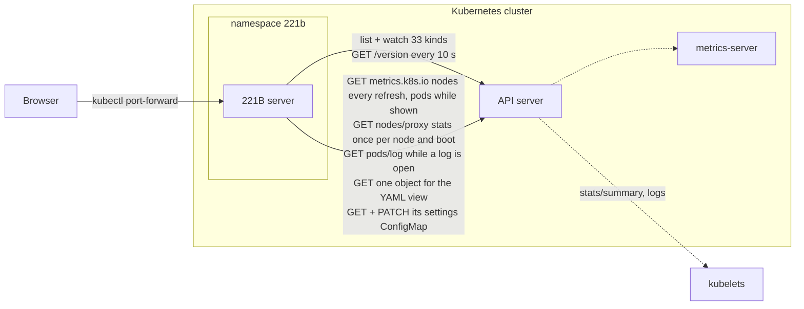

# 221B Architecture

This document describes 221B as built through Phase 6: its parts, how data moves through them, the security model and the ways it can be deployed. The decision records at the end explain each choice in the Architecture table of the [requirements](requirements.md#architecture), plus the decisions each phase made. It was the document for review item P1-01 and is kept current for every review since.

## In one paragraph

221B is one Go server and a browser app, shipped as one container image and installed with a Helm chart. The server keeps a watched, in-memory copy of the cluster's nodes, pods, workloads, Services, Helm releases and the other kinds each namespace lists, trimmed to what the screens use; it builds the rows each tab shows as *views*, the Phase 4 analyses among them (fleets, alerts, access, policies and the path of a request), and on a shared refresh tick sends every open browser the changes to the views it is showing, at the same moment, over Server-Sent Events. Browsers never see a Kubernetes object, only rows, except in the YAML view, which the server serves with managed fields removed and Secret values replaced by their sizes. Secrets are read only to list their keys and sizes and to decode Helm's release records, with credential-looking values masked before they enter the cache; a chart setting withholds Secrets altogether. The server runs inside the cluster it shows, with a ServiceAccount that can read the kinds the tabs show, pod logs, metrics and the kubelets' stats, and write two things in its own namespace: its settings ConfigMap and the Secrets that hold its connections to other clusters, each of which it watches the same way, as one more cluster in the menu (Phase 3). People sign in with the organization's OpenID Connect provider (or local accounts, for evaluations) and open it through `kubectl port-forward`, an exposed Service or an Ingress with TLS; every sign-in and every change to a connection is written to an audit log. Sherlock (Phase 5) answers questions about a cluster: the server keeps a conversation per session and cluster, sends the question to the Claude API with a set of read-only tools, runs each tool the model asks for as the person asking, through the console's own API, scrubs what they return of anything that looks like a credential, and streams the answer, with links to the objects it relied on, to every window of the session. It is off for every cluster until an administrator turns it on and gives it an API key, which is kept in a Secret; spending caps stop new questions when reached, and each question is audited with its tools and tokens. Watson (Phase 6) runs kubectl and helm commands: the server parses each one against a fixed list of reads and changes, refuses anything else (a shell is never started), runs reads at once and holds every change on an approval card with the objects it touches, a server-side dry run and its impact, until someone approves it; it then runs as the approver, with kubectl's own command packages and the Helm SDK in-process, impersonating that person. A card lapses after 10 minutes or as soon as the objects it acts on change; read-only clusters refuse every change; production clusters can require a second person; every command, approval, refusal and result is audited.

## Components



| Part | Where | What it does |
| --- | --- | --- |
| Entry point | `server/cmd/221b` | Reads flags and environment, connects, wires the parts below together, serves HTTP and shuts down cleanly on SIGTERM. |
| Configuration | `server/internal/config` | Flags with environment fallbacks (`CLUSTER_NAME`, `LISTEN`, `KUBECONFIG_PATH`, `KUBE_CONTEXT`, `API_SERVER`, `REFRESH`, `SETTINGS_CONFIGMAP`, `CONNECTIONS_SECRETS`, `KUBELET_STATS`, `SECRETS_READ`, `HEALTH_INTERVAL`, `LOG_LEVEL`, `LOG_FORMAT`, and for Phase 3 `AUTH_MODE`, `OIDC_*`, `LOCAL_USERS_FILE`, `ADMINS`, `ADMIN_GROUPS`, `SESSION_IDLE`, `SESSION_MAX`, `AUDIT_WEBHOOK_URL`, `AUDIT_WEBHOOK_TOKEN`, `HTTPS_REDIRECT`, and for Phase 5 `SHERLOCK_API_URL`, `SHERLOCK_SECRET` and `SHERLOCK_API_KEY`, the last from the environment only, and for Phase 6 `LOCAL_MODE`, whether Watson may change the console's own cluster). |
| Shared settings | `server/internal/settings` | The settings everyone shares, the refresh rate and each cluster's fleets (P4-01): validated, kept in a ConfigMap in the cluster (or in memory on a laptop), re-read every minute so a `kubectl edit` takes effect, and pushed to every browser when they change. |
| Sign-in and sessions | `server/internal/auth` | The sign-in page, the OIDC relying party (discovery, the code flow with PKCE and a nonce, ID token verification against the provider's keys), local accounts with PBKDF2 password hashes, sessions in memory with idle and absolute expiry, the two roles, and the gate every request passes (P3-01, P3-03). `server/internal/oidcsim` is the simulated provider the tests sign in through. |
| Audit log | `server/internal/audit` | One JSON record per sign-in, sign-out, settings change and connection change on standard output, and the same records to a webhook from a bounded queue (P3-10). |
| Per-person access | `server/internal/access` | What each signed-in person may see in each cluster (P3-02): verdicts from SubjectAccessReviews per resource and namespace, kept for a while, which the live store filters rows, usage and totals by, per subscriber. `kube.Person` and the impersonated clients live in `server/internal/kube`. |
| Cluster connections | `server/internal/clusters` | The connections to other clusters (P3-05 to P3-09): their specs and credentials in Secrets of the console's namespace (or in memory), validation of a draft and what each credential says about itself (a token's account and expiry, a kubeconfig's context, a certificate's subject), the five-step connection test, and a manager that runs one `kube.Cluster` and one live store per connection, the console's own cluster among them as `local`. |
| Kind registry and cluster connection | `server/internal/kube` | `kinds.go` lists every kind the console watches, with its API group, how it is cached (a typed informer with a transform, or metadata only) and its indexes. `cluster.go` chooses in-cluster, kubeconfig or URL mode, runs one informer per kind, checks the API server's health, reads node usage from metrics-server on every poll and pod usage while a tab wants it, reads each node's boot time from its kubelet once per boot, and reads and patches the settings ConfigMap. `secrets.go` turns Secrets into key names and sizes, reads a TLS Secret's certificate for its names, issuer and validity (never the key), and decodes Helm release records with credentials masked; `logs.go` streams pod logs; `yaml.go` serves one object as YAML with managed fields removed and Secret values hidden. |
| Row builders | `server/internal/nodes`, `server/internal/views` | `nodes` turns one node and the pods on it into a Nodes row (Phase 1). `views` builds the Phase 2 rows: pods, namespaces and what each holds by kind, Services with their endpoints, Helm releases with their history, and the details behind each row (a pod's containers, environment, volumes, events and owner chain; a Service's ports, endpoints and the pods behind them; a release's resources, values and notes). Phase 4 adds the analysis views: `alerts.go` (pods failing to start, pending and recovered, node problems, warning events by object), `access.go` (roles, bindings with their findings, ServiceAccounts), `policies.go` with `psa.go`, `drain.go`, `quota.go` and `hooks.go` (network policies and the connection checker, drains, disruption budgets, quotas and rollouts, Pod Security, webhooks, priority classes) and `networks.go` (each Ingress route traced hop by hop, nodes' addresses, the cluster's network facts). |
| Analyses | `server/internal/fleets`, `server/internal/rbac`, `server/internal/netpol`, `server/internal/psa` | The logic the Phase 4 views share, each kept apart so Sherlock can call it in Phase 5: `fleets` validates fleets and works out their members and totals; `rbac` matches RBAC rules the way the API server's authorizer does and names what a role can do (everything, change RBAC, escalate, bind, impersonate, read Secrets, exec, create pods, act as ServiceAccounts); `netpol` decides whether a NetworkPolicy lets a connection through, both sides, with named ports, port ranges and `ipBlock`; `psa` is the API server's own Pod Security checks, copied from `k8s.io/pod-security-admission` (see its README). |
| Live store | `server/internal/live` | Keeps the rows of every *view* as encoded JSON with a version per view, collects change notices from the informers, and on each refresh tick polls the cluster, recomputes the rows the changes touched and publishes one delta per changed view to the browsers showing it, followed by a refresh event. Views nobody shows are not built; per-namespace views are built when a browser opens them and dropped a minute after the last browser leaves. |
| HTTP API | `server/internal/api` | The JSON API: snapshots and the event stream by view, details for pods, Services and releases, pod logs, the YAML view, the settings endpoint, the cluster connections, health, readiness and Prometheus metrics, and the security headers on every response. Every data route exists twice: under `/api/v1/` for the console's own cluster and under `/api/v1/clusters/{id}/` for any connection. |
| Sherlock | `server/internal/sherlock` | Phase 5. The Claude Messages API client (streaming, tool use, retries on overload), the conversations (one per session and cluster, kept in memory for the session, trimmed to fit, repaired when an answer is stopped part way), the answer loop (the model's reply, the tools it asks for, their results back, at most 12 rounds), the system prompt, the scrubbing of credentials from what the tools return, the check of the answer's links against what the tools showed, the models offered with their list prices, the spend counted per day and month against the caps, and the API key's storage. The tools themselves live in `server/internal/api/sherlock_tools.go`: 22 reads, most of them the console's own API called in-process with the asking person's session. |
| Platform | `server/internal/platform` | Which Kubernetes distribution a cluster runs (RKE2, K3s, kubeadm, kind, EKS, GKE, AKS, OpenShift, Talos), on which operating systems and kernels, with which network plugin, load balancer, storage, GPU plugin and node monitoring, read from the cluster's cache; and the guidance on each for Sherlock's prompt, one file per distribution, operating system and add-on in `sections/`. |
| Watson | `server/internal/watson` | Phase 6. `parse.go` splits a command line the way a shell would quote it, without running one, refuses shell syntax, and checks the command, its flags and arguments against the fixed list of supported commands; `kubectl.go` runs kubectl's own cobra commands (`k8s.io/kubectl` v0.37) in-process through a `RESTClientGetter` that impersonates the person, with fatal errors caught instead of exiting; `helm.go` runs the Helm SDK's actions (`helm.sh/helm/v4`) and prints their results as the helm CLI does, with values masked; `impact.go` works out each change's targets, impact (pods a drain evicts and the budgets it meets, replicas before and after, what a rollback adds and removes) and the guards that void its card when its objects change; `service.go` keeps every person's commands per cluster, queues them, runs the dry run and the command, streams their output, lapses cards and writes the audit records. The HTTP routes are `server/internal/api/watson.go`. |
| Fake Claude API and evaluation | `server/internal/fakeclaude`, `server/cmd/221b-eval`, `hack/sherlock-eval.sh` | A stand-in for the Messages API that streams scripted answers calling the tools as a model would and records every request, served by the simulator at `/claude` for the tests. `221b-eval` finds the prototype's sample problems in a cluster, asks Sherlock about each and grades the answers by the facts they must name (P5-06); a nightly workflow runs it against the real API. |
| Browser app files | `server/internal/ui` | Serves the built browser app, embedded in the binary. |
| Simulator | `server/internal/sim`, `server/cmd/221b-sim` | A fake Kubernetes API server serving every kind the console watches, with namespaces full of workloads, Services, Helm release records and planted Secrets, pod logs and metrics, an admin API to break things, and outages on demand. For Watson it also serves discovery, server-side tables, field selectors, creates, updates, patches, deletes, evictions and the scale subresource, with dry runs, and plays the controllers just enough to see a change land: cordoned nodes, Deployments rolling out new ReplicaSets, pods replaced and scheduled, budgets counted. Used for development, tests and the scale test. |
| Browser app | `web/` | TypeScript and React. `lib/router.ts` maps the URL hash to a cluster, a tab and its filters (`#/pods` is the console's own cluster, `#/c/<id>/pods` another); `api/live.ts` subscribes to the views a screen shows and follows the event stream of the cluster open; `api/clusters.ts` and `components/ClusterMenu.tsx`, `ClusterPage.tsx` and `ClusterEditor.tsx` are the cluster menu, page and connection editor; `api/details.ts` fetches the details behind a row and refetches them on every refresh; `lib/table.ts` and `lib/useTable.ts` hold the one table model every tab uses (sorting, search terms with suggestions, column choices, exports); `columns/` defines each table's columns; `components/` holds the screens, the shared `DataTable`, `SearchBox`, `ColumnsMenu` and `ExportMenu`, the details drawers, the log view and the YAML view. Phase 4's tabs are `FleetsTab` with `FleetEditor`, `AlertsTab`, `NetworksTab`, `AccessTab` with `RbacPanel` and `PoliciesTab` with `PolicyPanel`; `lib/rbac.ts` works out who can do what from the access rows, with the same rule matching as `server/internal/rbac`. Phase 5's Sherlock is `components/Sherlock.tsx` (the pane and the Ask Sherlock button), `SherlockSettings.tsx` (the administrator's settings), `api/sherlock.ts` (the conversation's event stream and the calls), `lib/markdown.tsx` (answers rendered as React elements, never as HTML) and `lib/sherlock.ts` (where a cited object opens, and the windows' coordination). Phase 6 adds `components/Dock.tsx` (Sherlock and Watson docked side by side, resized, maximized, minimized and popped out), `AssistantWindow.tsx` (both panes in one window of their own), `Watson.tsx` (the terminal, the approval card, and the buttons that hand Watson a command), `WatsonSettings.tsx` and `api/watson.ts` (the commands' event stream and the calls). |
| Chart | `deploy/helm/221b` | Deployment, Service, ServiceAccount, ClusterRole and binding, the settings ConfigMap with a Role and binding for it and for the connection Secrets, the sign-in Secret (local accounts, the OIDC client secret, the webhook token), an optional Ingress, NetworkPolicy. `secrets.read` decides whether Secrets are granted and read at all; `connections.store` whether connections live in Secrets or in memory; `localCluster.mode` whether Watson may change the cluster the console runs in, and with sign-in off which ClusterRole it changes it with (`localCluster.writeClusterRole`). |
| CI scripts | `hack/` | Chart checks, the kind end-to-end run, the RBAC check (with and without Secrets) and the kwok scale run. |

## Data flow

```mermaid
sequenceDiagram
  participant K as API server
  participant I as Informers (cache)
  participant S as Live store
  participant H as Event stream
  participant B as Browser
  B->>H: GET /api/v1/events?views=pods,namespaces
  K->>I: list, then watch, one informer per kind
  I->>I: trim each object (transform); Secrets to keys and sizes
  I->>S: changed keys per view (collected until the tick)
  Note over S: refresh tick, every 3 s by default
  S->>K: GET node metrics; pod metrics while a tab wants them
  S->>S: rebuild the changed rows of the views shown, compare JSON
  S->>H: rows v+1 per changed view, usage, then refresh
  H->>B: event: rows, event: refresh
  B->>B: apply if v+1 for that view, else reopen for a snapshot
```

1. **Listing and watching.** client-go informers list and watch every kind in the registry: 16 kinds in full through typed informers (nodes, namespaces, pods, Deployments, StatefulSets, DaemonSets, ReplicaSets, Jobs, CronJobs, Services, EndpointSlices, Ingresses, PersistentVolumeClaims, ConfigMaps, Secrets and events), and 11 kinds that the Namespaces tab only lists by name as metadata-only informers (ControllerRevisions, Endpoints, NetworkPolicies, ServiceAccounts, Roles, RoleBindings, PodDisruptionBudgets, HorizontalPodAutoscalers, ResourceQuotas, LimitRanges and Leases), which the API server serves as `PartialObjectMetadata` so their bodies never leave it. On Kubernetes 1.35 and later lists arrive as streams (`sendInitialEvents` with a bookmark marking the end); older servers fall back to an ordinary list. Watches resume from the last resource version after a drop and relist by themselves after a `410 Gone`.
2. **Trimming.** A transform drops what no screen uses before an object enters the cache: managed fields, the last-applied annotation, and most of each spec. A pod keeps what the pod details show: containers with their images, environment (a variable taken from a Secret keeps the reference, never a value), volumes, conditions and container states, plus the resources needed to compute requests and limits. A ConfigMap keeps only its key names. A Secret keeps only its key names and each value's size, and a Helm release record (a Secret of type `helm.sh/release.v1`) is decoded into the release's chart, status, history and values, with every string under a credential-looking key (`password`, `token`, `secret`, `apiKey`, `privateKey`, `cert`, `auth`, `license` and the like) and every PEM private key replaced by a marker before caching (P2-07). This is what keeps the server under 1 GiB at Phase 1 scale with every kind watched (X-09; ADR-18, ADR-20).
3. **Views and change notices.** The store keeps *views*: `nodes`, `pods`, `namespaces`, `services`, `helm` and one `ns:<name>` view per namespace. An event on an object marks the views and keys it affects: a pod marks its own row in `pods`, its node's row in `nodes`, its namespace's rows in `namespaces` and `ns:<name>`, the Services selecting it and the release owning it. Health, metrics and boot-time changes mark the cluster state. The `pods` and `ns:<name>` views are *lazy*: nothing is built for them until a browser subscribes, and a namespace's view is dropped a minute after the last browser leaves it (ADR-19).
4. **The refresh tick.** Every refresh interval (3 seconds by default; the Settings page changes it for everyone, from 1 second to 10 minutes) the store polls what is not watched: node usage from metrics-server always, and pod usage only while some browser shows the Pods tab or a Helm release. It then rebuilds the marked rows of the views that have subscribers, encodes each as JSON and compares it with the previous encoding. Only rows that changed go into a view's delta, so a pod restarting sends one row to the Pods tab, one to the Nodes tab and one to its namespace. Pod usage goes out apart from the rows, as a `usage` map, so a change in CPU does not re-send a row. Every 30 seconds the tick also rebuilds every row, for problems that depend on time. One `rows` event per changed view, and then a `refresh` event stamped with the tick's time and every view's version, go to every browser at once. News about the connection to the API server does not wait for the tick; it goes out within 250 ms as a `meta` event, as do the counts in the tab bar.
5. **Requests and limits** follow the scheduler's rules (`k8s.io/component-helpers/resource`): the larger of the init containers and the app containers, sidecar init containers added to both, plus pod overhead, and during an in-place resize the larger of what is asked for and what the kubelet has allocated. Terminated pods do not count, as in `kubectl describe node`.
6. **Deltas.** Each view's delta has a version one higher than that view's last. A browser that misses one (a version jumps) reopens the stream and gets a fresh snapshot of its views. A browser that falls 64 events behind is sent a snapshot instead of the backlog, so one slow tab cannot hold memory on the server.
7. **The event stream.** `GET /api/v1/events?views=nodes,pods` (at most 8 views) starts with a `snapshot` event (the rows and version of each view, pod usage where it applies, the cluster state, the settings, the counts for the tab bar and the time of the last refresh), then `rows` events per view, `meta` events for the cluster state and counts, and a `refresh` event on every tick, a comment every 15 seconds so proxies keep it open, and `retry: 3000` so a browser reconnects by itself. The browser opens one stream for the views its screen shows and reopens it when it moves to a tab that needs others. It is gzip-compressed when the browser accepts it; the snapshot of 500 nodes is about 850 KB of JSON and 75 KB compressed, and of 15,000 pods about 8.7 MB and 1 MB.
8. **Details.** Opening a row fetches its details once (`/api/v1/pods/…`, `/api/v1/services/…`, `/api/v1/helm/…`) and again on every refresh tick while it is open, so an open drawer follows the cluster; a 404 while open means the object is gone, and the drawer says so (P2-04). Pod logs stream from the API server's `pods/log` endpoint through the server to the browser, batched into events of up to 500 lines every 200 ms, with at most 50 streams open at once per server and lines over 1 MiB split (ADR-21). The YAML view asks the API server for the one object live, so it is as fresh as `kubectl get -o yaml`, with `managedFields` removed and, for a Secret, every value replaced by `<N bytes, hidden by 221B>` (ADR-22).
9. **The browser** keeps the rows of each view in memory, sorts and filters them on the client, and renders every table with one component: an ARIA grid whose rows are focusable, with the arrow keys moving between rows and into a row's links, that renders only the rows in view (plus a margin) once a table passes 100 rows, so the Pods tab with 15,000 pods costs what a screenful does (ADR-23, which supersedes ADR-12). Every table has the same Columns and Export (Excel, CSV, JSON) menus and the same search box, which suggests names, labels, nodes, namespaces and statuses as you type (ADR-24).

**Connection status.** The server asks the API server for `/version` every 10 seconds with a 5-second timeout. One failure turns the status red with the cause in plain words, within about 15 seconds of the API server going away (P1-11). While it is away, the informers wait for it, checking every second, instead of retrying with client-go's backoff, so they resume or relist within a second or two of its return (P1-10). The last known rows stay on screen throughout, marked as such.

**Metrics.** On every refresh the server reads `metrics.k8s.io/v1beta1/nodes`, and `…/pods` while a browser shows the Pods tab or a Helm release; one request each however many browsers are open. If metrics-server is missing or failing, the tables still work and say why usage is not shown (P1-12).

**Uptime.** The Node object does not say when a node booted. Each kubelet does, in its Summary API, which the API server proxies at `/api/v1/nodes/<name>/proxy/stats/summary`; the server reads it once per node and bootID (ADR-17). The read needs `get` on `nodes/proxy`, which the chart grants when `kubeletStats` is on (the default).

**Helm releases.** Helm 3 keeps each release revision as a Secret named `sh.helm.release.v1.<release>.v<n>` holding a base64-encoded, gzip-compressed JSON record: the chart's metadata, the release's status, notes, the values the user supplied and the rendered manifest. The server decodes these as they enter the cache, keeps the chart, status, times, notes, masked values and the kinds and names in the manifest, and discards the manifest's bodies. The Helm tab lists one row per release (its latest revision) and the details show the revision history as `helm history` does, the notes and the user-supplied values with credentials masked (P2-06, P2-07). The pods of a release are matched by the labels Helm charts set (`app.kubernetes.io/instance` and `app.kubernetes.io/managed-by`) and the `meta.helm.sh/release-name` annotation, and, for charts that set neither on their pods, by their owners: a pod whose owner chain reaches a workload named in the release manifest belongs to the release (asked at the Phase 2 review, when a release showed no pods that `kubectl get pods -n <ns>` listed). With `secrets.read=false` there are no release records, so the Helm tab is hidden (P2-10).

**Shared settings.** The refresh rate and the fleets are settings everyone shares, so they live on the server: in the cluster, as `settings.json` in a ConfigMap the chart creates empty and never writes, so `helm upgrade` keeps what was saved and `helm uninstall` removes it; on a laptop or with the simulator, in memory. The theme is per browser and stays in `localStorage`, as do each table's column choices, also for people who sign in (ADR-40, superseded).

## API

All responses carry the security headers below. Every path needs a signed-in session (P3-01) except the health probes, `/metrics`, the sign-in pages and the app's static files; without one the API answers 401 and a page shows the sign-in page. Every endpoint is `GET` except the sign-in forms, sign-out and `PUT /api/v1/settings`, `PUT /api/v1/fleets`, `POST /api/v1/alerts/ack`, Sherlock's `POST` and `PUT` paths and `DELETE /api/v1/sherlock/key`, which change the shared settings or a conversation, the only thing 221B writes to the cluster (X-03) apart from Watson's approved changes, and Watson's `POST` and `PUT` paths; every request that changes anything is refused when the browser says another site made it (X-06).

| Path | Returns |
| --- | --- |
| `/signin` | The sign-in page: a button to the OIDC provider, or the local account form (`POST` with `email`, `password` and `next`). `/signin/start?next=…` begins the OIDC flow (state, nonce and PKCE in a short-lived cookie) and `/signin/callback` ends it; both bring the person back to `next`. `POST /signout` ends the session. |
| `/api/v1/me` | Who is signed in: the sign-in mode, the person (subject, username, email, name, groups), whether they are an administrator (P3-03), how they signed in and the idle lifetime of sessions. |
| `/api/v1/snapshot?views=nodes,pods` | The rows and version of each view asked for (`nodes` by default; `pods`, `namespaces`, `services`, `helm`, `ns:<namespace>`, and from Phase 4 `fleets`, `alerts`, `access`, `policies` and `networks`), pod usage where it applies, the cluster state, the settings, the counts for the tab bar and the time of the last refresh. |
| `/api/v1/nodes/{name}` | One Nodes row. |
| `/api/v1/pods/{namespace}/{name}` | A pod's details: containers and their states, environment (Secret references, never values), volumes, events, owner chain, conditions, scheduling and usage. 404 once the pod is gone. |
| `/api/v1/pods/{namespace}/{name}/log` | The pod's log: `container`, `previous`, `tail` and `timestamps` as `kubectl logs` takes them; `download=1` sends it as a file; `follow=1` streams it as Server-Sent Events (`log` events carrying arrays of lines, then `end` with the reason). |
| `/api/v1/services/{namespace}/{name}` | A Service's details: ports, endpoints with the pods and nodes behind them, Ingresses publishing it, events, and why a LoadBalancer is pending. |
| `/api/v1/helm/{namespace}/{name}` | A release's details: history, notes, user-supplied values with credentials masked (and the list of masked keys), resources by kind with their state, pods and their usage. A pod belongs to the release by Helm's labels or annotation, or when its owners lead to a workload in the release manifest. 404 when Secrets are not read. |
| `/api/v1/objects/{kind}/{namespace}/{name}` | Any other object's details, from the cache: the row, facts by kind (replicas and strategy, schedule, rules, capacity, keys and sizes, …), conditions, labels, annotations, owner chain, events, the Helm release it belongs to, and for a workload the pods it controls with their usage. `kind` is the registry name or the Kind (`deployments` or `Deployment`). 404 for an unknown kind, a missing object, or a Secret when they are not read. |
| `/api/v1/yaml/{kind}/{name}`, `/api/v1/yaml/{kind}/{namespace}/{name}` | The object as YAML (`application/yaml`), read live, with `managedFields` removed and Secret values replaced by their sizes; `download=1` sends it as a file. `kind` is the registry name (`pods`, `deployments`, …). 404 for Secrets when they are not read. |
| `/api/v1/netcheck?from=<ns>/<pod>&to=<ns>/<pod>&port=<n or name>&protocol=TCP` | Whether a connection is let through by the NetworkPolicies (P4-04): for each side, the policies that select the pod, whether it is isolated, the policies that admit the connection, and the verdict. `toService=<ns>/<service>` with a Service port checks each pod behind it instead. Answers what the policies say; whether the network plugin enforces them is on the Policies tab. |
| `/api/v1/alerts/ack` | `POST` with `{"key": "pod:web/api-0", "acknowledge": true}`, for anyone signed in who may list the alert's object: acknowledges the alert as it is now, for everyone, or takes that back, and writes an audit record (`alert.ack`, `alert.unack`). The acknowledgement is kept with the settings and lapses when the alert changes or clears (ADR-39). `/api/v1/clusters/{id}/alerts/ack` for a connection. |
| `/api/v1/fleets` | `PUT` with `{"fleets": [...]}` (each a name, color, description, labels and taints), for administrators: validates and saves the cluster's fleets with the settings and writes an audit record (P4-01). `/api/v1/clusters/{id}/fleets` for a connection. |
| `/api/v1/home` | Every cluster at a glance, for the home page: each connection's state and version, and, as the person may see them, its nodes (ready, control plane, cordoned, with errors or warnings), the CPU and memory its nodes can take, have requested and use, its pods, namespaces and Services, and its alerts by kind, acknowledged and recovered; and whether Sherlock can answer about it for this person (`sherlock`), which shows its Find deficiencies button. |
| `/api/v1/sherlock` | Sherlock in this cluster for the person asking: whether questions can be asked, whether it is on and has a key, why not, whether a spending cap is reached, and the model. `/api/v1/clusters/{id}/sherlock` for a connection, as for every path below. |
| `/api/v1/sherlock/events` | The person's conversation about the cluster as Server-Sent Events: `status`, then `conversation` with every message, then `answer` with the last message as it arrives (at most every 50 ms) and `conversation` again when messages are added or the chat starts over. Every window of the session gets the same stream (P5-08). A `ui` event carries a UI action (P6U-17) to the console window it names: `{id, window, answer, action, input}`; windows that connect later do not get earlier ones. |
| `/api/v1/sherlock/conversation` | The conversation as it is now, as JSON, for scripts such as the evaluation. |
| `/api/v1/sherlock/ask` | `POST` with `{"question": "…", "window": "…", "view": "…"}` (4,000 characters at most; the window whose view Sherlock may change and its view state, 2,000 characters, both optional): starts an answer, `202` with the conversation. `409` while Sherlock is off, has no key or is still answering; `429` with the cap's message when a spending cap is reached. |
| `/api/v1/sherlock/ui/{id}` | `POST`: a console window's result of a UI action, `{applied, dropped, error, label, link, view}`. `204`, or `404` when no action of the poster's own conversation waits for it: another person's session, an unknown id, or a result after the 5 seconds the action waits (P6U-17). |
| `/api/v1/sherlock/stop`, `/api/v1/sherlock/new` | `POST`: stops the answer in progress, keeping what arrived; starts the conversation over. |
| `/api/v1/sherlock/config` | For administrators. `GET`: the settings (on or off per cluster, the provider, the model and, for a model not on the list, its prices, the daily and monthly caps in US dollars), the provider in force with its defaults filled in, whether the chart fixes it (`providerLocked`) and whether it needs a stored credential (`needsKey`), whether a credential is set, by whom and where it is kept (never the key), the spend today and this month, the models offered with their prices, and the clusters. `PUT` with the settings saves them with the shared settings and writes an audit record (`sherlock.settings`) naming what changed, the provider by its kind and address only. A provider is refused (`400`) when it is not one of the four kinds or its address, headers, query or CA certificate are malformed, and (`403`) when the chart fixes it. |
| `/api/v1/sherlock/key` | For administrators. `PUT` with `{"key": "…"}` saves the provider's credential in the Secret `<release>-sherlock`: an API key for header authentication, AWS keys as JSON (`accessKeyId`, `secretAccessKey`, optional `sessionToken`) for Bedrock, or a service account's key file for Vertex AI, each checked for its shape; `DELETE` removes it. Both are audited (`sherlock.key`), without the key. `409` when the chart supplies the key (`sherlock.existingSecret`). |
| `/api/v1/watson` | Watson in this cluster for the person: whether it runs here, whether the cluster is read-only and how to change that, whether changes need a second person, the prompt, how long a card lasts, and the commands it runs. `/api/v1/clusters/{id}/watson` for a connection, as for every Watson path below. |
| `/api/v1/watson/events` | The person's commands on the cluster as Server-Sent Events: `status`, then `items` with every command, then `item` as one changes (its new output lines only, at most every 60 ms) and `gone` when one is cleared. Every window of the session gets the same stream (P6-09). Cards waiting for a second person show to every other signed-in person. |
| `/api/v1/assistants/events` | The two streams above on one connection, their events named `sherlock-status`, `sherlock-conversation`, …, `watson-items`, … (ADR-56). The browser uses this one; each part starts again with its status and full state whenever the stream connects. |
| `/api/v1/watson/commands` | `POST` with `{"command": "…", "from": "…", "why": "…", "run": true}`: parses the line (several, one per line, from Sherlock), refuses what Watson does not run, starts reads at once when `run` is set, and puts each change on a card, working out its impact and server dry run as the requester; `202` with the commands. `GET …/{id}` is one command with all its output, for scripts. |
| `/api/v1/watson/commands/{id}/approve`, `…/discard`, `…/stop` | `POST`: approves a card (it is checked again, then queued to run as the approver), discards it, or stops a command while it runs. `PUT /api/v1/watson/commands/{id}` with `{"command": "…"}` edits a card's command, which makes a new card. `POST /api/v1/watson/clear` removes the person's finished commands. |
| `/api/v1/watson/config` | For administrators. `GET` and `PUT` with `{"twoPerson": true}`: whether changes on production clusters need a second person (P6-07), kept with the shared settings and audited (`watson.settings`). |
| `/api/v1/settings` | `GET`: the settings in force, where they are kept (`configmap` or `memory`) and when they last changed. `PUT` with `{"refreshSeconds": n}` (1 to 600, JSON only), for administrators, saves and applies them for everyone and writes an audit record. |
| `/api/v1/clusters` | `GET`: every connection as the cluster menu shows it (name, environment, description, API server, how the certificate is checked and the console signs in, what the credential says about itself, the state of its watches, version, node and pod counts, whether the credential expires within a week or has, the last test). Never a credential. `POST` with a draft (the same fields plus the credential: `token`, `kubeconfig` and `context`, `certPem` and `keyPem`, `caPem`), for administrators, validates it, inspects the credential, saves it, starts the connection and answers 201 with its summary, or 400 with `{"error", "field"}`. |
| `/api/v1/clusters/test` | `POST` with a draft (and `id` when it edits a saved connection, whose credential is used for fields left empty): runs the five-step test (address, TLS, sign-in, Kubernetes, permissions) and answers the steps, a verdict, the version and node count, who the credential signs in as and whether it may impersonate. For administrators. |
| `/api/v1/clusters/{id}` | `GET`: one connection's summary. `PUT`: a change; credential fields left empty keep the saved credential, a changed method needs a new one. `DELETE`: stops the connection and deletes its Secret (`local`, the console's own cluster, cannot be removed; only its name, environment and description can change). `POST …/test` tests the saved connection and keeps the result for its page. Administrators only; everything is audited. |
| `/api/v1/clusters/{id}/…` | Every data route above (`snapshot`, `events`, `nodes`, `pods`, `services`, `helm`, `objects`, `yaml`, pod logs) for that connection; `local` is the console's own cluster. 404 for an unknown connection, 503 for one that could not start. |
| `/api/v1/events?views=…` | The event stream described above, for up to 8 views. |
| `/healthz` | `ok` while the process runs (liveness). |
| `/readyz` | `ok` once nodes, pods and namespaces have been listed the first time (readiness); the other kinds fill in behind it. It stays ready during a later API server outage, so the console stays reachable to say so. |
| `/metrics` | Prometheus text: HTTP requests by route and code, change delay from watch event to browser (histogram), rows and version per view, browsers per view, cached objects per kind, open event and log streams, API server and metrics-server state, and memory. |
| `/` | The browser app. Hashed assets are cached for a year; `index.html` is never cached. |

## Security model

**What the server can read.** The chart's ClusterRole allows `get`, `list` and `watch` on the 33 kinds above (Phase 4 added the RBAC kinds, priority classes, admission webhook configurations and IngressClasses, and reads roles, bindings, ServiceAccounts, NetworkPolicies, disruption budgets, quotas and limit ranges in full instead of by name), `get` on `pods/log`, `get` and `list` on `metrics.k8s.io` nodes and pods, and, with `kubeletStats` on, `get` on `nodes/proxy`. Secrets are in that list only while `secrets.read` is on (the default); off, the ClusterRole names no Secrets, the server starts no Secret informer, the Namespaces tab lists none, the YAML view refuses them and the Helm tab is hidden, since Helm keeps its release records in Secrets (P2-10). A namespaced Role allows `get` and `patch` on its own settings ConfigMap, by name, and `get`, `list`, `create`, `update` and `delete` on the Secrets of its own namespace, where the connections to other clusters are kept (`connections.store: memory` drops that grant and keeps them in memory). Kubernetes cannot grant Secrets by name prefix, so the console should have a namespace of its own, as the chart's notes say. With sign-in on, the ClusterRole also allows `impersonate` on users and groups and `create` on `subjectaccessreviews`, to read as each person (P3-02). Nothing else: no `exec`, no writes to workloads (Watson's changes run as the person who approves them; see below), no ClusterRoles, PersistentVolumes or CRDs, no impersonation of ServiceAccounts or UIDs. CI checks the grants with `kubectl auth can-i` against the installed ServiceAccount in both settings, checks that the API server refuses a pod deletion, and with Secrets off that it refuses listing Secrets (`hack/check-rbac.sh`).

**What the server keeps of a Secret.** The Secret transform runs inside the informer before an object is stored, so what reaches the cache is the Secret's name, type, labels, key names and each value's size, for a Helm release record its decoded contents with credential-looking values masked, and for a `kubernetes.io/tls` Secret what its certificate says publicly, as any TLS client sees it: subject, issuer, DNS names and validity (ADR-35). `tls.key` is never parsed. Annotations can carry values too: `kubectl apply` keeps the whole object, values included, in `kubectl.kubernetes.io/last-applied-configuration`, and tools such as kapp keep their own copy. That annotation, and any annotation holding one of the Secret's values in raw or base64 form, is replaced by its size, in the cache and in the YAML view alike. The server never holds a Secret value in memory after the transform returns, never logs one (the logs name objects, not their contents) and never serves one: rows and details carry keys and sizes, the YAML view replaces every value with `<N bytes, hidden by 221B>`, and an environment variable taken from a Secret shows the Secret's name and key. CI plants a Secret with a known value and a Helm release with a known password in the simulated cluster and checks that neither value appears in any API response, event stream, export or the server's log (P2-07, `web/e2e/secrets.spec.ts`).

**What a browser can see (P3-02).** Rows and details, and YAML without managed fields or Secret values. The pods on a node, the pods behind a Service and the pods of a release are the same pod rows. With sign-in on, a person sees what Kubernetes lets them see, not what the console's account can: the console watches everything once, with its own account, and before a row reaches a person it asks Kubernetes, with a `SubjectAccessReview` naming that person's user and groups, whether they may `list` that resource in that namespace, keeping the answers for `auth.kubernetes.accessTTL` (2 minutes) so a stream costs one review per namespace and resource it shows, not one per row. A pod, Service or namespace row needs `list` on pods or services in its namespace; a Helm release `list` on secrets there, where Helm keeps it; a node row `list` on nodes cluster-wide; the objects of one namespace each their own resource. The tab totals and exports follow the same rows, a node row's problems no longer name pods in namespaces the person may not list, and details, logs and YAML of what they may not list answer 403. Logs and YAML are read live *as the person*, with impersonation headers, so the API server applies their RBAC directly. The chart's ClusterRole therefore grants the console `impersonate` on users and groups and `create` on `subjectaccessreviews` (never on ServiceAccounts or UIDs), and only with sign-in on. Nothing is written in anyone's name. Two things stay cluster-wide, as counts: a node's pod counts and the number of unscheduled pods. With `auth.mode: none` there is nobody to read as, and the console shows what it sees.

**Who can open it (P3-01, P3-03).** Everyone signs in: with an OpenID Connect provider (`auth.mode: oidc`), or with accounts the console keeps itself (`auth.mode: local`), for evaluations and clusters without a provider. The sign-in page is served by the server, with no app code; the OIDC flow is the authorization code flow with PKCE and a nonce, and the ID token is verified against the provider's published keys (RSA and ECDSA signatures; never a shared secret). A session is a random 256-bit identifier in an `HttpOnly`, `SameSite=Lax` cookie, marked `Secure` when the request came over TLS (directly, or through a proxy that sets `X-Forwarded-Proto`), and kept in the server's memory: it ends after `auth.sessionIdle` without a request (8 hours by default), after `auth.sessionMax` whatever happens (7 days), at sign-out, or when the server restarts, which signs everyone out. Administrators (`auth.admins` by username, `auth.adminGroups` by group) change the settings and manage cluster connections; everyone else uses the tabs and sees the cluster menu without Edit, Add or Remove. `auth.mode: none` keeps the console open as it was before Phase 3, with everyone an anonymous administrator, for development and the simulator; the chart's notes and the server's log warn about it. The chart can still expose the Service as a LoadBalancer or NodePort (`service.type`), or through an Ingress with TLS (`ingress`), behind which plain HTTP is redirected (P3-11).

**Other clusters (P3-05 to P3-09).** An administrator adds a cluster in the console: its API server address, how its certificate is checked (a pasted CA certificate, the image's trust store, or none, with a warning), how the console signs in (a ServiceAccount token, a kubeconfig context, or a client certificate and key; OIDC is reserved and refused for now), and whether the console may only read there or also change things in later phases. The server validates the draft, reads what the credential says about itself (the token's account and expiry, the kubeconfig's user and cluster, the certificate's subject and expiry), saves the spec and the credential in one Secret named `<release>-cluster-<id>` in the console's namespace, and starts the same informers and live store for it as for the cluster it runs in. The credential never returns to the browser: the API and the editor show only what it says about itself, and replacing it is the only way to touch it. A token or certificate that expires within a week is flagged in the menu, on the cluster page and in a banner, and an expired or failing connection shows why on its page with a *Fix the connection* action (P3-07). Removing a connection asks again (and, for a production cluster, for its name typed) and deletes the Secret with it (P3-08). The connection test runs the five steps the prototype shows, each against the real address: TCP and TLS to the API server, `/version` with the credential, the version and node count, and `SelfSubjectAccessReview`s for what the console will read, for impersonation and, in read-and-change mode, for the writes (P3-06). Every add, change, test and removal is audited with the cluster's id.

**What Sherlock sends to the model's API (Phase 5, providers from the Phase 6 review).** Nothing, for a cluster where an administrator has not turned Sherlock on. Where it is on, a question sends the provider in force (the Claude API at `sherlock.apiURL`, `https://api.anthropic.com`, unless the settings or `sherlock.provider` name another; ADR-58) the system prompt (how to answer; the cluster's name, version and distribution and, as far as the person may list nodes and kube-system's DaemonSets, the operating systems and kernels of its nodes by name and its add-ons, with guidance on each; the date), the definitions of the 23 tools, the conversation so far, and what each tool returned while answering. Every tool reads, and reads as the person asking: most are the console's own API called in-process with their session, so they return exactly the rows and details that person's tabs show and nothing of namespaces they may not list (P5-02); the events tool asks the same access reviews, and logs and YAML are read with impersonation as in the tabs. No tool writes, and the interface they reach has no method that could (P5-07). Secret values never reach the tools, since the cache holds only key names and sizes; Helm release values are left out of the release tool altogether; and every result passes through a scrubber that replaces with `[REDACTED]` what looks like a credential: private keys, bearer and basic credentials, JSON Web Tokens, passwords in URLs, the values of keys and environment variables named like secrets, and the token shapes of the common clouds and forges, and the API key itself (P5-03). Results are cut at 24,000 characters. The answer's links are checked against the objects the tools returned, so an answer cannot point a person at an object they cannot see or that does not exist. The credential is kept in a Secret in the console's namespace, read at start, used only to authenticate to the provider (the `x-api-key` header for the Claude API, a header of the administrator's choosing for a gateway, an AWS signature for Bedrock, a Google access token for Vertex AI) and never sent to a browser; with none saved, Bedrock and Vertex AI use the pod's own cloud identity (IRSA or EKS Pod Identity, Workload Identity); the chart can supply it from a Secret of your own instead. Each question writes one audit record naming the person, the cluster, the question (scrubbed), the model, the tools it called and the tokens and dollars it used; spending caps per day and per month stop new questions at the cap (P5-05).

**What Sherlock sees of the screen and may change there (Phase 6, Sherlock UI control).** A question from a console window carries that window's view state (P6U-02): the cluster, tab, path and filters, each table on screen with its id, search text, sort, shown and hidden columns, how many rows it shows of how many and the names of the first ones, and the open details pane with only "open", "loading" or "not available". It is at most 2,000 characters, scrubbed like a tool result, and goes to the Claude API inside `<console-view>` with the question. Eight UI actions (`server/internal/sherlock/ui_actions.json`, which the browser imports too) follow the 22 cluster tools: `view_state` reads the view again; `view_open`, `view_filter`, `view_search`, `view_sort`, `view_columns`, `view_details` and `view_highlight` change it, unless an administrator has turned view changes off (P6U-14). The server sends each to the window named with the question as a `ui` event and waits up to 5 seconds for the window's result, which returns the new view state to the model. In the browser, `lib/uiControl.ts` checks each action against what the tab and table accept and applies it the way the person's own clicks would: the route for tabs, filters and details, and the table registry (`lib/tables.ts`, filled by `useTable`) for search, sort, columns and the highlight. No action clicks, types, reads the page or fetches anything; what a tab or details pane then shows comes through the same access-filtered API (P6U-07). At most 10 actions per answer; once the person changes the view during an answer, the answer's later actions are dropped and the model is told (P6U-09). The answer lists what it changed, with Undo, which restores the view from before its first change (P6U-10). Column changes are not saved (P6U-11). A drawer Sherlock opens stops above the dock and is not modal, so the answer and the question box stay in reach; focus stays where it was. Each question's audit record lists its UI actions and whether each was applied, dropped, refused or found no window (P6U-15).

**What Watson may change (Phase 6).** Watson runs a fixed list of commands (P6-02) and refuses everything else with the rule that refused it: a tool or verb it does not run (`not supported`), a flag it does not take or one that would reach past it (`--kubeconfig`, `--as`, `--token`, `--server`, `--raw`, a file, a watch or follow, `-v`; `flag`), shell syntax outside quotes, pipes, redirections, `;`, `&&`, backquotes and `$` (`shell`), a Secret printed with its values (`secret values`), and a change on a read-only cluster (`read-only cluster`). The line is split the way a shell would quote it, but no shell or other process is ever started (P6-03): kubectl's own command code and the Helm SDK run inside the server, against a client that impersonates the person, so the API server applies that person's RBAC to every request (P6-05). A read runs as the person who sent it. A change first runs as a server-side dry run, as the person who asked, and waits on a card; whoever approves it is who it runs as. A card is checked again when it is approved and every 3 seconds until then: it lapses after 10 minutes, or as soon as one of the objects it acts on changes the way the command depends on (a node's schedulability, taints and labels; a workload's template or replicas; the pods on a node being drained; a release's revision), so nobody approves a change to a state they did not see (P6-04). With *second person* on (Settings) a change on a production cluster cannot be approved by the person who asked for it; another signed-in person sees its card and approves it, and it runs as them (P6-07). A cluster connected read-only, and the console's own cluster unless the chart sets `localCluster.mode: write`, refuses every change before anything is sent. With sign-in off there is nobody to impersonate, so changes run as the console's own ServiceAccount, which the chart then binds to `localCluster.writeClusterRole` (the built-in `edit` role) and a role to cordon, drain and label nodes; with sign-in on the console is granted nothing more than impersonation. Commands, cards and their output live in the server's memory for 12 hours (200 per person and cluster, 2 MB of output each) and do not survive a restart. Every command, approval, refusal, lapse and result is one audit record naming the person, the cluster and the command (P6-08).

**Who did what (P3-10).** Every sign-in, failed sign-in, sign-out, settings change and connection change is one JSON record on the server's standard output, naming the person (subject, email, name), the action, its target and outcome, the time and the address it came from; the ordinary logs go to standard error, so the two can be routed apart. The same records go to a webhook when `audit.webhook.url` is set, with a bearer token, three tries each, and a bounded queue that drops with a warning and a counter on `/metrics` rather than block the console. No record carries a credential or a password.

**Network.** The NetworkPolicy allows no inbound traffic except from peers listed in `networkPolicy.ingressFrom`, or from anyone when the Service is exposed and no peers are listed (port-forward and kubelet probes are not affected by NetworkPolicy), and outbound traffic only on API servers' ports (443 and 6443 by default; other clusters' API servers are reached through the same ports, so add theirs when they listen elsewhere) and to DNS, which a cluster given by name needs. With OIDC sign-in, an audit webhook or Sherlock (`sherlock.egress`, on by default) it also allows HTTPS out (`networkPolicy.outboundPorts`, narrowed by `networkPolicy.outboundCIDRs`). 221B makes no other outbound calls: no telemetry, the fonts are bundled, and the Claude API is called only for clusters an administrator turned Sherlock on for (X-16).

**Container.** A distroless static image with no shell or package manager, running as user 65532 with a read-only root filesystem, no privilege escalation, all capabilities dropped and the RuntimeDefault seccomp profile. It passes the Pod Security `restricted` profile, which CI enforces on the test namespace (X-05). The server sizes Go's memory limit to 90% of the container's.

**Browser.** A strict Content Security Policy (`default-src 'self'`, no inline scripts or styles, `frame-ancestors 'none'`), `X-Content-Type-Options: nosniff`, `X-Frame-Options: DENY`, `Referrer-Policy: no-referrer`, and cross-origin opener and resource policies (X-06). The server answers only to `localhost`, IP addresses, its Service's DNS names, the Ingress host and names set in `allowedHosts`; any other `Host` is refused, so a web page cannot read the console through DNS rebinding while someone has a port-forward open. Every request that changes anything (the settings, the connections, sign-out) is refused when the browser's `Sec-Fetch-Site` or `Origin` header says another site made it, and the session cookie is `SameSite=Lax`, so another site cannot ride a session either (X-06). The local sign-in form cannot rely on those headers (a form post carries `Origin: null` under the referrer policy, and plain HTTP to a non-local address no `Sec-Fetch-Site` at all), so it carries a token that a `SameSite=Strict` cookie set with the page must match; a form posted from another site has neither. Log and YAML downloads are plain `GET`s of what the page already shows. Password guessing against local accounts is slowed to five attempts a minute per account and thirty per address, and unknown accounts take as long to refuse as wrong passwords.

**Supply chain.** GitHub Actions are pinned to commit SHAs and downloaded tools to checksums. CI checks dependency licenses (no GPL, AGPL or LGPL), audits the shipped npm packages, and scans the image with Grype, failing on any high or critical finding (P1-04, P1-05).

## Deployment modes

| Mode | How | Used for |
| --- | --- | --- |
| In the cluster | `helm install`; the in-cluster ServiceAccount | The test deployment and production. |
| On a laptop, against a real cluster | `221b -kubeconfig ~/.kube/config -context <name> -cluster-name <name>` | Development. Shows the same cluster as the in-cluster mode (P1-08), with your own permissions; `-secrets-read=false` runs it without touching Secrets. |
| On a laptop, simulated | `make dev-sim` | Development and the browser tests, with no cluster at all. |
| Management mode | `helm install`, then *Add a cluster* in the console | One installation connected to several clusters with stored credentials (P3-09); the cluster it runs in is the connection `local`. On a laptop the same works against the simulator, with connections kept in memory unless `-connections-secrets` names a namespace. |

The image is published to `ghcr.io/ucesys/221b` for `linux/amd64` and `linux/arm64`: `main` and `sha-<commit>` from main, `pr-<number>` from this repository's pull requests, and `branch-<name>` with `sha-<commit>` from a run started by hand on another branch (never `main`). A build pushed with `hack/push-prebuilt.sh` as `prebuilt-<tree>`, labelled with the git tree it was built from, is taken by CI for that same tree: it passes the same size, user and vulnerability checks, is the image every test runs, and is published as it is, for `linux/amd64` only; a release is always built by CI. The package is private while the repository is, so a cluster pulling it needs an image pull secret (see the [README](../README.md#try-it-on-a-cluster)). `main`, `pr-<number>` and `branch-<name>` are moving tags, so for them the chart sets `imagePullPolicy: Always` and stamps the pod template with the release revision, which makes every `helm upgrade` restart the console on the tag's latest build; a release, a `sha-` tag or `image.digest` names one build for good and is pulled once.

## Operations

- **Probes.** Liveness on `/healthz`, readiness on `/readyz` (see above).
- **Logs.** Structured JSON on standard error, one line per event; client-go's own logging goes to the same log. The log names objects and errors, never their contents: no Secret value, no pod log line.
- **Metrics.** `/metrics`, listed above. `b221_change_delay_seconds` measures X-07's freshness from the server's side; `b221_rows{view}` and `b221_view_subscribers{view}` show what is built and watched; `b221_cached_objects{kind}` the size of each cache; `b221_log_streams` the logs open; `b221_api_server_up` and `b221_metrics_available` the connection.
- **Settings.** `kubectl -n 221b get configmap k8s-console-221b -o jsonpath='{.data.settings\.json}'` shows what is saved; editing it takes effect within a minute, and deleting the key returns to the chart's `refresh`.
- **Connections.** `kubectl -n 221b get secrets -l app.kubernetes.io/component=cluster-connection` lists the clusters added in the console, one Secret each (`spec.json` and the credential's keys); they survive upgrades and go with `helm uninstall` only if deleted first, since the chart does not own them. `b221_connections` and `b221_connection_up{cluster}` on `/metrics` say how many there are and which answer.
- **Resources.** Requests 100m CPU and 256 MiB; limits 1 CPU and 1 GiB. At 500 nodes and 15,000 pods with every kind watched the server uses about 360 MiB, and about 450 MiB while a browser has the Pods tab open, since that view's rows are kept as JSON ready to send.
- **Shutdown.** On SIGTERM the server stops accepting connections, ends the event and log streams and exits within 10 seconds.
- **Tabs.** Each open tab holds one HTTP connection for its event stream, and one more while a log is open, and browsers allow six connections per host over plain HTTP. Through one port-forward, a seventh waits until another closes. A Phase 3 Ingress with HTTP/2 removes the limit.

## Scale

Phase 1's target is 500 nodes and 15,000 pods (P1-18). CI measures it on every pull request with kwok in kind, on a 2-core runner that is also running the cluster: the first screen of nodes shows in about 130 ms, a sort takes about 30 ms (median), and the server uses about 300 MiB with every Phase 2 kind watched (against the simulator, whose pods carry more, about 360 MiB, and 450 MiB with the Pods tab open). The job fails if the first screen takes 2 seconds, a sort 200 ms, or the server 1 GiB. Against the simulator with the same numbers, the Pods tab shows its first rows 1.1 seconds after opening, a sort of 15,000 pods takes about 65 ms, a search narrows them in about 200 ms, and the page holds about 35 MB of JavaScript heap, because only the rows in view are rendered.

Phase 7's 5,000 nodes and 150,000 pods will need the second change the design allows for: sending each browser only the rows its screen shows, instead of every row of a view.

## Testing

| Level | What | Where |
| --- | --- | --- |
| Unit | Row building and problem detection for every view, Secret summaries and Helm decoding with masking, the store's views, subscriptions, lazy views and tick paths, the API including details, logs, YAML, the settings endpoint's checks and the cluster connection endpoints with their role checks, configuration, the settings service and its ConfigMap storage, the OIDC flow and every token refusal, local accounts, sessions, connection specs and credentials, the Secret store against the simulator, the connection test's steps and the manager; the table model, exports (Excel, CSV, JSON), search suggestions, the router with its cluster prefix, the live store, the grid's keyboard behaviour, credentials as the editor reads them, formatting and the Excel writer in the browser | `go test ./...`, `npm test` |
| Integration | The real client-go informers against the simulator: streaming lists, metadata-only lists, watch recovery, outages, metrics on and off, boot times and a reboot, the proxy refused, the caches holding only what the transforms keep | `server/internal/kube` |
| Browser, simulated | Every tab's behaviour: navigation and the More menu at every width, the Nodes tab with the label and taint picker, the Pods tab with its filters, details, logs and a pod deleted while open, the Namespaces tab against `kubectl get` counts, the Services tab with a pending LoadBalancer, the Helm tab against `helm list` and `helm history`, the YAML view, the planted Secret appearing nowhere, the same Columns, Export and search controls on every table, the Settings dialog, live updates, outage and recovery, sign-in and sign-out through the simulated provider with the audit records they write, a viewer's limits, a second simulated cluster added through the editor with a bad address and a wrong token refused at their steps, fixed, switched to with the tab and filters kept, tested from its page and removed with its Secret, a person limited to two namespaces seeing only those everywhere and the limit lifted without a reload, accessibility (axe, WCAG 2.2 AA on every screen in both themes) and keyboard use, in Chromium, Firefox and WebKit | `make e2e-sim`, `web/e2e` |
| Browser, real cluster | The chart in kind on Kubernetes 1.35, 1.36 and 1.37 with metrics-server: install within 60 seconds with local accounts, permissions, port-forward, sign-in and the audit log, settings saved in the ConfigMap, boot times from every kubelet, the console's own Helm release shown with its values, the same browser tests with kubectl and helm making the changes (the kind cluster added a second time as another connection through its in-cluster address, with a real token and CA; a developer bound to the view role in one namespace seeing only it, in every tab, search and export, refused the rest by name, and seeing a new RoleBinding take effect without a reload), an upgrade that keeps the settings, an upgrade to `secrets.read=false` checked against the API server and the console, and uninstall | `hack/e2e-kind.sh` |
| Analyses (Phase 4), against the cluster itself | In kind, each analysis checked against what Kubernetes does: 21 RBAC cases against `kubectl auth can-i`; the connection checker against real connections between pods under policies kindnet enforces; drain verdicts against `kubectl drain --dry-run=server`; Pod Security against the API server's warnings for `kubectl label --dry-run=server`; quotas against the API server's own `status.used`; the Networks trace broken hop by hop, its policy hop against a real connection; fleets joining within 5 seconds of a label change; injected faults (an image that cannot be pulled, a pod no node can take, an out-of-memory kill) on the Alerts tab within 30 seconds. In the simulator, the same specs against staged objects | `web/e2e/{rbac,policies,networks,fleets,alerts}.spec.ts` |
| Sherlock (Phase 5) | Against the fake Claude API, in the simulator and in kind: the panel docked, resized, maximized, minimized and in a window of its own; answers streaming from the tools with every cited link opening its object; planted Secret values, Helm passwords and credentials in logs absent from every request the API received; a person limited to some namespaces learning nothing of the others; a spending cap stopping questions; stopping an answer; the audit records; the settings for administrators only. In Go: the client against the fake, the conversation loop, scrubbing, citations, prices and caps, the tools reading as the person, and the toolset's names. Nightly, against the real API: the evaluation set | `web/e2e/sherlock.spec.ts`, `server/internal/sherlock`, `server/internal/api/sherlock_test.go`, `hack/sherlock-eval.sh`. Phase 6 review: an administrator switches the provider to an OpenAI-compatible gateway on the Settings page, with a header and prices, and an alert's Troubleshoot and a home card's Find deficiencies are answered through it (`sherlock.spec.ts`); in Go, each provider's request and streamed answer (Chat Completions, the Bedrock event stream with its checksums, Vertex AI), AWS Signature Version 4 against the published example, IRSA, Pod Identity and Google token exchanges against stand-ins, a private CA, the chart's provider and lock, and the review tool. |
| Watson (Phase 6) | In the simulator and in kind: typed reads printing what kubectl prints, compared byte for byte with the real kubectl and helm in kind; every supported read and change run through Watson and checked against the cluster afterwards (cordon, uncordon, drain, scale, rollout restart and undo, label, annotate, taint, delete pod, and in kind a Helm rollback of a release the test installs); shell syntax refused; the Cordon and Drain buttons' cards with their targets, impact and dry run; a card lapsing when its node changes; a read-only connection refusing a change by name; a developer's approval refused by Kubernetes; the second-person rule; a helm rollback's card; Sherlock's command sent to Watson; the pane in a window of its own approving there; the audit records; accessibility. In Go: the parser and every refusal, every command against the simulator, the card's impact and guards, lapses, queues, stop, and the API's roles | `web/e2e/watson.spec.ts`, `server/internal/watson`, `server/internal/api/watson_test.go` |
| Sherlock UI control (Phase 6) | `sherlock-ui.spec.ts`, against the fake Claude API, which runs the tool calls a question scripts as `[[tool {input}]]`: each action, docked and from Sherlock's own window; focus kept; Undo; columns back after a reload; refusals with nothing changed and a link for another cluster; markup kept as text; yielding to the person's own change; only the asking window changing; an object the person may not see reported only as not available; view changes off; every table registered; WCAG 2.2 AA. Go: the `ui` event and result round trip, another session's and a late result refused, the 5-second timeout, no window, the 10-action limit, the switch, scrubbing, one audit record. Vitest: the two lists agree, input checks, the table registry and 10,000 rows sorted and searched in under 200 ms. Nightly: UI tasks graded by the view they leave, and planted instructions never followed (`221b-eval`). |
| Scale | 500 nodes and 15,000 pods with kwok | `hack/scale-kind.sh`, `web/e2e/scale.spec.ts` |

## Decision records

Records 1 to 9 cover the Architecture table in the requirements; 10 to 17 were made while building Phase 1, 18 to 24 while building Phase 2, 25 to 31 while building Phase 3, 32 to 41 while building Phase 4 and at its review, 42 to 48 while building Phase 5, and 49 to 55 while building Phase 6. Proposed records are not decided yet; they are listed so the review can see where they fit.

### ADR-1: Go for the server

- **Status:** Accepted.
- **Context:** The server talks to Kubernetes all day, and later phases need Helm releases, kubectl's drain and describe logic, and Pod Security checks.
- **Decision:** Go, with client-go.
- **Consequences:** The libraries Kubernetes itself uses (client-go, the Helm SDK, kubectl's packages, the Pod Security admission library) are available as code rather than as shell-outs. Phases 1 and 2 use client-go and `component-helpers`; Helm's release records are decoded without the Helm SDK (ADR-20).

### ADR-2: TypeScript and React for the browser app

- **Status:** Accepted.
- **Context:** The prototype is a set of screens built from repeated parts: tables, cards, drawers, menus.
- **Decision:** TypeScript and React 19, built with Vite. No UI component library: the prototype's stylesheet is used as is (`web/src/styles/design.css`), so screens match it by construction.
- **Consequences:** The bundle is small. Matching the prototype is a matter of markup, not of overriding a library's styles.

### ADR-3: One image, with the browser app inside the Go binary

- **Status:** Accepted.
- **Context:** Two images would mean two things to version, scan and keep in step.
- **Decision:** The browser app is built first and embedded in the binary with `go:embed`; the image holds only that binary.
- **Consequences:** One version, one scan, one thing to deploy (P1-05). The app and the API always come from the same build, so their data shapes cannot drift apart in production.

### ADR-4: A Helm chart for deployment

- **Status:** Accepted.
- **Context:** Test and production installs should differ only in settings.
- **Decision:** A Helm chart in `deploy/helm/221b`, tested by `helm lint`, schema validation against Kubernetes 1.35 and 1.37, and real installs in kind.
- **Consequences:** `helm install`, `upgrade` and `uninstall` are the supported lifecycle; CI proves uninstall leaves nothing behind (P1-06). The chart requires `clusterName`, since the API server has no reliable name for its cluster.

### ADR-5: Informers on the server, Server-Sent Events to the browser

- **Status:** Accepted.
- **Context:** Changes must show within 5 seconds (X-07), and many people may watch the same cluster.
- **Decision:** One informer per resource type per cluster, shared by every viewer; deltas go to browsers over Server-Sent Events.
- **Alternatives:** Browser polling (slower and heavier on the API server); WebSockets (two-way, which nothing yet needs, and harder through proxies). SSE reconnects by itself and works through ordinary HTTP proxies.
- **Consequences:** The API server's load does not grow with viewers. Changes reach the screen on the next refresh tick (ADR-16), so within 3 seconds by default. Phase 2 kept the one stream per tab and made it carry several views (ADR-19).

### ADR-6: Rows are built on the server

- **Status:** Accepted.
- **Context:** Raw objects are large and can carry sensitive values.
- **Decision:** The server turns objects into rows; browsers receive only rows.
- **Consequences:** Secret handling (X-01) has one place to get right in every phase. Payloads are small, and the problem rules live in one tested place. Sorting and filtering stay in the browser, where they are instant at Phase 1 scale. The YAML view (ADR-22) is the one place a browser sees an object, and it passes through the same filter.

### ADR-7: In-cluster ServiceAccount with a read-only ClusterRole

- **Status:** Accepted; widened in Phase 2 by what its screens need.
- **Context:** The console shows the cluster it runs in and changes nothing.
- **Decision:** The chart creates a ServiceAccount bound to a ClusterRole with read verbs on exactly the kinds the tabs show. Phase 1 granted nodes, pods and node metrics; Phase 2 adds the 25 other kinds, pod logs and pod metrics, and Secrets behind the `secrets.read` setting (ADR-20).
- **Consequences:** No credentials to store. Every widening is listed in the chart and checked by CI in both Secret settings (X-02, P2-10). The uptime in the node details added `get` on `nodes/proxy` (ADR-17), and the shared settings a Role on one ConfigMap (ADR-16).

### ADR-8: Sign-in and per-person access by impersonation (Phase 3)

- **Status:** Accepted (Phase 3): sign-in, sessions, roles and the audit log are ADR-25 to ADR-28, the connections ADR-29 and ADR-30, and per-person access ADR-31.
- **Decision:** OIDC sign-in, and calls to Kubernetes made as the signed-in person through impersonation, so Kubernetes RBAC decides what each person sees and the audit log names them.

### ADR-9: The Claude API is called only from the server (Phase 5)

- **Status:** Accepted, built in Phase 5.
- **Decision:** Sherlock's calls go from the server; the key lives in a Kubernetes Secret (`<release>-sherlock`, or one the chart is given); browsers never hold the key or send cluster data for prompts. The server streams the API's answer and passes the text on.
- **Consequences:** The key and the cluster's data stay on the server, which applies one person's access to what the model reads. The server needs HTTPS out to the API, which the chart's NetworkPolicy allows (`sherlock.egress`).

### ADR-10: Distroless static base image

- **Status:** Accepted.
- **Context:** The image must be small, non-root and clean of vulnerabilities (P1-05, X-05).
- **Decision:** `gcr.io/distroless/static-debian13:nonroot`, with a statically linked binary (`CGO_ENABLED=0`), built for amd64 and arm64 by cross-compiling.
- **Consequences:** No shell, so debugging uses `kubectl debug` with an ephemeral container. The scan has almost nothing to find besides the Go binary itself, which stays current by building with the latest Go patch release.

### ADR-11: A simulated API server for development and tests

- **Status:** Accepted; extended in Phase 2 to every kind the console watches.
- **Context:** Many behaviors (an API server outage, a node that stops reporting, 15,000 pods, a Helm release with a failed revision, a planted Secret) are slow or awkward to produce on a real cluster, and development should not need one.
- **Decision:** `221b-sim` implements just enough of the Kubernetes API (list and watch with resource versions, streaming lists, metadata-only lists, bookmarks, `410 Gone`, node and pod metrics, pod logs with follow) for client-go's real informers to run against it, with namespaces full of workloads, Services, Ingresses, ConfigMaps, Secrets and Helm release records, plus an admin API to make changes and outages.
- **Consequences:** Integration tests use the real client-go code paths in seconds, and the browser tests run without a cluster in every browser. The same tests run against kind with real Kubernetes, so the simulator cannot hide a difference for long.

### ADR-12: No table virtualization in Phase 1

- **Status:** Superseded by ADR-23 in Phase 2.
- **Context:** At 500 rows, the measured cost of rendering every row was small once off-screen rows skipped layout and paint.
- **Decision then:** Render every row, with `content-visibility: auto` on rows.
- **What changed:** The Pods tab holds 15,000 rows at Phase 1 scale, and rendering them all took seconds and hundreds of megabytes of browser memory. ADR-23 renders only the rows in view.

### ADR-13: Excel export written in the browser, without a library

- **Status:** Accepted; CSV added in Phase 2 (ADR-24).
- **Context:** Every table exports to Excel (X-13); spreadsheet libraries are large, and some carry license or security baggage.
- **Decision:** A small writer (`web/src/lib/xlsx.ts`, ported from the prototype) that produces a valid `.xlsx`: an uncompressed ZIP of five XML parts, with typed numeric cells, a frozen header and filters.
- **Consequences:** No dependency, a few kilobytes of code, and the export contains exactly the rows, columns and order on screen, which the browser tests check.

### ADR-14: Bundled fonts

- **Status:** Accepted.
- **Context:** The prototype loads IBM Plex from Google Fonts. That is a third-party request at runtime, which X-06 and X-16 rule out.
- **Decision:** Bundle IBM Plex Sans and Mono (Latin and Latin Extended) from the `@fontsource` packages, served by 221B itself.
- **Consequences:** The app looks the same with no outbound requests and works in clusters with no internet access. The fonts are under the SIL Open Font License.

### ADR-15: Kubernetes versions under test

- **Status:** Accepted (open question 3 in the requirements, settled with the proposed answer).
- **Decision:** CI installs the chart in kind on every minor release maintained upstream, today 1.35, 1.36 and 1.37, and validates the chart's manifests against the oldest and newest.
- **Consequences:** When a new minor release ships and the oldest goes out of support, the matrix in `hack/lib.sh` moves with them.

### ADR-16: One refresh rate for everyone, kept on the server

- **Status:** Accepted.
- **Context:** The console should update at a rate people can choose, every open console should update at the same moment, and the choice must not multiply requests to the Kubernetes API with the number of browsers.
- **Decision:** The server publishes on a shared tick: it polls metrics-server, rebuilds the changed rows and sends every browser the same deltas and a `refresh` event. The rate is a shared setting, changed in the Settings dialog through `PUT /api/v1/settings` and kept in a ConfigMap in the console's namespace (the chart creates it empty and never writes its data, so upgrades keep it); the server re-reads it every minute and pushes changes to every browser through the stream. The theme stays per browser.
- **Alternatives:** A per-browser rate (browsers would disagree, and nothing would stop one from polling fast); a rate in `values.yaml` only (a change would need a `helm upgrade` and a restart); settings in the Deployment's environment (the server cannot write its own Deployment without far wider permissions).
- **Consequences:** The Kubernetes API sees one metrics read per tick and the watches, whatever the number of viewers; changes wait up to one tick (3 seconds by default, so still within X-07's 5 seconds) while connection news goes out at once. The console gained its first write, scoped by a Role to one named ConfigMap (X-03), and its first state-changing endpoint, protected against cross-site requests by taking JSON only and checking `Sec-Fetch-Site` and `Origin` (X-06). Anyone who can reach the console can change the rate, until Phase 3 brings sign-in.

### ADR-17: Node uptime from the kubelets' Summary API

- **Status:** Accepted; `kubeletStats` in the chart turns it off.
- **Context:** The node details should show how long a node has been up. Kubernetes keeps no boot time in the Node object, and metrics-server does not report one. A kubelet reports its node's boot time in its Summary API, which the API server proxies.
- **Decision:** Read `/api/v1/nodes/<name>/proxy/stats/summary` once per node and bootID, a few nodes at a time, and show the uptime from it. Grant `get` on `nodes/proxy` in the ClusterRole, behind `kubeletStats: true`.
- **Alternatives:** The Ready condition's transition time (restarts of the kubelet and brief outages reset it, so it is not uptime); node events such as `Rebooted` (expire after an hour); talking to the kubelets directly (blocked by the network policy and the kubelets' certificates).
- **Consequences:** A handful of requests per node over its whole life, none while the API server is down or a kubelet is not reporting. `get` on `nodes/proxy` is a wider grant than the rest of the role, since it reaches a kubelet's other read-only endpoints; it is what monitoring agents hold, and `--set kubeletStats=false` withholds it at the cost of the uptime, which the node details then say.

### ADR-18: A kind registry, with typed informers for what screens read and metadata-only informers for the rest

- **Status:** Accepted.
- **Context:** Phase 2 shows 27 kinds. The Namespaces tab lists every object of every kind, but for most kinds it needs only a name, an age and a count; reading whole Roles, Leases or ControllerRevisions into memory would cost memory for nothing and widen what the server holds.
- **Decision:** One registry (`kube.Kinds`) names every kind with its API group, resource and how it is cached. Kinds whose contents a screen shows run a typed informer with a transform that keeps the fields the screens use. Kinds listed by name only run a metadata informer: the API server is asked for `PartialObjectMetadata`, so their bodies never leave it. Every view, detail, index and the YAML view go through the registry, so adding a kind is one line and one transform.
- **Alternatives:** Dynamic (unstructured) informers for everything (every object held as a map, several times the memory of a typed struct, and no transforms); listing on demand instead of watching (slower screens, and a load on the API server that grows with viewers).
- **Consequences:** At 500 nodes and 15,000 pods with every kind watched the server stays at about 360 MiB, 450 MiB with the Pods tab open (X-09). The metadata-only kinds cost a few hundred bytes each. A new screen that needs a kind's contents promotes it to a typed informer with a transform, and the chart's ClusterRole lists the same registry.

### ADR-19: One live store with named views, built only while shown

- **Status:** Accepted.
- **Context:** Phase 1 had one table. Phase 2 has five tabs and one table per namespace, each with its own rows, and a browser shows one or two of them at a time. Building every view for every tick would cost most of the server's time on rows nobody is looking at, and sending every browser every view would multiply the stream's size.
- **Decision:** The store keeps named views (`nodes`, `pods`, `namespaces`, `services`, `helm`, `ns:<name>`), each with its own rows, version and change set. A browser subscribes to the views its screen shows, over its one stream, and gets a snapshot of those and deltas for those only. `pods` and the per-namespace views are lazy: built when the first browser subscribes, kept while any browser shows them, dropped a minute after the last leaves. Pod metrics are polled only while a view that shows them has a subscriber.
- **Alternatives:** One stream per view (more connections per tab, against the six-per-host limit through a port-forward); building every view always (simple, but the server's tick would scale with the number of namespaces rather than with what is shown); fetching per-namespace tables with plain requests instead of the stream (no live updates in the Namespaces tab).
- **Consequences:** The tick costs what the open tabs cost. A browser moving between tabs reopens its stream once with a new view list, which takes a snapshot of the new views (about a second for 15,000 pods). The counts in the tab bar come from the caches, not from views, so they are right even for views nobody shows. The metrics name views (`b221_rows{view}`, `b221_view_subscribers{view}`), so an operator can see what is being built.

### ADR-20: Secrets are read, reduced to keys and sizes as they enter the cache, and Helm release records are decoded with credentials masked

- **Status:** Accepted (open question 4 in the requirements, settled at the Phase 1 review); `secrets.read` in the chart turns it off.
- **Context:** The Namespaces tab lists Secrets by key name and size, and the Helm tab needs release records, which Helm 3 keeps in Secrets. X-01 forbids a Secret value from being shown, logged, exported or kept in the browser, and the safest way to meet that is for the server not to hold values either.
- **Decision:** The Secret informer's transform replaces each Secret with a summary (name, type, key names, value sizes) before it is stored, and decodes a Helm release record into the release's chart, status, history, notes and values, with every string under a credential-looking key and every PEM private key replaced by a marker, listing the keys it masked. The rendered manifest keeps only the kinds and names of the objects. Annotations that can carry a value (kubectl's last-applied configuration, and any annotation holding one of the values) are replaced by their size. The YAML view, which reads live, replaces every value with `<N bytes, hidden by 221B>` and hides the same annotations. `secrets.read=false` removes Secrets from the ClusterRole, starts no Secret informer and hides the Helm tab.
- **Alternatives:** Not reading Secrets at all (no Helm tab, and `kubectl get secrets` is how people check a Secret's keys); reading them on demand without caching (every list of a namespace would fetch its Secrets, with the values passing through the server each time); masking values by key name only (a value that is a PEM key under an innocent name would show).
- **Consequences:** The server's memory holds no Secret value after the transform, and the planted-value test (P2-07) checks every API response, the stream, the exports and the log. Masking is by key name and content, so a credential under an unusual key (`dbPass` is caught by `pass`; `connectionString` is not) can show in the Helm values; the masked keys are listed in the details so the gap is visible, and the pattern is one regular expression to extend. With Secrets off, the Helm tab is gone rather than empty, since the console cannot know the releases exist.

### ADR-21: Pod logs stream through the server, batched, with a cap on open streams

- **Status:** Accepted.
- **Context:** The pod details show logs live (P2-04). A browser cannot read the API server's `pods/log` endpoint itself (no credentials, and the network policy), and a busy pod can log thousands of lines a second.
- **Decision:** `GET /api/v1/pods/{ns}/{name}/log` proxies `kubectl logs`' options (container, previous, tail, timestamps), as one response for a download or as Server-Sent Events with `follow=1`, where lines are batched into events of up to 500 lines every 200 ms. The server allows 50 open log streams at once and splits lines over 1 MiB. The stream ends when the browser closes it, the pod goes, or the API server ends it, with an `end` event that says why.
- **Alternatives:** WebSockets (no advantage for a one-way stream); polling with `sinceTime` (gaps and duplicates); keeping log history on the server (X-16 says logs are read live, and it would be the first store of workload data).
- **Consequences:** Logs start within a second of opening the tab and cost one request on the API server per open log, which the cap bounds. Each open log holds one browser connection, which counts against the six-per-host limit through a port-forward.

### ADR-22: The YAML view reads the object live and filters it on the way out

- **Status:** Accepted.
- **Context:** The YAML view must match `kubectl get -o yaml` apart from managed fields and Secret values (P2-08). The caches hold trimmed objects (ADR-18), so they cannot serve it.
- **Decision:** `GET /api/v1/yaml/{kind}/…` fetches the one object from the API server when asked, removes `managedFields`, replaces a Secret's `data` and `stringData` values with their sizes, and renders it as YAML in the field order `kubectl` uses. Metadata-only kinds are fetched in full for the view, since the request is for one object.
- **Alternatives:** Serving the cached object (incomplete by design); caching full objects for the view (the memory ADR-18 saves).
- **Consequences:** One `get` per view opened, which the ClusterRole's `get` verb already covers. The YAML is as fresh as the request, and the only transformation is the two the requirement names; the browser tests compare it with `kubectl get -o yaml`.

### ADR-23: One table component, an ARIA grid that renders only the rows in view

- **Status:** Accepted; supersedes ADR-12.
- **Context:** Every tab shows a table, several of them inside one screen, and the Pods tab holds 15,000 rows at Phase 1 scale. The tables must sort, filter, pick columns and export the same way everywhere (X-13), and work by keyboard and screen reader (X-12). Rows now hold links (a pod's namespace, node, Service and release), and a row that is itself a button must not contain other controls.
- **Decision:** `DataTable` renders every table: an ARIA `grid` with a header row of `columnheader`s carrying `aria-sort`, rows that are focusable `row`s with `aria-selected` and the first cell as `rowheader`, Enter opening a row, the arrow keys moving between rows and into a row's links, and Home and End jumping to the ends. Tables above 100 rows render only the rows in view plus a margin, with spacers keeping the scroll height, so 15,000 pods cost what a screenful does; the grid carries `aria-rowcount` and each row `aria-rowindex`, so assistive technology knows the table's true size. `useTable` holds the model every tab shares: sort, search, hidden columns (remembered per table in `localStorage`) and the rows on screen, which is what the exports take.
- **Alternatives:** A table library (the prototype's markup and styles would be replaced by the library's, and the grid and virtualization each come with opinions); rendering every row with `content-visibility` (ADR-12; too slow and too much memory at 15,000 rows).
- **Consequences:** The scale test's first screen of nodes shows in 170 ms and the Pods tab's first rows in about a second with 15,000 pods. Browser find and a screen reader's table navigation see only the rendered rows; the search box and the grid's own navigation cover the rest. Tests count a table's rows through its `data-total` rather than its DOM.

### ADR-24: Search suggestions, CSV export and the same controls on every table

- **Status:** Accepted (asked for at the Phase 1 review).
- **Context:** The Phase 1 search box took free text and the Export menu offered Excel and JSON. The review asked for the search to fill in as you type, for CSV, and for every table's Columns and Export controls to be the same.
- **Decision:** Each table's columns declare the *terms* a row can be found by (its name, labels, taints, node, namespace, status, chart…), and the search box suggests the terms that match what is typed, from the rows on screen, as a listbox the keyboard and mouse can pick from; a picked term is added as a word, so several can be combined. Export offers Excel, CSV (UTF-8 with a byte-order mark and CRLF line ends, so Excel opens it directly) and JSON, of exactly the rows and columns on screen, from one `ExportMenu` and one `ColumnsMenu` used by every table.
- **Consequences:** The same filter, column and export behaviour on every tab, with one set of tests. Suggestions come from what is loaded, so they are instant and never ask the server.

### ADR-25: OIDC sign-in without a client library, and sessions in the server's memory

- **Status:** Accepted (Phase 3).
- **Context:** P3-01 asks for sign-in with any OIDC provider and sessions in Secure, HttpOnly, SameSite cookies with an idle expiry. The usual Go library brings a JOSE dependency the module cannot build offline, and the part of OIDC a relying party needs is small.
- **Decision:** The server implements the relying party itself on the standard library and `golang.org/x/oauth2`, which client-go already brings: discovery, the authorization code flow with PKCE (S256) and a nonce, a JWKS cache that refetches on an unknown key, and ID token verification that accepts only asymmetric signatures (RS, PS and ES families), checks issuer, audience, expiry, issue time and nonce, and reads the username and groups from configurable claims. Sessions are random identifiers kept in memory with their user, groups and role, swept every minute; the cookie carries only the identifier.
- **Consequences:** No new dependency and a small, readable verifier with tests for every refusal (another key, wrong issuer or audience, expired, wrong nonce, `alg: none`, a tampered payload). A restart signs everyone out, which a sign-in puts right in seconds. (Phase 7: sessions are shared by the replicas and survive a restart; ADR-61.) The sign-in page is server-rendered, so no app code loads before sign-in, and it starts the OIDC flow from a link because Chrome applies the page's `form-action` policy to a form's redirects.

### ADR-26: Two console roles, from the provider's claims

- **Status:** Superseded by ADR-59 (Phase 6.1).
- **Context:** P3-03 asks for admins who manage connections and settings, and everyone else.
- **Decision:** A person is an administrator when their username or subject is in `auth.admins` or one of their groups in `auth.adminGroups`, decided at sign-in and kept in the session. The settings endpoint checks the role; the browser disables what a viewer cannot do and says why. With sign-in off everyone is an anonymous administrator.
- **Consequences:** Roles follow the provider: moving someone out of the admin group takes effect at their next sign-in, within the idle lifetime at most. What a person may see in a cluster is not a console role but Kubernetes RBAC, applied by impersonation (ADR-8).

### ADR-27: An audit log on standard output, and a webhook

- **Status:** Accepted (Phase 3).
- **Context:** P3-10 asks for a record of sign-ins and connection changes (and later Sherlock questions and Watson commands) naming who, what, when and which cluster: JSON lines on standard output, plus an optional webhook.
- **Decision:** An `audit` package writes one JSON object per event to standard output, under a mutex, while the ordinary structured logs stay on standard error. A webhook receives the same events from a bounded queue, three tries each with back-off, and drops with a warning and a metric rather than hold up a request. Records name the person (subject, email, name), the action, target, detail, outcome, time and source address, and never a credential.
- **Consequences:** `kubectl logs` and any log pipeline see the records; a SIEM gets them pushed. Later phases add their actions to the same stream.

### ADR-28: Local accounts for evaluations, and a simulated provider for the tests

- **Status:** Accepted (Phase 3).
- **Context:** Reviews and evaluations happen on clusters without an identity provider, and CI must exercise the OIDC flow without one either.
- **Decision:** `auth.mode: local` keeps accounts in the chart's values (or an existing Secret), with passwords as PBKDF2-SHA256 hashes (600,000 iterations, from the standard library) that `221b hash-password` prints; the server never sees or stores a plain password. The simulator serves a small OIDC provider at `/oidc` (discovery, keys, a sign-in form with fixed accounts, the code flow with PKCE, RS256 ID tokens), which the browser tests sign in through, and which the Go tests use in-process; the kind tests install the chart with local accounts.
- **Consequences:** A console can be reviewed with nothing but the chart; production is expected to use a provider. The simulated provider is not for anything but tests, and says so on its page.

### ADR-29: Connections to other clusters are Secrets in the console's namespace, run like the cluster it lives in

- **Status:** Accepted (Phase 3).
- **Context:** P3-07 asks for credentials stored in Kubernetes Secrets in 221B's namespace that never return to the browser; P3-09 for one installation that connects directly to other clusters' API servers, with the cluster it runs in as one connection among them.
- **Decision:** Each connection is one Secret, `<release>-cluster-<id>`, labelled as a cluster connection, holding the spec as JSON and the credential under its own keys (`token`, `kubeconfig` and `context`, `tls.crt` and `tls.key`, `ca.crt`). The chart's Role grants the console `get`, `list`, `create`, `update` and `delete` on Secrets in its namespace, and nothing on Secrets elsewhere beyond what `secrets.read` already allows; the console should therefore have a namespace to itself. A manager starts the same `kube.Cluster` and live store for every connection as for the local one, with its own `rest.Config` built from the spec and credential, and registers the cluster the server was started against as the connection `local`, whose credentials are the console's own and cannot be replaced, only its name, environment and description. The API serves every data route under `/api/v1/clusters/{id}/` as well as unprefixed for `local`, and the browser keeps one event stream per cluster, opening the cluster's as it is switched to. A credential is read once, when saved, for what it says about itself (account, expiry, context, subject), and only that summary is ever served; a draft's empty credential fields mean "keep the saved one". Removing a connection deletes its Secret. On a laptop, or with `connections.store: memory`, the same manager keeps connections in memory.
- **Consequences:** No database and nothing new to back up: the Secrets go where the namespace goes, survive upgrades (the chart does not own them) and are readable to whoever can read Secrets in that namespace, which is the usual Kubernetes stance on credentials. Every connection costs what the local cluster costs in memory, so the limits scale with the clusters added; Phase 7's scale work applies per connection. OIDC as a cluster sign-in method is stored but refused until the renewal flow is built; tokens, kubeconfigs and certificates cover the clusters at hand.

### ADR-30: The connection test runs on the server, step by step, against the real address

- **Status:** Accepted (Phase 3).
- **Context:** P3-06 asks for the prototype's five steps (address, TLS, sign-in, Kubernetes, permissions), each failure reported at its step with its cause.
- **Decision:** `POST /api/v1/clusters/test` builds the connection from the draft (or the saved credential for fields left empty) and runs the steps in order on the server, where the console will connect from: a TCP dial of the address, a TLS handshake checked the way the connection will check it (pasted CA, system trust store, or not at all, which is reported as a warning), `/version` with the credential (a 401 or 403 is the sign-in step's failure) and a `SelfSubjectReview` for who the account is, the version and node count, and `SelfSubjectAccessReview`s for every verb the console will use, for impersonation of users and groups, and in read-and-change mode for the writes later phases make. Steps after a failure are reported as not reached. The browser reveals the steps one by one and keeps the last test of a saved connection on its page.
- **Consequences:** The test says what the connection will do, not what the browser's network allows, which is what matters when the console runs in a cluster and the person's laptop does not. A failed test does not block saving: a cluster may be down for a while, and the page then shows why with the way to fix it.

### ADR-31: One cache for everyone, filtered per person by access reviews; live reads impersonated

- **Status:** Accepted (Phase 3).
- **Context:** P3-02 asks that calls to Kubernetes be made as the signed-in person so Kubernetes RBAC decides what each person sees, and that a person without rights to a namespace sees none of its pods anywhere, search and export included. Watching the cluster once per person would multiply the informers, the memory and the API server's load by the number of people signed in, against X-09.
- **Decision:** The console keeps watching everything once, with its own account, and filters at the edge. Each stream and snapshot carries a filter for its person: a set of verdicts, one per resource and namespace, obtained by `SubjectAccessReview`s the console creates for that person's user and groups (`list` is the verb that makes a row theirs), asked before the stream opens and again as the verdicts age (`accessTTL`, 2 minutes), with a fresh snapshot when any answer changes, so an RBAC change reaches an open page within the TTL. Rows, usage and totals are filtered per subscriber as they are sent, browsers with the same person sharing one encoding; node rows have the pods of hidden namespaces removed from their problems. Reads that go to the API server anyway, logs and YAML, are made as the person with impersonation headers; `system:authenticated` is added to their groups as the API server would, and configurable prefixes match what the API servers' OIDC configuration puts before names. The console's account needs `impersonate` on users and groups and `create` on reviews, granted by the chart only with sign-in on; it is never allowed to impersonate ServiceAccounts or UIDs.
- **Consequences:** Memory and API server load do not grow with the people signed in beyond one review per namespace and resource per person per TTL, and what a person sees is Kubernetes' answer, not a copy of RBAC kept in the console. The verdict is per namespace, so someone who may list pods in a namespace sees every pod there, as `kubectl get pods -n` would show them. Aggregate counts (a node's pods, unscheduled pods) stay cluster-wide. Until the first reviews answer nothing is shown rather than everything, and a console whose account cannot create reviews shows nobody anything and says so, which the connection test warns about.

### ADR-32: Fleets are definitions kept with the settings; membership is worked out from the nodes

- **Status:** Accepted (Phase 4).
- **Context:** P4-01 asks for groups of nodes by label and taint selectors, saved with 221B's settings, and that a new node with matching labels joins its fleet within 5 seconds.
- **Decision:** A fleet is a name, a colour, a description and a set of labels and taints; it is kept per cluster in the settings ConfigMap, next to the refresh rate. Membership is never stored: a node belongs to every fleet whose labels and taints it all has, worked out by the server whenever the nodes change (`fleets` view) and by the browser for a draft in the editor. Only administrators change fleets; each change is audited.
- **Consequences:** A node joins or leaves a fleet by changing its own labels or taints, on the next tick, with nothing to keep in sync. A node can be in several fleets or none, and the tab says which nodes are in none and which label groups could become fleets. The settings stay small (at most 100 fleets of 50 labels and taints each).

### ADR-33: Who can do what is worked out from the RBAC objects, with the API server's matching, in the server and the browser

- **Status:** Accepted (Phase 4).
- **Context:** P4-03 asks for risk flags, answers to "who can do this" for any verb, resource and namespace, and each identity's effective permissions, matching `kubectl auth can-i`. Asking the API server (`SubjectAccessReview`) answers one question for one identity; the matrix and "who can" need thousands.
- **Decision:** The console reads ClusterRoles, Roles and both kinds of bindings (now typed informers) and evaluates them itself with the API server's rule matching: verbs, API groups, resources, `*`, `*/subresource`, `resourceNames`, aggregated ClusterRoles through their stored rules, a ClusterRoleBinding everywhere and a RoleBinding in its namespace. The server's `rbac` package names what each role and binding can do and flags the risky ones; the browser's `lib/rbac.ts` answers "who can" and draws the permissions matrix from the rows the person may see, without a round trip per question. CI checks 21 sampled questions against `kubectl auth can-i` in kind.
- **Consequences:** Answers are instant and cover groups and ServiceAccounts as well as users. They are what RBAC grants: other authorizers (a webhook, ABAC, the Node authorizer) are not modelled, `system:masters` is flagged as allowed everything, and a person who may not list some bindings sees answers from the ones they may. Sherlock in Phase 5 calls the server's package.

### ADR-34: Pod Security uses the API server's own checks, copied; drains and policies follow kubectl's and the API server's logic

- **Status:** Accepted (Phase 4).
- **Context:** P4-05 and P4-06 ask that drain verdicts match a server-side dry-run drain and Pod Security results match the API server's warnings. Re-implementing the Pod Security standards would drift with every release.
- **Decision:** The `api` and `policy` packages of `k8s.io/pod-security-admission` are copied into `server/internal/psa` (Apache 2.0, headers kept, a README saying how to update), since the module is not vendored and would bring the admission machinery with it. The Policies tab evaluates each namespace's pods at baseline and restricted with them and words the warnings as the API server does. Drains follow `kubectl drain`'s filters (DaemonSet pods ignored, mirror pods skipped, emptyDir allowed with the flag, unmanaged pods refused) and the eviction API's budget checks (pods that are not running ignore budgets, more than one budget is an error, 0 disruptions allowed waits). The connection checker evaluates NetworkPolicies on both sides, as the network plugin would.
- **Consequences:** The verdicts are the API server's and kubectl's, checked in kind against `kubectl label --dry-run=server` and `kubectl drain --dry-run=server`. A new Kubernetes release with new Pod Security checks needs the files copied again. Whether the network plugin enforces policies is detected from the plugin's DaemonSet in `kube-system` and said on the tab; the checker answers what the policies say.

### ADR-35: A TLS Secret's certificate is read for its public facts

- **Status:** Accepted (Phase 4).
- **Context:** P4-02 traces a request through its TLS certificate, as the prototype does: which names it covers and when it expires. The certificate is in a Secret, and ADR-20 keeps only key names and sizes of Secrets.
- **Decision:** For Secrets of type `kubernetes.io/tls` only, the Secret transform parses `tls.crt` as it enters the cache and keeps its subject, issuer, DNS names and validity, or why it could not be read. `tls.key` is never parsed and no PEM is kept. Off with `secrets.read`, the Networks tab says the certificate was not checked.
- **Consequences:** The trace names an expired certificate, one for other hosts, a missing Secret or a Secret that is not a TLS Secret. What is kept is what every client connecting to the host is shown anyway. CI checks that neither the key nor the certificate's bytes appear in the summary.

### ADR-36: The path of a request is traced from the objects, without sending one

- **Status:** Accepted (Phase 4).
- **Context:** P4-02 asks for each Ingress hostname's path, hop by hop, with the failing hop red and its cause named. The console runs in the cluster but should not make requests to the applications it shows (X-03).
- **Decision:** The `networks` view follows each Ingress rule and path through the objects: the address in the Ingress status, its IngressClass and the controller's pods (found by the labels the common controllers use; cloud controllers are named and not followed), the TLS Secret's certificate, the rule, the Service and port, its EndpointSlices, the NetworkPolicies between a ready controller pod and a backend pod (with the connection checker), and the pods. The first failing hop gives the verdict. DNS is not looked up: the Address hop says what the Ingress publishes and that DNS is kept outside the cluster.
- **Consequences:** Nothing is sent to applications or resolvers, and the trace updates on the tick like any view. It cannot see what only a request would show (a backend answering 500, a DNS record pointing elsewhere, a controller's own configuration); the tab says so. Controllers it does not know are reported as not checked rather than guessed.

### ADR-37: The analyses are views, built only while their tab is open

- **Status:** Accepted (Phase 4).
- **Context:** The analysis tabs read many kinds at once (the Policies tab nine), and the tab bar shows a badge for alerts and findings.
- **Decision:** `alerts`, `access`, `policies` and `networks` are lazy views like `pods` (ADR-19): built when a browser opens the tab, marked changed by the kinds they read, dropped a minute after the last browser leaves. Each row is filtered per person by the resource it comes from (ADR-31). The Alerts badge and banners need the `alerts` view on every tab; the Access and Policies badges show only while their tab is open.
- **Consequences:** A console nobody looks at the analyses of costs nothing for them. The Access and Policies counts are not in the tab bar until those tabs have been opened, a deliberate trade against building them for every page.

### ADR-38: One object's details open over the tab you are on

- **Status:** Accepted (Phase 4 review).
- **Context:** Links to one node, pod, Service or object went to that object's tab, so following a link from a fleet, an alert or a trace left the page you were working on. The node details shortened the Nodes table while the other drawers lay over theirs.
- **Decision:** A link to a single object adds `peek=‹target›` to the current page's URL (`node:‹name›`, `pod:‹ns›/‹name›`, `service:‹ns›/‹name›`, `object:‹Kind›/‹ns›/‹name›`, `policy:‹key›`), and the app draws that object's details pane over whatever tab is open, the same pane its own tab draws. A link whose result is several objects (a node's pods, a namespace, a fleet's nodes) still goes to the tab that lists them, filtered; a Helm release is a page of its own and still opens on the Helm tab. Every details pane, the node's included, now lies over the page with a backdrop rather than beside the table.
- **Consequences:** Closing a pane leaves the tab as it was, filters and scroll included, and the URL can be shared. A pane opened from inside another pane replaces it on top; Escape closes the top one. Links carry `data-peek`, so the target is added to the page as it is when clicked, not as it was drawn.

### ADR-39: Acknowledged alerts are shared, kept with the settings, and lapse when the alert changes

- **Status:** Accepted (Phase 4 review).
- **Context:** An alert someone is already handling should leave the banners and the tab's count without disappearing from the Alerts tab.
- **Decision:** Anyone signed in who may list an alert's object acknowledges it with `POST /api/v1/alerts/ack`. The acknowledgement is shared by everyone: it names who and when, is kept per cluster with the settings (in the settings ConfigMap, at most 500 at a time) and is audited. It holds the alert's fingerprint (its severity, status and, for a node, its problems), and the alert row carries it only while the fingerprint matches: a pod that fails differently, a node with another problem or an alert that clears and comes back is unacknowledged again. Lapsed acknowledgements are dropped when the next one is saved. Acknowledged alerts stay on the Alerts tab, marked, after the unacknowledged ones; they leave the banners and the tab's count.
- **Consequences:** One person's acknowledgement spares everyone the banner, which is what an on-call team expects, and anyone can take it back. Nothing is written to the cluster's objects. More restarts of the same failure keep an alert acknowledged, so an acknowledged crash loop does not come back on its own until it changes.

### ADR-40: Column choices follow the person when they are signed in

- **Status:** Superseded at the Phase 6 review: column choices are kept in each browser again, signed in or not, and the server keeps no preferences (`/api/v1/prefs` and the chart's `preferences.perUser` are gone). Keys named `prefs.*.json` left in the settings ConfigMap by earlier versions are no longer read and can be deleted.
- **Context:** Which columns each table shows was kept in each browser's storage, so a person's choices did not follow them to another browser, and two people sharing one browser shared them.
- **Decision:** With sign-in on and `preferences.perUser` on (the default), a person's preferences are kept on the server, in the settings ConfigMap under a key per person (`prefs.<hash of the sign-in method and subject>.json`, 16 KiB at most), and read and written with `GET` and `PUT /api/v1/prefs`; the app saves a change a moment after it is made. The first time a person's preferences are empty, the browser's own become theirs. Without sign-in, or with the option off, each browser keeps its own. Fleets, acknowledgements and the refresh rate stay shared settings, the same for everyone.
- **Consequences:** A person's columns are the same in every browser and nobody else's. Writing them is not audited: they change nothing anyone else sees. The ConfigMap holds a key per person who has changed a column, which stays well inside its size limit for the teams the console is meant for.

### ADR-41: The console opens on every cluster at a glance

- **Status:** Accepted (Phase 4 review).
- **Context:** With several clusters connected, the first question is which of them needs attention, which no single cluster's tab answers.
- **Decision:** `#/` is a home page, reached from the logo: a card per cluster with its health, its nodes, pods and alerts, and what its nodes' CPU, memory and pod room hold, from `GET /api/v1/home`, which sums the views the console already keeps, filtered by what the person may see. It asks again every 5 seconds while open. A cluster's tabs open on Alerts, now the first tab.
- **Consequences:** No new watches or calls to the clusters: the page costs a pass over each cluster's nodes and alerts rows per request. A cluster that is not connected shows its state and why, and leads to its connection.

### ADR-42: Sherlock's conversations live on the server, per session and cluster

- **Status:** Accepted (Phase 5).
- **Context:** An answer takes seconds to a minute; the panel can move to another window (P5-08); a reload should not lose the conversation. The requirements' open question proposed that conversations last for the session.
- **Decision:** The server keeps one conversation per session and cluster, in memory, with the messages as the browser shows them and the history as the API expects it. A question is a `POST`; the answer is worked out on the server and every window of the session follows it on one event stream. Conversations are dropped when the session ends or after 12 hours unused; the history sent is trimmed oldest question first when it grows past about 360,000 characters. Stopping an answer cancels the request to the API and leaves the history as the API expects it.
- **Consequences:** Closing the page does not stop an answer, which still counts against the caps. Conversations do not survive a restart, and with several replicas they live on the leader, which the others forward to (ADR-60).

### ADR-43: The tools are the console's own API, called as the person asking

- **Status:** Accepted (Phase 5).
- **Context:** Sherlock must learn nothing a person could not see in the tabs (P5-02), and the analyses already exist as views and endpoints.
- **Decision:** Most tools call the console's own `GET` endpoints in-process, with the asking person's session attached: snapshots of the views (nodes, pods, alerts, fleets, networks, access, policies, Helm), the details of a node, pod, Service, release or object, logs, YAML and the connection checker. They are filtered by the same access reviews and read live with the same impersonation as the tabs. Two tools read the cache directly with the same checks: events, and who can do what (worked out from the access rows the person may see, with `server/internal/rbac`). The tool list is fixed in a test, so a new tool is a reviewed change.
- **Consequences:** A tool sees exactly what the person's tabs show, no more, and every fix to a view's filtering applies to Sherlock too. In-process calls pass through the request metrics, so Sherlock's reads show on `/metrics` under the routes they use.

### ADR-44: What leaves for the Claude API is scrubbed, and Helm values do not leave at all

- **Status:** Accepted (Phase 5).
- **Context:** Secret values never reach the cache (ADR-20), but logs, events, environment variables and annotations can still carry credentials an application should not have printed (P5-03).
- **Decision:** Every tool result is scrubbed before it is sent: patterns for private keys, authorization headers and bearer tokens, JSON Web Tokens, passwords in URLs, `key=value` pairs whose key names a secret, and the token shapes of AWS, GitHub, GitLab, Slack, Google and OpenAI-style keys; JSON results are scrubbed value by value, so a field or environment variable named like a secret loses its value and the rest stays readable; the API key itself is removed wherever it appears. The release tool leaves Helm values out, since people put credentials there under any name.
- **Consequences:** The scrubber errs on removing too much: a value that merely looks like a token is replaced too. It cannot know every format, which is why Secrets themselves never reach it and the tests plant credentials in the simulator's logs and check every request the fake API receives.

### ADR-45: An answer links only to objects the tools showed

- **Status:** Accepted (Phase 5).
- **Context:** Answers cite the objects they rely on as links into the console (P5-04), and a model can name objects that do not exist or that the person cannot see.
- **Decision:** The model writes links as `221b://Kind/namespace/name`. The server records every object each tool returned, and when the answer ends keeps only the links to those, turning any other into its plain label. The browser opens a pod, node, Service or other object in its details pane over the current tab, a Helm release or namespace on its tab, and, from Sherlock's own window, in the main window.
- **Consequences:** Every link opens its object. A link made while the answer streams may still point nowhere for a moment, until the answer ends.

### ADR-46: Spend is counted from the tokens at list price, with caps per day and month

- **Status:** Accepted (Phase 5).
- **Context:** Administrators set daily and monthly spending caps (P5-05); the API reports tokens, not dollars.
- **Decision:** Each response's input, cache-write, cache-read and output tokens are priced at the model's list price (published prices as of October 2026, in `models.go`; an unlisted model at the highest listed price) and added to today's and this month's totals (UTC), kept in the settings ConfigMap. A question is refused once a total reaches its cap, with a message saying which cap and when it lifts; an answer in progress stops at the next round. The system prompt and tool definitions are marked for the API's prompt cache.
- **Consequences:** The totals are the console's estimate; the account's bill is the authority, and discounts or other uses of the same key are not seen. A cap can be passed by the answer that reaches it.

### ADR-47: Sherlock in a window of its own

- **Status:** Accepted (Phase 5, asked for Phases 5 and 6 as P5-08 and P6-09).
- **Context:** On-call engineers want the conversation on a second monitor while the tabs stay on the first.
- **Decision:** The panel's pop-out button opens `#/sherlock` (or `#/c/<id>/sherlock`) in a new window with the pane alone. Since the conversation lives on the server (ADR-42), the window simply follows the same stream. The windows talk over a `BroadcastChannel`: the separate window says hello every 2 seconds and goodbye when it closes, and the main window then shows an icon to bring it forward or dock it back; Ask Sherlock buttons in the main window post their question and bring the other window forward; a link clicked there opens in the main window; the separate window follows the main window to another cluster.
- **Consequences:** Without `BroadcastChannel` or pop-ups the button is not offered or says the browser refused. Watson (P6-09) can reuse the same coordination.

### ADR-48: Tests talk to a fake Claude API, and a nightly run measures the real one

- **Status:** Accepted (Phase 5).
- **Context:** Pull requests cannot spend money or depend on a model's wording, but P5-06 asks how often the real model finds the cause.
- **Decision:** The simulator serves a fake Messages API at `/claude`: it streams scripted answers that call the tools a model would for the question's shape (a pod, its logs, a namespace, a release, who can, the alerts) and records every request. Like the current models, it thinks before each reply and keeps the thinking to itself (an empty thinking block with a signature, and a redacted one before a tool call), and it refuses a request that does not send those blocks back exactly as they came, as the real API does. The browser and Go tests run against it, in the simulator and in kind. `221b-eval` finds ten sample problems in the simulator (a pending pod, an image pull error, a crash loop whose log names its cause, an out-of-memory kill, a node down, disk pressure, a failed Helm upgrade, a LoadBalancer without an address, a drain blocked by a budget and a rollout a quota would stall), asks Sherlock about each and grades each answer by the facts it must name; a nightly workflow runs it with the repository's `ANTHROPIC_API_KEY` and fails below 9 of 10, and pull requests run it against the fake to keep it working.
- **Consequences:** The pull-request tests check the plumbing, the security properties and the interface, not the model's judgement, which only the nightly run measures. The nightly run costs a few dollars with the default model.

### ADR-49: Watson runs kubectl's and Helm's own code in-process, never a shell

- **Status:** Accepted (Phase 6).
- **Context:** P6-01 asks for output identical to the CLIs', and P6-03 for no shell. Shipping the `kubectl` and `helm` binaries and starting them would give the output for free, but each start is a process that reads its own configuration and environment, and the image has no shell to quote arguments safely.
- **Decision:** The server imports `k8s.io/kubectl` (v0.37) and `helm.sh/helm/v4` (v4.3). For kubectl it builds the command's own cobra command under a root `kubectl`, gives it a factory whose `RESTClientGetter` returns the cluster's REST config with the person's impersonation headers, and runs it with the parsed arguments, writing to the command's output; kubectl's fatal-error handler is replaced with a panic the runner catches, since it would otherwise exit the server. For Helm it calls the SDK's actions (list, status, history, get values, rollback) with a configuration from the same getter and prints the results the way the helm CLI does, with the same table and YAML writers. Arguments are split with shell-like quoting, but nothing is ever run through a shell, and flags that would point a command elsewhere (`--kubeconfig`, `--server`, `--as`, `--token`, files) are refused.
- **Consequences:** The output is the CLIs' own, as kind tests show against the real binaries. kubectl's and Helm's packages add about 16 MB to the image, so P1-05's limit rises from 60 MB to 80 MB (ADR-55). Commands that read files, start editors or attach to pods are out of reach by construction. A kubectl upgrade is a module upgrade, tested like any other.

### ADR-50: Commands and cards live on the server, per person and cluster

- **Status:** Accepted (Phase 6).
- **Context:** A card raised in the main window must be approvable in a separate window (P6-09) and by a second person (P6-07), and a long drain must keep running when a tab closes.
- **Decision:** The Watson service keeps every command in memory: who sent it and from where, its card (targets, impact, dry run, expiry), who approved it, its status and its output lines. Each person's commands on a cluster run one after another, in a queue; reads run as soon as they arrive. The browser follows a per-cluster event stream with the person's commands and, with the second-person rule on, the cards others wait on. Commands are kept for 12 hours, 200 per person and cluster, with output capped at 2 MB each.
- **Consequences:** Like Sherlock's conversations (ADR-42), commands and pending cards do not survive a restart; a command running then is cut off, which the audit log shows as a command without a result. With several replicas the service runs on the leader, which the others forward to (ADR-60).

### ADR-51: A card says what a change will do before anyone approves it, and lapses when that stops being true

- **Status:** Accepted (Phase 6).
- **Context:** P6-04 asks for the exact command, its objects, a server-side dry run and the impact, and for the approval to lapse after 10 minutes or when the objects change.
- **Decision:** When a change arrives the service works out its targets (the objects its arguments or selector name) and its impact from the live cluster, as the person asking: for a drain, kubectl's own drain helper lists the pods it would evict, with the warnings it would print and the disruption budgets those pods meet; for scale, the replicas before and after; for a restart or an undo, the pods replaced and the revisions involved; for a label or annotation, what changes, with what a node label means for the pods that select it; for a Helm rollback, the revisions and the objects it adds and removes. Then the command itself runs with `--dry-run=server` (a drain's dry run is given 12 seconds, since a budget can make it wait). Each target contributes a guard, a digest of the parts of the object the command depends on, and the card lapses when any guard's digest changes, checked every 3 seconds and again at approval, or after 10 minutes.
- **Consequences:** The impact is read once, when the card appears; the guards then make sure it still holds. A change that touches many objects reads each; a selector matching hundreds of nodes makes a long card, which is the point.

### ADR-52: A change runs as the person who approves it

- **Status:** Accepted (Phase 6).
- **Context:** P6-05 says the approver's own rights decide, and P6-07 that with the second-person rule on nobody approves their own change.
- **Decision:** The dry run runs as the requester; the change runs as the approver, impersonated, so Kubernetes refuses what that person may not do and the refusal is printed as kubectl prints it. Read-only clusters refuse a change before it is parsed further, naming the rule and how to allow changes. The second-person rule is a shared setting, applied to clusters whose environment is production; there the requester sees "Waiting for a second person" and every other signed-in person sees the card. With sign-in off there is no person, so changes run as the console's own account, and the chart grants it write access only when asked to (`localCluster.mode: write`).
- **Consequences:** The approver is accountable for the change and the audit log names both. A person without write access can still prepare a card for someone who has it.

### ADR-53: One button path for every change

- **Status:** Accepted (Phase 6).
- **Context:** P6-06 asks that buttons and Sherlock's fixes go through the same card.
- **Decision:** Every control that changes something (Cordon, Uncordon and Drain on a node, and Send to Watson on a command in Sherlock's answer, an RBAC fix or a policy fix) only sends the command line to Watson, with where it came from and why. The command then follows the same path as one typed at the prompt. The browser has no other way to change a cluster.
- **Consequences:** A button's command is visible and editable on its card before it runs. New buttons in Phase 7 need no new server code.

### ADR-54: Sherlock and Watson share one dock and one window

- **Status:** Accepted (Phase 6, extends ADR-47; changed at the Phase 6 review).
- **Context:** The prototype docks Watson beside Sherlock, and P6-09 asks for Watson in a window of its own. As built first, each pane could leave on its own, share a window or split apart again; at the review, one window for both was asked for.
- **Decision:** One dock holds both panes side by side, with a grip between them; on a narrow screen a switch shows one at a time. One button moves both to a single window of their own (`#/assistants`; `#/sherlock` and `#/watson` open the same window), with Sherlock only where it is on, and one button docks both back. While the window is open the main window shows an icon to bring it forward or dock them here. Ask Sherlock and the buttons that send Watson a command bring the window forward, where the answer or the card waits.
- **Consequences:** Watson is in the dock wherever it runs, even with Sherlock off. Its stream is open while a tab shows the dock (ADR-56).

### ADR-55: The image may be up to 80 MB

- **Status:** Accepted (Phase 6, changes P1-05).
- **Context:** P1-05 set 60 MB. kubectl's command packages and the Helm SDK (ADR-49) bring the image to about 70 MB.
- **Decision:** The limit is 80 MB, checked in CI as before.
- **Consequences:** A larger download on first install; nothing else changes.

### ADR-56: A page holds two event streams

- **Status:** Accepted (changed at the Phase 6 review).
- **Context:** A browser opens at most six connections to a host over HTTP/1.1, for all its tabs, and an event stream holds one for as long as it is open. With Watson's stream beside the live views' and Sherlock's, each page held three: two tabs used every connection, and a third tab, or a page opened in another window, waited without loading. The browser tests in Firefox showed it as pages that never finished loading. Behind an Ingress with TLS the browser speaks HTTP/2 and the limit does not apply, but a port-forward or a plain-HTTP Service does not.
- **Decision:** Sherlock and Watson share one stream per cluster, `assistants/events`, with their events named `sherlock-…` and `watson-…`. In the browser both panels subscribe to it; it opens with the first, once the page has loaded, and closes with the last. A panel that joins an open stream connects it again, so every panel starts from its status and full state. The live views keep their own stream, which reconnects when the views change. Sherlock's and Watson's own streams stay, for other clients and tests.
- **Consequences:** A page holds two connections, as before Phase 6, so three tabs fit in HTTP/1.1. A browser test checks that a page holds exactly these two.

### ADR-57: Sherlock changes the view through typed actions run in the asking window

- **Status:** Accepted (Phase 6, Sherlock UI control).
- **Context:** Questions such as "show me the crash-looping pods in web" are best answered on the screen the person has open. A model could drive the page as a person does, with screenshots and clicks, but that is slow, breaks with the layout, could reach Approve and run, and leaves only clicks in the audit.
- **Decision:** The model loop stays on the server (ADR-42, ADR-44). Sherlock gets eight UI actions from one list that the server and the browser share. The server cannot run them: it sends each to the console window named with the question, as a `ui` event on the conversation's stream, and waits up to 5 seconds for the result that window posts to `/api/v1/sherlock/ui/{id}` with the asking session. A question asked in Sherlock's own window names the main window that opened it. The browser checks each action against the filters each tab declares and the columns each table has, and applies it through the route and a registry of the tables on screen. With each question goes a small structured view state, never a screenshot.
- **Consequences:** The worst a bad instruction can do is change a filter in one person's own window, which Undo puts back. Nothing a UI action does can change a cluster or shared settings, since the browser's only way to do that is Watson's card. Tables built without `useTable` (the Namespaces tab's kind cards, the Fleets matrix, the alert cards' event lists, the release history on Namespaces) cannot be sorted by Sherlock; their tabs' filters can be set. With several replicas the action waits on the leader, which answers every conversation (ADR-60).

### ADR-58: Sherlock speaks to four kinds of API, at any address

- **Status:** Accepted (Phase 6 review).
- **Context:** Many organizations reach AI models only through their own gateway (LiteLLM, Portkey, Kong, an API management product), often in front of Amazon Bedrock, Azure OpenAI or Google Vertex AI, with their own keys, headers and certificate authority, and some may use only a model their cloud provides.
- **Decision:** The conversation keeps the Messages API's shape (ADR-42). A provider is one of four kinds, each translated at the edge: `anthropic` (the Messages API), `openai` (Chat Completions, which OpenAI, Azure OpenAI, vLLM, Ollama and most gateways speak), `bedrock` (the Converse stream, its binary event stream read in Go) and `vertex` (Claude through `streamRawPredict`, other models through its OpenAI-compatible endpoint). Every kind takes an endpoint, so a gateway is the same provider at another address, with a credential sent in a header of the administrator's choosing, extra headers, a query string and a CA bundle. Bedrock signs with SigV4 from saved keys, the environment, IRSA or EKS Pod Identity; Vertex AI uses a service account key, Workload Identity or the metadata server. All of it is done with the standard library, so no cloud SDK enters the image (ADR-55). The provider is part of the shared settings and can be set or fixed by the chart (`sherlock.provider`, `sherlock.lockProvider`). The spending caps use the listed price of a Claude model, or prices the administrator gives for another; a model with no price counts at the highest listed one.
- **Consequences:** The tools, scrubbing, citations and caps are the same for every provider; what changes is where the request goes. The nightly evaluations (P5-06 and the UI tasks) measure Claude models; another model may find fewer causes or use the UI actions less well, which the settings do not hide. Extended thinking is dropped when a conversation moves to a provider that cannot replay it.

### ADR-59: Four fixed roles, as ClusterRoles bound to groups by the chart

- **Status:** Accepted (Phase 6.1). Replaces ADR-26.
- **Context:** Two console roles (ADR-26) said who could change settings but not what anyone, including Watson, could do in a cluster, and left a model's mistaken command limited only by the approver's own rights. Organizations also sign people in from a directory (LDAP) or from local accounts, and need a fully read-only deployment that cannot be talked out of it.
- **Decision:** There are four roles and no others: SuperAdmin, SuperViewer, Admin and Viewer. Each is a ClusterRole (`221b-super-admin`, `221b-super-viewer`, `221b-admin`, `221b-viewer`, plus `221b-nodes` for everyone) rendered by the chart from one definition (`internal/roles`, `files/roles.json`), which the server embeds too, so the Roles and Permissions pages show exactly what a cluster is given. Admin and SuperAdmin have a full and a read-only definition, chosen in values; read-only roles with `localCluster.mode: read` make a fully protected deployment, and the chart refuses contradictory combinations. Every person is sent to Kubernetes as `221b-local:` or `221b-ldap:` names (OIDC keeps `auth.kubernetes` prefixes) in the reserved group `221b:console-users` plus their groups, so Kubernetes RBAC is the limit for the console and for Watson, which also refuses RBAC kinds. Admin and Viewer are bound per namespace by RoleBindings the chart renders from `auth.ldap.roles`, `auth.oidc.roles` and `auth.local.groups`, always to a group; SuperAdmin and SuperViewer are held in 221B and applied through `221b:superadmins` and `221b:superviewers`. Nothing at run time writes RBAC. The console may impersonate only the listed groups, the reserved ones and `system:authenticated` (OIDC without role lists stays unrestricted for compatibility). A drift check every 5 minutes compares the live ClusterRoles with the definitions in use; `rbac.enforce: strict` makes Watson refuse changes to a drifted cluster.
- **Consequences:** What a role may do is reviewable and testable in one place, and a hallucinated or hostile command is limited by the cluster, not by the console's good behavior. Changing who holds Admin or Viewer in a namespace is a deployment change, by design. Someone with their own `cluster-admin` binding or a ServiceAccount token is outside the limit (the pages show such bindings). The console's account can still impersonate any user name.

### ADR-60: Several replicas elect one to run Sherlock and Watson; the others forward to it

- **Status:** Accepted (Phase 7, P7-02). Changes the consequences of ADR-42, ADR-50 and ADR-57.
- **Context:** Two or more replicas keep the console up through a node drain or a pod replacement. Most of what a replica serves is rebuilt from its own watch of the cluster, or read from Kubernetes, and any replica can answer it. Sherlock's conversations (ADR-42), Watson's commands and cards (ADR-50) and Sherlock's waiting UI actions (ADR-57) live in one process's memory: a card raised through one replica must be seen and approved through any, including by a second person (P6-07), so routing each browser to a replica of its own would not do. Moving them to shared storage would mean every streamed line of an answer or a command written to the API server.
- **Decision:** The replicas hold a Kubernetes Lease (`<fullname>-leader`, created empty by the chart so `helm uninstall` removes it) with client-go's leader election. The holder's identity is its pod name and the address of its HTTP server (`pod@10.42.0.7:8080`, from the downward API), so every replica knows where the leader is. Every request is checked for a session on the replica that receives it; then, on a follower, Sherlock's and Watson's routes (for every cluster), the assistants' shared stream and their administrator settings go through a reverse proxy to the leader, which checks the session again and serves them. Streams pass through event by event, and end when the leader changes, so the browser reconnects to the new one. The follower tells the leader the person's address in a header the leader believes only with a token the replicas share (a Secret the chart makes once), so the audit log and the sign-in limits see the person, not the replica. A leader that stops gives the Lease up on its way out, so another replica leads within a couple of seconds; one that dies loses it after 15 seconds. The Lease is always used, with one replica too, since a rolling update runs two for a while.
- **Consequences:** No new storage, and Sherlock and Watson keep running in one process as before. Losing the leader loses what losing the only replica did before: open conversations and cards not yet run, which the audit log shows. Requests to Sherlock and Watson through a follower take one more hop inside the cluster; the network policy lets the replicas reach each other on the console's port. While no replica leads, those requests answer 503 and the page retries.

### ADR-61: The replicas share sessions, accounts, settings and connections through Kubernetes

- **Status:** Accepted (Phase 7, P7-02). Changes the consequences of ADR-25 and ADR-28.
- **Context:** Without sticky routing, a person's requests reach every replica in turn. Sign-ins, local accounts, the settings (with fleets and acknowledgements) and the cluster connections were each read once and kept in one process's memory, so a replica would not know a session another made, would bring back a user another deleted, or would undo a setting another saved.
- **Decision:** Each of them lives in the Kubernetes object it is kept in, which every replica watches, and is written with the object's resource version, so two replicas changing it at once cannot lose either change: the writer that loses re-reads and applies its change again. A change made through one replica reaches the others within seconds. Ending a session (sign-out, a password change, a disabled account) ends it everywhere.
- **Consequences:** A restart or an upgrade no longer signs everyone out. The console writes to the API server on sign-in and sign-out and when a session's idle time is extended, a few writes a minute for a busy console. `connections.store=memory` keeps everything in one process and so allows one replica only; the chart refuses more.

### ADR-62: Sherlock's prompt describes the cluster asked about: its distribution, operating systems and add-ons

- **Status:** Accepted (after Phase 7).
- **Context:** One console manages clusters of different kinds: RKE2 on Debian and RHEL next to EKS on Bottlerocket, say. A prompt that names only the cluster and its version leaves Sherlock to give generic advice, or another distribution's commands and file paths, and to stop at Kubernetes when the cause lies in the node's operating system or hardware.
- **Decision:** Each question is answered with a prompt in three blocks. The first, how Sherlock works, is the same for every cluster. The second describes the cluster the conversation belongs to, detected from that cluster's cache when the question is asked: the distribution (from the version, the nodes' provider IDs and labels, and kubeadm's static pods), the nodes grouped by OS image and kernel, the runtime, and the add-ons (from DaemonSet and Deployment names, IngressClasses and the storage classes claims use); then the guidance for that distribution, each add-on and each OS family found, and none other. The third is the time. The node facts are included only when the person may list nodes, the add-ons only when they may list DaemonSets in kube-system; the distribution, which the version shows everyone, always.
- **Consequences:** The first two blocks are cached by the model's API, the first across clusters and the second per cluster, so a question costs less than when the time led the prompt and changed it every minute. Facts hold nothing that changes minute to minute, such as which nodes are ready, so the cluster's block stays cached until a node joins, leaves or is upgraded. A distribution or OS not recognised gets the facts and the general instructions only. Adding one is a file in `server/internal/platform/sections` and a line in its detection.

### ADR-63: A fleet is a set of labels and taints or a list of nodes; picked nodes join and leave through either

- **Status:** Accepted (after Phase 7).
- **Context:** Administrators want to pick nodes and put them in a fleet, or take them out. Until now a fleet was a set of labels and taints, kept by the console, and a node was in it because it had them (P4-01). Putting a node in two such fleets means giving it both fleets' labels, and taking a shared label off takes it out of several: picking nodes became editing labels.
- **Decision:** A fleet is either kind. A fleet of labels and taints (the default, as before) takes every node that has them, now and later, and schedulers can select on them. A list (`kind: nodes`) names its nodes; it is kept with the console's settings, changes nothing in the cluster, and a node may be on any number of lists. Nodes picked on the Fleets tab make a list by default, or a fleet of a label only they have, or of a new label put on them. Adding picked nodes to a list or removing them saves the list; for a fleet of labels and taints the dialog shows the commands, one per label or taint naming every node that needs it, and what else they change (fleets the nodes leave, pods a taint keeps off or evicts), and hands them to Watson, which gained `kubectl taint` for nodes, so each runs only once someone approves its card. Where Watson cannot run them, the dialog copies them. Only administrators, who may change fleets, see the picks.
- **Consequences:** A list does not follow the cluster: a new node joins only when someone adds it, and a node that leaves the cluster stays listed, shown as gone, until someone takes it off. A fleet of labels and taints changes members when the commands run, not when the dialog closes. Removing a label Kubernetes sets (a `kubernetes.io` key) is allowed, with a warning that the kubelet may put it back.
