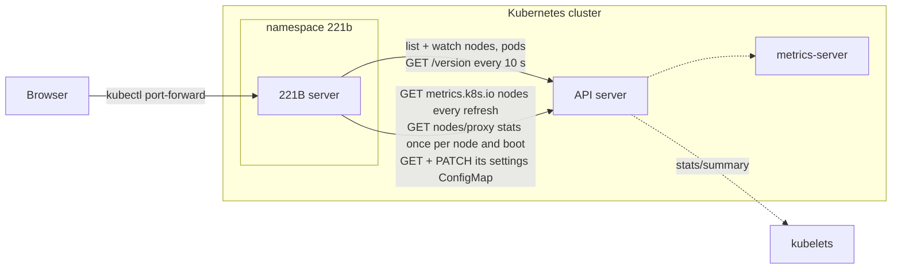
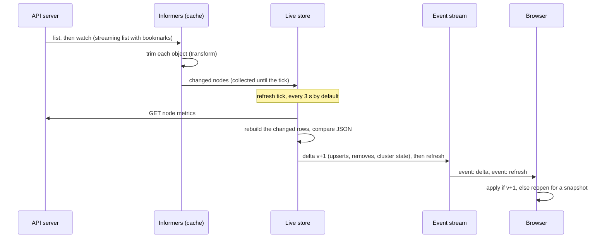

# 221B Architecture

This document describes 221B as built in Phase 1: its parts, how data moves through them, the security model and the ways it can be deployed. The decision records at the end explain each choice in the Architecture table of the [requirements](requirements.md#architecture), plus the decisions Phase 1 itself made. It is the document for review item P1-01.

## In one paragraph

221B is one Go server and a browser app, shipped as one container image and installed with a Helm chart. The server keeps a watched, in-memory copy of the cluster's nodes and pods, builds the rows the Nodes tab shows, and on a shared refresh tick sends every open browser the same changes at the same moment over Server-Sent Events. Browsers never see a Kubernetes object, only rows. In Phase 1 the server runs inside the cluster it shows, with a ServiceAccount that can read nodes, pods, node metrics and the kubelets' stats, and write one thing: its own settings ConfigMap. People open it with `kubectl port-forward` or an exposed Service.

## Components

| Part | Where | What it does |
| --- | --- | --- |
| Entry point | `server/cmd/221b` | Reads flags and environment, connects, wires the parts below together, serves HTTP and shuts down cleanly on SIGTERM. |
| Configuration | `server/internal/config` | Flags with environment fallbacks (`CLUSTER_NAME`, `LISTEN`, `KUBECONFIG_PATH`, `KUBE_CONTEXT`, `API_SERVER`, `REFRESH`, `SETTINGS_CONFIGMAP`, `KUBELET_STATS`, `HEALTH_INTERVAL`, `LOG_LEVEL`, `LOG_FORMAT`). |
| Shared settings | `server/internal/settings` | The settings everyone shares, today the refresh rate: validated, kept in a ConfigMap in the cluster (or in memory on a laptop), re-read every minute so a `kubectl edit` takes effect, and pushed to every browser when they change. |
| Cluster connection | `server/internal/kube` | Chooses in-cluster, kubeconfig or URL mode. Runs two informers (nodes, and pods indexed by node), trims every object as it enters the cache, checks the API server's health, reads node usage from metrics-server when polled, reads each node's boot time from its kubelet once per boot, reads and patches the settings ConfigMap, and turns watch errors into warnings people can act on. |
| Row builder | `server/internal/nodes` | Turns one node and the pods on it into a table row: status, problems with their causes, CPU and memory requested, limits, allocatable, free and in use, pod counts, taints, zone, labels, kubelet, age, boot time and the drawer's details. |
| Live store | `server/internal/live` | Keeps every row as encoded JSON, collects change notices, and on each refresh tick polls the cluster, recomputes the rows the changes touched and publishes one versioned delta to every subscriber, followed by a refresh event. Connection news goes out at once. |
| HTTP API | `server/internal/api` | The JSON API, the settings endpoint, the event stream, health, readiness and Prometheus metrics, and the security headers on every response. |
| Browser app files | `server/internal/ui` | Serves the built browser app, embedded in the binary. |
| Simulator | `server/internal/sim`, `server/cmd/221b-sim` | A fake Kubernetes API server with any number of nodes and pods, an admin API to break things, and outages on demand. Used for development, tests and the scale test. |
| Browser app | `web/` | TypeScript and React. `api/live.ts` follows the event stream and `api/settings.ts` saves settings; `lib/` holds formatting, the table logic and the Excel writer; `components/` holds the screens, including the Settings dialog. |
| Chart | `deploy/helm/221b` | Deployment, Service, ServiceAccount, ClusterRole and binding, the settings ConfigMap with a Role and binding for it, NetworkPolicy. |
| CI scripts | `hack/` | Chart checks, the kind end-to-end run, the RBAC check and the kwok scale run. |

## Data flow

1. **Listing and watching.** client-go informers list and watch nodes and pods. On Kubernetes 1.35 and later the list arrives as a stream (`sendInitialEvents` with a bookmark marking its end) instead of one large response; older servers fall back to an ordinary list. Watches resume from the last resource version after a drop, and relist by themselves after a `410 Gone`.
2. **Trimming.** A transform drops what no screen uses before an object enters the cache: managed fields, annotations, container images, volumes, environment and most of the pod spec. A pod keeps its name, namespace, node, phase, conditions, container states and the resources needed to compute requests and limits. This is what keeps the server under 1 GiB at Phase 1 scale (X-09).
3. **Change notices.** An event on a node marks that node; an event on a pod marks the node it runs on, and both nodes when it moves; a pod without a node marks the cluster totals. Health, metrics and boot-time changes mark the cluster state.
4. **The refresh tick.** Every refresh interval (3 seconds by default; the Settings dialog changes it for everyone, from 1 second to 10 minutes) the store polls what is not watched, today node usage from metrics-server, then rebuilds the marked rows with `nodes.BuildRow`, encodes each as JSON and compares it with the previous encoding. Only rows that changed go into the delta, so a pod restarting on one node sends one row. Every 30 seconds the tick also rebuilds every row, for problems that depend on time, such as a pod that has been starting for more than two minutes. One delta, and then a `refresh` event stamped with the tick's time, go to every browser at once, so every open console shows the same state at the same moment (and the same "refreshed" clock). News about the connection to the API server does not wait for the tick; it goes out within 250 ms.
5. **Requests and limits** follow the scheduler's rules (`k8s.io/component-helpers/resource`): the larger of the init containers and the app containers, sidecar init containers added to both, plus pod overhead, and during an in-place resize the larger of what is asked for and what the kubelet has allocated. Terminated pods do not count, as in `kubectl describe node`.
6. **Deltas.** Each delta has a version one higher than the last. A browser that misses one (its version jumps) reopens the stream and gets a fresh snapshot. A browser that falls 64 deltas behind is sent a snapshot instead of the backlog, so one slow tab cannot hold memory on the server.
7. **The event stream.** `GET /api/v1/events` starts with a `snapshot` event (rows, cluster state, settings and the time of the last refresh), then sends a `delta` event for every change and a `refresh` event on every tick, a comment every 15 seconds so proxies keep it open, and `retry: 3000` so a browser reconnects by itself. The refresh event carries the server's version too, so a browser that somehow missed a delta notices within one tick and reopens. It is gzip-compressed when the browser accepts it; the snapshot of 500 nodes is about 850 KB of JSON and 75 KB compressed.
8. **The browser** keeps the rows in memory, sorts and filters them on the client, and renders them with React. The first screenful of rows renders at once and the rest over the next few frames, and rows off screen skip layout and paint (`content-visibility: auto`), so re-sorting 500 rows only lays out what is in view.

**Connection status.** The server asks the API server for `/version` every 10 seconds with a 5-second timeout. One failure turns the status red with the cause in plain words ("The connection was refused.", "It did not answer within 5 seconds."), within about 15 seconds of the API server going away (P1-11). While it is away, the informers wait for it, checking every second, instead of retrying with client-go's backoff, which grows to 30 to 60 seconds between attempts. So they resume or relist within a second or two of its return, well inside P1-10's 30 seconds, and the status turns green at the next check. The last known rows stay on screen throughout, marked as such.

**Metrics.** On every refresh the server reads `metrics.k8s.io/v1beta1/nodes`, one request however many browsers are open. If metrics-server is missing or failing, the table and the node details still work and say why usage is not shown (P1-12).

**Uptime.** The Node object does not say when a node booted. Each kubelet does, in its Summary API, which the API server proxies at `/api/v1/nodes/<name>/proxy/stats/summary`; its `node.startTime` is the system boot time. A boot time changes only with a reboot, which also changes the node's `bootID`, so the server reads it once per node and bootID, a few at a time, and keeps it; a node whose kubelet has stopped reporting, or that reports no bootID (a simulated node), is not asked. The read needs `get` on `nodes/proxy`, which the chart grants when `kubeletStats` is on (the default); off, or refused, the node details say so and show how long the node has been Ready instead.

**Shared settings.** The refresh rate is a setting everyone shares, so it lives on the server: in the cluster, as `settings.json` in a ConfigMap the chart creates empty and never writes, so `helm upgrade` keeps what was saved and `helm uninstall` removes it; on a laptop or with the simulator, in memory. The server loads it at start, saves it with a merge patch when someone changes it in the Settings dialog, re-reads it every minute so a change made with kubectl takes effect, and sends every change to every browser as part of the stream. The theme is per browser and stays in `localStorage`.

## API

All responses carry the security headers below. Every endpoint is `GET` except one: `PUT /api/v1/settings` changes the shared settings, the only thing in Phase 1 that changes state, and the only thing 221B writes to the cluster (X-03).

| Path | Returns |
| --- | --- |
| `/api/v1/snapshot` | Every row, the cluster state, the settings, the version and the time of the last refresh, as JSON. |
| `/api/v1/nodes/{name}` | One row. |
| `/api/v1/settings` | `GET`: the settings in force, where they are kept (`configmap` or `memory`) and when they last changed. `PUT` with `{"refreshSeconds": n}` (1 to 600, JSON only) saves and applies them for everyone; it refuses requests another site made the browser send (see Browser below). |
| `/api/v1/events` | The event stream described above. |
| `/healthz` | `ok` while the process runs (liveness). |
| `/readyz` | `ok` once nodes and pods have been listed the first time (readiness). It stays ready during a later API server outage, so the console stays reachable to say so. |
| `/metrics` | Prometheus text: HTTP requests by route and code, change delay from watch event to browser (histogram), rows, cached nodes and pods, watch events, open streams, API server and metrics-server state, and memory. |
| `/` | The browser app. Hashed assets are cached for a year; `index.html` is never cached. |

## Security model

**What the server can read.** The chart's ClusterRole allows `get`, `list` and `watch` on nodes and pods, `get` and `list` on `metrics.k8s.io` nodes, and, with `kubeletStats` on, `get` on `nodes/proxy`, which is how it reads each node's boot time from its kubelet. That last grant is the widest: through the proxy, `get` reaches a kubelet's other read-only endpoints too (stats, metrics, container logs), which is the same grant monitoring agents hold; 221B uses only `/stats/summary`, and `--set kubeletStats=false` withholds it at the cost of the uptime. A namespaced Role allows `get` and `patch` on its own settings ConfigMap, by name. Nothing else: no Secrets, no other ConfigMaps, no `exec`, no writes to workloads. CI checks this with `kubectl auth can-i` against the installed ServiceAccount, and checks that listing Secrets is refused by the API server itself (P1-09). The requirement also allows pod metrics; the Nodes tab does not use them, so Phase 1 does not ask for them.

**What a browser can see.** Rows only. A row carries a node's details and, for pods with problems, their namespace, name, reason and message. The pod transform removes environment variables before anything is cached, so not even literal values in a pod spec reach the server's memory, let alone a browser. Phase 1 never reads a Secret.

**Who can open it.** Phase 1 has no sign-in, so by default the chart creates a ClusterIP Service and documents `kubectl port-forward`. Opening the console then needs the right to port-forward to a pod in its namespace, which the cluster's own RBAC grants. Anyone with that right sees what the console's ServiceAccount can read: node details and the names of failing pods across namespaces. Keep port-forward rights in the 221B namespace to the people who should see that. The chart can also expose the Service as a LoadBalancer or NodePort (`service.type`), on port 8081; then anyone who can reach that port sees the same, so it belongs only on a network where that is acceptable. Phase 3 adds sign-in and per-person access.

**Network.** The NetworkPolicy allows no inbound traffic except from peers listed in `networkPolicy.ingressFrom`, or from anyone when the Service is exposed and no peers are listed (port-forward and kubelet probes are not affected by NetworkPolicy), and outbound traffic only on the API server's ports (443 and 6443 by default). Its addresses differ between clusters, so any address is allowed on those ports unless `networkPolicy.apiServerCIDRs` lists them. 221B needs no DNS and makes no other outbound calls: no telemetry, and the fonts are bundled (X-16).

**Container.** A distroless static image with no shell or package manager, running as user 65532 with a read-only root filesystem, no privilege escalation, all capabilities dropped and the RuntimeDefault seccomp profile. It passes the Pod Security `restricted` profile, which CI enforces on the test namespace (X-05). The server sizes Go's memory limit to 90% of the container's.

**Browser.** A strict Content Security Policy (`default-src 'self'`, no inline scripts or styles, `frame-ancestors 'none'`), `X-Content-Type-Options: nosniff`, `X-Frame-Options: DENY`, `Referrer-Policy: no-referrer`, and cross-origin opener and resource policies (X-06). The server answers only to `localhost`, IP addresses, its Service's DNS names and names set in `allowedHosts`; any other `Host` is refused, so a web page cannot read the console through DNS rebinding while someone has a port-forward open. The one state-changing request, `PUT /api/v1/settings`, takes JSON only (so no HTML form can send it) and is refused when the browser's `Sec-Fetch-Site` or `Origin` header says another site made the request; the app sets no cookies, so there is no session to ride. Anyone who can reach the console can change its refresh rate; that is the extent of what they can change in Phase 1.

**Supply chain.** GitHub Actions are pinned to commit SHAs and downloaded tools to checksums. CI checks dependency licenses (no GPL, AGPL or LGPL), audits the shipped npm packages, and scans the image with Grype, failing on any high or critical finding (P1-04, P1-05).

## Deployment modes

| Mode | How | Used for |
| --- | --- | --- |
| In the cluster | `helm install`; the in-cluster ServiceAccount | Phase 1's test deployment and production. |
| On a laptop, against a real cluster | `221b -kubeconfig ~/.kube/config -context <name> -cluster-name <name>` | Development. Shows the same nodes as the in-cluster mode (P1-08), with your own permissions. |
| On a laptop, simulated | `make dev-sim` | Development and the browser tests, with no cluster at all. |
| Management mode | Phase 3 | One installation connected to several clusters with stored credentials. |

The image is published to `ghcr.io/ucesys/221b` for `linux/amd64` and `linux/arm64`: `main` and `sha-<commit>` from main, and `pr-<number>` from this repository's pull requests. The package is private while the repository is, so a cluster pulling it needs an image pull secret (see the [README](../README.md#try-it-on-a-cluster)).

## Operations

- **Probes.** Liveness on `/healthz`, readiness on `/readyz` (see above).
- **Logs.** Structured JSON on standard error, one line per event; client-go's own logging goes to the same log.
- **Metrics.** `/metrics`, listed above. `b221_change_delay_seconds` measures X-07's freshness from the server's side (with the refresh tick it is mostly the wait for the tick); `b221_refresh_seconds` is the rate in force; `b221_api_server_up` and `b221_metrics_available` show the connection.
- **Settings.** `kubectl -n 221b get configmap console-221b -o jsonpath='{.data.settings\.json}'` shows what is saved; editing it takes effect within a minute, and deleting the key returns to the chart's `refresh`.
- **Resources.** Requests 100m CPU and 256 MiB; limits 1 CPU and 1 GiB. At 500 nodes and 15,000 pods the server uses about 200 MiB.
- **Shutdown.** On SIGTERM the server stops accepting connections, ends the event streams and exits within 10 seconds.
- **Tabs.** Each open tab holds one HTTP connection for its event stream, and browsers allow six connections per host over plain HTTP. Through one port-forward, a seventh tab waits until another closes. A Phase 3 Ingress with HTTP/2 removes the limit.

## Scale

Phase 1's target is 500 nodes and 15,000 pods (P1-18). CI measures it on every pull request with kwok in kind, on a 2-core runner that is also running the cluster: the first screen shows in under 200 ms, all 501 rows in about 400 ms, a sort takes 80 to 150 ms (median), and the server uses about 200 MiB. The job fails if the first screen takes 2 seconds, a sort 200 ms, or the server 1 GiB.

Phase 7's 5,000 nodes will need two changes the design allows for: virtualizing the table (rendering only the rows in view) and sending each browser only the rows its screen shows.

## Testing

| Level | What | Where |
| --- | --- | --- |
| Unit | Row building, problem detection, the store's tick and prompt paths, the API including the settings endpoint's checks, configuration, the settings service and its ConfigMap storage; the table logic, exports, formatting, Excel writer and live-state logic in the browser | `go test ./...`, `npm test` |
| Integration | The real client-go informers against the simulator: streaming lists, watch recovery, outages, metrics on and off, boot times and a reboot, the proxy refused | `server/internal/kube` |
| Browser, simulated | Every Nodes tab behavior, the Settings dialog (a change reaching a second browser, both refreshing on the same tick, the ConfigMap written), live updates, outage and recovery, accessibility (axe, WCAG 2.2 AA) and keyboard use, in Chromium, Firefox and WebKit | `make e2e-sim`, `web/e2e` |
| Browser, real cluster | The chart in kind on Kubernetes 1.35, 1.36 and 1.37 with metrics-server: install within 60 seconds, permissions, port-forward, settings saved in the ConfigMap and picked up from a kubectl edit, boot times from every kubelet, the same browser tests with kubectl and docker making the changes, then an upgrade that keeps the settings, and uninstall | `hack/e2e-kind.sh` |
| Scale | 500 nodes and 15,000 pods with kwok | `hack/scale-kind.sh`, `web/e2e/scale.spec.ts` |

## Decision records

Records 1 to 9 cover the Architecture table in the requirements; 10 to 17 were made while building Phase 1. Proposed records are not decided yet; they are listed so the review can see where they fit.

### ADR-1: Go for the server

- **Status:** Accepted.
- **Context:** The server talks to Kubernetes all day, and later phases need Helm releases, kubectl's drain and describe logic, and Pod Security checks.
- **Decision:** Go, with client-go.
- **Consequences:** The libraries Kubernetes itself uses (client-go, the Helm SDK, kubectl's packages, the Pod Security admission library) are available as code rather than as shell-outs. Phase 1 uses client-go and `component-helpers`; the binary is about 29 MB.

### ADR-2: TypeScript and React for the browser app

- **Status:** Accepted.
- **Context:** The prototype is a set of screens built from repeated parts: tables, cards, drawers, menus.
- **Decision:** TypeScript and React 19, built with Vite. No UI component library: the prototype's stylesheet is used as is (`web/src/styles/design.css`), so screens match it by construction.
- **Consequences:** The bundle is small (about 80 KB of script, compressed, plus fonts). Matching the prototype is a matter of markup, not of overriding a library's styles.

### ADR-3: One image, with the browser app inside the Go binary

- **Status:** Accepted.
- **Context:** Two images would mean two things to version, scan and keep in step.
- **Decision:** The browser app is built first and embedded in the binary with `go:embed`; the image holds only that binary.
- **Consequences:** One version, one scan, one thing to deploy (P1-05). The image is about 32 MB. The app and the API always come from the same build, so their data shapes cannot drift apart in production.

### ADR-4: A Helm chart for deployment

- **Status:** Accepted.
- **Context:** Test and production installs should differ only in settings.
- **Decision:** A Helm chart in `deploy/helm/221b`, tested by `helm lint`, schema validation against Kubernetes 1.35 and 1.37, and real installs in kind.
- **Consequences:** `helm install`, `upgrade` and `uninstall` are the supported lifecycle; CI proves uninstall leaves nothing behind (P1-06). The chart requires `clusterName`, since the API server has no reliable name for its cluster.

### ADR-5: Informers on the server, Server-Sent Events to the browser

- **Status:** Accepted.
- **Context:** Changes must show within 5 seconds (X-07), and many people may watch the same cluster.
- **Decision:** One informer per resource type per cluster, shared by every viewer; deltas go to browsers over Server-Sent Events.
- **Alternatives:** Browser polling (slower and heavier on the API server); WebSockets (two-way, which Phase 1 does not need, and harder through proxies). SSE reconnects by itself and works through ordinary HTTP proxies.
- **Consequences:** The API server's load does not grow with viewers. Changes reach the screen on the next refresh tick (ADR-16), so within 3 seconds by default.

### ADR-6: Rows are built on the server

- **Status:** Accepted.
- **Context:** Raw objects are large and can carry sensitive values.
- **Decision:** The server turns objects into rows; browsers receive only rows.
- **Consequences:** Secret handling (X-01) has one place to get right in every phase. Payloads are small, and the problem rules live in one tested place (`server/internal/nodes`). Sorting and filtering stay in the browser, where they are instant at Phase 1 scale.

### ADR-7: In-cluster ServiceAccount with a read-only ClusterRole (Phase 1)

- **Status:** Accepted.
- **Context:** Phase 1 shows the cluster it runs in and changes nothing.
- **Decision:** The chart creates a ServiceAccount bound to a ClusterRole with read verbs on nodes, pods and node metrics only.
- **Consequences:** No credentials to store. Pod metrics, allowed by P1-09, are left out because the Nodes tab does not use them. The uptime in the node details added `get` on `nodes/proxy` (ADR-17), and the shared settings a Role on one ConfigMap (ADR-16). Later phases widen the role only by what their screens need (X-02), and a chart setting will keep Secrets unreadable (P2-10).

### ADR-8: Sign-in and per-person access by impersonation (Phase 3)

- **Status:** Proposed; an open question in the requirements.
- **Proposal:** OIDC sign-in, and calls to Kubernetes made as the signed-in person through impersonation, so Kubernetes RBAC decides what each person sees and the audit log names them.
- **Phase 1 impact:** None in code. Until then, access is gated by who may port-forward (see the security model).

### ADR-9: The Claude API is called only from the server (Phase 5)

- **Status:** Proposed for Phase 5.
- **Proposal:** Sherlock's calls go from the server; the key lives in a Kubernetes Secret; browsers never hold the key or receive raw cluster data for prompts.
- **Phase 1 impact:** None. Phase 1 makes no outbound calls except to the API server.

### ADR-10: Distroless static base image

- **Status:** Accepted.
- **Context:** The image must be small, non-root and clean of vulnerabilities (P1-05, X-05).
- **Decision:** `gcr.io/distroless/static-debian13:nonroot`, with a statically linked binary (`CGO_ENABLED=0`), built for amd64 and arm64 by cross-compiling.
- **Consequences:** No shell, so debugging uses `kubectl debug` with an ephemeral container. The scan has almost nothing to find besides the Go binary itself, which stays current by building with the latest Go patch release.

### ADR-11: A simulated API server for development and tests

- **Status:** Accepted.
- **Context:** Many behaviors (an API server outage, a node that stops reporting, 15,000 pods) are slow or awkward to produce on a real cluster, and development should not need one.
- **Decision:** `221b-sim` implements just enough of the Kubernetes API (list and watch with resource versions, streaming lists, bookmarks, `410 Gone`, node metrics) for client-go's real informers to run against it, plus an admin API to make changes and outages.
- **Consequences:** Integration tests use the real client-go code paths in seconds, and the browser tests run without a cluster in every browser. The same tests run against kind with real Kubernetes, so the simulator cannot hide a difference for long.

### ADR-12: No table virtualization in Phase 1

- **Status:** Accepted for Phase 1; revisit in Phase 7.
- **Context:** The Architecture table counts on virtualization for large tables. At 500 rows, the measured cost of rendering every row is small once off-screen rows skip layout and paint, and the first screenful renders before the rest.
- **Decision:** Render every row, the first 60 at once and the rest over the next frames, with `content-visibility: auto` on rows.
- **Consequences:** Browser find, screen readers and keyboard navigation see the whole table, and tests can count rows. A sort of 500 rows takes under 150 ms on a busy CI runner. Phase 7's 5,000 nodes will need virtualization.

### ADR-13: Excel export written in the browser, without a library

- **Status:** Accepted.
- **Context:** Every table exports to Excel (X-13); spreadsheet libraries are large, and some carry license or security baggage.
- **Decision:** A small writer (`web/src/lib/xlsx.ts`, ported from the prototype) that produces a valid `.xlsx`: an uncompressed ZIP of five XML parts, with typed numeric cells, a frozen header and filters.
- **Consequences:** No dependency, a few kilobytes of code, and the export contains exactly the rows, columns and order on screen, which the browser tests check.

### ADR-14: Bundled fonts

- **Status:** Accepted.
- **Context:** The prototype loads IBM Plex from Google Fonts. That is a third-party request at runtime, which X-06 and X-16 rule out.
- **Decision:** Bundle IBM Plex Sans and Mono (Latin and Latin Extended) from the `@fontsource` packages, served by 221B itself.
- **Consequences:** The app looks the same with no outbound requests and works in clusters with no internet access. The fonts are under the SIL Open Font License.

### ADR-15: Kubernetes versions under test

- **Status:** Accepted (open question 3 in the requirements, settled with the proposed answer).
- **Decision:** CI installs the chart in kind on every minor release maintained upstream, today 1.35, 1.36 and 1.37, and validates the chart's manifests against the oldest and newest.
- **Consequences:** When a new minor release ships and the oldest goes out of support, the matrix in `hack/lib.sh` moves with them.

### ADR-16: One refresh rate for everyone, kept on the server

- **Status:** Accepted.
- **Context:** The console should update at a rate people can choose, every open console should update at the same moment, and the choice must not multiply requests to the Kubernetes API with the number of browsers.
- **Decision:** The server publishes on a shared tick: it polls metrics-server, rebuilds the changed rows and sends every browser the same delta and a `refresh` event. The rate is a shared setting, changed in the Settings dialog through `PUT /api/v1/settings` and kept in a ConfigMap in the console's namespace (the chart creates it empty and never writes its data, so upgrades keep it); the server re-reads it every minute and pushes changes to every browser through the stream. The theme stays per browser.
- **Alternatives:** A per-browser rate (browsers would disagree, and nothing would stop one from polling fast); a rate in `values.yaml` only (a change would need a `helm upgrade` and a restart); settings in the Deployment's environment (the server cannot write its own Deployment without far wider permissions).
- **Consequences:** The Kubernetes API sees one metrics read per tick and the watches, whatever the number of viewers; node and pod changes wait up to one tick (3 seconds by default, so still within X-07's 5 seconds) while connection news goes out at once. The console gained its first write, scoped by a Role to one named ConfigMap (X-03), and its first state-changing endpoint, protected against cross-site requests by taking JSON only and checking `Sec-Fetch-Site` and `Origin` (X-06). Anyone who can reach the console can change the rate, until Phase 3 brings sign-in.

### ADR-17: Node uptime from the kubelets' Summary API

- **Status:** Accepted; `kubeletStats` in the chart turns it off.
- **Context:** The node details should show how long a node has been up. Kubernetes keeps no boot time in the Node object, and metrics-server does not report one. A kubelet reports its node's boot time in its Summary API, which the API server proxies.
- **Decision:** Read `/api/v1/nodes/<name>/proxy/stats/summary` once per node and bootID, a few nodes at a time, and show the uptime from it. Grant `get` on `nodes/proxy` in the ClusterRole, behind `kubeletStats: true`.
- **Alternatives:** The Ready condition's transition time (restarts of the kubelet and brief outages reset it, so it is not uptime; it is shown as "Ready since" instead); node events such as `Rebooted` (expire after an hour); talking to the kubelets directly (blocked by the network policy and the kubelets' certificates).
- **Consequences:** A handful of requests per node over its whole life, none while the API server is down or a kubelet is not reporting. `get` on `nodes/proxy` is a wider grant than the rest of the role, since it reaches a kubelet's other read-only endpoints; it is what monitoring agents hold, and `--set kubeletStats=false` withholds it at the cost of the uptime, which the node details then say.
