# 221B data model: domains and tables

> Exported on November 20, 2026 from the Claude doc [221B data model: domains and tables](https://claude.ai/artifact/HkWMFgzhSfdj1GxiG2jkP8), where it is edited. Do not edit this copy: export it again after the doc changes.

Nov 20, 2026 · Mikhail Stolpner

The 221B schema on branch phase-13-store has 121 tables in 12 domains and three tiers, plus two tables of the database's own, after migration steps 0001 to 0037. This page is the map: each domain's tables, their keys and how they join. Every column, with what it holds, is in [docs/data-model.md](https://github.com/ucesys/221b/blob/phase-13-store/docs/data-model.md) on the branch, which a test holds to the migrated schema (DB-68).

## Domains at a glance

Each domain is a set of tables one service owns. Keys point down the tiers or stay inside one: the AIOps flow keys into the engines and the foundation, and the engines into the foundation. Where a lower table records something higher, it keeps the id as a plain column.

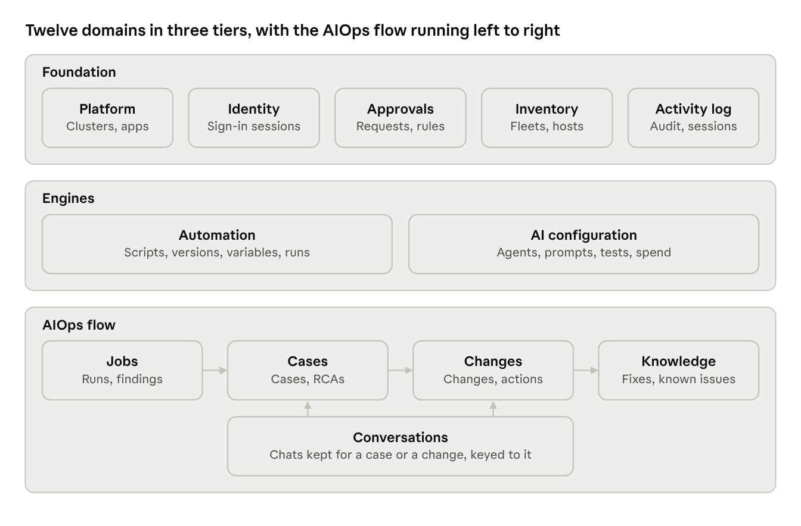

| Tier       | Domain           | Tables | Holds                                                                                                |
|------------|------------------|--------|------------------------------------------------------------------------------------------------------|
| Foundation | Platform         | 8      | Cluster connections, applications, acknowledged alerts, repositories, credentials, backups, settings |
| Foundation | Identity         | 1      | Sign-in sessions                                                                                     |
| Foundation | Approvals        | 4      | Requests, decisions, standing approvals, notification channels                                       |
| Foundation | Inventory        | 7      | Fleets, hosts, facts, SSH pairing and logins                                                         |
| Foundation | Activity log     | 2      | The audit log and the Toolbox's session records                                                      |
| Engines    | Automation       | 20     | Scripts and versions, variables and their changes, profiles, runs                                    |
| Engines    | AI configuration | 15     | Providers, agents, instructions, tests, pilots, spend                                                |
| AIOps flow | Jobs             | 19     | Jobs, runs, findings, validation rules, what runs found under each check                             |
| AIOps flow | Cases            | 13     | Cases with their messages, work, analyses and RCAs; the service catalogue                            |
| AIOps flow | Changes          | 9      | Proposed changes with their evidence, actions, results and decisions                                 |
| AIOps flow | Conversations    | 2      | The conversations kept for a change or a case                                                        |
| AIOps flow | Knowledge        | 21     | Wiki page changes, sources and syncs, fixes, exceptions, known issues                                |

The AIOps flow runs from a job's finding to a case, a change and what is learned from it. A finding becomes a case, a known issue or an exception; a case gets a proposed change; and a fix, an exception or a known issue stays in Knowledge after the case closes. Conversations sit beside Cases and Changes, which they key to.

## Foundation tier

What every other domain stands on: five domains, 22 tables. A foundation table keys only into the foundation.

### Platform

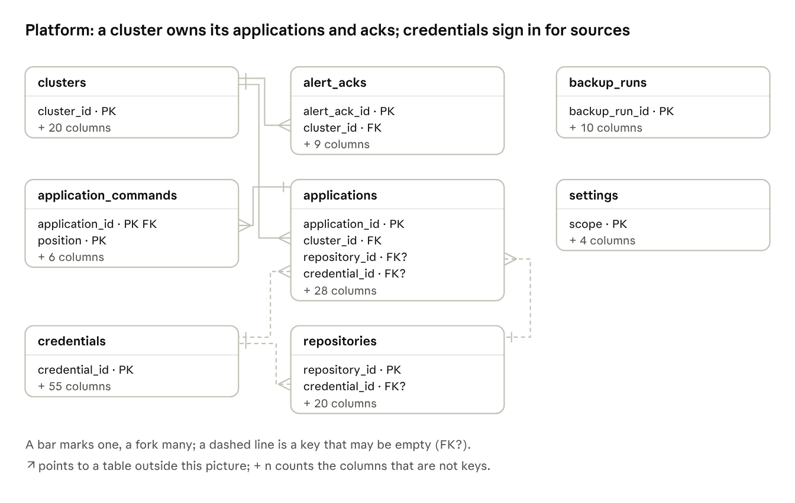

What the console keeps about itself and the clusters it is connected to. A cluster owns its applications and acknowledged alerts, and both go with its row. An application may name a repository and a credential, and a repository a credential; those keys are emptied when the target goes.

Secrets hold what is secret: a connection's credential, a credential's secret, and an application's values file and parameters. A removed connection keeps its row with only its id (is_kept false), so whatever names the cluster stays.

| Table                | Holds                                                                                                                                                        |
|----------------------|--------------------------------------------------------------------------------------------------------------------------------------------------------------|
| clusters             | The cluster connections, keyed by the console's cluster id: every field of a connection but its credential, which stays whole in a Secret                    |
| alert_acks           | The acknowledged alerts of a cluster: who acknowledged each, when and why, and the run, case or exception that did                                           |
| applications         | The Helm applications deployed to a cluster: the source, the commit deployed and who set it; the values file and parameters stay in the application's Secret |
| application_commands | An application's own deploy commands, in the menu's order; their parameters stay in the Secret                                                               |
| repositories         | The Git repositories, Helm repositories and OCI registries that applications and Mycroft's sources read                                                      |
| credentials          | The credentials of Administration › Credentials: every field but the secret, which stays in the credentials' Secret                                          |
| backup_runs          | The console's backups, scheduled and manual, one row a run with its result                                                                                   |
| settings             | One JSON document a scope, read whole and saved over its version: a page's settings, a counter, a flag                                                       |

### Identity

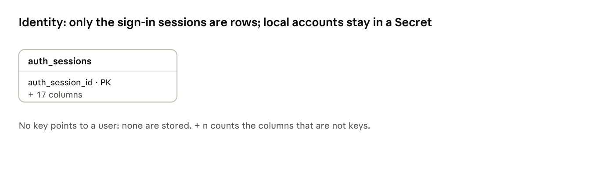

Only the sign-in sessions are rows, one a signed-in browser, keyed by a hash of the session's id. Local accounts stay in a Kubernetes Secret, and people of a directory or an OIDC provider are never stored, so no key points to a user. While the session store is away a sign-in gets a short-lived signed session kept in its cookie; neither it nor the key that signs it is ever in the database.

| Table         | Holds                                                                                                                      |
|---------------|----------------------------------------------------------------------------------------------------------------------------|
| auth_sessions | The signed-in browser sessions, shared by every replica: who the person is, what they may do, and the session's four times |

### Approvals

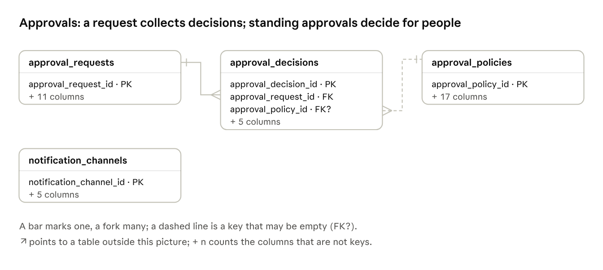

A request collects decisions, one row an approval, a rejection or a withdrawal. Standing approvals decide for people within what each allows, and channels tell approvers that a request is waiting.

Seven tables elsewhere carry an approval_request_id that points here (script versions, runs, variable changes, agents' instructions, proposed changes, wiki page changes, Toolbox sessions). None is filled today: each of those records keeps who decided in columns of its own.

| Table                 | Holds                                                                                                   |
|-----------------------|---------------------------------------------------------------------------------------------------------|
| approval_requests     | What was asked, by whom, on which cluster, how many approvers it needs, its state and expiry            |
| approval_decisions    | One row an approval, a rejection or a withdrawal of a request: who, when and the comment                |
| approval_policies     | The standing approvals: rules that approve an agent's changes without a person, within what each allows |
| notification_channels | The channels that tell approvers a request is waiting; a channel's address stays in a Secret            |

### Inventory

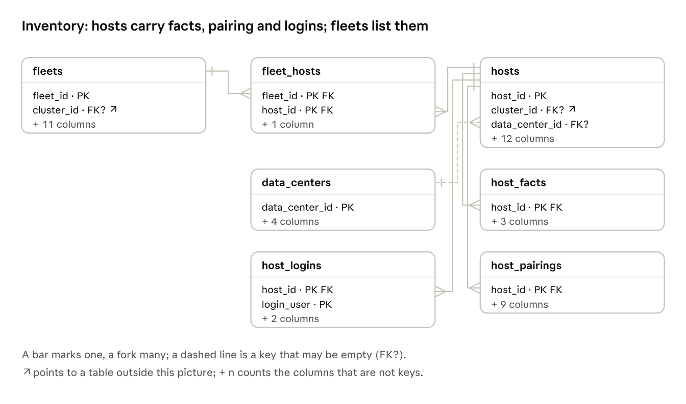

Kubernetes nodes and hosts outside Kubernetes share hosts; a fleet is a named set of them, and fleet_hosts lists the members of a list fleet. A host carries its facts (one JSON value, as the facts run reported them), its SSH pairing and its logins. A node's row holds its identity only; labels, taints and status are read live.

fleets.cluster_id and hosts.cluster_id are keys into Platform that are emptied if the cluster's row is deleted, so list fleets and hosts outside Kubernetes can outlive their cluster. data_centers is kept for the page that will fill it; nothing writes it today.

| Table         | Holds                                                                                                                                                             |
|---------------|-------------------------------------------------------------------------------------------------------------------------------------------------------------------|
| fleets        | The fleets of a cluster: a selector fleet is the nodes that have its labels and taints, a list fleet the hosts listed; also its privilege ceiling and reboot time |
| fleet_hosts   | The members of a list fleet, in order                                                                                                                             |
| hosts         | Kubernetes nodes and hosts outside Kubernetes; a host outside Kubernetes adds its address, port and state                                                         |
| data_centers  | The data centers hosts stand in: name, site and time zone                                                                                                         |
| host_facts    | The latest facts gathered from each host, as the facts run reported them                                                                                          |
| host_pairings | SSH trust of each host: the host keys pinned, the SSH authority it trusts, who trusted and who paired it                                                          |
| host_logins   | The login account a host is reached as                                                                                                                            |

### Activity log

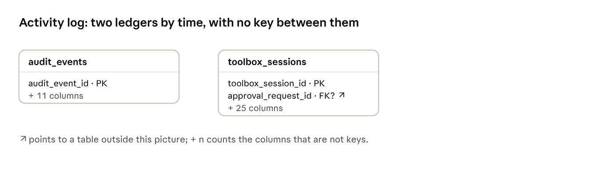

Two ledgers indexed by time and trimmed by retention. audit_events is only ever added to: a trigger refuses an update, so replicas adding at once never collide. A Toolbox session's row is written once, when the session ends; its transcript stays on its volume.

| Table            | Holds                                                                                                                                            |
|------------------|--------------------------------------------------------------------------------------------------------------------------------------------------|
| audit_events     | Every recorded action: who, what, on which cluster and target, how it ended                                                                      |
| toolbox_sessions | The records of ended shell, port-forward, debug and node sessions: who ran each, on what, how it ended and what passed through; never the output |

## Engines tier

What runs things: scripts on machines, and models behind agents. Two domains, 35 tables. An engine's table keys into the foundation or stays in its domain.

### Automation

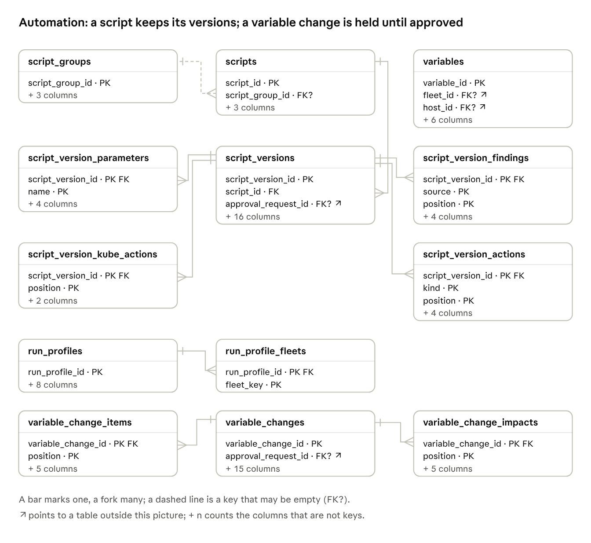

A script keeps its texts as versions, each with the parameters and Kubernetes actions its header declares, what the checks found in it and what people did with it. A variable sits on one fleet or one host. A change to a fleet's variables is a row that waits for a second person, with each thing it alters and the script versions it touches. Execution profiles say which privilege or identity a run may use, and on which fleets.

| Table                       | Holds                                                                                                                  |
|-----------------------------|------------------------------------------------------------------------------------------------------------------------|
| script_groups               | The named groups scripts are filed in                                                                                  |
| scripts                     | A script's identity: its name and its group                                                                            |
| script_versions             | A script's texts, each with its state, what its header declares, its author and Sherlock's reading of it               |
| script_version_parameters   | The parameters a version declares in its header                                                                        |
| script_version_kube_actions | What a Kubernetes script's header says it may do                                                                       |
| script_version_findings     | What the console's checks and Sherlock found in a version, on its lines                                                |
| script_version_actions      | What people did with a version: saved its draft, submitted, approved or rejected it, took an approval back             |
| run_profiles                | The execution profiles: an SSH privilege or a Kubernetes identity a run may use                                        |
| run_profile_fleets          | The fleets a profile may run on                                                                                        |
| variables                   | The variables scripts read, each on one fleet or on one host                                                           |
| variable_changes            | A change to one fleet's variables that waits for a second person, or waited: who asked, why, its state and who decided |
| variable_change_items       | Each thing a change alters, before and after                                                                           |
| variable_change_impacts     | The approved script versions a change touches, and whether each needs the change approved                              |

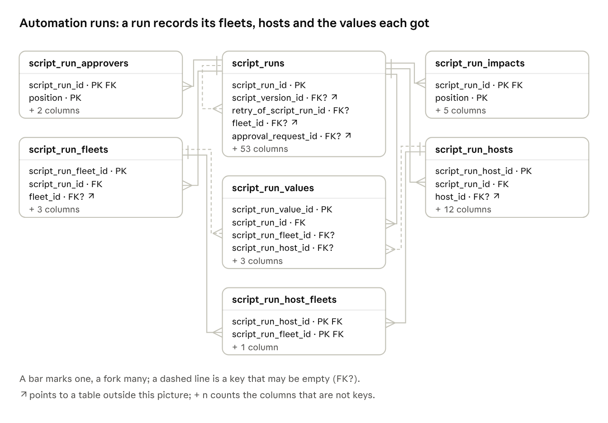

A request for a run and the run are one row of script_runs, so one list has every run, the rejected ones too. A run records the fleets its nodes were in, the result on each node, and the values each fleet and host got, as they were when it started. A retry points at the run it retries. A run keeps its script's name and version number beside the key, so it outlives the version.

| Table                  | Holds                                                                                                                                                                                    |
|------------------------|------------------------------------------------------------------------------------------------------------------------------------------------------------------------------------------|
| script_runs            | The runs, and the requests for a run that wait for approval, were rejected or expired: the script's version, the profile and the fleet each names, its rollout, state and who started it |
| script_run_approvers   | Who had approved the script's version when the run started                                                                                                                               |
| script_run_impacts     | What a run request's own values mean for its script, and whether they need approval                                                                                                      |
| script_run_fleets      | The fleets a run's nodes were in when it started                                                                                                                                         |
| script_run_hosts       | The result of a run on each node: batch, state, exit code and the end of its output                                                                                                      |
| script_run_values      | The values a run used: the run's own, a request's, what each fleet had and what each host got                                                                                            |
| script_run_host_fleets | The fleets each node of a run was in                                                                                                                                                     |

### AI configuration

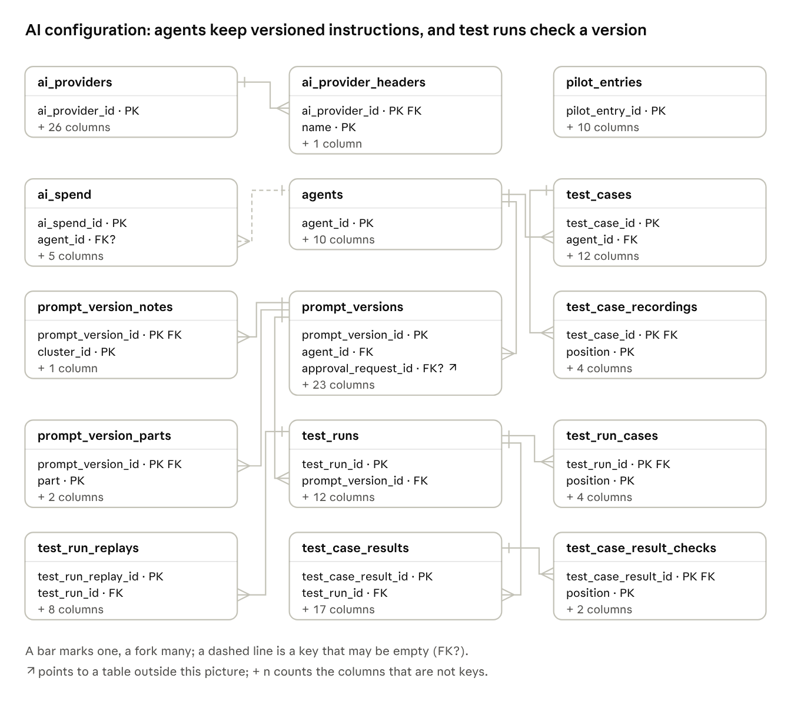

A provider carries its headers, and an agent's settings are keyed by its id in the catalog. An agent's instructions are rows of prompt_versions, each in one state: what is in force, a version that went live, the draft on its way to live, or a draft as one save left it. A test run checks a version against the agent's test cases and keeps each result with its checks; replays and pilot entries record how a draft answered real questions.

ai_spend is a ledger: one row a cost, summed when read and never updated. Rows older than the month before this one are deleted.

| Table                   | Holds                                                                                                                                            |
|-------------------------|--------------------------------------------------------------------------------------------------------------------------------------------------|
| ai_providers            | The model providers: endpoint, model, how the console signs its requests, prices and limits, and the last connection test                        |
| ai_provider_headers     | The headers a provider's requests carry                                                                                                          |
| agents                  | What was chosen for a built-in agent, keyed by its id in the catalog: provider, model, budgets, clusters and tools                               |
| ai_spend                | What the agents spend, one row a cost, summed when read                                                                                          |
| prompt_versions         | An agent's instructions, each row in one state: in force, a version that went live, the draft on its way to live, or a draft as one save left it |
| prompt_version_notes    | The notes an agent's instructions carry for one cluster                                                                                          |
| prompt_version_parts    | The edits of the built-in text of an agent's instructions, part by part                                                                          |
| test_cases              | The test cases kept for an agent's suite: a question, what the answer is expected to do, and the tool results recorded for it                    |
| test_case_recordings    | The tool results recorded for a test case, in order                                                                                              |
| pilot_entries           | The questions a draft in pilot answered                                                                                                          |
| test_runs               | One run of an agent's suite against a draft, or against what is in force: state, counts and cost                                                 |
| test_run_cases          | The cases a test run set out to run, in order, and how far each got                                                                              |
| test_case_results       | The result of each case of a test run, with the case as it was then                                                                              |
| test_case_result_checks | What was checked of a result, and whether each check held                                                                                        |
| test_run_replays        | The questions of production replayed against the draft: the answer before and after                                                              |

## AIOps flow tier

The flow from a job's finding to a case, a change and what is learned from it: five domains, 64 tables. A flow table keys into the engines, the foundation or another flow domain.

### Jobs

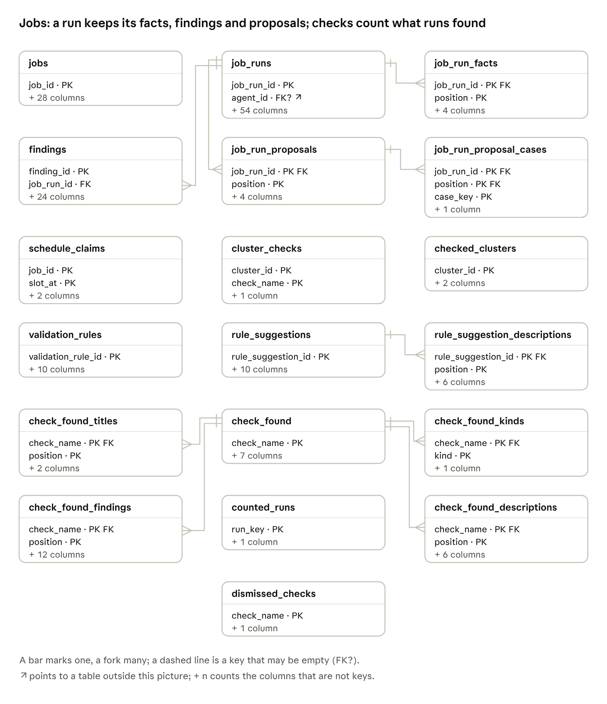

A job's runs keep their facts, findings and proposed changes. The rest is what is known about the checks that findings name: the validation rules that differ from the built-in ones, the suggestions for new rules, and check_found, which counts what the runs found under each check. A finding names the case, known issue or exception it went to by id, as plain columns.

schedule_claims is kept for the jobs' schedules and nothing writes it yet: a scheduled time is claimed on the job's own row.

| Table                        | Holds                                                                                                           |
|------------------------------|-----------------------------------------------------------------------------------------------------------------|
| jobs                         | The jobs: kind, task, when each runs, on which clusters and within what budget                                  |
| job_runs                     | The runs of the jobs: what started each, its agent and model, status, report, cost, and where its findings went |
| job_run_facts                | What a run did, as its drawer shows it: a label, the value in words and where it leads                          |
| job_run_proposals            | The changes a run proposed                                                                                      |
| job_run_proposal_cases       | The cases a run's proposal resolves, with their titles then                                                     |
| findings                     | The findings of a run: check, severity, what it is about, and the case, known issue or exception it went to     |
| schedule_claims              | One row a scheduled time claimed, so that a time runs once whichever replica gets there first                   |
| cluster_checks               | The checks seen on each cluster, to tell a new one                                                              |
| checked_clusters             | The clusters the jobs looked at                                                                                 |
| validation_rules             | The validation rules that are not as built in: a built-in rule's changes, or a rule added                       |
| rule_suggestions             | The rules suggested from what the runs found                                                                    |
| rule_suggestion_descriptions | The agents' descriptions a suggestion was made from                                                             |
| check_found                  | What the runs found under each check: how often, on which clusters, by which jobs, first and last               |
| check_found_titles           | The titles findings under a check carried, counted                                                              |
| check_found_kinds            | The kinds of object findings under a check were about, counted                                                  |
| check_found_findings         | The newest findings under a check                                                                               |
| check_found_descriptions     | The agents' descriptions of a check they made up                                                                |
| dismissed_checks             | The rule suggestions people dismissed, by the check's id                                                        |
| counted_runs                 | The runs whose findings are already counted in check_found                                                      |

### Cases

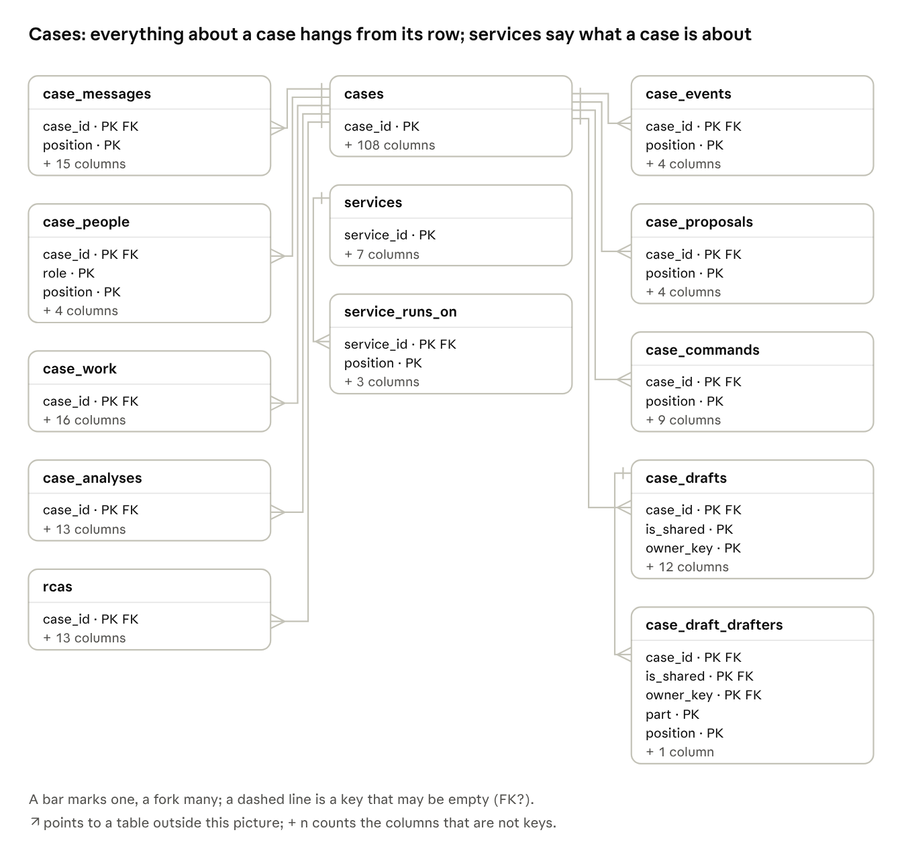

Everything about a case hangs from its row in cases: its messages, the people on it, the work and its history, the Troubleshooter's analysis, the RCA, the changes proposed for it, the commands run from it, and what people are writing and have not sent. services is the catalogue that says what a case is about.

A case names what it links to by id, as plain columns: its cluster, the job, run and finding it came from, other cases, its exception, known issue and service, and the change that was applied.

| Table               | Holds                                                                                                                      |
|---------------------|----------------------------------------------------------------------------------------------------------------------------|
| cases               | The cases: number, source, what each is about, status, outcome, priority, the people on it, what it links to and its times |
| case_messages       | The messages on a case, in order                                                                                           |
| case_people         | Who watches a case, and who approved a change that fixed it                                                                |
| case_work           | The work on a case, one row a case that has any: where it came from, the runs that analyzed it, the fix                    |
| case_analyses       | The Troubleshooter's analysis of a case, one row a case: cause, evidence and the suggested fix                             |
| rcas                | The root cause analysis of a case, one row a case                                                                          |
| case_events         | The history of the work on a case                                                                                          |
| case_proposals      | The changes proposed for a case, who linked each and how the case handled it                                               |
| case_drafts         | What people are writing on a case and have not sent: a reply, a fix, a closing, an RCA                                     |
| case_draft_drafters | Who wrote in each part of a draft, in order                                                                                |
| case_commands       | The commands run from a case through Watson; never their output                                                            |
| services            | The service catalogue: name, what people call it and who to contact                                                        |
| service_runs_on     | Where a service runs                                                                                                       |

### Changes

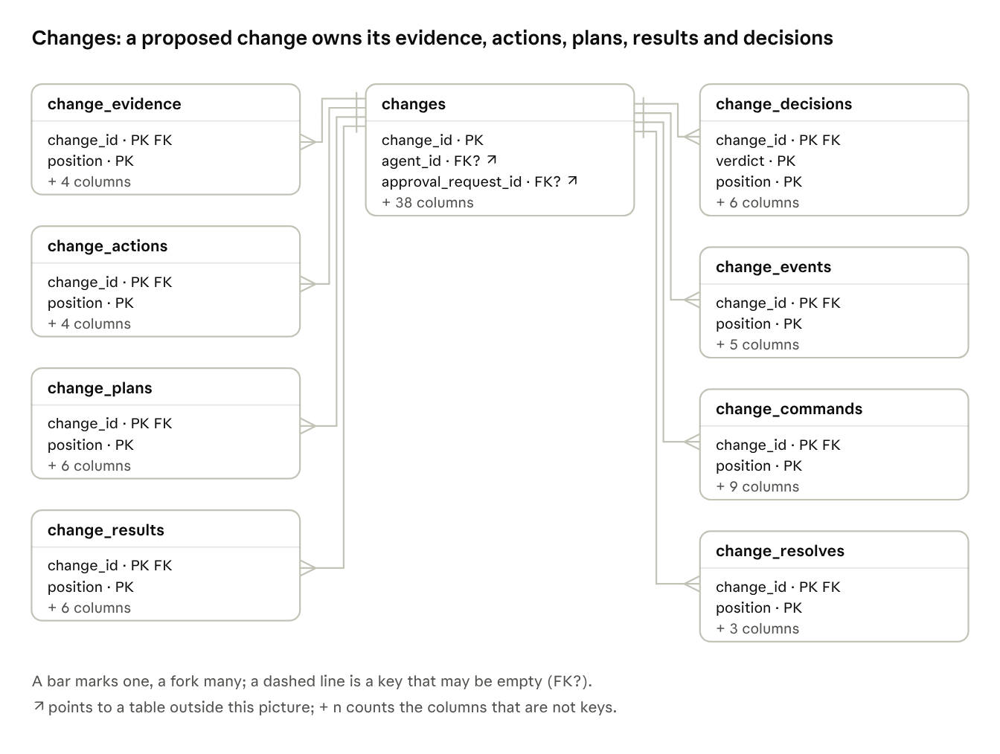

The changes the agents propose, from proposal to applied or failed; the console calls a change a card. A change owns what the agent read, what it will do, Watson's reading of each action, how each action went, its approvals and its history. change_resolves lists the cases and known issues it resolves, by their ids.

People know a change by change_key (PC-12). Its row keeps change_id for as long as the change is kept, which is what a conversation keys to.

| Table            | Holds                                                                                                                           |
|------------------|---------------------------------------------------------------------------------------------------------------------------------|
| changes          | The proposed changes: what started the agent, its reasoning, what must still hold, the state, who asked and who changed it last |
| change_evidence  | What the agent read before it proposed                                                                                          |
| change_actions   | What a change will do, in order, with the agent's word on impact and risk                                                       |
| change_plans     | Watson's reading of each action when the change was proposed                                                                    |
| change_results   | How each action of an approved change went; never its output                                                                    |
| change_decisions | The approvals a change has, in order, and its rejection                                                                         |
| change_events    | The history of a change                                                                                                         |
| change_commands  | The commands run from a change's drawer, and its own actions once approved; never their output                                  |
| change_resolves  | The cases and known issues a change resolves, in order, and who linked each                                                     |

### Conversations

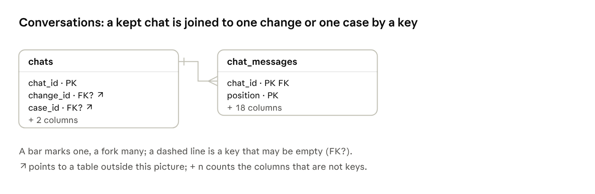

The conversations Sherlock keeps for another record while that record wants it: a waiting change's and a case's. A chat is joined to exactly one of them by a key, never by its session's name, and goes with it. A message's text and what is asked of it are columns; its parts are one JSON value. Other conversations with Sherlock are not kept in the database.

| Table         | Holds                                                                                                               |
|---------------|---------------------------------------------------------------------------------------------------------------------|
| chats         | One row a kept conversation, joined to the change or the case it is of                                              |
| chat_messages | A conversation's messages, in order: the text and what is asked of a message as columns, the rest as one JSON value |

### Knowledge

What outlives the cases it came from, and Mycroft's side: the sources it reads, its syncs, and the wiki page changes that wait for review. The wiki's pages themselves stay in Git or S3.

#### The wiki

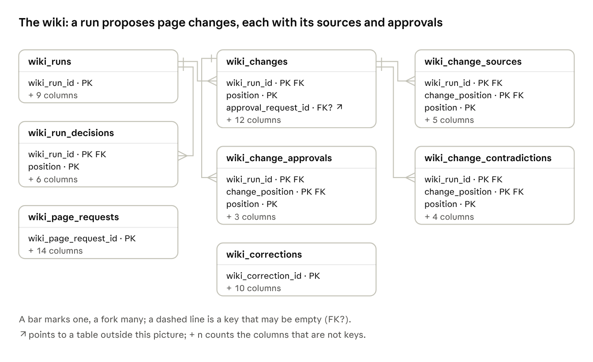

A run proposes page changes; each change lists the source items it draws on, who approved it so far and the fixes it contradicts. Requests to retire a page and the corrections people send with This is outdated stand alone.

| Table                      | Holds                                                                                      |
|----------------------------|--------------------------------------------------------------------------------------------|
| wiki_runs                  | Mycroft's runs of page changes that wait for review, and the newest decided ones           |
| wiki_changes               | The page changes of a run: the page, the diff, its state and why                           |
| wiki_change_sources        | The source items a page change draws on                                                    |
| wiki_change_approvals      | Who approved a page change so far                                                          |
| wiki_change_contradictions | The fixes a page change says otherwise than, and why                                       |
| wiki_run_decisions         | What people decided on a run: who, when, which pages                                       |
| wiki_page_requests         | The requests to retire a wiki page or make it active again, which a second person approves |
| wiki_corrections           | The corrections people sent with This is outdated, and what became of each                 |

#### Sources and syncs

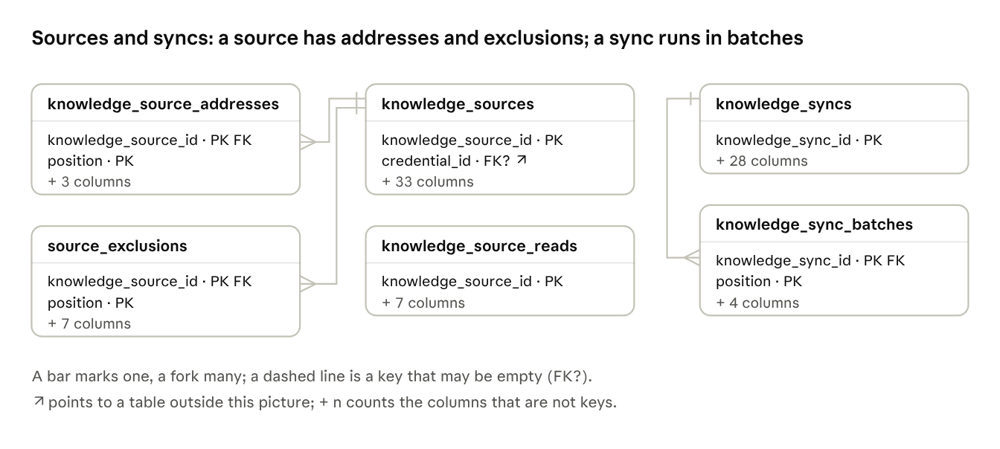

A source has its addresses and its exclusions, and one row for its last read. A sync keeps how each batch of items went. A source may name a credential, a key into Platform that is emptied when the credential goes.

| Table                      | Holds                                                                                                         |
|----------------------------|---------------------------------------------------------------------------------------------------------------|
| knowledge_sources          | The sources Mycroft reads: Confluence, Git, S3, web sites, live addresses, uploads, the console and the fixes |
| knowledge_source_addresses | The addresses of a live source                                                                                |
| source_exclusions          | The items or patterns a source does not read                                                                  |
| knowledge_source_reads     | The last read of each source: when, how many items, what it skipped, why it failed                            |
| knowledge_syncs            | The syncs of Mycroft's sources: the last one whole, and the newest few in short                               |
| knowledge_sync_batches     | How each batch of items given to Mycroft in a sync went                                                       |

#### Fixes, exceptions and known issues

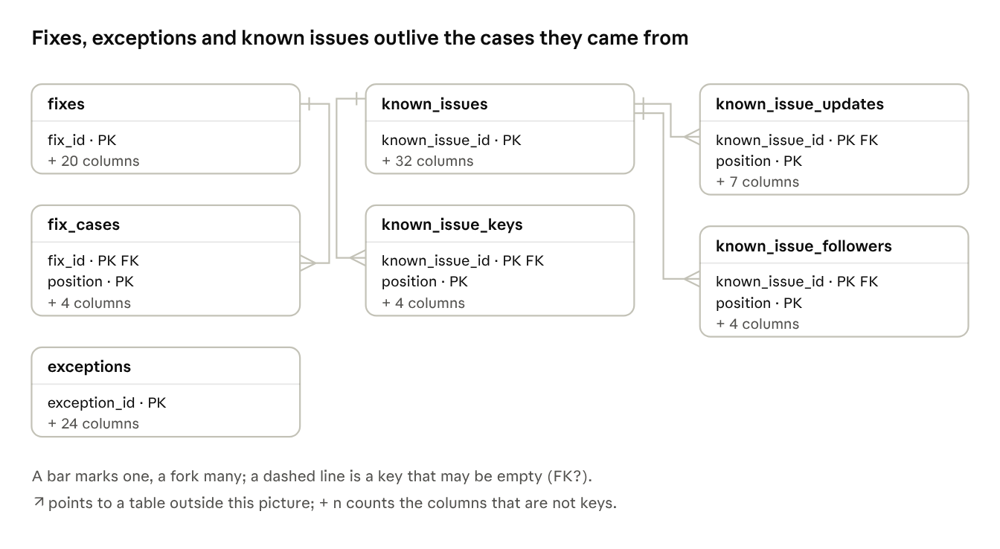

A fix lists the cases it was seen in. A known issue has its dated updates, its followers and the findings it covers. An exception leaves findings on one check, resource and cluster out until it expires or is removed. All three name cases, clusters, jobs and runs by id, as plain columns, so they stay when those go.

| Table                 | Holds                                                                                                                        |
|-----------------------|------------------------------------------------------------------------------------------------------------------------------|
| fixes                 | The recorded fixes: the problem, the cause, the steps, the commands that worked, and whether each is active                  |
| fix_cases             | The cases each fix was seen in, with when, on which cluster and who closed it                                                |
| exceptions            | The accepted exceptions: findings on this check, resource and cluster are left out until the exception expires or is removed |
| known_issues          | The known issues: symptoms, status, workaround, owner, and what the runs still find of them                                  |
| known_issue_updates   | The dated updates on a known issue                                                                                           |
| known_issue_followers | Who follows a known issue                                                                                                    |
| known_issue_keys      | The findings a known issue covers, by cluster, object and check, with the job that found each                                |

## The database's own tables

Two tables belong to no domain. imports is written in the transaction that copies a record set, and the console looks there before it reads a ConfigMap's key or a Secret's again.

| Table             | Holds                                                                                                                                     |
|-------------------|-------------------------------------------------------------------------------------------------------------------------------------------|
| schema_migrations | The steps of the schema that were applied; a build whose file for an applied step differs is refused                                      |
| imports           | The record sets copied into the database from ConfigMaps and Secrets, once each, so that records deleted in the database do not come back |

## Model rules

These rules hold across the schema; docs/data-model.md gives each in full.

- **Keys point down the tiers or stay inside one.** No table keys up: a lower table that records something higher keeps the id as a plain column.

- **Every key is named for its table.** A primary key is \<entity\>\_id; a foreign key has the name of the key it points to, with a role in front for a second key into the same table (retry_of_script_run_id). A list is keyed by its owner's key and position.

- **Natural keys only where the code already has a stable id** (cluster_id, credential_id, agent_id, job_id and ten more). Every other key is a UUIDv7 the console makes, never a sequence. An id people read is a column of its own beside it (case_number, change_key).

- **An id is a key only where the row it names is sure to be there.** Otherwise it is kept as plain text or a number: the record may have no row, may go first, or is written again with a new row id.

- **Names say what a column holds.** A flag starts with is\_ or has\_, a time ends in \_at, who did something in \_by, money in \_usd.

- **History outlives what it points to.** A run or record that outlives its target holds a key that is emptied, beside the target's name as text.

- **A cluster is cluster_id everywhere.** Only Platform and Inventory hold a real key to clusters; every other domain keeps the id as a plain column. A removed connection keeps its row, with only its id.

- **Sign-in never depends on the database while the console runs.** Local accounts stay in a Secret, and a sign-in while the session store is away gets a short-lived signed session. A console does not start without its database.

- **Kubernetes state is never stored,** and what the facts run observes on a host is one JSON value, not columns.

- **A record is one row for its whole life.** Approval changes its state; there are no tables of drafts of records.

- **Versioned things keep their history in a versions table:** script_versions and prompt_versions.

- **JSON only for what is read whole.** Six columns: settings.value, approval_requests.summary, host_facts.facts, change_actions.args, changes.condition_args and chat_messages.parts.

- **Ledgers are only added to:** audit_events and ai_spend.

- **Secrets stay in Kubernetes.** No column holds a secret; the tables hold the rest of a credential, an application and a connection.

- **Bodies stay where they are:** wiki pages in Git or S3, Toolbox transcripts on their volume.

## Decisions

These questions are decided.

| Question                                                                        | Decision                                                                                                                                                                                                                                                       |
|---------------------------------------------------------------------------------|----------------------------------------------------------------------------------------------------------------------------------------------------------------------------------------------------------------------------------------------------------------|
| Is a record that another one names joined by a key, or named by its id?         | By a key where the row is sure to be there and keeps its id; by its id as plain data where it may have no row, may go first, or is written again with a new row id                                                                                             |
| Where do the conversations Sherlock keeps belong?                               | In the AIOps flow tier, as a domain of their own beside Changes and Cases. A conversation is joined to its change or its case by a key, never by its session's name (Nov 20, 2026)                                                                             |
| What of a record that was kept in a Secret moves to the database?               | Everything but the secret: the secret part of a credential, an application's values file and parameters, and a connection's credential stay in their Secrets (Nov 20, 2026)                                                                                    |
| Does a console start without its database?                                      | No: it waits two minutes, stops and is started again. Starting without it is an option, off unless set (Nov 20, 2026)                                                                                                                                          |
| What may be JSON?                                                               | What is read whole and has no fixed shape: a settings document, a request's summary, a host's facts, the arguments of a change's action and of its condition, and a message's parts                                                                            |
| Is a request for a run a record of its own?                                     | No: it is a row of script_runs, the same row the run is written into once approved. Requests and runs are numbered apart                                                                                                                                       |
| Should job runs and case analyses record the prompt version that produced them? | Not now: the code does not record it, so it would be a new feature                                                                                                                                                                                             |
| What happens to fleets and hosts when a cluster connection is removed?          | Selector fleets are deleted. List fleets and hosts outside Kubernetes stay, with no cluster, and show under every cluster. The administrator chooses for each node whether to delete it or keep it as a host. The keys allow it; the services do not do it yet |
| Do RCAs belong in Cases or Knowledge?                                           | Cases: an RCA is written when its case closes and is a row keyed by its case                                                                                                                                                                                   |
| Do validation rules belong in Jobs or Cases?                                    | Jobs: they are offered to job kinds and shown under the Jobs tab                                                                                                                                                                                               |
| Do variables belong in Automation or Inventory?                                 | Automation: only script runs read them, although they key to fleets and hosts                                                                                                                                                                                  |
| Do known issues and services belong in Cases or Knowledge?                      | Known issues in Knowledge, with the fixes and the exceptions: they outlive the cases they came from. Services in Cases                                                                                                                                         |
| Does clusters hold connection metadata, or does everything stay in Secrets?     | A table for the metadata, the credential in a Secret, whole                                                                                                                                                                                                    |
| Do local users and sign-in sessions move to the database?                       | Local accounts stay in a Secret, so a database outage never blocks them. Sessions move; during an outage a sign-in of any kind gets a short-lived signed session                                                                                               |
| Does one rejection close an approval request for good?                          | Yes; a new request is needed to try again                                                                                                                                                                                                                      |
| Will any request need more than two approvers?                                  | No flow needs it today; required_count allows any number                                                                                                                                                                                                       |
| Are the tables nothing writes yet kept?                                         | data_centers stays for the page that will fill it, and schedule_claims for the jobs' schedules. A table nothing will use is dropped (wiki_pages was)                                                                                                           |

## Change log

| Date         | Change                                                                                                                                                                                                                                                                                                                                                                                                                                                                                                                                                                                                                                                                                                                                                                                                                                                                                                                                                                                                                                                                                                                                                                                                                                                           |
|--------------|------------------------------------------------------------------------------------------------------------------------------------------------------------------------------------------------------------------------------------------------------------------------------------------------------------------------------------------------------------------------------------------------------------------------------------------------------------------------------------------------------------------------------------------------------------------------------------------------------------------------------------------------------------------------------------------------------------------------------------------------------------------------------------------------------------------------------------------------------------------------------------------------------------------------------------------------------------------------------------------------------------------------------------------------------------------------------------------------------------------------------------------------------------------------------------------------------------------------------------------------------------------|
| Nov 20, 2026 | Rebuilt from the final schema of branch phase-13-store, steps 0001 to 0037: 121 tables in 12 domains. Conversations is a new domain, and Knowledge is drawn in three parts. Every diagram now shows each table's keys and relations and counts its other columns; docs/data-model.md lists every column. The section "As built: where the schema differs" is gone, since this page is the schema as built. Decided the same day: a console does not start without its database.                                                                                                                                                                                                                                                                                                                                                                                                                                                                                                                                                                                                                                                                                                                                                                                  |
| Nov 19, 2026 | Added "As built: where the schema differs": Automation, AI configuration and Jobs are built on branch phase-13-store with every field a column, 98 tables in all. Runs that wait for approval share script_runs with the runs. ai_spend is a ledger of one row per cost. Jobs claim a scheduled time on the job's row, not through schedule_claims. The diagrams and column tables of these three domains still show the model.                                                                                                                                                                                                                                                                                                                                                                                                                                                                                                                                                                                                                                                                                                                                                                                                                                  |
| Nov 18, 2026 | Removing a cluster no longer deletes list fleets or external hosts: their cluster_id is set to null and they show under every cluster; selector fleets are deleted, and each node is deleted or kept as a host by the admin's choice. Hosts gain rack_name and data_center_id, with a new data_centers table; network details stay in host_facts. Local users, groups and memberships left PostgreSQL and stay in a Secret, with signed fallback sessions during a database outage. Open questions closed as Decisions. 73 tables.                                                                                                                                                                                                                                                                                                                                                                                                                                                                                                                                                                                                                                                                                                                               |
| Nov 18, 2026 | Every key renamed to \<entity\>\_id across all domains, with role prefixes for second references and composite keys on join tables; cases get a UUID key beside case_number. Inventory: host_logins split from host_pairings; ceiling and reboot timeout on fleets and hosts. Automation: automation_runs and run_nodes became script_runs and script_run_hosts; fleet_variables became one variables table on a fleet or host; variable_changes split into the change and its items; added script_version_parameters, run_profile_fleets and the run snapshot tables script_run_fleets, script_run_values and script_run_host_fleets. AI configuration: agents keyed by catalog id; test_results became test_case_results; added test_run_replays; ai_spend made insert-only. Jobs: run_facts folded into job_runs; added cluster_checks. Cases: added case_links and rca_cases; known issues moved to Knowledge. Changes: cards renamed to changes; card_results folded into change_actions; added change_cases; notification_channels moved to Approvals. Knowledge: exclusions became source_exclusions keyed to their source; added known_issue_services. Platform: added credentials. New rules on key direction, naming, natural keys, history and JSONB. |
| Nov 18, 2026 | Renamed helm_repositories to repositories (Git, Helm and OCI) and made applications.repository_id optional. Renamed users and user_groups to local_users and local_user_groups, and added super_roles. Rebuilt Inventory as hosts, fleets, fleet_hosts, host_facts and host_pairings: nodes and external hosts share one table, node rows hold identity only and are deleted when the node leaves, and hosts carry no labels. Automation variables now key to Inventory, and run results keep node names as text. Added rules on history, Kubernetes state and keys into foundation tables.                                                                                                                                                                                                                                                                                                                                                                                                                                                                                                                                                                                                                                                                      |
| Nov 18, 2026 | Added the domains diagram and a crow's-foot data model for each of the 11 domains, with key columns and relations.                                                                                                                                                                                                                                                                                                                                                                                                                                                                                                                                                                                                                                                                                                                                                                                                                                                                                                                                                                                                                                                                                                                                               |
| Nov 18, 2026 | Approvals added as a foundation domain. Removed script_decisions, card_decisions, draft_approvals, admin_requests, standing_approvals and prompt_drafts. Renamed wiki_drafts to wiki_changes.                                                                                                                                                                                                                                                                                                                                                                                                                                                                                                                                                                                                                                                                                                                                                                                                                                                                                                                                                                                                                                                                    |
| Nov 18, 2026 | First cut: ten domains in three tiers, derived from the Go packages on main.                                                                                                                                                                                                                                                                                                                                                                                                                                                                                                                                                                                                                                                                                                                                                                                                                                                                                                                                                                                                                                                                                                                                                                                     |
