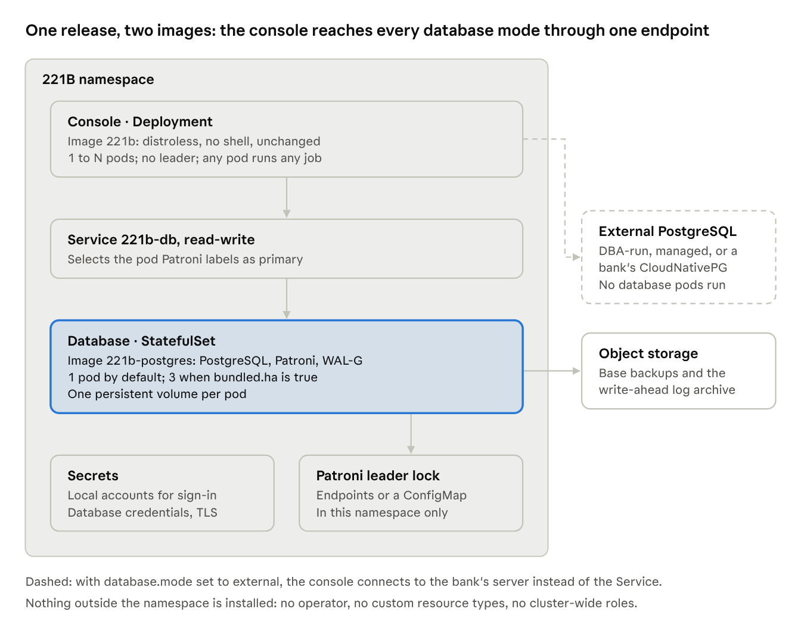

# 221B storage deployment design

> Exported on November 21, 2026 from the Claude doc [221B storage deployment design](https://claude.ai/artifact/UkeJEapC2JvDJVdvtsxu9H), where it is edited. Do not edit this copy: export it again after the doc changes.

Nov 21, 2026 · Mikhail Stolpner

## Summary

221B moves its records from ConfigMaps to PostgreSQL. This document says how that database is deployed and how the console uses it. The data model itself is in *221B data model: domains and tables*, and the engine choice is in *221B storage engine options*.

- **PostgreSQL is the only engine.** It is either bundled with 221B or provided by the customer.

- **One release, two images.** 221b stays a distroless console image. A new 221b-postgres image carries PostgreSQL, Patroni and WAL-G, built and versioned in the same pipeline.

- **Bundled is the default, as a single instance with no HA.** One value, database.bundled.ha: true, turns on three instances with automatic failover and synchronous replication.

- **External PostgreSQL is a first-class mode.** It covers a bank's DBA-run server, a managed service (RDS, Cloud SQL, Azure) and a CloudNativePG cluster the platform team already runs.

- **221B depends on no operator.** Patroni keeps its leader lock in ordinary Kubernetes objects in 221B's namespace, so the chart installs no custom resource types and needs nothing cluster-wide.

- **The console has no leader.** Every pod is equal; jobs coordinate through the database with claim rows, advisory locks and SKIP LOCKED queues.

- **Sign-in never depends on the database.** Local accounts stay in a Kubernetes Secret, so break-glass sign-in works through a database outage.

## Goals and non-goals

**Goals**

- One or many console pods share the same records and see each other's changes within a second.

- No single point of failure when HA is on: losing a node, a pod or a volume loses no committed data and stops writes for seconds at most.

- A first install needs nothing but the 221B chart: no operator, no cluster-wide resources, no database team.

- Banks that run their own PostgreSQL point 221B at it with a connection string and a Secret.

- Backups and point-in-time recovery are on from the first install, in every mode.

- Every mode looks the same to the console: one read-write endpoint.

**Non-goals for now**

- Writes accepted at two sites at once. The model stays ready for it (UUIDv7 keys, insert-only ledgers, commit timestamps), and pgEdge on CloudNativePG is the path if a bank requires it.

- Read replicas for console queries. The data is small; every query goes to the primary.

- A connection pooler. Each pod holds a small pool of its own; a pooler is added only for a bank that already runs one in front of its servers.

- Supporting databases other than PostgreSQL.

## Components

| Component                | What it is                                      | Notes                                                                                                 |
|--------------------------|-------------------------------------------------|-------------------------------------------------------------------------------------------------------|
| 221b image               | The console: the Go server and web UI           | Stays distroless and static. It never contains PostgreSQL, Python or a shell                          |
| 221b-postgres image      | PostgreSQL, Patroni and WAL-G on a minimal base | Built in the same repository and pipeline, tagged with the same version, signed and scanned like 221b |
| Console Deployment       | 1 to N stateless pods                           | No leader. Every pod reads and writes through one endpoint                                            |
| Database StatefulSet     | 1 pod by default, 3 with HA                     | Bundled mode only. Each pod has its own persistent volume                                             |
| 221b-db Service          | The read-write endpoint                         | Selects whichever pod Patroni has labelled primary, so it follows a failover                          |
| 221b-db-replicas Service | The standbys                                    | HA only, for backups and checks; the console does not use it                                          |
| Patroni leader lock      | An Endpoints object or a ConfigMap              | Patroni's only state outside PostgreSQL, kept in 221B's own namespace                                 |
| Secrets                  | Local accounts; database credentials; TLS       | Local accounts stay out of the database so sign-in survives an outage                                 |
| Object storage           | S3 or any S3-compatible store                   | WAL-G base backups and the write-ahead log archive                                                    |

One chart installs everything. The user sees one product and one version; only the database pods pull the second image.

## Deployment modes

database.mode chooses between bundled and external; database.bundled.ha chooses single instance or HA.

|                          | Bundled, single (default)                                                      | Bundled, HA                                        | External                                                  |
|--------------------------|--------------------------------------------------------------------------------|----------------------------------------------------|-----------------------------------------------------------|
| Who runs PostgreSQL      | The 221B chart                                                                 | The 221B chart                                     | The bank: DBA team, managed service, or its CloudNativePG |
| Database pods            | 1                                                                              | 3, on separate nodes                               | None                                                      |
| Failover                 | None: the pod is rescheduled and its volume reattached, which can take minutes | Automatic, in seconds, with no committed data lost | The provider's                                            |
| Backups                  | WAL-G to object storage, on by default                                         | Same, taken from a standby                         | The provider's; 221B's own export still works             |
| What the bank must allow | Persistent volumes                                                             | Persistent volumes on three nodes                  | A network path and a database role                        |
| Suited to                | Evaluation, small and non-production installs                                  | Production without a DBA team                      | Banks with a database standard                            |

**Changing mode.**

- **Single to HA** is an upgrade with bundled.ha: true. Two standbys join and copy from the primary while it keeps serving; the console sees no change.

- **HA to single** needs a short pause for writes while Patroni stops the standbys. It is allowed, but the chart warns.

- **Bundled to external, or the reverse,** is a migration: 221B's backup export is restored into the target, then the chart is switched. This is a planned change with a maintenance window, not a value flip.

The chart refuses a production-labelled namespace in single mode unless database.bundled.acknowledgeNoHA is set, so a bank never runs without HA by accident.

## Bundled database

### Image

221b-postgres holds PostgreSQL from the PostgreSQL project's own packages, Patroni in an isolated Python environment, and the WAL-G binary, on a minimal Debian base. It runs as a non-root user with a read-only root filesystem; only the data volume and a temporary directory are writable. Each 221B release line pins one PostgreSQL major version (18 to start), and patch releases of PostgreSQL ship as patch releases of 221B.

### StatefulSet

- **Pods:** 1, or 3 with HA. With HA, pods are required to land on different nodes and spread across zones where the cluster has them, and a disruption budget allows only one pod down at a time.

- **Volume:** one ReadWriteOnce volume per pod, 10 GiB by default, any storage class. The write-ahead log sits on the same volume.

- **Resources:** 250m CPU and 512 MiB requested, 1 CPU and 1 GiB limit by default. The data is megabytes to a few gigabytes.

- **Shutdown:** a long enough grace period for Patroni to hand over cleanly before a pod stops.

### Patroni

- **Leader lock in ConfigMaps.** Patroni keeps its lock and cluster state in ConfigMaps in 221B's namespace and labels each pod with its role. ConfigMaps rather than Endpoints, because Kubernetes is moving away from the Endpoints API.

- **Failsafe mode on.** If the Kubernetes API is unreachable, the primary keeps serving as long as it can reach every member directly, instead of demoting itself.

- **Synchronous quorum in HA.** A commit waits for one of the two standbys (synchronous_mode: quorum, one node). Losing one standby never stops writes, and a failover never loses a committed transaction. Single mode runs Patroni as a one-member cluster, so turning on HA only adds members.

- **Failover timing.** With Patroni's defaults (30-second leader lease, 10-second loop), a dead primary is replaced within about 30 seconds; a planned switchover takes a few seconds. pg_rewind lets a former primary rejoin as a standby without a full copy.

- **Role:** a namespaced Role allowing Patroni to read and write ConfigMaps and to read and label pods. Nothing else.

### Services

- 221b-db selects the pod labelled primary. It is the console's only endpoint.

- 221b-db-replicas selects the standbys, in HA only.

- A headless Service gives each pod a stable name for replication.

### PostgreSQL settings

- TLS on, with certificates from a Secret (generated by the chart unless one is given). pg_hba accepts only TLS connections, with SCRAM passwords, from inside the namespace; a NetworkPolicy admits only console and database pods.

- track_commit_timestamp = on, as the model's design rules require.

- Modest memory settings sized to the pod's limit, set through Patroni so they apply to every member.

### Roles

| Role        | Used by      | Notes                                                   |
|-------------|--------------|---------------------------------------------------------|
| Superuser   | Patroni only | Password in a Secret; never given to the console        |
| Replication | Standbys     | Password in a Secret                                    |
| app_221b    | The console  | Owns the 221B database and its schemas; runs migrations |

### Backups

- **Continuous archiving.** Every completed write-ahead log segment is pushed to object storage by WAL-G, so recovery can reach any point in time.

- **Base backups** run from a backup sidecar in each database pod, on a schedule (daily by default). Only one member acts: a standby in HA, the primary in single mode. The members agree through a PostgreSQL advisory lock, so no Kubernetes exec rights are needed.

- **Retention:** 7 base backups and the WAL between them by default.

- **Without object storage,** the sidecar writes to a second volume instead. The chart warns that this does not survive losing the namespace's storage.

- **Restore** bootstraps a new database from the archive, to the latest point or to a given time: database.bundled.restore.fromBackup: true with an optional targetTime.

### Monitoring

Patroni's REST API exposes health and Prometheus metrics on each pod. The chart can add a PodMonitor when the Prometheus Operator is present; it is optional and nothing depends on it.

## External PostgreSQL

With database.mode: external, the chart deploys no database: no 221b-postgres pods, volumes, Patroni role or database services. The console connects to a PostgreSQL the operator already runs: a managed service, a team's own Patroni or CloudNativePG cluster, or a central database platform.

### Connection settings

| Setting          | Meaning                                                                                                                                        |
|------------------|------------------------------------------------------------------------------------------------------------------------------------------------|
| host, port       | Read-write endpoint. For CloudNativePG, the cluster's -rw Service; for Patroni, the primary Service or a load balancer that follows the leader |
| database         | Database name; created beforehand by the operator                                                                                              |
| user             | Login role for the console                                                                                                                     |
| passwordSecret   | Secret name and key holding the password. Not set when using client certificates only                                                          |
| sslMode          | verify-full by default; require allowed with a warning; disable refused unless allowInsecure is set                                            |
| caSecret         | CA bundle used to verify the server's certificate. Not needed when the server's CA is publicly trusted                                         |
| clientCertSecret | Optional TLS client certificate and key, for servers that authenticate by certificate                                                          |
| maxConnections   | Upper bound on the console's pool, across all console replicas                                                                                 |
| listenerHost     | Optional separate address for the one long-lived LISTEN connection, when host points at a pooler                                               |
| iamAuth          | Optional: aws-rds or gcp-cloudsql, fetching short-lived tokens instead of a password                                                           |

The password is read from the Secret at start and again whenever the Secret changes, so rotating it needs no restart.

### What the database must provide

- **Version:** PostgreSQL 16 or later. The console checks at start and refuses to run on an older server.

- **A role that owns the 221B schemas.** Migrations run as this role at start, under an advisory lock, and create the schemas they need. The role needs no superuser rights, no replication rights and nothing outside its own database.

- **Extensions:** none required. pgcrypto is not used; UUIDv7 keys are made in the console.

- **Settings:** track_commit_timestamp = on is recommended (the model relies on it for conflict analysis in a future multi-site setup); the console warns if it is off but runs.

- **LISTEN/NOTIFY and session advisory locks,** which every PostgreSQL has, provided nothing between the console and the server breaks sessions (see poolers).

- **Connections:** the console holds up to maxConnections plus one listener connection per replica. The default of 20 suits 2–3 console replicas.

### Managed services

| Service                                         | Notes                                                                 |
|-------------------------------------------------|-----------------------------------------------------------------------|
| Amazon RDS and Aurora PostgreSQL                | Works. IAM authentication optional. Aurora readers are not used       |
| Google Cloud SQL and AlloyDB                    | Works through the private IP or the Cloud SQL Auth Proxy as a sidecar |
| Azure Database for PostgreSQL (Flexible Server) | Works                                                                 |
| Crunchy Bridge, Neon, Supabase and similar      | Work if they offer a direct (non-pooled) connection for the listener  |

### Poolers

PgBouncer and similar poolers in transaction mode break two things the console needs: LISTEN/NOTIFY, and session advisory locks used for leaderless coordination. The rules:

- Session mode, or no pooler, is fully supported.

- Transaction mode is supported only when listenerHost points at a direct connection. The console then takes its LISTEN connection and every advisory lock on that direct connection, and sends ordinary queries through the pooler.

- The console's own pool is small, so most installations need no pooler at all.

### High availability

Availability is the operator's. The console needs only one address that always reaches the current primary, and it reconnects with backoff when that primary changes. During a failover, reads and writes that need the database fail for those seconds, and the console behaves as described under failure behaviour.

### Backups

Backups are the operator's too. The console's own sealed export (described under backup and restore) still works in external mode, as a portable copy that does not depend on the database platform.

## Console coordination without a leader

Today one console replica holds a Kubernetes lease and runs the scheduler and background sweeps. With PostgreSQL, the database itself coordinates the replicas, and the lease goes away. Every replica runs the same loops; the database decides who does each piece of work.

| Work                                                                 | How replicas agree                                                                                                                          | What happens if a replica dies                                                                |
|----------------------------------------------------------------------|---------------------------------------------------------------------------------------------------------------------------------------------|-----------------------------------------------------------------------------------------------|
| Schema migrations at start                                           | pg_advisory_lock on a fixed migration key; others wait, then see the schema is current                                                      | The lock is released with its session; the next replica migrates                              |
| Scheduled runs (automation, jobs)                                    | Each replica tries INSERT INTO schedule_claims (schedule_id, due_at) … ON CONFLICT DO NOTHING; the one whose insert succeeds starts the run | The run row shows it was started; the stale-run sweep marks it failed if its replica vanished |
| Queued work (job steps, agent tasks, notifications)                  | SELECT … FOR UPDATE SKIP LOCKED LIMIT n on the queue table                                                                                  | The row lock is released with the transaction; another replica picks the item up              |
| Periodic sweeps (node sweep, stale runs, retention, approval expiry) | pg_try_advisory_lock on a key per sweep; whoever gets it runs that pass                                                                     | The lock is released; the next tick on any replica runs it                                    |
| Cache invalidation and live updates                                  | NOTIFY on commit; each replica holds one LISTEN connection                                                                                  | A missed notice is caught by a slow poll (30 seconds by default)                              |

### Rules

- **Notices are hints.** Every notified change is also found by polling, so a lost notice delays an update but never loses it.

- **Sweeps are idempotent.** Running a sweep twice, or on two replicas after a lock was lost, does no harm.

- **Advisory locks live in a session.** Each replica keeps them on its long-lived listener connection, which must not go through a transaction-mode pooler.

- **Claims are kept briefly** (7 days by default) for diagnosis, then removed by the retention sweep.

### What changes in the chart

- The Lease and the Role permission to manage it are removed.

- Console replicas can scale freely; 2 is the HA default, independent of the database's mode.

### Caveat for later

Advisory locks and NOTIFY belong to one PostgreSQL server. In a future multi-site setup with pgEdge Spock, they are not replicated, so each site would coordinate only its own replicas, and site-wide duties (retention, node sweep) would need to be assigned to one site explicitly. Nothing in this design blocks that, but it is not solved here.

## Helm values reference

Defaults shown. Only database.mode and, in external mode, the connection settings are normally changed.

database:  
mode: bundled \# bundled \| external  
  
bundled:  
ha: false \# true runs 3 members with quorum commit  
acknowledgeNoHA: false \# needed to run single mode in a namespace marked production  
image:  
repository: ghcr.io/ucesys/221b-postgres  
tag: "" \# defaults to the chart's appVersion  
postgresMajor: 18  
storage:  
size: 10Gi  
storageClass: "" \# cluster default when empty  
resources:  
requests: { cpu: 250m, memory: 512Mi }  
limits: { cpu: "1", memory: 1Gi }  
synchronous: quorum \# quorum \| off (HA only)  
tls:  
secretName: "" \# generated when empty  
networkPolicy: true  
podMonitor: false  
backup:  
enabled: true  
schedule: "0 2 \* \* \*"  
retainBaseBackups: 7  
s3:  
bucket: "" \# empty: back up to a second volume  
prefix: 221b  
endpoint: "" \# set for MinIO or other S3-compatible stores  
region: ""  
credentialsSecret: ""  
volume:  
size: 20Gi  
restore:  
fromBackup: false  
targetTime: "" \# RFC 3339; empty restores to the latest point  
  
external:  
host: ""  
port: 5432  
database: "221b"  
user: "app_221b"  
passwordSecret: { name: "", key: password }  
sslMode: verify-full \# verify-full \| verify-ca \| require  
allowInsecure: false  
caSecret: ""  
clientCertSecret: ""  
iamAuth: "" \# "" \| aws-rds \| gcp-cloudsql  
maxConnections: 20  
listenerHost: "" \# direct address when host is a transaction-mode pooler  
  
console:  
replicas: 2  
pollInterval: 30s

### Checks at install

- external with no host: install fails.

- external with sslMode below require and allowInsecure: false: install fails.

- bundled with ha: false in a namespace labelled 221b.io/environment: production and acknowledgeNoHA: false: install fails with a message pointing to ha: true.

- bundled with backups on and no S3 bucket: install succeeds with a warning that backups stay inside the cluster.

- Changing mode on an existing release: upgrade fails. Moving between bundled and external is a migration through the sealed export, not a value change (see changing mode).

## Failure behaviour

| Failure                            | Bundled, single                                                                                         | Bundled, HA                                                                                                              | External                                                            |
|------------------------------------|---------------------------------------------------------------------------------------------------------|--------------------------------------------------------------------------------------------------------------------------|---------------------------------------------------------------------|
| Database pod or primary dies       | Kubernetes restarts the pod on the same volume; database down for the restart, typically under a minute | A standby is promoted within about 30 seconds; no committed data lost                                                    | Depends on the provider; the console reconnects to the same address |
| One standby dies                   | —                                                                                                       | Writes continue on the other standby's acknowledgement; the pod is recreated and catches up                              | —                                                                   |
| Node drained for maintenance       | Database down while the pod moves, if the volume can follow it; otherwise until the node returns        | Patroni switches over before the primary's pod stops; a few seconds of failed writes                                     | Not affected                                                        |
| Kubernetes API unreachable         | Primary keeps running                                                                                   | Failsafe mode: the primary keeps serving while it can reach both standbys; no failover is possible until the API returns | Not affected                                                        |
| Network split isolates the primary | —                                                                                                       | The primary cannot renew its lock and demotes itself; the majority side promotes a standby                               | Provider's behaviour                                                |
| Volume lost or corrupted           | Restore from backup; data since the last archived WAL segment (seconds to a minute) is lost             | The member is rebuilt from the primary; nothing lost                                                                     | Provider's behaviour                                                |
| Whole namespace or cluster lost    | Restore from S3 into a new install; without S3, data is lost except for sealed exports                  | Same                                                                                                                     | Not affected, unless the database lived in that cluster             |

### What users see while the database is down

- **Sign-in keeps working** for local accounts and SSO: local accounts stay in their Secret, and sessions are signed with a key from a Secret, so any replica can verify them.

- **Live Kubernetes views keep working:** nodes, pods, workloads, events and logs come from the Kubernetes API, not the database.

- **Pages backed by the database** (cases, changes, runs, inventory, knowledge, settings stored in the database) show that the database is unavailable and retry on their own.

- **Scheduled runs and agent work pause** and resume when the database returns. Runs that were due during the outage start once, not once per missed tick.

- **Writes made during the outage fail with a clear error;** the console never queues them in memory.

### Health reporting

The console's readiness stays green while the database is down, so it keeps serving the pages that do not need it. A separate health endpoint and a banner in the UI report the database's state, and an event is recorded when the database becomes unavailable and when it returns.

## Upgrades, backup and restore, security

### Upgrades

| What                                               | How                                                                                                                                                                                                                                                                                         |
|----------------------------------------------------|---------------------------------------------------------------------------------------------------------------------------------------------------------------------------------------------------------------------------------------------------------------------------------------------|
| Console                                            | Rolling update of the Deployment. Migrations run at start under the migration lock and are additive within a release line, so old and new replicas can run side by side for the duration of the rollout                                                                                     |
| PostgreSQL minor version (new 221b-postgres image) | Bundled HA: standbys are restarted first, then Patroni switches over to an updated standby, then the old primary restarts. Bundled single: one restart, under a minute of downtime                                                                                                          |
| PostgreSQL major version                           | A 221B release that moves to a new major ships an image holding both the old and new binaries and runs pg_upgrade --link in an init step, after taking a base backup. In HA, standbys are rebuilt from the upgraded primary. Opt-in through database.bundled.postgresMajor; never automatic |
| Patroni or WAL-G                                   | Shipped inside the database image; upgraded with it                                                                                                                                                                                                                                         |
| External database                                  | The operator's responsibility; the console's minimum version is checked at start                                                                                                                                                                                                            |

A migration that removes or renames columns is split across two releases: the first stops using the old column, the second drops it. Rolling back the console by one release is therefore always safe.

### Backup and restore

Two layers, for different failures:

1.  **Database backups** (bundled mode): WAL-G base backups and WAL archive, restored to any point in time. This is the answer to lost volumes and mistakes found within the retention window.

2.  **Sealed export:** 221B's existing export, encrypted with the backup key, now produced from the database. It is portable across modes and versions: an export from a bundled install can be imported into an external one. This is the answer to moving installs, and the only backup the console itself controls in external mode.

Restore drills are part of the release checklist: each release restores the previous release's backup into a fresh namespace in CI.

### Security

- **Images:** 221b stays distroless and holds no database binaries. 221b-postgres is built from a minimal Debian base. Both are scanned on every build, signed with Cosign, and published with an SBOM and build provenance. A critical fix in PostgreSQL, Patroni or the base image triggers a patch release.

- **Pods:** non-root, read-only root filesystem, all capabilities dropped, default seccomp profile, no service account token for the console unless it needs the Kubernetes API (it does, for cluster views; the database pods need theirs for Patroni).

- **Network:** TLS between the console and the database and between members; a NetworkPolicy admits only console and database pods to port 5432 and only database pods to Patroni's API.

- **Secrets:** superuser, replication and application passwords are separate Secrets, generated at install unless supplied. The console only ever receives the application role's password.

- **Least privilege:** the application role owns only the 221B database. Patroni's Kubernetes rights are limited to ConfigMaps and pod labels in the namespace.

- **Backups:** WAL-G encrypts with a key from a Secret before upload (libsodium), so the bucket holds no readable data. The sealed export uses the separate backup key.

## Moving from ConfigMaps

- **First start imports once.** When a console finds an empty database and 221B data in ConfigMaps, it imports the ConfigMaps under the migration lock, records the import in the database, and marks each ConfigMap as imported with an annotation. It never writes to ConfigMaps again for an imported domain.

- **Domain by domain.** The import follows the phased plan in the data model: Platform and Inventory first, then Automation, AI configuration and Jobs, then Cases, Changes and Knowledge. A release can move some domains while the rest stay in ConfigMaps.

- **Not imported:** local accounts stay in their Secret; the session signing key stays in its Secret.

- **Kept for one release.** Imported ConfigMaps are left in place for one release as a fallback, then deleted by the next release's import step. A sealed export taken before the upgrade is recommended and the upgrade notes say so.

- **Rollback:** before the ConfigMaps are deleted, rolling back the console to the previous release returns to the ConfigMap data as it was at import. Changes made after the import are not carried back.

## Open questions

1.  **Minimum PostgreSQL version** for external mode: 16 is proposed; 15 would widen managed-service coverage slightly.

2.  **WAL-G or pgBackRest.** WAL-G is a single binary and fits the image; pgBackRest has stronger verification and parallel restore but needs its own repository host or sidecar. WAL-G is proposed.

3.  **Pooler policy:** whether to ship an optional PgBouncer in bundled mode at all, or leave pooling to external setups only. Not shipping one is proposed.

4.  **Default volume size:** 10 GiB proposed; needs measuring against a year of runs, facts and audit history on a large fleet.

5.  **Production guard:** whether the namespace label is the right signal for requiring acknowledgeNoHA, or whether a values flag alone is enough.

## References

- *221B data model: domains and tables* — the 126 tables, model rules and decisions this storage serves.

- [221B storage engine options](https://claude.ai/artifact/HxfnCu6MjGp8SSVLWUNaCr) — why PostgreSQL, and the multi-site options considered.

- Patroni documentation: Kubernetes DCS, failsafe mode, synchronous replication modes.

- WAL-G documentation for PostgreSQL.

## As built and decided, Nov 19, 2026

The bundled database and the schema are built on branch phase-13-store, and twelve cluster tests have run in namespace 221b-github. They covered one member and three, a switchover, a failover, restores in place to the newest point and to a point in time, an upgrade of a 0.12.1 release with no database to the bundled default, and the schema from step 37 to 49. The three tables below say what was built or decided by date. Where they differ from the sections above, or from each other, the newest is right.

| Topic                         | As built or decided                                                                                                                                                                                                                                                                                                                                                                                                                                                                            | Status                                                                                                                   |
|-------------------------------|------------------------------------------------------------------------------------------------------------------------------------------------------------------------------------------------------------------------------------------------------------------------------------------------------------------------------------------------------------------------------------------------------------------------------------------------------------------------------------------------|--------------------------------------------------------------------------------------------------------------------------|
| Patroni with one member       | Patroni stays in the bundled database when it has one member, for this release. Decide again after three members have run in a cluster.                                                                                                                                                                                                                                                                                                                                                        | Decided Nov 19                                                                                                           |
| Database pods' permissions    | The pods' Role lets them get, patch, update and delete only Patroni's five ConfigMaps (\<release\>-db-config, -leader, -failover, -sync, -failsafe) and patch only their own pods (\<release\>-db-0 to -2). They can still create, list and watch ConfigMaps.                                                                                                                                                                                                                                  | Built; held with one member in the fourth cluster test and with three, through a switchover and a failover, in the fifth |
| Console start                 | The console waits up to two minutes for its database at start and has a startup probe, so the liveness probe does not stop it while it waits.                                                                                                                                                                                                                                                                                                                                                  | Built and tested in a cluster                                                                                            |
| Schema steps                  | A step is never edited once written: every step's checksum is recorded and tested, and a database made by another build of the schema is refused with both checksums and what to do. A change is a new step.                                                                                                                                                                                                                                                                                   | Built after the second cluster test                                                                                      |
| Backups                       | With backups in a volume, the primary takes the base backup. The backup container looks at once at start and reads WAL-G's history files to tell a new timeline.                                                                                                                                                                                                                                                                                                                               | Built and tested in a cluster; a restore in place to the newest point ran once and worked                                |
| Chart mode guard              | Changing database.mode on an installation that already has a bundled database is refused with a message that names what to remove first.                                                                                                                                                                                                                                                                                                                                                       | Built                                                                                                                    |
| Images                        | 221b-postgres is built beside the console's image from the same release. CI and release do not build, scan, sign or publish it yet.                                                                                                                                                                                                                                                                                                                                                            | Open                                                                                                                     |
| What uses the database        | Every record set that was kept in a ConfigMap keeps its records in the database when one is configured: Activity log, Approvals, Inventory, Platform, Automation, AI configuration, Jobs, Changes, Knowledge and Cases. Of what was kept in Secrets, the part that is not secret does too: the credentials' list, the applications, the cluster connections and the sign-in sessions. Every secret stays in its Secret. database.mode stays none by default until the owner decides otherwise. | Built by Nov 20; ten cluster tests                                                                                       |
| Coordination between replicas | The agents' spend is rows that are only ever added, so replicas no longer take turns to save it. A job's scheduled time is still claimed on the job's row in one transaction, not through schedule_claims.                                                                                                                                                                                                                                                                                     | Built; schedule_claims comes with the jobs' repository                                                                   |
| CI                            | CI has not run on the branch. It runs when the branch is ready for release.                                                                                                                                                                                                                                                                                                                                                                                                                    | Decided Nov 19                                                                                                           |

### Added on Nov 20, 2026

| Topic                                               | As built or decided                                                                                                                                                                                                                                                                                                                    | Status                                                |
|-----------------------------------------------------|----------------------------------------------------------------------------------------------------------------------------------------------------------------------------------------------------------------------------------------------------------------------------------------------------------------------------------------|-------------------------------------------------------|
| Database away at start                              | A console does not start without its database: it waits two minutes, stops and is started again. Starting without it (database.startWithoutIt: true) was built that night as the default, and removed the next day.                                                                                                                    | Decided Nov 20; the default not yet seen in a cluster |
| Database away while the console runs                | The console stays ready and serves sign-in and the pages read live from Kubernetes. One failed 2-second probe marks the database away; every call is then refused at once and the API answers 503 with one sentence, until a probe on a connection of its own succeeds. The app has no banner for it yet.                              | Built; held in the tenth cluster test                 |
| Sign-in during an outage                            | A sign-in while the session store is away gets a session signed by the console and kept in its cookie, for local accounts, a directory and OIDC: 30 minutes, not renewed, exchanged for a stored one when the store is back. Its key is the Secret \<release\>-session-key; whoever can read that Secret can sign a session as anyone. | Built; held in the ninth and tenth cluster tests      |
| Sign-in sessions                                    | With a database the sessions are rows of auth_sessions, shared by every replica; without one they stay Secrets.                                                                                                                                                                                                                        | Built; held in the ninth cluster test                 |
| Record sets leave their ConfigMaps and Secrets      | Once a record set's copy is recorded in imports, it is removed from its ConfigMap. Of a Secret only the part that moved is removed, and no secret key is touched. Going back to a console without the database then means a restore: save the ConfigMaps and Secrets to a file before the upgrade.                                     | Built; held in the seventh and ninth cluster tests    |
| A copy from a Secret that fails                     | It does not stop the start: the Secret is left as it was and the next start tries again (the connections' copy every 30 seconds too). Until then the console runs with that record set empty.                                                                                                                                          | Built; stands as explained to the owner on Nov 20     |
| Empty session Secrets and sessions after a rollback | The console is to delete the session Secrets that hold no data once the sessions' copy is recorded, and to end the stored sessions from before a rollback at the roll forward.                                                                                                                                                         | Decided Nov 20; not built                             |
| Backup file and logs                                | The console's backup file is to seal an application's values file, parameters and commands' parameters like the other secrets, and a saved command's parameters are to be masked in the audit log and the console's log.                                                                                                               | Decided Nov 20; not built                             |
| Restore to a point in time                          | restore.targetTime is checked as RFC 3339 with a time zone, and a time ending in Z is passed on as +00:00.                                                                                                                                                                                                                             | Built; held in the eighth cluster test                |

### Added on Nov 21, 2026

| Topic                       | As built or decided                                                                                                                                                                                                                                                             | Status                                                                                                       |
|-----------------------------|---------------------------------------------------------------------------------------------------------------------------------------------------------------------------------------------------------------------------------------------------------------------------------|--------------------------------------------------------------------------------------------------------------|
| Modes                       | There is no mode without a database: bundled (the default, one member, ha: false) or external. A release with no database, 0.12 among them, upgrades to the bundled default and copies its records at the first start.                                                          | Decided Nov 20; held in the eleventh cluster test                                                            |
| ConfigMaps of before        | The console deletes each one once everything it held is copied. Until 0.14 the chart renders one only while lookup finds it, empty and kept, so Helm never deletes one before the copy. 0.14 drops the templates and refuses to upgrade a release that still has one (ADR-167). | Built; held in the eleventh cluster test                                                                     |
| Start without the database  | Removed. A console waits two minutes for its database, stops and is started again.                                                                                                                                                                                              | Decided Nov 20; built                                                                                        |
| Sensitive variables         | A sensitive variable's value is kept in a Secret of its cluster; rows hold only a keyed digest (DB-71).                                                                                                                                                                         | Built; no planted secret reached the database, the logs or the backup in the eleventh test; confirmed Nov 21 |
| Backup file and logs        | The backup file seals an application's values, parameters and commands' parameters (BK-15). Everything Watson records is masked, and past audit events were rewritten to match.                                                                                                 | Built; confirmed Nov 21                                                                                      |
| Sessions                    | Empty session Secrets are deleted after the copy. The sessions from before a rollback are ended when a session Secret holds a session started more than 10 minutes after the copy.                                                                                              | Built; confirmed Nov 21                                                                                      |
| Database away while running | A banner, ? for counts that cannot be known, and a 503 the app tells apart by its header.                                                                                                                                                                                       | Built                                                                                                        |
| External database           | iamAuth signs in with an RDS IAM token or a Cloud SQL token.                                                                                                                                                                                                                    | Built; not run against a cloud                                                                               |
| Backups                     | The backup container is a Go program on a cron schedule (backup.schedule); dailyAt is still read until 0.14.                                                                                                                                                                    | Built; the schedule not yet seen over days                                                                   |
| Database image              | CI and the release build, scan, sign and publish 221b-postgres. The scan fails only on a high or critical finding that has a fix; 222 such findings had no fix in Debian on Nov 20. A Wolfi-based variant is to be built and compared before 0.13 ships.                        | Built, CI not run; confirmed Nov 21                                                                          |
| The Lease                   | Stays in 0.13.0, unlike *What changes in the chart* above: the leader still runs the informers, the Toolbox, work in flight and the scheduled passes.                                                                                                                           | Confirmed Nov 21; to look at again in 0.14                                                                   |
| Job budgets                 | A job's run stops before a model call once its spend reaches its budget.                                                                                                                                                                                                        | Built; the fix not yet seen in a cluster                                                                     |
| Schema                      | Steps 0001 to 0049, 126 tables. The twelfth test took the test release from step 42 to 49 with nothing lost and no step run twice.                                                                                                                                              | Built                                                                                                        |
