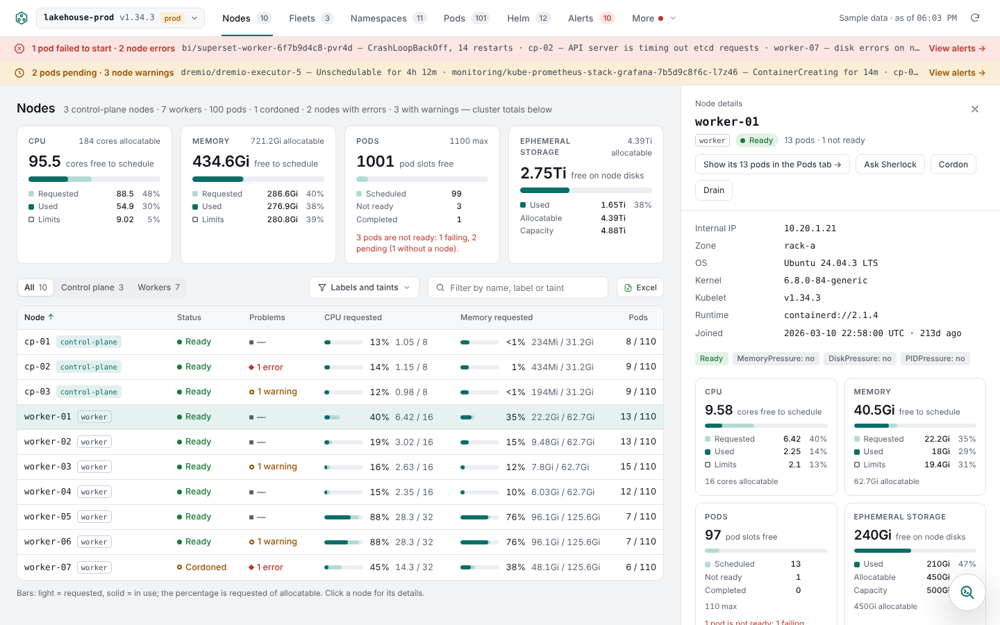
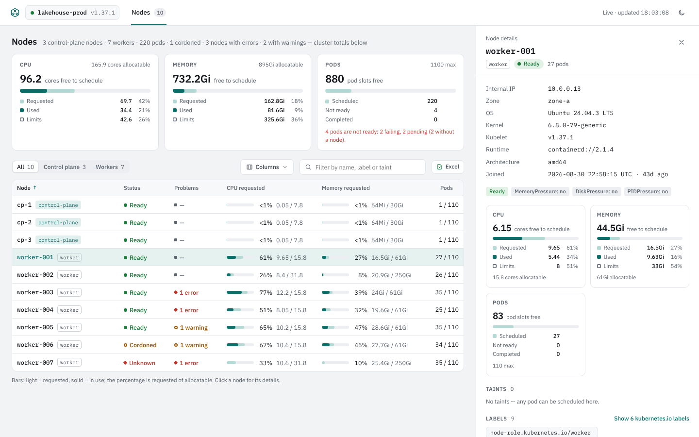
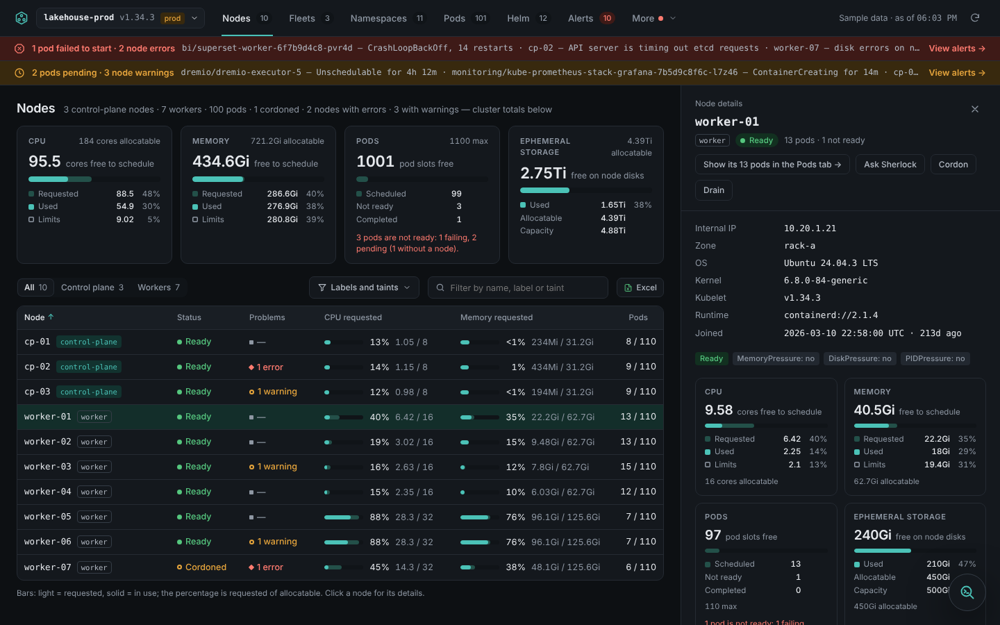
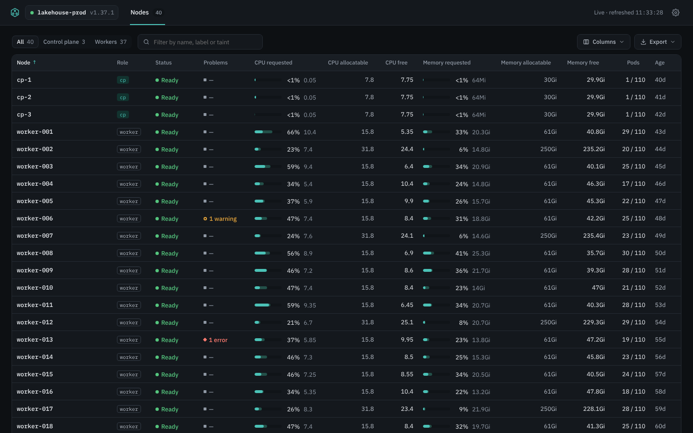
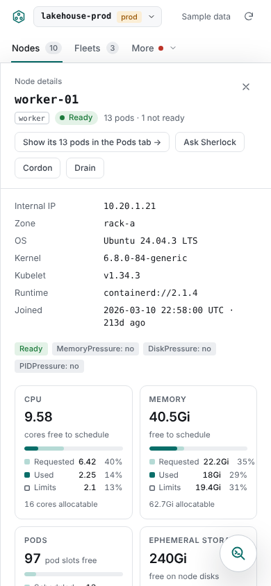
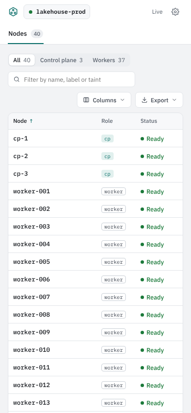
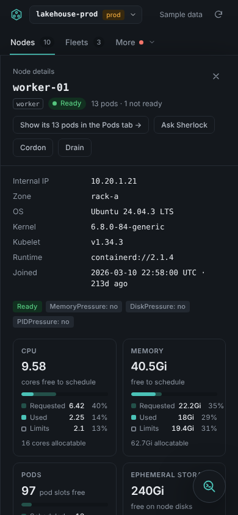
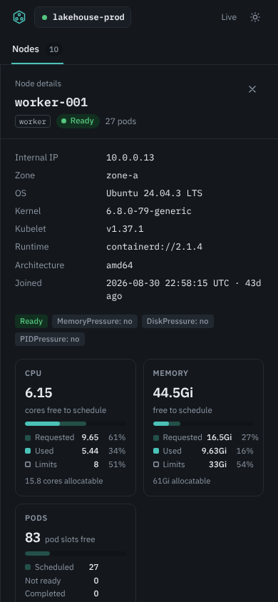
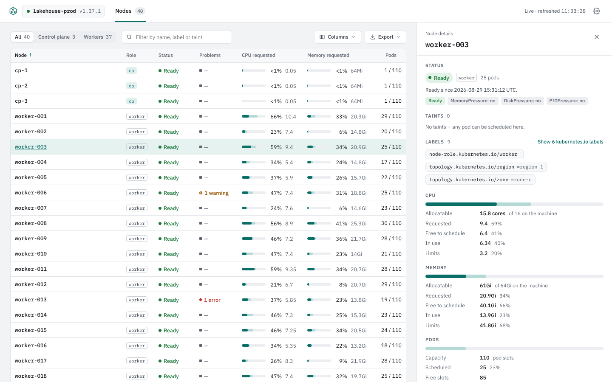
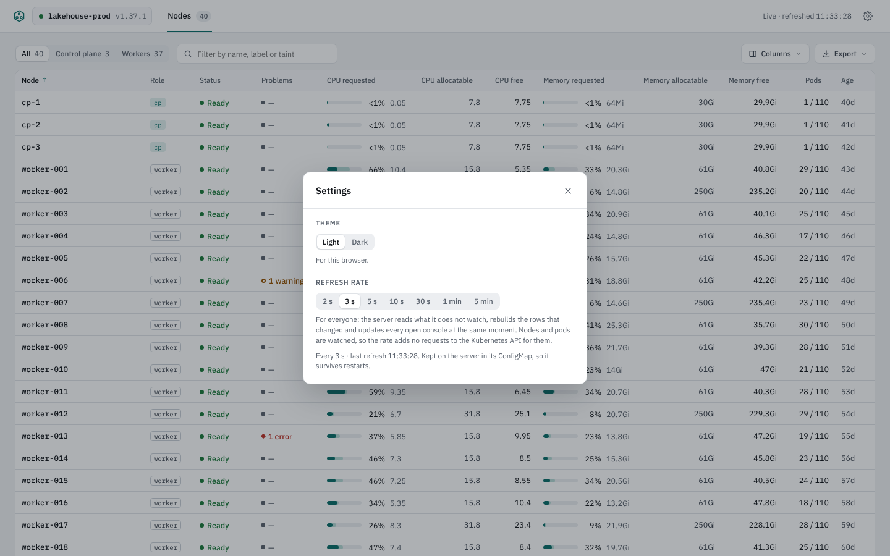

# Phase 1 review

This is the guide for the review that closes Phase 1 ([requirements](requirements.md#phase-1-foundation)). For each item on the review list it says what was built, what CI already proves on every pull request, and what is left for you to check by hand.

## 1. Architecture document and decision records (P1-01)

Read [architecture.md](architecture.md). It covers the components, the data flow, the security model, the deployment modes and the operations side, with seventeen decision records: one for each row of the requirements' Architecture table (two of them still proposals for later phases) and eight made while building Phase 1.

Decisions worth a look, because they narrow or depart from the requirements:

- **ADR-7:** the ClusterRole grants node metrics but not pod metrics, which P1-09 would allow, because the Nodes tab does not use them.
- **ADR-12:** no table virtualization in Phase 1; rows off screen skip layout instead. Phase 7 will need virtualization.
- **ADR-14:** fonts are bundled instead of loaded from Google Fonts as the prototype does.
- **ADR-16:** the refresh rate is one setting for everyone, kept in a ConfigMap in the console's namespace: the console's first write (allowed by X-03) and its first state-changing request. Anyone who can reach the console can change it until Phase 3 brings sign-in.
- **ADR-17:** the uptime in the node details comes from each kubelet's Summary API through the API server's node proxy, which needs `get` on `nodes/proxy`, a wider grant than the rest of the role. `kubeletStats: false` in the chart withholds it.
- **Open questions 2 and 3** are settled with their proposals: images go to GitHub Container Registry (private while the repository is), and CI tests Kubernetes 1.35, 1.36 and 1.37.

## 2. Test deployment: install, upgrade, remove (P1-06, P1-07)

**CI proves on every pull request**, in kind on Kubernetes 1.35, 1.36 and 1.37 with metrics-server, in a namespace that enforces the Pod Security `restricted` profile:

- `helm install --wait --timeout 60s` brings the pod to Ready within 60 seconds;
- the console answers through `kubectl port-forward`;
- the same image, run outside the cluster from a kubeconfig, shows the same nodes (P1-08);
- a refresh rate set in the console lands in the ConfigMap, a rate patched into the ConfigMap with kubectl takes effect within a minute, and every node's uptime matches its kubelet;
- `helm upgrade` rolls out a changed setting and keeps the saved refresh rate;
- after `helm uninstall`, nothing is left: no workload, Service, ServiceAccount, ConfigMap, Role, RoleBinding, NetworkPolicy, ClusterRole, ClusterRoleBinding or release Secret.

**To check by hand** on a test cluster of your choice (open question 1), follow [Try it on a cluster](../README.md#try-it-on-a-cluster) in the README, open <http://localhost:8080>, then:

```sh
helm upgrade console deploy/helm/221b -n 221b --reset-then-reuse-values --set logLevel=debug
helm uninstall console -n 221b
kubectl get all,sa,networkpolicy -n 221b
kubectl get clusterrole,clusterrolebinding -l app.kubernetes.io/instance=console
```

## 3. Permissions and live updates (P1-09, P1-10)

**CI proves:** the ServiceAccount can get, list and watch nodes and pods, get and list node metrics, get the kubelets' stats through the node proxy, and get and patch its own settings ConfigMap by name; `kubectl auth can-i --list` shows nothing more in any namespace beyond what every identity may do (review its own access, read version and discovery URLs and, from Kubernetes 1.36, public CA bundles); and listing Secrets is refused by the API server. A node cordoned with kubectl shows as cordoned within 5 seconds (within one refresh, 3 seconds by default). With the API server stopped (its static pod removed in kind), the status turns red within 30 seconds; when it comes back, the status turns green and a change made afterwards shows without a reload.

**To check by hand** on the test cluster:

```sh
kubectl auth can-i --list --as=system:serviceaccount:221b:console-221b
kubectl get secrets -A --as=system:serviceaccount:221b:console-221b   # Forbidden
kubectl cordon <node>     # the row turns Cordoned at the next refresh
kubectl uncordon <node>
kubectl -n 221b get configmap console-221b -o jsonpath='{.data.settings\.json}'   # after changing the rate in Settings
```

## 4. The Nodes tab against the prototype and kubectl (P1-13 to P1-17)

**CI proves** (`web/e2e`, in Chromium, Firefox and WebKit against the simulator, and in Chromium on kind):

- every value in the table matches `kubectl describe node`: requests and limits, allocatable, pod counts, kubelet, kernel, OS, runtime, architecture, internal IP, cordoning and role, and every node's boot time matches its kubelet's Summary API (kind only);
- the table shows each node's role in its own column, CPU and memory requested, allocatable and free to schedule (allocatable less requested), and pods; taints, zone, labels and kubelet are hidden until picked in the Columns menu, which remembers the choice after a reload;
- search, the role filter, sorting by every column, and Excel and JSON exports with the same rows, columns and order as the screen;
- a node that stops reporting and a crash-looping pod on another node each show as a problem naming its cause;
- the details drawer opens with Enter, closes with Escape and returns focus to the row, and shows the status first, then taints and labels, then CPU, memory and pods as plain sections, then the system details with the uptime;
- the Settings dialog switches the theme for this browser and the refresh rate for everyone: a second browser sees the new rate without a reload, both browsers show the same refresh time, and the rate is in the ConfigMap;
- no WCAG 2.2 AA violations (axe) in either theme, with the drawer, the menus and the Settings dialog open, and a visible focus ring on every control;
- nothing scrolls sideways at 390 px.

**Screenshots** at 1440 and 390 px, the prototype on the left and the console on the right (a simulated cluster with the prototype's cluster name, so the numbers differ). The prototype shows parts of later phases (other tabs, alerts, the label and taint filter, the drawer's actions, the ephemeral storage card and the assistants); Phase 1 leaves them out by design. The console departs from the prototype where the review asked it to: the CPU, memory and pod summary and the heading line are gone from the Nodes tab (they move to a home page later), the table has allocatable and free columns and a role column, the drawer is sections rather than tiles, and a Settings button replaces the theme switch.

| Prototype | Console |
| --- | --- |
|  |  |
|  |  |
|  |  |
|  |  |

The node details and the Settings dialog:

| Node details | Settings |
| --- | --- |
|  |  |

Two small departures from the prototype besides those: below 900 px the top bar stays in place while the page scrolls, so the details panel never leaves a gap above itself; and the Nodes count in the tab bar stays neutral, as the prototype's does, so problems show in the table only.

**To check by hand:** pick two or three nodes on the test cluster and compare their rows and drawers with `kubectl describe node`, and the uptime with `uptime -s` on the node. Open the console in two browsers, change the refresh rate in one and watch the other follow; `kubectl -n 221b get configmap console-221b -o yaml` shows the saved value.

## 5. Scale (P1-18)

**CI proves** with kwok in kind, on every pull request: 500 nodes and 15,000 pods, the first screen within 2 seconds, sorting within 200 ms and server memory under 1 GiB. The job's summary reports the measured numbers.

## 6. Build, image and CI (P1-02, P1-04, P1-05)

`make image` builds the image from a clean checkout. CI runs lint, unit and integration tests, the browser build, license checks (no GPL, AGPL or LGPL) and an audit of shipped npm packages, builds the image, checks it is under 60 MB, runs as user 65532 and has no shell, and scans it with Grype, failing on any high or critical vulnerability. Images for `linux/amd64` and `linux/arm64` are pushed to `ghcr.io/ucesys/221b` from main, from version tags and from this repository's pull requests.

## Still open

- **Which cluster hosts the test deployment** (open question 1): yours to choose.
- **Reading Secrets in Phase 2** (open question 4): to settle at this review, before Phase 2 starts.
