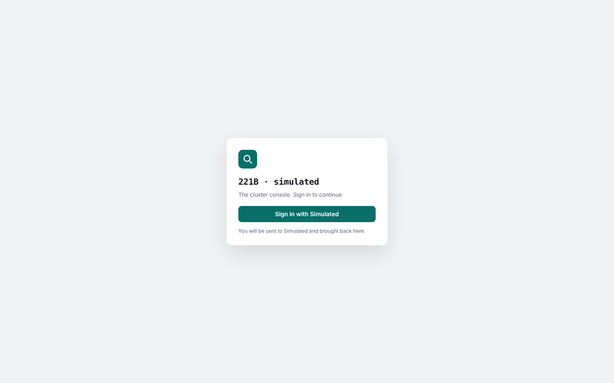
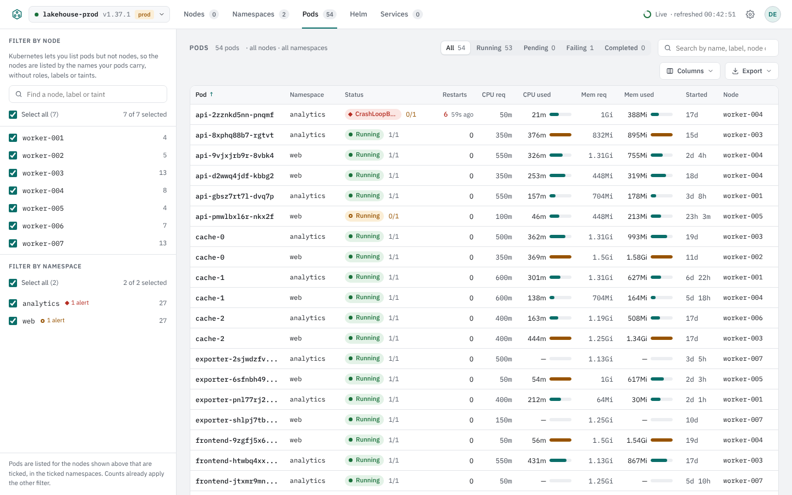
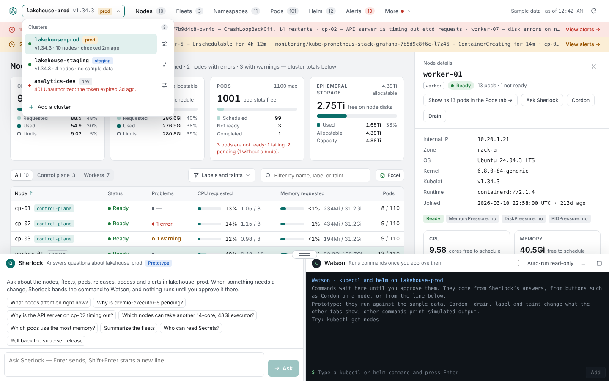
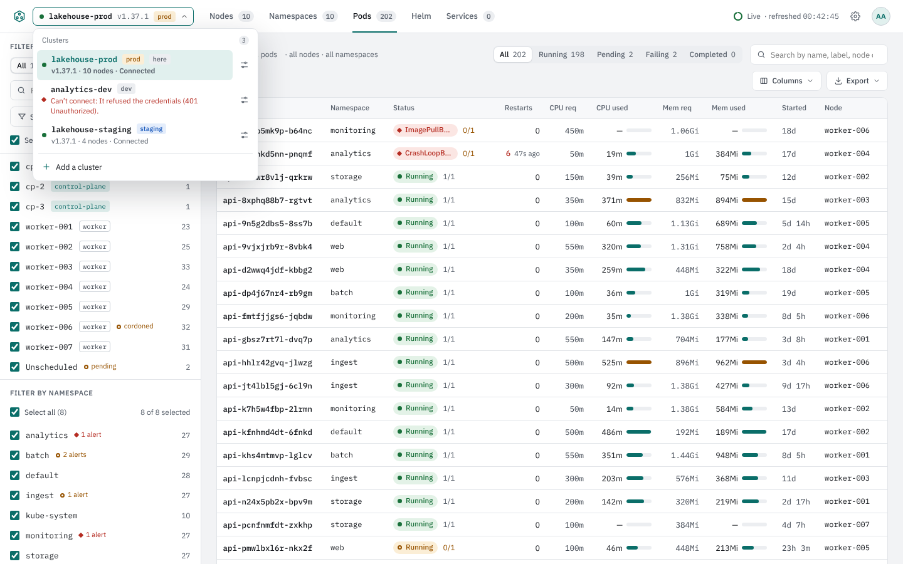
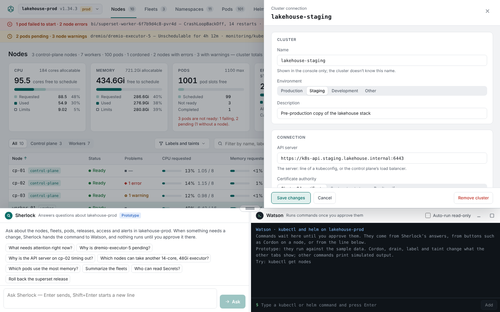
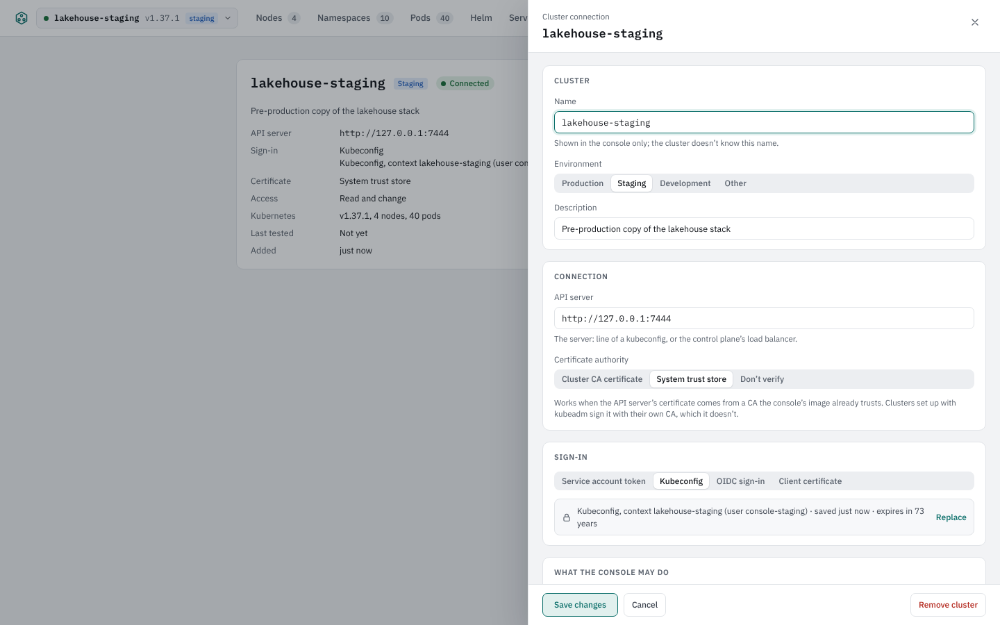
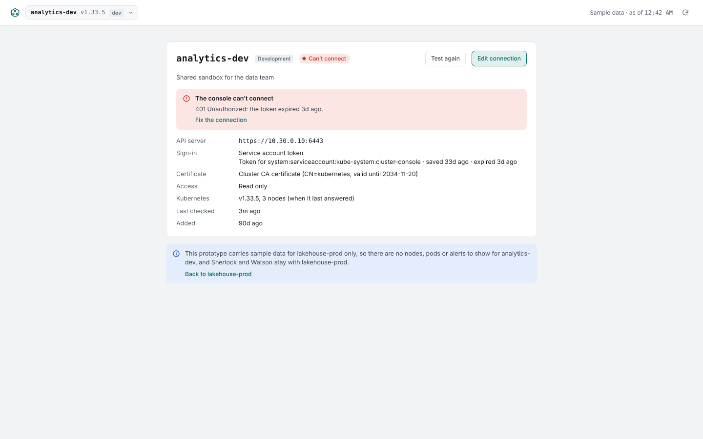
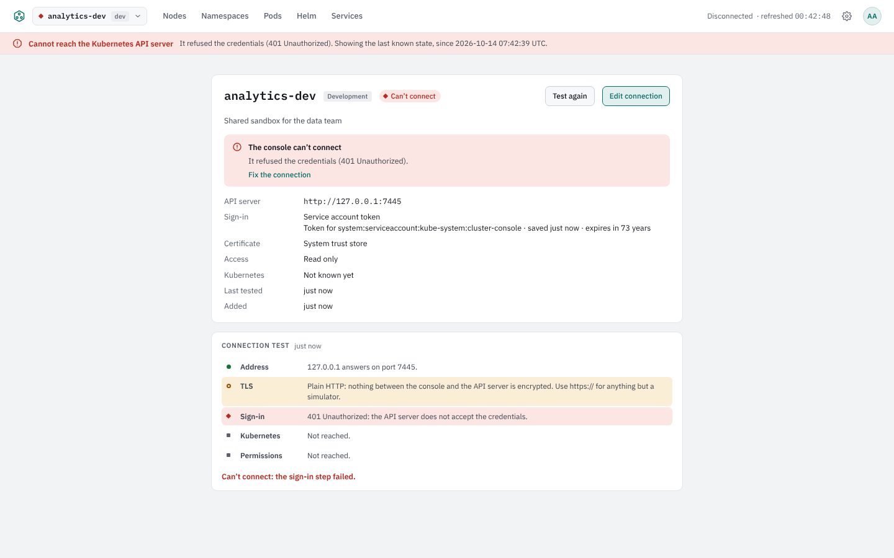
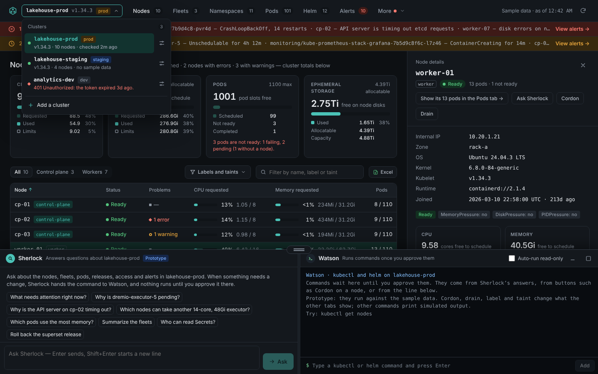
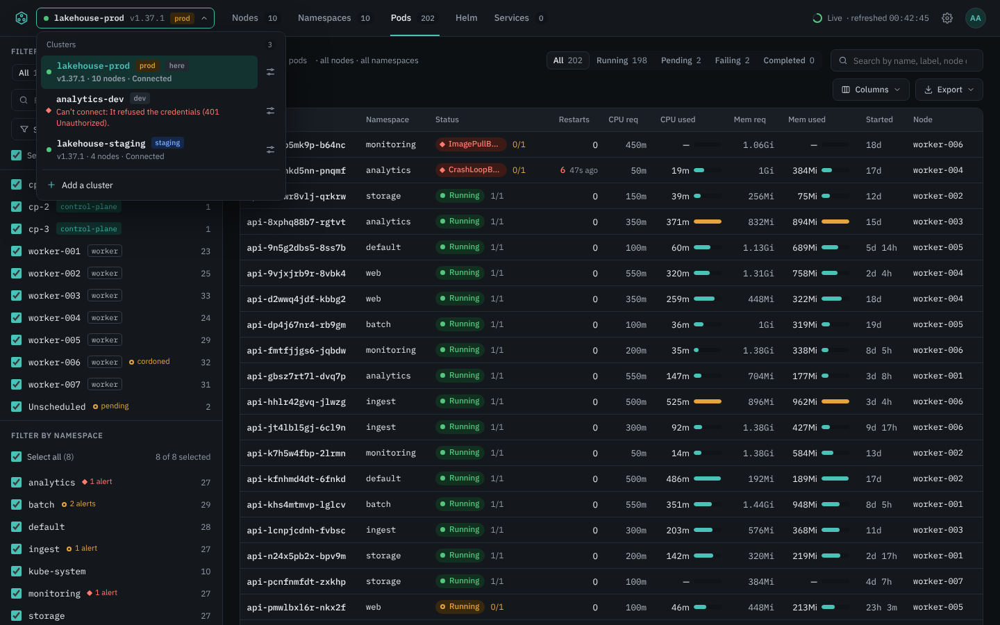

# Phase 3 review

This is the guide for the review that closes Phase 3 ([requirements](requirements.md#phase-3-people-and-clusters)). For each item on the review list it says what was built, what CI already proves on every pull request, and what is left for you to check by hand. The Phase 2 guide is [phase-2-review.md](phase-2-review.md); [architecture.md](architecture.md) has been brought up to date and gained seven decision records (ADR-25 to ADR-31), and ADR-8, proposed at the start, is now accepted.

## What Phase 3 built

People sign in, Kubernetes decides what each of them sees, one installation shows several clusters, and everything that matters is in an audit log.

**Sign-in (P3-01).** With an OpenID Connect provider (`auth.mode: oidc`: Okta, Entra ID, Google, Keycloak, Dex, …), or with accounts the console keeps itself for evaluations (`auth.mode: local`, with password hashes `221b hash-password` makes). The sign-in page is served by the server with no app code; the OIDC flow is the authorization code flow with PKCE and a nonce, verified against the provider's keys. Sessions are random identifiers in `Secure`, `HttpOnly`, `SameSite=Lax` cookies and end after 8 hours idle (`auth.sessionIdle`), 7 days at most, at sign-out, or when the server restarts. Nothing answers without a session but the health probes, `/metrics` and the sign-in pages.

**Per-person access (P3-02).** The console still watches each cluster once, with its own account, and filters at the edge: before a row reaches a person it asks Kubernetes, with a `SubjectAccessReview` for that person's user and groups, whether they may list that resource in that namespace, and keeps the answers for two minutes. The rows, the tab totals and the exports follow; a node row's problems no longer name pods the person may not list; details, logs and YAML of what they may not list answer 403; logs and YAML are read live *as the person*, by impersonation, so the API server applies their RBAC itself. An RBAC change reaches an open page within the two minutes, without a reload. Someone who may list pods but not nodes gets the Pods tab with the nodes listed by the names their pods carry.

**Roles (P3-03).** Administrators (`auth.admins` by username, `auth.adminGroups` by group) change the settings and manage cluster connections; everyone else uses the tabs and sees the cluster menu without Edit, Add or Remove. A console role says what someone may do *in the console*; what they may see in a cluster is Kubernetes RBAC, as above, administrators included.

**Clusters (P3-04 to P3-09).** The cluster menu in the top bar, as designed: every cluster with its state, environment tag and Kubernetes version; switching keeps the open tab and its filters. The connection editor, as designed: name, environment and description; API server address; CA (a pasted PEM certificate, the image's trust store, or none, with a warning); sign-in by service account token, kubeconfig (with the context picker, filling in the address and the CA from the file) or client certificate; read-only or read-and-change (stored now, used from Phase 6), with the RBAC YAML to grant it. *Test connection* runs the five steps on the server, where the console will connect from: address, TLS, sign-in, Kubernetes, permissions. Connections are kept as Secrets in the console's namespace, one each, with the credential under its own key; a credential goes in once and never comes back out: the API, the menu and the editor show only what it says about itself (the account, the expiry, the context, the certificate's subject). A token or certificate that expires within a week is flagged in the menu, on the cluster page and in a banner; a failing connection shows why on its page with *Fix the connection*. Removing a cluster asks again, and for a production cluster for its name typed, and deletes the Secret with it. The cluster the console runs in is the connection `local`, one among the others, with its own credentials and an editable name, environment and description. OIDC as a cluster sign-in method is in the editor but refused for now: it needs a renewal flow the three other methods do not, and none of the clusters at hand asked for it.

**Audit log (P3-10).** Every sign-in, failed sign-in, sign-out, settings change, and connection add, change, test and removal is one JSON line on the console's standard output, naming the person (subject, email, name), the action, its target and outcome, the cluster, the time and the address it came from; the same records go to a webhook (`audit.webhook.url`) with a bearer token, three tries and a bounded queue that drops, counted, rather than block the console. No record carries a credential.

**Ingress (P3-11).** `ingress.enabled` publishes the console through an Ingress; with `ingress.tls.enabled` plain HTTP is redirected to HTTPS and the session cookie marked Secure.

Decisions worth a look, because they shape what you will see:

- **ADR-25:** the OIDC relying party is written on the standard library and the OAuth 2 package client-go already brings, so there is no new dependency and every refusal (another key, wrong issuer or audience, expired, wrong nonce, `alg: none`, a tampered token) has a test. Sessions live in the server's memory: a restart signs everyone out.
- **ADR-26:** roles come from the provider's claims at sign-in; moving someone out of the admin group takes effect at their next sign-in.
- **ADR-27:** the audit log is standard output, so `kubectl logs` and any log pipeline see it; the webhook is for a SIEM.
- **ADR-28:** local accounts are for evaluations like this one; production is expected to use a provider. The simulator carries a small OIDC provider the tests sign in through.
- **ADR-29:** a connection is one Secret, `<release>-cluster-<id>`, in the console's namespace. Kubernetes cannot grant Secrets by name prefix, so the console's Role covers every Secret in that namespace: give it a namespace of its own, as the chart's notes say. Every connection runs the same informers as the local cluster, so memory grows with the clusters added, not with the people signed in.
- **ADR-30:** the connection test runs on the server against the real address, which is what matters when the console runs in a cluster your laptop's network does not match. A failed test does not block saving; the cluster page says why and how to fix it.
- **ADR-31:** one watched copy per cluster for everyone, filtered per person by access reviews, is what keeps the design within X-09 at any number of people. The verdict is per namespace and resource: someone who may list pods in a namespace sees every pod there, as `kubectl get pods -n` would show them. Two counts stay cluster-wide, a node's pods and the unscheduled pods.

Two open questions from the requirements are built as proposed and yours to confirm: per-person access is enforced by impersonation and access reviews (with the console's account needing both rights on every cluster, and sign-in groups matching the groups RBAC uses, with prefixes for the API servers that add them), and settings live in Kubernetes objects in the console's namespace, Secrets for credentials and a ConfigMap for the rest, with no database.

## 1. Sign in (P3-01, P3-03)

**CI proves** (`web/e2e/auth.spec.ts`, in Chromium, Firefox and WebKit against the simulator's OIDC provider, and in Chromium on kind with local accounts; `server/internal/auth`): without a session every page shows the sign-in page and every API path answers 401, while the probes answer 200; a wrong password is refused and the right one comes back to the page asked for; the OIDC flow end to end, with PKCE and the nonce, and every bad ID token refused; a viewer uses the tabs but cannot change the settings (the dialog says so, the API answers 403); signing out ends the session; a form posted from another site is refused, by its headers where the browser sends them and by the form's token where it does not; password guessing is slowed per account and per address; idle sessions end.

**Screenshots** at 1440 px. The prototype has no sign-in page of its own, so there is nothing to put beside it.

| Console |
| --- |
|  |

**To check by hand:** install the chart with your provider, or with local accounts as the [README](../README.md#try-it-on-a-cluster) shows, open the console, sign in, and open the account menu (the initials, top right): your name, your role and how you signed in. Sign out and try an API path: `curl -i http://localhost:8080/api/v1/snapshot` answers 401.

## 2. What each person sees (P3-02)

**CI proves** (`web/e2e/access.spec.ts`; `server/internal/access`, `server/internal/live`, `server/internal/api`): a person Kubernetes lets list two namespaces (the simulator is told; in kind a RoleBinding of the `view` role in one namespace) gets only those in the API's snapshot and stream, with the totals to match and no node; the Pods tab lists them with its count agreeing, search for a pod outside them finds nothing, the JSON export carries none of them, the Nodes tab is empty, the Namespaces tab lists theirs; details, logs and YAML of a pod outside them answer 403 with *Kubernetes does not let you*, and a drawer opened on one says so rather than "deleted"; the same for a pod inside them work, read as the person with `system:authenticated` among their groups; the administrator still sees everything; and a RoleBinding made while the person's page is open reaches it without a reload. Unit tests cover the verdict cache (asked once, again after the TTL, a failing review leaving the old verdict), the filtered store (rows, usage and totals per subscriber, versions shared, a hidden change sending nothing) and the API's gates.

| Console |
| --- |
|  |

**To check by hand** on the test cluster, with a second account that has no RBAC yet:

```sh
# As the second account, the tabs are empty: no pods, no nodes, no namespaces.
kubectl create rolebinding review-view -n default --clusterrole=view --user=<second account's username>
# Within two minutes, without a reload: the pods of default appear, the Pods count agrees, the Nodes tab stays empty.
kubectl auth can-i list pods -n kube-system --as=<second account's username>      # no
# In the console as that account: search for a kube-system pod by name finds nothing; its address, pasted, says
# "Kubernetes does not let you list pods in kube-system"; an export holds only default's pods.
kubectl delete rolebinding review-view -n default
```

For a provider whose API servers add a prefix to names (`--oidc-username-prefix`, `--oidc-groups-prefix`), set `auth.kubernetes.userPrefix` and `groupPrefix` to the same.

## 3. The cluster menu, the connection editor and the test (P3-04, P3-05, P3-06)

**CI proves** (`web/e2e/clusters.spec.ts`, against a second simulator that requires a token, and in kind against the kind cluster itself through its in-cluster address, with a real token and CA; `server/internal/clusters`): the menu lists the console's own cluster first, marked *here*, with its state and version; the editor refuses a missing name and a bad address before asking the server, reports an address nothing answers on at the *Address* step and a wrong token at the *Sign-in* step with the later steps not reached, and with the right token passes every step, naming the version and node count; saving opens the new cluster, which connects; switching keeps the open tab and its filters (`#/pods?status=Running` becomes `#/c/<id>/pods?status=Running` and back); every data route answers under `/api/v1/clusters/<id>/`; a kubeconfig with two contexts connects through the one picked, taking the address (and in kind the CA) from the file, and passes the test; a kubeconfig that signs in through a plugin, or whose context has no address, is refused with a note that says so; a client certificate is read for its subject and expiry, and an expired one refused; the RBAC YAML is shown. Connecting with a client certificate is not in CI (neither simulator checks certificates), so it is on the list below.

**Screenshots** at 1440 px, the prototype on the left and the console on the right. The console's three clusters mirror the prototype's: the one it runs in, a staging cluster reached through a kubeconfig, and a development cluster whose token the cluster no longer accepts. The prototype shows the Alerts tab and the assistants of later phases; the console's Services count is this simulator's.

| Prototype | Console |
| --- | --- |
|  |  |
|  |  |
|  |  |
|  |  |

**To check by hand:** add two clusters with different sign-in methods, one of them a client certificate. For a token, in the other cluster:

```sh
# The RBAC the editor shows under "What the console may do", then a token:
kubectl apply -f <the YAML from the editor>
kubectl -n kube-system create token cluster-console --duration=8760h
kubectl config view --raw --minify -o jsonpath='{.clusters[0].cluster.certificate-authority-data}' | base64 -d   # the CA to paste
```

For a client certificate, one the cluster's CA signed (`kubectl` with a certificate user in its kubeconfig has one: `kubectl config view --raw --minify -o jsonpath='{.users[0].user.client-certificate-data}' | base64 -d`, and the same for `client-key-data`). For a kubeconfig, paste one whose user has a token or a client certificate inline (`kubectl config view --raw --minify --flatten`); one that signs in through a plugin such as `kubelogin` is refused, and the editor says so as you paste. Test each before saving: the five steps, in order, with the version and node count at *Kubernetes* and what the account may do at *Permissions*. Then switch between the clusters from the menu with the Pods tab filtered, open a pod in each, and read a log. The chart's network policy lets the console out to DNS and to ports 443 and 6443; an API server on another port (minikube's 8443, MicroK8s's 16443) goes in `networkPolicy.apiServerPorts`, and the *Address* step says when nothing answers.

## 4. Stored credentials and expiry (P3-07)

**CI proves:** a connection's Secret exists in the console's namespace and holds the token, which the API never returns (not in the list, not in the summary, not in the audit log); the editor of a saved connection shows what the credential says about itself with a *Replace* button and no password field; a change that keeps the credential keeps it; *Replace* asks for a new one and *Keep the saved credentials* backs out; a saved connection that cannot sign in says so on its page with *Fix the connection*, which opens the editor with the credential to replace, and the cluster connects once it is; the connection survives a `helm upgrade` and restart; an expired or expiring credential is flagged (unit tests on the summaries and the editor's notes).

**To check by hand:**

```sh
kubectl -n 221b get secrets -l app.kubernetes.io/component=cluster-connection
kubectl -n 221b get secret console-221b-cluster-<id> -o jsonpath='{.data.spec\.json}' | base64 -d   # the spec, no credential
curl -s -b <cookie> http://localhost:8080/api/v1/clusters | grep -c eyJ                             # 0: no token leaves the server
# Add a cluster with a token created with --duration=100h: the menu, the cluster page and a banner warn it expires in 4 days.
```

## 5. Removing a cluster (P3-08)

**CI proves:** removing asks again; for a production cluster the Remove button stays disabled until the cluster's name is typed exactly; after removal the API answers 404, the data routes too, the Secret is gone, and the audit log holds `cluster.remove` with the person's email.

**To check by hand:** set a test cluster's environment to Production, click Remove, type a wrong name (the button stays off), then the right one; `kubectl -n 221b get secrets` no longer lists it; nothing changed in the cluster itself (`kubectl --context <it> get sa -n kube-system cluster-console` is still there).

## 6. Management mode (P3-09)

**CI proves:** the kind cluster is shown twice in one installation, as the local connection and as a connection through its in-cluster address, and the simulator twice in the browser jobs (by token and by kubeconfig), each with its own stream, counts, details, logs and YAML, and the local cluster's routes untouched by the others.

**Screenshots:** the cluster menu above shows three clusters in one installation.

**To check by hand:** `curl -s http://localhost:8080/metrics | grep b221_connection` lists `b221_connections` and one `b221_connection_up` per connection, 0 for the one whose token is wrong. Replace a connection's credentials while a browser has its Pods tab open: the tab reconnects by itself and keeps showing pods (the stream on the old connection ends, and the browser opens one on the new).

## 7. The audit log (P3-10)

**CI proves:** one record per sign-in, failed sign-in (with local accounts; a provider keeps a wrong password to itself) and sign-out, naming the person, with `outcome` and `time`; one per settings change; `cluster.test`, `cluster.add`, `cluster.update` and `cluster.remove` with the cluster's id; no record carries a password, a token or a CA certificate; the chart wires `audit.webhook.url` and its token into the deployment. The webhook's delivery (bearer token, three tries, a queue of a thousand that drops and counts rather than block) has no test of its own: it is on the list below.

**To check by hand:**

```sh
kubectl -n 221b logs deploy/console-221b | grep '"action"' | tail -20
kubectl -n 221b logs deploy/console-221b | grep '"action"' | python3 -m json.tool --json-lines | grep -E '"(action|email|cluster|outcome)"'
```

Each line is a JSON object with `time`, `action`, `who` (subject, email, name), `cluster` where one applies, `target`, `detail`, `outcome` and `from`. To try the webhook, point `audit.webhook.url` (and `audit.webhook.token`) at a request bin, sign in, and see the same record arrive as a JSON POST with `Authorization: Bearer`; then point it at an address that refuses connections and sign in again: the console carries on, and its log warns about the delivery after the third try.

## 8. Ingress with TLS (P3-11)

**CI proves:** the chart renders an Ingress with its host, path and TLS Secret, adds the host to the names the console answers to, and sets the HTTPS redirect, which the server applies to plain-HTTP requests by `X-Forwarded-Proto` (`hack/check-chart.sh`, `server/internal/api`).

**To check by hand:** `helm upgrade ... --set ingress.enabled=true --set ingress.host=<host> --set ingress.tls.enabled=true --set ingress.tls.secretName=<Secret>`; `curl -I http://<host>/` answers 308 to `https://<host>/`; the session cookie has `Secure`.

## 9. Permissions (X-03, P3-02)

**CI proves** in kind: the ServiceAccount can read what Phase 2 settled, get and patch its settings ConfigMap by name, manage the Secrets of its own namespace (get, list, create, update, delete; nowhere else), impersonate users and groups and create SubjectAccessReviews, and nothing else: no ServiceAccounts or UIDs impersonated, no writes anywhere else, and with `auth.mode=none` or `connections.store=memory` the respective grants are gone (`hack/check-rbac.sh`, `hack/check-chart.sh`).

```sh
kubectl auth can-i --list --as=system:serviceaccount:221b:console-221b
kubectl auth can-i impersonate serviceaccounts --as=system:serviceaccount:221b:console-221b   # no
kubectl auth can-i create secrets -n default --as=system:serviceaccount:221b:console-221b     # no
```

## Still open

- **Which identity provider** the test deployment uses is yours to choose; local accounts work for this review.
- **OIDC as a sign-in method for other clusters** is deferred: the editor offers it and the server refuses it with a note. The three other methods cover the clusters at hand; say if one of yours needs it.
- **An agent for clusters the console cannot reach** (open question): not in this plan; decide from real installations after Phase 3.
- **Aggregate counts** stay cluster-wide for everyone: a node's pod counts in the Nodes tab, and the unscheduled count. Everything that names an object follows the person's access.
