# Phase 4 review

This is the guide for the review that closes Phase 4 ([requirements](requirements.md#phase-4-analysis-views)). For each item on the review list it says what was built, what CI already proves on every pull request, and what is left for you to check by hand. The Phase 3 guide is [phase-3-review.md](phase-3-review.md); [architecture.md](architecture.md) has been brought up to date and gained eight decision records (ADR-32 to ADR-39, the last two from the first review round).

## What Phase 4 built

Five tabs that answer the questions kubectl leaves to you, each worked out on the server from the watched objects and filtered per person like every other view (ADR-31, ADR-37).

**Fleets (P4-01).** Nodes grouped by the labels and taints they share: every node against every label value and taint, one column each, grouped by fleet, with each fleet's cores, memory and CPU requested, its nodes' problems, the nodes in no fleet and label groups that could become fleets. Administrators create, edit and delete fleets in the drawer, which previews which nodes a draft takes and what the others lack; fleets are saved per cluster in the settings ConfigMap and audited. Membership is never stored: a node joins a fleet by having its labels and taints (ADR-32).

**Alerts (P4-07).** Pods that failed to start or are pending, pods that recovered from recent warnings, node problems (conditions, cordons, kubelet down) and warning events, grouped by the pod, node or volume they concern, with each event's count and first and last seen. The tab's badge counts them, and every other tab carries the error and warning banners that lead here, as designed.

**Networks (P4-02).** Every Ingress host and path traced hop by hop: the address the Ingress publishes, its class and the controller's pods, the TLS certificate (its names and expiry), the rule, the Service and port, its endpoints, the NetworkPolicies between the controller and the pods, and the pods. The first failing hop turns red, names the cause and gives the verdict. Fact cards cover the network plugin, pod ranges, cluster IPs, kube-proxy, LoadBalancers still waiting for an address, cluster DNS and each IngressClass; a table lists every node's address, pod range and pod IPs in use. The trace reads the objects and sends no request (ADR-36).

**Access (P4-03).** Who can do what, from the cluster's ClusterRoles, Roles and bindings, matched the way the API server matches them (ADR-33): a review of what is risky (cluster-admin given to a ServiceAccount, Secrets readable cluster-wide, bindings to ServiceAccounts that don't exist, users bound directly, who can change RBAC), the roles and bindings with what each adds up to (everything, change RBAC, escalate, bind, impersonate, read Secrets, exec, create pods, act as ServiceAccounts), "who can" for any verb on any resource in any namespace, and each user's, group's and ServiceAccount's effective permissions as a matrix, with the bindings that grant them and the pods and tokens that carry a ServiceAccount.

**Policies (P4-04 to P4-06).** A review of what to look at first, then: NetworkPolicies per namespace with how isolated each namespace is and a checker that answers whether one pod can connect to another (or to a Service) on a port and names the policies that decide; whether each node can be drained now and what blocks it, with kubectl's drain logic and the disruption budgets; quotas, used against hard, with the rollouts a quota would stall, and limit ranges; Pod Security per namespace with the pods a stricter level would reject, worded as the API server words its warnings; admission webhooks with their failure policy, timeout and whether their Service has ready endpoints; and priority classes with the pods that use them. Fixes are shown as commands to copy; Watson runs them from Phase 6.

Decisions worth a look, because they shape what you will see:

- **ADR-33:** who can do what is worked out by the console from the RBAC objects, not asked of the API server question by question, so "who can" and the matrix are instant. It is what RBAC grants: a webhook authorizer is not modelled.
- **ADR-34:** Pod Security is the API server's own code, copied from `k8s.io/pod-security-admission` v0.37.1 into `server/internal/psa` with its license and a README on how to update it.
- **ADR-35:** for Secrets of type `kubernetes.io/tls`, the server now keeps what the certificate says publicly (names, issuer, validity) next to the key names and sizes, so the Networks tab can say a certificate has expired or covers other hosts. `tls.key` is never parsed, and nothing of the PEM is kept. This widens ADR-20 a little; with `secrets.read=false` the tab says the certificate was not checked.
- **ADR-36:** the Networks trace does not resolve DNS or send requests. It can't see a backend answering 500 or a DNS record pointing elsewhere, and says so on the tab.
- **ADR-37:** the Access and Policies tabs show their count in the tab bar only once opened, so a page that never opens them never builds them.

Smaller changes came with it. The chart's ClusterRole now reads ClusterRoles, ClusterRoleBindings, priority classes, admission webhook configurations and IngressClasses, and roles, bindings, ServiceAccounts, NetworkPolicies, disruption budgets, quotas and limit ranges in full rather than by name; it still writes nothing but its settings and connections (`hack/check-rbac.sh` checks it, and checks it may not create ClusterRoleBindings or patch webhook configurations). And with ten tabs, the bar at 1440 px puts the last ones under **More** when the counts are long, as the prototype does at that width; the Services count in the bar was 0 for a signed-in person until the Services tab had been opened, which is fixed.

## Changes from the first review round

- **Details over the tab you are on (ADR-38).** A link to one node, pod, Service, object or policy opens its details pane over the current tab instead of switching tabs: a node from a fleet, a pod or node from an alert, a hop of a trace, a pod from a policy or an identity. Links whose result is several objects still go to the tab that lists them, filtered. Every pane now lies over the page, the node details included, so no table is shortened.
- **Fleets.** A saved fleet shows at once: changes made in the console are published within a fraction of a second instead of at the next refresh. Before, a fleet saved under a long refresh appeared only a refresh later, and picking it before then did nothing. The Columns panel has **Select all** and **Clear all** (for the columns matching the search, when there is one), and every other table's Columns menu has them too.
- **Alerts (ADR-39).** **Active alerts only** is on by default; unticked, recovered pods follow in a group of their own, after everything that is going on, with a green *Recovered* tag, and the groups with nothing to show come last. **Acknowledge** takes an alert off the banners and the tab's count for everyone, until it changes or clears; it stays on the Alerts tab, marked with who acknowledged it and when, and **Undo acknowledge** puts it back. Both are audited.
- **Pod details.** The container and amount pickers look like the drop-downs they are.
- **Access.** On an identity's page, its findings were squeezed to a sliver and cut off at the bottom by the page's own layout; they now keep their height.
- **Services.** A Service published by an Ingress failed to open its details (the browser read the Ingresses in a shape the server did not send); it opens, and lists the URLs that publish it.

## Changes from the second review round

- **Home page.** The console now opens on a home page, also reached from the logo at the top left: every cluster it is set up for, each with its health in a word and why (nodes not ready, pods failing to start, node errors, then warnings and acknowledged alerts), its nodes ready, pods, alerts, namespaces and Services, and bars for the CPU and memory requested and in use and the pods placed, of what its nodes can take. Each figure leads to the tab that lists it; a cluster that cannot connect leads to its connection. The figures are filtered, like every tab, by what the person may see (`GET /api/v1/home`). **Alerts** is now the first tab, and a cluster opened without a tab opens on it.
  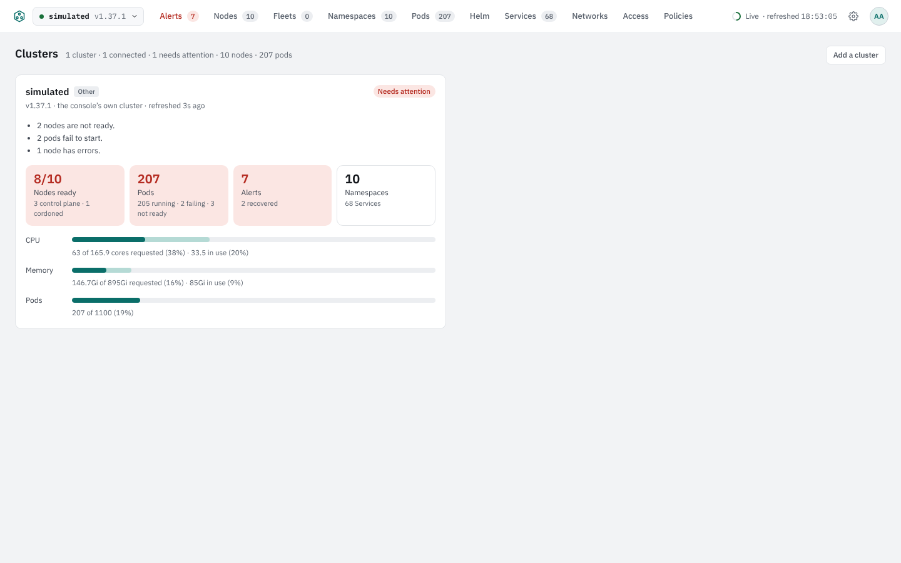
- **Fewer words.** The descriptions at the top of the Alerts, Services, Networks and Access tabs, and at the top and bottom of the Fleets and Policies tabs, are gone.
- **Alerts.** Acknowledged alerts are yellow: their card's edge, status and tag. The tab's name is red while an unacknowledged failure is on, and yellow while any alert is on, even when every one is acknowledged and so off the banners and the count.
- **Fleets are the cluster's, for everyone (checked).** Fleet definitions were already kept on the server, per cluster, in the settings ConfigMap (`settings.json`, under `fleets`), the same for everyone; a new end-to-end test signs a second person in from another browser and finds the fleet there and nothing about it in that browser's storage.
- **Columns per person (ADR-40).** Which columns each table and the Fleets matrix show was kept by each browser. Someone signed in now keeps them with their account, on the server, so they follow them to any browser and are theirs alone; with sign-in off, or with `preferences.perUser: false` in the chart, each browser keeps its own as before. The first time someone signs in, the choices that browser had become theirs.
- **Namespaces.** A namespace's Helm releases are a table like the other lists on the page, with Columns, and their status, chart, app version, revision, pods and when they were last updated.

## 1. Fleets (P4-01)

**CI proves** (`web/e2e/fleets.spec.ts` in the simulator and in kind; `server/internal/fleets`, `server/internal/api/fleets_test.go`, `web/src/lib/fleets.test.ts`): an administrator creates a fleet in the drawer from a node's labels, sees the nodes it takes before saving, and after saving its members are exactly the nodes with those labels; a node that gets the labels (`kubectl label`) joins within 5 seconds and leaves when they go; a fleet with a taint takes only nodes with both and says what the others lack; a viewer sees no New, Edit or Delete and the API answers 403; every change writes one audit record naming the fleets.

**Screenshots** at 1440 px, the prototype on the left and the console on the right (here and below). The console's fleets were made for the picture against the simulator; the prototype's nodes carry more labels.

| Prototype | Console |
| --- | --- |
| 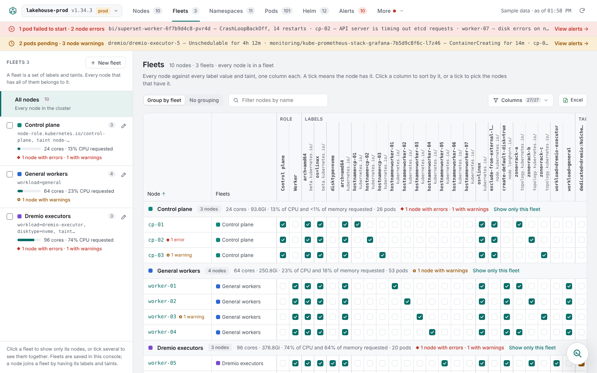 | 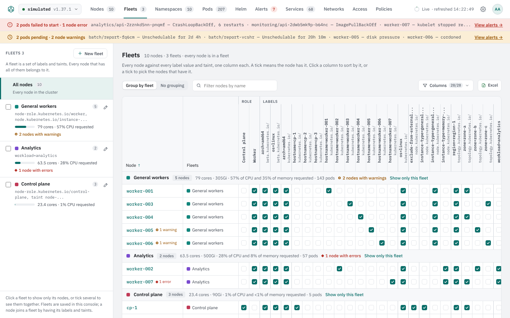 |

**To check by hand:** as an administrator, open Fleets, click **New fleet**, pick a label your workers share, and save. Then:

```sh
kubectl label node <a node outside the fleet> <the label>=<value>    # it joins within 5 seconds
kubectl label node <that node> <the label>-                          # and leaves
kubectl -n 221b get configmap console-221b -o jsonpath='{.data.settings\.json}'   # the fleet, saved
```

## 2. Alerts (P4-07)

**CI proves** (`web/e2e/alerts.spec.ts`; `server/internal/views/alerts_test.go`, `web/src/lib/alerts.test.ts`): three injected faults (a pod whose image cannot be pulled, a pod no node can take, a pod killed for using more memory than its limit) each appear within 30 seconds, as *failed to start*, *pending* with the scheduler's reason, and with `OOMKilled` named; events are grouped by object with counts and first and last seen; the tiles and the tab's badge count them; search and the kind filter narrow the cards; a card opens the pod's details; every other tab's banner names them and leads to the tab; deleted pods leave it; a cordoned node is a warning until uncordoned.

| Prototype | Console |
| --- | --- |
| 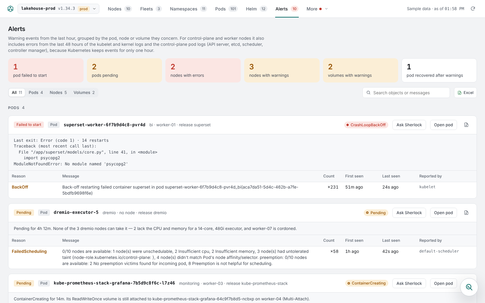 | 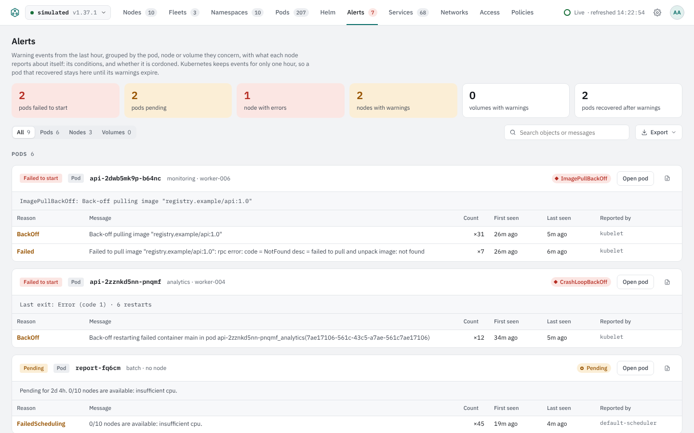 |

**To check by hand:**

```sh
kubectl create namespace review
kubectl -n review run pull --image=registry.invalid/nope:1                                      # failed to start
kubectl -n review run nowhere --image=busybox --overrides='{"spec":{"nodeSelector":{"review":"none"}}}'   # pending
kubectl -n review run oom --image=busybox --overrides='{"spec":{"containers":[{"name":"oom","image":"busybox","command":["sh","-c","tail /dev/zero"],"resources":{"limits":{"memory":"24Mi"}}}]}}'   # OOMKilled
kubectl get events -n review --field-selector type=Warning                                       # what the cards group
kubectl cordon <a worker>; kubectl uncordon <that worker>                                        # a node warning, then gone
kubectl delete namespace review
```

## 3. Networks (P4-02)

**CI proves** (`web/e2e/networks.spec.ts` in the simulator and in kind; `server/internal/views/networks_test.go`, `server/internal/kube/yaml_test.go`): a route through a working Ingress, IngressClass, TLS Secret made by `openssl`, Service and pod traces as *Works* with all eight hops; then each hop is broken in turn and turns red with its cause, the verdict *Fails at …* naming it: the Ingress with no address; the TLS Secret deleted, replaced by an expired certificate, and by one for another host; the backend's port renamed, its Service missing, its selector matching nothing; a default-deny NetworkPolicy, then one admitting the controller, each checked in kind against a real connection from a pod carrying ingress-nginx's labels to the backend; the controller's pod not ready (kind). The hop links open the Service, pods, policy and Ingress. A TLS Secret's summary carries the certificate's names and expiry and neither the key nor the certificate's bytes.

kind runs no Ingress controller, so there the controller is a pod with ingress-nginx's labels and the Ingress's address is set with `kubectl patch --subresource=status`. The simulator runs ingress-nginx, CoreDNS and a real certificate; its `analytics/dashboards` Ingress points at a Service that does not exist, and `api.shop.example.test` is blocked by its namespace's policies.

| Prototype | Console |
| --- | --- |
| 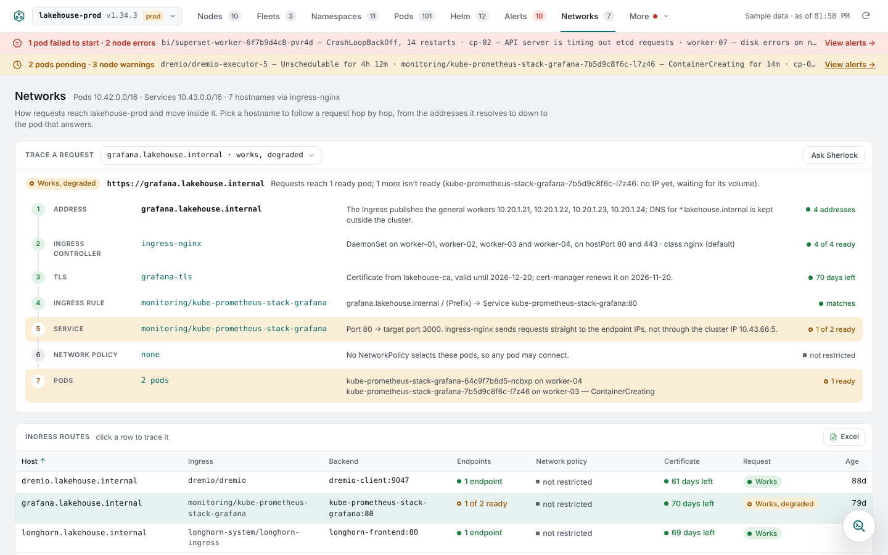 | 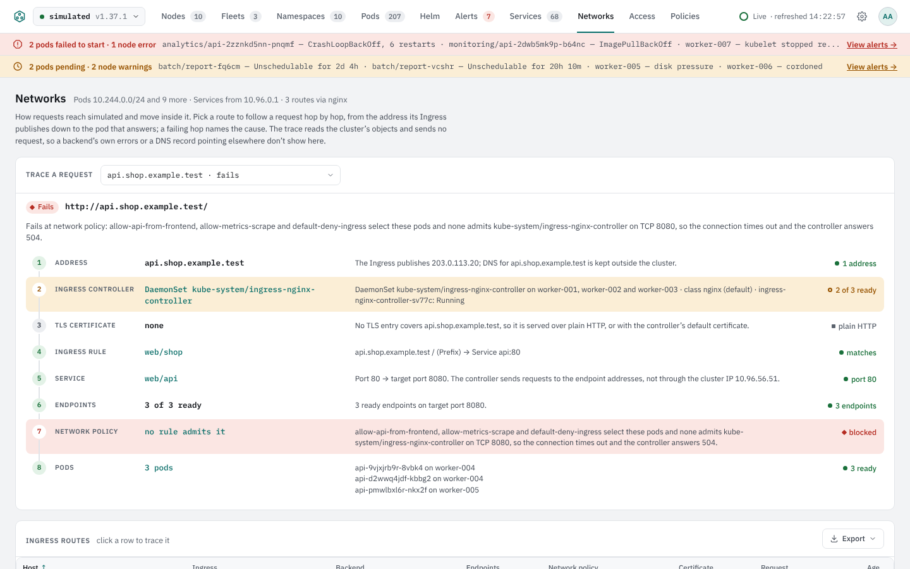 |

**To check by hand,** on a cluster with an Ingress controller and an Ingress you can break (back up first with `kubectl get ingress <name> -o yaml`):

```sh
kubectl -n <ns> patch ingress <name> --type=json -p '[{"op":"replace","path":"/spec/rules/0/http/paths/0/backend/service/name","value":"nope"}]'
#   → Service hop red: "The Service doesn't exist, so the controller answers 503"; curl -k https://<host>/ answers 503
kubectl -n <ns> apply -f - <<'EOF'
apiVersion: networking.k8s.io/v1
kind: NetworkPolicy
metadata: {name: review-deny}
spec: {podSelector: {}, policyTypes: [Ingress]}
EOF
#   (restore the backend first) → Network policy hop red, naming review-deny; curl answers 504 after the timeout
kubectl -n <ns> delete networkpolicy review-deny
kubectl -n <ns> get secret <tls secret> -o jsonpath='{.data.tls\.crt}' | base64 -d | openssl x509 -noout -enddate -ext subjectAltName
#   → the same expiry and names as the TLS certificate hop
```

## 4. Access (P4-03)

**CI proves** (`web/e2e/rbac.spec.ts` in the simulator and in kind; `server/internal/rbac`, `server/internal/views/access_test.go`, `web/src/lib/rbac.test.ts`): with a set of fixtures (a group bound to a pod reader everywhere and a named-Secret reader in one namespace, a user and a ServiceAccount bound to a deployer role with exec, an edit binding, a binding to a ServiceAccount that doesn't exist), the effective permissions shown for 21 sampled questions match `kubectl auth can-i --as` in kind, yes and no; the review flags what is risky and the "who can" answer lists who can; an identity page says what it has and through which bindings. Unit tests cover the rule matching as the API server does it (wildcards, subresources and `*/subresource`, `resourceNames`, non-resource rules) and what each role adds up to.

| Prototype | Console |
| --- | --- |
| 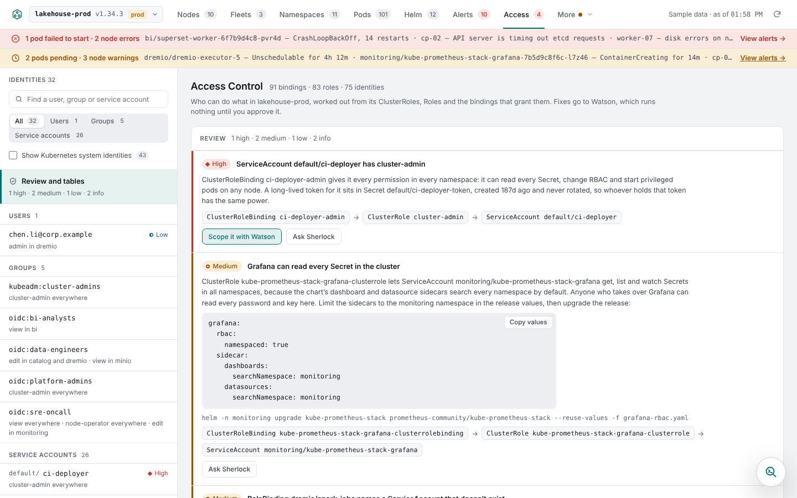 | 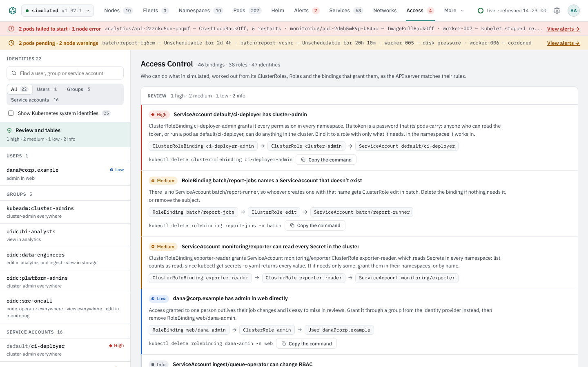 |

**To check by hand:** pick a few answers from the tab and ask the API server the same thing.

```sh
kubectl auth can-i create pods/exec -n <ns> --as=system:serviceaccount:<ns>:<sa>
kubectl auth can-i list secrets -A --as=<user> --as-group=<group>
kubectl auth can-i --list -n <ns> --as=<user>            # against that identity's matrix
kubectl get clusterrolebindings -o wide | grep cluster-admin   # against the review's cluster-admin findings
```

## 5. Network policies (P4-04)

**CI proves** (`web/e2e/policies.spec.ts`, kind's network plugin kindnet enforcing policies; `server/internal/netpol`, `server/internal/views/policies_test.go`): in two namespaces with a default-deny, an allow-list by pod and by namespace label, and an egress policy, the checker's answer for four pairs matches a real `wget` between the pods, and names the deciding policies; the tab lists the policies and how many pods each namespace isolates; a policy's details say in words what it admits. Unit tests cover ingress and egress, named ports, an empty namespace selector and `ipBlock` with an exception.

| Prototype | Console |
| --- | --- |
| 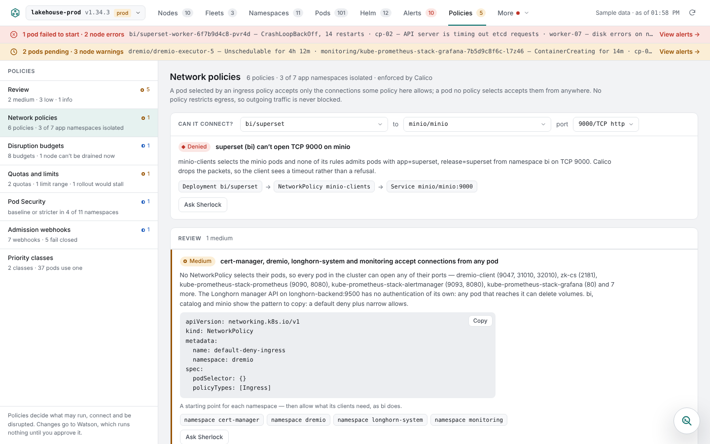 | 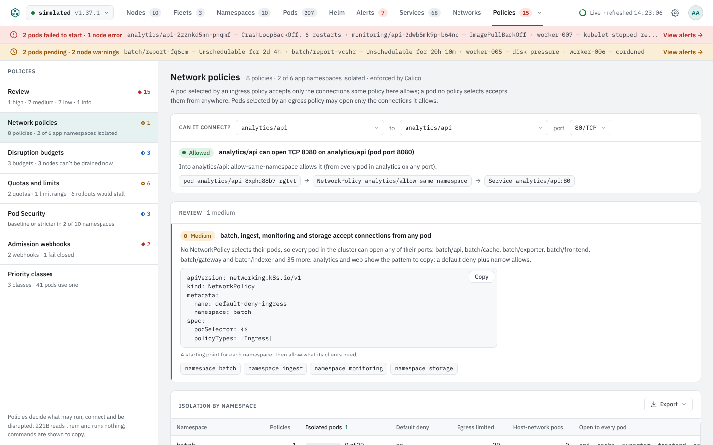 |

**To check by hand:** pick two pods in a namespace with policies, ask the checker, and try it:

```sh
kubectl -n <ns> exec <pod A> -- wget -q -T 3 -O- http://<pod B's IP>:<port>/ ; echo $?   # 0 if allowed, non-zero if blocked
```

The Network policies section also says whether the network plugin enforces policies; on one that does not, every answer is "allowed" in practice, and the review says so.

## 6. Drains (P4-05)

**CI proves** (`web/e2e/policies.spec.ts`; `server/internal/views/policies_test.go`): with a disruption budget allowing no disruption and a pod with no controller, the verdict for every node matches `kubectl drain --ignore-daemonsets --delete-emptydir-data --dry-run=server` in kind (blocked or not, and the blocking pods named). Unit tests cover a pod with no controller, a node with only static and DaemonSet pods, and a budget that lets a drain wait or blocks it.

| Prototype | Console |
| --- | --- |
| 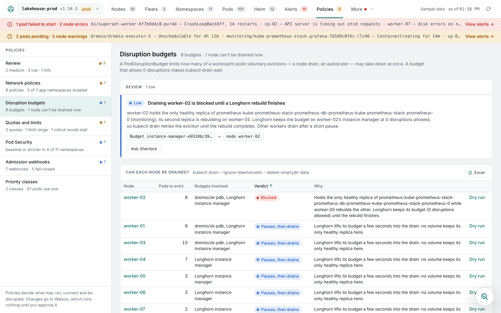 | 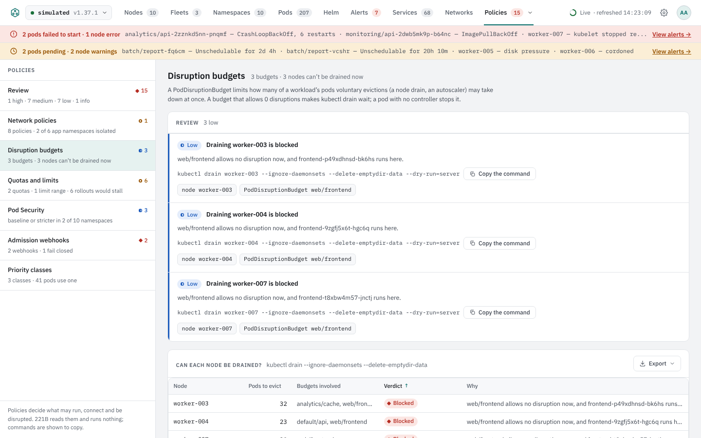 |

**To check by hand:** for each node the tab calls blocked or waiting, run the command it shows (it is a dry run):

```sh
kubectl drain <node> --ignore-daemonsets --delete-emptydir-data --dry-run=server --timeout=10s
```

## 7. Quotas, Pod Security, webhooks and priority classes (P4-06)

**CI proves** (`web/e2e/policies.spec.ts`; `server/internal/views/policies_test.go`): for a namespace holding a privileged pod, two hostPath pods, a host-network pod with a host port, a plain pod and a hardened one, the warnings the tab shows for enforcing baseline and restricted are line for line what `kubectl label --dry-run=server namespace … pod-security.kubernetes.io/enforce=…` prints; a quota shows what the API server counts in `status.used` and the rollout that would stall at it; a webhook whose Service is missing is flagged with its failure policy; a new priority class is listed with its pods.

| Prototype | Console |
| --- | --- |
| 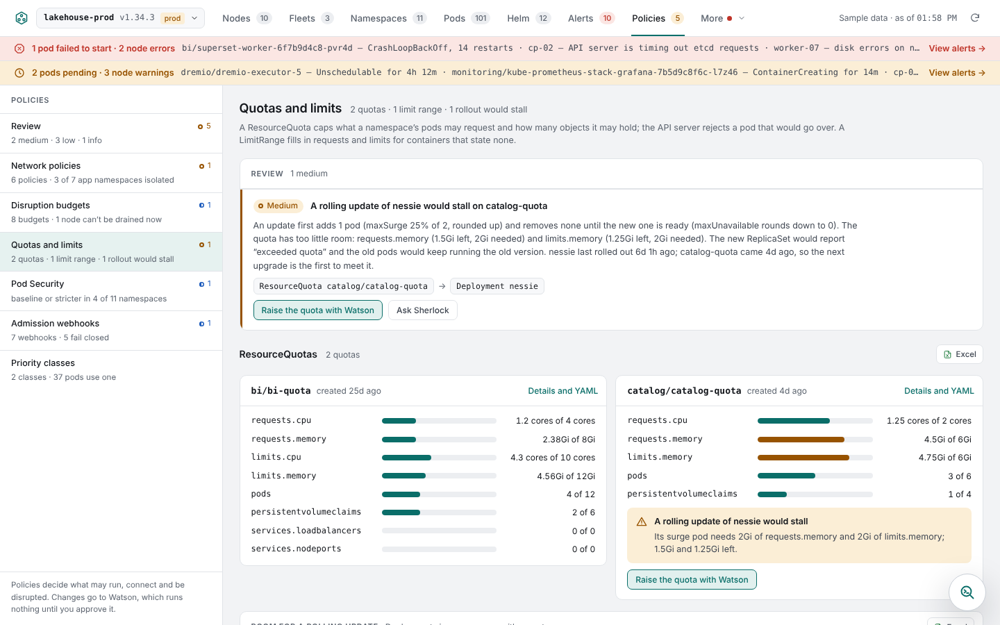 | 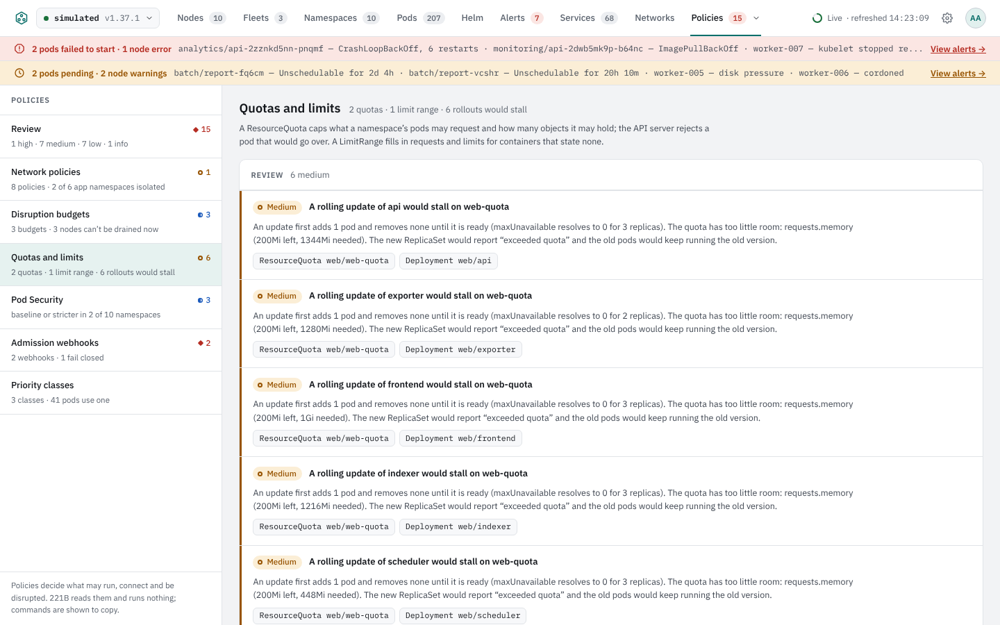 |
| 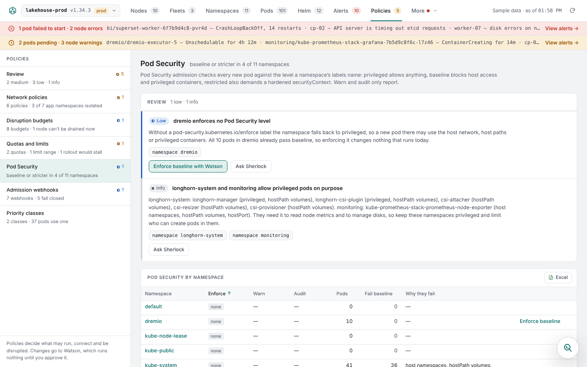 | 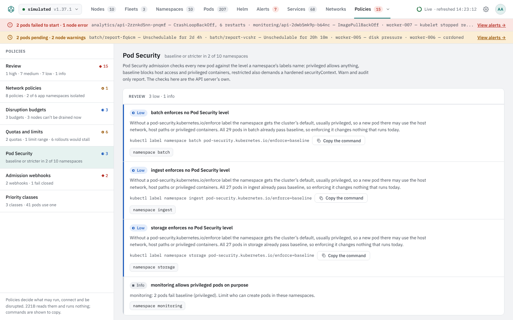 |
| 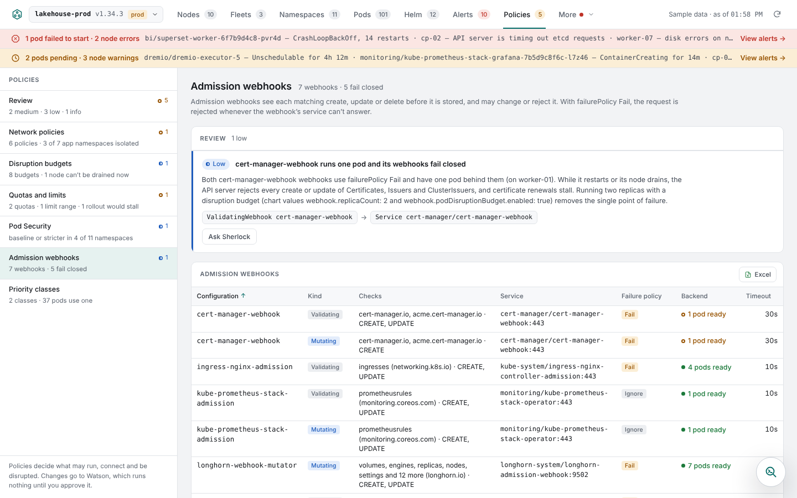 | 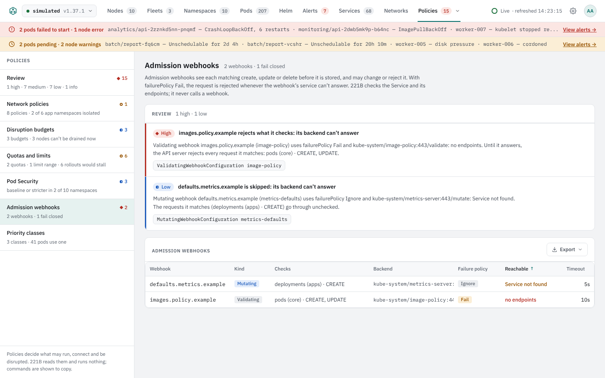 |

**To check by hand:**

```sh
kubectl label --dry-run=server --overwrite namespace <ns> pod-security.kubernetes.io/enforce=restricted   # the warnings, against the namespace's details
kubectl describe resourcequota -n <ns>                                   # Used and Hard, against the quota's row
kubectl get validatingwebhookconfigurations,mutatingwebhookconfigurations -o custom-columns=NAME:.metadata.name,POLICY:.webhooks[*].failurePolicy,TIMEOUT:.webhooks[*].timeoutSeconds
kubectl get priorityclasses
```

## 8. The review page and the rest

The Policies tab opens on a review of what to look at first across the sections, as the Access tab does for RBAC; each finding links to its objects and shows the command a fix would run.

| Prototype | Console |
| --- | --- |
| 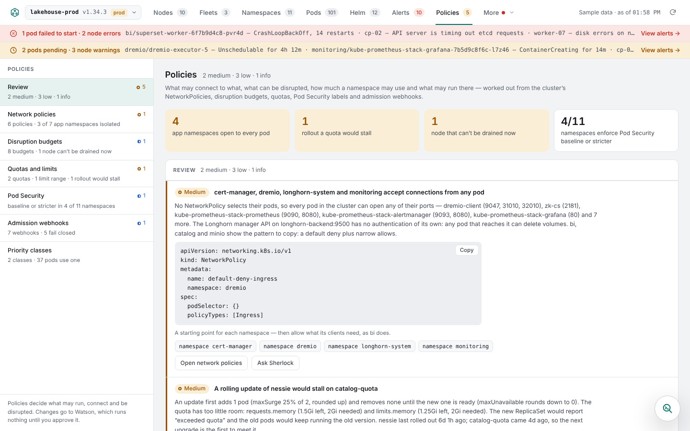 | 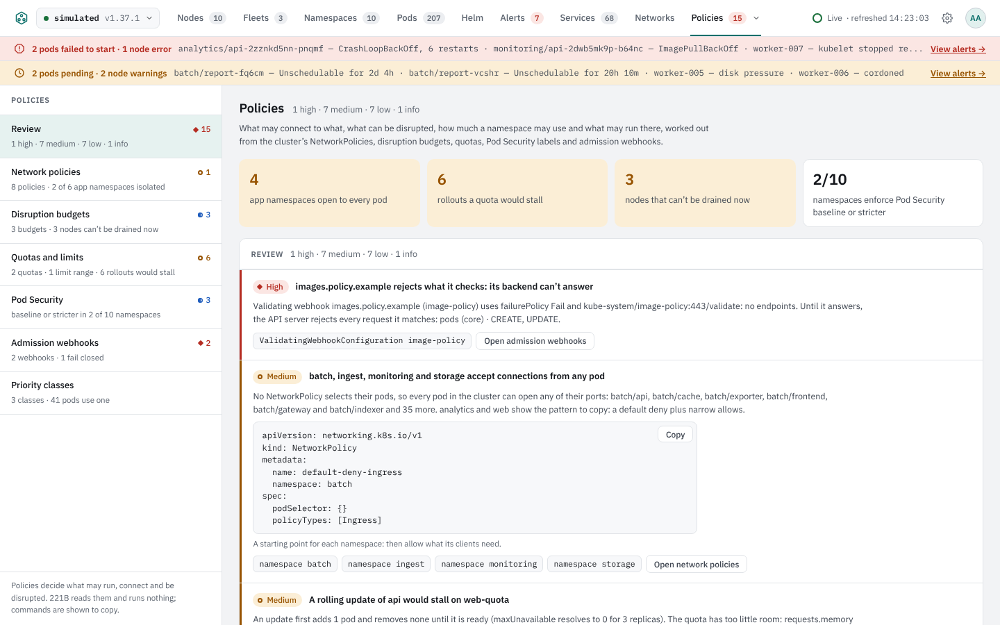 |

Everything else CI checks on every pull request still holds: the planted Secret appears nowhere (now including the Access, Policies and Networks views), each person sees only what Kubernetes lets them (the new views are filtered by the resource each row comes from), accessibility with axe in both themes on every new tab, the three browsers, the three Kubernetes versions in kind, and the scale run.

## Not in Phase 4

Acting on findings: the commands are shown to copy, and Watson runs them from Phase 6. Sherlock (Phase 5) will call the same analyses. The Networks trace does not follow Gateway API routes, and controllers other than the ones it knows (ingress-nginx, NGINX's own controller, Traefik, HAProxy and Contour, whose pods it finds; Google Cloud, AWS and Azure load balancers, which it names) are reported as not checked.
