# Phase 6 review

This is the guide for the review that closes Phase 6 ([requirements](requirements.md#phase-6-watson)). For each item on the review list it says what was built, what CI already proves on every pull request, and what is left for you to check by hand. The Phase 5 guide is [phase-5-review.md](phase-5-review.md); [architecture.md](architecture.md) has been brought up to date, and seven decision records are new (ADR-49 to ADR-55).

## What Phase 6 built

**Watson** runs kubectl and helm commands, beside Sherlock in the panel at the bottom of every tab, as the prototype has it. Type a read (`kubectl get pods -n web`, `helm history shop -n web`) and it runs at once, printing what kubectl or helm would print. Type a change, press **Cordon** or **Drain** in a node's details, or **Send to Watson** on a command in Sherlock's answer or in an RBAC or policy fix, and the command waits on an **approval card**: the exact command, the objects it acts on, its impact (the pods a drain evicts, the disruption budgets they meet, replicas before and after, what a rollback adds and removes) and the result of a server-side dry run. Nothing changes until someone presses **Approve and run**; it then runs as that person, and its output streams into the panel. A card lapses after 10 minutes, or at once if one of its objects changes before anyone approves it.

Behind it, the server parses each line against the fixed list of commands P6-02 names and refuses everything else, naming the rule. It never starts a shell or any other process: kubectl's own command code and the Helm SDK run inside the server, against a client that impersonates the person, so Kubernetes decides what each person may do. Clusters connected read-only refuse every change, and the cluster the console runs in is read-only unless the chart says otherwise (`localCluster.mode: write`). An optional setting makes changes on production clusters wait for a second person. Every command, approval, refusal, lapse and result is audited.

Decisions worth a look, because they shape what you will see:

- **ADR-49:** kubectl's and Helm's own code runs in-process, so the output is theirs; no shell, no binaries. It grows the image, hence ADR-55.
- **ADR-50:** commands and cards live on the server, per person and cluster, so any window of the session, or a second person, can approve them. Like Sherlock's conversations, they do not survive a restart.
- **ADR-51:** how a card works out the impact, and the guards that make it lapse.
- **ADR-52:** the dry run runs as the requester, the change as the approver.
- **ADR-53:** every button that changes something only hands Watson a command line.
- **ADR-54:** one dock for Sherlock and Watson, and one window for both (P6-09).
- **ADR-55:** P1-05's image limit rises from 60 MB to 80 MB, as you decided; the image is about 70 MB.
- **ADR-56:** Sherlock and Watson share one event stream, so a page holds two connections, not three.

## Setting up for the review

Watson is on wherever the console runs; there is nothing to turn on. What it may change:

1. **The console's own cluster** is read-only by default. To let Watson change it, upgrade with `--set localCluster.mode=write`. With sign-in on (`auth.mode` local or oidc), a change runs as the person who approves it and the console needs nothing more than the impersonation it already has. With sign-in off (`auth.mode: none`), changes run as the console's own ServiceAccount, which the chart then binds to the built-in `edit` ClusterRole (`localCluster.writeClusterRole`) and a small role to cordon, drain and label nodes.
2. **Other clusters** follow their connection's setting: **Read only**, or **Read and change** in the connection editor. With **Read and change**, the console's account there needs to impersonate people (the editor's *Show the RBAC* lists it).
3. For the second-person rule, set a cluster's environment to **production** (in its connection editor) and tick **Changes to production clusters need a second person** under **Watson** in Settings.

For your deployment from the earlier reviews (`auth.mode=none`), that is `helm upgrade k8s-console deploy/helm/221b -n 221b --reset-then-reuse-values --set image.tag=pr-6 --set localCluster.mode=write`.

## 1. The panel (P6-01)

| Prototype | Console |
| --- | --- |
| 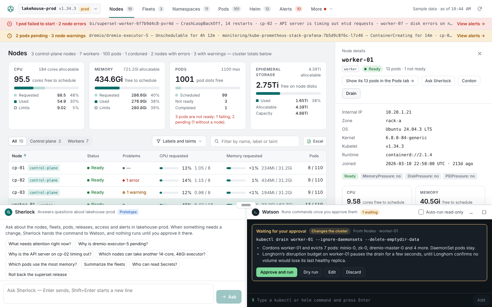 | 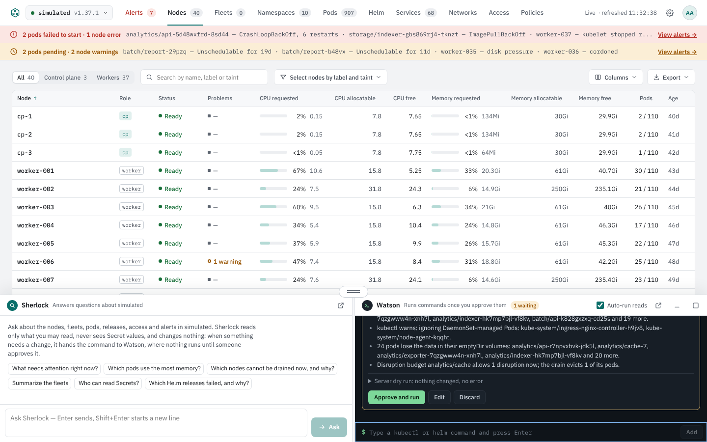 |

**CI proves** (`web/e2e/watson.spec.ts`, in the simulator on Chromium, Firefox and WebKit and in kind on 1.35 to 1.37):
- Typed at the prompt, `kubectl get nodes` runs at once and prints every node the Nodes tab shows, under kubectl's header. In kind, the output matches the real `kubectl get nodes` column for column (all but the ages, which tick), and `kubectl logs`, `kubectl get -o name`, `kubectl auth can-i`, the start of `kubectl describe` and `helm get values` match byte for byte.
- The up arrow brings back earlier commands.
- A long command shows its output as it arrives and can be stopped (`TestStopAndQueue` in Go).
- axe finds no WCAG 2.2 AA failure in the panel with output and a card, in either theme.

Sherlock and Watson share the dock: a grip between them shares the width (the arrow keys work too), and on a phone a switch shows one at a time. With Sherlock off for a cluster, Watson has the whole width.

| Output | Phone width |
| --- | --- |
| 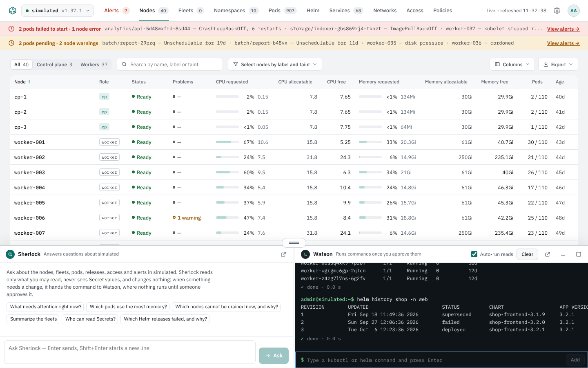 | 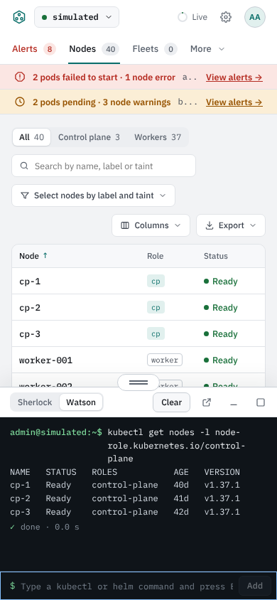 |

**To check by hand:** run a few reads you use every day and compare them with your own kubectl; drain a node of a test cluster and watch the evictions arrive.

## 2. The commands (P6-02)

Reads: `kubectl get`, `describe`, `logs`, `top`, `events` and `auth can-i`; `helm list`, `status`, `history` and `get values`. Changes: `kubectl cordon`, `uncordon`, `drain`, `scale`, `rollout restart`, `rollout undo`, `delete pod`, `label` and `annotate`; `helm rollback`. The empty panel lists them. Anything else is refused with a message that says why ("Watson does not run kubectl exec. It runs …, and changes with …."), and the flags that would point a command elsewhere or make it act as someone else (`--kubeconfig`, `--context`, `--server`, `--as`, `--token`) are refused by name. `kubectl get secrets -o yaml` and the like are refused (`secret values`): Watson never prints a Secret's values. `--watch` and `--follow` are refused too, since the panel prints once.

**CI proves:**
- In kind, every read runs through Watson against a namespace the test creates, and every change runs once approved and is checked against the cluster afterwards: a node cordoned, uncordoned and drained, a Deployment scaled, restarted, rolled back with `rollout undo`, labelled and annotated, a pod deleted, and a Helm release the test installs and upgrades rolled back to its first revision (the ConfigMap it owns returns to its first value). The simulator runs the same test.
- In Go (`server/internal/watson`), every command against the simulator, and the parser's refusals: unknown tools and verbs, blocked flags, wrong arguments, kinds a command does not take (`scale` only Deployments, StatefulSets and ReplicaSets; `delete` only pods).

**To check by hand:** try the commands you would reach for in an incident, and a few Watson should refuse.

## 3. No shell (P6-03)

**CI proves:**
- Pipes, redirections, `;`, `&&`, `||`, backquotes, `$(…)`, `${…}` and `$VAR` outside quotes are refused (`shell`), eleven cases in `TestShellCharactersAreRefused`, and in the browser `kubectl get pods -A | grep Crash` is refused with nothing run.
- Inside single quotes the same characters are just text, passed to kubectl as one argument, as a shell would quote them; `$` inside double quotes is refused, since a shell would expand it.
- The server has no code that starts a process: kubectl and Helm run in-process (ADR-49), and the image has no shell to start (CI checks it on every build).

## 4. The approval card (P6-04)

| A node's Cordon card | A drain card | A lapsed card |
| --- | --- | --- |
| 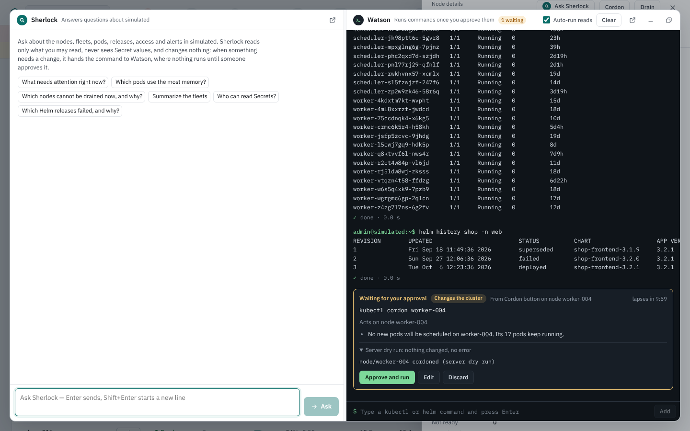 | 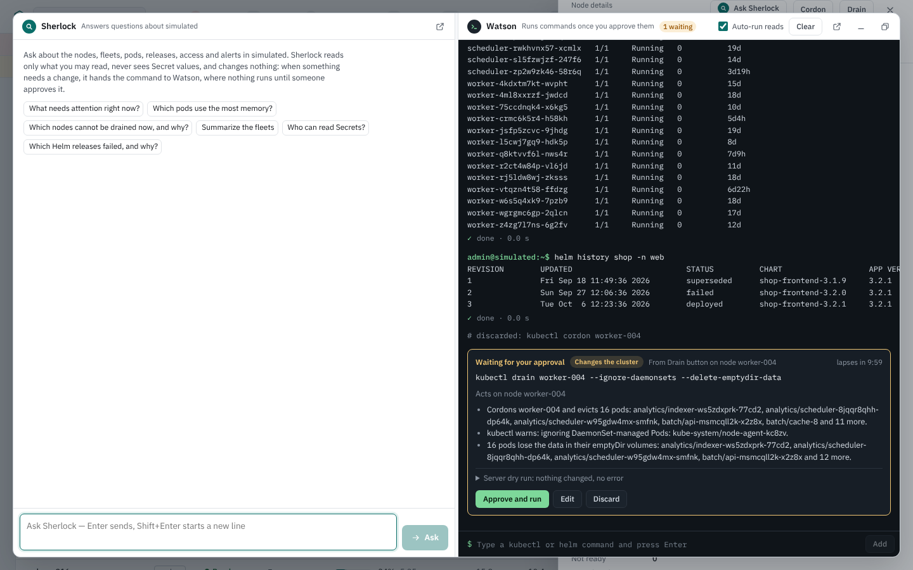 | 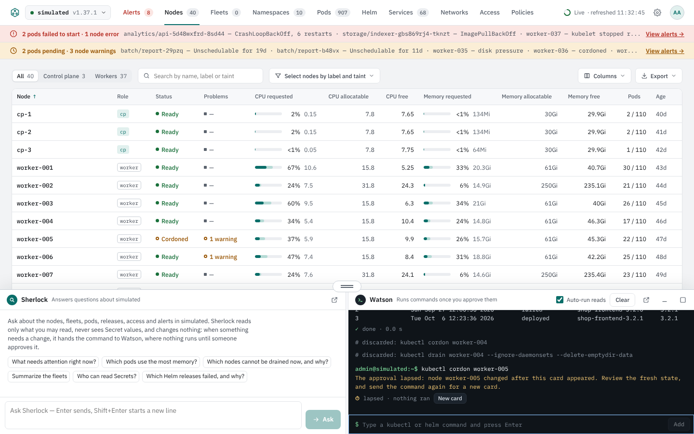 |

**CI proves:**
- Cordon on a node's details puts a card in the panel with the exact command, the node it acts on, its impact ("No new pods will be scheduled on …"), the server dry run (`node/… cordoned (server dry run)`, nothing changed, no error) and the time left. The node is not cordoned until **Approve and run**; then it is, the output says so, and the drawer offers **Uncordon**, through a card too.
- A drain card names the pods it evicts and, in Go (`TestDrainCardNamesPodsAndBudgets`), the budgets that would hold it up and the pods with local storage.
- A card whose node is cordoned by someone else before it is approved lapses within seconds with "node … changed after this card appeared", and nothing runs. **New card** sends the command again against the node as it is now. In Go, a card lapses after 10 minutes (`TestAnApprovalLapsesAfterItsTime`), and an approval arriving after its objects changed is refused.

**To check by hand:** leave a card open for 10 minutes; edit a card's command; change a Deployment with kubectl while its scale card waits.

## 5. Read-only clusters and the approver's rights (P6-05)

**CI proves:**
- On a connection added read-only, reads run and a change is refused at once, with the rule (`refused · read-only cluster · nothing ran`) and how to allow changes. The audit log has a `watson.refuse` record naming the cluster.
- A change runs as the person who approves it: a developer limited to two namespaces (in kind, bound to the view role in one) approves a cordon, and Kubernetes refuses it as forbidden; the node stays as it was.
- The console's own cluster is read-only unless the chart says `localCluster.mode: write`; editing the connection in the console cannot change that.

## 6. Buttons and Sherlock's fixes go through the card (P6-06)

**CI proves:**
- **Cordon**, **Uncordon** and **Drain** on a node put a card in the panel and change nothing by themselves. A Helm release has no button of its own (removed at your first look); a typed `helm rollback` gets a card that names the release, the revisions and what changes.
- **Send to Watson** on a command in Sherlock's answer sends it to Watson with the question as its reason; a read runs at once (with **Auto-run reads** on, the default), a change waits on its card.
- A fix on the Policies tab (labelling a namespace for Pod Security) offers **Send to Watson** beside **Copy the command**. A fix on the Access tab deletes a binding, which Watson does not run, so it offers **Copy the command** only.

## 7. A second person on production (P6-07)

| The requester | The second person |
| --- | --- |
| 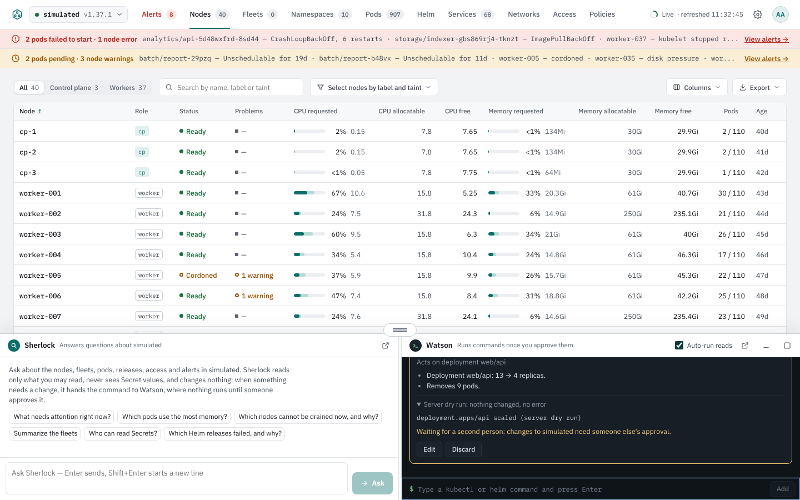 | 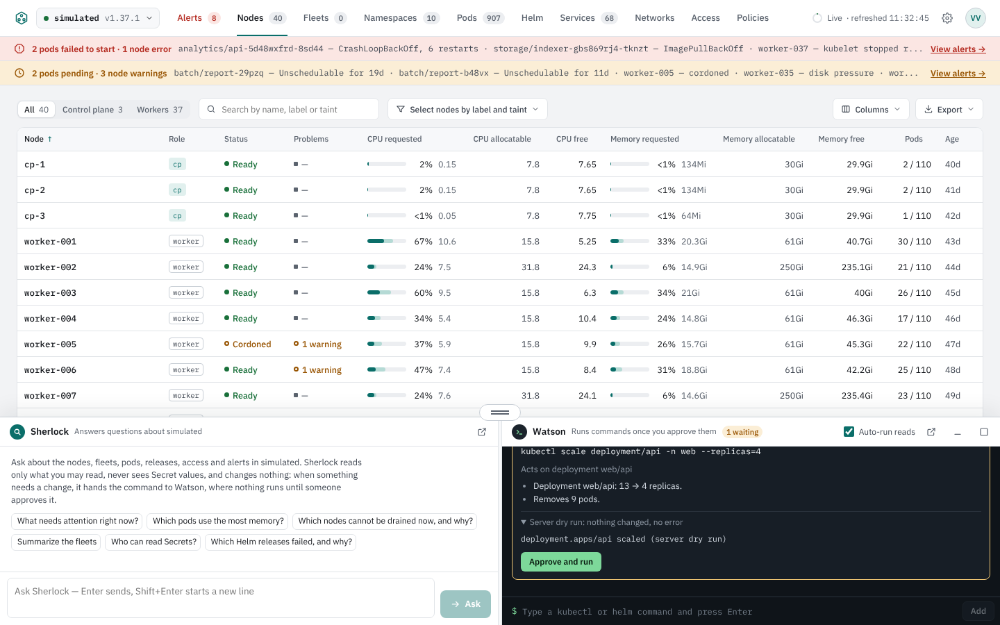 |

**CI proves:**
- With the rule on and the cluster's environment production, the person who asked sees "Waiting for a second person: changes to … need someone else's approval." and no **Approve and run** button; the API refuses their approval too.
- Another signed-in person sees the card ("… asks for approval"), approves it, and it runs as them; the requester sees it run. The audit log names both.
- Only administrators change the setting, and that is audited (`watson.settings`).

## 8. Audit (P6-08)

Each step writes one JSON record on standard output (and to the webhook) naming the person, the cluster and the command: `watson.command` when a command arrives, `watson.refuse` when it is refused, `watson.approve` when someone approves a card, `watson.result` with the exit code when it ends, `watson.lapse` and `watson.discard` for cards that do not run.

**CI proves** that the cordon test's request, approval and result are each in the audit log with the person's email and the cluster, and that refusals and lapses are recorded.

**To check by hand:** `kubectl -n 221b logs deploy/k8s-console-221b | grep '"watson\.'`.

## 9. Sherlock and Watson in a window of their own (P6-09)

| The main window | Their window |
| --- | --- |
| 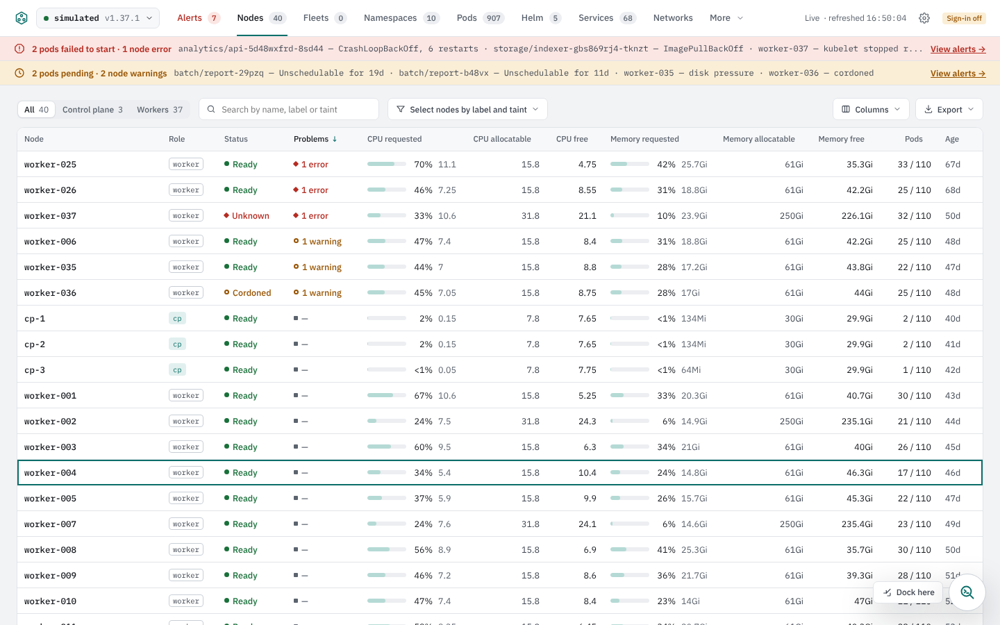 | 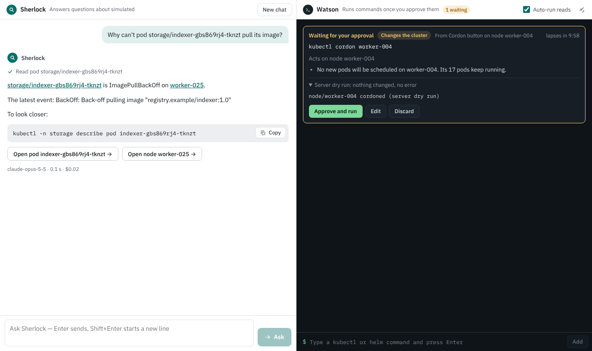 |

Sherlock and Watson leave the main window together, into one window, and come back together (changed at your first look).

**CI proves:**
- The new-window button in the dock opens one window with both panes; the main window shows an icon to bring it forward or **Dock here**.
- Cordon pressed in the main window puts its card in the other window, where **Approve and run** runs it; Ask Sherlock in the main window is answered there, and a link there opens in the main window.
- The dock-back button closes the window, and both panes return to the main window with their commands and conversation.

## Changed after your first look

Changes you asked for, in the same pull request:

1. **Alerts count.** The Alerts tab counts every active alert, acknowledged ones included; acknowledged alerts still stay off the banners at the top of the other tabs. CI: `alerts.spec.ts` acknowledges an alert and checks that the count still includes it and the banners do not.
2. **Nodes order.** Nodes with problems come first (errors, then warnings, then by name) until you sort by a column; the Problems heading shows the sort. CI: `nodes.spec.ts`.
3. **Column choices in the browser.** Which columns each table shows is kept in this browser only, signed in or not. The server's per-person preferences are gone: `/api/v1/prefs`, the chart's `preferences.perUser` and the `USER_PREFS` setting (ADR-40 is marked superseded). Keys named `prefs.*.json` that earlier versions left in the settings ConfigMap are ignored and can be deleted. CI: `fleets.spec.ts` checks that a choice survives a reload and does not reach another browser of the same person.
4. **Legends as tooltips.** The line under the Nodes table is gone; hovering a CPU or memory bar, or the headings of those columns and of the Free columns, explains them. On the home page the bars' tooltip explains them, and the note about missing usage figures moved into it.
5. **Services.** The summary tiles are gone; the type filters above the table do their job.
6. **Sherlock.** Answers no longer end with questions to ask next; the prompt no longer asks the model for them.
7. **Helm tab.** A release has no **Roll back** or **Ask Sherlock** button; `helm rollback` typed in Watson still gets its card.
8. **One window.** Sherlock and Watson move to a window of their own together, and dock back together (section 9).
9. **Release name.** The README, scripts and CI install the chart as `k8s-console`, so its objects are named `k8s-console-221b`, as in your installation. A release whose name starts with a digit is now prefixed `k8s-console-`.

Found while making these, and fixed:

10. **Two event streams per page.** Watson's stream made three per page. A browser opens at most six connections to a host over plain HTTP/1.1 (a port-forward, or a Service without TLS), for all its tabs, so a third tab of the console waited without loading. Sherlock and Watson now share one stream (ADR-56). Behind an Ingress with TLS this never applied. CI: `watson.spec.ts` checks that a page holds exactly two streams; the Go tests read both assistants from the shared stream.

## Not in Phase 6

Commands outside the list, `kubectl apply` and `edit` among them. Watson's commands and cards are kept in the server's memory for 12 hours and do not survive a restart; a command running during a restart stops, and the audit log shows it without a result. With several console replicas (Phase 7), a card raised on one would not show on another.
