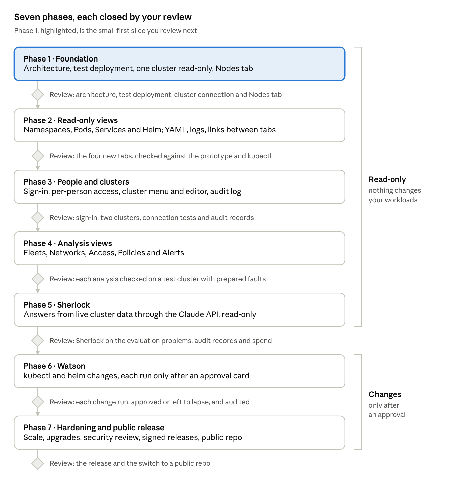
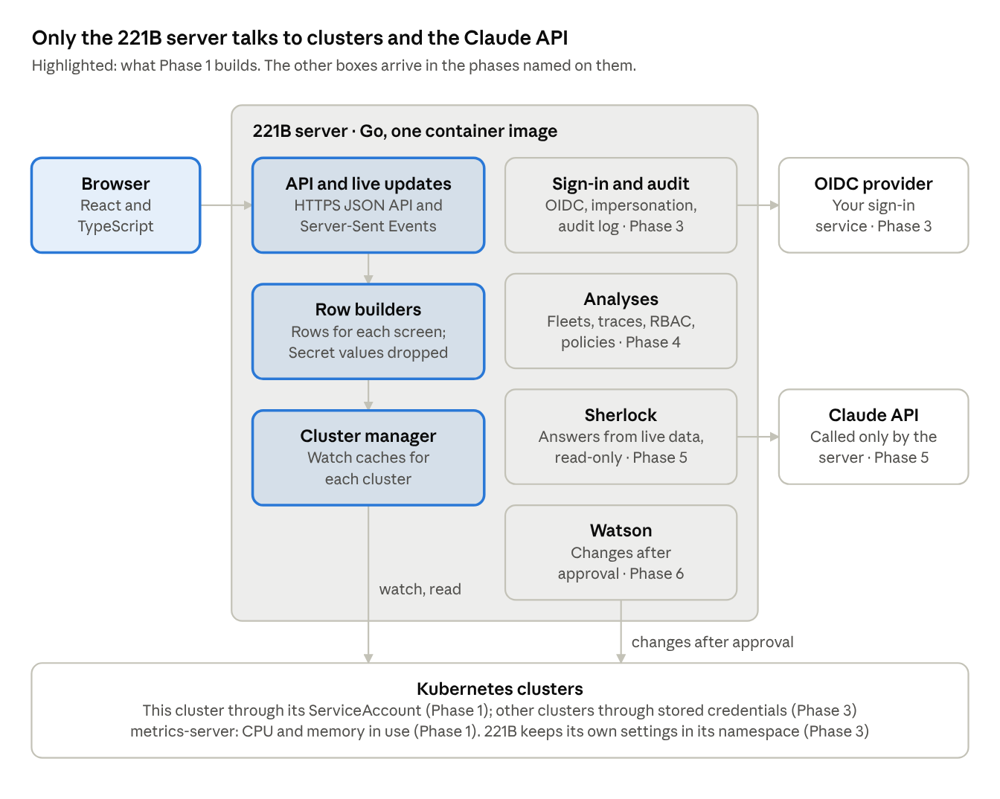

# 221B Requirements

Oct 12, 2026 · Mikhail Stolpner

221B is built in seven phases, and each one ends in a review you approve before the next starts. Phase 1 is deliberately small: an agreed architecture, a test deployment, a read-only connection to one cluster, and the Nodes tab working end to end. The [design prototype](../design/Main.dc.html) is the reference for every screen.

## Roadmap

Phases 1 to 5 never change your workloads. Watson, in Phase 6, is the first part that does, and only after an approval.

## Scope

221B is a web console for Kubernetes clusters with two built-in assistants. Sherlock answers questions about a cluster. Watson runs kubectl and helm commands, but only after you approve each change.

**Who it is for:** the people who run clusters day to day: platform engineers, SREs and on-call staff.

**What it does**

- Shows each cluster live: Nodes, Fleets, Namespaces, Pods, Helm, Alerts, Services, Networks, Access and Policies.
- Connects to several clusters and switches between them from the top bar.
- Lets each cluster be connected read-only or read-write; read-only clusters refuse every change.
- Sorts every table by any column and exports it to Excel.

**What it does not do**

- Create, upgrade or delete clusters. It works with clusters that already exist.
- Show Secret values. It shows Secret keys and sizes only, to every user, everywhere.
- Store metrics or logs long term. It reads them live from the cluster and metrics-server.
- Run as a hosted multi-tenant service. Each installation runs in the owner's own Kubernetes environment.

## Architecture

221B is one Go server and a browser app, shipped as one container image. The server keeps a live, watched copy of each cluster it connects to and sends each browser only the rows its screen shows. Phase 1 runs inside the cluster it shows. Phase 3 adds a management mode, where one installation connects to other clusters with stored credentials.

| Decision | Choice | Why |
| --- | --- | --- |
| Server language | Go | client-go, the Helm SDK, kubectl's drain and describe code and the Pod Security admission library are all Go. |
| Browser app | TypeScript and React | The prototype's screens map onto React components; table virtualization is mature. |
| Packaging | One image: the Go binary serves the built browser app | One thing to deploy, version and scan. |
| Deployment | Helm chart | The same chart installs test and production. |
| Live updates | Watch caches (informers) on the server; Server-Sent Events to the browser | Changes appear within seconds; one watch per resource type per cluster, shared by every viewer. |
| Where rows are built | On the server | Browsers never receive raw objects, so Secret values are filtered in one place and payloads stay small. |
| Cluster access, Phase 1 | In-cluster ServiceAccount with a read-only ClusterRole | No stored credentials; least privilege. |
| People's access, Phase 3 | OIDC sign-in; calls to Kubernetes made as the signed-in person (impersonation). Proposed; see Open questions | Kubernetes RBAC decides what each person may see and change, and the audit log names them. |
| Claude API, Phase 5 | Called only from the server; key kept in a Kubernetes Secret | Keys and cluster data never reach the browser. |

Everything a browser sees passes through the row builders, which is where Secret values are dropped.

## Requirements for every phase

These apply to every phase: a phase is done only when everything it builds meets them.

| ID | Area | Requirement |
| --- | --- | --- |
| X-01 | Secrets | Secret values are never shown, logged, exported, kept in the browser or sent to Sherlock. Screens show Secret keys and sizes only; an environment variable taken from a Secret shows the reference, not the value. |
| X-02 | Permissions | Each phase asks Kubernetes only for the resources and verbs its screens use, and the Helm chart grants exactly that. |
| X-03 | Changes | Nothing changes your workloads before Phase 6; until then 221B writes only its own settings, in its own namespace. From Phase 6, every change needs an explicit approval and is written to the audit log. |
| X-04 | Credentials | Stored credentials (tokens, client keys, kubeconfigs, the Claude API key) live in Kubernetes Secrets and are never sent back to the browser after saving. |
| X-05 | Container | Runs as non-root with a read-only root filesystem and no privilege escalation, and passes the Pod Security restricted profile. |
| X-06 | Browser | A strict Content Security Policy and no third-party scripts at runtime. From Phase 3, every request that changes anything is protected against cross-site request forgery. |
| X-07 | Freshness | A change in the cluster shows on screen within 5 seconds (95th percentile), without a reload. |
| X-08 | Scale | Phase 1: 500 nodes and 15,000 pods per cluster. Phase 7: 5,000 nodes, the upstream limit ([source](https://kubernetes.io/docs/setup/best-practices/cluster-large/)), and 150,000 pods. Sorting or filtering 10,000 rows takes under 200 ms. |
| X-09 | Footprint | Server memory stays under 1 GiB at Phase 1 scale; caches drop fields no screen uses, such as managed fields. |
| X-10 | Compatibility | Any conformant cluster on a Kubernetes minor release still maintained upstream, today 1.35 to 1.37 ([source](https://kubernetes.io/releases/)). Current Chrome, Edge, Firefox and Safari. |
| X-11 | Design | Follows the prototype: layout, light and dark themes, and the More menu that takes tabs as the window narrows. Usable at 390 px phone width. |
| X-12 | Accessibility | WCAG 2.2 AA: every menu, table and drawer works by keyboard, with visible focus and screen-reader labels. |
| X-13 | Tables | Every table sorts by any column, filters, picks columns and exports to Excel exactly the rows and columns on screen. |
| X-14 | Testing | Unit tests, integration tests against a real API server (kind) and browser end-to-end tests for every screen run on every pull request; main stays releasable. |
| X-15 | Operations | Health and readiness probes, structured JSON logs, and Prometheus metrics for requests, watch delay and cache size. |
| X-16 | Privacy | No telemetry. 221B calls out only to the clusters it shows, the sign-in provider, an optional audit webhook, and the Claude API once an admin turns Sherlock on (Phase 5). |
| X-17 | Licensing | Apache 2.0. Every dependency has a compatible license (no GPL or AGPL), checked in CI. |

## Phase 1: Foundation

Phase 1 proves the whole path on one screen. Code becomes an image, the image runs on a test cluster, the server reads that cluster read-only, and the Nodes tab works as the prototype shows it. It ends with your review of those four things; Phase 2 starts only after you approve.

### Architecture and design

| ID | Requirement | Done when |
| --- | --- | --- |
| P1-01 | An architecture document in the repo: components, data flow, security model, deployment modes, and a decision record for each decision in Architecture above. | You approve it at the review. |
| P1-02 | Repository layout: `server/` (Go), `web/` (TypeScript and React), `deploy/helm/221b`, `design/` (the prototype) and `docs/`. | `make image` builds the image from a clean checkout. |
| P1-03 | The app shell follows the prototype: top bar, type, colors, light and dark themes. | Screenshots match the prototype at 1440 px and 390 px wide. |

### Build and test deployment

| ID | Requirement | Done when |
| --- | --- | --- |
| P1-04 | CI on every pull request and push to main: lint, unit tests, browser build, image build, license check and vulnerability scan. | All checks pass on a pull request; a critical or high vulnerability fails the build. |
| P1-05 | One container image: the Go binary serving the built browser app, on a distroless base, non-root, read-only root filesystem. Pushed to GitHub Container Registry, private while the repo is private. | The image is under 60 MB and its scan is clean. |
| P1-06 | A Helm chart: Deployment, Service (ClusterIP), ServiceAccount, read-only ClusterRole and binding, NetworkPolicy, probes, resource requests and limits. No Ingress yet. | `helm install` brings the pod to Ready within 60 seconds; `helm upgrade` works and `helm uninstall` leaves nothing behind. |
| P1-07 | A test deployment on a cluster you choose, opened through `kubectl port-forward`. CI also installs the chart in a kind cluster and runs the end-to-end tests there. | You open the Nodes tab of the test cluster in your browser. |

### Kubernetes integration

| ID | Requirement | Done when |
| --- | --- | --- |
| P1-08 | Connects with the in-cluster ServiceAccount when deployed, or with a kubeconfig context when run on a laptop for development. | Both modes show the same nodes. |
| P1-09 | Reads only what the tab needs: get, list and watch on nodes and pods; get and list on node and pod metrics. | `kubectl auth can-i --list` for the ServiceAccount shows nothing more, and reading a Secret is refused. |
| P1-10 | Keeps watched caches of nodes and pods that recover by themselves after a dropped watch or an API server restart. | A node cordoned with kubectl shows as cordoned within 5 seconds. After an API server restart the tab is current within 30 seconds, without a reload. |
| P1-11 | The top bar shows the cluster name (a chart value), the Kubernetes version read from the API server, and the connection status. | Status turns red within 30 seconds of losing the API server and green when it returns. |
| P1-12 | CPU and memory in use come from metrics-server when it is installed. | Without metrics-server the tab still works and marks usage as unavailable. |

### Nodes tab

| ID | Requirement | Done when |
| --- | --- | --- |
| P1-13 | Columns: Node, Role (one short column), Status, Problems, CPU and Memory (requested and in use against allocatable; allocatable to Kubernetes; free to schedule), Pods (running of capacity) and Age; Taints, Zone, Labels and Kubelet available but hidden by default. | Every value matches `kubectl describe node` on the test cluster. |
| P1-14 | The cluster summary (control-plane and worker counts, pods, cordoned nodes, nodes with problems, and totals for CPU, memory and pods) moves to a home page in a later phase; the Nodes tab shows the table only. | The Nodes tab has no summary. |
| P1-15 | Search by name, role filter (All, Control plane, Workers), sort by any column, column picker, and an Export menu (Excel, JSON) of what is on screen, next to the column picker on the right. | The exported sheet and JSON have the same rows, columns and order as the screen. |
| P1-16 | Problems come from node conditions (not ready; memory, disk or PID pressure; network unavailable), from cordoning, and from pods on the node that are not ready. | A node made not ready and a crash-looping pod on another node each show as a problem that names its cause. |
| P1-17 | A details drawer per node, in this order: status and conditions, problems, taints, labels with kubernetes.io labels hidden by default, then CPU, Memory and Pods as plain sections (allocatable, requested, free, in use, limits; pod counts), then system info (uptime when the kubelet can be asked, internal IP, zone, OS, kernel, kubelet, runtime, joined). | It opens with Enter, closes with Escape, and returns focus to the row. |
| P1-18 | Works at 500 nodes and 15,000 pods, simulated with kwok. | First screen within 2 seconds, sorting within 200 ms, server memory under 1 GiB. |
| P1-19 | A Settings button in the top bar (in place of the theme switch) opens a dialog with the theme and the refresh rate. The refresh rate applies to every open console at the same moment and is kept on the server, so the number of browsers does not add requests to the Kubernetes API. | Two browsers show the same refresh time; a rate set in one shows in the other without a reload and survives a restart of the server. |

**Not in Phase 1:** other tabs, the cluster menu and connection editing, sign-in and Ingress, Sherlock and Watson, label and taint filters, and the cordon and drain buttons in the drawer.

### Your review

- [ ] Architecture document and decision records approved (P1-01)
- [ ] Test deployment installed, upgraded and removed with the chart (P1-06, P1-07)
- [ ] Permissions and live updates checked on the test cluster (P1-09, P1-10)
- [ ] Nodes tab checked against the prototype and kubectl (P1-13 to P1-17)
- [ ] Open question on reading Secrets settled, for Phase 2
- [ ] Go-ahead for Phase 2

## Phase 2: Read-only views

Phase 2 adds the everyday read-only screens: Namespaces, Pods, Services and Helm, with the prototype's navigation and the details behind every row. Nothing in it changes a cluster.

| ID | Requirement | Done when |
| --- | --- | --- |
| P2-01 | Navigation as designed: Nodes, Namespaces, Pods and Helm in the bar, Services under More, and the More menu takes tabs as the window narrows. | From 390 px wide upward no tab is cut off, and the open tab always shows. |
| P2-02 | Namespaces tab: every namespace and what it holds, by kind, with the funnel filter for kinds (multi-select, All by default). | Counts match `kubectl get` for each kind. |
| P2-03 | Pods tab: status, restarts, node, namespace, CPU and memory against requests and limits, and age; filters by namespace, node and status. | A crash-looping pod shows its last termination reason. |
| P2-04 | Pod details: containers and their states, events, owner chain, volumes, environment, and logs (live, previous container, container picker, download). | Logs start within 2 seconds; a pod deleted while open says so. |
| P2-05 | Services tab: type, cluster IP, ports, ready endpoints, and the External columns (external IP or pending, node ports, Ingress hostname). Details list endpoints and the pods behind them. | A LoadBalancer without an external IP shows as pending, with the reason. |
| P2-06 | Helm tab: releases with chart, app version, revision, status and last update. Details show revision history, notes and user-supplied values. | Matches `helm list -A` and `helm history` for every release. |
| P2-07 | Secret handling: the server reads Secrets only to list keys and sizes and to read Helm release records. Helm values that look like credentials are masked. | An automated test proves a known Secret value appears in no response, log or export. |
| P2-08 | A YAML view of every object, with Secret data replaced by key names and sizes and managed fields hidden. | The YAML matches `kubectl get -o yaml` apart from those two changes. |
| P2-09 | Links between tabs: a node to its pods, a pod to its Service and Helm release, a Service to its pods. Label and taint filters on Nodes, held back from Phase 1. | Each link opens the right tab with the right filter. |
| P2-10 | Permissions: get, list and watch on the kinds these tabs show, logs and events. A chart setting turns Secret reading off, which hides Secret keys and the Helm tab. | With the setting off, the ServiceAccount cannot read any Secret. |

**Not in Phase 2:** changes to clusters, more than one cluster, sign-in, and the Fleets, Alerts, Networks, Access and Policies tabs.

**Asked for at the Phase 1 review, built in Phase 2:** the search box fills in suggestions as you type; every table has the same Columns and Export controls, and Export offers CSV besides Excel and JSON; a node's pod count links to the Pods tab filtered to that node.

### Your review

- [ ] Navigation and the four new tabs checked against the prototype and kubectl on the test cluster (P2-01 to P2-06)
- [ ] Secret handling and the YAML view checked: keys and sizes only, Helm credentials masked, managed fields hidden (P2-07, P2-08)
- [ ] Links between tabs and the label and taint filters checked (P2-09)
- [ ] Permissions checked with Secrets on and off (P2-10)
- [ ] Go-ahead for Phase 3

**Review:** you check the four new tabs on the test cluster against the prototype and kubectl, and approve Phase 3. The guide is [phase-2-review.md](phase-2-review.md).

## Phase 3: People and clusters

Phase 3 makes 221B safe to share: people sign in, Kubernetes decides what each person may see, and one installation can show several clusters. It also adds the audit log that Phases 5 and 6 depend on.

| ID | Requirement | Done when |
| --- | --- | --- |
| P3-01 | Sign-in with any OIDC provider. Sessions live in Secure, HttpOnly, SameSite cookies and expire after a set idle time. | No page or API answers without a session, except the health probes. |
| P3-02 | Calls to Kubernetes are made as the signed-in person (user and groups, by impersonation), so Kubernetes RBAC decides what each person sees. | A person without rights to a namespace does not see its pods anywhere, including search and export. |
| P3-03 | Two console roles: admins manage cluster connections and settings; everyone else uses the tabs. | A non-admin sees the cluster menu without Edit, Add or Remove. |
| P3-04 | The cluster menu as designed: switch clusters, each shown with status, environment tag and Kubernetes version. | Switching keeps the open tab and its filters where they apply. |
| P3-05 | The connection editor as designed: name, environment and description; API server address; CA (pasted PEM, system trust, or skip verification with a warning); sign-in by service account token, kubeconfig (with context picker), OIDC or client certificate; read-only or read-write access, with the RBAC YAML to grant it. | Each sign-in method connects to a test cluster. |
| P3-06 | Test connection runs the prototype's five steps: address, TLS, sign-in, Kubernetes and permissions. | Each step's failure, produced in a test, is reported at that step with its cause. |
| P3-07 | Credentials are stored in Kubernetes Secrets in 221B's namespace and never return to the browser. Token expiry is shown and warned about 7 days ahead. | An expired token shows on the cluster page with a Fix the connection action. |
| P3-08 | Removing a cluster asks again; for production, you type its name. Its stored credentials are deleted with it. | No Secret is left behind for a removed cluster. |
| P3-09 | Management mode: one installation connects directly to other clusters' API servers; the cluster it runs in is one connection among them. | Three test clusters show in one installation. |
| P3-10 | An audit log of sign-ins and connection changes (and, later, Sherlock questions and Watson commands): who, what, when, which cluster. JSON lines on standard output, plus an optional webhook. | Each audited action writes exactly one record that names the person. |
| P3-11 | The chart can publish 221B through an Ingress with TLS. | Plain HTTP redirects to HTTPS. |

**Not in Phase 3:** changes to clusters (read-write is stored now and used in Phase 6), and an agent for clusters that 221B cannot reach directly (see Open questions).

**Review:** you sign in, add two clusters with different sign-in methods, test, switch and remove one, and read the audit records.

## Phase 4: Analysis views

Phase 4 adds the tabs that answer questions kubectl leaves to you: which nodes form a fleet, how a request reaches a pod, who can do what, and what blocks a change. Each analysis is a server API that Sherlock reuses in Phase 5.

| ID | Requirement | Done when |
| --- | --- | --- |
| P4-01 | Fleets tab: groups of nodes defined by label and taint selectors, one column per label and per taint, and totals per fleet. Admins create and edit fleets in a drawer; fleets are saved with 221B's settings. | A new node with matching labels joins its fleet within 5 seconds. |
| P4-02 | Networks tab: for each Ingress hostname, the path of a request (address, Ingress controller, TLS certificate, Ingress rule, Service, endpoints, pod), each hop with its state. | Breaking any hop on a test cluster turns that hop red and names the cause. |
| P4-03 | Access tab: roles and bindings with risk flags (cluster-admin, wildcards, reading Secrets, escalate, bind, impersonate), answers to "who can do this", and each identity's effective permissions. | Answers match `kubectl auth can-i` on 20 sampled cases. |
| P4-04 | Network policies: the policies per namespace, and a checker that answers whether pod A can connect to pod B on a port and names the policies that decide. | Answers match real connection tests on a cluster whose network plugin enforces policies. |
| P4-05 | Drains: for each node, whether it can be drained now and what blocks it (disruption budgets, unmanaged pods, local storage), using kubectl's drain logic. | Matches a server-side dry-run drain of each node. |
| P4-06 | Quotas (used against hard, per namespace), Pod Security levels per namespace with the pods a stricter level would reject, admission webhooks (failure policy, timeout, reachability) and priority classes. | Pod Security results match the API server's warnings for a dry-run label change. |
| P4-07 | Alerts tab: pods failing to start, pending and recently recovered, node problems and warning events, grouped by object with counts and first and last seen. | Each injected fault (image pull error, unschedulable pod, out-of-memory kill) appears within 30 seconds. |

**Not in Phase 4:** acting on findings. Fixes appear as the commands Watson will run in Phase 6.

**Review:** you check each tab against kubectl on a test cluster with prepared faults.

## Phase 5: Sherlock

Phase 5 adds Sherlock, which answers questions about a cluster from live data. It reads only what the person asking may read, never sees Secret values, and never changes anything.

| ID | Requirement | Done when |
| --- | --- | --- |
| P5-01 | The panel as designed: docked at the bottom of every tab, resizable, with maximize and minimize to an icon. Ask Sherlock buttons in drawers and callouts start a question. | Behaves as the prototype on desktop and phone widths. |
| P5-02 | Sherlock answers through read-only server tools (get, list, events, recent logs, metrics and the Phase 4 analyses), run as the person asking. | A person without access to a namespace learns nothing about it through Sherlock. |
| P5-03 | Secret values are never sent to the Claude API, and log excerpts are scrubbed of tokens, keys and passwords first. | A test with planted values finds none in the captured API requests. |
| P5-04 | Answers stream, cite the objects they rely on as links into the console, and can be stopped. | 90% of answers start within 5 seconds, and every cited link opens its object. |
| P5-05 | Admin settings: Sherlock on or off per cluster, the Claude API key (kept in a Kubernetes Secret), the model, and daily and monthly spending caps. Each question is audited with its tools and token use. | Reaching a cap stops new questions with a clear message. |
| P5-06 | An evaluation set built from the prototype's sample problems, such as a pending pod, a failed Helm upgrade, a drain blocked by a budget and a LoadBalancer without an IP. | Sherlock finds the cause in at least 9 of 10 cases, measured nightly. |
| P5-07 | When a fix needs a change, Sherlock proposes the command and hands it to Watson in Phase 6. | Sherlock's toolset contains no tool that writes. |

**Not in Phase 5:** running any command. Watson arrives in Phase 6.

**Review:** you ask Sherlock about the evaluation problems on a test cluster and read the audit records and spend.

## Phase 6: Watson

Phase 6 adds Watson, the first part of 221B that changes clusters. Reads run at once; every change waits for an approval card, runs as the person who approved it, and is audited.

| ID | Requirement | Done when |
| --- | --- | --- |
| P6-01 | The Watson panel as designed: a terminal-style prompt per cluster beside Sherlock, output printed the way kubectl and helm print it, and live progress for long operations such as drains. | Output of each supported read command matches the real CLI. |
| P6-02 | Supported reads: kubectl get, describe, logs, top, events and auth can-i; helm list, status, history and get values. Supported changes: kubectl cordon, uncordon, drain, scale, rollout restart, rollout undo, delete pod, label and annotate; helm rollback. Anything else is refused with a clear message. | Each supported command has a passing test on kind. |
| P6-03 | The server parses commands and runs them through client-go, kubectl's own packages and the Helm SDK. It never starts a shell. | Shell characters in arguments have no effect, shown by tests. |
| P6-04 | Every change shows an approval card first: the exact command, the objects affected, a server-side dry run, and the impact, such as pods evicted and budgets touched. The approval lapses after 10 minutes or when those objects change. | Changing an object after its card appears voids the approval. |
| P6-05 | Clusters connected read-only refuse every change; elsewhere the approver's own Kubernetes rights decide. | A refused change names the rule that refused it. |
| P6-06 | Buttons that change things, such as Cordon and Drain on a node, Rollback on a Helm release, and fixes Sherlock proposes, all go through the same card. | No button changes a cluster without a card. |
| P6-07 | An optional setting requires a second person to approve changes on production clusters. | With it on, nobody can approve their own change. |
| P6-08 | Every command, approval, refusal and result is audited. | Each step writes one record naming the person and cluster. |

**Not in Phase 6:** `kubectl apply`, `edit` and `exec`, and helm install or upgrade (see Open questions).

**Review:** you run each supported change on a test cluster, approve some, let others lapse, and check the audit log.

## Phase 7: Hardening and public release

Phase 7 makes 221B ready for other people's production clusters and for the public repo: full scale, safe upgrades, an outside security review, signed releases and complete docs.

| ID | Requirement | Done when |
| --- | --- | --- |
| P7-01 | Meets the Phase 7 scale in X-08: 5,000 nodes and 150,000 pods, simulated with kwok. | A load-test report in the repo shows every target met. |
| P7-02 | Runs with two or more replicas; anything that must run once uses leader election. | Deleting a replica costs viewers no more than a reconnect. |
| P7-03 | `helm upgrade` works from each of the two previous releases, migrating stored settings. | The upgrade tests pass in CI. |
| P7-04 | An outside security review and penetration test of sign-in, impersonation, Secret handling, Sherlock and Watson. | No high or critical finding is open. |
| P7-05 | Signed images with an SBOM and build provenance for every release. | Signature verification passes on the published image. |
| P7-06 | An accessibility audit against WCAG 2.2 AA (X-12). | No AA failure is open. |
| P7-07 | Docs: install, upgrade, connecting clusters, sign-in providers, RBAC templates, what Sherlock sends to the Claude API, Watson's commands, and troubleshooting. | Someone new to the project installs 221B and connects a cluster using the docs alone. |
| P7-08 | Public-repo readiness: contributing guide, code of conduct, security policy for reporting vulnerabilities, issue templates, semantic versions and release notes. | You switch the repository to public. |

**Review:** you approve the release and the switch to public.

## Open questions

Each open decision has a proposal. The first three are needed before Phase 1 starts; the rest can wait until the phase that needs them.

| Question | Proposal | Needed by | Status |
| --- | --- | --- | --- |
| Which cluster hosts the Phase 1 test deployment? | A non-production cluster you choose, reached by port-forward; CI uses kind. | Phase 1 | Open |
| Where are images published? | GitHub Container Registry under ucesys, private until the repo goes public. | Phase 1 | Open |
| Which Kubernetes versions does CI test? | Every minor release still maintained upstream, today 1.35 to 1.37. | Phase 1 | Open |
| May the ServiceAccount read Secrets, for Secret keys and sizes and for Helm releases? | Yes, filtered on the server (P2-07), with a chart setting to turn it off. | Phase 2 | Settled at the Phase 1 review: yes, as proposed; `secrets.read` in the chart turns it off. |
| How is per-person access enforced? | Impersonation, so Kubernetes RBAC decides. 221B needs the right to impersonate on every cluster, and sign-in groups must match the groups RBAC uses. | Phase 3 | Open |
| Where do settings live (connections, fleets, Sherlock settings)? | Kubernetes objects in 221B's namespace: Secrets for credentials, ConfigMaps for the rest. No database. | Phase 3 | Open |
| Do clusters behind firewalls need an agent that connects out to 221B? | Not in this plan; decide after Phase 3 from real installations. | After Phase 3 | Open |
| Which model does Sherlock use, and how long are conversations kept? | The admin picks the model. Conversations last for the session; the audit log keeps questions and tool calls. | Phase 5 | Open |
| Should Watson ever run kubectl apply, edit or exec, or helm install and upgrade? | Not in the first release; exec carries the most risk. | Phase 6 | Open |
| How do outside contributors sign off on their work once the repo is public? | A Developer Certificate of Origin sign-off on each commit. | Phase 7 | Open |
