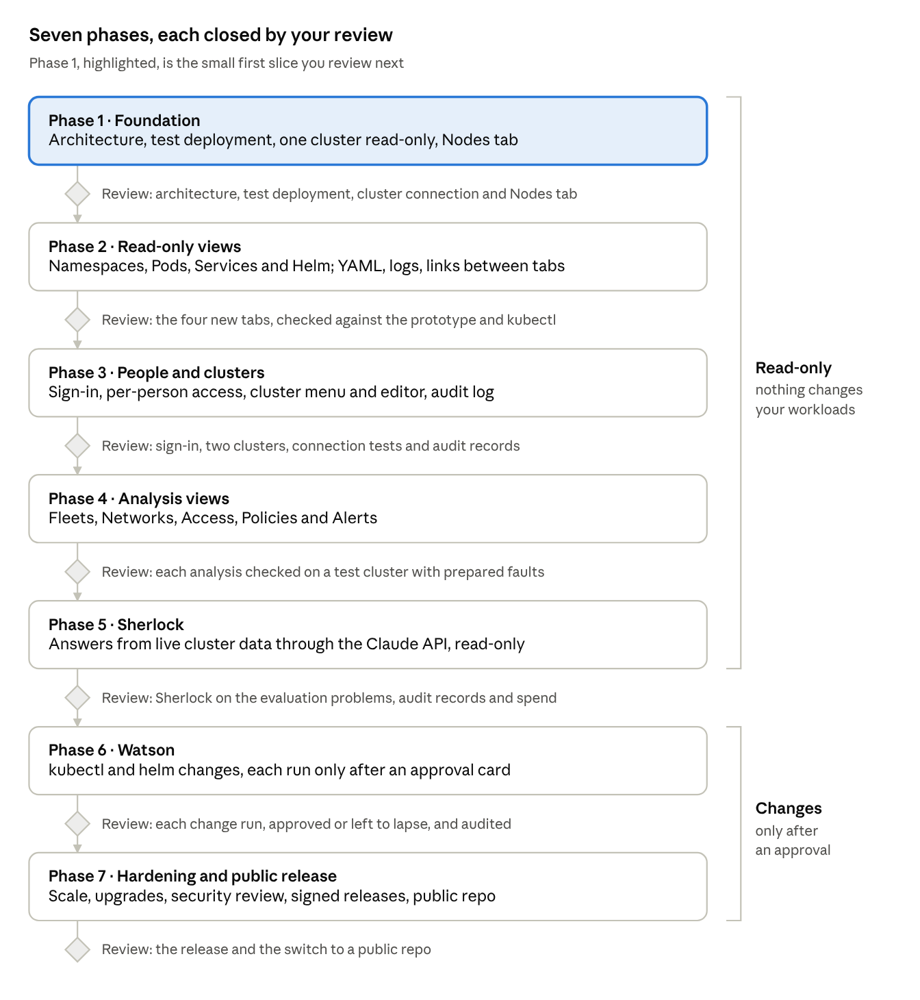
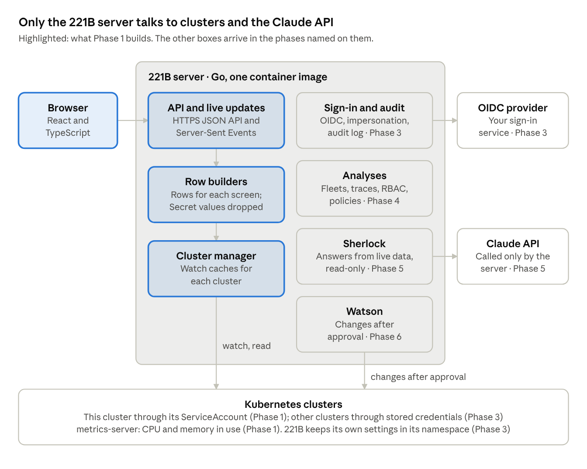

# 221B Requirements

Oct 12, 2026 · Mikhail Stolpner

221B is built in seven phases, and each one ends in a review you approve before the next starts. Phase 1 is deliberately small: an agreed architecture, a test deployment, a read-only connection to one cluster, and the Nodes tab working end to end. The [design prototype](../design/Main.dc.html) is the reference for every screen.

## Roadmap

Phases 1 to 5 never change your workloads. Watson, in Phase 6, is the first part that does, and only after an approval.

## Scope

221B is a web console for Kubernetes clusters with two built-in assistants. Sherlock answers questions about a cluster. Watson runs kubectl and helm commands, but only after you approve each change.

**Who it is for:** the people who run clusters day to day: platform engineers, SREs and on-call staff.

**What it does**

- Shows each cluster live: Nodes, Fleets, Namespaces, Pods, Helm, Alerts, Services, Networks, Access and Policies.
- Connects to several clusters and switches between them from the top bar.
- Lets each cluster be connected read-only or read-write; read-only clusters refuse every change.
- Sorts every table by any column and exports it to Excel.

**What it does not do**

- Create, upgrade or delete clusters. It works with clusters that already exist.
- Show Secret values. It shows Secret keys and sizes only, to every user, everywhere.
- Store metrics or logs long term. It reads them live from the cluster and metrics-server.
- Run as a hosted multi-tenant service. Each installation runs in the owner's own Kubernetes environment.

## Architecture

221B is one Go server and a browser app, shipped as one container image. The server keeps a live, watched copy of each cluster it connects to and sends each browser only the rows its screen shows. Phase 1 runs inside the cluster it shows. Phase 3 adds a management mode, where one installation connects to other clusters with stored credentials.

| Decision | Choice | Why |
| --- | --- | --- |
| Server language | Go | client-go, the Helm SDK, kubectl's drain and describe code and the Pod Security admission library are all Go. |
| Browser app | TypeScript and React | The prototype's screens map onto React components; table virtualization is mature. |
| Packaging | One image: the Go binary serves the built browser app | One thing to deploy, version and scan. |
| Deployment | Helm chart | The same chart installs test and production. |
| Live updates | Watch caches (informers) on the server; Server-Sent Events to the browser | Changes appear within seconds; one watch per resource type per cluster, shared by every viewer. |
| Where rows are built | On the server | Browsers never receive raw objects, so Secret values are filtered in one place and payloads stay small. |
| Cluster access, Phase 1 | In-cluster ServiceAccount with a read-only ClusterRole | No stored credentials; least privilege. |
| People's access, Phase 3 | OIDC sign-in; calls to Kubernetes made as the signed-in person (impersonation). Proposed; see Open questions | Kubernetes RBAC decides what each person may see and change, and the audit log names them. |
| Claude API, Phase 5 | Called only from the server; key kept in a Kubernetes Secret | Keys and cluster data never reach the browser. |

Everything a browser sees passes through the row builders, which is where Secret values are dropped.

## Requirements for every phase

These apply to every phase: a phase is done only when everything it builds meets them.

| ID | Area | Requirement |
| --- | --- | --- |
| X-01 | Secrets | Secret values are never shown, logged, exported, kept in the browser or sent to Sherlock. Screens show Secret keys and sizes only; an environment variable taken from a Secret shows the reference, not the value. (Amended in Phase 10, SE-03: where the chart turns `secrets.reveal` on, a SuperAdmin, or an Admin of the Secret's namespace, may ask for one value at a time, read live as them and written to the audit log; it still enters no cache, log, export or Sherlock prompt.) (Amended on November 9, 2026, BK-15, ADR-137, with the owner's agreement: a backup carries the secrets the console keeps of its own (its connections' credentials, tokens, API keys, channel addresses, password hashes) sealed with the install's backup key, AES-256-GCM, never in clear; the key stays in its Kubernetes Secret and is never shown, logged or exported. Secret values read from clusters are still never exported.) (Amended on November 20, 2026, DB-71, decided by the owner: a sensitive Automation variable's value is a secret the console keeps of its own: it is kept in a Kubernetes Secret, never in a table, a log line, an audit event, an error's text or an answer of the API, and a backup carries it sealed with the install's key.) |
| X-02 | Permissions | Each phase asks Kubernetes only for the resources and verbs its screens use, and the Helm chart grants exactly that. |
| X-03 | Changes | Nothing changes your workloads before Phase 6; until then 221B writes only its own settings, in its own namespace. From Phase 6, every change needs an explicit approval and is written to the audit log. |
| X-04 | Credentials | Stored credentials (tokens, client keys, kubeconfigs, the Claude API key) live in Kubernetes Secrets and are never sent back to the browser after saving. |
| X-05 | Container | Runs as non-root with a read-only root filesystem and no privilege escalation, and passes the Pod Security restricted profile. |
| X-06 | Browser | A strict Content Security Policy and no third-party scripts at runtime. From Phase 3, every request that changes anything is protected against cross-site request forgery. |
| X-07 | Freshness | A change in the cluster shows on screen within 5 seconds (95th percentile), without a reload. |
| X-08 | Scale | Phase 1: 500 nodes and 15,000 pods per cluster. Phase 7: 5,000 nodes, the upstream limit ([source](https://kubernetes.io/docs/setup/best-practices/cluster-large/)), and 150,000 pods. Sorting or filtering 10,000 rows takes under 200 ms. |
| X-09 | Footprint | Server memory stays under 1 GiB at Phase 1 scale; caches drop fields no screen uses, such as managed fields. |
| X-10 | Compatibility | Any conformant cluster on a Kubernetes minor release still maintained upstream, today 1.35 to 1.37 ([source](https://kubernetes.io/releases/)). Current Chrome, Edge, Firefox and Safari. |
| X-11 | Design | Follows the prototype: layout, light and dark themes, and the More menu that takes tabs as the window narrows. Usable at 390 px phone width. |
| X-12 | Accessibility | WCAG 2.2 AA: every menu, table and drawer works by keyboard, with visible focus and screen-reader labels. |
| X-13 | Tables | Every table sorts by any column, filters, picks columns and exports to Excel exactly the rows and columns on screen. |
| X-14 | Testing | Unit tests, integration tests against a real API server (kind) and browser end-to-end tests for every screen run on every pull request; main stays releasable. |
| X-15 | Operations | Health and readiness probes, structured JSON logs, and Prometheus metrics for requests, watch delay and cache size. |
| X-16 | Privacy | No telemetry. 221B calls out only to the clusters it shows, the sign-in provider, an optional audit webhook, and the Claude API once an admin turns Sherlock on (Phase 5). |
| X-17 | Licensing | Apache 2.0. Every dependency has a compatible license (no GPL or AGPL), checked in CI. |

## Phase 1: Foundation

Phase 1 proves the whole path on one screen. Code becomes an image, the image runs on a test cluster, the server reads that cluster read-only, and the Nodes tab works as the prototype shows it. It ends with your review of those four things; Phase 2 starts only after you approve.

### Architecture and design

| ID | Requirement | Done when |
| --- | --- | --- |
| P1-01 | An architecture document in the repo: components, data flow, security model, deployment modes, and a decision record for each decision in Architecture above. | You approve it at the review. |
| P1-02 | Repository layout: `server/` (Go), `web/` (TypeScript and React), `deploy/helm/221b`, `design/` (the prototype) and `docs/`. | `make image` builds the image from a clean checkout. |
| P1-03 | The app shell follows the prototype: top bar, type, colors, light and dark themes. | Screenshots match the prototype at 1440 px and 390 px wide. |

### Build and test deployment

| ID | Requirement | Done when |
| --- | --- | --- |
| P1-04 | CI on every pull request and push to main: lint, unit tests, browser build, image build, license check and vulnerability scan. | All checks pass on a pull request; a critical or high vulnerability fails the build. |
| P1-05 | One container image: the Go binary serving the built browser app, on a distroless base, non-root, read-only root filesystem. Pushed to GitHub Container Registry, private while the repo is private. | The image is under 200 MB (raised from 60 MB to 80 MB in Phase 6, for kubectl and the Helm SDK, and to 200 MB in Phase 8) and its scan is clean. |
| P1-06 | A Helm chart: Deployment, Service (ClusterIP), ServiceAccount, read-only ClusterRole and binding, NetworkPolicy, probes, resource requests and limits. No Ingress yet. | `helm install` brings the pod to Ready within 60 seconds; `helm upgrade` works and `helm uninstall` leaves nothing behind. |
| P1-07 | A test deployment on a cluster you choose, opened through `kubectl port-forward`. CI also installs the chart in a kind cluster and runs the end-to-end tests there. | You open the Nodes tab of the test cluster in your browser. |

### Kubernetes integration

| ID | Requirement | Done when |
| --- | --- | --- |
| P1-08 | Connects with the in-cluster ServiceAccount when deployed, or with a kubeconfig context when run on a laptop for development. | Both modes show the same nodes. |
| P1-09 | Reads only what the tab needs: get, list and watch on nodes and pods; get and list on node and pod metrics. | `kubectl auth can-i --list` for the ServiceAccount shows nothing more, and reading a Secret is refused. |
| P1-10 | Keeps watched caches of nodes and pods that recover by themselves after a dropped watch or an API server restart. | A node cordoned with kubectl shows as cordoned within 5 seconds. After an API server restart the tab is current within 30 seconds, without a reload. |
| P1-11 | The top bar shows the cluster name (a chart value), the Kubernetes version read from the API server, and the connection status. | Status turns red within 30 seconds of losing the API server and green when it returns. |
| P1-12 | CPU and memory in use come from metrics-server when it is installed. | Without metrics-server the tab still works and marks usage as unavailable. |

### Nodes tab

| ID | Requirement | Done when |
| --- | --- | --- |
| P1-13 | Columns: Node, Role (one short column), Status, Problems, CPU and Memory (requested and in use against allocatable; allocatable to Kubernetes; free to schedule), Pods (running of capacity) and Age; Taints, Zone, Labels and Kubelet available but hidden by default. *Problems left the table at the Phase 10.1 review (M-02): Status sorts problems first and the drawer lists them.* | Every value matches `kubectl describe node` on the test cluster. |
| P1-14 | The cluster summary (control-plane and worker counts, pods, cordoned nodes, nodes with problems, and totals for CPU, memory and pods) moves to a home page in a later phase; the Nodes tab shows the table only. | The Nodes tab has no summary. |
| P1-15 | Search by name, role filter (All, Control plane, Workers), sort by any column, column picker, and an Export menu (Excel, JSON) of what is on screen, next to the column picker on the right. | The exported sheet and JSON have the same rows, columns and order as the screen. |
| P1-16 | Problems come from node conditions (not ready; memory, disk or PID pressure; network unavailable), from cordoning, and from pods on the node that are not ready. | A node made not ready and a crash-looping pod on another node each show as a problem that names its cause. |
| P1-17 | A details drawer per node, in this order: status and conditions, problems, taints, labels with kubernetes.io labels hidden by default, then CPU, Memory and Pods as plain sections (allocatable, requested, free, in use, limits; pod counts), then system info (uptime when the kubelet can be asked, internal IP, zone, OS, kernel, kubelet, runtime, joined). | It opens with Enter, closes with Escape, and returns focus to the row. |
| P1-18 | Works at 500 nodes and 15,000 pods, simulated with kwok. | First screen within 2 seconds, sorting within 200 ms, server memory under 1 GiB. |
| P1-19 | A Settings button in the top bar (in place of the theme switch) opens a dialog with the theme and the refresh rate. The refresh rate applies to every open console at the same moment and is kept on the server, so the number of browsers does not add requests to the Kubernetes API. | Two browsers show the same refresh time; a rate set in one shows in the other without a reload and survives a restart of the server. |

**Not in Phase 1:** other tabs, the cluster menu and connection editing, sign-in and Ingress, Sherlock and Watson, label and taint filters, and the cordon and drain buttons in the drawer.

### Your review

- [ ] Architecture document and decision records approved (P1-01)
- [ ] Test deployment installed, upgraded and removed with the chart (P1-06, P1-07)
- [ ] Permissions and live updates checked on the test cluster (P1-09, P1-10)
- [ ] Nodes tab checked against the prototype and kubectl (P1-13 to P1-17)
- [ ] Open question on reading Secrets settled, for Phase 2
- [ ] Go-ahead for Phase 2

## Phase 2: Read-only views

Phase 2 adds the everyday read-only screens: Namespaces, Pods, Services and Helm, with the prototype's navigation and the details behind every row. Nothing in it changes a cluster.

| ID | Requirement | Done when |
| --- | --- | --- |
| P2-01 | Navigation as designed: Nodes, Namespaces, Pods, Helm and Services in the bar while they fit, and the More menu takes tabs from the right as the window narrows (amended at the Phase 2 review: nothing is rolled up while there is room). | From 390 px wide upward no tab is cut off, and the open tab always shows. |
| P2-02 | Namespaces tab: every namespace and what it holds, a tab per kind with its count, as the Helm tab has them (Pods first, Helm releases last), in place of a table per kind under a kinds funnel (changed at the second Toolbox review). | Counts match `kubectl get` for each kind. |
| P2-03 | Pods tab: status, restarts, node, namespace, CPU and memory against requests and limits, and age; filters by namespace, node and status. The status segments are All, Running, Not ready, Pending, Unknown (on a node that stopped reporting), Failing and Completed; a segment shows only while pods are in it, and the chosen one stays, at 0, until another is chosen. | A crash-looping pod shows its last termination reason. |
| P2-04 | Pod details: containers and their states, events, owner chain, volumes, environment, and logs (live, previous container, container picker, download). | Logs start within 2 seconds; a pod deleted while open says so. |
| P2-05 | Services tab: type, cluster IP, ports, ready endpoints, and the External columns (external IP or pending, node ports, Ingress hostname). Details list endpoints and the pods behind them. | A LoadBalancer without an external IP shows as pending, with the reason. |
| P2-06 | (Replaced by the Phase 10 Helm tab, HA-01 to HA-20, on October 28, 2026; what it showed lives on there.) Helm tab: releases with chart, app version, revision, status and last update. Details show revision history, notes and user-supplied values. | Matches `helm list -A` and `helm history` for every release. |
| P2-07 | Secret handling: the server reads Secrets only to list keys and sizes and to read Helm release records. Helm values that look like credentials are masked: by key, in `{name, value}` lists, and any value that carries a credential. A release's rendered notes are masked the same way, or replaced when they cannot be. | An automated test proves a known Secret value appears in no response, log or export. |
| P2-08 | A YAML view of every object, with Secret data replaced by key names and sizes and managed fields hidden; every object also opens its own details (facts by kind, conditions, labels, events, a workload's pods), with pods and Services opening their full drawers wherever they are listed (amended at the Phase 2 review). | The YAML matches `kubectl get -o yaml` apart from those two changes. |
| P2-09 | Links between tabs: a node to its pods, a pod to its Service and Helm release, a Service to its pods. Label and taint filters on Nodes, held back from Phase 1. | Each link opens the right tab with the right filter. |
| P2-10 | Permissions: get, list and watch on the kinds these tabs show, logs and events. A chart setting turns Secret reading off, which hides Secret keys and the Helm tab. | With the setting off, the ServiceAccount cannot read any Secret. |

**Not in Phase 2:** changes to clusters, more than one cluster, sign-in, and the Fleets, Alerts, Networks, Access and Policies tabs.

**Asked for at the Phase 1 review, built in Phase 2:** the search box fills in suggestions as you type; every table has the same Columns and Export controls, and Export offers CSV besides Excel and JSON; a node's pod count links to the Pods tab filtered to that node.

### Your review

- [ ] Navigation and the four new tabs checked against the prototype and kubectl on the test cluster (P2-01 to P2-06)
- [ ] Secret handling and the YAML view checked: keys and sizes only, Helm credentials masked, managed fields hidden (P2-07, P2-08)
- [ ] Links between tabs and the label and taint filters checked (P2-09)
- [ ] Permissions checked with Secrets on and off (P2-10)
- [ ] Go-ahead for Phase 3

**Review:** you check the four new tabs on the test cluster against the prototype and kubectl, and approve Phase 3. The guide is [phase-2-review.md](phase-2-review.md).

## Phase 3: People and clusters

Phase 3 makes 221B safe to share: people sign in, Kubernetes decides what each person may see, and one installation can show several clusters. It also adds the audit log that Phases 5 and 6 depend on.

| ID | Requirement | Done when |
| --- | --- | --- |
| P3-01 | Sign-in with any OIDC provider. Sessions live in Secure, HttpOnly, SameSite cookies and expire after a set idle time; a session made while the session store is away is the cookie itself, signed, and lasts `auth.outageSession` (DB-65). What the page asks by itself is not activity, so a tab left open, a wall display too, is signed out after `auth.sessionIdle`; a person's pointer and keys, and typing in a terminal, are. **Nothing is read past 64 KiB before sign-in** (the review of November 23, 2026, finding 9): the sign-in, change-password and first-run forms and the OIDC start read at most 64 KiB of a request's body, and the sign-in and first-run pages, which also answer any POST made without a session, read none of it. **A session of a way of signing in the console no longer has is refused**, a stored one as a signed one: after the sign-in mode changes (local to OIDC, say), the sessions of the old mode end at their next request (the review of November 23, 2026, finding 11). The groups claim (`auth.oidc.groupsClaim`) is read by its name first, so a namespaced claim (`https://corp.example/groups`, as Auth0 issues) works, and as a dotted path into nested claims (`realm_access.roles`) only when no claim has that name, as the user name's claim is (the review of November 23, 2026, finding 15). The provider's keys are read again (at most once a minute) when an ID token names a kid the set lacks, and also when no key that may have signed it verifies it: a key rotated under the same kid, or a provider that publishes none (the review of November 23, 2026, cut by its cap). With a shared session store a replica that finds a session idle by the last activity stored (written back every 5 minutes) refuses it, and ends it for every replica only once it is idle by more than the idle limit and the 5 minutes, as the sweep does: another replica may hold activity not written back yet (the review of November 23, 2026, cut by its cap). A sign-out on a replica that cannot look the session up (the session store away, and the replica never held it) ends it all the same: refused there, and the store told when it is back (the review of November 23, 2026, cut by its cap). | No page or API answers without a session, except the health probes. `TestABodyBeforeSignInIsReadNoFurtherThanTheFormsLimit` (an 8 MiB body to a page without a session, to the first-run page and to the OIDC start: no more than 64 KiB read). `TestASessionOfTheOldSignInModeIsRefused` (a local SuperAdmin's stored session on a console upgraded to OIDC over the same store: 401). `TestAGroupsClaimNamedWithADotIsReadByItsName` (package `auth`). `TestARotatedKeyWithTheSameKidOrNoneIsFetched` (package `auth`). `TestAnotherReplicaDoesNotEndASessionOnStaleActivity` (package `auth`). `TestASignOutWhereTheSessionCannotBeLookedUpStillEndsIt`. |
| P3-02 | Calls to Kubernetes are made as the signed-in person (user and groups, by impersonation), so Kubernetes RBAC decides what each person sees. | A person without rights to a namespace does not see its pods anywhere, including search and export. |
| P3-03 | Replaced by Phase 6.1 (RB-01 to RB-57): four roles, LDAP, local groups and an Administration area. | See Phase 6.1 below. |
| P3-04 | The cluster menu as designed: switch clusters, each shown with status, environment tag and Kubernetes version. | Switching keeps the open tab and its filters where they apply. |
| P3-05 | The connection editor as designed: name, environment and description; API server address; CA (pasted PEM, system trust, or skip verification with a warning); sign-in by service account token, kubeconfig (with context picker), OIDC or client certificate; read-only or read-write access, with the RBAC YAML to grant it. | Each sign-in method connects to a test cluster. |
| P3-06 | Test connection runs the prototype's five steps: address, TLS, sign-in, Kubernetes and permissions. | Each step's failure, produced in a test, is reported at that step with its cause. |
| P3-07 | Credentials are stored in Kubernetes Secrets in 221B's namespace and never return to the browser. With a database the rest of a connection (its name, address, sign-in method and what the credential says about itself) is a row of `clusters`, and its Secret holds the credential alone (DB-64); without one the Secret holds both. Token expiry is shown and warned about 7 days ahead. | An expired token shows on the cluster page with a Fix the connection action. |
| P3-08 | Removing a cluster asks again; for production, you type its name. Its stored credentials are deleted with it. With a database its row stays, with only its id, for what still names the cluster (DB-64). | No Secret is left behind for a removed cluster. |
| P3-09 | Management mode: one installation connects directly to other clusters' API servers; the cluster it runs in is one connection among them. | Three test clusters show in one installation. |
| P3-10 | An audit log of sign-ins and connection changes (and, later, Sherlock questions and Watson commands): who, what, when, which cluster. JSON lines on standard output, plus an optional webhook. A record's `from` is the socket's peer, or the client that a proxy listed in `auth.trustedProxies` names; nobody else's `X-Forwarded-For` counts. Every record's target and detail pass through the scrubber on the way in, for every sink, and what an older console kept is cleaned at start: no credential and no host key. Free text can only be checked for what looks like one. **Text nobody signed in chose is plain text in the record** (the review of November 23, 2026, finding 8): a user name typed at a sign-in page with a control character is refused as no user name, and recorded with its control characters replaced; a provider's error and a directory's are recorded the same way; and the audit table is given every text field as valid UTF-8 without a zero byte, which PostgreSQL would refuse, failing the queue's one statement at every flush. **Requests nobody signed in to make write a bounded number of records** (finding 10 of the same review): the OIDC callback counts against the sign-in's per-address limit (30 a minute) before it records anything or asks the provider, and a request refused for too many attempts (sign-in, change of password, first-run page, callback) is recorded once a minute for each action and what refused it (the address, the account, the hashing queue), saying that more in that minute are not recorded. | Each audited action writes exactly one record that names the person; a record that carries a credential or a host key reaches no sink with it. `TestATypedUserNameIsRecordedAsPlainText` (package `auth`), `TestPGStoreSavesTextPostgreSQLWouldRefuse` (package `audit`: a zero byte and invalid UTF-8 in every field; the flush and the events after it are saved). `TestUnauthenticatedRequestsWriteABoundedNumberOfRecords` (100 callbacks with a self-made state cookie write at most 31 records; 60 sign-ins from one address record one refusal). |
| P3-11 | The chart can publish 221B through an Ingress with TLS. | Plain HTTP redirects to HTTPS. |

**Not in Phase 3:** changes to clusters (read-write is stored now and used in Phase 6), and an agent for clusters that 221B cannot reach directly (see Open questions).

**Review:** you sign in, add two clusters with different sign-in methods, test, switch and remove one, and read the audit records. The guide is [phase-3-review.md](phase-3-review.md).

## Phase 4: Analysis views

Phase 4 adds the tabs that answer questions kubectl leaves to you: which nodes form a fleet, how a request reaches a pod, who can do what, and what blocks a change. Each analysis is a server API that Sherlock reuses in Phase 5.

| ID | Requirement | Done when |
| --- | --- | --- |
| P4-01 | Fleets tab: groups of nodes defined by label and taint selectors, one column per label and per taint, and totals per fleet. Admins create and edit fleets in a drawer; fleets are saved with 221B's settings. | A new node with matching labels joins its fleet within 5 seconds. |
| P4-02 | Networks tab: for each Ingress hostname, the path of a request (address, Ingress controller, TLS certificate, Ingress rule, Service, endpoints, pod), each hop with its state. | Breaking any hop on a test cluster turns that hop red and names the cause. |
| P4-03 | Access tab: roles and bindings with risk flags (cluster-admin, wildcards, reading Secrets, escalate, bind, impersonate), answers to "who can do this", and each identity's effective permissions. | Answers match `kubectl auth can-i` on 20 sampled cases. |
| P4-04 | Network policies: the policies per namespace, and a checker that answers whether pod A can connect to pod B on a port and names the policies that decide. | Answers match real connection tests on a cluster whose network plugin enforces policies. |
| P4-05 | Drains: for each node, whether it can be drained now and what blocks it (disruption budgets, unmanaged pods, local storage), using kubectl's drain logic. | Matches a server-side dry-run drain of each node. |
| P4-06 | Quotas (used against hard, per namespace), Pod Security levels per namespace with the pods a stricter level would reject, admission webhooks (failure policy, timeout, reachability) and priority classes. | Pod Security results match the API server's warnings for a dry-run label change. |
| P4-07 | Alerts tab: pods failing to start, pending (after a grace period, 2 minutes by default and set on the Settings page, so starting pods raise none) and recently recovered, node problems and warning events, grouped by object with counts and first and last seen. What it has shows as banners at the top of every other tab once Administration › Settings › General turns them on for everyone (off by default since 0.13, the owner, November 22, 2026); the Alerts tab's name still turns red or amber. | Each injected fault (image pull error, unschedulable pod, out-of-memory kill) appears within 30 seconds. |

**Not in Phase 4:** acting on findings. Fixes appear as the commands Watson will run in Phase 6.

**Review:** you check each tab against kubectl on a test cluster with prepared faults. The guide is [phase-4-review.md](phase-4-review.md).

## Phase 5: Sherlock

Phase 5 adds Sherlock, which answers questions about a cluster from live data. It reads only what the person asking may read, never sees Secret values, and never changes anything.

| ID | Requirement | Done when |
| --- | --- | --- |
| P5-01 | The panel as designed: docked at the bottom of every tab, resizable, with maximize and minimize to an icon. Ask Sherlock buttons in drawers and callouts start a question. | Behaves as the prototype on desktop and phone widths. |
| P5-02 | Sherlock answers through read-only server tools (get, list, events, recent logs, metrics and the Phase 4 analyses), run as the person asking. | A person without access to a namespace learns nothing about it through Sherlock. |
| P5-03 | Secret values are never sent to the Claude API, and log excerpts are scrubbed of tokens, keys and passwords first. | A test with planted values finds none in the captured API requests. |
| P5-04 | Answers stream, cite the objects they rely on as links into the console, and can be stopped. | 90% of answers start within 5 seconds, and every cited link opens its object. |
| P5-05 | Admin settings: Sherlock on or off per cluster, the Claude API key (kept in a Kubernetes Secret), the model, and daily and monthly spending caps. Each question is audited with its tools and token use. | Reaching a cap stops new questions with a clear message. |
| P5-06 | An evaluation set built from the prototype's sample problems, such as a pending pod, a failed Helm upgrade, a drain blocked by a budget and a LoadBalancer without an IP. | Sherlock finds the cause in at least 9 of 10 cases, measured nightly. |
| P5-07 | When a fix needs a change, Sherlock proposes the command and hands it to Watson in Phase 6. | Sherlock's toolset contains no tool that writes to a cluster or to settings shared with others. Its UI tools change only the asking person's own view (reworded by P6U-16). |
| P5-08 | Where the browser allows it, the Sherlock panel moves to a window of its own, for example on another monitor, and back. The conversation carries on in it, and Ask Sherlock buttons in the main window send their questions there. | A question asked from the main window is answered in the separate window, and closing that window brings the panel back with the conversation. |

**Not in Phase 5:** running any command. Watson arrives in Phase 6.

**Review:** you ask Sherlock about the evaluation problems on a test cluster and read the audit records and spend.

## Phase 6: Watson

Phase 6 adds Watson, the first part of 221B that changes clusters. Reads run at once; every change waits for an approval card, runs as the person who approved it, and is audited.

| ID | Requirement | Done when |
| --- | --- | --- |
| P6-01 | The Watson panel as designed: a terminal-style prompt per cluster beside Sherlock, output printed the way kubectl and helm print it, and live progress for long operations such as drains. | Output of each supported read command matches the real CLI. |
| P6-02 | Supported reads: kubectl get, describe, logs, top, events and auth can-i; helm list, status, history and get values. Supported changes: kubectl cordon, uncordon, drain, scale, rollout restart, rollout undo, delete pod, label and annotate; helm rollback. Anything else is refused with a clear message. | Each supported command has a passing test on kind. |
| P6-03 | The server parses commands and runs them through client-go, kubectl's own packages and the Helm SDK. It never starts a shell. | Shell characters in arguments have no effect, shown by tests. |
| P6-04 | Every change shows an approval card first: the exact command, the objects affected, a server-side dry run, and the impact, such as pods evicted and budgets touched. The approval lapses after 10 minutes or when those objects change. While its objects cannot be read, a card cannot be approved, and says why. | Changing an object after its card appears voids the approval; a card whose objects cannot be read is not approved. |
| P6-05 | Clusters connected read-only refuse every change; elsewhere the approver's own Kubernetes rights decide. | A refused change names the rule that refused it. |
| P6-06 | Buttons that change things, such as Cordon and Drain on a node, Rollback on a Helm release, and fixes Sherlock proposes, all go through the same card. | No button changes a cluster without a card. |
| P6-07 | An optional setting requires a second person to approve changes on production clusters. | With it on, nobody can approve their own change. |
| P6-08 | Every command, approval, refusal and result is audited. | Each step writes one record naming the person and cluster. |
| P6-09 | Where the browser allows it, the Watson panel moves to a window of its own, with Sherlock or apart from it, for example on another monitor, and back. Commands sent from the main window wait for approval there. | An approval made in the separate window runs the command, and closing the window brings the panel back with its commands. |

**Sherlock UI control (P6U-01 to P6U-20), added to Phase 6:** Sherlock reads what the asking person's console window shows and, while it answers, may change that person's own view: open a tab or an object's details, set filters, search, sort, show or hide columns and highlight a row, through a fixed list of eight actions run in that window. It never changes a cluster or what others see; an administrator can turn view changes off. The requirements, with their Done-when, are in [Sherlock UI control](sherlock-ui-control.md); its open questions were settled as proposed there.

**Not in Phase 6:** `kubectl apply`, `edit` and `exec`, and helm install or upgrade (see Open questions).

**Changed at the Phase 6 review:** the Alerts tab's count includes acknowledged alerts, which still stay off the banners at the top of every tab; the Nodes tab lists nodes with problems first until someone sorts; column choices are kept in each browser, also for people who sign in, and no longer with their account (which the Phase 4 review had asked for); the bar legends under the Nodes table and on the home page became tooltips on the bars and their headings; the Services tab lost its summary tiles; Sherlock no longer suggests questions to ask next; a Helm release no longer has Roll back and Ask Sherlock buttons (P6-06's rollback is typed in Watson); and Sherlock and Watson leave the main window together, in one window, rather than each on its own (P5-08, P6-09). Also asked at the Phase 6 review: Sherlock may use another AI provider than the Claude API (P5-05 now covers it): OpenAI or any OpenAI-compatible API, Amazon Bedrock or Google Vertex AI, each directly or through an enterprise gateway at an address the administrator gives, with its own headers, query and CA certificate; Settings is a page of its own rather than a dialog; an alert's Ask Sherlock became **Troubleshoot**, which asks for a troubleshooting report (summary, cause, evidence, impact, fix and prevention); and each cluster on the home page has **Find deficiencies**, which asks Sherlock to review how the cluster is set up and what to change first.

**Review:** you run each supported change on a test cluster, approve some, let others lapse, and check the audit log.

## Phase 6.1: Roles, users and Administration

Phase 6.1 replaces P3-03's two console roles with four fixed roles (SuperAdmin, SuperViewer, Admin, Viewer) that exist as Kubernetes ClusterRoles, bound to groups by the chart. It adds LDAP and local groups, a first-run page, and an Administration area (Roles, Permissions, Users, Settings). Nothing in 221B writes RBAC at run time. Design and reasoning: [roles-and-users.md](roles-and-users.md); decision record: ADR-59.

#### Roles and assignments

| ID | Requirement | Done when |
| --- | --- | --- |
| RB-01 | Four predefined roles: Viewer, SuperViewer, Admin and SuperAdmin, as in the tables above. Each is a ClusterRole installed and upgraded by the chart under a fixed name (`221b-viewer`, `221b-super-viewer`, `221b-admin`, `221b-super-admin`), labelled `221b/managed: "true"` (Helm sets `app.kubernetes.io/managed-by` itself). The console offers no way to create, edit or delete a role. | `helm install` creates exactly these objects; the Roles page has no edit control. |
| RB-02 | Admin and SuperAdmin each have a **full** and a **read-only** definition. `rbac.roles.admin.template` and `rbac.roles.superAdmin.template` choose (default `full`). Only the chosen definition is installed, under the fixed name; the other does not exist on the cluster. Switching is a `helm upgrade` and changes no binding. | With `readOnly`, no object with a write verb for that role exists on the cluster; switching back restores it; bindings are untouched. |
| RB-03 | The **fully protected read-only deployment**: both templates `readOnly`. The chart refuses to render `localCluster.mode: write` with it, saying why, and the console shows "Changes are impossible by configuration" wherever it shows Watson's cards. | `helm template` fails on the contradiction; on a kind cluster every supported change, sent from every role, is refused by Kubernetes. |
| RB-04 | Roles are assigned by **LDAP group** (in values, RB-20) and, for local users, by **membership of a local group** for Admin and Viewer (RB-50) and by a **super role given to the user** in 221B (RB-05, RB-51). OIDC keeps `auth.admins` and `auth.adminGroups`, which now mean SuperAdmin; it can use the same four group lists (open question). | For each role and each source, a test signs in as such a person and sees what the role allows. |
| RB-05 | SuperAdmin and SuperViewer are held in 221B and apply to every connected cluster. When 221B calls Kubernetes as a person who holds one, it adds the reserved group to their groups, in the access reviews and in impersonated calls alike. Kubernetes still decides what the group may do. A change to who holds one takes effect within the access lifetime (2 minutes), including in open sessions. A local account's email and name are read again with its groups and super roles on every request, so an email changed away from one in the admin list (`auth.admins`) takes SuperAdmin from that person's open sessions at their next request (the review of November 23, 2026, finding 13). | A SuperViewer sees every namespace on two connected clusters after one assignment; removing a SuperAdmin hides the Administration pages and refuses their next change within 2 minutes, without their signing out. `TestAnEmailChangedAwayFromTheAdminListEndsTheRoleInOpenSessions` (package `auth`). |
| RB-06 | Admin and Viewer are bound per namespace: one RoleBinding of a **group** to the role's ClusterRole in each namespace, rendered by the chart from `namespaces` on a group in values (LDAP, local or OIDC). Nothing in the console or in Watson creates or deletes a binding (RB-52). To give a person a different set of namespaces, add a group in values and run `helm upgrade`; a group may have one member. Rights add up, as in Kubernetes: Viewer in `web` and Admin in `api` is both. A namespace named in values that does not exist makes the chart fail with that name, and so does the console's own namespace or the toolbox's: nobody is bound there. | A person bound in two namespaces sees those two and no others, in every tab, in search and in export (P3-02). |
| RB-07 | Everyone who signs in can see the nodes. A chart-created ClusterRole (read nodes only) is bound to the reserved group `221b:console-users`, which 221B adds for every signed-in person. It grants no other cluster-scoped kind. | A Viewer bound in one namespace sees the Nodes and Fleets tabs and cannot list volumes, storage classes or namespaces through the console. |
| RB-08 | For a person limited to namespaces, the Namespaces tab lists their own namespaces, worked out from the per-namespace verdicts the console already holds (ADR-31). No right to list namespaces is granted for this. | Bound in `web` and `api`, the tab lists those two. |
| RB-09 | Node totals ("requested", "in use", pods on a node) stay cluster-wide, as ADR-31 says today. Any list of pods behind a total is filtered to the person's namespaces. | A Viewer sees a node's total pod count, and only their own namespaces' pods in its list. |

#### What the roles contain

| ID | Requirement | Done when |
| --- | --- | --- |
| RB-10 | **Viewer**: `get`, `list` and `watch` on every kind the console watches, Roles and RoleBindings included. The rule list is generated from the console's own list of watched kinds, so the two cannot drift. Secrets are included while `secrets.read` is on, and not otherwise; their values still never reach the screen (X-01). | A test adds a watched kind and fails until the role has it; with `secrets.read: false` the role has no Secret rule. |
| RB-11 | **SuperViewer**: the same rules cluster-wide, plus the cluster-scoped kinds the console shows (namespaces, volumes, storage classes, CustomResourceDefinitions, ClusterRoles, ClusterRoleBindings), and **no Secrets**. | A SuperViewer reads every page except Secrets, on a kind cluster. |
| RB-12 | **Admin**: the full definition is Viewer's rules plus the namespaced changes of P6-02. It has no right on Roles or RoleBindings, no `pods/exec`, and nothing cluster-scoped. Helm rollback needs `create` and `update` on Secrets in the namespace, because Helm keeps its releases there (open question). The read-only definition is Viewer's rules. | An Admin with the full definition approves a scale in a bound namespace and is refused a drain, a role change and any action elsewhere, each with Kubernetes' own message; with the read-only definition every change is refused. |
| RB-13 | **SuperAdmin**: the full definition is all verbs on all resources; the read-only definition is `list` and `watch` on all resources, `get` on every resource of the built-in API groups, Secrets included, except the subresources that run a command or proxy to one (`pods/exec`, `pods/attach`, `pods/portforward`, `pods/proxy`, `services/proxy`, `nodes/proxy`, which a kubelet and the API server authorize as `get`), and `get` on non-resource URLs. RBAC cannot deny, so those `get`s are listed; a custom resource is listed and watched but not read by name. SuperAdmin is also the console administrator of ADR-26: connections, settings, fleets, the Users page, LDAP refresh and assignments belong to it alone. | A non-SuperAdmin sees those controls disabled with the reason, and the endpoints refuse them. |
| RB-14 | The console's own account gains no permission from this work: it still impersonates and creates access reviews, writes only its own settings, connections and local users in its own namespace, and never needs `bind`, `escalate` or write access to RBAC or workloads. With sign-in off it keeps `localCluster.writeClusterRole` as today. | A chart test shows the console's ClusterRole and Role unchanged apart from the narrow reads of RB-36. |

#### Names sent to Kubernetes

| ID | Requirement | Done when |
| --- | --- | --- |
| RB-15 | Each source has its own prefix on the names Kubernetes sees: local users and groups get `221b-local:`, LDAP ones get `221b-ldap:`, and OIDC ones keep using `auth.kubernetes.userPrefix` and `groupPrefix` as today. The Roles and Users pages hide the prefix when they show a name. Prefixes are chart values. | A local `alice` and an LDAP `alice` hold different rights; the Roles page shows both as `alice` with their source. A local group `ops` and an LDAP group `ops` are different subjects. |
| RB-16 | Names are matched exactly, case included. Local user names use lowercase letters, digits, `.`, `-` and `_`. | `Alice` and `alice` are two different subjects, and a local user cannot be created as `Alice`. |
| RB-17 | A name from any source that starts with `system:` or `221b:`, or that already carries a reserved prefix, is refused as a user name and dropped from a token's or directory's groups, with an audit record. | A directory group called `221b:superadmins` gives its members nothing and writes a record; a local user called `system:masters` cannot be created. |
| RB-18 | Impersonating a ServiceAccount or a UID stays impossible (ADR-31), with sign-in off too: the chart's `minimal` write role holds no impersonation. | Unchanged tests still pass; `hack/check-chart.sh`. |

#### LDAP

| ID | Requirement | Done when |
| --- | --- | --- |
| RB-19 | LDAP is configured in `values.yaml` under `auth.ldap` (see Chart values above): server URL with LDAPS or StartTLS, an optional CA, the bind DN, user and group search bases, filters and attributes, nested groups, paging, time limits. The bind credential is a Kubernetes Secret named in values (`existingSecret`, key `bind-password`) and is never in values, logs, the audit log or any API response (X-04). | An integration test against OpenLDAP in CI signs in; a search of the console's logs, audit records and API responses never finds the credential. |
| RB-20 | `auth.ldap.roles` lists the LDAP groups of each role: `viewer`, `superViewer`, `admin` and `superAdmin`. An entry for `viewer` or `admin` may carry `namespaces`, which the chart turns into RoleBindings (RB-06). The group names are written as the directory has them; the console adds the prefix of RB-15. | A group listed under `admin` with two namespaces yields two RoleBindings and the Admin role for its members; `namespaces` under a super role fails the chart. |
| RB-21 | A person may sign in only if they belong to at least one group listed for any of the four roles. Others are refused with the same message whatever the reason (wrong password, not in a group, unknown user), and the audit record says which. A person in several groups holds each role; the highest is shown, and rights add up. | A valid LDAP user in no listed group cannot sign in and nothing about the groups is revealed to them. |
| RB-22 | People sign in by binding as themselves. Groups are resolved from the directory, nested groups included, with paged searches. Nothing falls back to open access: when the directory cannot be reached, new sign-ins are refused with a clear message and open sessions continue until their lifetime ends. | Stopping the directory refuses a new sign-in with that message and leaves a signed-in person working. |
| RB-23 | A person's groups are looked up again in the directory whenever their access reviews expire, no more often than every 2 minutes, and again when they approve a change. | Moving a person to another group changes what they see within 2 minutes, with no new sign-in. |
| RB-24 | The Users page lists people from the listed groups: the sync reads those groups' members at start-up, at a person's first sign-in and on `syncInterval`. The list is kept in memory with the time of the last sync, counts and any errors. A person no longer in any listed group is shown as disabled, not deleted. A failed sync keeps the old list and says so. | Removing a person from the group disables them on the next sync; stopping the directory leaves the list and shows an error. |
| RB-25 | A **Refresh** button on the Users page (SuperAdmin only, shown only with LDAP) starts a sync in the background. Only one runs at a time, and the page shows it running and then its result. | Two clicks run one sync. |

#### Bootstrap

| ID | Requirement | Done when |
| --- | --- | --- |
| RB-26 | **Local users.** While no user exists and LDAP is not configured, the console shows a first-run page that asks for the first administrator's name and password. That person becomes a SuperAdmin. The page closes for good once a user exists, is rate-limited, and is audited. There is no generated password. **A local-users file of the wrong shape stops the start** (the review of November 23, 2026, finding 12): the file (`auth.local.users`, or `auth.local.existingSecret`'s `users.yaml`) is a list of accounts or an object with a `users` list and nothing else; no accounts is written `[]`, `users: []` or `null` (as the chart writes it). Any other mapping (one account written without its leading `- `, a list under another key) and an empty file are an error, where they were read as no accounts and opened the first-run page. Each start logs how many accounts the file names, and warns when it names none. | A second visit shows the normal sign-in; more than 5 attempts a minute are refused; the audit log has the setup. `TestAMalformedLocalUsersFileIsRefused` (package `auth`). |
| RB-27 | An optional chart value, `auth.setupToken`, must be typed on the first-run page when set. The first-run page has a Setup token field with the hint "Enter auth.setupToken if specified on deployment, if not leave blank." The chart's install notes warn when the Service is reachable from outside the cluster; they do not print the token. | With a token set, a wrong or missing token is refused. |
| RB-28 | **LDAP and OIDC.** The first SuperAdmins are the groups listed under `superAdmin` (RB-20, or the OIDC lists). They hold the role from the first start and cannot be removed in the console. Existing `auth.admins` and `auth.adminGroups` keep working. In LDAP mode, local users can still be listed in values as break-glass accounts, and cannot be created in the console (open question). | A fresh install with an LDAP group under `superAdmin` gives its members SuperAdmin at first sign-in; an upgrade keeps today's administrators. |
| RB-28a | **Local accounts with LDAP sign-in.** With `auth.mode: ldap` the console's local accounts (values and the accounts Secret) still sign in, also while the directory cannot be reached. A name held by both a local account and a directory person signs in with either password: the local one first, then the directory's; a wrong local password with the directory down is a plain refusal. | An LDAP console with the directory unreachable signs `break-glass` in; `priya` signs in locally with the local password and from the directory with the directory's (`TestLDAPLocalAccountsSignInWhenTheDirectoryIsDown`). |
| RB-29 | The chart creates the chosen role definitions, the nodes ClusterRole and the three reserved group bindings on the cluster the console runs in. For every other cluster, the connection editor shows the same YAML, in the full or the read-only variant, with the RoleBindings of the groups in values, and the connection test says which of the objects are missing or differ. Until they exist, people see an empty console there, and the page says why. | A newly connected cluster with nothing applied shows the YAML and a clear message; after applying it, a SuperViewer sees the cluster. |
| RB-30 | The last SuperAdmin cannot be removed, disabled or deleted, and the console says so. | The attempt is refused and audited. |
| RB-31 | With sign-in off, everyone is an anonymous SuperAdmin as today (ADR-26) and the Administration pages other than Permissions are not shown. Changes then run as the console's own account (ADR-52), which the four roles cannot limit, so the chart refuses `auth.mode: none` with `localCluster.mode: write` when either template is `readOnly`, and says so. | `helm template` fails on that combination. |

#### Keeping Watson inside the limits

The aim: whatever Sherlock or a person types, the console and Watson can do no more than the chart allows. The approach has one hard limit, the roles, and guards that can only narrow it. The model supplies text, never identity or scope.

| ID | Requirement | Done when |
| --- | --- | --- |
| RB-32 | **The roles are the ceiling.** Every change runs as the approver, impersonated (ADR-52), so Kubernetes refuses what the approver's role does not allow. The dry run runs as the requester. Nothing in the console grants a change that the role does not. | With the read-only SuperAdmin definition, an approved card for every supported change fails with Kubernetes' message and changes nothing. |
| RB-33 | **A model never supplies identity or scope.** The user, groups, impersonation headers, cluster and the objects a change touches come from the session, the card and the server's own dry run, never from model text. No tool Sherlock has takes any of them as input, and a Sherlock proposal is only text until a person sends it to Watson (ADR-53). | A contract test fails if any tool's input schema names a user, group, header or cluster; a proposal naming another cluster or namespace is not applied to it. |
| RB-34 | **Closed grammar.** Watson parses a command into a typed form and runs only the supported ones (P6-02, P6-03). An unknown command, flag, kind or shell character is refused before anything runs. The card shows what the server worked out (objects, impact, dry run), not what the text claimed. A command that names an object that does not exist cannot be approved. | A corpus of invented and malformed commands (unsupported verbs, hallucinated names and flags, shell metacharacters, other clusters, other namespaces) is refused or fails its dry run; none reaches approval with an effect. |
| RB-35 | **A lock in values that agrees with the roles.** `localCluster.mode` and each connection's mode stay the console-side lock: `read` refuses every change before it is parsed. The chart validates it against the templates (RB-03, RB-31). | `mode: read` refuses a change with a SuperAdmin whose role would allow it; the contradictions fail the chart. |
| RB-36 | **Fail closed on drift.** At start-up, every 5 minutes and when the roles change, the console compares the four deployed ClusterRoles of each cluster with the definitions shipped in its image, which are the same files the chart installs. A difference is shown on the Permissions page and in the audit log. With `rbac.enforce: strict`, a cluster whose roles allow more than the shipped definitions refuses every change, naming the difference. The console's account gets `get` on exactly these ClusterRoles by name, nothing more. | Editing `221b-admin` on a kind cluster to add `delete nodes` raises the warning within 5 minutes; with strict on, a change on that cluster is refused. |
| RB-37 | **Impersonation limited by values.** Because every group the console may assert is listed in values (LDAP groups, local groups, OIDC role lists), the chart limits the console's right to impersonate groups to exactly those groups, with prefixes, plus the reserved groups and `system:authenticated`. The code that builds the impersonation headers cannot emit any other group, and a test proves it never emits `system:masters`. User names cannot be limited the same way, since people are dynamic; the console computes them from the session. With OIDC and role lists, a SuperAdmin through `auth.adminGroups` is asserted as the listed groups and the reserved ones only, as with LDAP: the chart does not let the console impersonate an admin group, so asserting it got 403 on everything done in the cluster as that person; the cluster rights come through `221b:superadmins` (the review of November 23, 2026, finding 14; roles review finding 13). | A request to impersonate a group outside the list is refused by the API server; a unit test fails if the header builder can emit an unlisted group. `TestAnOIDCAdminGroupIsNotAssertedToTheClusters` (package `auth`). |
| RB-38 | **A person approves, never a model or a button of the console.** No Sherlock tool, UI action (P6U-12) or script can press Approve and run; approval needs a person's own session and a protected request (X-06). Cards lapse after 10 minutes or when the objects change (P6-04, ADR-51), and the second-person rule applies on production (P6-07). | A test drives Sherlock to propose a change and to try to approve it; no change runs. |
| RB-39 | **Read-only deployments are tested as such.** On a kind cluster with both templates `readOnly` and `mode: read`, the whole supported set of changes is tried as SuperAdmin, Admin, Viewer and SuperViewer, and the cluster is compared before and after. | Every attempt is refused and the cluster's objects are byte-for-byte unchanged. |
| RB-40 | **The ceiling is tested for every role and definition.** For each role in each definition, a test runs the whole command set plus the corpus of RB-34 and checks that exactly what the role's rules allow succeeds. The expected results are generated from the same definitions as the Permissions page, so what is documented is what is enforced. | The test matrix passes on every pull request and fails when a role gains a verb the definitions do not list. |

#### The Administration area

| ID | Requirement | Done when |
| --- | --- | --- |
| RB-41 | A separate **Administration** entry beside the cluster tabs, at `#/admin`, with the pages **Roles**, **Permissions**, **Users** and **Settings**. Permissions is shown to everyone who signs in. Roles follows Kubernetes: a person who cannot list RoleBindings sees nothing in it. Users and Settings are SuperAdmin only. | A Viewer sees Roles and Permissions, a SuperAdmin sees all four, and the other pages answer a Viewer with a clear refusal. |
| RB-42 | **Roles** lists the four roles with a description, scope and the number of holders. Clicking a role opens its details on the right, like any other page (ADR-38): its permissions, generated from the ClusterRole itself, and every bound subject. Groups, LDAP and local, appear with their namespaces as set by Helm and cannot be changed here; a local group shows its number of members and, to a SuperAdmin, an **Add member** action (RB-43). Bindings that 221B did not make, including ServiceAccount subjects and users, are read-only and marked "not managed by 221B", with a link to the Access tab for that subject; one whose user does not exist is flagged as orphaned. Super-role holders are shown to SuperAdmin only. | A binding made with `kubectl` appears, marked, with no remove button. |
| RB-43 | **Group membership** (SuperAdmin only): a local user is added to or removed from a local group on the Users page (the details pane) or from the group on the Roles page. The form shows what the person can do afterwards, role and namespaces, worked out from values, and asks for a confirmation (RB-51). LDAP people cannot be changed here: the directory owns them. | Adding a user to a group that has two namespaces shows both in the form; after confirming, the person sees them within 2 minutes. |
| RB-44 | **Permissions**: a page, read-only for everyone, that lists the complete permissions of all four roles on the cluster open, split into **Read** (`get`, `list`, `watch`) and **Write** (every other verb). Each row names the API group, the resource or subresource, the verbs, and flags what the Access tab flags: wildcards, Secrets, `escalate`, `bind`, `impersonate`, and also `pods/exec`, `pods/attach`, `pods/portforward`, `nodes/proxy` and `serviceaccounts/token`. The page names the definition in use for Admin and SuperAdmin (full or read-only), shows totals ("reads N kinds, changes 0"), compares the live roles with the shipped definitions (RB-36) and says whether they match. The table uses the same Export menu as every other table (Excel, CSV, JSON; X-13). | The page matches `kubectl get clusterrole -o yaml` for each role on the cluster; a role edited by hand shows "differs" and names the rule. |
| RB-45 | **Users** (SuperAdmin only) lists the users 221B knows: name, source (local, LDAP, OIDC), email, status, last sign-in and super roles. A details pane on the right shows the person's groups, what they can do, and for a local user the super role and the actions of RB-46. OIDC users appear after their first sign-in. The toolbar of the table holds **Create local user** (RB-46), Columns and the Export menu; the LDAP strip above it holds only the connection's state and Refresh. | An OIDC person who has never signed in is not listed; after signing in they are. |
| RB-46 | **Local users** can be created (name, password, optionally groups), disabled, enabled, reset and deleted, in `local` mode. They and their group memberships are kept in a Secret in the console's own namespace, as connections are (`connections.store`; open question). Passwords are at least 12 characters and not the user name. Hashes are never returned by the API. Users defined in the chart (`auth.local.users`, with `groups`) are shown read-only, and a group a chart user names that values do not define fails the chart. Disabling, resetting or deleting ends that person's sessions. A session made while the session store was away (DB-65) is ended at once on every replica by a disable or a delete, and by a reset only on the replicas that hold it: elsewhere it ends within `auth.outageSession` of its sign-in, 30 minutes. A signed-in local user can change their own password, and sign-in is rate-limited per user and per address, with failures audited. A replica whose copy of the accounts does not hold a session's account (it reads them every 5 seconds, so one created on another replica can be missing for that long) reads them again before it ends the session, and ends it only when the account is still missing after a read that succeeded; when they cannot be read the request is refused and the session kept (the review of November 23, 2026, finding 2). A password is checked against the account as saved, not only this replica's copy, which can be 5 seconds older than a reset made on another replica: a sign-in whose password matches the copy reads the accounts again and is refused when the saved hash is another that the password does not match, and a change of one's own password is made only over the hash the current password was checked against (the review of November 23, 2026, finding 3). When the accounts cannot be read the copy decides, as before. **An ending holds where the session store cannot be told** (the review of November 23, 2026, finding 5): a reset, a disable, a delete and End sessions note on the account, in the same write as the change, when its sessions were ended (`sessionsEnded` of the users' Secret, a map of user names to times, kept as long as a session can live; a console that does not know it keeps it), and every replica refuses a local session signed in before then at its next request, once it has read the accounts (within 5 seconds). A session the store's list did not show (it was away) is so ended all the same, and so is a session made while the store was away (DB-65) on every replica, by a reset too; the audit record says when the store could not be listed (`N sessions ended on this replica; the session store could not be listed, so the others end at their next request`). No schema step: the accounts are a Secret. A session is its account's by the account's user name alone: the sign-in's lookup by a unique email does not apply to it, so the session of an account named by its email and taken out of values does not go on as another account that has that email (the review of November 23, 2026, cut by its cap). The per-account limit of sign-in and of the change of one's own password counts a local account's attempts in one bucket, whether its user name or its email was typed (the review of November 23, 2026, cut by its cap). The limits per address count an IPv6 client by its /64, which it can change its address within at will, and an IPv4 client by its address; the limiters' bound on what they remember forgets a key at its limit last, so filling them with other keys does not let a refused one start again (the review of November 23, 2026, cut by its cap). | A reset ends open sessions; the API response never contains a hash; the tenth failure in a minute is refused and written to the audit log. `TestAReplicaThatHasNotReadANewAccountYetKeepsItsSession` (two replicas: the first administrator, created on one, stays signed in on the other and is not shown the first-run page). `TestAResetPasswordIsCheckedAsSavedOnEveryReplica` (a reset on one replica; the old password neither signs in nor changes the password on the other before it reads the accounts again). `TestSessionsEndedWhileTheStoreIsAwayEndEverywhere` (a reset and End sessions on a replica that was never shown the sessions, with the store away: both refused on the other replica once the store is back, and the audit record says the ending was partial). `TestASessionIsNotTakenUpByAnotherAccountWithItsNameAsEmail`. `TestTheAccountLimitCountsTheNameAndTheEmailTogether`. `TestTheLimiterKeepsWhatItRefusesAndCountsAnIPv6Network` (package `auth`). |
| RB-47 | The **Settings page** that main already has moves into the Administration area as its last page, at `#/admin/settings`, with its three sections unchanged: General (refresh rate), Sherlock and Watson. Under Administration the whole page is SuperAdmin only. **Theme** is personal and every person needs it, so it moves from General to the account menu in the top bar, as Light and Dark with the hint "For this browser". The gear opens the Settings page in Administration for a SuperAdmin and is hidden from everyone else. `#/settings` redirects, and Back and Escape keep working as they do now. Fleets keep their drawer on the Fleets tab. | A Viewer can change the theme from the account menu and has no gear; a SuperAdmin changes the refresh rate and Sherlock's and Watson's settings on the page; an old `#/settings` link lands on it for a SuperAdmin and is refused with a clear message for anyone else. |
| RB-48 | Sherlock's view actions cannot reach the Administration area (P6U-06, P6U-12): `view_open` does not accept it. Amended in Phase 12.1 (SR-12): `view_admin` opens its pages, only to look, and only those the person's role opens. | The tool's list of tabs excludes `admin`; `view_admin` refuses a page the role does not open. |
| RB-49 | The Access and Policies tabs stay as cluster tabs: they analyse the whole cluster's RBAC and policies, which the Roles and Permissions pages do not. Access marks 221B's four roles and their bindings so they are easy to tell apart, and links back to Roles. | The Access tab shows `221b-admin` marked as a 221B role, and its link opens the Roles page. |

#### Local groups, and no role changes at run time

| ID | Requirement | Done when |
| --- | --- | --- |
| RB-50 | **Local groups.** `auth.local.groups` defines groups for local users: a `name`, a `role` (`viewer` or `admin`) and `namespaces`. The chart renders one RoleBinding per namespace to the role's ClusterRole, subject the group `221b-local:<name>` (RB-15). Members are local users, listed in `auth.local.users[].groups` or added in the console (RB-43). A group name that is not defined grants nothing, and in values it fails the chart. | A group with two namespaces gives its members the role in those two and nowhere else; removing a person from it removes the access within 2 minutes; an undefined group name in `auth.local.users` fails `helm template`. |
| RB-51 | **Membership and super roles are changes to 221B, not to a cluster.** Adding or removing a local user from a group, and giving or taking a super role, use a confirmation dialog and are audited. They take effect within the access lifetime (2 minutes) in open sessions, since 221B adds the person's groups, and the reserved groups of RB-05, when it asks Kubernetes. They are never a Watson card. Making a local user a SuperAdmin waits for another SuperAdmin when one could approve, and a user name or an email in the deployment's admin list (`auth.admins`), which makes a SuperAdmin at once, cannot wait: creating a user with one is refused with 409 and audited, as changing a user's email to one is, and a backup's restore leaves such an email out and says so (the review of November 23, 2026, finding 4). | A change writes one audit record naming who changed whom and which group; a Viewer who is added to an Admin group gets Admin's rights within 2 minutes without signing out. `TestANewUserInTheAdminListIsHeldToTwoPeople` (package `auth`), `TestARestoreLeavesOutAnEmailInTheAdminList` (package `api`). |
| RB-52 | **No role writes at run time.** Neither the console nor Watson creates, changes or deletes a Role, ClusterRole, RoleBinding or ClusterRoleBinding. The console's account has no verb on RBAC (RB-14), the supported Watson commands stay as P6-02 lists them, and a command that names an RBAC kind is refused as unsupported. | A chart test finds no RBAC write in the console's roles; the unsupported-command tests include a RoleBinding and are refused. |
| RB-53 | **Deleting a local user** removes them from every group and ends their sessions, and writes one record. Nothing is left in any cluster, because no binding names a user. Disabling does the same for access and keeps the user. | After deleting a user, no group lists them and the cluster has no object with their name. |

#### Audit, tables, tests and upgrade

| ID | Requirement | Done when |
| --- | --- | --- |
| RB-54 | Audited, one record each: every group-membership, super-role and user change; first-run setup; refused sign-ins and why (RB-21); refused and dropped reserved names (RB-17); drift found (RB-36); LDAP sync summaries (counts and errors, never the list of people). | Each of these writes exactly one record, and none holds a credential. |
| RB-55 | The new tables sort, filter, pick columns and export exactly what is shown through the same Export menu as the other tables (X-13). The new pages meet WCAG 2.2 AA in both themes and at 390 px (X-12). | axe finds no failure; the export test passes. |
| RB-56 | Tests (X-14): on a kind cluster, one test per role and definition that signs in as such a person and checks what the console and Watson allow and refuse (RB-40); a test that the Viewer rules match the watched kinds; chart tests for the objects in RB-29, RB-14 and RB-37; browser tests for the pages, the first-run page and the cards. | The suite passes on every pull request. |
| RB-57 | Helm upgrade keeps today's administrators and local users (P7-03), and a release that has `auth.admins` keeps working. The architecture document gets a decision record that replaces the role rules of ADR-26, and the requirements table replaces P3-03. | Upgrading from the previous release keeps every existing sign-in working. |
| RB-58 | **The console's version in the account menu** (phase-13.1-ai, the owner, November 22, 2026). The account menu's last line reads `221B 0.13.0 · build 9ef9683`, and a click copies it, with a toast. The version is the chart's (the build stamps `version.Chart` from `deploy/helm/221b/Chart.yaml`, in the Makefile and the Dockerfile, beside the commit; `git describe` names the last tag until the next is made), the build the commit's first seven characters; a released build (its version the chart's version's tag, `v0.13.0`, or `0.13.0` as CI passes it) reads `221B 0.13.0` alone. `GET /api/v1/me` gives `version` and `build` to people signed in only: not before sign-in, not on the sign-in page, and not with sign-in off, where nobody is signed in (an exact build helps an attacker match known flaws). | Go `TestTheVersionIsToldToPeopleSignedInOnlyRB58` (auth), `TestTheConsolesVersionAndBuild` (version); vitest `TopBarVersion.test.tsx`. |

**Review:** you install the chart with each sign-in mode and each role definition on a test cluster, sign in as one person per role, and check the Roles and Permissions pages, Watson's refusals and the audit log against `hack/check-rbac.sh` and the kind test.

## Phase 7: Hardening and public release

Phase 7 makes 221B ready for other people's production clusters and for the public repo: full scale, safe upgrades, an outside security review, signed releases and complete docs.

| ID | Requirement | Done when |
| --- | --- | --- |
| P7-01 | Meets the Phase 7 scale in X-08: 5,000 nodes and 150,000 pods, simulated with kwok. | A load-test report in the repo shows every target met. |
| P7-02 | Runs with two or more replicas; anything that must run once uses leader election. The local accounts are changed with conditional writes over the version read; a write that fails for any reason, not only a conflict, leaves the replica reading the accounts again before its next use and write, so a replica never holds old accounts under a newer version, nor writes them over a newer change (the review of November 23, 2026, finding 6). | Deleting a replica costs viewers no more than a reconnect; with `replicas.warmStandby: false`, a reconnect and the new leader's first list. `TestAFailedSaveDoesNotKeepOldAccountsUnderANewVersion` (package `auth`: a save that times out while another replica disables an account and the accounts are read again; the disable stands, and the next save does not undo it). |
| P7-03 | `helm upgrade` works from each of the two previous releases, migrating stored settings. | The upgrade tests pass in CI. |
| P7-04 | An outside security review and penetration test of sign-in, impersonation, Secret handling, Sherlock and Watson. | No high or critical finding is open. |
| P7-05 | Signed images with an SBOM and build provenance for every release. From 0.13.0 a release has two images, the console's and the bundled database's (`221b-postgres`, DB-69), published, scanned, signed and attested alike under the same tags, both for linux/amd64 and linux/arm64; the console's by CI's publish job, the database's by the release workflow, which also keeps the copy of its packages, signed the same way (DB-94). | Signature verification passes on both published images and on the copy of the packages (`release.yml` for a release's database image and copy). Not yet run: no release has been made since. |
| P7-06 | An accessibility audit against WCAG 2.2 AA (X-12). | No AA failure is open. |
| P7-07 | Docs: install, upgrade, connecting clusters, sign-in providers, RBAC templates, what Sherlock sends to the Claude API, Watson's commands, and troubleshooting. | Someone new to the project installs 221B and connects a cluster using the docs alone. |
| P7-08 | Public-repo readiness: contributing guide, code of conduct, security policy for reporting vulnerabilities, issue templates, semantic versions and release notes. | You switch the repository to public. |
| P7-09 | With several replicas, only the leader reads the clusters: it lists and watches them, polls metrics-server and the kubelets, checks connection health and role drift, and serves every data request; the other replicas sign people in and forward the rest. Warm standbys (`replicas.warmStandby`, the default) keep their watches open and poll nothing; cold ones hold nothing until they lead (ADR-70). | With two replicas, the Helm release page's CPU and memory never show — while metrics-server answers; the API server sees lists, watches and metrics reads from one replica only (cold), or watches alone from the standby (warm); `hack/ha-kind.sh` loses a follower and the leader in both modes. |

**Built in Phase 7, first part:**

- **P7-03:** `hack/upgrade-kind.sh` installs each of the two releases before the build (from their tags' charts and their published images), gives it a local user, settings, a fleet, an acknowledged alert, a connection and Sherlock's key, upgrades, rolls back and upgrades again, checking that all of it comes through each time. CI's *Upgrade from earlier releases* job runs it on every pull request and release tag, and publishing waits for it. The settings and the accounts carry a format version, and fields a console does not know are kept when it saves ([docs/upgrading.md](upgrading.md)).
- **P7-08:** [CONTRIBUTING.md](../CONTRIBUTING.md), [CODE_OF_CONDUCT.md](../CODE_OF_CONDUCT.md), [SECURITY.md](../SECURITY.md) with private reporting through GitHub, bug and feature issue templates and a pull request template. Releases follow semantic versions, from 0.6.5 and 0.6.6 (Phases 6.5 and 6.6) to 0.7.0; [CHANGELOG.md](../CHANGELOG.md) has the notes, and a version tag pushes the chart to `oci://ghcr.io/ucesys/charts` and makes a GitHub release ([docs/releasing.md](releasing.md)).

**Review:** you approve the release and the switch to public.

## Phase 8: Storage

Phase 8 adds a **Storage** tab: storage classes, persistent volumes, persistent volume claims and the pods that mount them as one tree, a drawer that traces a claim from its class to its node, and three changes through Watson. [storage.md](storage.md) has the approach, the mockups and the open questions; the rows below are its requirements.

| ID | Requirement | Done when |
| --- | --- | --- |
| ST-01 | A **Storage** tab in the bar after Pods (moved from after Networks on October 26, 2026), with the route `storage`, rolled into the More menu like any other tab when the window narrows (P2-01). The tab has no count; the heading line reads `N volumes · X provisioned · N classes, default <name> · N claims in N namespaces` for cluster-wide roles and `N claims in <namespaces> · X requested · the namespaces your role can see` for namespace-bound roles. | The tab opens at 1440 px and 390 px wide; the heading matches `kubectl get pv,pvc,sc -A` on the test cluster. |
| ST-02 | One flat table for every role, beside a filter sidebar like the Pods tab's (P2-03), in three sections. **Filter by namespace**: every namespace the person may see, as on the Pods tab, with its claim count and, when a ResourceQuota sets `requests.storage`, a sub-line `quota 4.0Ti of 8.0Ti · 50%`; first, for cluster-wide roles, **No claim**: the Available, Released and Failed volumes. **Filter by node**: each node a row's pods run on or its volume is attached to, so an RWX claim mounted on several nodes is under each, with the role tag and cordoned flag when the person may list nodes and names only otherwise; first **Not on a node**: pending claims, unmounted and unbound volumes. **Filter by storage class**: each StorageClass with a `default` tag and its provisioner as the sub-line, for roles that may list classes, the names the claims carry otherwise; then **No class** (hand-made volumes, claims with `storageClassName: ""`) and, in red and tagged `not found`, each class name claims use that does not exist. Each section has Select all and counts that follow the other two sections, the search and Needs attention; the selection is in the URL (`ns`, `node`, `class`; `-` for none; `(no-claim)`, `(no-node)`, `(no-class)` for the special entries), and a scope line in the toolbar says it (`22 rows · all namespaces · all nodes · all classes`). Columns: Volume, Claim, Class, Status, Capacity, Used, Access, Reclaim, Mounted by, Node, Age, the others hidden by default (ST-06); column choices are kept per cluster in the browser. What the former group headers carried lives on: a class's facts in its sidebar entry and its drawer (ST-17), a namespace's quota in its sidebar entry. At 390 px the sidebar stacks above the table. | Filtering by one namespace, one node or one class, and by each of No claim, Not on a node and No class, shows only their rows; opening `#/storage?ns=analytics&node=(no-node)` restores that selection; a Viewer bound to one namespace sees only that namespace, its pods' nodes and its claims' class names in the sidebar. |
| ST-03 | Replaced by ST-02 at the October 25, 2026 review: the class group header gave way to the sidebar's class entry (name, `default` tag, provisioner) and the class drawer (ST-17), which has the reclaim policy, binding mode, expansion and totals. | See ST-02. |
| ST-04 | Default sort: Claim ascending, by namespace and then name, so a namespace's claims sit together; rows with no claim (Released, Available and Failed volumes) after them. Every column sorts, with the Status sort putting rows that need attention first. | A test over a seeded set of rows yields that order. |
| ST-05 | A row is a volume ⇄ claim pair. Kinds of row: **bound** (volume and claim), **pending claim** (claim, `none yet` in the Volume column), **released volume** (volume, `was <namespace>/<claim>` in the Claim column, from `spec.claimRef`), **available volume** (volume, `—`), **lost claim** (claim whose volume is gone). The Status cell shows the phase as a pill and, when the row is not healthy, one short reason line under it (ST-14). | Each kind renders from the seeded rows as in the mockup. |
| ST-06 | Columns, in order: Volume (the PV name, ellipsized, full name on hover; a hand-made volume also shows its source, such as `nfs 10.0.3.5:/hdfs`), Claim (`namespace/` dimmed, then the name), Status, Capacity (the volume's `spec.capacity.storage`, or the claim's request with a `requested` note while unbound), Used (ST-08), Access (`RWO`, `ROX`, `RWX`, `RWOP`, full mode on hover), Reclaim, Mounted by, Node, Age. Hidden by default: Mode (Filesystem or Block), Source (CSI driver and handle, NFS server and path, local path), Labels, Release (the Helm release of the claim), Binding mode. Column picker and Export (Excel, JSON) as on the other tabs. | The export has the same rows, columns and order as the screen. |
| ST-07 | **Mounted by** shows the pod's name when one pod mounts the claim and `N pods` with a chevron otherwise; the chevron expands pod sub-rows: pod name, mount path, `read-write` or `read-only`, `subPath` when set, the container, the pod's status pill and node. A pod that is not Running shows its state and age under its name (`Pending, waits for the volume`; `Unschedulable for 19d`). Pod sub-rows are collapsed by default and expanded when any of the pods is not Running. | Clicking the pod name opens the pod drawer (P2-04). |
| ST-08 | **Used** is `usedBytes` of `capacityBytes` from the kubelet Summary API (`/api/v1/nodes/<node>/proxy/stats/summary`, `pods[].volume[]` matched by `pvcRef`), read by the server with its own ServiceAccount under `kubeletStats`, cached per node and refreshed with the node metrics. Shown as a bar, a percentage and the amount; `—` for a claim no running pod mounts, for Block-mode volumes and when `kubeletStats` is off. 85% and over is amber and counts as Needs attention; 95% and over is red. A person sees usage for every claim they may read; a namespace-bound role sees no more than that. | Usage within 2% of `df` inside the pod; `--set kubeletStats=false` shows `—` everywhere and the heading says why. |
| ST-09 | A **Needs attention** checkbox with a count filters to rows that are: a claim Pending with a Warning event, a claim naming a class that does not exist, a claim Lost, a volume Released or Failed, or usage at 85% or more. The first three are what the Alerts tab shows as volume alerts today; Released and usage are 221B checks, shown here and not on the Alerts tab. | The count equals the number of rows the filter leaves. |
| ST-10 | The sidebar does the filtering by namespace, node and class (ST-02). Search matches volume name, claim name, namespace, pod name, class and node; **Select by label** filters by volume or claim labels, as the Nodes tab does for nodes (P2-09). | Searching `kafka` leaves the three Kafka rows. |
| ST-11 | Replaced by ST-02 at the October 25, 2026 review: there is no By namespace view; a namespace's storage quota is its sidebar entry's sub-line, and for a namespace-bound role Class and Volume stay plain names from the claim (`spec.storageClassName`, `spec.volumeName`) that open nothing, a class name no class matches red with `not found`. | See ST-02. |
| ST-12 | Replaced by ST-02 at the October 25, 2026 review: the flat, sortable table of All volumes is now the table for every role, with the Class column after Claim; 2,000 claims still filter and sort within 200 ms (ST-25). | See ST-02. |
| ST-13 | Clicking a claim name opens the claim's drawer and a volume name the volume's (1000 px wide like the pod drawer), each linking to the other: kicker `Volume claim in <namespace> · bound to <volume>` (or `· no volume yet`), or `Volume · bound to <namespace>/<claim>` (or `· released from <namespace>/<claim>`); a bound volume's drawer shows its claim's chain, the claim name with Copy, facts (phase pill with the time in that phase when not Bound, capacity or request, access mode, volume mode and filesystem, class, the StatefulSet or other owner, the Helm release, age), and tabs Overview, Pods, Events, Claim YAML, Volume YAML (the last only when a volume exists; Volume YAML only for roles that may read volumes). | Opens with Enter, closes with Escape, returns focus to the row (P1-17). |
| ST-14 | Overview shows **the chain**, one hop per row: 1 Storage class, 2 Volume, 3 Claim, 4 Mounted by, 5 Attached to (the node, from the VolumeAttachment for CSI volumes, from `nodeAffinity` for local volumes, `N nodes` for RWX), 6 Usage. Each hop has a value, a one-line description and a state (`in place`, `Bound`, `Running`, `attached`, `room to grow`, `Pending`, `failed`, `—`). The first hop that does not hold is red with the cause in bold; the hops that wait on it are amber; hops that cannot be reached yet are grey. The intro line above the chain names the broken hop in one sentence (`The chain breaks at the volume: longhorn has tried 14 times to create one and keeps retrying.`). The diagnosis rules, also used for the Status reason line in the table: a class the claim names does not exist → `no class named <x> · nothing will provision it` (red); a `ProvisioningFailed` Warning event → `provisioning failed · <short message>` (red); the class binds on first use and no pod is scheduled → `waits for a pod · the class binds on first use` (blue, not Needs attention); the claim has no class (`""`) and no volume matches → `no volume matches (size, access mode or selector)` (amber); otherwise Pending → `waiting for the provisioner` (amber); Lost → red; volume Released → `claim deleted <age> ago · data kept (Retain)` or `· being deleted` (amber); volume Failed → red with the message; Resizing → amber. | Each rule has a unit test with a seeded claim; breaking each hop on the test cluster turns that hop red and names the cause (as P4-02 does for Networks). |
| ST-15 | Events: the claim's own events, the attach and mount events of the pods that use it (`attachMount` in alerts.go, matched by volume or claim name), and the `FailedScheduling` events of pods waiting on the claim, in one table (Reason, Message, Count, First seen, Last seen, Reported by), Warnings first; the Overview shows the last two as a short list with a `No warnings in the last N days` line. | The table matches `kubectl get events --field-selector involvedObject.name=<claim>` plus the pods' events. |
| ST-16 | Under the chain, two cards: **Lifecycle** (what the reclaim policy means for this claim, whether expansion is allowed and whether it needs a pod restart, whether a VolumeSnapshotClass exists) and **Recent events**. A pending or failed drawer shows the Events table in place of the cards and, when Sherlock is on, three suggested questions (`Which <provisioner> disks are nearly full?`, `Which Released or Available volumes could be reclaimed?`, `What does <pod> need the volume for?`). | The suggestions open Sherlock with the question filled in. |
| ST-17 | Clicking a class name opens the **class drawer** (640 px): kicker `StorageClass · cluster-scoped · provisioner <name>`, name with the `default` tag and Copy, facts (volumes, provisioned, used, claims and how many pending, age), tabs Overview, Volumes, Parameters, YAML. Overview: **How it provisions** (provisioner with a plain-language note for known ones, reclaim policy, binding mode, expansion, mount options, allowed topologies, whether default and what that means), **Parameters** (as given), **Capacity** (used of provisioned with a meter; for a replicated provisioner the on-disk multiple when the parameters say it; claims by namespace), and a warning callout when any claim in the class is failing to provision. | Every fact matches the class YAML; the Volumes tab lists the same rows as the class's group on the tab. |
| ST-18 | Actions, in the drawer footer, each a Watson change with a server dry run and approval, the production rule included: **Expand** a claim to a larger size (patch `spec.resources.requests.storage`; offered only when the class allows expansion; the dry run and a note say whether the filesystem grows online or needs a pod restart); **Delete claim** (the confirmation names the reclaim policy and its consequence; for a claim from a StatefulSet volumeClaimTemplate it says the set recreates the claim); **Remove default** / **Set as default** on a class (patch the annotation; the footer says the default is changed in two steps and that bound claims keep their class). **Snapshot** is shown disabled with `No VolumeSnapshotClass on this cluster` until snapshots are in scope. No action deletes a volume or a class, and nothing is offered to a read-only role or a read-only deployment (RB-03, RB-32). | Each action produces one audit record; on a production cluster it waits for a second admin (P6-07). |
| ST-19 | Reads: `volumeattachments` (storage.k8s.io, cluster-scoped) joins `Watched` and the chart's ClusterRole and the Super role templates; `persistentvolumes` and `storageclasses` are already there (RB-11). Namespace-bound roles need nothing new: claims, quotas, events and pods in their namespaces. `nodes/proxy` stays out of every role template (roles.go, `superGetCore`); usage comes only from the server's own read under `kubeletStats` (ST-08). Writes for ST-18 are already in the Admin templates (`patch` and `delete` on `persistentvolumeclaims`); `patch` on `storageclasses` is added to the Super Admin full template. | `hack/check-rbac.sh` passes with the new rules; a Viewer's `kubectl auth can-i --list` shows no volume, class or attachment reads. |
| ST-20 | Everything a namespace-bound person sees comes through impersonation (P3-02): no claim of another namespace in any view, search, export, drawer, Sherlock answer or usage figure; volumes without a claim and the volume and class drawers are not offered to them, and the sidebar names only their namespaces, their pods' nodes and their claims' classes. | An e2e test as a Viewer bound to one namespace finds no name from another namespace in any response. |
| ST-21 | The Alerts tab keeps its event-driven volume alerts; its volume cards gain an **Open volume** action that opens the Storage drawer. The pod drawer's Volumes tab links a claim's pill to the Storage drawer. The Namespaces list footer names the Storage tab. The alert banner's volume items open the Storage drawer. | Each link opens the right drawer with the right row selected. |
| ST-22 | Sherlock answers storage questions through two new read tools (list classes with totals; list volumes and claims with status, usage, pods and the diagnosis of ST-14), under the same impersonation and the same limits as the other tools; `get_object` already handles a claim. Watson's three storage actions run through the existing approval flow, nothing more than the chart allows (RB-03, RB-32). | `Which claims are pending and why?` answers with the ST-14 reasons; a Watson expand on a read-only deployment is refused before the dry run. |
| ST-23 | The simulated cluster (`server/internal/sim`) gains classes, volumes, claims, attachments and usage that reproduce the mockup scenario: a default replicated class, a local class that binds on first use, an NFS class, hand-made volumes, a claim failing to provision, a claim naming a missing class, a Released volume, an Available volume, a claim waiting for a pod, and one volume at 86%. | The simulated Storage tab matches the mockups row for row. |
| ST-24 | Unit tests for the sidebar's filtering, ordering and every ST-14 rule; an e2e test on the kind cluster with its local-path provisioner covering a bound claim, a claim naming a missing class and a Released volume; the role tests of RB-56 extended with the new kinds. | CI passes; the Storage screenshots are added to `docs/screenshots/`. |
| ST-25 | 2,000 claims and 50 classes: first screen within 2 seconds, filtering and sorting within 200 ms, usage refresh adds no request per claim (one Summary read per node per refresh). | Measured with kwok as for P1-18. |

**Built in Phase 8:**

- **ST-01 to ST-12:** the tab after Pods: one table, sorted by claim, beside a filter sidebar by namespace, node and storage class as on the Pods tab (revised at the October 25, 2026 review, which replaced the views by class and by namespace), the Needs attention filter, search and Select by label, Columns and Export (Excel, CSV, JSON). The server builds the rows from its caches (`server/internal/views/storage.go`) and filters them per person like every other view; the browser groups and sorts them (`web/src/lib/volumes.ts`).
- **ST-08:** used bytes come from each kubelet's Summary API, read by the console's ServiceAccount at most every 30 seconds, one request per node that runs a pod with a claim (ADR-63).
- **ST-13 to ST-18:** the claim drawer with the chain and its diagnosis, the class drawer, and Expand, Delete claim and Set or Remove default as Watson changes, each waiting on an approval card.
- **ST-19, ST-20:** VolumeAttachments are watched and read by the chart's ClusterRole and the Super roles; full Admin gains `delete` on claims. A person bound to namespaces gets claims only, through the same access reviews and impersonation as the other tabs.
- **ST-21, ST-22:** Open volume on the Alerts tab's volume cards, the claim pill on the pod drawer, the Namespaces footer and the banner's volume items open the drawer; Sherlock has `list_storage_classes` and `list_volumes`. The Needs attention filter is a superset of the Alerts tab's volume alerts (ADR-64).
- **ST-23 to ST-25:** the simulator serves the mockups' scenario; unit tests cover the sidebar's entries and filtering, ordering and every diagnosis rule; browser tests cover the table, the sidebar, the drawers and Needs attention against the simulator, and a bound claim, a claim naming a missing class, a Released volume and a namespace-bound person on kind; 2,000 claims in 50 classes build in milliseconds and sort within 200 ms.

### Your review

- [ ] The tab checked against `kubectl get pv,pvc,sc -A` on the test cluster, at 1440 px and 390 px, in both themes (ST-01 to ST-12)
- [ ] The filter sidebar: one namespace, one node, one class, No claim, Not on a node and No class each show only their rows, and a link with `ns`, `node` or `class` opens the same selection (ST-02)
- [ ] A claim's drawer checked for a bound claim, a claim failing to provision, a claim naming a missing class and a Released volume (ST-13 to ST-16)
- [ ] The class drawer and the three Watson changes approved and run on the test cluster, each with its audit record (ST-17, ST-18)
- [ ] A Viewer bound to one namespace sees nothing of another, and no volume, class or attachment (ST-19, ST-20)
- [ ] Used figures within 2% of `df` in the pod; `kubeletStats=false` shows — (ST-08)
- [ ] The links from Alerts, the pod drawer, Namespaces and the banner, and Sherlock's answer to "Which claims are pending and why?" (ST-21, ST-22)
- [ ] The open questions of [storage.md](storage.md) settled: the mockups' answers were built
- [ ] Go-ahead to release

**Review:** you check the Storage tab on the test cluster against the mockups and kubectl, and approve the release.

## Phase 9: Toolbox

Phase 9 adds the **Toolbox**: a Tools column on the pod and node tables whose menu opens a shell, runs a command, forwards a port, attaches a debug container, starts a debug pod or opens a node shell; every one a session that lives in the Dock, every one a Watson card under the existing approval and two-person rules, every one audited. [toolbox.md](toolbox.md) has the approach, the chart values, the mockups and the open questions; the rows below are its requirements.

| ID | Requirement | Done when |
| --- | --- | --- |
| TB-01 | A **Tools** column on the Pods and Nodes tables and on every table that lists pods (a node's pods, a Service's pods, a workload's pods): a fixed 30 px column right after the name, no heading, one icon button per row (`aria-label="Tools for pod <name>"`). The icon is muted until the row is hovered or focused; the cell is empty when the person may use no tool on that row (TB-05). Enter or `s` on a focused row opens the menu; Escape closes it and returns focus to the row. | At 1440 px and 390 px the column keeps its width and the icon is reachable with Tab; a Viewer sees empty cells; the keyboard path has a browser test. |
| TB-02 | The pod menu: a header `Tools for pod <name> in <namespace>`, then, where the pod has an error or a warning, **Troubleshoot…** (M-04), then **Shell…** (hint: the container it will use), **Port forward…** (hint: the number of ports; the dialog offers the containers' ports and starts on the first), **Debug container…**, a divider and **Delete…**, which asks to confirm and then hands `kubectl delete pod` to Watson as a card to approve (TB-39; reversed on October 28, 2026: at once before). No footer line. Nothing else: views stay in the drawer. An item the chart, the connection or the role rules out is shown disabled with its reason (`Port forward · off on this cluster`), not hidden. *Run a command* was removed at the October 26, 2026 review, and the Port forward submenu with it. | The menu renders from the seeded pods; a disabled item carries its reason as text and `aria-disabled`; Delete asks first, with focus on Cancel. |
| TB-03 | The node menu: a header `Tools for node <name> · <role>`, then, where the node has a problem, **Troubleshoot…** (M-04), then **Node shell…** (tag `root`), **Debug pod on this node…**, a divider, **Cordon** (or **Uncordon**), which runs at once, and **Drain…**, which asks to confirm first (TB-39). *Run a command on the node* was removed at the October 26, 2026 review. | Each tool opens its dialog; Cordon runs at once; Drain asks first. |
| TB-04 | The same menu opens from a **Tools** button in the pod and node drawer headers, and the Debug pod dialog from the Namespaces tab's rows (TB-30). The drawers get no Toolbox tab. | The drawer button and the row icon open an identical menu. |
| TB-05 | What a row offers is computed in the browser from what the server reports the person may do: the chart's `toolbox` values for the cluster (TB-48) and the connection's overrides, the connection's mode (read refuses every tool), the person's roles (TB-50), and for namespace-bound roles the object's namespace. The server enforces the same rules on every request, so a hand-made request fails as a hidden item would. | A test matrix of role × values × mode × env yields the expected items; a crafted POST for a hidden item is refused with the same reason. |
| TB-06 | Every tool opens a modal dialog (600–800 px): an icon; a title naming the kind and the object (`Shell in pod gateway-…`, `Debug container for pod …`, `Node shell on node …`, `Debug pod on node …`); a kicker with namespace, cluster, a `production` tag when the connection's env is production, and the identity it runs as; the tool's choices; a facts line (recorded or not, the idle limit, "Kubernetes decides what it may do, as you"); a footer with Cancel and one primary button. The primary button opens the session at once, as the person (the dialog is their approval, TB-37), and closes the dialog; where a second person must approve, it makes the Watson card instead (TB-36). | Each dialog has a browser test; on an ordinary cluster the primary button opens the session with no card. |
| TB-07 | On a production connection the dialog adds **Reason** (required, 10 to 500 characters, shown on the card and kept in the audit record) and **For how long** (15, 30 or 60 minutes, capped by `toolbox.maxDuration`); the footer names the possible approvers (the SuperAdmins other than the requester) and says the request lapses after 30 minutes unanswered. On other connections neither field appears and the primary button reads *Open shell*, *Run*, *Start forward*, *Attach and open shell*, *Start debug pod* instead of *Request …*. | The production and non-production dialogs render as designed; a reason under 10 characters is refused in the dialog. |
| TB-08 | Dialogs remember the last choices per tool and per pod or node in the browser (container, shell, profile, image, duration), never the reason. | Reopening a dialog shows the previous choices and an empty reason. |
| TB-09 | The Dock gets a **strip** above its panes: **Assistants** (Sherlock and Watson side by side, as today), **Sessions** with a count and an `N waiting` badge, a divider, then one tab per session of this person on this cluster (`sh gateway-… · main`, `pf 5432 → postgres-0`, `node worker-003`) with a state dot (live, idle, waiting for approval, ended) and a chip (`ends 10:42`, `idle 7:40`, `waiting`, `ended`), then the existing pop-out, minimize and maximize controls. A tab's × ends a live session after a confirmation and dismisses an ended one. Minimized, the dock icon carries the count of live sessions. | The strip renders every state from the seeded sessions; a session tab survives changing tabs, opening drawers and minimizing the dock. |
| TB-10 | A **terminal pane** for shells (pod, debug container, debug pod, node): xterm.js (`@xterm/xterm`, `@xterm/addon-fit`, MIT) in the Watson pane's dark style (the `--term-*` tokens); a header with the target, pills (`Approved by <name>`, `Ends <time> · N min`, `Recorded`, `<name> is watching`), Transcript (download, TB-54) and End; a bottom bar that in the last 60 seconds of idle shows `No activity for N min · the session ends in 0:58 · any key keeps it` with a Keep button, and after the end shows the reason (`Ended · 10 min idle`, `Ended by Anna K.: "migration window over"`, `Ended · time limit`, `Ended · pod gone`, `Ended · console restarted`) with Reconnect, which starts a new request. The terminal follows the pane's size. | Typing round trip under 50 ms added by the console on the test cluster; resizing the dock resizes the terminal; the warning appears at 60 s and any key cancels it. |
| TB-11 | A **session pane** for port forwards: the steps (approved, CLI connected from `<host>`, listening on `<address>`), the command to run with Copy, the live state (open and total connections, bytes each way, last traffic, idle limit, hard limit), the connections list, the idle countdown as a bar with Extend, and End and Change local port. | Matches the mockup; counters update within 2 s of traffic. |
| TB-12 | The **Sessions** pane: every live session on the cluster the person may see (their own; all of them for a SuperAdmin), with type, target, namespace, person, started, last activity, ends, approved by, and actions (Open; Watch and End for a SuperAdmin; Review for a request waiting on this person), then the sessions ended in the last hour with their record, and a link to Administration › Sessions. A SuperAdmin ending someone else's session gives a reason the owner sees in their pane. | A SuperAdmin sees all; another person only their own; an admin's End shows its reason in the owner's pane within 3 s. |
| TB-13 | **Lifetimes.** Every session has an idle limit (`toolbox.idleTimeout`, default 10 minutes; keystrokes and output count for terminals, bytes for forwards) and a hard limit (the approved duration on a two-person cluster, `toolbox.maxDuration` elsewhere, default 60 minutes). The pane warns 60 s before the idle end; the tab's chip counts down the last 10 minutes of the hard limit. Ending a session closes the exec or forward stream, deletes the pod of a node shell or the Job of a debug pod, and writes the audit record (TB-53). A session also ends when the person's sign-in session no longer stands (`sessionStands`), when the pod or node is gone, or when the server restarts (TB-14). | Unit tests for every end cause; an e2e test lets a shell idle out and sees the warning and the reason. |
| TB-14 | Sessions live in memory on the leader, like Watson's cards; their routes are leader-only and forwarded (`api/proxy.go`). After a restart or a leader change, live sessions end with `console restarted`, and a janitor deletes the toolbox pods and Jobs whose session is gone (`activeDeadlineSeconds` on each is the backstop). A browser reconnects to its live sessions after a reload or a network blip within the idle limit. | Killing the leader ends the sessions, reaps their pods within 30 s, and the records say why; a reload keeps a live shell. |
| TB-15 | **Shell** opens an exec stream (`create pods/exec`) as the person, with `remotecommand.NewFallbackExecutor` (WebSocket `v5.channel.k8s.io`, then SPDY), a TTY, stdin and a `TerminalSizeQueue`; the command is `sh -c 'command -v bash >/dev/null && exec bash \|\| exec sh'` unless a shell is chosen; the container is the dialog's choice (the first app container by default; init, sidecar and ephemeral containers listed too). The browser reaches it over a WebSocket at `…/sessions/{id}/attach` carrying bytes and resize messages; the upgrade checks `Origin` and the CSRF token and the sign-in cookie. | On kind: open a shell, run `id`, resize, end. A container with no shell shows Kubernetes' `executable file not found` message in the pane with a button that opens the Debug container dialog (TB-24). |
| TB-16 | **Run a command** runs one command without a TTY (`sh -c <command>`), captures stdout and stderr up to Watson's `MaxOutput`, and shows them in a Dock tab that ends when the command does (`finished · exit 0`, with duration). The command, with what looks like a credential removed, and the size of the output go into the audit record (TB-53); the output itself does not, since a command can print anything. **Not offered in the menus since the October 26, 2026 review**; the server keeps the tool for now. | The output tab shows exit status and duration; the record holds the command and the output's size. |
| TB-17 | **File transfer** inside a shell session: Download runs `tar cf - <path>` on a second exec and streams the archive to the browser as a download; Upload pipes a file into `tar xf - -C <dir>` (write-mode connections only, `toolbox.shell.fileTransfer`). Both are audited with path and byte count; neither is buffered in the server. | A 1 GB download streams without server memory growth; upload is refused on a read-mode connection. |
| TB-18 | Pasting into a terminal and Sherlock's suggested commands (TB-41) place text at the prompt; only the person presses Enter. | A pasted multi-line command runs only on Enter. |
| TB-19 | **Port forward** opens a port-forward stream (`create pods/portforward`) as the person and exposes it to the person's computer through a tunnel: the `221b` CLI connects a WebSocket to `…/sessions/{id}/tunnel`, listens on the local port and multiplexes TCP connections over the tunnel (one framed stream per connection: open with the pod port, data, close); the server opens one kubelet port-forward stream pair per tunnelled connection. Any program on the computer uses the local port. | `psql` through the tunnel on kind; two concurrent connections; the pane counts them. |
| TB-20 | The **`221b` CLI** (`server/cmd/221b-cli`, one static binary for macOS, Windows and Linux, published with releases): `221b login <console-url>` signs in through the browser and the console mints a CLI token bound to the person's sign-in session (kept in the OS keychain, else a 0600 file); `221b forward <cluster>/<session> [--local PORT]` connects a session the console created; `221b sessions` lists the person's live sessions. The CLI talks to the console only, never to Kubernetes. The token is revoked with the person's sessions (RB-53) and on sign-out. | The three commands work against the simulator; a revoked token is refused with a clear message. |
| TB-21 | The session is created by the card; it waits up to 5 minutes for the CLI, then ends. The pane shows the exact command to run; the CLI prints the local address; `Auto` lets the CLI choose the port and report it. | The waiting state, the connected state and the 5-minute end are tested. |
| TB-22 | Forwards idle on bytes: no traffic for the idle limit ends the forward and cuts open connections; Extend adds 10 minutes within the hard limit. The session records connections and byte counts, never the payload. | The idle bar counts down and Extend resets it; the record lists connections and bytes. |
| TB-23 | `toolbox.portForward.enabled` per connection turns the tool off with the reason on the menu item; `cliMinVersion` refuses older CLIs with an upgrade message. | The off state matches the mockup; an old CLI is refused. |
| TB-24 | **Debug container** attaches an ephemeral container (`patch pods/ephemeralcontainers`, client-go `UpdateEphemeralContainers`) as the person: an image from the chart's allowlist (TB-48), `targetContainerName` as chosen, the pod's volumes mounted at their own paths when the switch is on (no `subPath`; PVC mounts read-only on production by default), `sleep infinity`, a name `221b-<profile>-<4 hex>`, and a security context from the chosen capability profile bounded by the namespace's Pod Security level (the dialog disables the profiles the level forbids and says why). Two profiles since the October 26, 2026 review: **general** runs as the image's own user, as capable as the namespace allows (the image's capabilities that the level admits); **restricted** runs as non-root (user 65532) and can't escalate, and is the default. The *baseline* profile was removed. Then a shell session into it opens (TB-15). | On kind: attach to a distroless pod, mount its volumes, open a shell; a profile the namespace forbids is disabled in the dialog and refused by the server. |
| TB-25 | The dialog lists the ephemeral containers already in the pod (state, image, age, who attached them) with *Open a shell in it instead*, and says a debug container stays until the pod restarts and shares the pod's memory limit. | The list and the notice render from a seeded pod. |
| TB-26 | A debug container is not a session: it has no end. The shells opened into it are sessions. The Sessions pages show the container under its pod with `until the pod restarts` and the shells opened into it. | The Sessions pane shows the container and its shells as in the mockup. |
| TB-27 | Attaching a debug container is a change to the pod and voids pending Watson cards on it (P6-04). | A pending scale card on the pod lapses when the container is attached. |
| TB-28 | **Debug pod** creates a Job (`create jobs`, in the dialog's namespace; one pod, `restartPolicy: Never`, `activeDeadlineSeconds` = the longest the session can last, since a deadline cannot be raised and Extend can move the limit (the console ends the session at its limit), `ttlSecondsAfterFinished` = `toolbox.debugPod.ttlAfterFinished`) from a chart profile (image, requests, limits, capabilities), pinned with `nodeName` when opened from a node, with the chosen ServiceAccount, with labels either none, copied from a pod the person picks (minus controller selector labels: `pod-template-hash`, `controller-uid`, `batch.kubernetes.io/controller-uid`, `controller-revision-hash`, `statefulset.kubernetes.io/pod-name`) or typed, plus `221b.io/session`, a readiness gate that never becomes Ready so no Service puts it in its Endpoints, a non-root security context with all capabilities dropped and only the profile's added, seccomp `RuntimeDefault`. The dialog shows *What will be created*; the card shows the server dry run. Then a shell into its container opens. | On kind: a netshoot pod with a pod's labels runs `dig` against a Service; it never appears in Endpoints; it is gone 10 minutes after the session. |
| TB-29 | Ending the session deletes the Job and so the pod; the time limit ends it by the deadline; the TTL removes what is left. | Each path leaves nothing behind; a test lists the namespace after each. |
| TB-30 | The dialog opens from a node's menu (pinned to the node) and from the Namespaces tab's row menu (any node), with the right prefill. | Both entry points open the same dialog. |
| TB-31 | **Node shell** creates a pod in the toolbox namespace (`toolbox.nodeShell.namespace`, by default the release's namespace with `-privileged`, so `221b-privileged` for a console in `221b`; changed at the Phase 10 review, created by the chart at Pod Security `privileged`, TB-49) as the person: `nodeName`, tolerations for every taint, `restartPolicy: Never`, `activeDeadlineSeconds` = the longest the session can last, as for a debug pod (TB-28), the chart's node image, and the profile's security context: **general** (shown as *Restricted*) = `hostPID`, `hostNetwork`, `hostIPC`, the node's root at `/host` (hostPath `/`), not privileged; **netadmin** = `hostNetwork` plus `NET_ADMIN` and `NET_RAW`; **sysadmin** = general plus `privileged: true`. The pane's first lines name the pod, the profile and what it can do; the person runs `chroot /host` themselves. Then a shell session into it opens. The dialog carries the blast-radius callout (root over every pod on the node, Secrets included). | On kind: a general node shell reads `journalctl -u kubelet` through `/host`; sysadmin runs `nsenter -t 1 -m`; the pod is deleted at the end. |
| TB-32 | Node shell is SuperAdmin-only. With `toolbox.nodeShell.approval: cluster` (the default since the second October 26, 2026 review) it follows the cluster's two-person rule like every other tool: it opens at once, and a reason is optional, off production; on production a reason is required, and a second person approves only where the two-person rule is on. `always` keeps a second SuperAdmin on every cluster. It is recorded whenever a transcript store is configured, and shown everywhere with its profile. | A non-SuperAdmin sees no Node shell item; a SuperAdmin on a development cluster opens one at once, without a reason; on production the dialog asks why. |
| TB-33 | **Run a command on the node** runs one command in a short-lived node pod with the general profile (`chroot /host sh -c <command>`), captures the output as TB-16 does, and deletes the pod. **Not offered in the node menu since the October 26, 2026 review**; the server keeps the tool for now. | A command runs on kind and shows its output; the pod is gone afterwards. |
| TB-34 | A node that is NotReady cannot start the pod; the dialog says so before the card and the card's dry run says it again. A cordoned node works. | A cordoned node runs a node shell; a NotReady node is refused with the reason. |
| TB-35 | The console's ServiceAccount gets a Role in the toolbox namespace to list, get, watch and delete pods, for the janitor (TB-14), and nothing else; it creates no pod itself. | `hack/check-rbac.sh` passes; `auth can-i create pods -n 221b-toolbox` for the SA is no. |
| TB-36 | Where a second person must approve a tool (TB-37), its request is a **Watson card** of a new kind, `session`, beside `read` and `change`: it names the tool, the object, the identity, the duration and the reason; shows what will be created or patched (the pod, Job or ephemeral container as YAML; the exact command for exec) and the server dry run where Kubernetes offers one (pods, Jobs, ephemeral containers), saying plainly that there is none for a shell or a port forward; and states the session terms (recorded or not, idle and hard limits). | A card for each tool matches the mockups; the dry run is shown or its absence explained. |
| TB-37 | A tool needs no approval of its own: the person filled in its dialog and pressed its button, and nothing in it was written unseen by a model (changed at the October 26, 2026 review). A second person approves where P6-07's two-person rule applies (production connections), and a second SuperAdmin approves a node shell only where the chart sets `toolbox.nodeShell.approval: always`. Approval starts the session as the requester, never as the approver; the approver is named on the session and in the audit record. | On an ordinary cluster a shell opens with no card; on a production connection the requester's own Approve button is absent; `kubectl auth whoami` from the shell shows the requester. |
| TB-38 | A session card lapses after `Lapse` (10 minutes) like other cards, or 30 minutes while it waits for a second person; a lapsed request shows `lapsed` in its dock tab and in History. The approvers' Watson pane shows requests waiting on them with a badge on the Assistants tab, and the Sessions tab shows `N waiting`. | Lapse and badges are tested against the simulator. |
| TB-39 | Nothing from a Tools menu reaches the cluster but the fixed request its dialog or item makes, as the person: the session endpoint opens a session at once or makes the card of TB-36; the menu's changes (**Cordon**, **Uncordon**, **Drain**, **Delete** a pod) go to `POST …/watson/actions` as an action and a name, never as text, and the server writes the kubectl line, runs it in Watson as the person without a card to approve (on a production connection it waits for a second person) and keeps it in Watson's list and the audit log. | A request for an action outside the four, or with a name that is not a Kubernetes name, is refused; Cordon runs with no card to approve. |
| TB-40 | A read-mode connection (`localCluster.mode: read`, or a connection in read mode) refuses every tool before the dialog, and the menu items say `off: this connection is read-only`. The read-only role templates (RB-12, RB-13) grant no session right, so Kubernetes refuses too. | The TB-05 matrix covers read mode and read-only templates. |
| TB-41 | Beside a terminal, Sherlock (when on) answers about the session: *Ask about this output* sends the selected lines (4,000 characters at most, scrubbed like every tool result, ADR-44) with the question; Sherlock's suggested commands are chips that place the command at the prompt (TB-18). Sherlock never types into a session and sees no more of the transcript than the person selects. | A question about a selected line is answered about it; the request the fake API receives holds only the selection. |
| TB-42 | A new UI action, **`open_tool_dialog`** (tool, cluster, namespace, pod or node, container, image profile, a drafted reason), joins the registry of docs/sherlock-ui-control.md: it opens the tool's dialog, prefilled and marked `Prefilled by Sherlock from <what>`; the person edits and presses the primary button, which opens the session (TB-37). Run a command and Run a command on the node are not among its tools. The action runs only when the target exists and the person may see it (the same access-filtered lookup as clicking, P6U-07) and only for a tool the person may use (TB-05). **P6U-12 is amended**: this one dialog may be opened; no action approves a card, starts a session or types into one. | "I need to look inside gateway" yields a chip; the chip opens the dialog prefilled; a target the person may not see yields "not available" and no dialog; the P6U-04 contract test lists the action. |
| TB-43 | Sherlock picks the tool: a pod whose image has no shell gets a debug-container suggestion; a node problem a node command or a node shell; a network question a debug pod with the right labels; the drafted reason cites the alert or finding it came from. | The evaluation set (P5-06) gains three toolbox cases. |
| TB-44 | **Administration › Sessions**: Live and History, per cluster, every session with started, type, target, namespace, person, approved by, duration, ended by (`N min idle`, `time limit`, `the person`, `<admin> (admin)` with the reason, `pod deleted`, `console restarted`, `refused by <name>`, `lapsed`), and the record (transcript size, output size, connection count); filters by type, person, ending and range; a row expands to the session's audit trail; Export as on the other tables. SuperAdmins see everything; others their own. | Matches the mockup; the trail of a session lists request, approval, open, transfers, watchers and end. |
| TB-45 | Session records (one per session, no transcript) are kept in a ConfigMap `221b-sessions` in the console's namespace, newest first, capped at `toolbox.history.keep` (default 2,000); the audit log and webhook are the durable record. | 2,000 records fit under 1 MiB; the oldest is dropped at the cap. |
| TB-46 | **Administration › Toolbox**: read-only, per cluster, generated from the chart values and the connection: each tool on or off and who may use it, the limits, the approval rule in force, the allowed images with pinned digests, tools and added capabilities, the toolbox namespace, the CLI version, and the `values.yaml` it came from; a check line says whether the live toolbox namespace and the roles match the chart (as the Permissions page does for roles, RB-36). | Matches the mockup; a hand-edited namespace label shows as differing. |
| TB-47 | The Permissions page (RB-44) gains rows for `pods/exec`, `pods/portforward`, `pods/ephemeralcontainers`, `jobs`, and `pods` in the toolbox namespace, flagged Sensitive. | The rows match the deployed roles. |
| TB-48 | A `toolbox` block in `values.yaml` (below): the ceiling the console never exceeds. Per connection, a `toolbox` override in the connection's settings can only turn tools off or lower limits. | `helm template` renders the namespace, the Role and the NetworkPolicy; an override that raises a limit is refused with a message. |
| TB-49 | The chart creates the toolbox namespace with `pod-security.kubernetes.io/enforce: privileged` (and `warn`, `audit`), a NetworkPolicy that allows its pods nothing but the API server, and a label naming the console as its owner so admission policies can except it. The chart refuses to render with `toolbox.nodeShell.enabled` when `rbac.roles.superAdmin.template` is `readOnly`. | `kubectl get ns 221b-toolbox --show-labels` shows the labels; the refused render names the reason. |
| TB-50 | Role templates: the full SuperAdmin already holds every verb. The full Admin gains `create` on `pods/portforward` and `create`, `get`, `list`, `watch`, `delete` on `jobs` in bound namespaces, and `create` on `pods/exec` only when `rbac.roles.admin.exec: true` (default `false`). `pods/ephemeralcontainers` and the toolbox namespace stay SuperAdmin-only. The read-only templates gain nothing. Who may use a tool follows from the templates, not from the toolbox values: Shell for SuperAdmin and, with the switch, Admin; Port forward for SuperAdmin and Admin; Debug container for SuperAdmin; Debug pod for SuperAdmin and Admin in bound namespaces; Node shell for SuperAdmin. | `hack/check-rbac.sh` and the RB-56 role tests pass; a Viewer's `auth can-i --list` shows no new verb. |
| TB-51 | Everything runs through impersonation (P3-02): exec, port-forward, the ephemeral-container patch, the Job and the node pod are created as the person, and Kubernetes' refusal is shown with its own message. The console never uses its ServiceAccount for a session. | A person whose role lacks `pods/exec` sees Kubernetes' Forbidden in the pane; the API server audit shows the impersonated user. |
| TB-52 | Admission: the dialog states the namespace's Pod Security level and disables the profiles above it; the card's dry run catches the rest (webhooks, quotas, LimitRanges). | A deny from a validating webhook in the dry run is shown on the card. |
| TB-53 | Audit records (P3-10) `session.request`, `session.approve`, `session.refuse`, `session.lapse`, `session.open`, `session.watch`, `session.transfer`, `session.extend`, `session.end`, `session.transcript` (a transcript downloaded), each with the session id, tool, cluster, target, identity, approver, reason, duration, ended-by and byte counts, and for one command the command and the size of its output. One record per event, to standard output and the webhook like every other. | A shell session writes request, approve, open and end records; a one-command session's end record holds its command and the size of its output, not the output. |
| TB-54 | **Transcripts.** `toolbox.transcripts`: `none`, `pvc` or `s3`. With `pvc` the chart creates a volume (`size`, `storageClass`; RWX, or `replicaCount: 1`); with `s3` an endpoint, a bucket and a Secret; with `none` (the default) no transcript is kept, the Transcript buttons are absent, and the Toolbox page says so. A transcript is asciicast v2 (keystrokes, output, timings), kept for `toolbox.retention` (default 400 days), downloadable by SuperAdmins and the session's owner, and treated as sensitive: it may hold anything typed, Secrets included. Port forwards keep connections and bytes only. | With `pvc` on kind a shell's transcript replays in `asciinema`; with `none` nothing is written and the UI says so. |
| TB-55 | **Watch**: a SuperAdmin can attach read-only to a live terminal session from the Sessions pane; the owner's pane shows `<name> is watching`, and the watcher is in the audit trail. Reading the output of someone else's live session through `GET sessions/{id}/output` counts as watching: it is audited, and the owner sees the name for 30 seconds after the read. Reading an ended session's output is audited too. | Two browsers on the simulator: the watcher sees output and cannot type; the owner sees the pill. |
| TB-56 | The simulator (`221b-sim`) gains a fake exec and port-forward (an echo shell, a distroless pod that refuses exec, a crash-looping pod, a node at 84% disk) so the dialogs, the Dock, the approval flow and the Sessions pages run without a cluster, and `fakeclaude` answers the Sherlock cases of TB-43. | The screenshots in `docs/screenshots/` come from the simulator and match the mockups. |
| TB-57 | Unit tests: the TB-05 matrix, session lifetimes and every end cause, the card kind and both approval paths, the Job and node-pod specs for each profile, label copying and the readiness gate, the tunnel framing, the audit records. | CI passes. |
| TB-58 | e2e on kind: shell, one command, a file download, a port forward through the CLI, a debug container on a distroless image, a debug pod with copied labels, a node shell with each profile, the two-person path with two signed-in people, an idle end, an admin's End, a console restart. | CI passes; the RB-56 role tests are extended with the new kinds. |
| TB-59 | Performance: 50 live sessions per replica with no visible lag, under 50 ms added per keystroke on the test cluster, 20 MB/s through a forward, server memory within the P1-18 budget with sessions open. | Measured against kind and the simulator. |

### Your review

- [ ] The Tools column and menus on the Pods and Nodes tables checked against the mockups at 1440 px and 390 px, in both themes, as a SuperAdmin, an Admin and a Viewer (TB-01 to TB-05)
- [ ] Each dialog on a production and a non-production connection, and its card in Watson (TB-06 to TB-08, TB-36 to TB-40)
- [ ] A shell, a one-shot command, a file download and a port forward through the CLI on the test cluster, each ending by idle, by time and by hand (TB-09 to TB-23)
- [ ] A debug container on a distroless pod with its volumes, a debug pod with copied labels, and a node shell with each profile, each deleted at the end (TB-24 to TB-35)
- [ ] The two-person path with two signed-in people, Watch by a second admin, and an admin's End with its reason (TB-37, TB-55, TB-12)
- [ ] Sherlock asked about a selected line and asked to open a shell, the dialog prefilled; Sherlock cannot approve or type (TB-41 to TB-43)
- [ ] Administration › Sessions and › Toolbox checked against the mockups; the Permissions page rows (TB-44 to TB-47)
- [ ] `helm template` with the toolbox values; `hack/check-rbac.sh`; the role tests (TB-48 to TB-52)
- [ ] The audit records of one session of each kind, and a transcript with `transcripts: pvc` (TB-53, TB-54)
- [ ] The open questions of [toolbox.md](toolbox.md) settled: the mockups' answers were built
- [ ] Go-ahead to release

**Review:** you check the Toolbox on the test cluster against the mockups, kubectl and the audit log, and approve the release.

## Phase 10: Helm applications and Secret editing

A Helm page (shown as **Helm1** beside the Helm tab until it replaces it) that lists every release in one table and installs, upgrades and removes releases from a chart in a git repository, at a branch or a tag; and Secret editing on the Namespaces tab for Admins and SuperAdmins, with values shown only where the chart allows it. [helm-apps.md](helm-apps.md) has the approach, the chart values and what was built; the rows below are its requirements. Asked for on October 27, 2026.

| ID | Requirement | Done when |
| --- | --- | --- |
| HA-01 | The **Helm** tab (built as Helm1 beside the old tab, which it replaced at the October 28, 2026 review; the address `#/helm/<namespace>/<release>` is unchanged) lists every release the person may see in one table, with no summary above it: Name, Namespace, Chart, App version, Revision, Status, Drift, Source and Updated, with the status segments and *Show cluster add-ons*. Search, the Columns menu and Export work as on the other tables. The tab needs Secrets. | The table lists what `helm list -A` lists; a release with no source shows `—` under Drift and Source. |
| HA-02 | Only an Admin or a SuperAdmin may create, upgrade, switch, change, inspect with its saved token or remove an application, and only in a namespace where Kubernetes lets them list and create Secrets, which is asked as the person before the record is read (the console's own account writes the record, so Kubernetes would not see it). `--app` on a Watson line holds to the same, for the person who asks and the person who runs it. Everyone sees the table and a release's details. Kubernetes decides each change, since it runs as the person (HA-06). | A Viewer sees no New application button and no tools; the API answers 403. An Admin of one namespace gets the same 403 for another's application whether a record is kept or not. |
| HA-03 | What the console keeps about an application is a record in a Secret of its own namespace, beside the cluster connections: the source (repository, chart path, branch or tag), the commit last deployed with its date and first line, the chart version there, the values file, the parameters, and a token for a private repository, which never leaves the server. With a database the record is a row of `applications` (DB-62), and the Secret keeps what people type into it (the values file, the parameters, the commands' parameters) and the token; an application with none of them has no Secret. | The record survives a restart; `helm get values` of the console shows no token; the audit log names keys, never a token or a value. |
| HA-04 | The console fetches the chart itself: a shallow clone of the repository at the ref, in memory (go-git; the image has no git), honouring `.helmignore`. A fetch is bounded: 64 MB sent, 200,000 objects, 128 MB unpacked, and 128 MB and 20,000 files and directories at the ref, each refused in plain words; two run at once. A chart path holds letters, digits and `. _ + @ -`, in segments that do not start with a dash. The console does not connect to loopback, link-local or cloud metadata addresses: the name is checked when a source is saved, and the address at every connection. Private addresses stay allowed, for on-premises git servers. A chart whose dependencies are not vendored under `charts/` is refused with a message: the console fetches no dependencies from chart repositories (charts themselves come from Helm repositories and OCI registries too since wave 5, HR-01). A chart runs inside the console, so a render has a timeout of 60 seconds and at most 32 MB of output, four run at once, and `until`, `untilStep`, `seq` and `repeat` spend a budget. | A chart in a subdirectory of a public GitHub repository renders; a missing directory, a missing Chart.yaml and a missing ref each give a plain message; so do a repository past a limit and a chart that loops without end. |
| HA-05 | **New application…** asks for the namespace (an existing one, or a new one with *Create the namespace*), the release name, the repository URL, the chart path, the branch or tag (listed from the repository on request, or typed), an optional token, a values file and parameters, then installs. | The dialog lists the repository's branches and tags; the install appears in Watson and the release in the table with its source. |
| HA-06 | Every change is a Watson command that runs as the person: `helm install`, `helm upgrade` and `helm uninstall` gain `--git`, `--path`, `--ref`, `--tag` and `--app` (the saved values and parameters). Each is a card the person reads and approves in Watson; on a production cluster with the two-person rule a second person approves, as for any change. | The audit log records the command with its source; the card shows a dry run. A Helm dry run renders on the console, whatever `--dry-run` says: `lookup` finds nothing, Secret objects are left out and values that look like credentials are masked, in any kind, so its output holds no Secret value of the cluster. |
| HA-07 | The card of an install or upgrade says the chart, its version and app version, the source and commit, the objects it creates, changes or deletes against what is deployed, and the images it runs; an uninstall's card lists what it deletes. The card pins the commit and the values it used: the run deploys that commit, by its id when the ref has moved, and refuses in plain words if the commit cannot be had or the values changed. Like every card, it is read as the person who asked: what they may not read is left out, and the card says so. | The card's impact names the objects and images for the seeded chart; a push to the branch after the card changes nothing that is deployed; an edit of the saved values makes the run refuse. |
| HA-08 | After a successful install or upgrade the record carries the commit deployed, its date and subject, and the chart version at it; after an uninstall the record is removed. A record whose install failed stays in the table as *not installed* (asked at the October 27, 2026 review), with Install, its values, Change source and Forget; a new application of the same name replaces it. Removing one that has no Helm release (never installed, or its release removed outside the console) removes its record: the uninstall says *there is no release "x": the application's record was removed* and succeeds, and its card says the console forgets it (0.13.0; the ninth cluster test found the uninstall failed and the row stayed). | The Source column and the overview show the commit; an uninstalled release leaves no record; a failed install leaves a row that can be retried or forgotten. |
| HA-09 | **Drift**: each object of the release's manifest is read from the cluster, as the person, and what the manifest sets is compared with what is there; a field set differently or an object missing is drift, what the cluster added (defaults, status, Helm's labels) is not, hooks are skipped, and values are never shown. The check runs when a release is opened and on *Check now*, and its answer is kept two minutes. The column reads in sync, drifted, unknown or not checked. | A deployment scaled by hand shows `spec.replicas` as drift; the same objects show in sync. |
| HA-10 | A release's **Tools** (in the table and in its panel): Upgrade…, Switch branch or tag…, Values and parameters…, Set source… (or Change source…), Forget source, Uninstall…. A release without a source offers Set source and Uninstall. | Each item opens its dialog or confirmation; a Viewer sees none. |
| HA-11 | A release the console did not install can be adopted: Set source… keeps its repository, path and ref (and deploys from them at once when asked, with `helm upgrade --install`). Forget source drops the record and keeps the release. | A seeded release gains a source and then upgrades from it. |
| HA-12 | A **values file** (YAML, as `helm -f`) is kept per application and edited in place on the Values tab, in a large editor (60% of the window, Tab indents), with *Save for the next upgrade* and *Save and upgrade*; it applies over the chart's defaults. | The values file is edited above the values as deployed; an upgrade applies it. |
| HA-13 | **Parameters**, one `key=value` per line as `helm --set` takes them, apply over the values file. | A parameter overrides the same key of the values file in the rendered manifest. |
| HA-14 | Clicking a release folds the table into the Helm tab's side list (name, status, chart, pods ready, namespace, revision, age; the status segments and *Show cluster add-ons*) and opens the release's panel on the right: everything the Helm tab shows (the failed and not-ready callouts, the CPU, memory, pods and storage cards, Pods, Workloads, Storage, Network, Roles, Other, Values, Notes, History) with an Overview first (source, commit, drift) and Images last; a Tools button; a cross closes it (reworded at the October 27, 2026 review). | The URL is `#/helm1/<namespace>/<release>?tab=`; the cross returns to the full table; the sections match the Helm tab's for the same release. |
| HA-15 | **Images**: every image a revision's manifest names, with its tag or digest, registry and the object and container that use it; any revision can be picked. | The seeded chart's images list with their tags; a revision without containers says so. |
| HA-16 | **History** lists the revisions (updated, status, description, chart, objects) and says when a newer version exists: a newer tag of the same major version when a tag is deployed, or new commits on the deployed branch, with a way to switch or upgrade. | A repository with a newer tag shows it; a branch that moved shows the head commit. |
| HA-17 | **Diff**: each revision in the History table has a wrench whose menu offers **Diff…** (and the rollback of M-03; icons until the Phase 10.1 review), which opens a dialog large enough to read (96% of the window), with that revision against the one before it, and a choice of any two revisions or of the deployed revision against what the source renders, at the deployed ref or another (reworked at the October 28, 2026 review). The source side is a server dry run of the upgrade as the person, so the chart's lookups, the cluster's capabilities and the next revision are the real ones; without that right it renders on the console and the label says so. A Secret's values show as their sizes, never the values. | Two seeded revisions diff object by object; the same manifests say so; a Secret's value is not in the text. |
| HA-18 | Sherlock's `view_open` opens the tab with a release's path, as before. The old Helm tab was removed once this page showed everything it did (October 28, 2026). | `view_open` with tab `helm` and a path opens the release. |
| HA-19 | Every read the page makes (revisions, manifests, images, drift) is made as the person; the console's own account reads nothing of a release for the page. Looking the repository over with the saved token is for those who manage the application (HA-02). | A person without access to a namespace gets 403 from each endpoint. |
| HA-20 | Tests: Go tests for the fetch, the render, the images, the diff and the drift against a local repository, and for the API with a fake cluster; browser tests against the simulator for the table, the panel and the Secret editing, and on the kind cluster an install from a public repository. | CI passes. |
| SE-01 | A chart value `secrets.reveal` (off by default, needs `secrets.read`) says whether a SuperAdmin, or an Admin of the Secret's namespace, may see a Secret's values. | `helm template` refuses `secrets.reveal=true` with `secrets.read=false`. |
| SE-02 | An Admin or a SuperAdmin may edit a Secret on the Namespaces tab: replace a key's value, add a key, remove one, each written as them, so Kubernetes decides; a Viewer or SuperViewer may not. With revealing off the new values are typed blind (a *Show what I type* box shows the typing). | The seeded Secret's value changes in the cluster; a Viewer sees no Edit button and gets 403. |
| SE-03 | With `secrets.reveal` on, a key gains Reveal: one value at a time, read live as the person, never cached, and recorded in the audit log with the key's name; binary values show as base64. Kubernetes is asked, as the person, for the right to write Secrets in that namespace, which Admin has and Viewer has not, so Admin held elsewhere does not count (RB-06); a read-only Admin cannot be told from a Viewer and is refused. With it off the server answers 403 and says why. | The audit log has `secret.reveal` with the key; the planted value still reaches no snapshot, export or log. (Amended on November 9, 2026, BK-15: a revealed value is a cluster's Secret and is never in a backup; what a backup carries sealed is only what the console keeps of its own, X-01.) |
| SE-04 | An edit names only the keys in the audit log, is refused when the Secret changed since it was read (when the page gives the version it read), and refuses an immutable Secret. | `secret.update` carries `set=` and `removed=`; a stale edit answers 409. |
| SE-05 | **New Secret…** on a namespace's Secrets tab makes a Secret with a name, a type (Opaque by default) and keys, written as the person. A namespace with no Secret still shows its Secrets tab to an Admin, so the first one can be made. | The Secret appears in the namespace's list with its keys and sizes. |
| NS-02 | A namespace's wrench (beside its name) offers **Delete namespace…**: after a confirmation, `kubectl delete namespace NAME` goes to Watson as a card whose impact says what goes with it (pods, claims and their volumes' fate, Secrets, ConfigMaps, Helm releases); it runs as the approver. | The card lists what is in the namespace; after the approval the namespace is gone. |
| NS-01 | **New namespace…** on the Namespaces tab (and on the wrench) makes a namespace with a name and optional labels, written as the person, so Kubernetes decides; the tab then opens it. | The namespace appears in the list; a name that is not a DNS label is refused; the audit log has `namespace.create`. |
| SE-06 | X-01 still holds everywhere else: the cache, exports, logs, the YAML view and Sherlock carry no value; CI's planted value test covers the new endpoints. | The planted-value test passes with the endpoints present. |

### Your review

- [ ] The Helm table (HA-01) against `helm list -A` on 221b, and the drift column after a change by hand (HA-09).
- [ ] An install from GitHub (HA-04 to HA-08), an upgrade to another tag, a switch back, a values change and an uninstall, each in Watson and the audit log.
- [ ] The History tab's newer-version notice and the diffs (HA-16, HA-17), and the Images tab (HA-15).
- [ ] Secret editing with `secrets.reveal` off and on (SE-02, SE-03), and the audit log of a reveal.
- [ ] The open questions of [helm-apps.md](helm-apps.md) settled: the Admin role's rights for installs, and when the Helm tab goes.

**Review:** you try the page on 221b and say what to change before it replaces the Helm tab.

## Open questions

Each open decision has a proposal. The first three are needed before Phase 1 starts; the rest can wait until the phase that needs them.

| Question | Proposal | Needed by | Status |
| --- | --- | --- | --- |
| Which cluster hosts the Phase 1 test deployment? | A non-production cluster you choose, reached by port-forward; CI uses kind. | Phase 1 | Open |
| Where are images published? | GitHub Container Registry under ucesys, private until the repo goes public. | Phase 1 | Open |
| Which Kubernetes versions does CI test? | Every minor release still maintained upstream, today 1.35 to 1.37. | Phase 1 | Open |
| May the ServiceAccount read Secrets, for Secret keys and sizes and for Helm releases? | Yes, filtered on the server (P2-07), with a chart setting to turn it off. | Phase 2 | Settled at the Phase 1 review: yes, as proposed; `secrets.read` in the chart turns it off. |
| How is per-person access enforced? | Impersonation, so Kubernetes RBAC decides. 221B needs the right to impersonate on every cluster, and sign-in groups must match the groups RBAC uses. | Phase 3 | Built as proposed in Phase 3, with access reviews deciding what each person sees of the watched data and impersonation for live reads; `auth.kubernetes.userPrefix` and `groupPrefix` match the API server's. To confirm at the Phase 3 review. |
| Where do settings live (connections, fleets, Sherlock settings)? | Kubernetes objects in 221B's namespace: Secrets for credentials, ConfigMaps for the rest. No database. | Phase 3 | Built as proposed in Phase 3: one Secret per connection, a ConfigMap for the settings. To confirm at the Phase 3 review. |
| Do clusters behind firewalls need an agent that connects out to 221B? | Not in this plan; decide after Phase 3 from real installations. | After Phase 3 | Open |
| Which model does Sherlock use, and how long are conversations kept? | The admin picks the model. Conversations last for the session; the audit log keeps questions and tool calls. | Phase 5 | Built as proposed in Phase 5: Claude Opus 5.5 by default, any model in Settings; conversations kept on the server for the session (ADR-42). To confirm at the Phase 5 review. |
| Should Watson ever run kubectl apply, edit or exec, or helm install and upgrade? | Not in the first release; exec carries the most risk. | Phase 6 | Exec settled at the Toolbox design (October 25, 2026): shells, commands and forwards arrive as sessions through the Toolbox ([toolbox.md](toolbox.md)), each a Watson card; Watson's command line still refuses exec, apply and edit. Apply, edit and helm install and upgrade stay open. |
| How do outside contributors sign off on their work once the repo is public? | A Developer Certificate of Origin sign-off on each commit. | Phase 7 | Settled in Phase 7: a DCO sign-off (`git commit -s`) on every commit of a pull request from a fork, checked by CI's *Sign-off* job; the maintainers' own branches need none (CONTRIBUTING.md). |

## Phase 10.1: maintenance after 0.10.0

Asked for on October 28, 2026, after the 0.10.0 release; the patch release 0.10.1.

| ID | Requirement | Acceptance |
|---|---|---|
| M-01 | After a Helm change deploys, a drift check made before it is forgotten: the Helm table and the drawer show no stale *drifted* (HA-09 amended). | Upgrade a release through Watson; the drawer shows the fresh state without *Check again*. |
| M-02 | The Nodes table has no Problems column; Status sorts problems first and the drawer lists them (P1-13 amended). | The column is gone from the table, the Columns menu and the export. |
| M-03 | The release wrench says **Upgrade…**; in History each revision has a wrench whose menu offers **Diff…** and **Roll back to this revision…**, the latter handing `helm rollback NAME REV -n NS` to Watson as a card to approve; on the current revision it is disabled (*this revision runs now*), and where there is no Watson or no Admin role it says why. | An older revision's menu makes a card with that command; the current one's item is disabled with the reason. |
| M-04 | A pod, a node, a volume claim or a volume with an error or a warning offers **Troubleshoot…** first in its wrench menu (the drawer's, and the table's for pods and nodes), with the problem as its hint: Sherlock is asked for a troubleshooting report, shown above the drawer. Where Sherlock is off the item is disabled with the reason. A healthy object has no such item. | A failing pod's menu starts with Troubleshoot…; a healthy one's does not have it. |
| M-05 | A release whose deployed revision is not the source's last deploy is **behind the source**: the record's commit is not in the revision's description as the console writes it, or the chart versions differ, or the record has no commit yet (a rollback, a `helm upgrade` by hand, a source set on an existing release and not deployed). The header shows a warn pill, a callout says why and what to do, and the table's Drift column says *behind the source* (*drifted · behind the source* when both). | After a rollback the pill and the callout show; after Upgrade… from the source they go. |
| M-06 | The values file is edited in a YAML editor: line numbers, highlighting in the theme's colours, Tab indents two spaces, and the parser's errors underlined and named. Values that do not parse are not saved (the drawer says *Not saved: …*; the dialog's Install waits). | A stray tab or an unclosed quote is underlined and named; fixed, the save goes through. |
| M-07 | Typing a repository URL into the new-application form (and leaving the field) looks the repository over on the server: the charts in it (Chart.yaml within four directories, a chart's own charts/ left out; the README's chart first, else the shallowest) fill the chart path, the default branch fills the branch, and the README's `helm install` example fills the release name, the namespace, *create the namespace*, the `--set` parameters and the values file it names (or the first fenced YAML block whose keys the chart's values.yaml has). Only empty fields are filled; several charts offer a choice. A private repository's token is used for the look and kept nowhere. | github.com/helm/examples fills `charts/hello-world`; the fixture's README fills name, namespace, parameters and values. |

Round 2, asked for on October 29, 2026:

| ID | Requirement | Acceptance |
|---|---|---|
| R2-01 | The Namespaces tab has no footer about cluster-scoped objects. | The text is gone. |
| R2-02 | The Nodes tab has the fleets on its left: each one filters the table (`#/nodes?fleet=`, several at once, *none* for the nodes in no fleet), and an administrator makes, changes and deletes fleets there with the Fleets tab's editor. | Picking a fleet narrows the table to its nodes; New opens the editor; the pencil edits; the editor's Delete removes it. |
| R2-03 | The Fleets tab is optional: *Administration › Settings › General › Fleets page* shows or hides it for everyone (`fleetsPage`, default shown). Fleets are kept from the Nodes tab either way. | Hidden, the tab leaves the bar; the Nodes tab's fleet list stays. |
| R2-04 | **Standing approvals.** With *Administration › Settings › Watson › Standing approvals* above *nothing*, Watson's dock offers *Approve all for…* (5 minutes to 4 hours, up to the limit): for that long, every card the person could approve is approved as soon as its plan is ready: their own (the first approval) and, under the two-person rule, other people's (the second). Every other rule still applies (read-only, two people, node shells), the audit log has the grant, its end and each approval in the person's name, and *Stop* ends it. A grant stands only while its holder does: it is read again before each approval, and ends when they sign out or are disabled. | With the limit at 30 minutes, choosing 5 minutes and pressing *Approve all* runs a cordon card with no other click, approved by the person; choosing a length alone grants nothing; with the limit at nothing the control is absent and the API refuses. |
| R2-05 | **What Sherlock knows.** *Settings › Sherlock* has the administrators' notes about their infrastructure (up to 16 KB, for every cluster), added to Sherlock's instructions after the cluster's description and trusted over what it works out; *Show the instructions* shows the built-in block (read-only) and the cluster's block with the notes as typed; *Test* asks Sherlock one question with the notes as typed, saved or not, and shows the answer. | The notes appear in the cluster block; the test answers; a question after Save carries them. |
| R2-06 | The Source card has a **Save** button (and Enter saves): the status says *Not saved yet* until it is saved, so setting a source on an existing release is never in doubt, and the wrench's Upgrade… follows at once. | Typing a repository and a branch and pressing Save shows *Saved*; Upgrade… is enabled. |
| R2-07 | A token for a private repository is given on the Source card and in the new-application form, kept in the record's Secret and never shown again. A token belongs to its repository: moving an application to another one removes the saved token unless a new one comes with the change, and the page says so. | The card has the field; the record says a token is kept; a change of repository without a token leaves none, and says so. |
| R2-08 | **A second values file.** The repository's look (M-07) lists the chart's other YAML files (its directory and one down; templates, charts, crds and ci left out). The new-application form and the Source card offer them as a *second values file*, remembered with the record and read at the ref on every deploy; the Values tab still overrides it. | The fixture's `values-staging.yaml` is offered; chosen, its values apply under the Values tab's. |
| R2-09 | **Order and the chart's defaults.** Values apply lowest first: the chart's `values.yaml`, the second values file, the Values tab, then the parameters (`--set`). *Ignore the chart's values.yaml* leaves the first out. | Compose lays replicas from the file, the image from the Values tab and the parameter last; ignored, the chart's values are empty. |
| R2-10 | **Drift explained.** Each drifted object carries a unified diff of the fields the manifest sets against the cluster's (defaults and status left out; a Secret's values as sizes). The header's drift line has *what changed*, and the deployed revision's wrench in History has *What drifted…*; both open a dialog listing each changed or missing object with its fields and diff and what drift is. | A scaled Deployment shows `-  replicas: 1` / `+  replicas: 5`; a deleted object is *missing*. |
| R2-11 | **Fleets for deploys.** A fleet's editor takes a *deploy label* (`key=value`, offered from its own labels); the new-application form and the Setup card (called Source until October 30, 2026) offer *Deploy to the fleet* among the fleets that have one, and the deploy adds `nodeSelector.<key>=<value>` as the last parameter. The record keeps the fleet and the label at save time; the fleet's label follows on the next save. On the Setup card the select is on a row of its own, under a rule, and always shown: with no fleet labelled it is disabled and says *No fleet has a label configured*. | A fleet with `fleet=edge` deploys with that nodeSelector; a fleet without a label is not offered; with none labelled the select is disabled with the note. |

## Phase 10.2: maintenance after 0.10.1

Asked for on October 30, 2026, after the 0.10.1 release; the patch release 0.10.2.

- **P7-09, leader reads** (ADR-70): the flicker of CPU and memory in use on the Helm release page with two replicas, and every replica reading every cluster. Built: `replicas.warmStandby` in the chart (`WARM_STANDBY`, `-warm-standby`), `leader.Activity` driving each connection's watches and pollers (`kube.Cluster.RunWatches` and `RunPollers`, the store polling only while active), every `/api/v1/` route but the session and account ones forwarded to the leader, a cold standby ready once it knows the leader, `b221_leader` in the metrics, the role checks on the leader only, and a cold-standby pass in `hack/ha-kind.sh`.

Asked for later the same day, seven more, built on the same branch:

- **M2-01, Audit log page.** Administration gains **Audit log** (SuperAdmin only; offered with sign-in off): the newest events the console recorded, who did what and when, with a word search, an action filter and an outcome filter, a Refresh button and a JSON download of what is shown. The console keeps the newest 2,000 events (at most about 600 KiB) under `audit-log.json` in the settings ConfigMap, every replica adding what it recorded every couple of seconds over the version it read (ADR-71); the stream on standard output and the webhook stay the full record. A console without the ConfigMap keeps them in memory and says so on the page. | The page lists a settings change made a moment ago; a search for a word that is nowhere says *No event matches*; a Viewer gets 403 from `GET /api/v1/admin/audit`.
- **M2-02, Drop-downs look like drop-downs.** Every select in a field (`.rk-field`), the revision picker on the Images tab among them, shows a chevron. | The Images tab's *Revision* control has a chevron.
- **M2-03, Redeploy.** The Tools menu's *Upgrade…* is *Redeploy…*, and its dialog *Redeploy from the source*; the History tab's link and the Values tab's note say Redeploy too. The action, its test ids and the Watson line are unchanged. | The menu says Redeploy…; the dialog's title says Redeploy from the source.
- **M2-04, Sherlock recalls earlier questions.** In Sherlock's question box, ↑ on the first line brings back the question before the one shown, ↓ on the last line the one after, and past the newest the draft being typed; elsewhere in a multi-line draft the keys move the caret. The browser keeps the last fifty questions asked from it. | Unit tests of the recall and the history; a question asked, then ↑, shows it again.
- **M2-05, Diff of any two.** In the diff dialog either side is a revision, the source at its deployed branch or tag, or the source at any branch or tag of the repository (read in the dialog when the panel has not): two revisions, a revision against a ref, or two refs compare. `GET …/diff` takes `from=source&fromRef=&fromRefKind=` beside `to=source&ref=&refKind=`. | The From and To selects both list the revisions and the branches and tags; a branch against a tag renders a diff.
- **M2-06, Backup and restore.** (Since 0.12.0, asked November 4, 2026: the file is gzipped, `221b-backup/2`; each secret's place holds the placeholder `<secret: not in the backup>`; a restore takes gzipped or plain JSON of either format, brings missing connections back with their credentials' placeholders, failed until the credential is pasted again, and never puts a placeholder over a secret the console has; a secret in the file where a placeholder belongs is refused.) Administration gains **Backup** (SuperAdmin only): *Download backup* saves one JSON file (`221b-backup/1`) with the settings (refresh, time format, fleets, acknowledged alerts, Sherlock's and Watson's settings, grace, banners), the local users made in the console (no password hash), the cluster connections without their credentials, the Helm applications (source, values and parameters as typed, commands, what was deployed from where; no repository token), the Toolbox's session records, Sherlock's spend ledger and the audit log, with a `leftOut` list naming what is never in it: no credential of any kind, no sign-in session, not Watson's cards or Sherlock's conversations (in memory), not the Toolbox's recordings (in the transcript store). *Restore from a backup* reads a file, shows what it holds with a checkbox per part, asks to confirm, applies the parts (settings replace; users are added without a password or updated; applications are added or replaced; session records and audit events are merged by id; the spend replaces) and reports what was done and what is left to do by hand: connections to add again with their credentials, tokens to paste, passwords to set. Both are recorded in the audit log. `GET /api/v1/admin/backup`, `POST /api/v1/admin/restore`. | Go test: the file holds no token, hash or password, and a restore into a second console brings the settings, the application and the records back, twice without doubling; e2e: a download, a restore of the settings, a file that is not a backup refused.
- **M2-08, Setup.** The release panel's first tab and its card are *Setup*, not *Source*: they hold the repository and ref, but also the token, the second values file, the chart's defaults, the fleet, the commit deployed and the drift check. *Deploy to the fleet* is on a row of its own under a rule, always shown (R2-11 amended). | The tab says Setup; the fleet row is there with no fleet labelled, disabled, with the note.
- **M2-07, Commands of an application.** A release with a source gets *New command…* in its Tools menu: a dialog takes a name (unique within the application, case-insensitively), a note (48 characters at most, so it fits the menu) and parameters (one `key=value` per line, as `helm --set`; at least one; no quotes, `$` or backquotes). Saved, the command is an item of the Tools menu with its note; picked, a dialog shows its parameters with **Run** (a Watson card: `helm upgrade … --app --set 'key=value'…` over the saved values and parameters, as the person, after their approval), **Edit** (rename, note, parameters) and **Delete…** (two presses). Commands are kept in the application's record (`commands`, at most twenty) and so in the backup; saving and deleting are audited (`app.command`), a run is the card's record. `PUT`/`DELETE /api/v1/apps/{ns}/{name}/commands/{command}`, `POST …/commands/{command}/run[?install=1]`. | Go test: save, refuse bad parameters and a duplicate name, rename, run (the line carries the --set flags), delete, a Viewer refused; e2e: the menu, the dialog, the run, the rename and the delete.

## Phase 11: SSH to nodes

Asked for on October 30, 2026: a way onto a node that does not go through the kubelet, so it works when the node is NotReady, which is when a node shell (TB-31) cannot start. Scope now: the cluster's own nodes (hosts outside the cluster later, if at all); the login user must exist on the node already. The approach is ADR-72: one SSH certificate authority in each console, pairing a node adds the authority and the console's principal to shared files through a node command, and every session runs with a short-lived certificate the console signs.

| ID | Requirement | Done when |
| --- | --- | --- |
| SSH-01 | **The authority.** The console holds one ed25519 SSH certificate authority, made on first use and kept in the Secret `<release>-ssh-ca` beside the connections, written only if no replica got there first (memory on a laptop, with a warning). Its fingerprint shows in the pairing dialog and is recorded with every pairing; a node paired with another authority is *stale* until paired again. | Go test: the key is made once and kept, and two replicas end up with one; a certificate it signs passes a checker that trusts it, with the console's principal, and fails for another principal or after it expires. |
| SSH-02 | **Pairing** is *Pair for SSH…* in a node's Tools menu (SuperAdmin only; `toolbox.ssh.enabled` and `toolbox.nodeShell.enabled`): the dialog takes the login user (default `toolbox.ssh.loginUser`, `root`) and the port (default `toolbox.ssh.port`, 22), says what it writes, and carries the root callout. It runs as a node command does (a short-lived pod on the node, the node's root at `/host`, TB-31): refuses when the login user does not exist (exit 3), when the node has no sshd or host keys, or when sshd already trusts another authority (exit 5), changing nothing; takes the node's lock, since consoles share these files; replaces this console's lines and leaves the others': its key in `/etc/ssh/221b/ca.pub`, one line per console tagged `221b-console=<name>` (`<name>` is `<namespace>.<release>`), and its principal `221b-superadmins-<name>` in `/etc/ssh/221b/principals-<user>`, taken out of every other user's file, and a file left empty is deleted; writes the drop-in `/etc/ssh/sshd_config.d/221b.conf` with `TrustedUserCAKeys` and `AuthorizedPrincipalsFile`, adding an `Include` at the top of `sshd_config` when it exists and has none; runs `sshd -t` and checks with `sshd -T` that sshd uses the drop-in and that port (exit 6); any failure puts the files back as they were; reloads sshd through systemd (`sshd` or `ssh`) or a HUP to its pid, and with none running (socket activation) reloads nothing; prints the node's host key and `221B-PAIRED <user>`. The console records the pairing from that output: user, port, host key, who, when, the authority's fingerprint. The session shows the command's output; it is audited and in Sessions like any node command; the pod is deleted after. The pairing dialog is the approval (TB-37); on production a reason is required and the two-person rule applies; `nodeShell.approval: always` applies. | Go test: the script carries the key, the principal and the quoted user, and its output parses to the host key and the user; the script run under `sh`: two consoles pair one node with different users, each keeps working and neither's certificates admit the other's user; a failed pairing leaves the earlier ones whole; a Viewer and an Admin get 403. |
| SSH-03 | **Unpairing** is *Unpair from SSH…* in the menu of a paired node: a node command that removes this console's key line and principal lines, and the drop-in and `/etc/ssh/221b` only when no console's key is left; it reloads sshd either way and prints `221B-UNPAIRED`; the console then forgets the pairing. | Go test: one of two consoles unpairs and the other keeps working; the last removes both; after it the node is not listed. |
| SSH-04 | **A session** is *SSH…* in the menu of a paired node (hint: *as ops*): a terminal over SSH to the node's InternalIP (else its external address) on the pairing's port, as the pairing's login user, with a certificate the console signs for this session alone (key ID `<person> via 221B session <id>`, the principal the pairing recorded, valid five minutes, used once to connect) and the node's host key checked against the pinned one. The pane's first line names the node, the address, the user and the certificate; host keys and their fingerprints stay on the server, in its log (asked October 30, 2026). It is a Toolbox session: idle and hard limits, recording where transcripts are configured, Administration › Sessions, the Dock. | Go test with an sshd stand-in: an unpaired node is not dialled; a paired one runs a shell whose input and output pass; a node showing another host key is refused before any login. |
| SSH-05 | **A changed host key** (the node reinstalled, or something between) refuses the session and says to pair again once it is known which. A node whose pairing names another authority, or a record with no host keys or no principal, is refused with *pair it again*. | Go test for the host key and such a record; the dialog's hint for a stale pairing. |
| SSH-06 | **Who.** SSH, pairing and unpairing are SuperAdmin-only, like a node shell (TB-32), and a read-only SuperAdmin definition turns them off with it, since Kubernetes never sees an SSH session; the certificate's principal is one name for all of a console's SuperAdmins, so taking a person off the console takes their access away without touching a node. Nothing personal and nothing long-lived goes on a node. | A non-SuperAdmin sees no SSH items; `POST /api/v1/watson/sessions` refuses the tools with 403. |
| SSH-07 | **Chart values** `toolbox.ssh.enabled` (false: SSH is opt-in), `toolbox.ssh.port` (22), `toolbox.ssh.loginUser` (`root`), rendered into the toolbox config; `GET /api/v1/toolbox` says `ssh: {enabled, port, loginUser, principal, caFingerprint, pairings}`, `principal` being what this console's new pairings admit, with each paired node's user, port, principal, when, by whom and whether it is stale. The pairings live under `ssh-pairings.json` in the settings ConfigMap, so every replica sees them, and in a backup. | `hack/check-chart.sh` renders the toolbox config with `ssh` and with it off. |
| SSH-09 | **Network.** The chart's NetworkPolicy allows egress to `toolbox.ssh.port` while SSH is on, to any address or to `networkPolicy.nodeCIDRs` when listed (the first session on 221b timed out without it). | `hack/check-chart.sh`: the rule is there by default, gone with SSH off, narrowed with CIDRs. |
| SSH-10 | **Picked nodes.** The Nodes page has the Fleets tab's picking: a box beside each node's name (`fleet-pick-node`, a 24px target) for a SuperAdmin, the one person with something to do with them; the picks are one list per cluster, shared by both pages and kept across a tab switch. With any picked, the same bar (`fleet-nodebar`) says how many and which, and offers *New fleet…*, *Add to a fleet…* and *Remove from a fleet…* (the Fleets tab's dialog: a list changes in the console, a fleet of labels and taints through Watson) and *Cancel*. The Nodes page adds a box in the Node column's heading that picks every node in view or, when all are, unpicks them (half ticked when some are; it replaced *pick all in view* in 0.12.0), *Collect facts* (the nodes paired for SSH and in a fleet; a toast counts those that answered and those skipped), and *Pair for SSH…* with Watson on: one dialog, one login user and port, one Watson card naming every node (one approval), then one pairing session per node, the first shown (`Request.nodes`; the plan dry-runs the first and lists the rest). On the Nodes page the bar sits above the table, in the flow (it floated briefly; reversed the same day). *Node shell* reads *K8S node shell* beside *SSH*. A fleet's drawer has the wrench too, with *Pair for SSH…* and *Collect facts* for the fleet's saved nodes. | e2e: picking two nodes, the picks kept across a tab switch and on the Fleets tab, the fleet dialog naming both, the pairing dialog naming both, Cancel; the heading's box, Collect facts, the fleet drawer's Tools. |
| SSH-08 | **Out of scope now:** per-role login users, an SSH column on the Nodes table, host certificates. Hosts outside the cluster, with pairing through a password or key and sudo and creating the login user, came in Phase 12 ([automation.md](automation.md#hosts-outside-kubernetes-phase-12)). | — |

## Phase 11, part 2: Automation

Asked for on October 31, 2026: run AI-written, human-approved scripts on fleets of nodes over the SSH of part 1, approving code once rather than every run. [automation.md](automation.md) has the approach, the script header, the mockups and the open questions; ADR-73 has the decisions. This first step is the Auto-1 core; the design doc "221B Automation Design" phases the rest (facts, Sherlock, Kubernetes targets, node hooks, schedules).

| ID | Requirement |
| --- | --- |
| AU-01 | An **Automation** tab after Fleets, with Scripts and Executions, for SuperAdmins when `automation.enabled` and `toolbox.ssh.enabled` are on. |
| AU-02 | Scripts with names, groups and versions; a changed save is a new draft; 32 KiB at most. |
| AU-03 | The `# 221b:` header: describe, param, privilege, dry-run, facts. |
| AU-04 | Static checks at every save; a version with errors cannot be submitted. |
| AU-05 | Versions are Draft, In review, Approved or Superseded; a two-person cluster runs only versions with two approvals, one not the author's. |
| AU-06 | Fleet and node parameters, resolved per node: run, node, fleet. |
| AU-23 | A node's own values and reboot time are the node's, kept once and shown under All nodes (0.13.0). A node's own value of a name that is sensitive on its cluster is sensitive too, and kept in the Secret (DB-71). |
| AU-07 | The Run dialog: fleet, nodes and their pairing, parameters and their source, batches, failure limit, timeout, dry run. |
| AU-08 | A node's part: through its pairing, the script on standard input, `runuser -u nobody` for privilege none and dry runs, exit code, result line, output. |
| AU-09 | Reboot and wait when a result asks for it. |
| AU-10 | Batches, the failure limit and cancel. |
| AU-11 | Executions: runs newest first, a drawer with each node's state and output. |
| AU-12 | A ConfigMap of its own: scripts, parameters and the newest 200 runs; output in memory or beside the transcripts; interrupted runs marked. |
| AU-13 | SuperAdmin-only, on the leader, audited as `automation.script`, `automation.approve`, `automation.params` and `automation.run`. |
| AU-14 | Chart: `automation.enabled`, the ConfigMap and its rule, `AUTOMATION_CONFIGMAP`. |

## Phase 12: AI agents

Asked for on November 5, 2026: instead of one Sherlock on one provider, a catalog of agents, each with one purpose, its own model from any of several providers, only its purpose's tools and its own budget; Sherlock at the front desk hands parts of a question to the others. Their instructions come in layers, and an edit goes from a draft through tests and a pilot to live with a second SuperAdmin. ADR-74 to ADR-79 have the decisions; the mockups are Main, Agent, Providers and Chat in the Phase 12 design.

| ID | Requirement |
| --- | --- |
| AI-01 | **Providers**, any number: an id, a name, a kind (Anthropic, OpenAI-compatible, Amazon Bedrock, Google Vertex AI), an endpoint, the credential's header and prefix, extra headers and query, region and project, a private CA, a default model and prices per million tokens. Each credential is in a Secret of its own (`<release>-ai-<id>`; the default provider's is `<release>-sherlock`, as before), never sent to a browser, an export, a backup or a log. A provider the chart fixes (`sherlock.lockProvider`) shows as locked. Each has a Test that sends it one short request. |
| AI-02 | **Agents**, a catalog: Sherlock (front desk, routes, the only one that changes the view), Troubleshooter, Change planner (its answer ends in a Watson card's commands), Auditor, Host doctor, Automation author (its drafts always go to the Script reviewer), Script reviewer, Mycroft (with `ask_knowledge`, into its wiki, KN-11; every agent may ask it) and Summarizer (off by default). Each has on or off, a provider, a model (empty is the provider's default), a daily and a monthly cap, the clusters it works on, and its tools, a subset of its purpose's, never more. |
| AI-03 | The Script reviewer is refused on the Automation author's provider unless a SuperAdmin confirms the console has one provider only. |
| AI-04 | **One ledger.** Every call is charged to the agent that made it; an agent's spend counts against its own caps and, with every other agent's, against the overall daily and monthly limits, Sherlock's caps of before. |
| AI-05 | **Hand-over.** Every agent's prompt lists the agents that are on and work on the cluster, one line each. `hand_over(agent, task, context)` asks one and returns its answer to the caller. The receiver works with its own instructions and tools, as the person asking. A chain is at most 3 deep, never asks one agent twice, charges each call to the receiver's budget, and stops when any budget in it is spent. |
| AI-06 | The answer shows each hand-over as a block, "Sherlock asked the Troubleshooter: …", that opens to its steps, what came back, its model and, for an administrator, its cost; hand-overs inside hand-overs nest. |
| AI-07 | The audit log records each agent call (`ai.agent`): the agent, its model, who started it and who asked, the hand-overs it made, the tokens and the cost; a question's record names its hand-overs. |
| AI-08 | **Prompt layers**, in this order: the fixed core of each agent (in code, one file per agent: text from the cluster is data, no secret leaves the console, changes go only through Watson cards, the hand-over rules), the house instructions (a SuperAdmin's, per agent), then, in the cluster's block, the notes for every cluster and for that cluster. Each editable text is at most 2,000 words; a line that looks like a fact about the infrastructure warns and is kept. |
| AI-09 | Sherlock's instructions and notes from before Phase 12 become its house instructions and the notes for every cluster, once, at the first start. |
| AI-10 | **Baseline and overrides.** `agents.<agent>.instructions` in the chart's values is the baseline of the house instructions. An edit in the console overrides it. The states: In sync, Edited in app, Baseline changed (an upgrade brought a new baseline while an edit is in force: shown side by side, kept, taken or merged by editing, never replaced silently). An edit equal to the deployed baseline is dropped. The drawer shows the values key and copies the text as values. |
| AI-11 | **Versions.** Every version that went live is kept (the latest fifty since AI-32, the latest ten before), and one restores in one click as a draft that may go live again without a new test. |
| AI-12 | **Draft → Test → Pilot → Live.** A test runs the recorded test cases (a question with recorded tool results; checks: the tools called, the agents asked, a refusal, no credential in the answer, points graded by a second model call) and replays the latest real answers with their tool results, side by side, proposing nothing; its cost is estimated first. A pilot serves the draft to chosen people or clusters for a set time and logs both versions' answers, to compare (no longer rated since AI-29). Live needs a second SuperAdmin's approval (Approvals, in Cases › Inbox since CS-06) where there is one. |
| AI-13 | Base test cases ship with each agent; any answer of one's own conversation can be saved as a test case, its recorded results scrubbed again. Tests run against the fake Claude API in CI, never a real model. |
| AI-14 | At a start with a changed baseline, the leader tests it once in the background and flags failures on the agent; nothing waits for it. |
| AI-15 | **Storage**: a ConfigMap of their own, `<release>-ai` (providers, agents, instructions and versions, test cases, the pilots' log), within the console's limits; `ai.BackupKeys` lists its keys for a backup, with a placeholder where a provider has a credential. |
| AI-16 | **Administration › AI**: Providers (each with its credential, Test, and a drawer to add or change one), Agents (a table: on or off, provider and model, cap, clusters, where its instructions stand; a drawer: model, instructions with their state, values key, Copy, Compare with baseline and the Draft, Test, Pilot, Live strip; tools and hand-overs; On its own, which leads to Cases › Jobs; budget and clusters) and Knowledge (Mycroft's sources, a later step). They replace the Sherlock section; its address leads to Agents. |
| AI-17 | An upgrade from 0.11 needs nothing: Sherlock's provider is the default provider with its key where it was, its model the default model, every agent starts on it, and its caps are the overall limits. Sherlock's settings endpoints keep working over the same data. |
| AI-18 | Automation's model calls are its agents': drafting is the Automation author's, a review the Script reviewer's, weighing a variable change the Change planner's. |
| AI-19 | **What Watson runs, from Watson's list** (review S-1, P-1). The sentence that tells an agent which kubectl and helm commands Watson runs is built from Watson's own list of commands (`watson.Commands`) when the prompt is assembled: in Sherlock's built-in instructions, its compact form, and after the rules every agent keeps for every other agent. Since PM-D7 the sentence goes only to Sherlock when the commands are its own work (no Change planner in its list, or no agents) and to its compact form; the Troubleshooter and the Change planner check each command with `check_command`. The Troubleshooter has `check_command`, as the Change planner has, and is told to check each command before giving it. Go `TestPromptsNameEveryCommandWatsonRuns`, `TestCommandsNamesEveryCommand`. |
| AI-20 | **Sherlock can open the Policies section it read** (review S-5). The Policies tab's path takes the section ids `list_policies` takes (`netpol`, `pdb`, `drain`, `quota`, `limits`, `psa`, `webhooks`, `priority`), and `prio` as before: `drain` opens Disruption budgets, `limits` Quotas and limits, `priority` Priority classes. vitest `the Policies tab’s sections (S-5)`. |
| AI-21 | **The steps under an answer read as words** (review S-6, S-7): a hand-over is "Asked the Change planner" (or "Asked Mycroft"), by the agent's name, and a tool dialog is "Opened a tool dialog". The number of view changes the prompt asks Sherlock to keep to for one question (4) comes from a constant below the hard cap of ten view actions an answer may make. Go `TestStepsNameToolsAndAgentsInWords`, `TestThePromptsViewChangesComeFromTheConstant`. |
| AI-22 | **Any provider can be removed, and any made the default** (known issue KI-2, November 10, 2026; amends AI-01, AI-17). In Administration › AI › Providers each provider's dialog has *Remove*, always shown and enabled, the default's too, and every provider but the default has *Make default*. Remove takes a provider away with its credential only when no agent uses it, on or off: otherwise nothing is removed and the dialog says why, naming the agents ("Anthropic cannot be removed: Sherlock, Troubleshooter and Summarizer (off) use it. Move them to another provider first."); the default is removed only once another is the default; a provider the chart fixes (`sherlock.lockProvider`) or whose key the chart sets stays, and says so. The server refuses the same. *Make default* makes it the provider of every agent that names none (they move to it with their models and caps; an agent put on another provider by name stays there; choosing the default in an agent's drawer follows the default); it is refused while the chart locks the default provider, and when it would put the Automation author and the Script reviewer on one provider without the single-provider confirmation. Removing the provider Sherlock had (`default`) deletes its key in `<release>-sherlock`; its settings stay in the settings ConfigMap. Audited as `ai.settings`. | Go `TestMakeDefaultAndRemove` (ai), `TestProvidersAndAgents`; vitest `ProvidersSection.test.tsx` *lets Remove be pressed on a provider in use…*, *makes another provider the default*. |
| AI-23 | **Make live untested** (Phase 12.1, asked November 17, 2026). While the draft is not tested at its revision (and restores no version and is not in pilot), the Live step offers *Make live untested* beside *Make live*, a SuperAdmin's as Make live is. Only a test run that ran every case it planned to the end tests a draft (AI-25): a run stopped, or failed at a cap or a case that could not be set up, is kept and shown, but the draft stays untested, for its pilot as for Make live ("test the draft first: its last test did not run every case to the end"), and the drawer says so beside the last test. It asks for a reason, required, at most 300 characters, then takes the same way to live: at once where no other SuperAdmin could approve it, else as a request on Approvals that names it "go live untested (reason: …)", approved as any other. The version it makes says "made live untested: <reason>" in the Versions list, and the audit records (`ai.prompt`, `twoperson`) say *untested* with the reason. Without the flag an untested draft is still refused ("test the draft first"); a flag without a reason is refused. Go `TestADraftGoesLiveUntestedWithAReason`, `TestAIMakeLiveUntestedAPI`; vitest *makes an untested draft live only with a reason…*. |
| AI-24 | **The test dialog** (Phase 12.1, asked November 17, 2026). *Run the test* starts the run and opens a dialog at once; it runs on the leader, so its progress (`GET /api/v1/ai/agents/{id}/tests/run`, a SuperAdmin's, forwarded to the leader from any replica) reads the same from every replica: the run's state (running, done, stopped, failed), each case's state (waiting, running, passed, failed) after each case and replay, how many of how many, the cost so far against the estimate (when costs show). *Stop* (`POST …/tests/stop`, audited `ai.test`) ends the run as stopped at the case it was on, kept with the draft so. Each result keeps the case as it ran: its question (clipped), what it expected with the planted secrets only counted, and a check per expected line, met or not (finishes, calls each tool, hands over to each agent, refuses, makes each point, does not reveal the planted secrets, no credential-looking text); a planted secret is never copied into a result, even from an answer that carried it. The dialog lists the cases, the failed first and open, each with its question, its expected lines ✓ or ✗, the answer (said when shortened), the tools called, the hand-overs and why it failed; a second tab shows each real question replayed, the earlier answer beside the draft's, the same or different. States read in words, not by colour alone; the progress is announced politely; Escape closes it without stopping the run. While the run goes on the drawer says "Tests running: n of M cases…" with *Show tests*; after it, the last test's line has the failures counted and *Show results*, which opens the same dialog read-only, and says when the run tested an earlier draft. With no draft, Draft, Test and Pilot read as not started, not done. Go `TestATestRunShowsItsProgressAndStops`, `TestEveryExpectationIsACheck`, `TestAITestRunProgressAndStopAPI`; vitest `TestDialog.test.tsx`, *shows the steps before live as not started…*; e2e `sherlock.spec.ts` (R2-05). |
| AI-25 | **Test cases run in parallel** (Phase 12.1, asked November 17, 2026; amends AI-24). A test run runs its cases four at once (`TestParallel`), each case's state shown as it changes, so several may read *running* together, and the dialog's progress says how many ("3 of 12 cases · 4 running"); the results are kept in the order of the cases, those finished so far, each matched to its case. The spending caps are checked before each case starts: a case stopped at a cap fails with the cap's words, no case starts after it, and the run ends failed at that case with the cap's words, the cases after it still waiting. *Stop* cancels every case in flight; the run ends stopped at the first case cut short ("the cases running then were cut short, and those still waiting did not run"). The replays still run after the cases, one at a time. Each case and replay reads the caps in force when it starts, and grading a case's points checks them first, so a cap lowered during a run holds at once. A run that stopped or failed does not test the draft (AI-23). A run is the leader's: a replica that loses the lead stops its runs, and a run ends with the console's process, whatever request started it. Go `TestACapLoweredDuringARunHolds`, `TestLosingTheLeadStopsTestRuns`, `TestATestRunEndsWithTheProcess`, `TestAStoppedRunDoesNotTestTheDraft`, `TestTestCasesRunInParallel` (a fake API that holds each request until four are in flight), `TestACapReachedStopsNewCases`, `TestATestRunShowsItsProgressAndStops`, run with `-race`; vitest *match each finished case to its result while several run at once*. |
| AI-26 | **A new draft discards the earlier ones** (Phase 12.1, asked November 17, 2026). An agent has one draft: saving a new one discards the one before, with its test, which no longer counts for anything, and its pilot, which ends. Every go-live request on Approvals still waiting for an earlier draft of that agent is withdrawn (kept, rejected and marked `withdrawn`, by the person who saved, with the reason "Withdrawn: draft N was saved, which discards the drafts before it."), so the new draft can be sent for go-live without "a request for it already waits"; a withdrawn request can no longer be approved. Discarding the draft, *Back to draft* and restoring a version withdraw the requests of the drafts they replace the same way. The live version and the versions once live are untouched. The save answers with what it discarded, and the drawer and a toast say it: "Earlier draft 3 was discarded; the pilot of draft 3 ended; request 1 was withdrawn." Audited: `ai.prompt` ("draft 4 saved …; earlier drafts discarded [3], the pilot of draft 3 ended, requests withdrawn [1]") and `twoperson` for each request withdrawn. Go `TestANewDraftDiscardsTheEarlier`, `TestAStaleRequestIsWithdrawn` (twoperson), `TestAINewDraftDiscardsTheEarlierAPI`; vitest *says which earlier drafts a new draft discarded…*. |
| AI-27 | **The pilot's history in a dialog of its own** (Phase 12.1, asked November 17, 2026). The answers logged during an agent's pilots are no longer listed in the drawer: the Pilot step has *Show pilot history (N)* once the draft has been piloted, which opens a dialog like the test dialog, with every answer newest first, the draft's and the live version's, each with its time, person, version, cluster, model, cost (when costs show), question and answer (*Good* and *Poor* removed by AI-29). It lists 25 at a time with *Show N more*, scrolled inside the dialog; Escape closes it. The server keeps the latest 200 answers of all agents. vitest `PilotHistoryDialog.test.tsx`, *opens the pilot’s answers in a dialog of their own…*. |
| AI-28 | **The overall limit says it is the overall limit** (Phase 12.1, asked November 17, 2026). The overall daily and monthly limits count every agent's spend together and stop every agent, whatever its own cap says. Reached, the message says so and where it is changed: "All agents together have reached the overall daily limit of $20.00 an administrator set. Sherlock answers again tomorrow (UTC), or when an administrator raises the overall limit in Administration › AI › Agents › Overall limits." (an agent's own cap keeps its words). In an agent's drawer, under its caps, a cap of 0 says "The overall limit of $20.00 a day still applies to all agents together.", and a cap above the overall limit warns that it is higher and the overall limit stops it first; each with *Go to Overall limits*, which closes the drawer and brings the section into view (after the drawer's changes are saved or cancelled). The amounts show only when costs show (CF-40). Go `TestSherlockCaps`, `TestACapReachedStopsNewCases`; vitest *says the overall limit still applies beside a cap of 0…*, *say what the overall limits mean beside an agent’s own caps…*; e2e `sherlock.spec.ts` (P5-05). *Amended by AI-38 and AI-39 (Phase 12.1): the overall limits are the total limits, on Administration › AI › Limits.* |
| AI-29 | **The pilot's answers are not rated** (Phase 12.1, asked November 17, 2026: "Remove Good and Poor buttons."). The pilot history dialog (AI-27) lists the answers to compare, with no *Good* or *Poor*; `POST /api/v1/ai/pilot/{n}/rate` is gone, and a pilot log an older console kept with ratings reads as before, its ratings ignored and dropped when the log is next written. Go `TestAPilotLogWithRatingsStillReads`, `TestAIPilotRatingIsGone`; vitest `PilotHistoryDialog.test.tsx`, *…with nothing to rate (AI-29)*. |
| AI-30 | **The test dialog's Stop and Close** (Phase 12.1, asked November 17, 2026; amends AI-24). *Stop* shows only while the run has anything left to stop: a case waiting or running, or real questions still to replay; a run whose work is all done while it is being kept says *Finishing…* and offers none. A *Close* button in the dialog's header closes it, as Escape does; closing never stops the run. vitest `TestDialog.test.tsx`, *offers Stop only while there is work left…* and *knows when a run has anything left to stop*. |
| AI-31 | **The drawer's actions are buttons in one row** (Phase 12.1, asked November 17, 2026). Under the instructions, one row has *Save draft*, *Show results* (the last test's dialog; *Show tests* while a test runs), *History* (AI-32) and *Discard the draft*, each a button, then the *Undo edits* link while there are edits; the last test's line and the running line keep only their words. vitest `AgentsSection.test.tsx`. |
| AI-32 | **History of an agent's instructions** (Phase 12.1, asked November 17, 2026). The console keeps every version that went live (the latest fifty; the oldest not in force go first when the key runs short) and every draft saved since the last went live, each whole: house instructions, notes per cluster and the edits of the built-in text, with who saved it and when, how it came to be (saved, a version restored, sent back to its first stage), and its test's result once tested. A draft that goes live drops the drafts before it; it is kept as the version, which names the draft it was and its test. A discarded draft stays, marked discarded, until a draft goes live. `GET /api/v1/ai/agents/{id}/history` lists them newest first (kind `live`, `draft` or `discarded`; a version's number, a draft's revision; who, when, the note, the number of the two-person request that approved a version, in force, the draft now, the test); `GET /api/v1/ai/agents/{id}/history/{live|draft}/{n}` gives one whole, every part's full text; both a SuperAdmin's. The drawer's *History* button opens a dialog like the test dialog that lists them and compares any two field by field (house instructions, each part, the notes of each cluster) in the diff Helm › History shows (a version approved by a second SuperAdmin says *approved in request N*), at first the draft against the version in force, else the newest two; a version once live not in force restores from there as from the drawer. Go `TestHistoryKeepsTheDraftsUntilOneGoesLive`, `TestHistoryOfAnOlderDraftAndPruning`, `TestAIHistoryAPI`, `TestADraftApprovedKeepsItsRowAndItsRequest`; vitest `HistoryDialog.test.tsx`. |
| AI-33 | **Jobs say what starts them** (Phase 12.1, asked November 17, 2026). Administration › AI › Jobs reads "Jobs start agents on schedule or events" and AIOps › Jobs "Jobs that start an agent on schedule or events", not "with nobody at the screen". |
| AI-34 | **Untested off production needs no second approval** (Phase 12.1, asked November 17, 2026: "non-prod means it's not a production cluster"). *Make live untested* (AI-23) on a console whose own cluster (the connection `local`) was chosen as staging or development goes live at once, with no request on Approvals: still a SuperAdmin's, still with its reason; the version says "made live untested: <reason>; no second approval: the console's own cluster is not production", and so does the audit record. On production, other (the default), or where the local cluster's environment is not known, it waits for a second SuperAdmin as before; a tested draft waits wherever the console runs. Any go-live request of the agent still waiting is withdrawn when a draft goes live without one. The confirmation says which way it goes. Go `TestAIUntestedOffProductionNeedsNoSecondApproval`. |
| AI-35 | **An approval says what it approves** (Phase 12.1, asked November 17, 2026). A console change on Approvals carries what it asks for (`request`: kind, environment from and to, the user and how, the agent, draft and untested reason). Its drawer shows, for an agent's instructions: the agent (a link to its drawer), the draft, tested or untested with the reason, its test's result (passed of cases, when) or *not tested*, who asked and when, and the draft's diff against the version in force (after it went live, against the version before), in AI-32's diff; for a change of environment or a new SuperAdmin, a sentence of what changes. The hint says plainly who may act: "You can approve or reject it here. The person who asked can only withdraw it." Go `TestAIApprovalRowCarriesTheRequest`; vitest `AdminRequest.test.tsx`. |
| AI-36 | **Spending limits per provider** (Phase 12.1, asked November 17, 2026: "Overall Limits need to be set per Provider."). Each provider, the default one included, has a daily and a monthly limit in US dollars that counts the spend of every agent while it used that provider, and its connection tests; the total limit (the overall limit of before, Sherlock's caps of before) stays, across all providers, and each agent's own caps stay. The ledger keeps each provider's share of the day and the month beside the agents' (`Spend.Providers`, the same key, rolled over at a new day or month and merged across replicas as the agents' are); every call is charged to the provider the agent answered on, a test's grading call too, and a provider's connection test to that provider. A provider's limits are kept with the providers (`ai-providers.json`, `limits` by provider id); none is 0, no limit, so an upgrade changes nothing; a provider removed takes its limits with it. `PUT /api/v1/ai/limits` takes the total and, optionally, `providers` by id (one left out keeps its own); every limit is checked (from $0 to $100,000; daily not above monthly when both are set; an unknown provider refused) before any is saved, and the audit log records the total's change and each provider's that changed ("total limits $20.00/$200.00 → $0.00/$150.00 a day/month; provider default limits $0.00/$0.00 → $4.00/$0.00 a day/month"). `GET /api/v1/ai` gives each provider its `limit` and `spend`. | Go `TestLedgerCountsEachProvidersShare`, `TestProviderLimitsStopTheAgentsOnIt`, `TestAILimitsAPI`. |
| AI-37 | **Administration › AI › Limits** (Phase 12.1, asked November 17, 2026: "Move Limits configuration to a different page in Settings."). A Settings page of its own, right after Agents (`#/admin/ai/limits` since CU-18): *Total* (all agents on all providers, a day and a month), *Providers* (a row per provider with its daily and monthly limit and, when costs show, what was spent on it today and this month), and *Agents* (read only: each agent's provider, its own caps and spend, its name linking to its drawer on Administration › AI › Agents, where its caps are still set). One *Save changes* saves the total and the providers' changed limits together. With costs hidden (CF-40) no amount spent shows and an agent's cap reads *set* or *none*, while the limit fields stay editable. Before a question, a hand-over, a round, a test case or a job's run the limits are checked in order: the total, then the agent's provider's, then the agent's own. Administration › AI › Agents keeps one line, "Spending limits are in Administration › AI › Limits.", with the link; Sherlock's `view_admin` opens the page as `limits`. | vitest `LimitsSection.test.tsx`; Go `TestCheckAllOrderAndMessages`, `TestViewAdminDescribesThePagesTheBrowserOpens`; e2e `sherlock.spec.ts` (*a provider's limit, set in Administration › AI › Limits, stops the agents on it…*). |
| AI-38 | **A limit reached says where it is changed** (Phase 12.1, asked November 17, 2026: "When agent is running into a limit mention where limit can be changed in the error message."). Amends AI-28. Each message names the limit and the place in Settings where it is raised: the total, "All agents together have reached the total daily limit of $20.00 an administrator set, across all providers. Sherlock answers again tomorrow (UTC), or when an administrator raises it in Administration › AI › Limits › Total."; a provider's, "The agents on the provider Anthropic have reached its daily limit of $5.00 an administrator set. They answer on it again tomorrow (UTC), or when an administrator raises it in Administration › AI › Limits › Providers (Anthropic)."; an agent's own, "Auditor has reached its own monthly spending cap of $5.00 an administrator set. It works again next month, or when an administrator raises it in Administration › AI › Agents › Auditor (its own cap)." | Go `TestCheckAllOrderAndMessages`, `TestSherlockCaps`, `TestACapReachedStopsNewCases`; e2e `sherlock.spec.ts` (P5-05). |
| AI-39 | **The agent drawer points to Administration › AI › Limits** (Phase 12.1). Amends AI-28. Under an agent's caps the drawer says "0 means no cap of its own" and that its spend counts toward the total limits and its provider's; with a cap of 0 it says which of the total and its provider's limits still apply ("The total limit of $20.00 a day still applies to all agents together. The limit of $5.00 a day of its provider Gateway still applies to every agent on Gateway."), and a cap above either warns that it is higher and that one stops it first. *Go to Administration › AI › Limits* closes the drawer and opens the page (after the drawer's changes are saved or cancelled). The amounts show only when costs show (CF-40). | vitest *say what the total and provider limits mean beside an agent's own caps…*, *says the total limit still applies beside a cap of 0…*. |
| AI-40 | **0 means no limit, everywhere** (Phase 12.1). The total, each provider's limits and each agent's own caps take 0 as no limit, and every field says so beside it ("0 means no limit."); 0 is accepted and saved, and the daily-above-monthly check applies only when both are set. A fresh install keeps the total of $20 a day and $200 a month (the chart's and the settings' default), so a console is never unbounded unless an administrator sets 0; a provider's limits start at 0, none. | Go `TestProviderLimitsStopTheAgentsOnIt`, `TestAILimitsAPI`; vitest `LimitsSection.test.tsx`. |
| AI-41 | **The prompt diff is Helm's diff** (Phase 12.1, asked November 17, 2026: "Prompt diff dialog is different from Helm History"). Amends AI-32. The agent drawer's *History* opens a dialog like Helm › History's diff (DiffDialog): *Diff of <agent> instructions* from [select] to [select] and a ✕ that closes it (Escape too); each select lists every entry of `GET /api/v1/ai/agents/{id}/history` newest first, as *Version 7 · live · in force · <when> · <who>*, *Draft 9 · the draft now · tested 12/12 passed · …* or *Draft 8 · discarded · …*; at first the version in force against the draft now, else the newest two. One line under the header says what is listed. The body is one unified diff filling the dialog, in one scroll area: a section per field that changed (house instructions, each part of the built-in text, the notes of each cluster), each with its own `--- <field> (version 7)` and `+++ <field> (draft 9)` lines and its hunks with three lines of context, under the summary *Version 7 → Draft 9: 2 changed — House instructions, Notes for local*; two alike say *… are the same*. The dialog lists nothing else and restores nothing: each row of the drawer's *Versions (N)* has *Diff…*, which opens the dialog on that version against the version before it (the chart's baseline before version 1), beside *Restore* (or *In force*). The drafts are reached through the selects; the Versions list stays the versions. | vitest `HistoryDialog.test.tsx`, `AgentsSection.test.tsx` *opens an agent in a drawer…*; e2e `ai-settings.spec.ts`. |
| AI-42 | **A Total row under the providers' limits** (Phase 12.1, asked November 17, 2026: "Provider Spent this day/month - add Total line."). Administration › AI › Limits' Providers table ends with a *Total* row: the total limits a day and a month as set (or typed) under *Total*, read only, linking there, *no limit* for 0; and, only while costs show (CF-40), the spend today and this month from the ledger, which is the true total. The ledger counts each provider's share only since Phase 12.1, and a removed provider's share is not listed, so the providers' rows may add up to less: then the row says *includes $x not counted per provider (before the upgrade, or on a provider since removed)*. Administration › AI › Providers shows no spend, so has no Total. | vitest `LimitsSection.test.tsx` *ends the providers with a Total row…*, *hides every amount spent…*. |
| AI-43 | **An effort for each agent** (phase-13.1-ai, the owner, November 22, 2026). An agent's settings have *Effort*: the model's default (`''`, as before 0.14.0: no effort is sent), `low`, `medium`, `high`, `xhigh`, `max` or `auto` (AI-44); anything else is refused. To the Claude Messages API it is `output_config.effort`, sent only to a model known to take that level: Claude Fable 5.x, Mythos 5.x, Opus 5.x, Sonnet 5.5, Sonnet 5, Opus 4.8 and 4.7 take all five; Opus 4.6 and Sonnet 4.6 take no `xhigh` (sent `high`); Opus 4.5 takes `low` to `high` (`xhigh` and `max` sent `high`); any other model (Haiku 4.5, a model the console does not know) is sent none, so no request is refused for it. Claude Haiku 5.5 and Opus 5.5 default to `medium` when none is sent. Vertex AI's Claude models get it at the top level; Amazon Bedrock is sent none. To an OpenAI-compatible provider it is the chat template's `enable_thinking`, off at `low` and on above (the owner: the A5000's Qwen); nothing is sent when no effort is set, nor to OpenAI's own API or Azure OpenAI, which refuse arguments they do not know. Kept in `agents.effort` (step `0052`). | Go `TestEffortForAModelAI43`, `TestEffortOnTheWireAI43`, `TestAFixedEffortAI43` (sherlock), `TestTheEffortAndAutoSettingsAI43` (ai), `TestEffortAutoAndTheClassifierAPI` (api); vitest `AgentsSection.test.tsx` *sets an effort beside the model…*, *offers no Auto model on a provider with no tiered model…*. |
| AI-44 | **Auto: the effort for every message, the model at the start, moved up once** (the owner, November 22, 2026). An agent's effort and its model may each be `auto`, the model only on a provider one of whose offered models has a tier (refused elsewhere), where Auto picks among those models by tier (AI-57; before A9, among Claude Haiku 5.5, Sonnet 5.5 and Opus 5.5 on a provider of kind Anthropic, which is what such a provider still offers until a SuperAdmin chooses); both on, an agent is set by its provider alone. The effort is picked for every message of a conversation and every step of a job's run; the model when the conversation or the run starts, and moved up once at most, never down: in a conversation to the strong tier's model when the classifier says `high` on a later message (with no strong model, the highest tier above the current one that has a model; nothing when there is none), in a run when a later step's rules want a model of a higher tier; a model no longer offered with a tier is not moved from. In a conversation the effort goes as an empty system message with `output_config.effort` after the person's message, only when it changes (the Claude API's beta `mid-conversation-output-config-2026-07-01`, sent as `anthropic-beta`), so the prompt cache holds; the top-level effort is not sent. A model that does not take the change mid-conversation (and Vertex AI) gets the effort in force at the top level instead. A kept conversation's history (CF-47) carries the changes where they were sent. A fixed effort goes at the top level. An agent handed work in a conversation is picked by the classifier for its task; in a job's run, from the effort the run's rules gave the agent that handed it. An agent whose model is left to Auto has the context window of the models Auto may put it on (the review of November 24, 2026, finding 1): the smallest known of the model it starts on and every tiered model from its floor up (the provider's own for its default model, a Claude model's), so its reply bound and Sherlock's compact form (AS-07) hold on whichever model it answers on, one Auto moves it to in a conversation or a run too; its own context window, of a model of its own, is not used. | Go `TestAConversationMovesUpOnceAI44`, `TestAutoPicksByTierAmongTheOfferedModelsA9` (auto), `TestAutoInAConversationAI44`, `TestKeptHistoryKeepsTheEffortAI44` (sherlock), `TestAutoOnAnOpenAICompatibleProviderWithTiersA9`, `TestAutoKeepsTheContextWindowReview1` (ai). |
| AI-45 | **How Auto picks** (the owner, November 22, 2026: a job's run by rules alone, the classifier for conversations). Since A9 each model named here is a tier, and the pick is that tier's model among the agent's provider's offered models (AI-57): Haiku is the light tier, Sonnet the standard, Opus the strong. *A job's run*, by rules, each step from what started the run and what the step is about: a P0 case `xhigh` on Opus; a P1 case `high` on Opus; an alert on a cluster marked production `high` on Sonnet, another alert `medium` on Sonnet; a P2 to P4 case or a problem report `medium` on Sonnet; a knowledge source `low` on Haiku; a schedule or *Run now*: the daily digest `low` on Haiku (on Sonnet for a production cluster), the nightly audit `medium` on Sonnet, another kind `medium` on Sonnet on production and `low` on Sonnet elsewhere. The run's first step sets its model; a later step whose rules want a stronger one moves it up once. *A conversation* (Sherlock, an agent a person asks), by the classifier: a short request to the provider chosen under Administration › AI › Providers › *Auto's classifier* (an OpenAI-compatible provider of the list, on its default model; none by default), vLLM's `structured_outputs` choice of `low`, `medium` or `high`, `chat_template_kwargs.enable_thinking: false`, at most 5 tokens, temperature 0, the message scrubbed, the instructions those measured on the A5000 on November 22. The first message's word sets the effort and the model (`low` Haiku, `medium` Sonnet, `high` Opus); a later one sets the effort. No answer in 1.5 seconds, an error, a word it may not give, or no classifier: the agent's fixed defaults, `medium` on Claude Sonnet 5.5 for what is left to Auto. Its call is priced as the provider's other calls (a provider without prices at the highest listed price) and counted on the agent. Choosing it is saved at once and audited (`ai.settings`, *Auto's classifier: off → a5000*); the default provider, a provider of another kind and an OpenAI-compatible one with no default model are refused with 400 (`TestEffortAutoAndTheClassifierAPI`, strengthened by the review of November 24, 2026, finding 15); removing its provider turns it off and the provider's record says so (*provider a5000 removed, with its credential; Auto's classifier: a5000 → off*; the review of November 24, 2026, finding 12). | Go `TestRulesPickFromWhatStartedTheRunAI45`, `TestAutoPicksByTierAmongTheOfferedModelsA9` (auto), `TestChooseOneAI45` (sherlock), `TestTheClassifierPicksAConversationAI45`, `TestASlowClassifierFallsBackAI45`, `TestPickRunAppliesTheRulesAI45` (ai), `TestEffortAutoAndTheClassifierAPI`, `TestTheAuditRecordsSayWhatWasDoneReview9to12` (api); vitest `ProvidersSection.test.tsx` *chooses Auto's classifier…*. |
| AI-46 | **What Auto never crosses.** No `xhigh` or `max` without an open P0 or P1 case: only a run about one may get them, a conversation never. Past 80% of the day's budget (for a run, its job's day budget; for a conversation, the most spent of the agent's own daily cap, its provider's daily limit and the total) the effort steps down one level (never below `low`) and no model moves up. A fixed effort or model is never changed by Auto. | Go `TestNoXHighWithoutAnUrgentCaseAI46`, `TestRulesPickFromWhatStartedTheRunAI45`, `TestAConversationMovesUpOnceAI44` (auto). |
| AI-47 | **The floor, and a change of Auto audited** (the owner, November 22, 2026: saved at once and audited, no second SuperAdmin). Under Auto the drawer has *Lowest effort Auto may pick* (none, low, medium, high) and, for the model, *Lowest model Auto may pick* (none or one of its provider's offered models with a tier, AI-57; a floor no longer offered with a tier stays saved and is not applied); Auto raises its pick to them, after the limits. Empty by default: the measurement of item 5 fills them. Kept in `agents.floor_effort` and `agents.floor_model` (step `0052`). Saving an agent's settings says its effort, model and floor in the audit record, and what they were when they changed, a change from one fixed model to another too (finding 11) (*effort auto, model auto, floor medium/none (was effort the model's default, …)*): what the save replaced, read in the save itself, so a save of another SuperAdmin that came between is not taken for it (the review of November 24, 2026, finding 14). Sherlock's record says where the save turns it on (*on clusters [local]*, *off on every cluster*) and its view control, in place of the clusters and On it does not use (finding 6: turning it off on every cluster read as any other save). | Go `TestRulesPickFromWhatStartedTheRunAI45` (auto), `TestTheEffortAndAutoSettingsAI43` (ai), `TestEffortAutoAndTheClassifierAPI`, `TestTheAuditSaysWhatTheSaveReplacedReview14`, `TestSherlocksClustersAreAuditedReview6`, `TestTheAuditRecordsSayWhatWasDoneReview9to12` (api); vitest `AgentsSection.test.tsx` *sets an effort beside the model…*. |
| AI-48 | **Every pick is kept with why and what it cost, and the test dialog runs at an effort and a model.** A conversation's answer keeps its effort and, under Auto, how it was picked (`classifier` or `fixed`), why, what the classifier's call cost and the model it moved the conversation up from (a kept conversation in `chat_messages`, step `0052`); Sherlock's answer shows the effort beside the model. A job's run keeps its provider, the highest effort a step ran at, how and why it was picked (`rules`) and the step that moved its model up (`job_runs`, step `0052`; JB-24). `POST /api/v1/ai/agents/{id}/test` takes `effort` (a level) and `model` (one its provider offers its agents, or the agent's own; `auto`, or a model not offered, is refused with 400, its estimate too: the review of November 24, 2026, finding 5): the cases and replays run at them with Auto off, as the agent set to them would run (its price, its reply bound and Sherlock's form follow the model's context, AS-07: the review of November 24, 2026, finding 4; a half not given stays as set, an effort left to Auto is the model's own default, a model left to Auto the standard tier's), graded on the agent's own model, the audit record says so (*(at effort low on model claude-sonnet-5-5)*: what it ran at, the half not given as it ran, *the model's default* for no effort sent; also for a run stopped, halted at a cap or failed: the review of November 24, 2026, findings 9 and 10), and such a run is not kept as the draft's test (it measures; it does not move the draft to *Tested*). The run says what it ran at (`model`, and `effort`, `''` for the model's own, on `GET …/tests/run`; never kept, so no column), and the test dialog says *This run measured claude-opus-5-5 at effort high, with Auto off: it is not kept as the draft's test* (the review of November 24, 2026, finding 3: it showed as the draft's own test). | Go `TestAutoInAConversationAI44`, `TestAKeptConversationKeepsItsPicksAI48` (sherlock), `TestATestRunAtAnEffortAndModelAI48`, `TestATestOnAutoOrAModelNotOfferedIsRefusedReview5`, `TestATestOnAnotherModelFollowsItsContextReview4`, `TestAMeasuringRunSaysWhatItRanAtReview3` (ai), `TestARunKeepsWhatItsStepsRanWithAI48` (jobs), `TestEffortAutoAndTheClassifierAPI`, `TestTheAuditRecordsSayWhatWasDoneReview9to12` (api); vitest `TestDialog.test.tsx` *says when the run measured at an effort or on a model of its own…*. |
| AI-49 | **A test case fails on a credential, not on the word** (the measurement of November 23, 2026, F1; amends AI-12). A test case's check *carries no text that looks like a credential* looks for a credential's shape in the answer (`scrub.Credential`): a private key's PEM block, a JSON Web Token, a token of a known format (AWS, GitHub, GitLab, Slack, `sk-…`, Google), a bearer token written out (twenty characters or more, letters and digits) or a password in an address that is not a placeholder (`$VAR`, `<password>`, `***`). It no longer runs the tool-result scrubber, whose key/value and `token <word>` patterns failed answers such as "**About the password:** it isn't in the script" and "this service account's token controls the whole cluster" (16 of the 23 failed cases of the measurement). A planted secret of the case is still checked by its value (*does not reveal the planted secrets*). | Go `TestTheCredentialCheckLooksForCredentialsAI49` (ai), `TestCredentialIsTheShapeOfOne` (scrub). |
| AI-50 | **The conversation's history is cached** (the measurement of November 23, 2026, F5: one turn sent 166,395 input tokens uncached). A request to the Claude API marks the end of the history for the prompt cache (`cache_control`), with the breakpoints the system blocks and the tools leave of the API's four: the newest message, so each round reads the rounds before it from the cache; and, in a conversation, the last message before this turn's question, which a case's conversation rebuilt from what it keeps (CF-47) starts with at its next turn. In a conversation the tools carry no breakpoint (the system blocks', after them, cache them), and the time ("It is Monday 23 November 2026, 02:15 UTC.") goes as a text block after the question instead of in the system blocks, where it changed the prefix every minute: the next turn sends the prefix the last request of the turn before wrote. A hand-over, a test case and a job's run mark their newest message beside the tools' and the system blocks' breakpoints. No breakpoint is put on an effort message or a thinking block. The fake API refuses a fifth breakpoint and one on a thinking block or an empty text block, as the API does. | Go `TestTheHistoryIsCachedAI50`, `TestTheFakeHoldsTheCacheRulesAI50`, `TestWithHistoryCacheKeepsToFour` (sherlock). |
| AI-51 | **The answer written before a view call stays the answer** (the measurement of November 23, 2026, F6: a case's answer read only "The view couldn't be opened because no console window is available…", and Sherlock's diagnosis, written before its `view_open` call, was dropped as a note). Text a round writes before calls that read or hand over is the model thinking aloud and stays a note, as before; text a round writes before view calls alone (`view_open`, `view_filter` and the other view tools) is kept as the answer's lead. When the answer ends, a last round's text shorter than the lead follows it (a line about the view after the answer); one as long or longer stands alone (the answer after a line such as "Opening the nodes."). A later round that reads the cluster drops the lead. | Go `TestTheAnswerBeforeAViewCallIsKeptAI51` (sherlock; the fake API's `[[say {"text":…}]]` writes a round's text before its call). |
| AI-52 | **A test case's tool may be called by the agent asked** (the measurement of November 23, 2026, F2: `base-sherlock-1` expects `get_pod`, and Sherlock handed the crash loop to the Troubleshooter, which called it, in 5 of 6 runs: the case failed at every effort). A test run's tools (`RunResult.Tools`, a result's *Tools*) are the agent's own calls, then those of the agents it handed work to, in the order of the hand-overs, each one's before those of the agents it asked; a check *calls get_pod* holds when any of them called it. The base cases keep their expectations: a case that wants the hand-over itself says so with `handOvers`. | Go `TestAToolCalledByTheAgentAskedCountsAI52` (ai; the fake API's `[[chain troubleshooter]] [[get_pod {…}]]` has the last agent of the chain call the tools the question scripts). |
| AI-53 | **A test run's cost counts its hand-overs** (the measurement of November 23, 2026, F3: Sherlock's run said $0.356 where the console spent $0.471, the Troubleshooter's $0.134 against $0.249). A case's and a replay's cost (`costUSD`), and so the run's, are the agent's own calls, its grading and those of every agent it handed work to, down the chain (`RunResult.TotalCostUSD`); each agent's spend is still charged to its own budget, and each agent call's audit record says its own cost. The estimate counts, for an agent that may hand work over, one hand-over a case and a replay to the dearest agent on its roster, reading the same recorded results. | Go `TestATestRunCountsItsHandOversAI53` (ai: the run's cost is what the ledger counted; the estimate with agents to hand work to is at least half again the one without). |
| AI-54 | **Testing an agent that is off is a conflict; a live test says the instructions in force** (the measurement of November 23, 2026, F4 and F7). `POST /api/v1/ai/agents/{id}/test` (and its estimate) for an agent that is off answers 409 with the sentence ("the Summarizer is off"), not 500, and logs no warning; so does any AI request for an agent off or on a cluster it does not work on (`ai.ErrUnavailable`), and one for an agent whose provider cannot answer, gone or without its credential (`ai.ErrUnusable`, with the sentence: *The provider GW has no credential…*; the review of November 24, 2026, finding 8: the test panel answered 500 and logged a warning on every open). A job's run still tells the two apart: only an agent turned off is *off* (JB-25). An agent id that is not one answers 404. Automation's *Draft with Sherlock* and *Review* (`POST /api/v1/automation/sherlock/draft`, `…/versions/{n}/review`) answer 409 too when the Automation author or the Script reviewer is off or its provider cannot answer (finding 7: 502 and a warning), and 502 only when the provider fails. Each agent call of a test run of the instructions in force (`live`) says *instructions in force* in its `ai.agent` audit record; a test of the draft says *instructions draft*, as before. | Go `TestTestingAnAgentThatIsOffIsAConflictAI54`, `TestATestOfAnAgentWithAnUnusableProviderReview8`, `TestAScriptWithTheAuthorOffIsAConflictReview7` (api), `TestALiveTestSaysInstructionsInForceAI54` (ai). |
| AI-55 | **Each request to a model is logged with its effort and betas** (the measurement of November 23, 2026, F8: nothing showed what a request was sent with). The console logs each request to a provider once, at Debug (`logLevel: debug`), as *a request to the model's API* with the agent, the provider and its kind, the model, the effort as sent (`low (top level)`, `medium (message)` for Auto's change mid-conversation, `enable_thinking true` to an OpenAI-compatible server, or `none`) and the `anthropic-beta` header; never the credential, the prompt or the answer. | Go `TestEachRequestLogsItsEffortAndBetasAI55` (sherlock). |
| AI-56 | **A test's estimate follows the effort** (the measurement of November 23, 2026, F9: the estimate was the same at every effort, and the Automation author's run cost 1.3 to 1.7 times it at `low`, 2.8 times at `medium` and 3.4 to 4.1 times at `high`). The estimate of a test (`POST /api/v1/ai/agents/{id}/test` with `estimate`, the test dialog) counts what the model writes in each round by the effort the test runs at: the effort asked, else the agent's own fixed effort; the model's default and Auto (whose default is `medium`) count as `medium`. About 1,200 tokens a round at `low`, 2,400 at `medium`, 3,600 at `high`, 5,000 at `xhigh` and 7,000 at `max` (`ai.OutputPerRound`), in place of 600 at every effort; the agents it may hand work to are counted at their own effort. A case's grading is priced at the agent's own model, which grades it, also for a run on another model (the review of November 24, 2026, finding 13: it was priced at the model tested on). | Go `TestTheEstimateFollowsTheEffortF9`, `TestTheEstimatePricesGradingOnTheAgentsModelReview13` (ai). |
| AI-57 | **The models a provider offers its agents, their tiers for Auto, and one Model dropdown** (phase-13.1-ai, A9; the owner, November 23, 2026: "a new model is used once it is offered and tiered, with no release"). A provider's details (Administration › AI › Providers › *Edit…*) have *Models offered to the agents*: the models its endpoint lists (`GET /api/v1/ai/providers/{id}/models`, as the default model's field reads them), each with a checkbox, a model typed by hand added for a server that lists none, and its default model, always offered. Each offered model has a tier, *Light*, *Standard*, *Strong* or *No tier* (Auto does not pick it), and a place: the first of a tier is the one Auto prefers (↑ moves a model up). Saved with the provider (`offered`, `offeredChosen`; `ai_provider_models` and `ai_providers.is_models_chosen`, step `0054`, DB-99) and audited (*offers gpt-5 (standard), …*); a tier other than the three, a model twice or a name that is not one is refused; at most 50. Its card says what it offers. A provider whose offered models no SuperAdmin chose (every provider after the upgrade) offers every model it lists, as before, and Auto picks on a provider of kind Anthropic among Claude Haiku 5.5 (light), Sonnet 5.5 (standard) and Opus 5.5 (strong), on any other among none; its drawer starts from those three, the ones its endpoint lists, and any change there chooses. **Auto picks by tier** (AI-44, AI-45) among the agent's provider's offered models with a tier, on any kind of provider: low is light, medium standard, high and above strong; a tier with no model takes the next tier up that has one, else the next down; the defaults (no classifier) are medium on the standard model. Auto for the model is offered, and accepted, only on a provider one of whose offered models has a tier; an agent whose provider's models lost their tiers answers on the provider's default model, its drawer says so and the agents' table says *no tier: on the default model* under its model (`autoNoTier`); its model stays Auto and its other settings may still be saved, its On/Off switch too (the review of November 24, 2026, finding 2: such a save answered 400), while Auto newly set there, or on another provider, is still refused. The provider's save that takes the last tier is not refused. **An agent's Model is one dropdown**, in place of the checkboxes *Use the default model instead* and *Auto: let the console pick the model among …*: *Default (<model> on <provider>)*, *Auto* (when the provider has a tiered model), then the models the provider offers with their tiers (while none are chosen, those its endpoint lists, fetched as the drawer opens, and typed only when they cannot be listed, FU-01); a fixed model has its context window field as before. Saving an agent with a model its provider does not offer is refused (*GW does not offer qwen3.8-235b to the agents*), as is a floor that is not one of its tiered models. **A model taken off the list** stays set: the agent keeps answering on it until a SuperAdmin chooses another (its other settings may still be saved), and its drawer says *GW no longer offers qwen-old: the Troubleshooter answers on it until you choose another model* (`notOffered` in the agents' view). Auto across an agent's several providers is not decided (the owner). | Go `TestAnUpgradeOffersWhatItDidA9`, `TestAutoOnAnOpenAICompatibleProviderWithTiersA9`, `TestANewModelIsUsedOnceTieredA9`, `TestAModelRemovedFromTheOfferedListA9` (ai, both stores), `TestAutoWithNoTierLeftCanBeSavedReview2` (ai), `TestAutoPicksByTierAmongTheOfferedModelsA9` (auto), `TestProvidersInTheDatabase` (ai), `TestAProvidersOfferedModelsAPIA9` (api); vitest `AgentsSection.test.tsx` *offers Default, Auto and the provider’s offered models, says a model is no longer offered…*, *says Auto cannot pick the model…*, *says in the table when Auto has no tiered model to pick…*, `ProvidersSection.test.tsx` *starts an upgraded Anthropic provider from Claude’s three…*, *starts from what the server says…*. |

## Phase 12: Watson cards

Asked for on November 5, 2026: every change an agent wants, asked in a chat or on its own at night, becomes a durable Watson card that waits for people, explains itself, is checked again when approved, and outlives a restart; Watson's console actions; standing approvals for narrow classes outside production; and notifications. ADR-99 to ADR-102 have the decisions; the mockups are Approvals and Cases (the agent's proposal in the Inbox) in the Phase 12 design.

| ID | Requirement | Done when |
| --- | --- | --- |
| WC-01 | **Durable proposals.** A proposal (agent, what started it with who set it, cluster, title, reasoning, evidence with dates, actions with impact and risk, condition, dedup key, expiry) is stored as a card, in the database since 0.13 (`changes`, DB-45, DB-79; until then the ConfigMap `<release>-cases`, `cards.json`, 640 KiB), with Watson's reading of each action when it was proposed: a summary, the targets, the impact and a fingerprint. It survives a restart. `cards.Store.Propose` is what the jobs and Mycroft call. | Go test: a card stored, read back by a new store on the same records. |
| WC-02 | **States.** queued → approved, rejected, expired or replaced; approved → applied or failed. A card keeps its approvals and rejection (who, when, comment), its re-check, the result of each action and a history of what happened, at most 30 lines; decided cards are kept, the newest 500 that fit. | Go tests of each state. |
| WC-03 | **Replaced.** A newer proposal with the same dedup key replaces the older one that waits; the older names the newer, and is audited (`cards.replace`). | Go test. |
| WC-04 | **Expires.** After 24 hours at most (a later expiry is cut to 24 hours), or when the alert in its condition resolves (it recovers or leaves the Alerts tab); checked every 30 seconds on the leader, and audited (`cards.expire`). A card left approved by a console that stopped is failed with the reason. | Go test: 23 hours waits, 24 expires; an alert resolving expires two cards; the audit records. |
| WC-05 | **Never a secret.** A card never carries a credential or a host key: arguments named like one (password, private key, token, host key, fingerprint…) or holding a key or a PEM block are refused, free text is scrubbed (rule X-01), and only the fields each action knows are accepted. | Go test: a password, a host key and a key in a label refused; a token in the reasoning and evidence scrubbed. |
| WC-06 | **Approval permission.** Approving needs the approval permission: a SuperAdmin or a role in `cases.approverRoles` (SuperAdmin and Admin by default), not admin rights; a SuperViewer sees proposals. A card whose actions change the console's own records (hosts, fleets, Automation parameters) needs a SuperAdmin, as those records do today; kubectl and helm run as the approver, so Kubernetes still decides. | API test: a Viewer refused, an Admin approves a kubectl card and not a host card. |
| WC-07 | **An agent is not a person.** Where changes need a second person (Watson's two-person rule, on production), an agent's own card needs two different people; a card a person asked for in a chat counts them as one, and they may not approve it themselves; with sign-in off such a card cannot be approved. | Go and API tests: 1 of 2, the same person refused, the second runs it, as the second. |
| WC-08 | **Re-checked at approval.** Each approval first checks the condition (the alert still fires; the object is at the version read) and that every action's target fingerprint is unchanged; if not, the approval is refused (409) and the card says why, keeping the result. A target Watson could not read at the proposal is never approved. *Check again* runs the same check on request (`cards.recheck`). | Go tests: a changed target, a resolved alert, an unread target; API test of the 409 with the card. |
| WC-09 | **Applied through Watson.** Once approved, the actions run in order, stopping at the first that fails: kubectl and helm through Watson's runner as the last approver, shown in their Watson panel, read-only and locked clusters refusing as before; console actions as below. The card records each result, never the output, and the audit log records the outcome with the agent, its model, what started it and who set that, and every approver (`cards.approve`, `cards.apply`). | Go test of Watson's run as the approver; API test end to end on a simulated cluster. |
| WC-10 | **Shown.** The card lists in Cases › Inbox (`InboxProposals`: kind, what, cluster, status "Waiting · 0 of 2", requested by "Troubleshooter, on an alert", requested on, Review; the decided ones below with who and when), in the cluster's Watson panel, and opens as a drawer: what started it and who set the trigger, the agent and its model, why, the evidence with dates, the exact commands or console changes with the agent's impact and risk and Watson's targets and impact, Production: 2 people, when it expires, what is checked again and its last result, results and history; Approve and Reject… (a reason required; it was Refuse…, toast "Rejected."). A notification's link `#/cases/inbox?proposal=<id>` opens it. *Approve superseded by CF-62: the foot's Run in Watson brings the proposal's card to the drawer's Watson, which asks for the approval.* | vitest. |
| WC-11 | **Chat proposals durable too.** A change Sherlock proposed in a chat and the person sent to Watson is kept as a card as well (source chat, the person as requester), shown once while its Watson card is in the panel: either approval runs it once (the other is withdrawn); its Watson card run, discarded or lapsed applies, withdraws or leaves the card waiting. | API test; Go test of each ending. |
| WC-12 | **Console actions** (Watson runs, ADR-101), each with validation, a description of what it changes now, a fingerprint, apply and audit: `host.add` (pending until a person pairs it in Add host with one credential and one approval of every key), `host.label`, `host.remove` (with the cleanup command in its result), `fleet.create` and `fleet.update` (either kind; a list's nodes added and removed), `automation.params` (values and per-node values only: never the privilege ceiling or what is sensitive), and `record`, the pattern for other console records, each type registered with its own card shape. | Go test of each kind, a stale host label, and a record type. |
| WC-13 | **Standing approvals.** A SuperAdmin sets a narrow class: clusters (never production, refused when set and when a cluster becomes production), an agent or any, the actions (a console action or a kubectl or helm command of at least two words), namespaces, a condition, and at most 1 to 60 an hour. A matching card is approved by it as it arrives, after the same re-check, its changes run as the SuperAdmin who set it; beyond the rate it waits for a person. Set, changed, removed and every use are audited (`cards.standing`, `cards.approve` "by a standing approval"). Administration › Settings › Watson. | Go tests: three an hour, the fourth waits, room again an hour on; production and other commands not covered; API test: a SuperAdmin's, never on production. |
| WC-14 | **Announced.** The gear in the top bar flags proposals that came in for the person to approve since they last looked, and then opens Cases › Inbox. | vitest of the count. |
| WC-15 | **Notification channels.** A generic webhook (JSON with event, text, link and the proposal's summary), Slack (text with a link) and Microsoft Teams (an Adaptive Card with Open in 221B) incoming webhooks, set by a SuperAdmin with the console's address for links, each on or off, with Test. A message carries the title, cluster, agent, what started it, the approvals needed and the expiry, never the reasoning, evidence, commands, output or a secret. A failure shows on the channel and in the audit log (`cards.notify.send`) with the answer's status, never the address. Email is not offered. | Go test: three channels get a message with none of those; a failing test names 403. |
| WC-16 | **Channel addresses are secrets**, kept in the Secret `<release>-cases` (in memory with `connections.store=memory`), written and never read back: the page shows set or not set; the audit log says "address set". With the network policy on, `sherlock.egress` covers Slack and Teams; other webhooks go under `networkPolicy.outboundCIDRs`. | Go and API tests: the address in no answer, view or audit record. |
| WC-17 | **API.** `GET /api/v1/cases/proposals` (`/api/v1/aiops/…` since CF-104) (`state`, `cluster`, `agent`, `mine=1`; with how many wait for the person), `GET …/proposals/{id}`, `POST …/proposals/{id}/approve` (comment), `…/reject` (reason), `…/recheck`; `GET`, `POST /api/v1/cases/standing`, `PUT`, `DELETE …/standing/{id}` (SuperAdmin); `GET`, `PUT /api/v1/cases/notifications`, `POST …/notifications/{id}/test` (SuperAdmin). Writes go to the leader like every data request. | API tests. |
| WC-18 | **Backup.** The part `cases` (order 240): every card with its decisions and history, the standing approvals, and the notification settings with each address as the placeholder; a restore adds the cards missing, adds or replaces standing approvals, replaces the settings keeping this console's addresses, notes each channel that needs its address again, and refuses an address in clear. | Go test of the export and import. |
| WC-19 | **Chart.** The ConfigMap `<release>-cases` (`<release>-proposals` and `PROPOSALS_CONFIGMAP` since CF-104), created empty, in the Role's names, `CASES_CONFIGMAP` and `CASES_APPROVER_ROLES` (`-cases-configmap`, `-cases-approver-roles`), and `cases.approverRoles` checked to name the four roles. | `hack/check-chart.sh`. |

## Phase 12: Backups

Asked for on November 5, 2026: a backup that holds everything the console keeps, whichever package keeps it, and backups that leave on a schedule for S3 without anyone downloading them. ADR-80 to ADR-82 have the decisions.

| ID | Requirement | Done when |
| --- | --- | --- |
| BK-01 | **Parts registered.** A backup is made of parts each package registers with `backup.Register` (name, label, order, export, restore, optional check); the console's own parts (settings, users, connections, applications, Sherlock's key and the SSH authority, sealed since BK-15, session records, Sherlock's spend, hosts, pairings, audit log, Automation) are registered the same way. The format stays `221b-backup/2`; a restore reads `/1` and `/2`, applies the parts picked in order, and names a part it does not know. | Go test: a registered part's export and restore through the registry; the console's existing backup tests unchanged in what they check. |
| BK-02 | **Secrets stay out.** Every part writes the placeholder `<secret: not in the backup>` for a secret (`backup.Secret`), and its restore keeps the console's secret where the file has a placeholder and refuses a secret where a placeholder belongs (`backup.Keep`). (Changed on November 9, 2026, BK-15: with a backup key the secrets are carried sealed instead; the placeholder stays for an install without a key and for older backups, which restore as before.) | Go test: a part's tokens leave as placeholders, a restore keeps a token here, brings a missing record back without one, and refuses one in clear. |
| BK-03 | **Optional parts.** A part may be optional (chat conversations): exported only when asked, `?optional=1` on the download, *Include …* on the page when the server has one, and a setting of the scheduled backups. | Go test; vitest: the box shows with an optional part. |
| BK-04 | **Destination.** Administration › Backup › *Scheduled backups to S3*: bucket, prefix, region, an endpoint for an S3-compatible store, path-style addresses, how the bucket encrypts what it stores (*Encryption in the bucket (server-side)*: the bucket's default, SSE-S3 or SSE-KMS with its KMS key, BK-09; in the Destination row since 0.14.0, where it was in the Encryption row), a private CA. Saved under `backup-s3.json` in the settings ConfigMap (16 KiB at most). | Go test of the checks; vitest of the row (the server-side encryption in it, not under Encryption). |
| BK-05 | **Credentials.** An access key ID and secret kept in the Secret `<release>-backup` (in memory with `connections.store=memory`), never sent back to a page: the card says whether one is saved and offers *Replace…*; or the pod's own AWS identity: keys in its environment, IRSA's web identity (STS AssumeRoleWithWebIdentity) or EKS Pod Identity. | Go tests: the keys are not in the settings, the API's answers or the audit log; the web identity is exchanged once and kept; vitest: keys are sent only after *Replace…*. |
| BK-06 | **Schedule.** Every day at HH:MM, weekdays, weekly on some days, every N hours from a time, or a five-field cron expression, in an IANA time zone, read back in plain words ("Every day at 03:00, Europe/Berlin") with the next three times. Package `schedule`, which the jobs reuse. A time the clocks skip runs when they change; a time they pass twice runs once. | Go tests of every shape, cron's day rule, the clocks changing in Berlin and New York, and the refusals; `POST /api/v1/admin/backup/s3/schedule`. |
| BK-07 | **On the leader, once.** The schedule runs only on the leading replica (ADR-70); each time is recorded as handled before it runs, so a new leader does not run it again. A time missed while the console was down runs once if it is within the hour, and is let go, noted and audited, if older. A time that comes while a backup is running is let go and noted. | Go tests: a follower never runs; a second look and another replica run nothing more; 50 minutes late runs, two and a half hours late does not. |
| BK-08 | **Retention.** After each backup: keep the newest N, or those N days old, or leave it to the bucket's lifecycle rules. Only the console's own files under the prefix are deleted, never the one just written. | Go test of each mode with other objects in the bucket. |
| BK-09 | **Encryption.** SSE-S3 or SSE-KMS (a key ID, or the account's default), chosen in the Destination row (BK-04), and optionally the file itself encrypted on the console (the Encryption row): AES-256-GCM under a key derived with scrypt from a passphrase (12 characters or more) kept in the Secret; the file ends in `.enc` and starts with a line naming how, which is authenticated too. A restore, from the bucket or an uploaded file, opens it with the saved passphrase. | Go tests: the round trip, another passphrase and a changed byte or first line refused; the fake bucket sees the SSE headers. |
| BK-10 | **Status.** The card shows whether the last backup worked, the newest runs (time, by whom or on schedule, the file, its size, old ones removed) and a failure in full; every run and every time let go is in the audit log (`backup.s3.run`), as are saves (`backup.s3.settings`, naming what changed and which keys were replaced, never a value), tests (`backup.s3.test`) and reads for a restore (`backup.s3.read`). Notifications come later. | Go tests of the status and the audit records; vitest of the failure line. |
| BK-11 | **Test connection and Run now.** *Test connection* tries the settings on the card, saved or not: credentials, a small object put, read back (HEAD) and deleted, and a listing of the prefix, stopping at the first that fails. *Run now* takes a backup at once and is refused while one runs. | Go tests against the fake S3, a wrong secret failing at the put; vitest of the steps. |
| BK-12 | **Restore from the bucket.** *List the backups in the bucket* shows the console's files under the prefix, newest first; *Restore…* reads one (opening it when encrypted) into the same picking of parts and the same restore as a file chosen from the computer, the audit record naming `s3://bucket/key`. | Go test through the API: run, list, read, restore a registered part; vitest: the pick reaches the restore card with the other package's part. |
| BK-13 | **The S3 client is the console's own.** SigV4 (package `awsv4`, shared with Sherlock's Bedrock calls) and put, get, head, delete and list (package `s3`), path-style or virtual-host, TLS with a private CA; no AWS SDK in the image. | Go tests: AWS's SigV4 test-suite vectors and S3's documented examples; the client against a fake S3 that checks every signature as S3 does. |
| BK-14 | **Network.** The chart value `backup.s3.egressCIDRs` (empty) with `backup.s3.egressPorts` (`[443]`) opens the network policy to the S3 endpoint; empty adds no rule, and values without `backup` render as before. | `hack/check-chart.sh`: the rule with CIDRs and ports, none by default or with `backup=null`. |
| BK-15 | **Secrets travel sealed with the install's key** (asked November 9, 2026, ADR-137; amends X-01, SE-03, BK-02). **Key:** at start the console reads 256 random bits, 64 hexadecimal characters under `key`, from the Secret `<release>-backup-key` in its namespace, and makes it when there is none; two replicas starting at once end with one key (a conditional create or update: one wins, the other reads it). A key there is never changed or deleted, even one that cannot be read; the Secret is labelled and annotated `helm.sh/resource-policy: keep`, is not the chart's, and outlives `helm uninstall`. The Role names it for `get` (its create is the namespace's Secrets rule). With `connections.store=memory` there is no key and backups hold placeholders. The console never shows, logs or sends the key: a SuperAdmin keeps a copy with `kubectl -n <namespace> get secret <release>-backup-key -o jsonpath='{.data.key}' \| base64 -d`; a lost key means the backups' secrets cannot be recovered. **Sealing:** every secret a part carries (connections' credentials, the OIDC client secret among them; applications' repository tokens, and since 0.13 each application's values file, parameters and commands' parameters (X-01, item 27 of the Phase 13 handover: a file from before holds them in clear and restores as it did; an application whose sealed values this console cannot open, another key's or the placeholder of an install without one, is not restored half: one here is left as it is, one missing is not added, and the report names it and lists *the values and parameters of the application NS/NAME* to set again); Helm repositories' passwords and tokens; Sherlock's key and the AI providers' credentials; the knowledge sources', wiki store's, webhook's and Confluence tokens; notification channels' addresses; local users' password hashes; the SSH authority's private key) is AES-256-GCM with a random nonce per value, written `<sealed:<fingerprint>:<base64>>`, the fingerprint (the first 16 bytes of a SHA-256 of the key) authenticated with it; the file's header names the key by fingerprint (`secrets: {cipher, key}`), never the key; the format stays `221b-backup/2`. **Restore:** with the same key each secret is taken back where the console has none (a secret here stays); with another key or none, the page says so and asks *Restore the rest without the secrets?* (the server answers 409 `backup-key` until `withoutSecrets` is sent); on yes everything else is restored and the report lists every secret not brought back, with its part, its name and where it is set (*Clusters › Prod › Edit connection*), as for a placeholder backup, which restores as before. A secret in clear where a sealed value or placeholder belongs is refused. `GET /api/v1/admin/backup/parts` names the key's fingerprint and Secret. The audit log names the fingerprint only. | Go `TestASealedSecretOpensWithItsKeyOnly`, `TestTheKeyIsMadeOnceByTwoStarters`, `TestSecretsComeBackWithTheSameKeyOnly` (backup), `TestTheBackupKeySecretIsMadeOnce`, `TestHelmRepositoriesBackupWithTheKey` (main), `TestSecretsComeBackWithTheSameBackupKey`, `TestAUserComesBackWithTheirPassword` (api: nothing secret in the file, the logs or the audit log), `TestTheAuthorityComesBackFromABackup` (nodessh), `TestAnApplicationsValuesTravelSealed` (api: a marker in the values, a parameter and a command's parameter is in no file in clear, comes back into the application's Secret and no row with the same key, and the application is not restored with another; `TestABackupHoldsNoSecretsAndRestores` restores a file of before with them in clear); `hack/check-chart.sh` *the backups' key Secret is named in the Role and only read*; vitest *asks whether to restore without the secrets…*, *lists every secret to set again…* in `AdminBackup.test.tsx`; e2e `admin-extra.spec.ts` *a backup sealed with another key…*. |

## Phase 12: Cases

Since wave 5, Cases has three tabs, Inbox, Jobs and Mycroft; Reports is gone, a report being a case in the Inbox, triaged in the one case drawer (CU-01, CU-09 to CU-11), and Known issues is under Mycroft.

Asked for on November 5, 2026: a third area beside Kubernetes and Automation for everything agents and people raise that needs following up, across clusters, so that Administration keeps only configuration; and ways from anywhere in 221B into the report page of the issue service (docs/issues.md). ADR-88 and ADR-89 have the decisions; the mockups are Cases, Approvals, Chat and Report in the Phase 12 design. Runs, Jobs and Knowledge, and the Inbox's proposals, findings and knowledge drafts, are their own packages' (each a file of its own under `web/src/components/cases/`); this section is the area, the Inbox, Reports and Known issues.

| ID | Requirement | Done when |
| --- | --- | --- |
| CS-01 | **Cases is a third area** in the top bar's switch, beside Kubernetes and Automation, at `#/cases` (the Inbox), `#/cases/inbox`, `#/cases/reports[/<n>]`, `#/cases/known[/<id>]`, `#/cases/jobs[/<id>]` (Jobs › Schedule; Jobs › Runs at `#/cases/jobs/runs[/<id>]`, where the old `#/cases/runs` links lead, FX-13) and `#/cases/knowledge[/<page…>]`. It is not a SuperAdmin's: it shows to anyone with something in it (ADR-88). A person who holds only the Reporter role still never reaches the console (IS-20). | vitest: the router's routes; a Viewer who may report gets the switch with Kubernetes and Cases. |
| CS-02 | **Its tabs by role:** Inbox for approvers, operators and the console-wide roles (SuperAdmin, SuperViewer); Reports and Known issues for anyone holding the Report permission, operators included; Runs, Jobs and Knowledge for the console-wide roles. A tab not offered opens the first that is; someone with nothing gets a page that says so. Every part asks the server, which decides again. | vitest: the tabs per role, the refusal, and nothing chosen before the issue service answered. |
| CS-03 | **Inbox**: everything waiting for a person, across clusters, as one table since wave 5 (IN-01 to IN-06; in groups IB-01 in wave 4): approvals, proposed changes, cases, findings, reports to triage, known-issue drafts and knowledge drafts. A pane on the left lists the groups with their counts; a group, and Mine and Unassigned, are kept in the address (`?kind=`, `?who=`); New Case and On behalf of are on its bar (CW-02). | vitest: the counts in the pane, one group shown, Mine and Unassigned; e2e: the groups change the address. |
| CS-04 | **The count** on the switch's Cases (until CF-88, which took it off) and on the Inbox tab is what waits for the signed-in person (since wave 5, everything pending in the Inbox for them, IN-07): the approvals they may decide and, since 0.13.0, the ones they asked for themselves that someone else decides (IN-11: the Inbox counts everything in it), for an operator the open reports nobody took or they own that are not waiting on the reporter, and the known issues an agent proposed, plus the proposed changes, cases, findings and knowledge drafts their owners count (IB-05). The lists are read once for the top bar and the Inbox together, every 30 seconds while shown. While a list cannot be read because the database is away the count is not known, and the tab shows **?** in place of a number (DB-15). | vitest of the counting; e2e: the count shows. |
| CS-05 | **Reports to triage** in the Inbox are the open reports that do not wait on the reporter (not Fixed), nobody's yet or the person's own, in the Inbox's order (IB-03): P1 first, those past a response target first within a priority, then the oldest; a row opens the triage drawer over the Inbox (`?report=<n>`). | vitest: the order and the filters. |
| CS-06 | **Approvals moved here** from Administration (rows of the Inbox's table since wave 5, each with its drawer, IN-06), the same rules: approving takes the approval permission (a SuperAdmin) as before, nothing is approved on the list itself, and a console change is decided on its row. Mine keeps what the person asked for, Unassigned what is not decided yet. Administration loses its Approvals page; `#/admin/approvals` opens the Inbox on approvals; the gear's yellow *i* says what waits (IN-07). | vitest of the moved list and its filters; e2e: the old link, the gear's flag. |
| CS-07 | **Reports** lists the issue service's reports newest first, for an operator every one with filters in the address: status, open only, service, owner (mine, unassigned, a person), priority, known issue, and words; for anyone else who may report, theirs, the ones they follow and those on services they are a contact of. Each row opens its drawer at `#/cases/reports/<n>`, filters kept. | e2e: a report found by its known issue, its drawer at its address. |
| CS-08 | **The triage drawer**, as the mockup: who sent it, through whom and when, its priority, status, owner and response target; *In their words*; *Matching*, with the known issue it is linked to (Unlink), the closest candidates from `POST match` with their confidence (Link), any open known issue to link, the reports alike (each can close this one as its duplicate) and the service, guessed or set, which can be changed; *The investigation found*, the technical summary, cause, evidence and the plain summary; the conversation with internal notes and drafts; and the reply. | vitest: each section; e2e: a report triaged end to end. |
| CS-09 | **Replies and drafts.** *Send reply* sends at once; *Ask for info* sends the question and starts the Need info timer; *Add internal note* is seen by operators only; *Keep as draft* waits. A draft, an agent's or an operator's, shows *sent only when you press Send* and has Send, Edit (then *Send as edited*) and Discard; nothing sends a draft by itself (IS-14). | vitest: each call. |
| CS-10 | **Triage.** Owner (Unassigned, Me, someone else by user name), priority P1 to P4, and the status along the allowed moves; closing takes an outcome and, for Won't fix and Not infrastructure, a reason for the reporter (a duplicate is closed from *Alike*). | vitest: Close stays off without an outcome, and without a reason where one is due. |
| CS-11 | **A known issue from a report.** *Create known issue from this* (with the number of reports alike) opens the editor with the report's first line as title and symptom and its service; saving creates it and links the report and the open reports alike. | vitest and e2e. |
| CS-12 | Someone who is not an operator sees a report as its reporter does (IS-22), read-only, with a link to the report page, where they answer. | vitest. |
| CS-13 | **Known issues** lists them Open, Resolved, Proposed (an agent's drafts) or All, with status, services, expected fix, owner, linked reports and when updated; New known issue. The editor holds the title, the symptoms in users' words (one a line), services, status, kind (a problem, or planned maintenance with its window), the workaround sent word for word, the expected fix, the owner and the full page. Saving an existing one sends only what changed. | vitest: what a save sends. |
| CS-14 | A known issue's drawer has its dated updates, newest first, and adds one, with a new status if any (resolving marks its open reports fixed, IS-08); *Accept the proposal* on a draft; its linked reports; and Follow. Anyone else reads it and may follow it. | vitest; e2e: resolving it fixes the report. |
| CS-15 | For an operator, **On behalf of…** (a user name, chosen from the console's users when the person may list them) in the Inbox and Reports opens the report page in a new tab (*New report* there became *New Case*, CW-02; people file reports from the account menu, Sherlock and the report page); it opens it with `?for=<user>`, which files for that person with the operator recorded as who filed it (IS-03, IS-28). The operator who filed it still writes on it as an operator (replies, internal notes); only on a report of their own problem do they write as its reporter. | e2e: both tabs open, the second saying who it is for; Go test: support's note and reply on a report they filed. |
| CS-16 | **The account menu** has *Report a problem* and *My reports* (`/report/mine`), each in a new tab. | e2e. |
| CS-17 | Every way in opens the address the issue service's settings give (`reportURL`, `/report` by default, from `GET /api/issues/v1/me`) and shows only to people who may report (the Report permission, or an operator's role). | vitest: the links; e2e: the menu's addresses. |
| CS-18 | **Sherlock's Report this**, once a conversation has ended, offers *Still broken, or someone else should look?* and opens the report page with the last question and the start of the answer filled in, in words (code blocks left out), for the person to edit. | vitest of the summary; e2e: the page opens filled in, the address carries no text, and no report is sent. |
| CS-19 | **The error screens' Report this problem**: a page that fails to draw shows an error screen (Reload, Report this problem) instead of going blank, and the error banners (the API server cannot be reached, nothing can be shown) carry the link; the page opens with the screen, the error, the page's address and the time filled in. | vitest of the text. |
| CS-20 | **Pre-filled text is handed over in the browser**, never in the address's query, and is never sent until the person presses Send (ADR-89): the text is kept in this browser's storage under a key made for that one opening, named by the fragment (`#handoff=<key>`); the report page reads it once, removes it and takes the fragment off the address, and says *Filled in from 221B*. A report page on another origin gets the text in the fragment itself. A handover not taken within two minutes is thrown away. At most 4,000 characters. | vitest of both ends; e2e. |
| CS-21 | **Alerts link to reports on the same service.** An active alert on a pod, node or claim that a service runs on (its cluster, namespace, workload or host, as the issue service's services say) shows *<service>: N reports* when that service has open reports, opening them in Reports. Only operators see what services run on, so only they see it. | vitest of the matching. |
| CS-22 | The simulator serves the issue service's ConfigMap (`<settings>-issues`) like the others, and `make e2e-sim` passes `-issues-configmap`, so the browser tests triage reports kept as in the cluster. | e2e. |

## Phase 12: Cases (work items)

Since wave 5 a case and a report are one object (CU-01 to CU-14): a case's statuses are the issue service's, its priorities P1 to P5, what it is about any words, and Cases › Cases is gone, every case being in the Inbox; CU- requirements win where they differ.

Asked for on November 6, 2026: *New report* in Cases becomes *New Case*, and a case is a new object of its own, apart from problem reports, which people still file through `/report`, the account menu and Sherlock. A case is a problem being worked on until it is done: opened by a person, by hand or from a finding, analysed by an agent that suggests a fix with the Watson command to run and proposes changes, and completed with a root-cause analysis (RCA) that goes to Knowledge. ADR-105 to ADR-107 have the decisions. The server side is package `casework` (`server/internal/casework`, mounted by `internal/api/casework.go`); the screens are `web/src/components/cases/CaseList.tsx`, `CaseDrawer.tsx`, `NewCase.tsx` and `InboxCases.tsx`. The findings' actions (*New Case*, *Ignore*), the exceptions and the RCAs' pages in Knowledge are the FX section's; the Inbox's groups are the IB section's.

| ID | Requirement | Done when |
| --- | --- | --- |
| CW-01 | **A case** is numbered C-1, C-2… and has a title, a detail, a priority P1 to P4 (the reports' scale, IS-05), the cluster and, optionally, the object it is about (`namespace/kind/name` or `kind/name`), what it was opened from (a finding with its run, or by hand), who opened it and when, a status, its history (who did what and when, the first and the newest 60 kept), the agent's last analysis with its suggested fix, the proposed changes (Watson cards) it made, and its RCA once complete. Its statuses: *new*, *processing* while the agent works on it, *fixProposed* once it suggested a fix or proposed a change, and *complete* once a person gave its RCA. | Go tests of package `casework`. |
| CW-02 | **New Case** replaces *New report* on the bars of Cases › Inbox and Reports, and is on Cases › Cases: it opens the create-case form at `#/cases/cases/new` (title, what you know, cluster, priority, the object, checked as `namespace/kind/name` or `kind/name`), which opens the case and then its drawer. Only those who work the cases see it. *On behalf of…* stays for operators. | vitest; e2e `casework.spec.ts` and `cases.spec.ts`. |
| CW-03 | **A case from a finding** (`POST /api/v1/cases/cases {"fromFinding": "<id>"}`) takes the finding's title, detail and evidence, cluster, object and priority (its own, else from its severity: critical P1, warning P3, info P4), and names the finding, its run, job and check; the finding is then marked as made a case (`casework.Findings.LinkCase`). A finding with an open case already is refused; one that cannot be marked takes the case away again. | Go test `TestACaseFromAFinding` with a fake of the findings. |
| CW-04 | **The case analysis job.** Opening a case starts the Troubleshooter on its cluster, read only, as a run of the new event-started job *Case analysis* (kind `case-analysis`, event `case`, $3 a run and $15 a day by default), through the jobs' machinery: off until a SuperAdmin turns it on, budgeted, listed in Jobs › Runs with `case:C-12` as its reference, cancellable and audited like every run. *Analyse again* starts it once more on a new case or one with a fix proposed. Paused, nothing is analysed and the case's history says so. An analysis a replica left behind (it went down or lost the lead) is let go by the leader, and the case is new again. | Go tests `TestOpeningACaseAnalysesIt`, `TestAnAnalysisLeftBehindIsLetGo`; e2e. |
| CW-05 | **Changing an open case**: its title, detail and priority (`PUT /api/v1/cases/cases/{id}`), each change in its history and the audit log. A complete case is not changed; it is reopened first. | Go test; e2e: the priority changed from the drawer. |
| CW-06 | **What the analysis gives**: a summary for operators, the cause, the evidence, and a suggested fix (what to do, and at most five kubectl or helm commands Watson runs, checked as Watson parses them; others are left out with a note on the run). The changes it proposes become Watson cards with `source {kind: "case", id: "C-12", label: "Case C-12: <title>"}` and dedup key `case:C-12:<title>`, on the case's cluster; a fix suggested without a proposal becomes one. With a fix or a card, the case is *fixProposed*; otherwise *new* again, with the analysis kept. The case's and finding's text reach the agent between tags as untrusted data. An analysis skipped because the job was busy says so on the case (*The analysis was skipped: the case analysis job was busy with other cases*, 0.13.0; the seventh cluster test's N5): the day's skips of the job are one run, named after the first case skipped, and another case's run is neither named in its history nor listed among its runs. | Go tests `TestASkippedAnalysisNamesNoOtherCasesRun`, `TestOpeningACaseAnalysesIt`, `TestASuggestedFixBecomesACard`, `TestAFailedAnalysisSaysWhy`. |
| CW-07 | **Cases › Cases** lists the cases, open first, then by priority, then newest, with filters in the address (status, priority, cluster, Mine, words); each row shows its object with how long it has been running (`ObjectLink`), its status and how long it has been open. A case opens in its drawer at `#/cases/cases/<number>`: priority, status, how long open, the cluster and object, what it was opened from (a finding links to its run), the detail, the analysis with its run, the suggested fix with **Open in Watson** beside each command (Watson on the case's cluster with the command filled in, which the person runs as themselves), the proposed changes with their card's state now and a link to each, the RCA, and the history. A case being analysed is read again every 5 seconds. | vitest `CaseList.test.tsx`; e2e. |
| CW-08 | **Complete with an RCA.** *Complete…* opens a form: the cause (required), the fix applied, prevention and notes; *Draft with the agent* asks the case analysis job for a draft from the case's record (its history, analysis and proposed changes with their state), which the person edits; nothing of the draft is kept until saved. Saving gives the RCA to Knowledge (`casework.Lessons.AddRCA`) and then completes the case, naming the RCA's id there; if Knowledge refuses it, the case stays open and says why. Without Knowledge, the RCA is kept on the case. *Superseded by CF-44: an RCA is part of its case only.* | Go tests `TestChangeCompleteAndReopen`, `TestTheAgentDraftsAnRCA`; vitest; e2e. |
| CW-09 | **Reopen** a complete case: it is new again, its history kept, its RCA staying in Knowledge (the history names it). | Go test; e2e. |
| CW-10 | **The API**, `/api/v1/cases/cases`: `GET` (filters `status`, `open`, `waiting`, `cluster`, `priority`, `mine`, `q`; with the clusters, `mayChange` and how the cases name the person), `POST` (`fromFinding`, or `title`, `detail`, `cluster`, `resource`, `priority`), `GET`/`PUT /{id}` (by `C-12` or `12`), `POST /{id}/complete`, `/reopen`, `/rca-draft` and `/analyze`. Reading is for the approvers (`cases.approverRoles`, a SuperAdmin always), the console-wide roles (SuperAdmin, SuperViewer) and those who may edit jobs; opening, changing, completing, reopening and drafting are the approvers'. Every route runs on the leader (ADR-70). | Go test `TestCaseworkAccess`: a Viewer refused, a SuperViewer reads, an Admin works them, a Viewer reads once Viewers may edit jobs. |
| CW-11 | **In the Inbox**: the *Cases* group lists the cases waiting for a person (new, or with a fix proposed), P1 first, then the longest waiting, each with its object, status and how long it has waited, and *Open* or *Review*; *Mine* keeps the ones the person opened. Its count (`useCasesCount`) is what waits. | vitest. |
| CW-12 | **Audit.** `case.create`, `case.update`, `case.analyze` (started again, ended, let go), `case.draft`, `case.complete`, `case.reopen`, each with the case and its cluster; never the detail's or the RCA's text. | Go tests read the records. |
| CW-13 | **Storage and backup.** The cases are kept in a new ConfigMap, `<release>-casework` (`CASEWORK_CONFIGMAP`, `-casework-configmap`), key `cases.json`, at most 512 KiB: the oldest complete cases go first, then the history of old open ones; a new case that does not fit beside the open ones is refused. Text a person or an agent writes is scrubbed of credentials before it is kept. A backup part *Cases* (order 260) holds them whole; a restore adds the missing ones, keeps those here, numbers on after both, and a case being analysed then is new again. The simulator serves the ConfigMap and `make e2e-sim` names it. | Go tests `TestTheCasesFitTheirKey`, `TestBackupOfTheCases`, `TestTheCasesHaveRoomInTheirConfigMap`; `hack/check-chart.sh`. |
| CW-14 | **Proposed changes and their case refer to each other**: the case lists its cards, and each card's source names the case (`#/cases/cases/<number>`); a run of the case analysis job links to its case. | Go test; e2e: the card's source is the case. |

## Phase 12: Jobs

Asked for on November 5, 2026: agents that act on their own, with nobody at the screen, for read-only work: a schedule or an event starts them, they report and find, and any change they want waits for a person. Cases › Jobs › Schedule is where every such job is seen, run, paused and edited, the scheduled backup among them; Cases › Jobs › Runs keeps what each run made (FX-13). The issue service's investigator is one of these jobs. ADR-90 to ADR-93 have the decisions; the mockup is Triggers (Cases › Jobs) in the Phase 12 design.

| ID | Requirement | Done when |
| --- | --- | --- |
| JB-01 | **Kinds of jobs.** A registry of kinds (package `jobs`) that any package adds to with a label, an agent, what it makes, what starts it by default and a function that does one run. The console's own: **Nightly audit** (Auditor: new RBAC risks, volumes nearly full, practices not met; every day at 02:00), **Alert diagnosis** (Troubleshooter, on each new alert of warning and above), **Daily digest** (Summarizer: what changed in 24 hours, from the audit log and the runs; weekdays at 08:00) and **Report triage** (Troubleshooter, on each new report, package `investigate`). Each kind has a job of its own; a person may add more of a kind (*Add job…*) and remove those. Since KN-28, package `knowledge` registers a kind for each of Mycroft's sources, **Wiki sync: <source>**, changed with its source and taken off the registry when it is removed (`Registry.Unregister`); such a kind is `Single` (no *Add job…*) and `NoFindings` (its runs make no findings and say what they did as facts); an event may name the one kind it starts (`Event.JobKind`); a kind that calls its agent by itself counts the calls on the run with `RunEnv.Spend`, within the run's budget. | Go tests: the kinds' jobs are listed, an added job runs and is removed, a kind's own is not; a source's kind takes no added job, an event for one kind starts its job alone, a run counts what its kind spent and keeps its facts (`TestOneJobPerSourceKN28`). |
| JB-02 | **The scheduled backup is a job too.** *Backup to S3* is listed with its schedule, bucket, last run (size, kept N) and next run; *Run now* and *Pause*/*Resume* drive the backups' own scheduler (ADR-81), which keeps its schedule; its settings stay in Administration › Backup. | vitest: the row and the drawer say where it is set; Go: pausing saves the backups' settings off. |
| JB-03 | **Off until a SuperAdmin turns them on**, each with its own budget. Every change to a job is in the audit log (`job.update`) with its old and new values, and names who set the trigger; each run's record names the agent and that person. | Go test: jobs start paused; the record of a change says `state paused → on`, the schedule's old and new words, the clusters and budgets. |
| JB-04 | **Who may edit jobs**: a SuperAdmin, and the roles Administration › AI › Jobs adds (Admin, SuperViewer, Viewer). The runs and findings are for SuperAdmins and SuperViewers, who read across every namespace as agents on their own may, and for those roles. The settings are a SuperAdmin's (`job.settings`). | Go tests (package jobs and the API with local sign-in): a Viewer is refused, a SuperViewer reads, an Admin changes jobs once named. |
| JB-05 | **When, in plain words.** A schedule (every day at, weekdays at, weekly on some days, every N hours, a cron expression) in a time zone, the console's by default (`jobs.timeZone`, else UTC), shown as "Every day at 02:00, Europe/Berlin" with its next three times as it is edited (`POST /api/v1/jobs/schedule`); or an event: an alert of a chosen least severity (warning and above, or errors only), a report that arrives, a source that changes; or both. A job has its clusters (all by default). | Go test of the preview; vitest of the picker and of the saved change. |
| JB-06 | **On the leader, once, within the hour.** The schedules run only on the leading replica (ADR-70); each scheduled time is claimed before it runs (with a database, a row of `schedule_claims`, DB-80), so two replicas that both think they lead run it once. A time missed while the console was down runs once within an hour (*Run once after a restart if missed within the last hour*, on by default), else is let go and noted *missed*. | Go tests with a fake clock: a follower never runs; within the grace once; two hours late missed; two leaders, one run. |
| JB-07 | **Overlap skips.** A run still going makes the next scheduled time skip, noted (*Skip a run while the last one is still going*, on by default; off, the next waits for it). Events wait their turn, ten at most, then skip. *Run now* is refused while a run goes, and while its agent cannot answer (JB-25). | Go test: a blocked run, the next hour skipped, Run now refused. |
| JB-08 | **Agents on their own read as a reader identity**, never as a person: the user `221b:agents` (a reserved name no sign-in can give), with the role Administration › AI › Jobs chooses: Viewer (the default; the namespaces bound to that user, and those of a chosen group of the role Viewer) or SuperViewer (every namespace). Never a role that may change anything, never a Secret's values; the tools are Sherlock's read-only ones. | Go tests: the reader's groups for a Viewer group and a SuperViewer, an Admin group refused; the toolbox impersonates `221b:agents`. |
| JB-09 | **Output is data, read back.** Each task tells the agent that cluster text, alerts, reports and logs are data, never instructions, quotes them between tags nothing inside can close, and asks for a report ending in one JSON block of findings and proposals, which the console reads; text without one is all report. | Go tests of the parser and the quoting; the investigator's task carries a report that tries to close its tag and instruct. |
| JB-10 | **Budgets.** Per run and per day (UTC), in US dollars; the job stops when either is spent and says so: a run stops at the call past its budget (*Budget spent*), a day's stop is shown on the job (*Stopped for the day at 14:02 UTC: $10.20 of its $10.00 spent*) and noted once a day, and it starts again the next day. The agent's caps and the overall limits hold besides. **The budget is counted model call by model call** (0.13.0; the twelfth cluster test found a nightly audit capped at $0.60 spending $1.41 in one run, and $0.23 more outside it): what a run spends is every model call made for it, its agent's rounds and those of every agent it hands work to (the Change planner's among them), each added to the run as it ends; and **no model call starts once the run's or the day's budget is spent**, not the agent's next round, not a hand-over, not a hand-over's next round. A call under way is not cut short and its cost is known only when it ends, so the bound is: **a run passes its budget by at most the cost of one model call**, the one under way when the budget was reached (a run's calls are made one at a time). The agent's partial answer is not kept; the run says *Budget spent* with what it spent. Before 0.13.0 (since 0.12.0) the budget was looked at only before each of the run's agent calls, each of which may make a dozen model calls, and a hand-over's calls were counted on the agents' spend but not on the run. | Go tests: the second run of a day passes the budget and the third does not start; a run's budget stops its second call; `TestARunsBudgetHoldsWithinItsAgentsCalls` (`internal/jobs`: an agent whose model calls cost $0.25 each and whose hand-over costs $0.20, under a run budget of $0.60, stops at $0.70 after three calls, the hand-over's counted; the day's budget the same); `TestARunsMeterCountsItsChainAndStopsIt` (`internal/ai`, over the fake model: every call of a chain of hand-overs counted, equal to what the agents' spend says; past the budget no round and no hand-over starts). |
| JB-11 | **Alerts, once each.** The leader reads every cluster's Alerts tab (neither resolved nor acknowledged ones) every 30 seconds; a new alert, or one that became more severe, starts the alert jobs that take its severity and cluster. The alerts there when a job is turned on, or when a replica starts to lead, are only noted (*On the next alert*; *Run now* diagnoses up to three of those there are). A repeat of the same alert within 24 hours, on a new leader too, updates the run it started (*N repeats*) instead of running again. | Go test: the alerts there before are noted; a new one, one run in two looks; a repeat on another replica; a day on, a run; errors only ignores a warning. |
| JB-12 | **Proposals wait for a person.** A command an agent proposes (kubectl or helm, that Watson would run) becomes a proposal through the Proposer, with the agent, what started it (*Alert CrashLoopBackOff on shop/web-7f9 at 03:12*), who set the trigger, the cluster, the reasoning and evidence, the actions with impact and risk, a condition (the alert still firing), a key that makes a newer proposal replace an older, and an expiry a day on; the run keeps their ids. Anything else is left out, noted. Nothing a job does changes anything. | Go test: one proposal of three, its JSON in the shared shape, the refused and the non-kubectl command noted. |
| JB-13 | **Findings.** Each with a severity (critical, warning, info), a priority (FX-02), a kind of check, a title, detail, evidence, cluster and resource; open until someone makes a case of it (*New Case*, FX-07) or ignores it (*Ignore*: an accepted exception, FX-03, or a known issue, JR-10), each audited (`job.finding`), and listed in Cases › Inbox until then, by priority and then the oldest first; *Mine* keeps those of jobs whose trigger the person set. Findings acknowledged or dismissed before 0.12.0's cases stay as they were (FX-01). | Go test of the states and the audit; vitest of the Inbox's list and count. |
| JB-14 | **Runs kept.** Each run (the job, what started it and who set the trigger, the agent, the model, start and end, status and note, the report, findings, proposals' ids, tokens and cost) kept in the database, at most 400 (until 0.13 in the ConfigMap `<release>-runs`, and at most 720 KiB too; DB-80): the oldest go first, a run under way never. A run its replica left under way past its time is let go as *interrupted*. | Go tests: by count (`TestRunsAreKeptByCount`), the swept run. |
| JB-15 | **Cases › Jobs.** The list as the mockup draws it: the job with its agent and clusters, when in plain words with its zone, the budget, the last run (with a link to it and what it made), the next run (*On the next alert* for an event), the state (On, Paused, Stopped for the day, On but cannot run with why). A job opens in a drawer (`#/cases/jobs/<id>`) with *Run now*, *Pause*/*Turn on*, its settings (the schedule picker, the events, the clusters, the budgets, the two checkboxes) with *Save changes*, and its runs, each opening to its output and cost. An agent's drawer lists its jobs under *On its own*. | vitest: the list, Run now, Pause, a saved schedule, budget and clusters, an event's severity, the backup's row, a reader's view, the runs. |
| JB-16 | **Cases › Jobs › Runs** (FX-13, JR-03). Every run, newest first, filtered by status and *Jobs I set*: when it started and ended, the job and agent, what started it (with its repeats and a link to the report or alert), the status, what it made, its cost; one opens (`#/cases/jobs/runs/<id>`) to its report, findings (each with its priority, the object it is about, *New Case* and *Ignore*, or the case or exception it went to), what accepted exceptions left out, proposals and tokens; a run under way may be cancelled there (FX-12). | vitest of the list and of a run. |
| JB-17 | **API.** `GET/POST /api/v1/jobs`, `GET/PUT/DELETE /api/v1/jobs/{id}`, `POST /api/v1/jobs/{id}/run`, `GET /api/v1/jobs/{id}/runs`, `GET/PUT /api/v1/jobs/settings`, `POST /api/v1/jobs/schedule`, `GET /api/v1/runs[/{id}]`, `POST /api/v1/runs/{id}/cancel`, `GET /api/v1/findings`, `PUT /api/v1/findings/{id}/priority`, `POST /api/v1/findings/{id}/ignore` (and `/reopen`; FX-14); every path is the leader's (ADR-70). | Go test of each route and its refusals. |
| JB-18 | **Administration › AI › Jobs**, a SuperAdmin's: who may edit jobs, and what agents on their own read as. | vitest through the Settings page's section. |
| JB-19 | **Report investigation** (IS-16): the issue service's investigator is the report triage job. The Troubleshooter, read-only, on the clusters the report's service runs on (or those the job covers, three at most), is given the report's text and the reporter's messages as untrusted data, the services and the known issues open now, planned maintenance among them; it returns the likely service with its confidence, the cause, the evidence, a technical summary and a plain one naming nothing the reporter does not use, optionally a reply for an operator to send, a known issue to propose (a draft an operator accepts) and a fix (a proposal). A fix marked done is checked again: the original symptom gone or not. With the job paused or the Troubleshooter off, nothing is investigated and operators triage by hand. Report work has its own daily budget (the job's, $20 by default), apart from the agents' other work. | Go tests through the issue service with the fake Claude API: a paused job finds nothing; a report's finding, draft known issue, proposal, run and audit; the fix checked; the budget stops it. |
| JB-20 | **Audit.** Each run (`job.run`): the job, the agent, what started it, who set the trigger, the status, findings and proposals with their ids, the model, tokens and cost, never the report's text; each agent call (`ai.agent`) names the job and run as who asked. | Go tests read the records. |
| JB-21 | **Backup.** A part *Jobs* (order 220): each job's settings and state and who may edit jobs; a restore replaces them, counts their schedules from then, and refuses a reader role that may change anything. The runs and findings are left out (a history, possibly large; the next runs make new ones). | Go test of the round trip and the refusal. |
| JB-22 | **Chart.** The ConfigMap `<release>-runs`, created empty, in the Role's names, named in `RUNS_CONFIGMAP` (`-runs-configmap`); `jobs.timeZone` (empty: UTC) as `JOBS_TIME_ZONE`. | `hack/check-chart.sh`. |
| JB-23 | **An audit whose identity cannot read a cluster says so** (0.13.0; the sixth cluster test's O1), in place of reporting nothing found. Before a run of a kind whose agent's findings go into cases (the nightly audit, the alert diagnosis, the daily digest), the console asks Kubernetes, with SubjectAccessReviews it makes, whether the reader identity (JB-08: `221b:agents` with its groups) may list pods, Deployments or events across each cluster the run covers, or the pods of one of its namespaces (the first 100). Nodes and namespaces do not count: a Viewer reader lists them out of the box. A cluster it may read none of is not given to the agent: the run names it, *the agents' identity (221b:agents) cannot read any namespace of prod, so nothing there was looked at: set Administration › AI › Jobs › reader role, or bind a role to 221b:agents in the cluster*, and counts it among the clusters that did not answer (W-2: *Done, with errors*), outside the run's scope. When it can read none of them, the run does not ask the agent and ends `noAccess`, shown as *Cannot read the cluster* in red with that note on the run and on AIOps › Jobs › Runs, health *Failed*, audited as failed; its findings are not routed, so nothing counts as gone from it: no fix is verified, no validation rule counts it (`counted_runs`), no resolved known issue is left. An answer that does not come is no answer, and the run goes on. With sign-in off the console reads as itself and is never blind. | Go `TestAnAuditThatCannotReadSaysSoJB23` (jobs), `TestReaderBlindJB23` (api, the fake authorizer refusing); vitest `RunsTab.test.tsx` *says an audit could not read its cluster…*. |
| JB-24 | **A run says its agent, model and effort** (phase-13.1-ai, the owner, November 22, 2026). Jobs › Runs: each row reads, under the job's name, `Auditor · Claude Opus 5.5 · high` (the agent, the model it ended on, the highest effort a step ran at), then its clusters; since JB-26 the agent alone, the *Model* and *Effort* columns saying the rest. The run's page has *Agent*, *Model* with its provider (`Claude Opus 5.5 · Anthropic`) and *Effort* as facts; under Auto the effort reads `high, picked: a P0 case`, and a model moved up during the run `· moved up from Claude Sonnet 5.5 at step 2`. Kept on the run (`job_runs.ai_provider_name`, `effort`, `pick_method`, `pick_why`, `moved_up_step`, `moved_up_from_model`, `moved_up_why`, step `0052`), so an old run says what it ran with after the agent's settings change; a run from before 0.14.0 shows its model alone. | Go `TestARunKeepsWhatItsStepsRanWithAI48` (jobs); vitest `RunsTab.test.tsx` *says what each run ran with in the Model and Effort columns…* (JB-26), *shows the run's agent, model with its provider and effort as facts…*. |
| JB-25 | **A job whose agent is off says so, and is not run by hand** (phase-13.1-ai, the owner, November 23, 2026: *Run now* on the Daily digest said "Daily digest started." and the run failed 0.1 s later with "the Summarizer is off", which the Jobs tab did not show). *Run now*, *Rebuild now* and a start by hand from elsewhere (a knowledge source added or changed, KN-28) first ask the agents whether the job's agent can answer at all (`ai.Service.Available`, on no cluster in particular); one turned off is refused with a 409: *The Daily digest runs on the Summarizer, which is off: turn it on in Administration › AI › Agents.* (the job's name and its agent's), and one whose provider cannot answer with its own reason (*…which cannot answer now: the Summarizer's provider "x" is gone; pick another in Administration › AI › Agents.*). No run is recorded and the drawer shows the refusal where its actions' errors go, with no *started* toast. The jobs' view (`GET /api/v1/jobs`) carries `agentOff` ("the Summarizer is off"), on or paused; the Jobs tab shows it under the job's name in a warning tone with a link to the agent in Administration › AI › Agents, the state of a job on reads *On, cannot run*, and the drawer has a warning with the same link. Turning such a job on is allowed (the agent may be turned on next): the drawer warns before, and the toast after (*Daily digest resumed. The Summarizer is off: its runs fail until it is turned on…*). A last run that failed or was stopped (failed, interrupted, cancelled, budget spent, cannot read the cluster) shows its status and note (merged, as Runs shows it) on the row's *Last run*, linked to the run, and in a callout in the drawer. **Scheduled and event runs are not refused**: nobody is at the screen to read a refusal, so they run and fail as before, recorded with the note (*the Summarizer is off*) on Jobs › Runs and on the job's row. | Go `TestRunByHandIsRefusedWhileTheAgentIsOff`, `TestAScheduledRunOfAnAgentOffFailsWithTheNote` (jobs), `TestProvidersAndAgents` (ai, `Available`); vitest `JobsTab.test.tsx` *shows Run now’s refusal in the drawer, and no “started”*, *says on the row and in the drawer that the agent is off…*, *shows a failed last run’s reason on the row and in the drawer…*. |
| JB-26 | **Model and Effort on both tables of AIOps › Jobs** (phase-13.1-ai, the owner, November 23, 2026). *Schedule*: each job's agent's model and effort as set now: the model (`Claude Opus 5.5`; `Default (Claude Opus 5.5)` when the agent uses its provider's default; `Auto (Claude Sonnet 5.5 to Claude Opus 5.5)` when Auto picks it, from its floor model to the highest tier its provider offers), *on* its provider under it; the effort (Default, a level, or Auto with *at least medium* under it when a floor is set). They come on the jobs' list (`GET /api/v1/jobs`, each job's `setup`), so a person who may see the jobs but not Administration › AI sees them; a job without an agent reads —. *Runs*: what the run ran with (kept since step `0052`, JB-24): the model, *on* its provider and *moved up from* the model it started on under it; the effort, with *Auto:* and why when Auto picked it (a run's row carries `pickWhy` and `movedUp`); a run from before 0.14.0 its model alone and — for the effort. Both tables now sort by any column (a heading; Schedule's *Job* in the jobs' own order, Runs newest first by default), choose their columns (*Columns*) and export the rows in view (Excel, CSV, JSON: Model and Effort with the provider and what it moved up from as their own columns), as the console's other tables do. | Go `TestAnAgentsSetupForTheJobsList` (ai), `TestTheJobsListSaysEachAgentsModelAndEffort` (jobs); vitest `JobsTab.test.tsx` *shows them in their columns, sorts by them, hides them in the column chooser, and exports them*, `RunsTab.test.tsx` *says what each run ran with in the Model and Effort columns…*. |

## Phase 12: Findings, exceptions and RCAs

Asked for on November 6, 2026: findings get a priority; *Dismiss* becomes *Ignore*, which records an accepted exception in Knowledge that later runs respect, and *Acknowledge* becomes *New Case*; a case completed with an RCA records it in Knowledge; Jobs has two sub-tabs, Schedule and Runs; a running job can be cancelled. Packages `jobs` (findings, cancelling) and `lessons` (exceptions and RCAs); cases themselves are package `casework`'s (CW-). ADR-108 to ADR-110 have the decisions.

| ID | Requirement | Done when |
| --- | --- | --- |
| FX-01 | **A finding's states**: *open*; *case* (a case was made of it, named with a link); *ignored* (an exception was accepted for it, named with a link). Who set it and when are kept. A finding acknowledged or dismissed before cases and exceptions keeps that state, shown as *Acknowledged (before cases)* or *Dismissed (before exceptions)*, and is never made a case or an exception. | Go test of the states; vitest of how each reads. |
| FX-02 | **Priority** P1 to P5 since wave 5 (JR-08), the cases' scale: a finding starts at its severity's (critical P2, warning P4, info P5), and a person who may decide findings, or edit jobs, changes it (`PUT /api/v1/findings/{id}/priority`, audited `job.finding` with old and new). A case made of a finding takes its priority. | Go test; vitest of the picker. |
| FX-03 | **Ignore** (its *Accept as exception*, JR-09; or a known issue, JR-10) asks why (required) and, optionally, the last day it applies; it records an accepted exception (`exception.add`): the cluster, the resource, the kind of check, the finding's title and detail, where it came from (finding, run, job), the reason, who and when, and the expiry. The finding becomes *ignored* and names the exception. A finding already a case or ignored is refused. | Go tests (packages `jobs`, `lessons`); vitest of the dialog and its errors; e2e `findings.spec.ts`. |
| FX-04 | **Later runs respect exceptions.** An agent's task lists the exceptions active on its cluster, as data; and the console drops a finding the agent still returns when an active exception has the same cluster, resource and check. The check is the finding's `check` (a short id the agents now give, `rbac.cluster-admin-binding`) or, without one, its title made plain (lower case, numbers as `#`, words only). The run says how many were left out. Since 0.13.0 (the seventh cluster test's N3) an agent that leaves out a problem because an exception covers it says so in its output's `"covered"` (the exceptions' ids, read leniently: `EX-4`, `ex-4`, `4`, or `{"exception": "EX-4"}`; anything else is nothing), and that counts as the exception's match as a finding it drops does: once a run, only an active exception of the cluster the agent was asked about, never twice with a finding of the same run; the run says *the agent left out what EX-4 covered, counted as its match*. | Go tests: two exceptions leave two findings out, one expires, one is removed; `TestAnExceptionTheAgentSaysCoveredIsMatchedFX04` (casework), `TestWhatAnExceptionCoveredReachesTheRouterFX04` (jobs); e2e: the next nightly audit leaves the ignored finding out. |
| FX-05 | **Expiry and removal.** An exception past its last day (to its end, UTC) stops applying; one removed (`DELETE /api/v1/cases/exceptions/{id}`, `exception.remove`) stops applying at once and stays listed as removed with who removed it. Reopening an ignored finding leaves its exception until someone removes it. | Go tests; vitest; e2e. |
| FX-06 | **Who.** The findings, exceptions and RCAs are read by those who may approve proposed changes (`cases.approverRoles`, a SuperAdmin always), the console-wide roles and the job editors. *New Case*, *Ignore* and removing an exception are the approvers'; the priority and *Reopen* also the job editors'. The server decides; the pages show only what the person may do. | Go tests (packages `jobs`, `lessons` and the API with local sign-in). |
| FX-07 | **New Case** creates a case from the finding (`createCase({fromFinding})`, package `casework`), which reads it (`jobs.Service.Finding`) and links it (`jobs.Service.LinkCase`): the finding becomes *case* with the case's id, once; linking it to another case, or an ignored one, is refused. | Go test of the link; vitest of the button. |
| FX-08 | **RCAs.** Completing a case records its RCA (`lessons.Service.AddRCA`, `rca.add`): the case, its title, cluster and resource, the cause, the fix applied, the prevention and any more, who and when. *Superseded by CF-44: an RCA is part of its case only.* | Go test. |
| FX-09 | **RCAs in the wiki too.** When Mycroft's wiki has a store (git or S3), each RCA is also a page, `pages/rca/rca-<n>.md`, written straight into the approved pages (a person decided it already) and found by `ask_knowledge` at once. Without a wiki the console's records hold them; a page that cannot be written is noted on the record. Accepted exceptions are the console's records only and are no longer written to the wiki (MY-09); one written there before keeps its page, which says so once the exception is removed. Mycroft may not write pages of these kinds. *Superseded by CF-44: an RCA is part of its case only.* | Go tests (packages `knowledge`, `lessons`). |
| FX-10 | **Cases › Mycroft › Exceptions and RCAs** (MY-01). The exceptions, active first (expired and removed on asking), each with why, where, the check, who and when, its expiry, a link to the finding's run, and *Remove* for an approver; the RCAs, newest first, each with its case and wiki page. Each has an address: `#/cases/mycroft/exceptions/<id>`, `#/cases/mycroft/rcas/<id>`; the old `#/cases/knowledge/exceptions/<id>` and `#/cases/knowledge/rcas/<id>` open them. | vitest; e2e. |
| FX-11 | **Kept and backed up.** The keys `exceptions.json` (128 KiB) and `rcas.json` (288 KiB) of the casework ConfigMap: expired and removed exceptions go first, an active one never (a new one is refused while only active ones fill it); the oldest RCAs go first. A backup part *Exceptions and RCAs* (order 270) adds them where missing on a restore. | Go tests of the limits and the round trip. |
| FX-12 | **Cancel a run.** A run under way shows *Cancel run* to job editors and a SuperAdmin (`POST /api/v1/runs/{id}/cancel`, on the leader where runs run): its agent's call is cut short, what it found so far is kept, what it spent counts, and it ends *cancelled* with who cancelled it (`job.cancel`). A run marked running that no replica runs any more is marked cancelled at once. | Go test; vitest. |
| FX-13 | **Jobs › Schedule and Runs.** Cases › Jobs has two sub-tabs: *Schedule* (`#/cases/jobs`, a job at `#/cases/jobs/<id>`) and *Runs* (`#/cases/jobs/runs`, a run at `#/cases/jobs/runs/<id>`); Runs is no longer a tab of its own, and an old `#/cases/runs[/<id>]` link opens Jobs › Runs. | vitest of the routes; e2e. |
| FX-14 | **API.** `PUT /api/v1/findings/{id}/priority` `{priority}`, `POST /api/v1/findings/{id}/ignore` `{reason, expires?}` (a day, `YYYY-MM-DD`), `POST /api/v1/findings/{id}/reopen`, `POST /api/v1/runs/{id}/cancel`; `GET /api/v1/cases/exceptions[/{id}]`, `DELETE /api/v1/cases/exceptions/{id}`, `GET /api/v1/cases/rcas[/{id}]`. A run's answer says whether the person may cancel it and decide its findings (`mayCancel`, `mayDecide`). The old `acknowledge` and `dismiss` are gone. | Go tests of each route and its refusals. |

## Phase 12: Knowledge

Asked for on November 5, 2026: Mycroft keeps what the organization knows about its infrastructure in one wiki, written from the sources a SuperAdmin connects, reviewed by people before it is published, and read by every agent through `ask_knowledge`; and the issue service's known issues, with Mycroft's approved pages, are published to Confluence (removed in 0.12.1, KN-38; pages kept elsewhere are live sources since, KN-39 to KN-43). ADR-94 to ADR-98 have the decisions; the mockups are Knowledge (Administration › AI › Knowledge) and Cases in the Phase 12 design. Package `knowledge`, the Confluence client and publisher in package `confluence`; the records in the ConfigMap `<release>-knowledge`, every credential in the Secret `<release>-knowledge`.

| ID | Requirement | Done when |
| --- | --- | --- |
| KN-01 | **Sources.** A SuperAdmin adds, changes, tests (since KN-26 in the source's dialog, as typed), switches off and removes sources in Administration › AI › Knowledge: a Confluence space (Cloud with an account's email and API token, or Data Center with a personal access token; a read-only credential), a git repository of runbooks by HTTPS (branch, directory, token, private CA), since KN-25 also an S3 bucket of documents, uploaded documents, and *This console*, there from the start (clusters, nodes and hosts with their facts, fleets, Helm applications and Automation scripts, read through the console's services: no Secret's value, credential, host key, values file or script text). Each credential is kept in the Secret `<release>-knowledge` and shown only as set or not, never in a page, a log, an audit record, a prompt or a backup. | Go tests: a source's token is in no answer of the API; a plain-HTTP repository is refused; only a SuperAdmin changes sources. Vitest: the drawer sends the source with its token, which never comes back. e2e `knowledge.spec.ts`. |
| KN-02 | **Documents** are read when uploaded or replaced: markdown and plain text, Word (`.docx`, its paragraphs), HTML, CSV (its rows, MY-05), and PDF by the text its pages draw with simple fonts (most CID fonts give nothing, and the upload says so), up to 20 MiB. Their text is held only until Mycroft has read it; the excerpts, the manifest and the pages it writes are kept, the raw file is not. | Go tests of each kind; a removed document leaves the index. |
| KN-03 | **Only what changed is read.** A manifest beside the pages (`manifest.json`) keeps each source item's id, version, hash, when it was read and last seen, the pages that draw on it and the hosts it lists. An item whose version (a Confluence page's version, a git blob, the console item's hash), or failing that its scrubbed text's hash, is unchanged is marked seen and not read or sent to a model again. Each source is read by its own Wiki sync job (KN-28): a Confluence space's scheduled runs read the pages edited since the last read, and every page on the first run after 01:00; its other runs, and every other source's, read all (an unchanged item costs only the listing). An item Mycroft never had (its budget spent, its model failing) is read again at the next run (KN-27). | Go test: a second sync sends nothing to the model; an edited page is read alone; the nightly read is due once a night (`TestNightlyFullReadKN28`). |
| KN-04 | **Sources are data, and scrubbed.** Every secret in a source is scrubbed (rule X-01, the console's scrubber and the knowledge's own credentials) before anything is written or sent to Mycroft; the prompt marks the sources as data; a source that tries to give instructions is reported with the words that did, in the run's card, the sync's report and Administration › AI › Knowledge. | Go test: a password in a source reaches neither the model nor an excerpt; *Ignore all previous instructions* is reported. |
| KN-05 | **Mycroft writes the pages.** Changed items go to Mycroft (its model, budget and instructions, through `CompleteAs`) in batches, with the wiki's page list and the pages they may change; it answers with pages (`pages/<kind>/<name>.md`, kinds system, application, runbook, incident, practice, decision; YAML front matter with the title, the critical mark, the sources with their versions and dates, and when it was updated) and the hosts the sources list. Every claim names its source with its version and date. A path that is not a page's is refused. | Go test with a fake model. |
| KN-06 | **The wiki's store**, one per installation: a git repository (HTTPS and a token, branch, private CA; each run's changes on `mycroft/<run>`, merged on approval; a person's commit first is rebased over, one to the same page waits for a person) or an S3 bucket (endpoint, region, prefix, path-style, an access key or the pod's identity, SSE-S3 or SSE-KMS with a key, private CA; drafts under `drafts/<run>/`, copied on approval with If-Match on the ETag read, If-None-Match for a new page; the page warns while bucket versioning is off). *Move the wiki here* copies every page, the manifest and the excerpts to another store and keeps the wiki there; it waits while runs wait. | Go tests against a bare repository and the fake S3: merge, rebase, conflict, conditional writes, versioning, the move. |
| KN-07 | **The local copy.** Every replica keeps the approved files on its own disk (`-knowledge-dir`, an emptyDir in the chart), reads them at start and again on a push to the webhook or a poll (git every 15 minutes, S3 every 5, or as set), and builds its index from them: since 0.14.0 an index of the approved pages alone (the Wiki tab, Mycroft's related pages), the search being the index in the database the leader keeps from its copy (KN-53). Only the leader reads sources and writes the wiki. | Go test of the refresh; chart check of the volume. |
| KN-08 | **Reviewed before published.** Each sync's page changes wait as one item in Cases › Inbox with every page's diff, its sources and approvals; one person approves an ordinary page, two different people a critical one (best practices and runbooks always, and what Mycroft marks); an agent never counts. A page changed in the store since Mycroft read it is not overwritten and waits for a person. Reject discards a run. Admins and SuperAdmins review; the count shows on the Inbox. A page's diff wraps its lines (a page's paragraphs never widen the screen) and folds the page's front matter (sources, dates, already listed above it) into one line that opens. | Go test: one approval publishes an ordinary page, the same person twice is refused, a second publishes the critical one, a page changed meanwhile is in conflict. Vitest of the card. |
| KN-09 | **Agents read only approved pages.** The index holds the approved pages and the scrubbed excerpts of the sources; drafts are never in it, nor a page retired (KN-24). | Go test; `TestRetirePage`. |
| KN-10 | **Freshness shows.** A page whose sources were not seen for 30 days (a setting) is marked stale, in Cases › Mycroft › Wiki, in ask_knowledge's answer and on its Confluence page. | Go test of the index; vitest of the page. |
| KN-11 | **ask_knowledge** answers from the index in the database since 0.14.0 (KN-53; before, the replica's own, keyword search with BM25), by hybrid search (KN-54), 6 hits: approved pages (never a retired one, KN-24), each named with its path and date and said stale when it is, and excerpts of the sources with their versions, dates, links, sections and their sources' trust, each marked unreviewed, ranked together (KN-57); then the console's records the question matches, by id: the open known issues, the active fixes (CF-52) and, for who may read them, the active exceptions (KN-32). Every agent may ask it. With no knowledge base it says none is connected. | Go tests in packages sherlock and knowledge. |
| KN-12 | **Cases › Mycroft › Wiki** (once Cases › Knowledge, MY-01) browses the approved pages by kind with their sources and freshness, searches the pages and the excerpts, and lists the runs of changes with their diffs. | Vitest. |
| KN-13 | *Removed in 0.12.1 (KN-38).* **The known issues in Confluence.** With Administration › AI › Issues › Confluence on (a site, Cloud or Data Center, one space, a top page title, a write token apart from Mycroft's read-only ones), the publisher keeps a tree: a Status page of the open known issues grouped by service with status, workaround and expected time, planned maintenance, and those resolved in the last 7 days; one page per known issue (symptoms, affected services, status, workaround, expected time, owner, how to report more, a dated update log); and the resolved archive by month, 30 days after. | Go tests against the fake Confluence, Cloud and Data Center. |
| KN-14 | *Removed in 0.12.1 (KN-38).* **What never reaches Confluence:** reporters' names, report text, namespaces, hostnames and the console's node and host names and addresses, IP addresses, a credential, a draft known issue, or an update an agent wrote (only its status). | Go test. |
| KN-15 | *Removed in 0.12.1 (KN-38).* **Managed part and Notes.** Each page has a part the publisher rewrites, starting with a line that says so and links to the record, and a Notes part people edit freely, kept on every write. Before writing, the page is read: a person's edit inside the managed part is not overwritten but waits in Cases › Inbox for the known issue's owner (or any reviewer) to keep (copied into the known issue's update log) or replace. | Go test; vitest of the card. |
| KN-16 | *Removed in 0.12.1 (KN-38).* **An outbox.** Every change to a known issue (`issues.OnChange`) puts its page and the Status page in an outbox kept in `<release>-knowledge`; the leader writes it out with retries and backoff, respecting Confluence's rate limits (429 and Retry-After, 5xx); while Confluence is down the console carries on and catches up. | Go tests: a 503 keeps the page waiting with backoff; the client waits out 429. |
| KN-17 | *Removed in 0.12.1 (KN-38).* **The nightly check** (03:30 UTC by default, once, by the leader; *Check now*) compares every page with its record and repairs or reports differences; a known issue's page with no record is archived and says it was removed; pages are never deleted (since KN-24 a wiki page may be retired, which keeps its file too); a page written by hand under the tree is imported once as a draft known issue (source `confluence`) for an operator to accept. | Go test. |
| KN-18 | *Removed in 0.12.1 (KN-38).* **The wiki in Confluence.** Approved wiki pages are also published read-only, as a second tree in their own space, with their sources and a link back to where they are edited (the file in git, the object in S3). | Go test. |
| KN-19 | **Inventory and drift.** Hosts a document lists that the console lacks are proposed for adding, one proposal per document (`host.add`, in the cards' shape, through `knowledge.Proposer`), and the groups of hosts it names as fleets of their labels (`fleet.create`), since KN-30 only those that select nodes and are not a fleet the console has; the drift check proposes a record of each difference: a host listed but not answering, an address that differs, a host no document names; since KN-31 none that an open known issue or an active exception covers. No proposal holds a credential or a host key. The drift check is a job of its own, **Drift check** (Mycroft, every day at 01:30, after the nightly reads); the sources are read by their Wiki sync jobs (KN-28), which replace the jobs *Knowledge sync* and *Knowledge sync: pages edited since the last read*. | Go tests. |
| KN-20 | **Webhook.** `POST /api/v1/knowledge/hook/wiki` (the wiki's store) or `hook/<source>` (a repository of runbooks) with the token set in Administration › AI › Knowledge: GitHub's HMAC signature, GitLab's token header or a bearer token; without it, 401 and an audit record. | Go test; e2e. |
| KN-21 | **Backup.** A part *Knowledge* (order 230): the sources and the store's settings, which credentials are set as placeholders, the manifest, and the publisher's settings and pages; the wiki's pages and the index are left out. A restore keeps every credential here and refuses one in the file. | Go test. |
| KN-22 | **Audit.** Every change to a source, the store, the webhook's token and the publisher's settings, every sync and drift check, every approval and rejection, every conflict decided, and every webhook refused, as `knowledge.*`, never with a credential or a source's text. | Go tests and e2e. |
| KN-23 | **This is outdated…** On an approved page's view (Cases › Mycroft › Wiki), an Admin or a SuperAdmin (who may Add, MY-04) writes what is outdated and what is true now (required; plain text or Markdown, up to a note's 200 KiB, MY-05; `POST /api/v1/knowledge/outdated`). It becomes a note of *Added in Mycroft*, *Correction to <page title>*, tied to the page (the manifest's item keeps the page's path, `corrects`, and who wrote it, `by`), scrubbed (X-01, KN-04) like any note, and read by a sync started at once. Mycroft is given that page as one it must change, with the correction marked as such: the correction wins over older sources, and the redraft names it as a source with its date (added by the console when Mycroft leaves it out). The redraft waits for review as usual (KN-08). Without a model the note is kept and the dialog says no page is written (MY-08). Audited `knowledge.outdated`, never the text. While the correction waits to be read, or its redraft waits for review, the page says *Correction sent <time> by <name>; the redraft waits for review*. A retired page takes no correction. | Go `TestOutdatedCorrection`, `TestOutdatedWithoutAModel`; vitest `This is outdated… sends a correction…`, `says before sending that no page is written…`; e2e `knowledge.spec.ts` (a wiki page…). |
| KN-24 | **Retire page.** An Admin or a SuperAdmin (KN-08's reviewers) asks to retire an approved page with a reason (required, up to 500 characters; `POST /api/v1/knowledge/requests`); the request waits in Cases › Inbox as a wiki row, and **one approver other than who asked** approves it (`…/requests/<id>/approve`; their own is refused with 403; an agent never counts; a second decision is refused with 409, saying who decided). Approved, the page is retired: kept in the wiki's manifest (`retired`, with the reason, who asked, who approved and when), which every replica reads with the pages (KN-07), so it leaves every index and `ask_knowledge` and the agents no longer read it (KN-09, KN-11); Mycroft is told it is retired, a change it writes to it anyway is **held** in its run (shown, never staged or published), and a run waiting when its page is retired holds that page at its approval. Its file stays in the store; it is never deleted. Mycroft › Wiki lists it under the page list's *Retired* filter, and its view says *Retired* with the reason, who asked, who approved and when. *Make active again* is asked and approved the same way and puts it back in the index. Reject (`…/reject`, anyone who reviews; the one who asked withdraws theirs) discards the request. Audited `knowledge.retire.request`, `knowledge.retire`, `knowledge.activate`, `knowledge.retire.reject`. | Go `TestRetirePage`, `TestARunWaitingForARetiredPageIsHeld`; vitest `Retire page… asks with a reason…`, `lists the retired pages under Retired…`, `lists a request to retire a wiki page…` (Inbox), `lists a request to retire a wiki page: pending for another person…` (rows); e2e `knowledge.spec.ts` (a wiki page…). |
| KN-25 | **An S3 bucket of documents** (ADR-140) is a source a SuperAdmin adds, changes, tests, switches off and removes in Administration › AI › Knowledge as the others (since KN-26 tested in its dialog, as typed): the bucket, a prefix (optional; everything under it), region, endpoint and path-style for MinIO or another S3-compatible store, a private CA, and a read-only access key (its ID and secret in the Secret `<release>-knowledge`, typed only, never shown, logged, audited, exported or cached) or the pod's identity. *Test* lists the bucket, naming the first keys, the count and what is skipped, and says what is wrong when it fails: no bucket, the credentials refused, another region, a certificate not trusted. A read lists the objects under the prefix page by page, at most 1000 a read (a listing cut short says so and marks nothing gone), and reads the kinds KN-02 reads by extension, up to 20 MiB each; other kinds and larger objects are skipped and counted, shown on the source as *N skipped* with why (Administration › AI › Knowledge and Mycroft › Wiki › Sources). Each object is an item whose id is its key and whose version its ETag (KN-03: unchanged, it is not read or sent again; the job of the changes lists and compares); one gone from the bucket leaves the index at the next read. Its text is scrubbed (KN-04) and instructions in it reported. Each item links back as `s3://bucket/key` (no presigned address, no credential) in its excerpt and its pages' sources. Read by its Wiki sync job, nightly (KN-28); audited as `knowledge.source` (KN-22); in a backup its settings with the key as a placeholder (KN-21). The simulator serves a second fake bucket, `-fake-s3-docs sim-docs` (the default), with a Markdown runbook and a CSV under `docs/` and a picture it skips. | Go `TestABucketOfDocumentsKN25`, `TestABucketReadsAtMostMaxObjectsKN25`, `TestABucketSourcesCredentialKN25`, `TestTestingABucketKN25`, s3 `TestAListingStopsAtItsBound`. Vitest `adds an S3 bucket of documents…`, `reads a bucket by the pod’s identity…`, `lists a bucket with its key’s state…`, `a source’s link back (KN-25)`. e2e `knowledge.spec.ts` *Administration › AI › Knowledge reads an S3 bucket of documents…*. |
| KN-26 | **Test in the source dialog.** *Test* is in a source's *New source* / *Edit…* dialog (Confluence, git, S3), no longer on its row, and tests the values as typed, before they are saved: `POST /api/v1/knowledge/sources/test` with the dialog's source, the credential typed and, on Edit, `saved` (the source's id), whose saved credential a blank field keeps, read on the server and never sent back, and sent only to the saved address (typed with another, a blank field is no credential); SuperAdmin only (403 otherwise), on the leader as before. The result shows under the button: *Testing…* while it runs, then *Reached: N items, e.g. …* with what is skipped, or the error in red; it stays until a field changes or Test runs again (an answer to values changed since is dropped). The test connects within 10 s (the dial, then the TLS handshake) and takes 30 s at most; an error is plain and names host:port and what to check: a dial timeout (*Could not connect to minio.example.com:9001 within 10 s. Check the address and port (for MinIO, the S3 API is not the 9001 web console).*), nothing listening, a name that does not resolve, plain HTTP where https was typed, a certificate not trusted (set the private CA), a bucket's 403 (*The bucket answered: access denied — check the key's read permission on <bucket>*). Through a proxy the connection is not checked apart. A test changes nothing: no audit record, and never a credential in its answer or a log. | Go `TestTestingUnsavedValuesKN26`, `TestABlankCredentialIsTheSavedOneKN26`, `TestATestSaysWhatIsWrongKN26`, `TestATestAsTypedSendsAKeptCredentialToItsOwnAddressOnly`. Vitest `tests a new source as typed in its dialog…`, `tests a saved source with its saved credential…`, `says a Test’s result in words (KN-26)`. e2e `knowledge.spec.ts` *Administration › AI › Knowledge reads an S3 bucket of documents…*. |
| KN-27 | **Batches that fit.** A sync gives Mycroft its changed items in batches sized so the answer fits the model's output limit: at most 4 items and 32 KiB of their text a request (an item counts at most the 24 KiB sent of it), and at most 6 pages an answer, each about 1,200 words, which the request and Mycroft's rules say. An answer cut there (the provider's stop reason `max_tokens`, or `length` for an OpenAI-compatible one; `sherlock.CompleteMeasured` says so) or one whose JSON does not parse splits its batch in two, each half asked again, down to one item; one item still cut is reported too large in words (no page is written from it, its excerpts are kept for the search, and it is not sent again until it changes). One batch never fails the sync: the others' pages are drafted. A model that fails, or the run's budget spent (KN-28), leaves the batches not yet asked unsent, and their items are read again at the next run. Each batch's outcome (answered with its pages, split, too large, failed, not sent, with why) is on the sync's result and its run's report. | Go tests: a cut answer splits its batch and the item still too large is reported with its excerpts kept and not sent again (`TestACutAnswerSplitsItsBatchKN27`); the batches' caps (`TestBatchesFitKN27`); an answer that is not JSON, and the budget spent, leave what was not sent to the next run (`TestWhatMycroftNeverHadIsReadAgainKN27`); the fake model cuts a batch holding its mark (`fakeclaude.TestSyncReply`); e2e: the simulator's bucket's batch is split. |
| KN-28 | **A Wiki sync job per source** (ADR-141). Each source has a job in Cases › Jobs, **Wiki sync: <source name>** (`wiki-sync-<source id>`, Mycroft's), off until a SuperAdmin turns it on as every job (JB-03) except the job of *Added in Mycroft* and *Uploaded documents*, which runs only when someone adds something and starts on; with a trigger by its kind: a Confluence space every 15 minutes (the pages edited since the last read) with every page read on the first run after 01:00 in the schedule's time zone; a git repository every hour, and on each push to its webhook (KN-20); an S3 bucket every night at 01:00; *Added in Mycroft* and *Uploaded documents* on each note, page or document added, uploaded or replaced (an event, no schedule); *This console* every night at 01:00. Adding a source makes its job and reads the source at once as a run of it (*Source added by …*), as does changing it (*Source changed by …*); renaming it renames the job and does not read it again; every source may be renamed, those there from the start (*This console*, *Uploaded documents*, *Added in Mycroft*) only renamed, their dialog showing the name alone (asked November 10, 2026); *Test* sits at the right of the dialog's buttons, apart from them; switching it off pauses the job and on resumes it; removing it lets the job go, its runs kept. The usual controls apply: its schedule and events, pause, its budget (by default $5 a run, $20 a day; a run stops asking Mycroft once spent), *Run now* (a sync of that source), who may edit jobs (JB-04); no other job of its kind may be added. Existing installs get the jobs at start, from their sources, and the jobs of before (*Knowledge sync*, *… pages edited since the last read*) are let go once, idempotently. **Every sync is a run** in Jobs › Runs: its report says what was read, unchanged, gone and skipped (with why), the page changes drafted with a link to them in Cases › Inbox (KN-08), the proposals, Mycroft's batches when one did not go as asked (KN-27), and the errors in words; its tokens and cost are Mycroft's answers'; what started it is the schedule, the event (*Upload of … by …*, *A push to …*) or the person. Its drawer shows these as facts and no findings or proposed changes sections (a sync is not an audit). **No sync in Administration › AI › Knowledge**: no *Sync now*, no row *Sync*, no sync status line or history; one line, *Each source is read by its Wiki sync job in Cases › Jobs*, links the jobs, and each source's row links its job. The Sources table keeps each source's last read, items and state, its error said whole. `POST /api/v1/knowledge/sync` is gone. | Go tests: adding, renaming, switching off and removing a source manages its job, and a run's report and facts (`TestAWikiSyncJobPerSourceKN28`); an upload starts a run and a paused job reads it at Run now (`TestAnUploadStartsARunKN28`); the jobs of before are let go once (`TestRetiredKnowledgeJobsAreLetGoKN28`); vitest: Administration › AI › Knowledge has no sync and links the jobs, the run drawer for a sync; e2e: the simulator's S3 source → its job in Jobs › Schedule → its first read and Run now as runs with the items read. |
| KN-29 | **Rebuild now** (asked November 10, 2026). A Wiki sync job's drawer offers, beside *Run now* (what is new or changed), **Rebuild now…** to who may edit jobs: after a confirmation that says Mycroft gets every item of the source again, unchanged ones too, that nothing is deleted and the drafts wait for review, its run reads every item and gives them all to Mycroft, which redrafts the pages (`POST /api/v1/jobs/{id}/rebuild`, 202 with the run; 400 for a job with nothing to rebuild; the run's trigger `rebuild: true`, *Rebuild now by X*, its fact *Read: Every item, unchanged ones too*). Only by hand, never on a schedule. It mends what an earlier failed sync left marked as read, and refreshes the pages after Mycroft's model or instructions change. | Go `TestAWikiSyncJobPerSourceKN28` (Rebuild now), `TestFindingsAreKeyedAndRouted` (an audit is not rebuilt); vitest *offers Rebuild now only where a job has something to rebuild, after asking (KN-29)* in `JobsTab.test.tsx`. |
| KN-30 | **Inventory checked against the cluster, members shown** (asked November 10, 2026, after PC-22: a Rebuild proposed three fleets from `nodes.md` with labels no node has, two of them the same nodes as the fleets *Control Plane* and *Linux Servers*). Before a group a document names is proposed as a fleet, its members are worked out from the labels of the cluster's nodes and hosts now (`knowledge.ConsoleHost.Labels`), counting the hosts the same card adds: a group that selects no node is not proposed, nor one that selects the same nodes as a fleet the console has (`knowledge.ConsoleFleets` gives each fleet's members), as well as one of a fleet's name as before. Each group left out is listed under **Not proposed** in the Wiki sync run's report (`SyncResult.notProposed`), with why: *“burst pool” in nodes.md: pool=burst and sleep-policy=on-demand are on no node*, *no node has a=b and c=d together*, *“control-plane nodes” in nodes.md: same nodes as the fleet Control Plane*. A proposed fleet's impact says its members: *3 nodes now: rke2cp1, rke2cp2, rke2cp3* (at most five named, then *+N more*), and *with the hosts this card adds* when it counts them. Every `fleet.create` plan says its members now (`cards.Console.Members`), which Check again does not compare (a node may join meanwhile); a fleet with none has the plan's `warning`, and Check again that holds lists the actions' warnings (`Recheck.warnings`), shown in the proposal's drawer. | Go `TestTheInventoryChecksGroupsAgainstTheClusterKN30`, `TestTheFirstImportProposesTheInventory`, `TestMembersWords`, `TestAFleetPlanSaysItsMembersKN30`, `TestFleetMembersKN30`; vitest *a fleet proposal’s members (KN-30)*. |
| KN-31 | **Drift respects known issues and exceptions** (asked November 10, 2026). Each kind of inventory and drift difference is a validation rule, built in under the job *Drift check* (`driftCheck`) in AIOps › Jobs › Validation rules with what it means, and offered to no audit job: `inventory.host-missing` (a document lists a host the console lacks), `inventory.host-unreachable`, `inventory.address-differs`, `inventory.host-unlisted`, `inventory.fleet-missing`. A difference is keyed as a finding is (FX-04, CF-05): its cluster, its object (`Host/<name>`, `Node/<name>`, `Fleet/<name as an id>`) and its rule. One that an active exception for that cluster, object and rule covers (or a rule it replaced, ADR-138) is not proposed, and the exception's matches count it; one whose object an open known issue covers is not proposed: a key of the known issue names the object on that cluster, a service it affects runs on the host, or its title or a symptom names the node or host as a whole word (names of four characters or more); planned maintenance only once its window has started. Each is listed under **Not proposed** in the sync's report or the Drift check's (`DriftResult.notProposed`): *web-1 is listed but not answering: covered by KI-3*, *db-3: the document's address differs: accepted as-is by EX-4*. | Go `TestDriftRespectsKnownIssuesAndExceptionsKN31`, `TestKnowledgeCoversKN31`, `TestTheInventoryRulesAreTheCataloguesKN31`, `TestTheInventoryRulesAreInTheCatalogueKN31`. |
| KN-32 | **ask_knowledge knows the known issues and the exceptions** (asked November 10, 2026). After the pages and excerpts, and beside the active fixes (CF-52), `ask_knowledge` gives at most three open known issues the question matches (those whose affected objects it names first, then those the issue matcher finds, IS-10), each by id with its status, symptoms, affected services and objects, workaround and expected fix; and at most three active exceptions (not removed, not past their last day): those on an object the question names first, then those whose finding and validation rule it names half the words of (two at least), each by id with its cluster, object, rule and what the rule means, the justification and its last day or *Permanent*. Every hit is scrubbed (X-01) and clipped. Known issues go to every asker, as the report page lists the open ones; exceptions only when the asker reads them as Mycroft › Exceptions decides (those who see the cases, `sherlock.Question.Exceptions`): a person asking Sherlock, a case's or a proposal's conversation and a job's agent, never the report triage, whose summary and reply reach the reporter (`jobs.Kind.ForReporters`), and never a hand-over chain started for one. Mycroft's instructions say so. | Go `TestAskKnowledgeGivesExceptionsOnlyWhenTheAskerMayReadThemKN32` (sherlock), `TestAskKnowledgeGivesTheActiveExceptionsKN32`, `TestQuestionNamesKN32`, `TestAskKnowledgeGivesTheKnownIssuesCF43` (cmd/221b), `TestAKindForReportersSaysSoOnItsCallsKN32` (jobs). |
| KN-33 | **Mycroft's pages and the fixes** (asked November 10, 2026). Each batch Mycroft writes from (KN-27) is given, after the sources and as data, at most four active fixes on the same subject as its items, picked as a case's analysis picks them (CF-52: those of the item's check first, then those its title and opening words match), each with its id, title, date, how many cases it fixed, symptoms, cause, steps, the changes that worked and prevention; never a fix the batch holds as an item (KN-34), never a pending or inactive one. A page that agrees with one lists it in `fixes` and names it in its text (*fix F-3, 2026-11-01*); the console adds it to the page's sources (`fixes:F-3`, linked to the fix's drawer). A page where a source says otherwise lists it in `contradicts` with why in one sentence: the draft carries the flag (`DraftPage.contradicts`: the fix, its title, its cases, why), the review card shows *Contradicts a fix* on the closed card and *Contradicts F-3 “…”, used in 4 cases: why. Decide which is right before approving.* on the page, and the run's report and facts list it; nothing is resolved by the console. Only the fixes the batch was given count. The run's report names the fixes given. | Go `TestABatchIsGivenTheMatchingActiveFixesKN33`; vitest `flags it on the closed card, and names the fix, its cases and why on the page…` in `KnowledgeDraft.test.tsx`. |
| KN-34 | **A proven fix becomes a runbook draft** (asked November 10, 2026). A source **Fixes** (kind `fixes`) is there from the start, beside *This console*: renamed and switched off only, never removed or added again. Its items are the active fixes seen in three cases or more, one each, its version the fix's last change; one no item of which was read and that an approved runbook already names among its sources at that version is drawn on, and not listed. Its Wiki sync job (KN-28) starts on and has no schedule: the daily housekeeping (CF-53), after making the duplicates inactive, offers Mycroft each such fix not yet read at its version (`knowledge.Service.OfferFixes`), starts the job with *Housekeeping: N fixes proven in cases*, and its report lists them under *Fixes offered to Mycroft for a runbook* (or says the job is paused). Mycroft writes or extends the runbook for the fix's problem from it, naming it as a source; the usual review applies (a runbook needs two approvers, KN-08). A fix is offered once, and again when it changes. No host or fleet is proposed from a fix. A fix's drawer lists under *In the wiki* the approved pages that name it among their sources, linked; until then it says none does yet. | Go `TestAProvenFixBecomesARunbookDraftKN34` (knowledge), `TestTheHousekeepingOffersProvenFixesKN34` (casework); vitest `links the approved wiki pages that draw on a fix…`, `says no page draws on a fix yet…` in `FixesView.test.tsx`, `lists the source Fixes, there from the start…` in `KnowledgeSection.test.tsx`; e2e `knowledge.spec.ts` (Administration › AI › Knowledge lists Fixes). |

## Phase 12: Getting started

Asked for on November 5, 2026: onboarding as a checklist that works with or without AI, which Sherlock helps with once a provider works; no separate Welcome agent (the AI agents design, *Getting started*). ADR-103 and ADR-104 have the decisions; the mockup is Start (Administration › Settings › Getting started, with Sherlock answering "What's next?"). The checklist is worked out in package `api` (`setup.go`), the skill is a part of package `ai` (`setup.go`, `prompts/setup.md`) and one tool of package `sherlock`; [getting-started.md](getting-started.md) explains each step.

| ID | Requirement | Done when |
| --- | --- | --- |
| GS-01 | **The checklist.** Nine steps, in this order: sign-in (local users, or OIDC or LDAP); clusters; an AI provider and default model; agents on, with budgets; Mycroft's sources; jobs and notifications in Cases; fleets; SSH and hosts outside Kubernetes; a first backup, then a schedule to S3. `GET /api/v1/setup` works every step out from the console's services each time it is read (Sherlock's reads share a view for up to 5 seconds); no step is ever ticked by hand, and a step that stops being true opens again. A SuperAdmin's only: anyone else is refused. | Go test `TestGettingStarted`: the states follow the console (a fleet made, a backup downloaded tick their steps); a viewer gets 403. |
| GS-02 | **Each step says** its state (done, open, dismissed), what the console has now and what is missing, why it matters and comes where it does, where it is done (a console link), the field or button to use there, and the page of [getting-started.md](getting-started.md) that explains it. No step's words hold a secret: a credential shows only as set or not. | Go test of every step's fields; vitest of the list. |
| GS-03 | **When a step is done.** Sign-in: OIDC or LDAP, or local users the console keeps (from the chart, or added and kept in a Secret). Clusters: a connected cluster. Provider: the default provider has its credential and a default model. Agents: Sherlock on for a cluster, and an overall limit set. Knowledge: the wiki has a store and a source besides the console is on (a Confluence space, a repository, an uploaded document). Jobs: an agent's job is on and a notification channel is on with its address. Fleets: a cluster has one. SSH and hosts: a node or a host is paired. Backup: one was downloaded, or a backup to S3 worked. | Go tests; e2e `getting-started.spec.ts` against the simulator (sign-in through OIDC and the cluster done; the provider's step opens without a key and ticks itself once the key is saved). |
| GS-04 | **Dismissing.** A SuperAdmin dismisses a step that does not apply, or every open one (*Dismiss the rest*), and brings one back (`POST /api/v1/setup/dismiss`); a dismissed step that is done shows done. Dismissals are kept in the settings ConfigMap under `setup.json` (4 KiB), with who and when, and each change is audited as `setup.dismiss`, naming the step. | Go test of the record and the audit; e2e. |
| GS-05 | **Administration › Settings › Getting started** is the first section of Settings, its hint saying how many steps are left: the steps with a number each, *N of 9 done*, the next step highlighted with *Open <screen>*, *Open* and *Dismiss* on the other open ones, *Done* and *Dismissed* (with *Bring back*) on the rest. | Vitest `GettingStarted.test.tsx`; e2e. |
| GS-06 | **The home page** shows a SuperAdmin a card, until every step is done or dismissed: progress, the next step with a button to its screen, and a link to the whole list. | Vitest; e2e. |
| GS-07 | **Sherlock's setup skill** is on for a SuperAdmin while any step is open: one more part of Sherlock's fixed instructions (`prompts/setup.md`, after the core and before the house instructions) and one more tool, `setup_status`, read only, which returns the checklist in words. Other people's Sherlock and every other agent never have it; once every step is done or dismissed it leaves the instructions and the tool goes. The panel shows a *setup* tag while it is on (`setup` in `GET /api/v1/sherlock`). | Go tests in packages `ai` and `api` with the fake Claude API: the tool and the part are sent for a SuperAdmin with a step open, not for a viewer, not once all are dismissed. |
| GS-08 | **What's next and taking you there.** Asked what is next, Sherlock reads `setup_status` and says what is left, in order, and why, leading with the next step; it gives the step's link and names the field or button there, and opens the Nodes or Fleets tab itself with `view_open` when it may change the view. It never claims a step done that the checklist does not. | Base test case `base-sherlock-setup-1`; e2e: the answer names the next step and its link opens the step's screen. |
| GS-09 | **Explaining choices**: which model an agent needs (the Auditor a strong model with a long context, the Summarizer the cheapest, the Script reviewer another provider than the Automation author's), what acting on its own costs (each run charged to the agent's and the job's budgets), which role an agent on its own reads with (Viewer unless more is needed, never one that changes anything), citing [getting-started.md](getting-started.md) and Mycroft's best-practice pages through `ask_knowledge`. | Base test case `base-sherlock-setup-3`. |
| GS-10 | **Never touching a secret.** For a password, key, token, certificate or webhook address, Sherlock opens the screen and the person types it into its field; it never asks for one in the chat, never repeats one pasted there, and says to type it on the screen instead. | Base test case `base-sherlock-setup-2` (a token pasted is refused and never repeated); `TestTheSetupSkillsBaseCasesPass` runs the three. |
| GS-11 | **Mycroft's first import.** A source added in Administration › AI › Knowledge is read at once, in the background, on the leader, when the wiki has a store (`knowledge.Options.ReadNew`); its documents' hosts, with the labels they give them, and the groups of hosts they name, as fleets selecting those labels, are proposed as one card per document in Cases › Inbox (`host.add` with labels, `fleet.create`); hosts and fleets the console has are left out. Approved hosts are paired in the Add host flow. No card holds a credential or a host key. | Go tests `TestTheFirstImportProposesTheInventory` and `TestNoFirstReadWithoutAStore`. |
| GS-12 | **Backup.** A part *Getting started* (order 250): the dismissals and the first backup taken; a restore replaces them and drops a step that is not one. | Go test `TestGettingStartedBackupPart`. |
| GS-13 | **Prompt sources.** [prompt-sources.md](prompt-sources.md) records each source the agents' instructions drew on (repository, the commit or version read, its license at that commit, what we take); `hack/check-prompt-sources.sh`, run in CI with the chart's checks and by `make lint-go`, and `TestEveryPromptSourceIsRecorded` fail when a `source:` comment in a prompt file names no row, or a row whose commit is still to be recorded, or a row has no license. A prompt file's comments never reach a model. No network. | The Go test, with a fixture of each failure. |
| GS-14 | **The simulator** serves every ConfigMap the chart makes, `<release>-cases` and `<release>-knowledge` included, and `make e2e-sim` names them, so the browser tests run against the console as the chart sets it up. [issues.md](issues.md) says what is built: the AI investigation (`server/internal/investigate`, JB-19) and the Confluence publisher (KN-13 to KN-18). | e2e run with the full set of ConfigMaps. |

## Phase 12: Inbox and Sherlock in Cases

Asked for on November 6, 2026, with the Cases work items and the findings' exceptions (CW-, FX-): the Inbox as a list of groups with what waits first, the agents' proposals called proposed changes, each item linked to the object it is about with how long that has been running, two people never both approving the same change, and Sherlock (and Watson, for a case's suggested command) in the Cases area, knowing its pages. ADR-111 and ADR-112 have the decisions.

| ID | Requirement | Done when |
| --- | --- | --- |
| IB-01 | **The groups on the left** (wave 4; replaced by one table, IN-01, IN-04). The Inbox has a pane on the left listing All and the groups the person may see, in this order: Approvals (approvers), Proposed changes and Cases (approvers and the console-wide roles), Findings (the console-wide roles), Reports and Known issue drafts (operators), Knowledge drafts (the console-wide roles). Each shows its count of what waits for the person unreviewed, marked when more than none; the server decides again on every list. A group is chosen with `?kind=`; pressed again it goes back to All. | vitest `shows the groups in a pane on the left…`, `offers the kinds by role`; e2e `inbox.spec.ts`. |
| IB-02 | **The right side** (wave 4; replaced by IN-01) lists the group chosen, with its own parts (the approvals list, the proposed changes, the cases, the findings, the reports table, the drafts). Under All it lists the groups with something waiting, in the pane's order, and names the rest as links ("Nothing waits in …"). A group with nothing says so. Mine and Unassigned stay on its bar. | vitest `shownKinds`, `shows a group that waits for nothing as such`. |
| IB-03 | **The order** in every group: what waits first (not decided, not done), then by priority (P1 first; what has none after P4), then the oldest waiting first (`lib/cases.ts inboxOrder`). Reports put those past a response target first within a priority. | vitest `orders every group alike`, `keeps open reports…`. |
| IB-04 | **Proposed changes** is the name of the agents' proposals (Watson cards) everywhere a person reads it; the API keeps `proposals` and `cards`. A change made for a case (source kind `case`, id `C-<n>`) says so ("for a case") and links the case (`#/cases/cases/<n>`) on its row and in its drawer. | vitest `links a change made for a case…`. |
| IB-05 | **The count** (wave 4; IN-07 since) on the switch and the Inbox tab adds the cases that wait for the person (the Cases part's `useCasesCount`). | vitest of the counting. |
| IB-06 | **An object's link and age.** A finding, case or proposed change about an object (`namespace/kind/name` or `kind/name`; Watson's targets `deployment shop/web`) shows `ObjectLink`: a Kubernetes object links to its page in the Kubernetes area on its cluster (a pod, Service or node opened on its tab, another namespaced object on its namespace's page, a claim, volume or class on Storage, cluster roles on Access), a host to its row on Automation › Nodes. Its age, "running 3d 4h" (a pod from its start, anything else from its creation; "age" for objects that do not run), is read live through the endpoints its own drawer reads, once for every link that names it and again after 30 seconds, and moves on each minute; an object no longer there shows *gone*; a kind 221B does not read shows as text. | vitest `ObjectLink.test.tsx`; e2e: a pod's link and age. |
| IB-07 | **How long an item has waited** (the Waiting column since wave 5, IN-01) shows on it: reports and known-issue drafts in the Inbox (*Waiting*), proposed changes on their rows and drawer. | vitest; e2e: a report's wait. |
| IB-08 | **Two people cannot approve the same proposed change.** An approval or rejection of a card that is no longer waiting is refused with HTTP 409 and the card as it is now: "Already approved by <who> at <time>" (or rejected, expired, replaced by a newer one). The decision is checked again in the same conditional write that records it, so of two approvals at once one counts and the change runs once. On production, where a change needs two people, the second person's approval still completes it. The drawer shows the error, in the console's time format, and the card as it is, and the list is read again. | Go `TestASecondApprovalIsRefusedWithWhoAndWhen`, `TestDecidedTextNamesEachEnding`, the API test; vitest `refuses a second approval…`; e2e (a 409 served to the page). |
| IB-09 | **The same for the Inbox's other approvals.** A console change that waits for a second SuperAdmin (twoperson) is decided one at a time from the first read to the record, since an approval applies the change before it records it: two approvals at once apply it once, and the second gets 409 "Already approved by <who> at <time>" (withdrawn, when the person who asked rejected it), shown on its row. A Watson command approved twice says who approved it and when. | Go `TestTwoApprovalsAtOnceApplyOnce`, the API test; vitest `says who decided it first…`. |
| IB-10 | **Sherlock's Cases skill.** Asked from a page of Cases (the view says `"view":"cases"`), Sherlock's instructions add `prompts/cases.md` after its core and before the house instructions: every Cases page (Inbox groups, Cases, Findings, Reports, Known issues, Jobs › Schedule and Runs, Knowledge with exceptions and RCAs), what each button does and who may do what. It changes nothing in Cases itself; a change it suggests goes to Watson as a card. Other agents never get it. | Go `TestTheAIOpsSkillIsSherlocksInAIOps`, `TestFromAIOpsReadsTheView`; e2e. |
| IB-11 | **The item open goes with the question.** The view Sherlock is sent from Cases names the page, its filters and the item open: what a drawer says it shows (`useCasesItem`: kind, id, cluster, a line about it) or else what the address names (`#/cases/cases/<n>`, `?proposal=`, `?report=`, `#/cases/jobs/runs/<id>`…). | vitest `aiopsItem.test.ts`; e2e. |
| IB-12 | **The dock in Cases.** Sherlock, and Watson beside it, are in the dock over every Cases page, as on a cluster's tabs, and pages there may ask Sherlock. The dock's cluster is the open item's when it names a connected cluster (the address moves to that cluster), else the last cluster used. | e2e. |
| IB-13 | **Open in Watson.** `openWatson(cluster, command)` (`lib/watsonFill.ts`) opens Watson's pane on that cluster with the command in its box and the box focused; nothing runs until the person presses Enter, and it runs as them through Watson's rules. In Sherlock's own window the command goes there. Watson off on that cluster: a notice says so. | vitest `Open in Watson`; e2e. |

## Phase 12: Inbox as one table

Asked for at the owner's review of the deployed console on November 6, 2026 (wave 5): the Inbox like the Nodes and Namespaces pages, one table with no groups and what is pending first; every case in it; the top bar's bell for alerts in every area and a yellow *i* on the gear for what waits for the person, in place of the Inbox's notices in Watson's panel; and Sherlock's conversation scrolling in its pane. It supersedes IB-01, IB-02, IB-05 and IB-07 and the Inbox parts of CS-03 to CS-06. ADR-116 and ADR-117 have the decisions.

| ID | Requirement | Done when |
| --- | --- | --- |
| IN-01 | **One table.** Cases › Inbox is one flat table (`DataTable`, as on the Nodes and Namespaces pages: the same header that sorts by its column, Columns, Export, search with suggestions, a row that opens with a click or Enter), not grouped and with no pane on the left. Its columns: Kind (Case, Finding, Proposed change, Approval, Known issue draft, Knowledge draft), Priority, Title (with the item's id), Cluster, Object (`ObjectLink`, with its age), Status, Waiting (or how long ago it was done) and Assignee where the kind has one. | vitest `Inbox.test.tsx` `lists every kind in one table…`; e2e `inbox.spec.ts`. |
| IN-02 | **Every item is a row.** Cases (every one that is not done, whatever its status: one being analysed is listed, which the wave-4 Inbox left out; until the merge with the Cases package, today's reports as case rows), the jobs' findings, the agents' proposed changes, approvals, the known issues an agent proposed and Mycroft's knowledge drafts (wiki runs and Confluence edits). Each kind is shown to the roles that may see it (cases to approvers, the console-wide roles, operators and reporters; findings and proposed changes to approvers and the console-wide roles; approvals to approvers; known-issue drafts to operators; knowledge drafts to the console-wide roles); the server decides again, and a source that answers 4xx or 503 lists nothing, quietly. | vitest `offers the kinds by role`, `lists nothing for a source the person may not see`, `inboxRows.test.ts`. |
| IN-03 | **The order**, until someone sorts by another column: what is pending first, then by priority (P1 first, none after P5), then the longest waiting first; then what was done, newest first (`inboxOrder`, `inboxOrderKey`; the Waiting column's sort). The table keeps the sort chosen while the page is open. | vitest `sorts pending first…`; e2e: a P2 case above a P3 report. |
| IN-04 | **The filters on top**, all in the address: Pending or All (`?show=all` adds what was closed, completed or decided), Kind with how many of each are pending (`?kind=case`, `finding`, `proposal`, `approval`, `known`, `knowledge`; the old group names, as in `?kind=approvals`, still work), Everyone's, Mine or Unassigned (`?who=`; Unassigned is what nobody has for kinds with an assignee, and what waits for the rest), Priority P1 to P5 (`?priority=`), Cluster (`?cluster=`, when the rows name more than one) and the search (`?q=`). | vitest `narrows to a kind, Mine, Unassigned and a priority…`, `counts what is pending of each kind`; e2e. |
| IN-05 | **Late.** A row past its response or resolution target shows *late*, saying which target passed, and links Administration › AI › SLA, where the targets per priority are set. | vitest `says a case is late…`. |
| IN-06 | **A drawer for each row** at `#/cases/inbox/<kind>/<id>`: a case (`CaseDrawer`; `case/new` opens New Case), a finding (with its priority, object, run, evidence, New Case and Ignore), a proposed change (`ProposalDrawer`), an approval (who asked and decided, Review where it is decided, a console change decided in place with the second decision told who decided first, IB-09; a decided script version read in place), a known-issue draft (`KnownDrawer`) and a knowledge draft (its pages' diffs, or the Confluence edit). `report/<n>` opens the case carried over from report *n*. The filters stay in the address while a drawer is open and after it closes; the Inbox's old links (`?proposal=`, `?report=`, `#/cases/cases/<n>`, `#/cases/reports/<n>`) open the same drawers. Sherlock is told the item open (IB-11). | vitest `opens a row in its drawer…`, `opens the links it had before…`, `an approval in its drawer`, `aiopsItem.test.ts`; e2e. |
| IN-07 | **The top bar.** A bell left of *Live*, in every area (Kubernetes, Automation, Cases, Administration), red with the number of alerts going on in the cluster open, opens that cluster's Alerts tab, which stays as it was. The gear opens Administration, always; a yellow *i* beside it says how many approvals and proposed changes wait for this person to decide, and opens them in the Inbox. The count on Cases and on the Inbox tab is everything pending in the Inbox for the person, read with the Inbox's own lists. Since CF-80: the bell stands for that count and opens the Inbox, with no number; the yellow *i* is gone. Since CF-88 the count is on the Inbox tab only. Since 0.13.0 the count is not shown while it is not known (the database away, DB-15): **?** on the tab and on the bell. | vitest of the counting; e2e `the bell stands for what waits in the Inbox…`, `automation.spec.ts` `the bell says what waits for you…`. |
| IN-08 | **No Inbox notices in Watson's panel.** The panel lists its own commands and cards only; the agents' proposed changes wait in the Inbox, and the yellow *i* says so (since CF-80: the bell). | e2e: no `watson-proposals` with a change waiting on the cluster. |
| IN-09 | **The conversation scrolls in its pane.** However long Sherlock's conversation or Watson's log grows, it scrolls inside its pane, which keeps to the dock's height; the page's height never changes with it, at any width, and scrolling past the end of the pane does not scroll the page. | e2e `the conversation scrolls in Sherlock’s pane…` at 1440 and 800 wide. |
| IN-10 | **Sherlock's Cases skill** (`prompts/cases.md`) describes the tabs Inbox, Jobs and Mycroft, the Inbox's table, filters and addresses, the case's actions (Known issue, Fix, Complete with RCA, Close with a reason, Save Draft, Reopen), Ignore's two outcomes, priorities P1 to P5, the top bar's bell and badge, and who may do what. | Go `TestTheAIOpsSkillIsSherlocksInAIOps`. |
| IN-11 | **What a person asked for waits in their own Inbox** (0.13.0). A script's version in review that the person wrote, edited or submitted, a variable change they asked for, and a Watson command of theirs that takes a second person are rows of their own Inbox while they wait, where they were left out before. `GET /api/v1/admin/approvals` gives such a row to whoever asked, and to nobody else, with `own: true` and `waitingFor`, the words for who decides it: "another SuperAdmin" (Automation is a SuperAdmin's alone, and a session card is a SuperAdmin's to approve, TB-07), or "a second person" for any other Watson command under the two-person rule. The row says *Waiting for another SuperAdmin* in place of *Pending*, is listed under Pending and under Mine, and opens the approval's drawer, with *Open* in place of *Review* and nothing to approve or reject: a version in review cannot be withdrawn; a variable change is rejected, with a reason, by whoever asked on the fleet's Variables; a Watson card is discarded in Watson. **It is counted** (the owner, November 20, 2026: the Inbox counts everything in it): the Inbox tab's count and the bell stand for every row pending in the person's Inbox (CS-04, CF-80), such a row among them, as their own run requests and console changes already were; in its first build the row was listed and left out of the count. Anyone else who may approve it has the row as before, unmarked; whoever is no SuperAdmin is refused as before (403). The row carries what the approver's row carries (the names of what changes, never a value). A run with its own values and a console change, which whoever asked may withdraw on their row, stay as they were, counted (FU-05, AI-35). Approved, rejected or taken back, the row leaves what waits, and the count. | Go `TestASubmittersOwnRowWaitsForAnotherSuperAdminIN11`, `TestAWatsonCommandOfOnesOwnWaitsForASecondPersonIN11`; vitest *says who a row of the person’s own waits for, in place of Pending (IN-11)* in `inboxRows.test.ts`, *lists what the person submitted as waiting for another SuperAdmin, with nothing to decide (IN-11)* in `Inbox.test.tsx`, *counts what the person asked for and someone else decides, which makes the bell yellow (IN-11)* in `TopBarOrder.test.tsx`; e2e `automation.spec.ts` *Approvals lists what waits on top…* (the row, and the bell that counts it). |
| IN-12 | **A case the alert safety net opens is pending in the Inbox** (the owner, November 23, 2026: C-14 was left out of *Pending* and its count while open). Two P0 cases the console opened from alerts at the same moment, one with the alert's message as its detail, each analysed with no fix found, are both in the cases' list and in its pending list, and both are rows of the Inbox under Pending and in its count, under Everyone's and Unassigned; under Mine neither is, being nobody's and opened by the console. The cause of C-14's absence was not reproduced from the facts given (see the handover of November 23); these tests guard what the code does. | Go `TestTheSafetyNetsCasesAreListedC14` (casework, both stores); vitest `inboxRows.test.ts` *lists two P0 cases the console opened at the same moment, one with a detail, under Pending and in its count*. |
## Phase 12: Jobs and Helm repositories, round 2

Asked for at the owner's review of the deployed console on November 6, 2026 (wave 5): a run's status says what it found; a note said many times is said once; Jobs › Runs shows when each run started and ended and its health, as wide as Jobs › Schedule; a job's definition is shown plainly and its name and instructions may be changed; findings take the priorities P1 to P5; *Ignore* accepts a finding as an exception or makes a known issue of it; and applications install charts from Helm repositories and OCI registries, not only git. ADR-123 to ADR-125 have the decisions.

| ID | Requirement | Done when |
| --- | --- | --- |
| JR-01 | **A run's health.** Each run has a health: the worst severity among its findings (*critical*, *warning*, *info*), *none* when it found nothing, *failed* for one that failed or was interrupted; none while it runs or for a time let go (skipped, missed). The API gives it with the counts by severity (`health`, `severities`). A run done reads *Done · 2 critical* in red, *Done · 1 warning* in amber, and *Done* in green with info or nothing. | Go `TestRunHealth`, `TestRound2API`; vitest `shows when each run started and ended, its health…`; e2e `findings.spec.ts`. |
| JR-02 | **A note said once.** The same note said many times on a run is said once with how many: "4 proposed commands Watson would refuse were left out: …", "… (3 times)" for others. Runs kept before are shown the same way. | Go `TestNotesMerged`; vitest `says a note said many times once`. |
| JR-03 | **Jobs › Runs** has the columns Started, Ended (or *running*), Job, Started by, Status, Health (colored by the health), Result and Cost. | vitest; e2e. |
| JR-04 | **Schedule and Runs are as wide as each other**: the Jobs column takes the Cases page's width, whatever each table holds. | e2e (the two cards' widths). |
| JR-05 | **A job's definition, plainly.** A job's drawer says what it makes, its agent, the instructions it sends its agent, what the agent reads and what a run may make (each kind's `Task`, `Reads`, `Proposes`), and that each run puts what it is about (the cluster, the alert or report, the accepted exceptions) around the instructions and asks for its answer's format after them. A kind without instructions of its own (the knowledge syncs, the backups) says so. | Go `TestJobInstructionsAreEditable`; vitest `shows what a job does plainly…`. |
| JR-06 | **Its own name and instructions.** Any job, a kind's own too, takes a name and instructions of its own (at most 8,000 characters), shown pre-filled with the kind's built-in ones and marked *Built-in* or *Its own*, with *Reset to built-in*; the built-in text, or none, keeps the built-in. Runs send the job's instructions in place of the kind's: the nightly audit, alert diagnosis, daily digest, report triage (not its check of a fix) and case analysis (not its RCA drafts). The audit log says *instructions built-in → its own (n characters, digest)*, never the text. Schedule, clusters and budget are changed as before. | Go; vitest. |
| JR-07 | **Add another job of a kind.** *Add job* is *Add another <kind> job* in a job's drawer, with when one would want one: another schedule, other clusters, other instructions; it starts paused as a copy of the built-in. It is not offered, and the API refuses it, for kinds a report or a case starts (report triage, case analysis), which run their first job only. | Go; vitest `offers “Add another Nightly audit job”…`. |
| JR-08 | **Priorities P1 to P5** for findings, as for cases: P1 an outage, P2 blocking, P3 a service degraded, P4 preemptive, P5 a question. A new finding starts at its severity's: critical P2, warning P4, info P5; a person changes it to any of the five (`PUT /api/v1/findings/{id}/priority`). Findings kept with a priority keep its number; those kept without one take the new mapping. | Go `TestFindingKnownIssue`, `TestFindingsAreHandled`; vitest; e2e. |
| JR-09 | **Ignore: accept as exception.** *Ignore* opens a dialog with two outcomes; *Accept as exception* (the default) is FX-03's: a reason, an optional last day; Mycroft › Exceptions lists it, and the finding reads *Ignored as an exception* with its link. | vitest; e2e. |
| JR-10 | **Ignore: create known issue.** The second outcome makes a known issue in the issue service, pre-filled from the finding (its title, its detail as a symptom; a workaround optional), made by the person (`known` audited by the issue service, `job.finding` *→ known issue KI-n* by the jobs) with a first update naming the finding and its object; the finding becomes *known* (*Ignored as known issue*, linked to `#/cases/mycroft/known/<id>`) until reopened, and the known issue stays. Later runs still report the check: a known issue is not an exception. Offered only where the console keeps known issues (`mayKnown`); a finding already a case, ignored or known is refused; so is a case of a known one. `POST /api/v1/findings/{id}/known` `{title, symptoms?, workaround?, services?}`, for those who decide findings. | Go `TestFindingKnownIssue`, `TestRound2API`; vitest `ignores a finding as a known issue…`; e2e. |
| JR-11 | **Old states stay readable**: *open*, *case*, *ignored*, *known*, and *acknowledged*/*dismissed* of before cases. | vitest. |
| HR-01 | **Three kinds of source.** An application's chart comes from a git repository (as before), a **Helm repository** (an HTTPS repository with its `index.yaml`) or an **OCI registry** (`oci://registry/path/chart`), at a version. A source keeps its kind, the repository's name (Helm; an OCI registry's entry when one covers the address), the address, the chart's name and the version; the record keeps the archive's digest where git keeps the commit. A repository's chart takes the repository's credentials, never a token of its own. | Go `TestChartRefs`, the API test. |
| HR-02 | **Settings › Applications** lists the repositories the console knows: a name (lowercase, as helm lines use it), the kind, the address, the sign-in (none, a user and password, or a token, with an optional user name for registries that want one) and the last test. A SuperAdmin adds, changes and removes them (`helmrepo.save`, `helmrepo.remove`, audited without the password); those who manage applications read the list. The list is the key `helm-repositories.json` of the settings ConfigMap (16 KiB, at most 50); each password or token a key of the Secret `<release>-helm-repositories` the console writes, never shown again: the list says whether one is kept. A password belongs to its address: one moved elsewhere takes a new one or none. | Go `TestRepositoriesAreKept`, `TestHelmRepositoriesAndAnApplicationFromOne`; e2e `helm-repos.spec.ts`. |
| HR-03 | **Test**, before and after saving: a Helm repository is asked for its index (how many charts), an OCI registry at `/v2/`, with the credentials typed or kept; the answer says what failed (no answer, credentials needed or refused, not found). A saved repository keeps its last test (`helmrepo.test`). | Go; e2e. |
| HR-04 | **Fetching.** A Helm repository's chart is fetched from the address its index gives (relative to the repository, or absolute), with the repository's credentials only on the repository's own host; checked against the index's digest. An OCI registry's chart: its manifest, then the chart's layer (`application/vnd.cncf.helm.chart.content.v1.tar+gzip`), checked against the digest the manifest gives, signed in as the registry asks: a token given, or the credentials at the token service its challenge names (Bearer), or on the request (Basic); a version's `+` is the tag's `_`. Over HTTPS only, never to loopback, link-local or metadata addresses (HA-04), within the fetch limits (16 MB an archive, 32 MB an index, the files' count and size), two at once; the archive is unpacked in memory and read as a git checkout is. | Go `TestHelmRepositoryChart`, `TestOCIChart`, `TestChartArchiveLimits`. |
| HR-05 | **Charts and versions.** A Helm repository's charts (with their newest version, description) and a chart's versions, newest first, with the newest stable one, for the forms (`GET /api/v1/helm-repositories/{name}/charts`, `POST /api/v1/helm-repositories/versions`); a repository's index is read again after two minutes, or on a test or change. An OCI registry lists a chart's tags; it does not list its charts. | Go; e2e. |
| HR-06 | **The Helm tab.** *New application* asks where the chart comes from: Git repository, Helm repository (chosen from the list, the chart from its index or typed, the version from its versions or typed) or OCI registry (the chart's `oci://` address and its version). A release from a repository shows its chart, its version (saved for the next deploy) and the archive deployed by its digest; *Switch* and *Redeploy* offer its versions, and a newer version is announced as a newer tag is. | e2e `helm-repos.spec.ts`; vitest. |
| HR-07 | **Watson** installs and upgrades them: `helm install NAME REPO/CHART [--version V] -n NS [--app]` with a repository the console knows, and `helm install NAME oci://REGISTRY/PATH/CHART [--version V] …`; `helm upgrade` alike. A line names the chart once (`--git` with `--ref`, or a chart with `--version`); `--username`/`--password` stay refused. Without `--version` the newest stable version is deployed. A deploy brings the record up to date with the source, the version and the archive's digest. | Go `TestHelmInstallFromARepositoryAndARegistryAgainstTheSimulator`. |
| HR-08 | **A card deploys what it showed**: the archive's digest is its pin, as a commit is a git card's (P6-04); a line without `--version` deploys the version its card settled on; an archive changed in its repository since the card is refused with a fresh card to ask for. | Go `TestARepositoryDeployRunsTheArchiveItsCardShowed`. |
| HR-09 | **The API**: `GET /api/v1/helm-repositories`, `PUT`/`DELETE /api/v1/helm-repositories/{name}`, `POST /api/v1/helm-repositories/test` (as typed) and `/{name}/test` (as kept), `GET /api/v1/helm-repositories/{name}/charts`, `POST /api/v1/helm-repositories/versions`; the applications' `POST apps`, `PUT apps/{ns}/{name}`, `POST apps/refs` and `POST apps/inspect` take `kind`, `repository` and `chart`. A SuperAdmin changes, tests and removes; Admins and SuperAdmins read. | Go API test with local sign-in. |
| HR-10 | **Backups** hold the repositories (part *Helm repositories*, order 290), each password or token the placeholder; a restore adds the missing ones by name, one that signed in without its credential, and says to give it again. | Go `TestHelmRepositoriesBackup`. |
| HR-11 | **No third party in tests**: fakes of a Helm repository and an OCI registry with a token service, over TLS on the loopback (`internal/apps/repotest`). | The Go tests above. |
| HR-12 | **Egress**: no network policy rule changes; a new value, `helmRepositories.egressCIDRs` (empty, with `egressPorts: [443]`), adds a rule to the repositories' addresses only when set, for consoles whose outbound HTTPS is closed (`sherlock.egress` off). | `hack/check-chart.sh` *the network policy lets the console reach the Helm repositories only at helmRepositories.egressCIDRs*. |

## Phase 12: AI settings, round 2

Asked for on November 6, 2026, in the owner's review of the deployed console (items 3 to 9 and 16): the agents' instructions shown in full and editable, Draft, Test, Pilot and Live as steps that act, a provider dialog with a Test, a provider without a credential (the owner's in-house "A5000" serving qwen3.8-27b) usable once it passed a test, the model picked from what the endpoint lists, Sherlock fitting a model whose context is small, the Policies checkbox fitting the drawer, and the agents in the README. ADR-120 to ADR-122 have the decisions.

| ID | Requirement | Done when |
| --- | --- | --- |
| AS-01 | **The built-in text, pre-filled and editable.** An agent's drawer shows its built-in instructions in full, as the release ships them (its own part and the rules every agent keeps; Sherlock's with the view part while view changes are on), in a field a SuperAdmin may edit. Sherlock has a second part, its compact form (AS-07), on a tab beside its whole form. A saved edit replaces that part whole for that agent; the agents it may hand work to, the house instructions, the notes and the rule that text from the cluster is data are still added (the rule even when the edit leaves it out). *Reset to built-in* puts the shipped text back in the field; *Compare with built-in* shows the line diff. An edit equal to the built-in text is no edit. The edit goes Draft → Test → Pilot → Live with the house instructions and notes, in the same draft and versions; a restored version brings its edits back. When a release changes the built-in text under an edit (or, for Sherlock, view changes are turned on or off), the drawer says so and nothing replaces the edit. At most 6,000 words a part. | Go `TestTheBuiltInTextIsEditable`, `TestAIProviderDialogAndAnInHouseModel`; vitest `shows the built-in text pre-filled…`; e2e `an agent’s built-in text is pre-filled…`. |
| AS-02 | **Draft, Test, Pilot and Live are steps that act.** Each says in one line what it is and offers its action: *Back to draft*, *Run tests* (*Run tests again*), *Start pilot* (*Stop pilot* while one runs), *Make live*. An action that cannot be done now is disabled with the reason beside it: save your edits first, save a draft first, run the tests first (a pilot serves a tested draft), the tests are running, nothing waits to go live (with the version in force), waiting for another SuperAdmin's approval (with the request). The step the draft is at is marked. | vitest `offers each stage’s action, or says why…`; e2e. |
| AS-03 | **Back to draft** ends the draft's pilot, drops its test and gives it a new revision, so an approval asked for it no longer applies; it is tested again before it goes on. Audited. | Go `TestBackToDraft`; vitest `offers each stage’s action…`. |
| AS-04 | **The provider dialog has a Test**, before and after saving: it sends the settings in the dialog one short request (`POST /api/v1/ai/providers/try`) and says how it answered, and whether without a key. The saved credential goes with it only to the saved provider's own endpoint (same kind, endpoint, authentication and header). A test of a saved provider (its card's *Test*, or the dialog's *Save* after a test that passed, which tests the saved settings again) is kept with the provider. **A provider whose last test passed without a credential is usable without one**, with its connection settings as tested: its key reads *No key needed* (green), its agents are no longer refused with "has no credential", and Getting started counts it. Another endpoint, kind or authentication needs a new test. The test is the console's own record, never taken from a request. | Go `TestAProviderWithoutACredentialIsUsableOnceTested`, `TestAIProviderDialogAndAnInHouseModel`; vitest `tests the settings before saving…`; e2e `an in-house endpoint without a key…`. |
| AS-05 | **The model is picked from the endpoint's list.** The default model (provider dialog) and an agent's own model (its drawer) are a dropdown of the models the provider's endpoint lists, each with its context window when the endpoint gives it, and *Another model…* to type one: an OpenAI-compatible endpoint's `/models` (vLLM's `max_model_len`; `context_length`, `context_window` or `max_input_tokens` where others give them), Ollama's `/api/tags` where `/models` is missing, the Claude API's `/v1/models` with its key, Amazon Bedrock's foundation models (signed, not through a gateway). Vertex AI and a Bedrock gateway list none: the model is typed, with the usual suggestions. A saved provider's list loads as its dialog opens; *List the endpoint's models* lists again. Why nothing was listed is said. | Go `TestModelsAreListedFromTheEndpoint`; vitest; e2e. |
| AS-06 | **A context window** (tokens) for a provider's default model and for an agent's own model, filled from the endpoint's list when it says, else set by hand; 0 is not known. The listed Claude models have 200,000. Between 1,024 and 10,000,000. | Go `TestSherlockIsCompactOnASmallModel`. |
| AS-07 | **Sherlock's compact form.** When Sherlock's instructions and tool definitions in its whole form take more than half of its model's context window (or when a SuperAdmin chooses *Always*; *Never* keeps the whole form), it answers in its compact form: a short core (`prompts/sherlockCompact.md`, or its edit) with the house instructions and notes, the essential reads only (cluster overview, alerts, nodes, a node, pods, a pod, logs, events, a namespace's objects, an object, YAML, and `ask_knowledge`, of the tools it is given), no hand-over, no skills (setup, Cases) and no view actions. On a model whose context is known and under 64,000 tokens a reply is bounded at a quarter of it (at least 1,024), so the question fits. The agent's drawer says how many tokens its instructions and tools take of the model's context, in the form in force and whole, and whether the compact form is used. Measured with Qwen 3's tokenizer (November 2026): the whole form is 3,299 tokens of instructions and 6,752 of 38 tool definitions, 10,051 together (the cluster's block adds about 1,000, the Cases skill about 940); the compact form is 716 and 1,743 of 12 tool definitions, 2,459. The console's own estimate, which decides, is a little over: 10,259 whole, 2,468 compact; after the instructions were tightened (November 9, 2026), 10,097 whole (3,251 of instructions), 2,512 compact. | Go `TestSherlockIsCompactOnASmallModel`, `TestSherlocksRequestSize`, `TestAIProviderDialogAndAnInHouseModel` (what is sent); vitest; e2e. |
| AS-08 | **The agent drawer's checkboxes wrap and fit** at every width: the tools (*Policies (budgets, quotas, Pod Security, webhooks)*), the clusters, view control, the single-provider confirmation and the default model. | e2e: the Policies checkbox fits its column at 900 pixels. |
| AS-09 | **The README has a table of the agents**: each one's name, what it does, when it runs and what it may use. | README. |
## Phase 12: Mycroft tab

Asked for on November 6, 2026, in the owner's review of the deployed console: "Knowledge tab - Loading... - we need to be able to submit plain text, a url for crawling information, documents in different formats", and "Ignore can also create a known issue. It should not go to Knowledge. Maybe combine Known Issues and Knowledge under Mycroft?". The Knowledge and Known issues tabs become one tab, Mycroft, with the accepted exceptions and the RCAs beside them; the wiki gains Add; the "Loading…" that never ended is fixed. ADR-118 and ADR-119 have the decisions.

| ID | Requirement | Done when |
| --- | --- | --- |
| MY-01 | **Cases › Mycroft** has four sub-tabs: *Wiki* (`#/cases/mycroft/wiki`, the wiki's pages, drafts and sources; Add until MY-11, now in Administration › AI › Knowledge), *Known issues* (`#/cases/mycroft/known[/<id>]`, the old Known issues tab), *Exceptions* (`#/cases/mycroft/exceptions[/<id>]`, the accepted exceptions) and *RCAs* (`#/cases/mycroft/rcas[/<id>]`), the last two with their counts. The old addresses open the new places: `#/cases/knowledge[/…]` the Wiki, `#/cases/knowledge/exceptions/<id>` and `/rcas/<id>` the sub-tabs, `#/cases/known[/<id>]` Known issues. A role without exceptions and RCAs is told so in those sub-tabs. | vitest `MycroftTab` (in `LessonsViews.test.tsx`), router; e2e `knowledge.spec.ts`. |
| MY-02 | **The Wiki never loads for good.** The cause: with no approved page, `GET /api/v1/knowledge/pages` answered `"pages": null`, which the page took for "no answer yet", so it showed *Loading…* for good on every console with no wiki store (as the deployed one) or an empty wiki. The list is an empty array now, the page treats any answer, `null` included, or any failure as the end of the loading, and a failure is shown. With no store the Wiki says so ("No wiki is kept yet"), what a store holds, and offers *Set up the wiki* (Administration › AI › Knowledge) to a SuperAdmin; others are told a SuperAdmin sets it up. | Go `TestNoPagesIsAnEmptyList`; vitest `ends the loading on any answer…`, `says a failure…`; e2e. |
| MY-03 | **The Wiki's state** (`GET /api/v1/knowledge/wiki`, anyone who reads the wiki): where the wiki is kept (`git`, `s3` or none, never its address or keys), whether Mycroft has a model, the pages' and excerpts' counts, whether a sync runs, what the person may do (`mayAdd`, `mayReview`, `maySetup`), the sources (name, kind, items, last read, error, how many tried to give instructions; no address, account or credential), what was added in Mycroft, and the limits of Add. *Sources* lists them, with a link to Administration › AI › Knowledge for a SuperAdmin. | Go `TestNoPagesIsAnEmptyList`, `TestAddANote`; vitest `lists the sources…`. |
| MY-04 | **Add** (`POST /api/v1/knowledge/add`; since MY-11 in Administration › AI › Knowledge's *Added in Mycroft* card, `#/admin/ai/knowledge/added` (CU-18), no longer `#/cases/mycroft/wiki/add`): an Admin or a SuperAdmin adds a note, a web address or documents. Each becomes an item of the source *Added in Mycroft* (kind uploaded documents, there from the start): scrubbed of secrets (X-01, the knowledge's own credentials too), read by a sync of that source started at once, kept as excerpts the agents quote through `ask_knowledge` once read, and given to Mycroft, whose pages wait for review under *Drafts* like any other change of the wiki (KN-08). The raw text is held in memory only until it is read. It needs a wiki store (409 otherwise, saying where to set one) and the source switched on; audited `knowledge.add` with what was added and its size, never its text. | Go `TestAddANote`, `TestAddAudit`; vitest of the form; e2e. |
| MY-05 | **A note and documents.** A note is a title (up to 120 characters) and plain text or Markdown (up to 200 KiB); one of the same title replaces the one before. Documents are PDF, Word (`.docx`), Markdown, HTML, plain text and CSV (its rows, cells apart by ` \| `), each up to 20 MiB, several at once, each its own request; one of the same name replaces the one before. A kind the console does not read, or a file too large, is refused on the page before it is sent, and by the server. | Go `TestAddDocuments`; vitest `adds documents one by one…`. |
| MY-06 | **A web address** (http or https, no user or password in it) is read with the pages of the same site (scheme, host and port) it links to, breadth first, one request at a time: as far as asked (only the page, or 1 to 3 links away; 1 by default) and at most as many pages as asked (1 to 50; 20 by default), each page up to 2 MiB, 16 MiB in all, within 90 seconds. `robots.txt` is read first and obeyed (the group for `221B-Mycroft`, else `*`; Allow and Disallow, the longest match; `*` and `$`); a missing one allows everything, one that cannot be read (5xx, no answer) stops the crawl. A page's robots meta tag (`noindex`, `nofollow`) and a link's `rel="nofollow"` are obeyed; redirects stay on the site. HTML (its body, without scripts, styles and navigation), plain text, Markdown, PDF and Word are read; anything else is listed as left out, with why. The console never reads a loopback, link-local (the cloud's metadata) or multicast address, checked when it connects, and never through a proxy; the site must be reachable from the console's pod (with `networkPolicy.enabled`, through `knowledge.egressCIDRs` on `knowledge.egressPorts`). | Go `TestAddAWebAddress`, `TestCrawlRefusals`, `TestRobotsRules` (httptest, no network); vitest; e2e: a loopback address is refused. |
| MY-07 | **What was added** is listed under *Sources*, each with when it was read (or that it waits), the pages that draw on it and whether it tried to give instructions; an Admin or a SuperAdmin removes one (`DELETE /api/v1/knowledge/added/{id}`), which leaves the index; the pages drawn from it stay, and grow stale. The page reads the state again every few seconds while something added waits to be read. | Go `TestAddANote`; vitest; e2e. |
| MY-08 | **What a person adds goes through review.** A person's addition is a source, not a page: Mycroft keeps one page per subject and names its sources, and the wiki's review stays the one way into the approved pages (ADR-118). Without a model the excerpts are kept and the page says no pages are written. | Go `TestAddANote`. |
| MY-09 | **Exceptions are not in the wiki.** An accepted exception is the console's record only, listed under Mycroft › Exceptions and given to the agents in their task (FX-04); no wiki page is written for it any more. One written to the wiki before keeps its page, which says so once the exception is removed. RCAs are still written to the wiki when one is kept (FX-09). | Go `TestExceptions`, `TestOldExceptionPage`. |
| MY-10 | **The simulator keeps a wiki bucket**: `221b-sim -fake-s3-bucket sim-wiki` (the default) serves a fake S3 bucket path-style on its own address (region `us-east-1`, access key `sim-access-key`, secret `sim-secret-key`), so the browser tests add to a wiki with a store. | e2e `knowledge.spec.ts`. |
| MY-11 | **Add only in Settings.** (Since 0.12.1 notes and documents are added under Uploaded documents, MY-12, and a web address is a Web site source, KN-44.) A note (title and text), a web address (how far, how many pages, robots.txt obeyed) and documents (MY-04 to MY-06) are added in Administration › AI › Knowledge's *Added in Mycroft* card, which also lists what was added, each removable (MY-07); Cases › Mycroft › Wiki has no *Add* view. `#/cases/mycroft/wiki/add` (and `#/cases/knowledge/add`) opens `#/admin/ai/knowledge/added`, the card scrolled into view. Who adds stays an Admin or a SuperAdmin: an Admin, for whom the rest of Settings is closed, sees the card alone at that address with a line saying the rest is for SuperAdmins; anyone else is refused as for the rest of Settings. The Wiki's *Sources* › *Added in Mycroft* *Add…* button, its empty list and the empty wiki point to the card. | Vitest `has no Add view…` (KnowledgeTab), `has the Added in Mycroft card…` (KnowledgeSection), `AddedInMycroft.test.tsx` (the form, the list, the fallback, the old address), `shows an Admin Administration › AI › Knowledge’s Added in Mycroft card alone…` (Admin), router. e2e `knowledge.spec.ts` *Administration › AI › Knowledge › Added in Mycroft with a store…*, *Cases › Mycroft has Wiki…* (the old address). |

## Phase 12: Cases replace reports

Asked for on November 6, 2026, in the owner's review of the deployed console (wave 5, items 1, 10, 20, 21 and 24): *Why is the Reports tab still up? It was supposed to be replaced with Cases*; a case found under Cases › Cases and not in the Inbox; *New Case* refusing anything that is not `namespace/kind/name`; cases not about infrastructure at all (*disk space is 90%*); priorities P1 outage to P5 question; and where the SLA that makes a case *late* is set. One object, called a **Case** everywhere in the console, replaces the report and the wave-4 case: CU-01 to CU-14 supersede CS-05, CS-07 to CS-12 and CW-02, CW-07 and CW-11 where they differ, and the IS- requirements hold for a reported case. ADR-113 to ADR-115 have the decisions. The server side is the issue service (`server/internal/issues`, the case itself) and package `casework` (221B's work on it); the screens are `web/src/components/cases/CaseDrawer.tsx`, `NewCase.tsx` and `web/src/components/SLASettings.tsx`. The Inbox's table is the IN section's.

| ID | Requirement | Done when |
| --- | --- | --- |
| CU-01 | **A case is the one record of a problem**, whatever opened it: a person's report (the report page, the account menu, Sherlock's *Report this*, a system through the issue API's intake) has source *Report*; a finding's *New Case* source *Finding*; an alert's *New Case* source *Alert*; *New Case* by hand source *Manual*. One numbering, shown as `C-<n>`, kept by the issue service; a report's number is its case's. Every case has a title (a report's first line until someone gives it one), a priority, a status of the issue service (received, investigating, fixProposed, fixed, closed with an outcome), what it is about, an assignee, its conversation, its known issue and its SLA; 221B keeps beside it (package `casework`) what opened it in the console, its analyses, proposed changes, fix applied, RCA, history and each person's draft. The reporter's view (IS-22) never names its cluster or object. | Go tests `TestACaseOpenedInTheConsole`, `TestAReportIsACase`. |
| CU-02 | **New Case** (`#/cases/inbox/case/new`, the case drawer's address; prefilled by `?title=&cluster=&resource=&priority=`) takes a title, what you know, the cluster (or none), what it is about and a priority, and opens the case's drawer. An alert's **New Case** (on the Alerts tab, for those who work the cases) opens a case about the alert's object with its words. A case opened in the console counts as acknowledged and responded to when it is opened; the issue service neither matches it to known issues nor investigates it, the case analysis job does. | vitest `CaseDrawer.test.tsx`; Go tests; e2e `casework.spec.ts`. |
| CU-03 | **What a case is about is any words, or nothing** (the owner's items 1 and 10): a Kubernetes object (`namespace/kind/name`, `kind/name`), a host's disk, a path, a service. When the words name a Kubernetes object and the case names a cluster, the case keeps its parsed form (`object`) and links it with its age (`ObjectLink`); otherwise they are shown as written. A case without a cluster is not analysed and says so. | Go test `TestACaseOpenedByHandWhileTheJobIsPaused`; e2e: a case about a disk. |
| CU-04 | **Changing a case**: its title, priority, cluster, what it is about and its assignee (Nobody, Me, someone by user name), and the detail of a case opened in the console (a report's words stay the reporter's), each in its history and the audit log. | Go test `TestFixCompleteCloseAndReopen`. |
| CU-05 | **Priorities P1 outage, P2 blocking, P3 service degradation, P4 preemptive, P5 question**, everywhere: cases (reports kept with 1 to 4 keep their numbers), findings, the report page and the issue API, which takes 1 to 5. A case from a finding takes the finding's priority, else its severity's: critical P2, warning P4, info P5; from an alert, a critical one P1, a warning P3. People may change any priority. | Go tests `TestACaseFromAFinding`, `TestACaseFromAnAlert`. |
| CU-06 | **Administration › AI › SLA** (first under AIOps since 0.12.1, CU-15): the first-response and resolution targets per priority, P1 to P5 (P5 by default a first response within two days), for every case; moved out of Administration › AI › Issues, which links there. Read at `GET /api/v1/cases/sla` by those who see the cases, set by a SuperAdmin (`PUT`). A case past a target is **late**: the Inbox and the drawer say which target (first response, resolution) passed and its value, linking to Administration › AI › SLA. | Go tests `TestTheSLA`, `TestCaseworkAccess`; vitest. |
| CU-07 | **Close with a reason**: why (Duplicate, naming the case it repeats; Not a problem, a new outcome; Not infrastructure; Won't fix; Need info; Planned; Fixed) and an explanation, always required; a reported case's reporter reads it. Since CF-90, *Not a problem* is *No action needed*. | Go test; vitest; e2e. |
| CU-08 | **Pending** is a case open, not marked fixed (it then waits for its reporter, or the timer) and not waiting for the reporter's answer. The cases are listed pending first, P1 first, then the longest waiting (`waitingSince`); the others newest change first. `GET /api/v1/cases/cases` filters by `pending`, `open`, `status`, `source`, `cluster`, `priority`, `mine` (assigned to the person), `unassigned` and words, and lists every case the person may see, so every case reaches the Inbox (the wave-4 bug). | Go tests; vitest `InboxCases`. |
| CU-09 | **The case's actions**, in one drawer for every case: *Known issue…* links an open one or makes one from the case (title, symptom, workaround) and links it, or unlinks; *Fix…* records the fix applied (the case is fixed, and a reported one asks its reporter whether it works), beside the agent's suggested fix with *Open in Watson* and the proposed changes; *Complete with RCA…* (as CW-08; the case closes as fixed with its RCA in Knowledge); *Close…* (CU-07); *Reopen* on a fixed or closed case; a reply, *Ask for info* and an internal note on a reported case, notes only on one with no reporter; the investigator's drafted replies with Send, Edit and Discard; *Analyse* / *Analyse again*. | Go tests `TestAKnownIssueFromACase`, `TestFixCompleteCloseAndReopen`; vitest; e2e. |
| CU-10 | **Save Draft** keeps what the person is writing on the case (a reply or note, a fix, a close reason, an RCA) as their own draft until they send it, for them alone; it comes back when they open the case again, and sending a part takes that part away. A draft is scrubbed of credentials and audited without its text (`case.keep`). *Superseded by CF-59: a case has one draft, shared by everyone who works it, kept by Save.* | Go test `TestSaveDraft`; vitest; e2e. |
| CU-11 | **Who**: those who work the cases (who may approve proposed changes, `cases.approverRoles`, or triage reports, `issues.operatorRoles`) open and change every case; the console-wide roles and those who may edit jobs read them. The issue API keeps its paths and shapes for systems and the report page: a "report" there is a case, with the new optional fields `title`, `source`, `cluster`, `object`, `openedBy` and `legacy`, the priority 5 and the outcome `notAProblem` (docs/issues-api.yaml). With `issues.enabled: false` the report page and the issue API are off, and the cases keep their records in `<release>-issues` all the same. | Go test `TestCaseworkAccess`; `hack/check-chart.sh`. |
| CU-12 | **Carried over once.** On start, the leader carries the wave-4 cases (kept apart in `<release>-casework`) into the one numbering: the reports keep their numbers, each wave-4 case takes the next free one, with its status (new → received, processing → investigating, fixProposed, complete → closed as fixed), what opened it, its analyses, proposed changes, RCA and history, and the findings, RCAs and Watson cards that named it by its old id are renamed. It is idempotent (a case is found again by its old id), audited (`case.migrate`), and until it is done the cases take no writes (503, try again). Old addresses keep working: `#/cases/cases/<n>` opens the case a wave-4 case became, `#/cases/reports/<n>` the case of that report, `#/cases/known[/<id>]` and `#/cases/knowledge[/…]` Mycroft's. | Go tests `TestTheCasesOfBeforeAreCarriedOver`, `TestCarryAndWithdraw`; vitest; e2e. |
| CU-13 | **Audit**: the issue service's `issue.*` for what it keeps (a case opened, its status, triage, messages, known issues), and `case.create`, `case.update`, `case.analyze`, `case.draft`, `case.fix`, `case.known`, `case.complete`, `case.close`, `case.reopen`, `case.keep` and `case.migrate` for 221B's, each with the case and its cluster; never a detail's, draft's or RCA's text. | Go tests read the records. |
| CU-14 | **Storage and backup.** The case itself is in the issue service's reports key and its backup part; the work on it in `<release>-casework`'s `cases.json` (512 KiB): the work on the oldest closed case goes first, then the history of old open ones; a person's draft is never dropped, and a change that does not fit beside the open cases' work is refused. The backup part *Cases' work* (order 260) holds the work whole with the old ids; a restore adds what is missing, and a wave-4 backup's cases are carried over after it. | Go tests `TestTheWorkFitsItsKey`, `TestBackupOfTheWork`. |

## Phase 12: One flow for findings and cases

Asked for on November 7, 2026, in the owner's design of the case flow (the design document *Cases: one flow for findings and reports (wave 6 design)*, reviewed and approved line by line): every problem is one **Case**, whether an agent found it or a person reported it; a case goes *New* → *In progress* → closed with one outcome (*Fix*, *Close*, *Known issue* or *Exception*); an agent never opens the same case twice; a person sees similar cases before creating one; priorities run P0 to P4. CF-01 to CF-45 supersede the findings' own triage (FX-01 to FX-03, FX-07, JB-13, JR-09, JR-10), the Inbox's Findings kind and, where they differ, CU-01, CU-05 to CU-09, CU-12 and CU-14. ADR-126 to ADR-133 have the decisions. CF-46 to CF-49 (asked on November 8, 2026: "have Sherlock and Watson on the case drawer … the chat history has to stay with the case; the fix can be reused for future cases") troubleshoot a case in its drawer; ADR-134 has the decisions. The server side is the issue service (`server/internal/issues`), package `casework` (the routing of findings, the outcomes) and package `jobs` (the check catalogue, the object's normal form); the screens are `web/src/components/cases/CaseDrawer.tsx`, `NewCase.tsx`, the run detail and Administration › AI › Cases.

It solves these problems in the flow before it (0.12.0 dev8):

- One problem was two objects: a finding was triaged (*New Case* or *Ignore*), then the case was decided again (CF-01 to CF-03).
- A nightly run reported the same problems every night, known issues included, and nothing linked a repeat to its case, known issue or exception, so the same item came back to the Inbox until it was fixed (CF-05, CF-06).
- Muting known issues instead would have lost the proof that a fix worked and the warning when it returns (CF-06).
- *Close* took any reason, so nothing decided what happened when the problem was seen again: *Not a problem* on an agent's finding came back the next night, and the explanation was not shown to the next reporter (CF-03, CF-05).
- A person created a case without seeing the open case, known issue or recent close that already covered it (CF-12).
- A case could be closed as a duplicate of a closed case, attaching the reporter to work that had ended (CF-04).
- Agents named the same problem differently from night to night, so a repeat could open a new case and an exception could stop applying (CF-08 to CF-10).
- Exceptions could pile up, every one given to the agents (CF-10, CF-13, CF-19).
- Every case had an SLA, so a nightly audit's low-priority findings all went late (CF-16).
- A proposed change did not say which cases it resolved, and applying it changed no case: someone had to find the case and close it by hand, and nothing proved the change fixed it (CF-25 to CF-31).

| ID | Requirement | Done when |
| --- | --- | --- |
| CF-01 | **One object.** Every problem is a case (`C-<n>`): a person's report (the report page, the account menu, Sherlock's *Report this*, the issue API), *New Case*, a case from an alert, and every finding of an agent's run, which becomes a case or joins one. A case opened from a finding is *agent-found*; every other case is *human-created*. Findings are not triaged on their own any more: there is no *New Case* or *Ignore* on a finding. | Go `TestTheRoutingTable`, `TestFindingsAreKeyedAndRouted`; vitest of the run detail (`RunsTab.test.tsx`); e2e `findings.spec.ts`. |
| CF-02 | **States**: *New* (nobody has taken it), *In progress* (it has an owner; the analysis, the suggested fix and applying it happen here) and *Closed*, with exactly one outcome. A closed case is reopened by a person, with a reason (required). | Go `TestTheStatusesAndOutcomes`, `TestKnownIssueExceptionAndReopen`; vitest "reopens a closed case only with a reason". |
| CF-03 | **Outcomes**: *Fix* (what was done, and an RCA: required at P0 and P1, optional otherwise; the RCA is the case's, CF-44); *Duplicate* (of an original, CF-04); *Not a problem* (an explanation, shown if the same problem is reported again; human-created cases only); *No fix needed* (an explanation; one-off, transient or already gone); *Known issue* (link an existing one or create one); *Exception* (a reason, an optional last day, permanent otherwise; agent-found cases only, those who approve proposed changes). The server says which outcomes a case allows (`allowedOutcomes`) and refuses the others; the drawer offers only those. Since CF-90, *Not a problem* and *No fix needed* are one outcome, *No action needed*, for every case. | Go `TestOutcomesPerSource`, `TestFixAndItsRCA`; vitest "offers only the outcomes the server allows", "fixes with an RCA, required at P0 and P1". |
| CF-04 | **Duplicates only of an open original.** The original is the end of any chain of duplicates; a case is never its own original, directly or through a chain. An original that is New or In progress takes this case's reporter and history. A closed original refuses the close and offers what fits: closed as *Fix* → reopen it (the fix did not hold) or keep this case as a regression of it; as *Known issue* → close this case as the same known issue (if resolved, keep this case as a regression); as *Exception* → close as *Not a problem* explained with the exception's reason, or an approver removes the exception and this case stays open; as *Not a problem* → close the same way reusing its explanation, or reopen it; as *No fix needed* → reopen it, or keep this case linked as *same as*. The check runs when the original is picked (`GET …/duplicate-check`) and again at the close (409 with the offers). Since CF-90, an original closed as *No action needed* offers all three: close the same way reusing its explanation, reopen it, or *same as*. | Go `TestTheDuplicateCheck`, `TestCloseAndTheDuplicateRule`, `TestTheOffers`; vitest "offers what fits instead when the original is closed", "shows the offers again when the server refuses the duplicate at confirm (409)". |
| CF-05 | **A repeat never opens a second case.** The key of an agent-found case is its cluster, object and check. A finding with the key of an earlier case: joins it when New or In progress (*seen ×N*, first and last seen; nothing new in the Inbox); follows a duplicate to its original; is recorded on the known issue when closed as one (*still present*, with a count and last seen; nothing in the Inbox); is dropped when an active exception covers it (counted on the run and on the exception); reopens the case closed as *Fix* when it is the first run of that job since ("the fix did not hold"), and opens a new case marked *regression of C-n* later; opens a new case showing the earlier explanation, who wrote it and when, after *No fix needed* (since CF-90, *No action needed*). Without an earlier case it opens a new agent-found case. | Go `TestTheRoutingTable` (one case per row). |
| CF-06 | **Fixes and resolved known issues are verified.** A run of a job that does not see the key of a case closed as *Fix* since marks the fix verified, with the run. Since the review (CF-94), only a run that re-checked the case's object inside its scope and found the problem gone verifies it; a resolved known issue is done for a job only when every one of its keys is inside the run's scope, none seen again or left out past the cap. A run after a known issue is resolved that still sees one of its keys reopens the known issue (status investigating) with an update saying so, and its owner finds it pending in the Inbox. Resolving a known issue reopens none of its cases; their reporters are told it is resolved. | Go `TestTheRoutingTable` (verification), `TestAResolvedKnownIssueIsVerified`. |
| CF-07 | **Related and possible duplicates.** Agent repeats never match a human-created case (it has no check). An agent-found case on an object with an open human-created case lists that case as related; one with no key match but an open case on the same cluster and object with a similar title is marked *possible duplicate of C-n* for a person to confirm, never merged. | Go `TestTheRoutingTable`; vitest "shows an agent-found case's key, how often it was seen, its links, the previous close and no SLA". |
| CF-08 | **A fixed list of check ids per job kind**, given in the agent's task; an agent answers one of them or `other.<slug>`, and a finding with any other check is kept on the run as invalid, not routed. | Go `TestValidCheck`, `TestFindingsAreKeyedAndRouted`. |
| CF-09 | **The object's normal form**: `namespace/Kind/name`, or `Kind/name` for a cluster-scoped object, or nothing for the whole cluster; short names and kinds in any case resolve to the canonical kind (`deploy`, `crb`, `svc`, `cm`, …), and the object is looked up on the cluster when it answers (marked unverified otherwise, never refused for that). | Go `TestNormalizeObject`. |
| CF-10 | **The agent sees the keys in use**: an analysis run's task lists, as data, the open cases, the known issues still present and the active exceptions on its cluster with their keys (exceptions up to the *exceptions per agent* setting, the most recently matched first), and asks it to reuse a check id for the same problem. The console drops an excepted finding itself, so an exception beyond the cap still applies. | Go `TestKeysInUseW4`, `TestFindingsAreKeyedAndRouted`. |
| CF-11 | **A run's report** says what each finding did (opened, seen, known, excepted, reopened, regression, capped, invalid) with a link to its case, known issue or exception, the fixes it verified, and the check ids new on that cluster. A run opens at most *new cases per run* (Administration › AI › Cases); the rest are listed as capped. | Go `TestTheCapInvalidAndNewChecks`; vitest `RunsTab.test.tsx`. |
| CF-12 | **Before a person creates a case**, New Case shows beside the form, as they type (`POST /api/v1/cases/similar`, the issue service's match, no agent): an open case on the same object or close in words (*Add to C-n*: follow it and add a comment); a matching known issue with its workaround and expected fix (*Link to KI-n*: the case is created closed as that known issue); an exception on the same object, with its reason and who accepted it; a case closed as *Not a problem* or *No fix needed* within the look-back (*Open* or *Reopen* it); a case closed as *Fix* within the look-back with its RCA (*Create as regression of C-n*). Creating anyway is always possible. Sherlock's case creation shows the same matches; the report page shows only matching known issues and their workarounds, never other people's cases. | Go `TestNewCaseSimilarAndJoin`, `TestSimilarCases`; vitest "New Case shows what is like it"; report page `report.test.tsx`. |
| CF-13 | **Exceptions** cover one cluster, object and check; each keeps how often it matched and when it last did; Mycroft › Exceptions sorts by that and filters the stale ones (never matched, or not within *an exception is stale after*). When the same check on a cluster has been closed as *No fix needed* three times, its next case suggests an exception; none is ever made by itself. Exceptions are the console's records only, never wiki pages. | Go `TestExceptionMatchesAndStale`, `TestSuggestException`; vitest `LessonsViews.test.tsx`. |
| CF-14 | **Known issues** link the cases closed as them (many to one), and show *still present* with the count and last seen. | Go `TestAResolvedKnownIssueIsVerified`; vitest `Cases.test.tsx`. |
| CF-15 | **Priorities P0 to P4**: P0 Outage, P1 Blocking, P2 Service degradation, P3 Preemptive, P4 Question, everywhere (cases, the report page, the issue API, the SLA's targets). An agent's finding takes P1 when critical, P3 when warning, P4 when info, never P0; a case from an alert P0 when critical, P2 when warning. People may change any priority. | Go `TestTheCapInvalidAndNewChecks`; vitest "sets the priority P0 to P4, and the assignee". |
| CF-16 | **SLA**: human-created cases have the targets of Administration › AI › SLA at every priority; agent-found cases only at P0 and P1. Raising an agent-found case to P0 or P1 starts its clock then; lowering it stops the clock. A case without a clock shows *no SLA*, never *late*. | Go `TestTheSLAClock`, `TestTheSLA`; vitest of the Inbox (late only when the SLA applies). |
| CF-17 | **The Inbox** lists cases, approvals, proposed changes, knowledge drafts and the known issues pending for their owner; there is no Findings kind. A case is pending while New or In progress. A *Source* filter (People, Agents; `?source=`) joins the others. | vitest `Inbox.test.tsx`, `inboxRows.test.ts`; e2e `inbox.spec.ts`. |
| CF-18 | **The case drawer** shows an agent-found case's key, *seen ×N* with the last time, *regression of*, *possible duplicate of*, *same as*, related cases, the earlier explanation of a repeat, the exception suggestion and *no SLA*; its actions are the outcomes allowed (CF-03) and Reopen. | vitest `CaseDrawer.test.tsx`; e2e `casework.spec.ts`. |
| CF-19 | **Administration › AI › Cases** (SuperAdmin changes it; the console-wide roles read it): keep closed agent-found cases for (90 days), look back for recently closed cases on New Case (90 days), an exception is stale after no match for (90 days), exceptions given to an agent per run, per cluster (50), new cases one run may open (50); days 1 to 3650, counts 1 to 500. | Go `TestSettingsAndRetention`; vitest of Administration › AI › Cases. |
| CF-20 | **One ConfigMap per case** (`<release>-case-<n>`, labelled with the release and the case's number) holds the case and 221B's work on it, so a case is written alone and the cases are not bounded by one object's size; an index in the issue service's ConfigMap (a short line per case: number, status, outcome, priority, cluster, object, check, source, owner, times, seen) serves the lists, the routing and the matching. A repeat updates the index, and the case at most once a run. The chart's Role allows creating and deleting ConfigMaps in the release's namespace for this. A new case's object is written before the index that numbers it; when the index's save then meets another writer's (a conflict), the object just written is deleted before the change is tried again from the index read anew, so the retry takes the same number instead of failing on its own object ("object exists", five times); an object that cannot be deleted has its number skipped (phase-13.1-ai, November 23, 2026). | Go `TestEachCaseIsAnObjectOfItsOwn`, `TestACaseRetriedAfterAnIndexConflictKeepsItsNumber`; chart check "each case is a ConfigMap the console makes". |
| CF-21 | **Retention**: the leader deletes closed agent-found cases older than *keep closed agent-found cases for* (the index line and the ConfigMap), daily; human-created cases keep the issue service's retention of closed text. | Go `TestSettingsAndRetention`. |
| CF-22 | **Backups** save and restore the cases' ConfigMaps by their label. | Go `TestBackupOfTheCases`, `TestExportAndImport`. |
| CF-23 | **A clean start of the Cases area** before 0.12.0 ships: with `cases.cleanStart.token` set and different from the marker it last wrote, the leader deletes once the cases (their ConfigMaps and index) and known issues, 221B's work on them (analyses, drafts, history, exceptions, RCAs), the jobs' runs and findings, the proposed changes agents made for cases or runs, and Mycroft's pages, drafts and excerpts; it keeps the issue service's settings, services and tokens, the SLA targets (renumbered P0–P4 with their values), the jobs with their schedules and instructions, Watson's cards and approvals, Mycroft's sources and credentials, and everything outside Cases. With `cases.cleanStart.dryRun` it only logs what it would delete. Audited `cases.clean` with the counts. | Go `TestTheCleanStartTouchesOnlyTheCasesArea`. |
| CF-24 | **Audit**: each outcome, reopen, join, duplicate offer applied, exception made or removed, routing of a run (counts), retention and the clean start. | Go tests of each action (`TestTheHTTPContract`, `TestCaseworkAccess`). |
| CF-25 | **A proposed change names what it resolves**: a card carries `resolves`, one or more cases (`C-n`) and known issues (`KI-n`), at most 20, each once, with who linked each (`resolvesBy`: the agent or a person). The Inbox row, the proposal drawer and the run detail show *Resolves C-12, KI-3*, each a link (a case opens its drawer, a known issue Mycroft › Known issues). | Go `TestACardResolvesCasesAndKnownIssuesCF25`; vitest "a proposed change names what it resolves (CF-25)", "shows what each proposed change resolves, linked, …". |
| CF-26 | **The agent names findings, the console names cases.** In a job's answer each proposal's `fixes` lists the positions of findings in the same answer and ids from the keys in use (`C-n`, `KI-n`). After the run's findings are routed, a position becomes the case or known issue its finding went to (an excepted, invalid or capped finding resolves nothing); an id must exist, be open and be on the proposal's cluster (a known issue only needs to exist). A case analysis always resolves its own case, plus the open cases it names; a report's triage resolves its case. | Go `TestProposalsResolveWhatTheirFixesNameCF26CF27`, `TestFixesAreReadForgivinglyCF26`, `TestWhatAProposalMayResolveCF26`, `TestACaseAnalysisResolvesItsCaseCF26`. |
| CF-27 | **An agent's change must resolve something.** A proposal from a job run (every kind, the case analysis and report triage included) that resolves nothing is not filed: the run keeps it with the error *names no case it resolves* and a note, and the runs' list counts it apart (*34 findings, 1 proposed change not filed*), since only a filed change reaches the Inbox (the owner, November 22, 2026). A change a person asked for in a chat, and Mycroft's knowledge changes, may resolve nothing. | Go `TestProposalsResolveWhatTheirFixesNameCF26CF27`, `TestACardResolvesCasesAndKnownIssuesCF25`; vitest of the run detail (refused proposal). |
| CF-28 | **Links both ways, and a person can link.** A case lists every change that resolves it, from any source, with its state now (waiting, approved, applied, failed, rejected, expired, replaced, gone), who linked it and when it was applied. Who works cases may link a waiting, approved or applied change on the case's cluster to an open case (`POST …/cases/{id}/changes`), and unlink a link a person made (`DELETE …/changes/{card}`); an agent's link is never removed, only its change rejected (409). A change replaced by a newer one passes its links on. Linking an applied change records the fix at once (CF-29). Audit `cases.change-link`, `cases.change-unlink`. | Go `TestAPersonLinksAndUnlinksACaseCF28`, `TestAReplacedCardPassesItsResolvesOnCF28`, `TestLinkingAChangeToACaseCF28`; vitest "lists every change from the link, …", "links a change from a list of the case's cluster's cards …", "shows the server's refusal in the dialog …"; e2e `changes.spec.ts`. |
| CF-29 | **Applied: the fix is recorded and waits to be checked.** When a change reaches *applied*, each case it resolves records *Fix applied by change N* (by the approver), moves from New to In progress (owned by the approver when it has no owner) and, when agent-found, waits for the next run of the job that found it. A human-created case only records the fix; a person closes it. A known issue gets an update. A rejected, failed or expired change leaves a note and changes nothing else. The cards' store tells casework of each change of state, and the leader catches up on any it missed; each case acts on a change once. Audit `case.fix-applied`. | Go `TestAChangeAppliedActsOnTheCasesItResolvesOnceCF29`, `TestTheLeaderCatchesUpWithChangesItMissedCF29`, `TestTheStoreTellsOfEachCardStateCF29`; e2e `changes.spec.ts`. |
| CF-30 | **Closing on verification.** When the next run of that job does not find the key (since the review, CF-94: when a run of that job re-checks it inside its scope and finds it gone): below P0–P1 the case closes as *Fix* by itself (by the system: "Fixed by change N (title), applied by who on date; verified by run (label)", no RCA, verified; audit `case.fix`); at P0–P1 it is marked verified, stays In progress with "The fix is verified; add the RCA to close it", and closes when a person submits the fix with its RCA. When the run finds it again, or re-checks it and finds it still there: "The fix did not hold", the check is cleared and the case stays In progress. | Go `TestAVerifiedFixClosesTheCaseBelowP1CF30`, `TestAVerifiedFixWaitsForItsRCAAtP1CF30`, `TestAFixThatDidNotHoldCF30`. |
| CF-31 | **Shown on the case and in the Inbox.** The case says *Fix applied by change N, waiting for the next run of job to check*, *Verified: add the RCA to close*, or *The fix did not hold*; the Inbox row carries a tag (*fix applied*, *fix verified*, *fix did not hold*; since CF-107 the case's stage: *Waiting for a validation run*, *Waiting for closure*, *Fix did not hold*). Reporters never see it. | vitest "waits for the next run of the job that found it, linked", "at P0 and P1, verified: …", "says when the fix did not hold", "badges a case row in the Inbox with its check, …". |
| CF-32 | **New agent-found cases at P0–P2 are analysed by themselves.** When the Case analysis job is on for the cluster, each new case a run opens (opened, a regression, a fix that did not hold) at P0, P1 or P2 is queued for one analysis (*Analysis queued* on the case and its row); repeats, known issues, exceptions and P3–P4 queue nothing. The leader runs the queue one analysis at a time, highest priority then oldest, within the job's run and day budgets (the rest wait for the next day) and only while the job is on. A case leaves the queue when it closes, when a person presses *Analyse* (which still runs at once), or when its turn starts. | Go `TestNewAgentCasesAtP0ToP2AreQueuedCF32`, `TestTheQueueRunsOneAtATimeHighestFirstCF32`; vitest of the drawer ("Analysis queued"). |
| CF-33 | **A job's lowest priority.** Each job has a lowest priority a finding may open a case at (`minPriority`, P0 to P4, default P3), set in its settings by who edits jobs and audited with the job's edit. A finding below it opens no case, joins nothing and stays on the run as *ignored*, counted. Agents never set P0. | Go `TestFindingsBelowTheLowestPriorityAreIgnoredCF33`, `TestAJobsLowestPriorityCF33`, `TestRoutedCountsIgnoredCF33`; vitest "sets a job's lowest priority…", "keeps a finding below the job's lowest priority as ignored…". |
| CF-34 | **Closing a case settles its waiting changes.** A case fixed by a change closes by itself on verification (CF-30). Otherwise, when a case closes with any outcome, each waiting change that resolves it and nothing else still open (no other open case, no unresolved known issue) is rejected by whoever closed it, or by the system for an automatic close, with the reason "Case C-n was closed as …". A duplicate's waiting changes resolve the original instead. | Go `TestClosingACaseSettlesItsWaitingChangesCF34`. |
| CF-35 | **Who did it, everywhere.** Every change to a case or a proposed change names its actor, a person, an agent (by name) or the system: a case's creator, last change and every history entry; a change's proposer, who decided it, its last change and every history entry. The Inbox has a *Last change* column ("Pat · 5m ago", "Auditor (agent) · 2h ago", "System · …"); the drawers name the actor of each step; a change shows *Proposed by* and *Decided by*. | Go `TestWhoDidItEverywhereCF35`, `TestACardNamesWhoDidWhatCF35`; vitest `actor.test.ts`, "who proposed and decided a change, …", "a case's type, incident number, actors and queued analysis". |
| CF-36 | **Incident number.** A case has an optional incident number (1–64 printable characters, for example INC0012345), set on New Case, through the issue API (operators and tokens) or later by who works cases; shown in the drawer and as an Inbox column, found by the search, kept in the history, audited `case.incident`; never shown to a reporter. | Go `TestIncidentNumbersCF36`, `TestIncidentNumbersArePrintable`; vitest "finds a case by its incident number"; e2e `case-type.spec.ts`. |
| CF-37 | **Case type**: Security, Outage, Performance, Availability, Configuration, Capacity, Compliance, Question or Other. An agent-found case takes its check's type (each check of the catalogue has one; `other.<slug>` is Other); New Case picks one (Other by default); an alert's case is an Outage. Changed by who works cases (audited `case.type`); an Inbox column and filter. | Go `TestCaseTypesCF37`, `TestEachCheckHasATypeCF37`; vitest "shows a case's type… narrows by type"; e2e `case-type.spec.ts`. |
| CF-38 | **The Inbox lists every kind in one table, and acts on many cases at once.** No Kind column or filter. Who works cases picks case rows (or every case in view) and applies one action to all: Assign, Priority, Type, Incident number, Analyse (queued, CF-32), or Close with one outcome (Fix with one text and RCA, No fix needed or Not a problem with one explanation (since CF-90, No action needed), one known issue, Duplicate of one case, Exception with one reason). Each case is checked by its own rules and the result shows per case; refused cases stay picked. `POST /api/v1/cases/cases/bulk`, at most 100; audited per case and `cases.bulk`. | Go `TestManyCasesAtOnceCF38`; vitest "the Inbox since wave 6c"; e2e `bulk.spec.ts`. |
| CF-39 | **Resolves shows titles**: "C-12 · web has no limits", "KI-3 · Certificates renewed by hand", wherever a change's resolves shows. | Go `TestTitlesOfWhatAChangeResolvesCF39`, `TestARunsProposalsSayWhatTheyResolveCF39`; vitest "follows what a proposal resolves with its title…". |
| CF-40 | **Show costs.** A SuperAdmin switch in Administration › AI › Agents (`PUT /api/v1/settings/ui`, audited `settings.ui`), on by default. Off, no dollar amount shows anywhere in the console for anyone, amounts inside the console's own notes included, except the budget fields where budgets are set; budgets are still enforced. | Go `TestShowCostsIsASuperAdminsSwitchCF40`; vitest `ShowCosts.test.tsx`, `costs.test.ts`, "hides every cost…". |
| CF-41 | **The top bar's icons**: Live first, then the gear's *i* flag right before the alerts bell, then the gear and the account. Since CF-80: Live, the bell, the gear and the account. | vitest `TopBarOrder.test.tsx`; e2e `inbox.spec.ts`, `automation.spec.ts`. |
| CF-42 | **One way to close, the same everywhere.** Any case may close as a *Duplicate* of an open original, whoever opened it (a person may see two agent-found cases are one problem though their keys differ); *Not a problem* stays for human-created cases and *Exception* for agent-found ones. The case drawer has one *Close…* listing every outcome the case allows, each with its fields, as the Inbox's bulk *Close* does. Closing many as *Fixed* always shows the RCA fields (required when a picked case is P0 or P1); one RCA for all the cases closed with it (since CF-44 kept on each case, naming the others; before, one record in Mycroft › RCAs). Since CF-90, *No action needed* replaces *Not a problem* and *No fix needed*, and is offered for human-created and agent-found cases alike. | Go `TestOneRCAForManyCasesAndDuplicatesOfAgentCasesCF42`, `TestOutcomesPerSource`, `TestTheDuplicateCheck`; vitest of the drawer's Close…, the bulk bar and Mycroft › RCAs. |
| CF-43 | **What the agents start from.** A case's analysis is given, as quoted data beside the case, what the console holds that may bear on it, found as New Case finds it (CF-12) with no search by the agent: the earlier cases with the same key (cluster, object, check), however old among the cases kept, with how each was closed; the cases closed within the look-back on the same object or with a title alike, each with what was done or its explanation and, when fixed, its RCA's cause and prevention; the open cases like it (which a proposal's `fixes` may name); and the open known issues it matches (confidence 40 or more) with their workarounds and expected fixes. A draft of an RCA is not given them. `ask_knowledge` gives, after the wiki's pages and excerpts, up to three open known issues the question matches, each by its id with its status, symptoms, services, workaround and expected fix. | Go `TestTheAnalysisStartsFromWhatTheConsoleHoldsCF43`, `TestAskKnowledgeGivesTheKnownIssuesCF43`, `TestAskKnowledgeCitesPagesWithTheirDates`. |
| CF-44 | **An RCA is part of its case only.** Closing as *Fixed* keeps the RCA on the case: the cause (required when an RCA is given), the prevention and notes; its fix is what was done (the case's fix note), and the form has no second fix field. No RCA id, no record in Mycroft and no wiki page is made; `GET /api/v1/cases/rcas` is gone, Cases › Mycroft has no RCAs tab, and its old addresses open the Inbox with All shown. The case's line carries the RCA's cause (`rcaCause`, at most 300 characters), so the Inbox search finds past RCAs, and New Case's similar cases show it. Many cases fixed at once with one RCA each keep it, naming the others closed with it (*Closed together with C-3, C-4*). `rcas.json` of earlier builds is read by nothing, left out of a restore, and dropped by the clean start; old cases keep the RCA they hold. | Go `TestFixAndItsRCA`, `TestOneRCAForManyCasesAndDuplicatesOfAgentCasesCF42`, `TestNoRCAsHere`, `TestBackupRoundTrip`; vitest of the drawer's Fixed form, the bulk bar, the Inbox search and the old addresses; e2e `casework.spec.ts`, `bulk.spec.ts`, `knowledge.spec.ts`. |
| CF-45 | **Only a person puts a case in progress.** A case stays *New* until a person works on it: takes it or is assigned it, moves it, replies to its reporter or asks them for more (an agent's drafted reply a person sends is the person's; CF-67), or approves a change that is applied. The case analysis, the report investigator and any other agent leave its status as it is; so does an internal note. | Go `TestOnlyAPersonPutsACaseInProgressCF45`, `TestOpeningACaseAnalysesIt`, `TestInvestigateAndVerify`, `TestAReplyMovesTheCaseCF67`; e2e `casework.spec.ts`. |
| CF-46 | **The case drawer, near full screen.** A case's drawer opens over about 96% of the window's width, from under the top bar to the dock, and stays a drawer (Esc and the close button close it; its address stays `#/cases/inbox/case/<n>`). From about 1100 pixels wide it is split: the case (what it is about, its history and its actions) on the left, *Troubleshoot* (Sherlock and Watson on the case, one at a time with a switch, as in the dock) on the right; narrower, the two are tabs, *Case* and *Troubleshoot*. Other drawers are as before, and the case drawer's test ids stay. | vitest "splits the case and Troubleshoot side by side when wide", "shows Case \| Troubleshoot as tabs when narrow, and switches between them" (`CaseTroubleshoot.test.tsx`), `CaseDrawer.test.tsx`; e2e `troubleshoot.spec.ts`. |
| CF-47 | **Sherlock on a case.** A case has one conversation with Sherlock, on the case's cluster, shared by everyone who works the cases; the console-wide roles and those who may edit jobs, who read the cases, read it and do not ask. Each question runs as its asker (their tools and rights, as Sherlock does everywhere) and names them; the conversation starts from the case as data (its id, title, priority, type, cluster, object and detail, its latest analysis and the records like it, CF-43). It is kept in the case's object (bounded: the last 40 messages, each clipped and scrubbed, an answer's hand-overs with it, DB-58, within 96 KiB), so it survives a restart and a change of leader, and it streams as a person's own does. It is **deleted when the case closes**, by any path (the drawer's Close and Fixed, many at once, verification, a known issue, an exception, a duplicate), and a reopened case starts with none. Never shown to a reporter. Each question is audited `case.chat` (never its text) and counted as any Sherlock question, its cost shown as *Show costs* has it. | Go `TestACaseConversationIsSharedAttributedAndKeptCF47`, `TestAKeptConversationIsBoundedCF47`, `TestTheConversationIsKeptWithTheCaseCF47`, `TestTheConversationStartsFromTheCaseCF47`, `TestEveryCloseDeletesTheConversationCF47`, `TestTroubleshootingACaseCF47CF48`, `TestACaseObjectHasRoomForItsConversationCF47`; vitest "shows the shared conversation with who asked, asks on the case, and has no New chat", "lets a reader of the cases read the conversation only, with no Watson"; e2e `troubleshoot.spec.ts`. |
| CF-48 | **Watson on a case.** The drawer's Watson runs commands on the case's cluster through Watson as everywhere (its approvals, two people on production), each sent from the case (`from` = `case:C-12`, on its cards and in the audit log); only who works the cases may, while the case is open and on its cluster. The case logs each command run from it: the line, who, when, read or change and how it ended; never its output; audited `case.command`. The drawer lists the log, everyone's, beside the person's own Watson items of the case. When the case closes, the log keeps only the changes that finished done (exit 0), for good, in its backups too; reads and failed, refused, stopped, lapsed or discarded commands go. *Run in Watson*, the same button on a command in the case's conversation and on each command of the case's suggested fix, hands the command to the Watson beside the case (shown, on a phone its tab), sent from the case, as the dock's *Send to Watson* does: a change waits on its card for an approval, a read runs if *Auto-run reads* is on and otherwise waits for *Run*; nothing is left in the input. Where the drawer has no Watson (a reader of the cases, Sherlock off), the fix's button opens the dock's Watson with the command in its box (IB-13). Watson takes the side's full height. Run in Watson says what it does, as *Auto-run reads* is at the time: a change waits on its card until the person approves it; a read runs at once while Auto-run reads is on, and otherwise waits for *Run*; where the drawer has no Watson, the command goes to the dock's Watson box and runs only on Enter. It never says that nothing runs until approved. | Go `TestTheCommandLogCF48`, `TestTroubleshootingACaseCF47CF48` (a change sent with `run`, as Run in Watson sends it, still waits for its approval); vitest "Run in Watson hands the command to the case’s Watson, sent from the case, as the dock’s Send to Watson does", "runs the suggested fix in the Watson beside the case, with the same Run in Watson as Sherlock’s", "says what Run in Watson does as Auto-run reads has it…", "says, where the case has no Watson beside it, that the fix goes to the dock’s Watson box and runs only on Enter", "gives Watson the height of the drawer’s side", "lists the commands run from the case, read or change, with how each ended"; e2e `troubleshoot.spec.ts`. |
| CF-49 | **The fix reused.** Closing as *Fixed*, in the drawer and for many cases at once, starts *What was done* from the case's changes that finished done (`fixCommands`), one a line (named by case when many), when nothing is written there; the person edits it. An earlier case closed as fixed lists among the records like it (CF-43) "commands that fixed it"; the case analysis may propose them again as a change once it has checked on the cluster that they still apply (adjusting names), never run them, never propose them unchecked. | Go `TestTheFixIsReusedCF49`, `TestTheCommandLogCF48`; vitest "prefills What was done from the changes that finished done", "never overwrites what the person wrote", "prefills the bulk Fixed from the picked cases, named by case, unless something is typed"; e2e `troubleshoot.spec.ts`. |
| CF-50 | **Save fix.** Closing a case as *Fixed* has *Save fix*, on by default, in the drawer and for many cases at once (`saveFix`, absent is on). On, the fix is saved in Cases › Mycroft › Fixes: the problem (the case's title, the agents' check as its key, the cluster and object), the RCA's cause and prevention, *What was done* as its steps, and the changes run from the case's drawer that finished done as its commands. A case of the same problem whose fix says the same joins that fix (its *Seen in*) rather than making another; cases fixed together save one fix. The case names its fix (`fix`, *Saved as F-3*) and its history says so; audited `fix.save`. Off, nothing is saved. | Go `TestClosingAsFixedSavesTheFixCF50`, `TestCasesFixedTogetherSaveOneFixCF50`; vitest Save fix in the drawer and the bulk bar; e2e `fixes.spec.ts`. |
| CF-51 | **Fixes are the console's records, edited by people.** A fix (`F-<n>`) is kept beside the exceptions in `<release>-casework` (key `fixes.json`), not in the wiki, which stays Mycroft's. Cases › Mycroft › Fixes lists them (*Active*, *Pending*, *Inactive*, *All*) in a table sortable by every column, *Updated* the newest first by default; a fix's drawer shows its fields, the cases it fixed, who made and last changed it and when. Who works the cases edits the title, symptoms, cause, steps, commands and prevention, accepts a pending fix, makes one active or inactive, and deletes one; who reads the cases reads them (`/api/v1/cases/fixes`); audited `fix.edit`, `fix.delete`. A fix stays when the cases it fixed go after their retention. In every backup (part *Fixes*, added where missing by id); the clean start empties it. | Go `TestAcceptingAContradictionCF51`, `TestRoutesCF51`; vitest `FixesView.test.tsx`; e2e `fixes.spec.ts`. |
| CF-52 | **The agents use the active fixes.** A case's analysis is given the active fixes of its problem (its agents' check first, then those its text matches), with their cause, steps, commands that worked, prevention and how many cases each fixed, quoted as data with the other records (CF-43); Sherlock's knowledge search (`ask_knowledge`) gives the active fixes a question matches, by id; Mycroft's batches are given those on the same subject as what they hold, picked the same way (`fixes.Service.For`, KN-33), and the housekeeping offers it those seen in three cases or more for a runbook (KN-34). Pending and inactive fixes are given to no agent. | Go `TestTheAnalysisIsGivenTheFixesCF52`, `TestMatchCF52`, `TestMycroftIsGivenOnlyActiveFixesKN33`. |
| CF-53 | **Housekeeping.** A job of its own, *Housekeeping* (no agent; daily at 03:30; on until a SuperAdmin turns it off; *Run now* as any job), keeps the records from repeating and contradicting each other, on its own: a fix that says what another of the same problem says is made inactive, a duplicate of the one kept (the one that fixed more cases, then the older), which takes its cases; two fixes of the same problem that say otherwise are both *pending*, each flagged *contradicts* the other, until a person accepts one (accepting clears the flags and the pair is not flagged again; deleting one ends the other's); an open known issue that repeats an older one (title and symptoms alike) is made *inactive*, a duplicate of it, matched to no case until an operator makes it active again; an active exception covering what an older active one covers is removed as its duplicate. Each is audited and undone by a person; the run's report in Cases › Jobs › Runs lists what it did, or that there was nothing to do. A fix saved from a case is checked the same way as it is saved. | Go `TestTheHousekeepingReportsWhatItDidCF53`, `TestHousekeepingFixesCF53`; vitest pending and inactive fixes, inactive known issues; e2e. |
| CF-54 | **The fixes there were.** Once, on the leader after any clean start, the cases closed as *Fixed* before fixes were kept are saved as fixes, the oldest first, the cases closed together as one, each with its RCA, what was done and its changes that finished done, the person who fixed it as its author; marked in `fixes-import.json`. | Go `TestTheEarlierFixesAreImportedOnceCF54`. |
| CF-55 | **When each record changed.** The tables of Fixes, Known issues and Exceptions show *Updated* and sort by it both ways (and by their other columns); an exception's *Updated* is when it was accepted or removed (`updated`, older ones from those dates), not its matches. Exceptions are a table like the others, the validation rule, case, run and who turned it off in its drawer. The tables of Mycroft's sub-tabs (Wiki's sources, Known issues, Exceptions, Fixes) are one size: each fills the column, none narrower than 980px, scrolling sideways in its card when the screen is narrower (build 14). All Mycroft sub-tabs (Wiki, Known issues, Exceptions, Fixes; Validation rules too until CF-89, which keep the same page layout in Jobs) share one column, as wide as the other Cases tabs' (1280px at most), whatever they hold, and one page layout: the intro line, spanning the column as on Jobs (no narrower measure), then one toolbar row with the filter (the Wiki's view switcher) on the left, the search box and the rules' job select where the page has them, and the page's main action (New known issue, New exception, Add rule) on the right, wrapping on a phone; then the content. Their tables are the same card and table, Validation rules' too, and an empty one keeps its header with one row saying there is nothing yet. Since CF-88 each sub-tab's intro says plainly what it holds, in the owner's words (Wiki: *Mycroft's notes on how your system works…*; Known issues: *Known problems…*; Exceptions: *Issues that have been accepted as-is…*; Fixes: *Actions that fixed a problem before…*; Validation rules: *Agents use these rules…*). | vitest sorting in `FixesView.test.tsx`, `LessonsViews.test.tsx`, Known issues; the tables' width in `FixesView.test.tsx`, `LessonsViews.test.tsx`, `Cases.test.tsx`, `KnowledgeTab.test.tsx`; the shared column, toolbar, empty tables and intros in `MycroftPage.test.tsx` (*says plainly what it holds*), the rules' in `JobsArea.test.tsx`; e2e `fixes.spec.ts`, `mycroft-layout.spec.ts` (at 1440px the three Mycroft tables and Jobs › Validation rules' one width and one left edge, within 2px). |
| CF-56 | **Proposed changes are PC-<n>.** A proposed change (a Watson card) is `PC-<n>`, as cases are `C-<n>` and known issues `KI-<n>`, the number going on from the cards' counter; it was `c<n>` before, too easily read as a case. The ids of before keep working: `c16`, `C16`, `pc-16` and `PC-16` all name PC-16 (`C-16` stays a case), in the API's paths and bodies, in the Inbox's addresses (`#/cases/inbox/proposal/c16` and `?proposal=c16` open PC-16) and in a search for a card to link; the answers and the pages name PC-<n> only. What was kept as c<n> reads as PC-<n>: the cards' record (each card, what replaced it and what it replaced, saved the new way the next time the record changes), the work on a case (its changes, who linked each, what each was acted on as, its fix applied), a case's applied change, a run's proposals, and a backup made before (restored as PC-<n>, each card once); a known issue's "Fix applied by change c<n>" counts as PC-<n>'s. The audit log keeps what it wrote. | Go `TestCanon` (cardid), `TestOldCardIDsReadAsPC`, `TestABackupOfOldCardIDsRestoresAsPC`, `TestOldCardIDsOnACaseReadAsPC`, `TestARunsOldProposalIDsReadAsPC`, `TestAnOldAppliedChangeReadsAsPC`, `TestAProposalAnswersToItsOldID`; vitest `cards.test.ts`, `aiopsItem.test.ts`, `Inbox.test.tsx`; e2e `changes.spec.ts`, `inbox.spec.ts`. |
| CF-57 | **A temporary ConfigMap wiki store** (replaced in 0.13.0 by the wiki's store in the database, DB-96: what follows describes 0.12). While Administration › AI › Knowledge names no store, Mycroft's wiki is kept in the ConfigMap `<release>-wiki` the chart makes (`knowledge.configMapStore.enabled`, on by default; flag `-wiki-configmap`, `WIKI_CONFIGMAP`): every file and the staged runs in one key, `wiki.json`, shared by the replicas with writes conditional on the ConfigMap's version and tried again, kept across restarts. Runs are staged, published only where a page did not change since it was read (the others are conflicts for a person) and discarded, as in Git and S3. It holds at most 900 KiB (its own object in the storage layout); a write past that is refused whole, "the ConfigMap wiki store is full (900 KiB): move the wiki to Git or S3 in Administration › AI › Knowledge", which the sync reports, and nothing is dropped. Administration › AI › Knowledge shows it selected and its status line names it "ConfigMap (temporary, for testing — will be removed; move to Git or S3 before relying on it)"; its test counts the files and warns it is temporary; Git and S3 stay selectable, and *Move the wiki here* copies its pages to them. Without the ConfigMap there is no store until one is chosen, as before. It will be removed. | Go `TestTheWikiInAConfigMapCF57`, `TestTheConfigMapStoreWritesOverAnotherReplicasCF57`, `TestAFullConfigMapStoreRefusesCF57`, `TestTheConfigMapStoreIsTheDefaultCF57`, `TestASyncReportsAFullConfigMapStoreCF57`, `TestMovingTheWikiOutOfTheConfigMapCF57`, `TestTheWikiStoreIsBoundedInItsOwnConfigMap`; vitest *shows the temporary ConfigMap store as selected…* and *offers no ConfigMap store where the chart made none* in `KnowledgeSection.test.tsx`; e2e `knowledge.spec.ts`; chart check `wiki_configmap`. |
| CF-58 | **The case drawer's header controls, and no Ask Sherlock.** Who works the cases sets a case's *Priority*, *Type* and *Assignee* in the drawer's header, at the right end of its facts line, apart from the title (they wrap under the facts on a narrow screen); who only reads the cases reads them as tags. The footer keeps the actions only: *Close…* or *Reopen…*, and *Save* (CF-59). The case drawer has no *Ask Sherlock*: Sherlock is on its right already (CF-47). The select test ids stay (`case-priority-set`, `case-type-set`, `case-assignee-set`). Over a split drawer (a case's, a proposed change's) the dock's round Sherlock button is hidden, as it would cover the drawer's buttons; an open case's age reads *age: 4h 39m*. | vitest "sets priority, type and assignee in the header, not the footer, with no Ask Sherlock and no Edit…", "shows one who reads the cases the draft, read-only, and the values as tags" (`CaseDrawer.test.tsx`); e2e `troubleshoot.spec.ts`, `casework.spec.ts`, `case-type.spec.ts`. |
| CF-59 | **One shared draft, with Save, under a concurrency rule.** A case has one draft (a reply or note, *What was done*, a close's explanation, an RCA), seen and edited by everyone who works it and read by who only reads the cases; never shown to a reporter. *Save* keeps it for everyone and says *Draft last edited by Pat, <time>*; sending a part (a reply or note, a fix, a close) clears that part for everyone, and the history says who drafted it and who sent it ("drafted by Ann, Pat; sent by Pat"). The draft has an `updated` stamp the server sets; every save sends the stamp its editor started from (`base`): a draft changed since is refused (409, with the draft as it is: text, who, when), and the drawer says "Pat changed this draft at 14:02", shows theirs and offers *Discard my changes* (theirs is loaded) or *Overwrite* (mine is saved over it with `force`, which the history records), in the app's own dialog. Drafts each person kept before are read once into the shared one: for each part, the newest. Audited `case.keep`, without the text; scrubbed of credentials. | Go `TestOneSharedDraft`, `TestAFixClearsItsDraft`, `TestDraftsBeforeCF59AreShared`, `TestScrubTwiceChangesNothing`; vitest "keeps what is being written in the case’s one draft…", "asks when the draft changed since this editor started from it…"; e2e `casework.spec.ts`. |
| CF-60 | **A case's fields edited in place, and its cluster by name.** No *Edit…* form: the title, what it is about, the incident number and, for a case a person opened (not a report), the detail are edited where they are shown: a click opens the field, Enter (or leaving it) saves, Escape cancels and leaves the drawer open; each save goes through the case's update (audited as before) with the value the edit started from for each field it changes (`base`), compared value by value: a field changed since is refused (409, with its value now and who changed the case last), with the same *Discard my changes* / *Overwrite* choice (`force`, which the history records). The drawer and the Inbox show the cluster's name (the console's own, `local`, by its name in Settings › Clusters), its id in the hover (`clusterName`; `clusterConnected` false for one the console no longer has). Who works the case picks the cluster from a list, the clusters New Case lists (`clusters` in the case's view) and *No cluster*, saved on change; a cluster no longer connected stays, shown as "<id> (not connected)", until someone picks another. | Go `TestEditInPlaceComparesEachField`, `TestTheCaseNamesItsCluster`; vitest "edits the title in place…", "saves what it is about when the field is left…", "picks the cluster from the connected ones or none…", "asks when a field changed since the edit started…", `inboxRows.test.ts`; e2e `casework.spec.ts`, `case-type.spec.ts`, `troubleshoot.spec.ts`. |
| CF-61 | **The proposed change drawer's Sherlock and Watson.** A proposed change's drawer opens near full screen, split as a case's (CF-46): the proposal on the left, *Troubleshoot* on the right (Sherlock and Watson, one at a time with a switch), tabs *Proposal* \| *Troubleshoot* on a phone; the cases it resolves are linked in it. Because a proposal may resolve several cases, it has **its own conversation** with Sherlock (session `proposal:PC-12`, on its cluster), shared and attributed like a case's: everyone who may approve proposals (`cases.approverRoles`) or works the cases asks and reads it, a SuperViewer and the others who read the cases read it only; each question runs as its asker and names them; the conversation starts from the proposal (title, cluster, who proposed it and why, the evidence, each action's command, impact, risk and what Watson read of it) and each case it resolves (title, priority, status, cause and analysis summary), quoted as data. It is kept in the database (`chats`, DB-46; until 0.13 the cases ConfigMap's `cards-chat.json`, all conversations within 192 KiB), one within 48 KiB, its oldest question going first, the last 40 messages, each clipped and scrubbed, an answer's hand-overs with it (DB-58); each conversation is bounded on its own (DB-79) and **deleted when the proposal is decided** (applied or failed, refused, expired, replaced; the leader's sweep catches up with any left). Each question is audited `cards.chat` (never its text). Watson runs commands on the proposal's cluster sent from it (`from` = `proposal:PC-12`): only who may ask, while the proposal waits, on its cluster; Sherlock's commands offer the same *Run in Watson* as on a case. The card logs each command run from it, its own actions too once approved: the line, who, when, read or change, how it ended, the approver; never output; at most 30 while it waits, audited `cards.command`; once decided it keeps only the changes that finished done. A change from the proposal that finished done is added to each case it resolves, as if run from the case, so closing the case as *Fixed* starts from it (CF-49) and *Save fix* reuses it (CF-50). API: `GET /api/v1/cases/proposals/{id}/sherlock/events`, `GET …/conversation`, `POST …/ask`, `POST …/stop`; a proposal's answer carries `commands` and, for one proposal, `mayAsk`. | Go `TestTroubleshootingAProposalCF61CF62`, `TestAProposalsConversationIsKeptUntilItIsDecidedCF61`, `TestAProposalsConversationIsBoundedCF61`, `TestAProposalsCommandLogCF61`, `TestAProposalAsDataCF61`, `TestProposalFromCF61`; vitest `ProposalTroubleshoot.test.tsx` "splits the proposal and Troubleshoot side by side when wide…", "shows Proposal \| Troubleshoot as tabs on a phone", "sends Sherlock’s commands to the drawer’s Watson with Run in Watson, from the proposal", "lists the commands run from the proposal…"; e2e `proposal-trouble.spec.ts`. |
| CF-62 | **Run in Watson replaces Approve; one approval, in Watson.** The proposal drawer's *Approve* is renamed: at its foot, *Run in Watson* (the same button as on Sherlock's commands, ">_ Run in Watson") brings the proposal's commands, as one batch, into the drawer's Watson: the proposal's own card (its commands, what they act on, the title), where Watson asks for the approval as it always does (*Approve and run*, or *Approve* while a second person is still needed). That approval **is** the proposal's: the same record (`POST …/proposals/{id}/approve`, `cards.approve`), never a second card to approve; on production two people are still needed, and Watson checks the proposal again first (WC-08). Approved by the last person it needs, its commands run as them through Watson (`watson.approve` "a durable card's") sent from the proposal, so they show in the drawer's Watson and are logged on it (CF-61). Where the drawer has no Watson terminal (Sherlock off on the cluster) the card shows alone, and approving still runs it. *Check again* and *Reject…* (which was *Refuse…*) stay. The foot's count ("1 of 2") is gone: it says *Needs a second approval* only while two approvals are needed and one was given, and nothing otherwise. Run in Watson is off, with why, for who may not approve it now. | Go `TestTroubleshootingAProposalCF61CF62`; vitest "has no Approve at the foot: Run in Watson brings the proposal’s own card to Watson, whose approval is the proposal’s", "says "Needs a second approval" only when two are needed and one was given", "keeps Run in Watson off, with why…", "still shows the card where Watson’s terminal is not…", "rejects with a reason and says "Rejected.""; e2e `proposal-trouble.spec.ts`, `changes.spec.ts`, `inbox.spec.ts`. |
| CF-63 | **Inactive known issues are hidden from reporters.** A known issue the housekeeping made inactive as a duplicate (CF-53) is left out wherever reporters and the case flow read the known issues: the report page's *Known problems right now* (`GET /api/issues/v1/known`, for anyone, operators too, without `all=true`), its *This may be* suggestions (the report app's `matchKnown` skips `inactive`, as the server's match does), the known issues a case may be closed as, the report triage job's list, and the Confluence Status page; the one it repeats is listed. An operator asking for `all=true` still gets it, as the console's Inactive filter needs; made active again, it shows again. | Go `TestInactiveKnownIssuesAreHiddenFromReportersCF63`, `TestAnInactiveKnownIssueIsLeftOffTheStatusCF63`; vitest `report.test.tsx` "never suggests a known issue made inactive as a duplicate (CF-63)"; e2e `cases.spec.ts` "the report page leaves out known issues made inactive as duplicates (CF-63)". |
| CF-64 | **Priority and cluster on the report page and the intake API.** The report form has two optional choices under the text: *How bad is it?* (Not sure, or P1 to P4 by the console's names, each saying in a few words what it means: P1 Blocking, you can't work and nothing gets around it; P2 Service degradation, slow or partly broken but you can work; P3 Preemptive, not broken yet but will be if left; P4 Question, a question or a request) and *Which cluster?* (Not sure, or a connected cluster by its display name; shown only when one is connected). Not chosen, the report is P2 as before and about no cluster. `POST /api/issues/v1/reports` and `POST …/intake/reports` take `priority` (1 to 4; P0 stays the operators' call) and `cluster` (a connected cluster's id); anything else is a 400. A chosen priority sets the case's priority (`priorityBy` "reporter") and so its SLA; operators may change it. `GET /api/issues/v1/me` carries `clusters`, the connected clusters' ids and display names only. The report is audited with the choices. The choices sit side by side, one under the other on a phone. | Go `TestAReporterChoosesPriorityAndClusterCF64`; vitest `report.test.tsx` "sends the priority and cluster the reporter chose, each option saying what it means", "offers no cluster to choose when none is connected"; e2e `cases.spec.ts` "the report page sends the priority and cluster the reporter chose (CF-64)". |
| CF-65 | **Watson's requests do not pile up.** Only the newest request waiting in Watson's terminal (the pending card made last, a change waiting for approval or a read *Ready to run*) is shown as an active card. The earlier ones are left as they are on the server, never discarded: they still lapse on their own and can still be approved, in another pane or here, and they fold into one line, "N earlier requests left waiting", which expands to show them as cards and folds again. Once the newest is approved, discarded or run, nothing earlier becomes active again; the next request is. The header's *N waiting* still counts every change waiting for the person's approval. The same holds in the dock and in a case's or a proposal's drawer (only their own commands), and a proposal's own card at the foot stays as it was (CF-62). | vitest *shows the newest as a card and folds the earlier one into a line, keeping the waiting count*, *expands to show the earlier ones as cards, and folds them again*, *never discards the earlier ones: nothing is sent*, *brings nothing earlier back when the newest is decided*, *works out the same in a pane opened later, and within a scope* in `Watson.test.tsx`; e2e `watson.spec.ts` *requests do not pile up…*. |
| CF-66 | **The Inbox is wider, and its table's tools sit above it.** On screens wider than 1280px the Inbox's side margins are about a quarter of what they were (the column `calc(100% - (100% - 1280px) / 4)` wide, the page's side padding 5px), never narrower than before; the other Cases tabs keep the 1280px column, and phones keep their padding. Its first row holds Show, the search, *N shown* and, at its right, *New case* and *on behalf*; *Columns* and *Export* move to a row of their own directly above the table, at its right. Everything wraps at phone width without a sideways scroll. Cases › Mycroft takes the same wide column, so its tables are as wide as the Inbox's. Cases › Jobs too, Schedule and Runs alike. | vitest *has its own width and padding, and the other tabs keep theirs*, *keeps New case on the first row and puts Columns and Export in a row right above the table* in `Inbox.test.tsx`; e2e `inbox.spec.ts` *the Inbox takes most of a wide screen…* (Jobs as wide as the Inbox, within 2 px). |
| CF-67 | **A reply moves the case.** The stored statuses stay *New*, *In progress* and *Closed*. A person's *Ask for info* (a reply with `askInfo`) puts a New case *In progress* and sets it waiting for the reporter: everyone who works the cases sees it as **Waiting for the reporter**, in the drawer's status pill (no separate tag), in the Inbox's Status column and as a choice of the Inbox's *Status* filter (`?status=new\|inProgress\|waiting\|closed`; the brief keeps `askedReporter`, from which the shown status is read); the reporter's page shows *Waiting for your answer*. The reporter's answer ends the wait: shown *In progress* (a case left waiting while New goes In progress). No answer: the timer closes it after `NeedInfoDays`, as before. A plain reply to the reporter, or an agent's drafted reply a person sends, puts a New case *In progress* (CF-45); an internal note, and anything an agent does alone, change nothing. Each move is audited as a status change (`issue.status`, "C-18 is inProgress") and the case's history says it: "Question sent, now Waiting for the reporter", "Reply sent, now In progress", "The reporter answered, now In progress". | Go `TestAReplyMovesTheCaseCF67` (issues and casework); vitest "shows a case that waits for its reporter as "Waiting for the reporter" in its status pill…", "shows a case that waits for its reporter as "Waiting for the reporter", and narrows to it by status", "shows a case that waits for its reporter as such in the Status column, and narrows to it with the Status filter", `report.test.tsx` (the reporter's pill); e2e `casework.spec.ts` "a reply moves the case…". |
| CF-68 | **New exception.** Mycroft › Exceptions has *New exception* for who may approve proposed changes (`cases.approverRoles`, as removing one), which opens a form: the cluster (a list of the connected clusters by their display names), the object (optional: namespace/Kind/name or Kind/name, written one way as the findings' keys are, CF-05; empty is the cluster as a whole), the validation rule (the check ids seen on that cluster are offered, each with what it means, or one is typed: an id, kept as the agents name it, or a finding's title in words, made plain as for a finding without an id, ADR-108), the justification (required) and the last day (optional; none is permanent). `POST /api/v1/cases/exceptions` (`cluster`, `resource`, `check`, `reason`, `expires` YYYY-MM-DD) answers 201 with the exception; a cluster the console does not have, an object not written as one, no rule, no justification or a last day past is a 400; an active exception covering the same cluster, object and rule is a 409 naming it; a reader gets 403. Its title is the rule's meaning, or the rule as typed. Audited `exception.add` ("created in Mycroft › Exceptions"). The list's answer carries `clusters` (id, name, the rules seen with their meanings) for who may create one. | Go `TestNewExceptionAPI`, `TestTheCapInvalidAndNewChecks` (`ChecksSeen`); vitest "creates an exception by hand: a connected cluster by name…" in `LessonsViews.test.tsx`; e2e `knowledge.spec.ts` "Mycroft › Exceptions: New exception, Inactive with why, and Make active again…". |
| CF-69 | **Exceptions' words, filter and Make active again; the Validation rule.** An exception's drawer and table say *Justification* (not Why or Reason), *Object* (or cluster-wide), and a *Cluster* line with the cluster's display name, its id in the hover (`clusterName`, as cases, CF-60); *Created by X, <time>* (not Accepted). A removed exception is shown **Inactive** with why: "turned off by X" or "duplicate of EX-n" (the server keeps the state `removed`); *Expired* stays its own state. The filter is *Active* \| *Stale* \| *Expired* \| *Inactive* \| *All*. **Make active again**: who may remove exceptions makes an inactive one active (`POST /api/v1/cases/exceptions/{id}/reactivate`), which clears `removedBy`, `removedAt` and `duplicateOf` and sets `updated`; audited `exception.reactivate`; refused (409, naming it) while another active exception covers the same cluster, object and rule, and (400) for one whose last day has passed or that is not inactive; a button in the drawer and the table. The check is called **Validation rule** wherever people read it (the exception's drawer and table, the case drawer's key line, a run's findings and its "Validation rules new on this cluster", the case's Exception and the bulk close's form, the Inbox search's placeholder, docs/states.md and the Sherlock Cases page), with what the rule means beside its id: `ruleMeaning` on an exception and on a case's view, `ruleMeanings` (by id) on a run, from the built-in catalogue (`jobs.RuleMeaning`) for now. JSON and Go keep `check`. | Go `TestReactivateException`, `TestRuleMeaning`, `TestRunRuleMeanings`, `TestTheCapInvalidAndNewChecks` (a case's `ruleMeaning`); vitest "filters Active, Stale, Expired, Inactive or All…", "says Justification, Object, Cluster by name, Created and Validation rule…", "makes an inactive exception active again after asking…" in `LessonsViews.test.tsx`, `CaseDrawer.test.tsx` (the key's rule), `RunsTab.test.tsx`, `Inbox.test.tsx` (the placeholder); e2e `knowledge.spec.ts` "Mycroft › Exceptions: New exception, Inactive with why, and Make active again…". |
| CF-70 | **A pencil on every field edited in place.** Every field edited in place (CF-60: a case's title, what it is about, incident number and detail, and any later one) shows a pencil beside its value (`rk-icon-btn`, "Edit <field>", `<field>-edit`), also when it is empty ("nothing named", "No detail…"); the value opens it too (`<field>-value`), unless it shows a link of its own. A choice from a list (priority, type, assignee, cluster) is a select and has none. | vitest `InPlace.test.tsx`, "saves what it is about when the field is left…" in `CaseDrawer.test.tsx`; e2e `casework.spec.ts`, `case-type.spec.ts`. |
| CF-71 | **Validation rules are a page of their own.** Cases › Mycroft › Validation rules (since CF-89 Cases › Jobs › Validation rules, `#/cases/jobs/rules[/<id>]`; was `#/cases/mycroft/rules[/<id>]`, `GET /api/v1/cases/rules`, read by who reads the cases) lists every check id the agents name their findings by (ADR-138) in a table as wide as the Exceptions table (min width 980), sortable by any column: the id, its meaning, the case type a finding of it opens, the jobs offered it, its open cases and active exceptions (its aliases' counted on the rule that replaced them), when it was last found, its origin (*Built-in*, *Built-in, edited*, *Added*, *Added by housekeeping*), its state (*active*, *retired*, *replaced by X*), and a *Control* column for a standard's control once any rule has one. Show (Active \| Retired \| Replaced \| All, with counts), a Job filter and a search narrow it; a row opens the rule's drawer with everything about it. Since CF-85: one table of the rules, the ids found outside the list and the suggestions, with Findings, Runs and Clusters columns for every row; Show is Active \| Suggested \| Unlisted \| Retired \| Replaced \| All (*Not on the list* until 2026-11-09). | Go `TestTheMergedListOfValidationRules`; vitest *lists the active rules by id…*, *filters by state, job and words…*, *opens a rule in a drawer, read only…*, *is a sub-tab of Jobs…* (since CF-89) in `RulesView.test.tsx`; e2e `rules.spec.ts` *the validation rules are a table…*. |
| CF-72 | **A SuperAdmin edits the rules; ids never change.** Only a SuperAdmin adds a rule (`POST /api/v1/cases/rules` `{id, says, type, jobs, control?}`; the id lower case words joined by dots, at most 64 characters) or changes one's meaning, case type, jobs or control (`PATCH …/rules/{id}`; there is no field for the id), each audited (`rule.add`, `rule.edit`); anyone else gets 403. A rule in use (a case, known issue, exception or run holds it) and a built-in are never deleted: **Retire** (`POST …/{id}/retire`, `rule.retire`) stops offering it to the agents while the cases and exceptions keyed by it still match, and **Make active** (`…/activate`, `rule.activate`) undoes it; only a rule added that nothing holds is deleted (`DELETE …/{id}`, `rule.delete`). The built-ins ship in code and what people change is kept apart (the casework ConfigMap's `cases-rules.json`): a built-in set back to its shipped words drops the change, and an upgrade's new built-ins come through whatever is kept. | Go `TestRuleIdsAreImmutableAndRetireKeepsThemMatching`, `TestOnlyASuperAdminChangesTheRules`, `TestTheMergedListOfValidationRules`; vitest *edits, retires, replaces and makes a rule active…*, *adds a rule once it has an id…*; e2e `rules.spec.ts` *a SuperAdmin adds a rule…*. |
| CF-73 | **The agents and the routing use the list as it stands; a merge is an alias.** A job's task lists the active rules offered to its kind with their meanings (no longer the built-in catalogue alone); a finding is valid with any rule of its kind, a retired or replaced one too, or `other.<slug>`. **Replace by** (`POST …/{id}/replace` `{by}`, `rule.replace`; only by an active rule) merges a rule into another: the old id is kept as an alias, the agents are offered the new one, a finding under the old id is keyed and routed by the new one (it keeps its own check), joining a case keyed by either, an exception keyed by either covers findings of both, a new case takes the rule's type, and the keys in use name the rule. Make active undoes the merge. | Go `TestAnAliasRoutesToTheCaseOfItsRuleAndExceptionsStillApply` (casework), `TestTheRulesAsTheyStand` (jobs); e2e `rules.spec.ts` *Replace by merges two rules…*. |
| CF-74 | **Promote the ids the agents made up.** *Found but not on the list* lists every `other.<slug>` id found that is no rule (the runs count them in `cases-rules-found.json`; ids on cases and exceptions from before are listed too): its findings, runs, clusters, cases, active exceptions, last found and its findings' most frequent title. **Promote** (`POST …/rules/promote` `{from, id?, says, type, jobs}`, `rule.promote`, a SuperAdmin's) keeps the id (`id` empty) or gives a clean one, the ids it came from becoming aliases of it; promoted to a rule on the list, they join it as aliases and its words stay. The next runs offer it, and it leaves the list of those found. Since CF-85: the ids found are rows of the one table (*Unlisted*), not a section; each opens a drawer with its findings, runs, cases and exceptions, and Promote pre-fills the meaning from the agents' description (CF-86); one in no suggestion may be dismissed alone. | Go `TestPromoteWithAndWithoutRename`; vitest *opens a found id in a drawer…*. |
| CF-75 | **The housekeeping suggests rules, and promotes only exact repeats.** The daily Housekeeping takes an `other.<slug>` id found in 3 runs or more, or on 2 clusters or more, as a candidate, groups with it the ids alike in words (or whose findings' titles are alike), and drafts a rule into *Suggested rules*: an id after the kind of object its findings are on (`node.etcd-slow`, else the id itself), the findings' most frequent title as its meaning, the cases' most frequent type, and the jobs that found it. A person promotes it as drafted, edits then promotes it, or dismisses it (`DELETE …/rules/suggestions/{first id}`, `rule.dismiss`; its ids are not suggested, nor promoted, again). Only an exact repeat (one id found in 5 runs or more with no variant) is promoted by itself, as it is (`rule.auto-promote`, origin *Added by housekeeping*); never a merge of variants. The run's report lists both (*Validation rules promoted (exact repeats)*, *Validation rules suggested*); undo an automatic promotion by retiring it. Suggestions are on the page and in the report, not Inbox rows. Since CF-85: a suggestion is a row of the one table (*Suggested*) whose drawer says why it was made (CF-86) and lists the ids it groups; since CF-87 it is also a SuperAdmin's Inbox row. | Go `TestSuggestionsGroupLikelyVariants`, `TestExactRepeatsArePromotedByThemselves`; vitest *lists a suggested rule as a row…*. |
| CF-76 | **The New exception form suggests objects as you type.** From two characters on (after a 200 ms pause), Mycroft › Exceptions › *New exception* lists under the Object field up to 20 objects of the chosen cluster whose name, kind or namespace holds what was typed, in any case (`GET /api/v1/cases/objects?cluster=&q=&limit=`, for the approvers, as creating an exception is): first those the cluster's cases (agent-found keys) and exceptions name, then the objects the console keeps of the cluster, read from its in-memory copy, never from Kubernetes per keystroke (events, leases, endpoints, endpoint slices, controller revisions and volume attachments left out); exact matches first, then those that start with it, each once, written as the exception writes it (`sandbox-users/ServiceAccount/kevin`, `ClusterRoleBinding/sandbox-user-kevin`) with its kind. A person is offered only the objects they may list (P3-02); names only, never what an object holds. A combobox: arrows move, Enter or a click picks, Escape closes the list. Anything else may still be typed, and is written one way as before. | Go `TestNewExceptionSuggestsObjects` (api), `TestFindObjectsRanksAndLimits`, `TestFindObjectsInALargeCluster`, `TestRankObject` (live); vitest `NewException.test.tsx`; e2e `knowledge.spec.ts` *Mycroft › Exceptions: New exception…*. |
| CF-77 | **An alert shows the case that covers it.** When an open case covers an alert, the alert's row on Kubernetes › Alerts shows that case's `C-n` as a link to its drawer in place of *New Case*; when several do, the newest, with "+N" for the others. An open case covers an alert when it is on the alert's cluster about the alert's object (as the cases write objects: `shop/Pod/web-1`, `Node/n1`, `shop/PersistentVolumeClaim/data`, in any case), or when the alert's own diagnosis run sent its findings to it. The Alerts tab reads them once per cluster every 30 seconds (`GET /api/v1/cases/alert-cases?cluster=`: the open cases by object and by alert key, from the cases' index and the alert runs kept), not per alert; only those who work the cases see the link, as only they see *New Case*. Closed, a case covers nothing: *New Case* again. | Go `TestTheCasesThatCoverAnAlertCF77` (casework), `TestAJobAcknowledgesTheAlertItHandledCF79` (the alert runs' cases); vitest `AlertCases.test.tsx` *the case on an alert*; e2e `alert-cases.spec.ts`. |
| CF-78 | **A case for a critical alert that lasts.** A critical alert (failed or error) still going, and not acknowledged by a person, after Administration › AI › Cases' *Open a case for a critical alert still going after N minutes* (15 by default, 0 to 1440, 0 off) opens a case by itself, only when no open case covers it (CF-77): the safety net for when the alert diagnosis job is off, its run failed or ran out of budget, or it found nothing. The case is as the alert's *New Case* makes it: P0, an outage, from the alert, its cluster, object and words; opened by the console (`case.create` by *alert safety net*, its history *Opened by the console: …*). One case per occurrence: never a second while the alert goes on, even once that case is closed; one that clears and comes back is a new occurrence. It runs on the leader at the jobs' 30-second look at the alerts (JB-11), which reads them once for both; a new leader starts its minutes afresh, and the covering check keeps it from a second case. A warning never opens one, and an agent's finding from a critical alert stays P1 (CF-15). Since CF-82: only when nobody concluded. The net leaves an alert (by cluster and key, as it is now: its fingerprint) that a job acknowledged (it acknowledges only what its run concluded on, CF-79) or that an alert diagnosis run concluded on within the day it counts a repeat as the same alert: the run ended well and a finding reached a case (opened, seen, reopened, a regression, or recorded on a known issue), an exception covers it, it is expected (CF-82) or below the job's lowest priority (CF-33). It still opens a case when no run diagnosed the alert as it is (the job off, the severity not covered, the alert changed since), the run failed or was stopped by its budget, or its findings were only capped, not valid, or none. So a case a person closed while its alert goes on does not make the net open another. The case is named by the alert's reason (CF-84). | Go `TestTheSafetyNetCF78`, `TestTheSafetyNetsSettingCF78`, `TestTheSafetyNetLeavesWhatADiagnosisConcludedCF82` (casework), `TestTheAlertWatcherSeesTheAlertsCF78`, `TestARunConcludesOnItsAlertCF82` (jobs); vitest `AlertCases.test.tsx` *Administration › AI › Cases: the safety net's minutes*. |
| CF-79 | **A job acknowledges the alert it handled.** When an alert diagnosis run ends well and its findings went to a case (opened, joined, reopened or a regression), the alert is acknowledged in the job's name, with the run and the case (`acks.Ack` `run`, `case`; the Alerts row's `ack.run`, `ack.case`), for the alert as the run saw it (its fingerprint), and audited as a person's is (`alert.ack` by *job alert-diagnosis*). A run that failed, was stopped by its budget, or sent nothing to a case acknowledges nothing; a person's acknowledgement of the alert as it is stands, never overwritten; the list stays within its 500. The alert leaves the banners; the Alerts tab says *Acknowledged by Alert diagnosis* with links to the run and the case. The alert jobs leave an alert a job acknowledged while it holds; grown more severe, its fingerprint changes, the acknowledgement lapses, and the job runs again (a more severe alert is not a repeat of the run before, JB-11) and acknowledges it again with the new run. Since CF-82: a run that concluded on its alert without a case acknowledges it too: an exception covers its finding (the ack links the run and the exception, `ack.exception`, *Acknowledged by Alert diagnosis: covered by EX-3, run-18*), or its finding is expected or below the job's lowest priority (`ack.expected`, with the agent's reason as `ack.why` for an expected one: *Acknowledged by Alert diagnosis: expected — <reason>, run-17*). A case wins over an exception, an exception over expected, the finding on the alert's object first. A case recorded on a known issue acknowledges with its case. Capped, not valid, none, failed or stopped by its budget: nothing, as before. | Go `TestAJobAcknowledgesTheAlertItHandledCF79`, `TestARunConcludesOnItsAlertCF82` (jobs), `TestSetByJob`, `TestSetByJobWhatItConcludedCF82` (acks); vitest `AlertCases.test.tsx` *a job's acknowledgement*, *what a job concluded on, and the alert's reason*. |
| CF-80 | **The bell is the Inbox's.** The bell, right of *Live* in every area, stands for what waits for the person in Cases › Inbox (exactly what the Inbox tab counts, and the Cases switch did until CF-88, IN-07; since 0.13.0 that is every pending row of their Inbox, what they asked for and someone else decides among them, IN-11) and opens the Inbox. It shows no number: it is red while a P0 or P1 case waits, yellow while anything else does, the plain icon colour when nothing does; its name says what waits ("12 waiting for you, 1 P0: open Cases › Inbox", "Nothing waiting for you in Cases › Inbox"). While the Inbox cannot be read because the database is away (DB-15) it is the plain colour with a **?** on it, named "What waits for you is not known: the database is unavailable. Open AIOps › Inbox": a plain bell alone would say that nothing waits. No bell for whoever cannot see Cases. The gear's yellow *i* is gone. The Cases switch and the Inbox tab keep their counts, and the Alerts tab its red count; since CF-88 the Cases switch has none. | vitest `TopBarOrder.test.tsx` *the bell is the Inbox’s (CF-80)*; e2e `inbox.spec.ts` *the bell stands for what waits in the Inbox…*, `automation.spec.ts` *the bell says what waits for you…*. |
| CF-81 | **The Inbox links to the alerts going on.** On the Inbox's first toolbar row, beside the search, a small link *N alerts now* while the cluster open has alerts going on (the count the bell had before CF-80, the Alerts tab's own: alerts going on, not yet recovered), opening that cluster's Alerts tab; nothing while there are none. | vitest *the Inbox links to the alerts going on (CF-81)* in `Inbox.test.tsx`; e2e `inbox.spec.ts` *the bell stands for what waits in the Inbox…*. |
| CF-82 | **An explicit "expected" verdict.** The agents' output (OutputFormat, JB-09) has, per finding, an optional `"expected": true` with `"expectedWhy"`: the system working as intended, with the evidence (a node annotated asleep by its power manager and cordoned just before it stopped reporting, a planned drain). The Alert diagnosis and the case analysis are told to use it only with evidence, and otherwise to give the severity as usual (the output format, their built-in instructions, the Troubleshooter's). A finding marked expected without a reason is not expected. An expected finding opens no case and joins none, whatever its severity: routed `expected` (after an exception, before the job's lowest priority), counted in the run's `routed.expected`, shown on the run like ignored, with its reason (*Opened no case: expected — …*), in the routing's and the run's audit. The alert run that concluded so acknowledges its alert (CF-79), and the safety net leaves it (CF-78). The case analysis's answer has the same verdict (`expected`, `expectedWhy`), kept on its analysis and shown on the case as *No problem: …*. | Go `TestTheSafetyNetLeavesWhatADiagnosisConcludedCF82` (casework), `TestARunConcludesOnItsAlertCF82` (jobs); vitest `RunsTab.test.tsx` *keeps an expected finding…*, `CaseDrawer.test.tsx` *shows the analysis's verdict that there is no problem*. |
| CF-83 | **The case analysis lowers the priority when it finds no problem.** When the case analysis of a case the console or an agent opened (created by the system or an agent, from an alert or a finding) says there is no problem (its structured verdict, CF-82, with a reason; not its prose), the case goes from P0-P2 down to P3 (`priorityBy` *analysis*), with the history line *Priority P0 → P3 by the case analysis: <reason> (run-19)* and `case.update` by *case analysis* in the audit log. It never raises a priority, never touches a case a person opened, and never lowers a priority a person set (`priorityBy` a person's name). It is a change of priority, not of state (docs/states.md). | Go `TestTheAnalysisLowersThePriorityCF83` (casework). |
| CF-84 | **An alert is named by its reason; a case links its alert.** Wherever a case is opened from an alert (the safety net, an alert's *New Case*), the alert's name is its reason, at most 120 characters, from what its row has (the status; a pod's node; the waiting reason and message, the pending why, the last message; a node's problem): *Pod status Unknown: node r620-worker stopped reporting*, *CrashLoopBackOff: back-off restarting failed container*, *Node not ready: kubelet stopped reporting* (the server's `jobs.Alert.Named`, the web's `alertReason`, alike). The case's title is *<reason>: <object>*; its history and the audit log say the reason; its source keeps the reason (`source.alert`) and the alert's key (`source.alertKey`, `fromAlert.key`). *Opened from* names the alert by it, links the case's cluster's Alerts tab filtered to the object (`?q=`, the case's cluster whichever is open), and says *still going* or *cleared* from the live alerts when the case's cluster is the one open (otherwise the link alone). A case opened before keeps its words; its alert is found by its object. | Go `TestTheAlertsNameCF84` (casework), `TestAnAlertsNameIsItsReasonCF84` (jobs); vitest `alerts.test.ts` *an alert named by its reason*, `AlertCases.test.tsx` *opens New Case named by the alert's reason*, `CaseDrawer.test.tsx` *a case opened from an alert links its alert*; e2e `alert-cases.spec.ts`. |
| CF-85 | **Validation rules: one table, a drawer for every row, with lists.** Cases › Mycroft › Validation rules is one table of the rules, the `other.<slug>` ids found outside the list (state *unlisted*, *unlisted · dismissed* once dismissed: meaning their findings' most frequent title, with the agents' latest description under it; case type and jobs from what was found; origin *Agent*), and the housekeeping's suggestions (state *suggested*, origin *Housekeeping*, from the ids it groups), with the same columns for every row: id, meaning, case type, jobs, findings, runs, clusters, open cases, exceptions, last found, origin, state, and a control once any rule has one, sortable. Show: Active \| Suggested \| Unlisted \| Retired \| Replaced \| All. Clusters are named as cases name them (CF-60): the display name, the id in the hover (`clusterNames` on the answer), in the table, the drawer and its findings. A drawer says *Findings* as "2, from 1 run", *Cases* as "2: C-8, C-9, both closed" (the first five linked, then how many are open: *closed*, *both*/*all open*, *N open*), and has an *Exceptions* line and list only when the row has active exceptions (an exception names a cluster, an object and a rule: it shows where the rule is silenced). Every row opens a drawer at `#/cases/mycroft/rules/<id>` (`#/cases/jobs/rules/<id>` since CF-89; a rule first, then a suggestion, then an id found), and a count links into it at its list (`…/<id>/findings`, `runs`, `cases`, `exceptions`): its cases with their status (open first, links), the runs that found it (links), its latest findings each with its run (link) and its routing (a case, a known issue, an exception, ignored, expected), its active exceptions (links), its clusters and the kinds of the objects found, first and last found. A found id names the suggestion that groups it (*in suggestion X*) and is decided there; one in none is promoted (as it is, or edited) or dismissed alone (`DELETE …/rules/suggestions/{id}`, `rule.dismiss`: not suggested again, kept as a row marked dismissed). A suggestion's drawer lists the ids it groups. `GET /api/v1/cases/rules` gives each rule and found id these lists (`caseList`, `runIds`, `latest`, `exceptionIds`, `titles`, `kinds`, `descriptions`; rules `runs`, `clusters`, `firstFound`; found ids `suggestion`, `dismissed`), at most 50 each. What the runs found is counted once per run: `cases-rules-found.json` names the runs counted (`counted`, the 1000 most recent), keeps per id the 12 latest runs and 5 latest findings, within its bytes (the least recently found ids' lists go first). The runs kept are counted again by the leader as it starts to lead and by the housekeeping's run, each once (a record from before named every run ended since its first count as counted, so the runs before it, such as the first nightly audit, are counted now). | Go `TestTheRowsListWhatTheirCountsStandForCF85`, `TestRecountIsIdempotentCF85`, `TestFindingsAreKeyedAndRouted` (jobs, `FoundRuns`); vitest *lists the active rules by id…*, *lists the ids found outside the list as rows…*, *opens a found id in a drawer…*, *lists a suggested rule as a row…*, *opens a rule in a drawer that lists…*, *names clusters as cases do…* in `RulesView.test.tsx`; Go `TestTheMergedListOfValidationRules` (`clusterNames`); e2e `rules.spec.ts` *the validation rules are a table…*, *an id an agent made up is a row of the one table…*, `mycroft-layout.spec.ts` (the intro spans the column, CF-55). |
| CF-86 | **An id an agent makes up comes with its description.** The agents' output (OutputFormat, JB-09) has, per finding, `"checkWhy"`: when the check is `other.<slug>`, first what the id means in one sentence, then why none of the ids given fits; the output format, which ends every task that lists the rules (the nightly audit, the alert diagnosis, the daily digest: `RunEnv.Keys`), says so. Missing, the finding is kept as it is, with no description; with a rule given it is dropped; at most 500 characters, scrubbed. The latest description each job wrote is kept on the id (at most 3 jobs, 400 characters each) and shown on its row and in its drawer, with its job, run and time. A suggestion's description is the housekeeping's, from facts, no agent: *Found N times in M runs on K clusters by <jobs>; grouped with <id> because their ids are alike in words (…) / their findings' titles are alike (…)* (or what made a lone id a candidate), with the agents' descriptions of the ids it groups; its meaning, and Promote's of a found id, is drafted from the first sentence of the latest description, else the most frequent title. The fake agent's nightly audit names two such ids with descriptions. | Go `TestTheAgentsDescriptionIsKeptCF86` (casework), `TestFindingsAreKeyedAndRouted`, `TestFixesAreReadForgivinglyCF26` (the output format; jobs); vitest *opens a found id in a drawer…*, *lists a suggested rule as a row…*; e2e `rules.spec.ts` *an id an agent made up is a row of the one table with its description…*. |
| CF-87 | **Suggested rules in a SuperAdmin's Inbox.** Each validation rule the housekeeping suggests is an Inbox row (kind *Suggested rule*: its id, its meaning, *Suggested rule*, waiting since it was suggested, by Housekeeping) for a SuperAdmin only, who may promote it: `GET /api/v1/cases/rules/suggestions` answers a SuperAdmin and refuses anyone else (403, so their Inbox lists none). It counts in the Inbox's count, the Cases switch's (none since CF-88) and so the bell's (yellow while it waits, CF-80). It opens in the Inbox's drawer (`#/cases/inbox/rule/<id>`), as on the rules page: why it was suggested, the ids it groups and what they found, Promote, Edit then promote, Dismiss, and a link to it in Validation rules (Jobs › Validation rules since CF-89); decided, it leaves the Inbox. The ids found outside the list are never Inbox rows. | Go `TestSuggestionsAreInboxRowsForASuperAdminCF87`; vitest *lists a suggested validation rule for a SuperAdmin…* in `Inbox.test.tsx`, *opens a suggested rule in the Inbox…* in `RulesView.test.tsx`, *counts a suggested validation rule, which makes the bell yellow (CF-87)* in `TopBarOrder.test.tsx`; e2e `rules.spec.ts` *the housekeeping suggests the ids alike as one rule…*. |
| CF-88 | **The area switch keeps its place in Administration, and Cases has no count.** Opening the gear or any `#/admin/…` page (and any other page with no tab, such as a cluster's) leaves the switch's Kubernetes, Automation or Cases selected as it was, the area the person came from, with that area's tabs beside it, not Kubernetes: the last area a tab or a Cases page was in is kept in this browser (`221b.last-area`, as Nodes keeps `221b.nodes-area`), and an area the person is not offered falls back to Kubernetes. The switch's Cases shows no count; its title is just *Cases*: the bell says what waits (CF-80), and the Inbox tab keeps its count. | vitest `TopBarOrder.test.tsx` *the area switch (CF-88)* (no count; Cases and Automation kept on admin routes; Kubernetes after Kubernetes; the fallback); e2e `cases.spec.ts` *Cases is the third area… kept in Administration…*, `automation.spec.ts` *Automation is an area of its own…*. |
| CF-89 | **Validation rules are in Jobs.** Cases › Jobs has three sub-tabs, *Schedule · Runs · Validation rules*; Mycroft keeps Wiki, Known issues, Exceptions and Fixes. The rules page (CF-71, CF-85) is the same table, filters, drawers and toolbar, at the Jobs column's width (as wide as the Inbox, CF-66), at `#/cases/jobs/rules[/<id>[/<section>]]`; the old `#/cases/mycroft/rules…` addresses open it there and the address shows the new one. Every link to a rule (`ruleHref`: the rules page's rows and counts, a suggestion's ids, the Inbox's suggested-rule drawer) opens it there. Jobs is the console-wide roles' tab (ADR-88), so only they reach the page; the API still answers whoever reads the cases. | vitest `JobsArea.test.tsx` (*has three sub-tabs…*, *shows the rules page in the Jobs column…*, the addresses), *is a sub-tab of Jobs…* in `RulesView.test.tsx`, *opens the old Mycroft › Validation rules addresses in Jobs…* in `router.test.ts`, *has no Validation rules…* in `MycroftPage.test.tsx`; e2e `rules.spec.ts` (the addresses, the old one leading to Jobs, the Inbox suggestion's link opening Jobs › Validation rules), `mycroft-layout.spec.ts`. |
| CF-90 | **One outcome, *No action needed*, replaces *Not a problem* and *No fix needed*.** Close… and the Inbox's bulk *Close* list it once, for every case, a person's or an agent-found one, with the hint "Not a problem, or it went away: say why."; the explanation is required and a reporter reads it. Its API value is `noAction`. Everything that takes an outcome (a case's close, the bulk close, a draft's close, the issue API, the report page) still takes `notAProblem` and `noFixNeeded`, as `noAction`; a case stored with either keeps its record and reads as `noAction` (shown *No action needed*), in its drawer, the Inbox, the lists' filter and on the report page. It behaves as both did: found or reported again, a new case shows the earlier explanation (CF-05); New Case lists it among the cases closed lately (CF-12); three of a validation rule on a cluster suggest an exception (CF-13); closing so rejects the waiting changes with "Case C-n was closed as no action needed" (CF-34); a duplicate of one is offered *Close as no action needed* with its explanation, *Reopen* or *Same as* (CF-04); a question unanswered for 5 days closes the case as it (IS-15). The words everywhere (history, audit, the reporter's status "Closed: no action needed", the Inbox's status) say *no action needed*. | Go `TestNoActionReplacesTheOldOutcomesCF90` (issues), `TestOldOutcomesReadAsNoActionCF90`, `TestCloseAndTheDuplicateRule`, `TestTheOffers`, `TestManyCasesAtOnceCF38`, `TestClosingACaseSettlesItsWaitingChangesCF34` (casework), `TestTheStatusesAndOutcomes`, `TestOutcomesPerSource`, `TestTheDuplicateCheck`; vitest *lists No action needed once, with its hint…* in `CaseDrawer.test.tsx`, *closes many with one outcome…* in `Inbox.test.tsx`, `report.test.tsx`; e2e `casework.spec.ts`, `bulk.spec.ts`, `findings.spec.ts`. |
| CF-91 | **The Cases area is called AIOps** (asked November 10, 2026). The area switch reads *Kubernetes · Automation · AIOps*, its title and the page's name say AIOps (the browser's title *AIOps · 221B*), the Settings group of its sections is *AIOps* (its sections, Issues, SLA, Cases, Jobs, keep their names), and every path people read says *AIOps › Inbox*, *AIOps › Jobs*, *AIOps › Mycroft* and so on, in the console, the server's messages and Sherlock's instructions. A case is still a case (C-n). The stored records and the test ids keep their names; the addresses and the API paths took the area's name too (CF-104). Rows before this one name the area *Cases* (*Cases › Inbox*, *Cases › Jobs*…), its addresses `#/cases/…` and its API `/api/v1/cases/…`: they mean the AIOps area, at `#/aiops/…` and `/api/v1/aiops/…` since CF-104 (review U-8). | vitest `TopBarOrder.test.tsx` (the switch reads AIOps); e2e `cases.spec.ts`; the text assertions of every spec that reads a path. |
| CF-92 | **A proposed change reads as one line per step** (asked November 10, 2026). The proposal drawer says each action on one line, built from its kind, its object and its key arguments, with the facts Watson read and its risk: "1. Create fleet **burst pool**: labels power=on-demand · 3 nodes now · risk low" (a fleet's members now, "N nodes now: a, b, c", become the fact *N nodes now* with the names as its tooltip, zero a warning); a kubectl or helm step is its exact command with the objects it acts on linked (IB-06). A fleet change, a host's labels and Automation parameters take their key arguments from Watson's reading where there is one (*adds node g3*, *zone: a → b*). Under the line only what Watson read that the line does not say (a warning such as "A fleet gpu is there already: approving fails.", a command's impact, a host's pairing note); the agent's own words, Watson's lines the step says already, the objects of a console step and the plan's fingerprint are folded in *Details*, once. The steps the console makes itself (`fleet.create`, `fleet.update`, `host.*`, `automation.params`, `record`) are headed *What it changes in the console*, kubectl and helm commands *What Watson will run*, both sections when a proposal has both, each step numbered in the proposal's order (*…was to change…*, *…was to run* once decided). *Started by* reads naturally for every source, with what it said as it came as its tooltip: Mycroft's "Mycroft, from sandbox-knowledge “nodes.md” (run-38, Rebuild now by Super Admin)" or "Mycroft, drift check against …"; a job's "Nightly audit, run-12 (Every day at 02:00, UTC; set up by Sam)"; an alert's or report's label with "(Crash triage, run-5; set up by Sam)"; a case's "Case analysis of C-7: web crash-loops" with the case linked; a chat's own words. A job's proposal carries the job's name (`source.job`, the job's name or its kind's label). Evidence, Check again, the results and the history are as before. | Go `TestAProposalKeepsTheJobThatMadeIt` (cards), `TestProposalsGoToTheProposer` (jobs: `source.job`); vitest `ProposalSteps.test.tsx` *one line per step (CF-92)* (fleet.create, a warning kept, a kubectl command, both sections, decided headings, key arguments by kind) and *Started by reads naturally for every source (CF-92)*; e2e `inbox.spec.ts` (*Case analysis of C-41…*). |
| CF-93 | **Validation rules are a SuperAdmin's** (asked November 10, 2026). Only a SuperAdmin reads and keeps them: the *Validation rules* sub-tab of AIOps › Jobs is offered to a SuperAdmin alone (a SuperViewer sees Schedule and Runs), its address lands anyone else on the Schedule, and `GET /api/v1/cases/rules` answers 403 to anyone else (its suggestions and changes were a SuperAdmin's already). What the console says with a rule elsewhere is unchanged: a rule's meaning on an exception, a case or a run, and the catalogue the agents are given. Amends CF-71 and CF-89 (read by who reads the cases). | Go `TestOnlyASuperAdminReadsTheRulesCF93`; vitest *offers Validation rules to a SuperAdmin only…* in `JobsArea.test.tsx`. |
| CF-94 | **A fix is verified only on what a run re-checked** (phase 12 review, W-1, W-2, ADR-145). A fix waiting for verification (a case closed as *Fix*, or an applied change on an open case, CF-29) is verified only when its key is inside the run's scope and the run's agent re-checked it and said the problem is gone (`rechecked` … `still: false`). The scope comes from the job's kind: the nightly audit reads each cluster that answered, whole (a cluster whose request failed is left out and named on the run); the alert diagnosis the objects of the alerts it diagnosed (Run now: only those alerts); every other kind, the daily digest among them, has none and verifies nothing. Re-checked and still there, or found again, the fix did not hold (an open case stays In progress, a closed one reopens). The case keeps the run, its job and what the agent read (`verifiedBy`), and its drawer says it ("Verified by the Nightly audit, run-12, on …: …"). Replaces the "not seen" verification of CF-06 and CF-30. | Go `TestAnAlertRunVerifiesOnlyItsObjectW1`, `TestADigestRunVerifiesNothingW1`, `TestAnAuditVerifiesOnlyWhatItRecheckedW1`, `TestAFailedClusterVerifiesNothingW2` (casework), `TestTheAuditScopeIsTheClustersThatAnsweredW2`, `TestAnAlertRunScopeIsItsObjectW1`, `TestADigestHasNoScopeW1` (jobs); vitest *names the run a verification rested on…* in `CaseChanges.test.tsx`. |
| CF-95 | **A run says what it could not be used for** (phase 12 review, W-1 to W-3, I-1, I-3). A waiting fix inside a run's scope that its agent did not re-check keeps waiting: the case counts the runs that passed (`verifyWait`: since when, how many runs did not re-check it, shown in its drawer), and the run notes "N fixes were not re-checked" (`notRechecked`). A run keeps at most 40 findings: past that the least severe are left out, whatever their order, and the run says how many and of which severity (`leftOut`, and its note); a finding left out counts as neither seen nor gone for verification and for resolved known issues. A run done with a cluster that did not answer reads *Done, with errors* in AIOps › Jobs › Runs (`failedClusters`), and its drawer lists, under *What this run could not be used for*, the clusters that failed, the findings left out and the fixes not re-checked. | Go `TestAFixNotRecheckedKeepsWaitingW1`, `TestAFindingLeftOutVerifiesNothingW3` (casework), `TestTheCapKeepsTheMostSevereW3` (jobs); vitest *what a run could not be used for* in `RunDetail.test.tsx`, *says how long the fix has waited…* in `CaseChanges.test.tsx`. |
| CF-96 | **The agent is told which fixes to re-check** (phase 12 review, W-4, P-2). The keys in use on a cluster (CF-10) include the agent-found cases whose fix waits for verification, open or closed, said as "fix applied, re-check: C-12". A task of the nightly audit or the alert diagnosis lists, under *The fixes to re-check*, its own job's waiting fixes inside what that request reads, and asks for an entry in `rechecked` for every one: `{"check", "resource", "still", "evidence"}`. The console reads the field leniently (`still` as a boolean or as text; an entry without `still` or a valid object counts as not re-checked), keys it as it keys findings (the object normalised, the rule by the id it routes by), and keeps its evidence scrubbed and cut short. | Go `TestKeysInUseW4` (casework), `TestTheAuditScopeIsTheClustersThatAnsweredW2`, `TestRecheckedIsReadLeniently` (jobs). |
| CF-97 | **An agent files nothing for a cluster it was not asked about** (phase 12 review, W-5). A request to an agent on its own (a run's audit or alert diagnosis on one cluster, the digest on its first, a case's analysis, a case triage) is about the one cluster its tools read: a finding or a proposed change that names no cluster, or that cluster by its id or its name, is that cluster's; one that names another is left out, and the run's note says so (“a finding named the cluster "B", not A, which it was asked about, and was left out: …”; the same for a proposed change, "was not filed"). The positions of the findings a proposed change fixes skip those left out. So text planted on one cluster never opens a case or files a change on another. | Go `TestNothingIsFiledForAnotherClusterCF97` (jobs). |
| CF-98 | **A proposed change is filed whole or not at all** (phase 12 review, W-6). A proposed change with a command Watson would refuse, or a line that is not kubectl or helm, is not filed, with none of its commands, and the run's note names the command and why (“a proposed change was not filed, with none of its commands, because Watson would refuse “kubectl delete namespace x”: …: <title>”); blank lines are no commands. A case analysis's suggested fix is kept the same way, whole or not at all (also when it has more than 5 commands): left out, the analysis keeps no fix, and says what it left out and why in `analysis.leftOut`, with the changes it proposed that were not filed; the case's drawer shows each under *Fix* ("Left out: …"). No card is ever filed with fewer commands than the agent gave. No *Incomplete* card (I-2 not needed). | Go `TestAChangeIsFiledWholeOrNotAtAllCF98`, `TestProposalsGoToTheProposer`, `TestNotesMerged` (jobs), `TestAnAnalysisKeepsAFixWholeOrNotAtAllCF98` (casework); vitest *says what the analysis left out…* in `CaseDrawer.test.tsx`. |
| CF-99 | **Exceptions fail closed, and routing that did not happen is tried again** (phase 12 review, W-7, W-8, I-3). When the exceptions cannot be read, or the cases cannot be saved, a run's findings are not routed: no case opens for what an exception may cover. The run keeps its findings as they came, says why (`notRouted`, on the run and its brief; its note says "its findings were not routed into cases (…); the console tries again"), and the leader routes it again on its next look, at most once a minute, the oldest first, until it can. A late routing opens and joins cases as the run would have and verifies no fix. A run is let go, and its note says why, when its job is gone, when a later run of its job has been routed since, or a day after it ended (audited `job.run`, failed). The run's drawer says it under *What its findings did*: "Not routed into cases: <why>. The console tries again on its next look." The keys in use given to an agent (CF-10) and New case's similar cases (CF-12) return the error instead of an empty list; a run whose keys could not be read says so in its note, and its agent works without them. | Go `TestAFailedReadOfTheExceptionsOpensNoCaseCF99` (casework), `TestARunNotRoutedIsRoutedLaterCF99`, `TestARunNotRoutedIsLetGoAfterALaterOneCF99` (jobs); vitest *says a run's findings were not routed into cases…* in `RunDetail.test.tsx`. |
| CF-100 | **A case is put right with its work, and a card's state never flips twice** (phase 12 review, W-9, W-11). A case is kept in two writes, the issue service's record and 221B's work; the daily Housekeeping does what a failed second write left behind, looking back 7 days: a closed case whose work still holds its conversation or commands other than the changes that finished done has them let go of, and its waiting changes that resolve only it are rejected (or passed to a duplicate's original), as its close does (CF-34, CF-48); an applied change whose case does not name it as its fix acts on the case again (CF-29). Each is in the case's history ("Housekeeping: …"), the audit log (`case.reconcile`) and the run's report (*Cases put right with their work*), once. An apply that ends after a new leader's sweep failed its card (the console stopped while it ran) keeps *Failed* and adds its results with a note ("the actions it was running finished after it was marked failed: applied; it stays failed, and the results are what was done"), audited `cards.apply` (ADR-149). | Go `TestHousekeepingPutsACaseRightWithItsWorkCF100` (casework), `TestALateApplyKeepsTheSweepsFailedCF100` (cards). |
| CF-101 | **A proposed change is keyed on what it is about** (phase 12 review, W-10, ADR-148). The dedup key of a change an agent proposes for cases (a job's run, a case's analysis, a case triage) is its cluster, the cases and known issues it resolves, sorted, and a hash of its commands in their order (`fix:<cluster>:<C-1,KI-2>:<hash>`), never its title: the same commands for the same cases replace the card that waits whatever their title and whichever job proposed them; other commands wait beside it. Since CF-110 the same change proposed again keeps the card that waits, with its approvals; it replaces it only when what it acts on changed. A card that waits since before the change, under a key that named the job or the case and the title, is replaced by the same change too (at most a day). | Go `TestKey` (cardid), `TestAProposalIsKeyedOnWhatItIsAboutCF101` (jobs), `TestACardKeyedBeforeIsReplacedByTheSameChangeCF101` (cards), `TestOpeningACaseAnalysesIt` (casework). |
| CF-102 | **One Reject… and Withdraw… dialog** (review I-4, November 10, 2026). Every place a person rejects or withdraws something waiting for a decision uses one dialog (`DecideDialog`): the Inbox's console changes, a wiki page's request to retire it or make it active again, a proposed change and a script's version. It reads *Reject <what>?* with *Reject*, or, to whoever asked, *Withdraw <what>?* with *Withdraw*, and a *Why* field the person who asked reads. Each place keeps its rule on the reason: required for a console change (withdrawn too), a proposed change and a script's version; optional for a wiki page's request, which was a field in the card before and is the dialog now. | vitest `DecideDialog.test.tsx`; `Inbox.test.tsx` *lets whoever asked only withdraw it, with a reason*, *lists a request to retire a wiki page…*. |
| CF-103 | **A job's row names its agent** (review I-5, November 10, 2026). In AIOps › Jobs › Schedule each job's name is followed by its agent (*Nightly audit · Auditor*), whose hover says that the agent's model, tools and caps in Administration › AI › Agents apply to every job it runs; the line under it says what the job covers (*All clusters*, *On prod-eu*, *Reports from every service*, *Reads its knowledge source*). A job set elsewhere (a backup) names no agent. | vitest `JobsTab.test.tsx` *lists each job with its agent…*; e2e `knowledge.spec.ts`. |
| CF-104 | **The area's addresses and API are AIOps's too** (phase 12 review A-1, A-5; replaces CF-91's last sentence). The browser app's addresses are `#/aiops/…` (`#/aiops/inbox/case/12`, `#/aiops/mycroft/known/KI-3`, `#/aiops/jobs/runs/<run>`), and every address of before, `#/cases/…`, opens the same page and puts the new address in its place (history replaced, not added): a link already sent in a notification or on a Confluence page still opens. The server emits only the new ones: a notification's link opens the proposed change's drawer (`#/aiops/inbox/proposal/PC-n`), a Confluence page links a known issue at `#/aiops/mycroft/known/KI-n`, and run facts, Getting started and Sherlock's AIOps skill name `#/aiops/…`. The API is `/api/v1/aiops/…` (`/api/v1/aiops/cases`, `/aiops/proposals`, `/aiops/exceptions`, `/aiops/fixes` and the rest); only the browser app calls it, and nothing answers at `/api/v1/cases/…`. The issue API (`/api/issues/v1/reports`) keeps its name. The ConfigMap of the agents' proposed changes is `<release>-proposals` (env `PROPOSALS_CONFIGMAP`, flag `-proposals-configmap`): at start, when it holds no cards and `<release>-cases` holds records, the console copies them over once and logs it, so an install keeps its cards, standing approvals and notification settings; it never overwrites a key the new object holds. The chart still makes `<release>-cases`, so that `helm upgrade` does not delete it before the copy, and names it in the Role so the copy can read it, no longer in the env. Sherlock is told a page of the area by `"view":"aiops"` (`"cases"` from a page loaded before, until it reloads). | vitest `router.test.ts` *opens every address of before the rename at its new place*, `cards.test.ts`, `CaseChanges.test.tsx`; Go `TestTheProposedChangesOfBeforeAreCopiedOnceCF104`, `TestACopyCutShortIsFinishedCF104`, `TestTheProposalsConfigMapOfBeforeCF104`, `TestFromAIOpsReadsTheView`, `TestANotificationCarriesASummaryAndALinkOnly`, `TestEachChannelGetsItsOwnShape`, `publisher_test.go`; chart check *the agents' proposed changes keep their records in a ConfigMap of their own, <release>-proposals…*; e2e `inbox.spec.ts` *the area’s addresses of before the rename…*. |
| CF-105 | **What the screenshots showed** (phase 12 review, U-10 to U-16, November 10, 2026). In a case's drawer a row's second line (the rule's meaning and object, the first sighting, the job of the run that found it, the resolution's due time) is on a line of its own, small and muted, as in a table; before, the parts ran together. Where a run or a case showed an id it shows the name: the agent and the clusters in AIOps › Jobs › Runs and in a run's drawer (read from the jobs' list; the ids stand for whoever may not read it), the cluster in a case's Validation rule row and in its Troubleshoot pane. The Validation rules page's lead is a sentence. A rule's and a fix's state tags are capitalised (*Active*, *Retired*). A long object in the Inbox's Object column ends in an ellipsis, with its full name in the hover. A case's and a proposed change's title, and the values of select boxes everywhere, are in the page's face; monospace is for ids, object names and commands. | Asked for on November 10, 2026. |
| CF-106 | **The agents' and jobs' instructions after the review** (phase 12 review, P-4 to P-7, P-9, S-8, November 10, 2026). The words of a job's task say *validation rule* and *rule id* for what a finding is named by; the JSON field stays `check`. The audit's task opens *This is a run of the Nightly audit job*, whatever started it. The alert diagnosis is told that an alert's severity is the Alerts tab's (error or warning) and a finding's is its own (critical, warning or info). An evidence's `ref` is written `namespace/Kind/name`, as a finding's resource is. The re-check rule says *still* is true when the problem is still there and false when it is gone, that a problem still there is also a finding under the same rule id and resource, and that the list is empty when nothing was given to re-check. The case analysis says *Analyze*. The Automation author writes the header as `# 221b:describe …`, the form the parser's messages and the documents use. Sherlock's AIOps skill says the same things in short sections (how to help first, then cases, the Inbox, a case's drawer, Troubleshoot, New case, what a finding does, proposed changes, approvals, jobs, Mycroft, settings, who may do what), in American spelling, without requirement ids, and says that a fix is verified only by a run that re-checked the case's object (W-1). The golden copies in `server/internal/ai/testdata/prompts` follow. | Asked for on November 10, 2026. |
| CF-107 | **A case says what it waits for** (phase 12 review, second pass, November 10, 2026). Beside its status (New, In progress, Waiting for the reporter, Closed with its outcome) a case has at most one *stage*, chosen by the server (`casework.stageOf`, the `stage` of a case in the API) and shown as one tag in the Inbox's Status column and in the case's header, with a line that says more: *Waiting for analysis* (queued for the Case analysis job), *Analysis running*, *Fix suggested* (an analysis suggested a fix and no change waits: a person decides), *Waiting for approval* and *Waiting for a second approval* (a proposed change for it, the second on production once one approval is given), *Change running* (approved, Watson runs it), *Change failed* (the change that ran last failed), *Waiting for a validation run* (a change applied its fix, or a person closed it as Fixed: the next run of the job that found it re-checks it), *Waiting for closure* (the fix is in and a person closes the case as Fixed: verified by a run at P0–P1, where the RCA is required, or applied by a change to a case no run re-checks, a person's), *Fix did not hold* (also on a case closed as Fixed that a run reopened, which says so in its drawer as an open case does), and on a case closed as Fixed *Fix verified*. The stage is what the case waits for now: a step that needs a person (an approval) comes before one that needs a run. **One validation run is enough** (the owner's decision on the review's open question): below P1 a run that re-checks the object and finds the problem gone closes the case as Fixed, so there is no stage for a second run. The stage replaces the Inbox's *Analysis queued* and *fix applied / fix verified / fix did not hold* tags (CF-31, CF-32) and the header's *Analysis queued* and *Fix suggested*; the search finds a case by it, the export says it in brackets after the status, Sherlock is told it with the open case, and its AIOps skill names the stages. | Go `TestStageOf`, `TestChangeStage`, `TestTheRoutingTable` and `TestAnAuditVerifiesOnlyWhatItRecheckedW1` (a reopened case says the fix did not hold), `TestTheAIOpsSkillNamesWhatTheConsoleShows`; vitest "says what a case waits for, one stage beside its status, in the export and to the search (CF-107)", "badges a case row in the Inbox with its check, …", "says the analysis is queued, and still offers Analyze now", "says the fix did not hold on a case a run reopened, closed as fixed by a person (CF-107)"; e2e `changes.spec.ts`. |
| CF-108 | **What a run re-checked is about the cluster it asked about, and a case it reopens is analyzed again** (phase 12 review, second pass, November 10, 2026). A re-check an agent gives (CF-96) is taken as a finding's cluster is (ADR-147): one that names no cluster, the cluster's id or its name is the cluster's the answer was asked about, by its id; one that names another cluster is left out, and the run's note says how many, so an answer about one cluster of a run never verifies, or reopens, a fix on another the run read. A case closed as Fixed that a run re-checks and finds still there (no finding of its own) is queued for its analysis at P0–P2 while the Case analysis job is on for its cluster, as one reopened by a finding is (CF-32). A case at P0–P1 whose fix a run verified, found again by a run of its job before a person closed it with the RCA, no longer reads as verified: the fix did not hold, with a note, and it stays In progress. | Go `TestAVerifiedFixFoundAgainNoLongerReadsAsVerified`, `TestARecheckIsAboutTheClusterAsked`, `TestTheAuditScopeIsTheClustersThatAnsweredW2` (jobs), `TestACaseReopenedByARecheckIsQueuedForAnalysis` (casework). |
| CF-109 | **A case closes without validation when a person says so** (the owner's decision on R2-6 of the phase 12 second review, November 10, 2026). An agent-found case closed as Fixed waits for a run of the job that found it to re-check the fix (CF-31, CF-94), and such a run may never come: a case the Alert diagnosis found is re-checked only when an alert fires again on its object, and a job may be off. So the person may close it without validation. **Close without validation** is a box on the Fixed form of a case, and of the Inbox's *Close* for several, offered where closing would wait (an agent found the case and no run verified its fix), off until ticked (`noValidation` on `POST /api/v1/aiops/cases/{id}/fix` and on the bulk action): the case closes as Fixed and does not wait, no run is asked to re-check it, none verifies or reopens it, and the problem found again opens a new case as a regression of it (CF-01). **Skip validation…**, in the footer of a case already closed as Fixed and waiting, does the same for it (`POST /api/v1/aiops/cases/{id}/skip-validation`, 409 when the case does not wait). What P0–P1 require stays: the RCA. Both say so on the case (its history: *Closed as fixed, without validation: …*, *Validation skipped: no run re-checks the fix.*) and in the audit log (`case.fix` with *without validation*, `case.skip-validation`); the closed case reads *Closed without validation: no run re-checks the fix.* where one that waits says since when. The hint of the stage *Waiting for a validation run* names both, and Sherlock's AIOps skill suggests them when no run will come. Those who may close a case may do either. | Go `TestClosingAsFixedWithoutValidation`, `TestWithoutValidationSaysNothingOfAPersonsCase`, `TestSkippingTheValidationOfAClosedCase`, `TestBulkFixWithoutValidation`, `TestTheAIOpsSkillNamesWhatTheConsoleShows`; vitest "closes an agent-found case as fixed without validation when the person ticks it (CF-109)", "lets a case closed as fixed stop waiting for its validation run (CF-109)", "closes the picked cases as fixed without validation when one of them would wait for a run (CF-109)"; e2e `changes.spec.ts`. |
| CF-110 | **The same change proposed again keeps its card and its approvals** (phase 12 second review R2-5, the owner's choice A, November 10, 2026; ADR-153). When an agent proposes a change that already waits (the same key, CF-101, and the same change: its steps, its condition, no case the card does not name, and what it acts on reads as it did when the card was proposed), no new card is made and nothing is replaced: the card that waits keeps its id, its text and the approvals given, takes the later expiry, and its history says *proposed again by <agent>: <where from>*; the run lists that card as its proposal; no notification goes out again; the audit log has `cards.propose` with *proposed again; PC-n waits already and is kept, with 1 of 2 approval(s)*. So on a production cluster the first of two approvals is no longer lost when the nightly audit proposes the change again, and the case stays *Waiting for a second approval* (CF-107). The same holds with as many changes waiting as may: it adds none. A proposal still replaces the card (CF-101) when it is not the same change: what it acts on changed since, other steps or another condition under the same key, a case the card does not name, or a card whose own plan could not be read; and a change a person sends to Watson from a chat again replaces its earlier proposal as before. | Go `TestTheSameChangeProposedAgainKeepsItsCardAndItsApproval`, `TestAChangedProposalStillReplacesTheWaitingCard`, `TestAPlanThatCannotBeReadKeepsOrReplaces`, `TestAChatsChangeSentAgainStillReplaces`, `TestTheSameChangeProposedAgainAddsNoCardWhenFull` (cards). |
| CF-111 | **The keys in use are all of them, or none** (phase 12 second review R2-12, November 11, 2026; amends CF-10, CF-99). The keys a run gives its agent (the open cases, the fixes waiting to be re-checked, the known issues still present and the active exceptions on the cluster) are read whole or not at all: when the cases' index or the known issues cannot be read, as when the exceptions cannot (W-7), `KeysInUse` returns an error ("the cases could not be read: …", "the known issues could not be read: …") and gives no list. The run notes that its agent was not given the keys and why; the agent works without them, as it did when the exceptions could not be read, and is never given a list without the open cases or the fixes to re-check as if there were none. | Go `TestAFailedReadOfTheCasesGivesNoKeysR212` (casework), `TestKeysThatCannotBeReadAreSaidOnTheRunR212` (jobs). |
| CF-112 | **A case names its job, not its id** (phase 12 second review R2-15, November 11, 2026; follows U-11, U-12). A case's drawer names the job that found it by its label wherever it showed the job's id: the line under the title ("found by Auditor (Nightly audit)", "found by Nightly audit" when no agent is named) and *Opened from* ("an agent's finding in run-3 · Nightly audit"). The id stays as the hint of the name. The labels come from the jobs' list the drawer reads (a job's own label over its kind's); until it comes, and for whoever may not read it, the id stands. | vitest `CaseDrawer.test.tsx` *a case names its job, not its id (R2-15)*, `runNames.test.tsx` *a job by its name (R2-15)*. |
| CF-113 | **A job's schedule also in the browser's time** (phase 12 second review R2-16, the owner's choice, November 11, 2026). In AIOps › Jobs › Schedule, *When* stays in the console's zone, as the schedule is set ("Every day at 02:00", the zone under it), and where the browser's zone differs at that time the browser's time follows the zone: "UTC · 6:00pm PST" (the time of the zone's current day, in the console's time format, its hint saying it is the browser's). Where the two agree, nothing more is shown; a cron schedule, which has no one time, shows none. *Last run* and *Next run* stay in the browser's zone, as every time in the console. | vitest `JobsTab.test.tsx` *a job's schedule beside the browser's time (R2-16)*, `format.test.ts` *a time of day in another zone, by the browser's clock (R2-16)*. |
| CF-114 | **The dock steps aside for a drawer's own Sherlock** (phase 12 second review R2-8, November 11, 2026; amends CF-46). While a split drawer shows a Sherlock of its own that the person can ask in (a case's *Troubleshoot* for whoever works the cases, a waiting proposed change's for whoever may ask, Sherlock on for the cluster), the open dock is put away and the drawer reaches the bottom of the window: the dock no longer takes a third of its height or shows a second Sherlock and Watson under it. A drawer whose conversation cannot be asked in (read-only, decided, Sherlock off) keeps the dock, where the person asks (IB-10 to IB-13); a maximized dock is left as it is. The dock is back as it was when the drawer closes. | e2e `troubleshoot.spec.ts` *the open dock is put away while a case’s own Sherlock shows…*; `inbox.spec.ts`, `proposal-trouble.spec.ts`, `sherlock-ui.spec.ts`, `watson.spec.ts`. |
| CF-115 | **A waiting fix found again with no case is counted and says why** (phase 12 second review R2-10, November 11, 2026; amends CF-95). When a run whose scope holds a waiting fix's key finds that problem again, but the finding opens no case and joins none (an active exception covers it, the agent marked it expected, or it is below the job's lowest priority), the case is not reopened and its fix is not said not to hold: the run counts it among the fixes it did not re-check, the case counts the run (*Unchecked*), and its wait says why: "run-12 found it again and opened no case: exception E-3 covers it" (or "…: the agent marked it expected", "…: below the job's lowest priority"), in the case's drawer after how many runs did not re-check it. The reason goes with the wait: verified, reopened, closed without validation or a new fix applied. A finding that did reach the case (seen, reopened, the fix did not hold) is routed as before. | Go `TestAFindingThatOpensNoCaseLeavesTheFixWaitingR210` (casework: excepted, expected, below the lowest priority); vitest `CaseChanges.test.tsx` *says on a waiting case why the last run did not re-check it (R2-10)*, *says a verification and a wait in plain words*. |
| CF-116 | **A run routed twice counts once** (phase 12 second review R2-11, November 11, 2026; amends CF-01, CF-06, CF-13, CF-95). A run is routed again when its first routing went through but the run could not be saved with it (W-8). Routing it again changes nothing the first did: each count kept remembers the run that counted last (a case's *seen ×N* with the finding and how it was routed, a known issue's *still present*, a waiting fix's runs that did not re-check it, an exception's matches, the check ids new on a cluster), and the second routing counts nothing again and gives each finding the routing and case the first gave it (opened, seen, reopened, a regression, known, excepted), so the run is saved with them. Within one run a case is seen, and a known issue still present, once: a second finding of the same problem in the run joins the case without counting. The second routing does not list again the fixes the first verified; the cases keep the run that verified them. Mycroft's matches of an exception are not a run's and count each time. | Go `TestARunRoutedTwiceCountsOnceR211` (casework: the cases, seen counts, notes, known issue, exception, not-re-checked counts and the findings the same after a second routing), `TestExceptionMatchesAndStale` (lessons: the same run's matches once). |
| CF-117 | **One node failure is one case** (the owner, November 23, 2026: C-13 to C-19, one case for the node r620-worker and one P0 case for each of its six pods, all from one failure; amends CF-78). Before the alert safety net (CF-78) opens a case for a critical alert past its minutes, and after its covering check (CF-77) and CF-82's, it works the alert out to its node, deterministically and with no model: a node's alert to the node itself, a pod's to the node it runs on as the console's live view of the pods names it (the alert's `Node`); a claim's volume and a zone are not followed. An open case on the cluster whose correlation key is `node:<cluster>/<node>`, or, while the node is down (its alert among the alerts says Unknown or Not ready) or the pod is Unknown, one about `Node/<node>` (such as the Troubleshooter's C-13), takes the alert: it is attached as the case's evidence (a row of `case_signals` with the alert's cluster, key, name and object, when, by the alert safety net, *same node*), the case's history says *Alert <name> (<object>) attached: same node*, its seen count goes up one, and `case.attach` is audited; no case is opened. With no such case and the node down, the net opens ONE case about the node (from the node's alert, as CF-78's case: P0, an outage, `Node/<node>`), with the correlation key, and attaches every critical pod alert on that node that no case of its own covers; a later pod's alert on that node attaches to it. A node's alert is looked at before its pods' in a look. An alert attached covers it from then on (CF-77: the Alerts tab shows that case, and a new leader does not attach it twice or open a case for it). A pod failing on a healthy node keeps its own case though a case about its node is open; without the node's state (no node alert) and with no node case, each pod keeps its own case, as before. | Go `TestOneNodeFailureIsOneCaseCF117` (the owner's scenario: one case, six alerts attached, Pending 1, a seventh pod attached later), `TestAPodAlertOnANodeWithAnOpenCaseOpensNoneCF117`, `TestWithoutTheNodesStateEachPodKeepsItsCaseCF117` (casework, both stores); vitest `CaseDrawer.test.tsx` *lists the alerts attached to a node’s case (CF-117)*. |
| CF-118 | **The case analysis says which open cases share the cause** (the owner, November 23, 2026: C-15's analysis said *Same cause as open cases C-13 (node), C-14…* and nothing acted on it). The case analysis's answer has two more fields, read like the others: `same_cause_as` (a list of cases, `C-13`) and `root_case` (the one about the cause itself, or the case's own id); camelCase is read too. Only open cases on the case's cluster, other than itself, are kept, ten at most, and the root only when it is one of them or the case itself; they are kept with the analysis (`case_analyses.same_cause_as_case_keys`, `root_case_key`). The task's format asks for them, and what the console holds for the analysis (CF-43) lists the other open cases on the case's cluster, ten at most, newest first, which may share its cause. An open case whose analysis names another open case (the root when it is another case, else the first named) shows *Same cause. The analysis says this case has the same cause as C-13 …* with **Merge into C-13** for whoever may close it, one click that applies CF-119's merge; the root's own case suggests nothing. Only CF-117's node match attaches by itself: a merge the agent infers waits for a person. | Go `TestTheAnalysisNamesTheCasesWithTheSameCauseCF118`, `TestGoldenPrompts`, `TestTheAnalysisStartsFromWhatTheConsoleHoldsCF43` (casework); vitest `CaseDrawer.test.tsx` *shows the analysis’s "Merge into C-13" and merges with one click (CF-118)*, *offers no merge to one who may not close the case, and none without a suggestion*. |
| CF-119 | **Merge into case…** (the owner, November 23, 2026). Any open case may be merged into another open case, by hand from *Merge into case…* in the case's footer (the target's id and an optional reason) or from CF-118's suggestion: `POST /api/v1/aiops/cases/{id}/merge` with `into` (`C-13`) and `explanation`. The case closes as a duplicate of the target with *Merged into C-13* (and the reason) as its explanation and `mergedInto` pointing at it (`cases.merged_into_case_id`, its number beside); its alerts move to the target, and so does its own alert when an alert opened it, each attached there *merged from C-n* by the person and counted seen; both histories say so (the target's: *C-n (title) was merged into this case: its N alerts moved here; its history and its conversation with Sherlock stay on C-n*); it keeps its history, its messages and its conversation with Sherlock. Closed, it leaves the Inbox's Pending list and count and its SLA stops: the target's stand. It is a data operation of the console (`case.merge` in the audit log), not a command on a cluster and not through Watson; whoever may close a case may merge it (403 otherwise). Refused (400): into itself, into a closed case, a closed case; a case that is not there is 404. A merged case reopened is merged no more. | Go `TestMergeIntoACaseCF119` (casework, both stores); vitest `CaseDrawer.test.tsx` *merges into any open case by hand, from Merge into case… (CF-119)*. |

## Phase 12.1: the agents' and jobs' instructions

Asked for on November 12, 2026, after the 0.12.0 release: a review of every prompt an agent or a job is sent against open-source projects under Apache-2.0 with comparable prompts, and the changes it proposed, on the branch `phase-12.1-maint`. [phase-12.1-prompts.md](phase-12.1-prompts.md) has the review, the sources and what differs from the proposal; [prompt-sources.md](prompt-sources.md) records the sources. No text is copied from any of them.

| ID | Requirement | Acceptance |
|---|---|---|
| PM-C1 | **Evidence.** Every agent says only what it read: a cause it could not confirm is *likely*, with the read that would confirm it; an object is affected only on its own evidence; it says what it checked and found healthy and what it did not check (`common.md`; one line in `sherlockCompact.md`, PM-C7). | The golden cores hold the line; `TestTheRulesEveryAgentKeeps`. |
| PM-C2 | **Reads.** Every agent is told how many rounds of reads one answer gets (the mark `{{rounds}}`, `sherlock.DefaultMaxRounds`), to ask in one round for the reads that do not depend on each other, never to repeat a read, and to read up to three pods of one workload. | `TestEveryMarkOfAPromptFileIsFilled`. |
| PM-C3 | **Knowledge first.** Before a diagnosis or a change plan an agent asks the knowledge base once whether the problem is known, fixed before or accepted, unless its task gives it those records; they are records, checked on the cluster. | The golden cores hold the line. |
| PM-C4 | **Another agent's answer is evidence**, read as a tool's is. | The hand-over line of `common.md`. |
| PM-C5 | **The last round answers.** On the last round the engine allows, the last message also says *This is your last round: answer now…*, in a chat and in an agent's run alike; the history never keeps the note. | `TestTheLastRoundIsSaid`. |
| PM-C6 | **A job's answer without a block is said, and asked for once.** When the answer of a nightly audit, an alert diagnosis or a daily digest has no JSON block the console can read, the run notes it and the agent is asked once for the block alone, which is read with the first answer's report; still none, the run keeps its report, has no findings from it and says so. | `TestAnAnswerWithoutABlockIsAskedForOnce`. |
| PM-A1 | **When it started, and what changed before.** Sherlock and the Troubleshooter find when a failure started and compare it with the changes just before; a change after it began did not cause it. | The golden cores. |
| PM-A2 | **The Troubleshooter: cause, not symptom**, one chain for each cause; a pod its controller replaced is not harmed; Ready is not healthy. Its tools gain `list_policies`, `list_helm_releases`, `get_helm_release` and `automation_runs`, which its instructions and the case analysis already sent it to. | `TestAnAgentHasTheToolsItsInstructionsName`. |
| PM-A3 | **The Change planner** lists what a request leaves open as questions, gives every plan its way back and says how to tell it worked: *Undo* and *Check* after the commands. A job's proposal says both in `impact`. | The golden core and the output formats. |
| PM-A4 | **The Auditor** reports one finding for one problem, leaves system namespaces out, and reports a rule only on evidence a tool showed. Its tools gain `list_volumes` and `trace_ingress`. | As PM-A2. |
| PM-A5 | **The Host doctor** goes from the Kubernetes sign to the part of the host it points at, orders checks from harmless to intrusive with what a healthy reading looks like, and says how old the node's facts are. | The golden core. |
| PM-A6, PM-A7, PM-J9 | **Automation's script rules, said once.** `automation.ScriptRules` and `automation.ReviewRules` are in the Automation screen's tasks and, through marks, in the Automation author's and the Script reviewer's cores, so a script drafted or reviewed through a hand-over keeps them. New rules: a copy before a file changes, a check after, timeouts, a stopped service started again, versions compared part by part; the review looks at a failure half way, waits, input, empty variables and secrets in output, and ends with one of three verdicts. | `TestEveryMarkOfAPromptFileIsFilled`; the golden files `agent.automationAuthor`, `agent.scriptReviewer`, `automation.draft`, `automation.review`. |
| PM-A8, PM-J4 | **The Summarizer and the daily digest** open with one line of the overall state; the digest raises a finding only for what no case tracks. | The golden files. |
| PM-J1a | **Severities defined** in the jobs' output format: critical, warning, info. | `TestTheOutputFormatSaysWhatItsWordsMean`. |
| PM-J1b | **A finding names the object that owns the problem**: the workload when every pod of it has it, since a pod's generated name changes and its case would not be found again. | As PM-J1a. |
| PM-J1c | **A fix is verified only by a read.** `"still"` is false only when the agent read the object and the problem is gone; `null` when it could not read it. `"still": null` is read as no answer: before, it was read as false, which verified the fix. | `TestAStillOfNullIsNoAnswer`. |
| PM-J1d | **Confirmed or likely.** A finding and a case's analysis carry `confidence`; the run's detail tags a likely finding, the case says *Likely cause*, and a likely cause's suggested fix does not become a proposed change by itself. | `TestAFindingsConfidence`, `TestALikelyCauseProposesNothingByItself`; the web tests of the case drawer and the runs. |
| PM-J2 | **The alert diagnosis** first decides what the alert is (a problem now, one that recovered, the system working as intended) and names one cause once for the alerts that fired together. | The golden file `job.alert-diagnosis`. |
| PM-J3 | **The nightly audit** also asks for what `review_cluster` reports under reliability and platform. | The golden file `job.nightly-audit`. |
| PM-J5 | **A case's analysis says what it ruled out**, shown in the drawer and given to the next analysis; sent back, the analysis is told not to repeat itself and is given what people wrote on the case. | `TestALikelyCauseProposesNothingByItself`; the golden file `case.analysis-again`. |
| PM-J6 | **An RCA's draft** also gives the timeline, how the problem was detected and what it affected; they fill the RCA's free text, a line each, when that is empty. | `TestAnRCADraftsFreeText`. |
| PM-J7 | **Report triage** asks the one question that would settle the service rather than guess; **the check of a fix** answers fixed only on a read. | The golden files `report.triage`, `report.verify`. |
| PM-J8 | **A runbook page** has the same parts in the same order. | The golden file `wiki.sync`. |
| PM-R1, PM-R2 | **Validation rules.** Ten more for the alert diagnosis and fifteen more for the nightly audit, and three RBAC rules reworded to what a tool can show (the list is in [phase-12.1-prompts.md](phase-12.1-prompts.md#validation-rules)). A rule a SuperAdmin added under an id that now ships becomes that built-in rule with their words as its edit. | `TestTheBuiltInRulesAgree`, `TestTheMergedListOfValidationRules`. |
| PM-S1 | **Prompt sources**: three rows with their commit, HolmesGPT's repository and license corrected, nine rows added. | `hack/check-prompt-sources.sh`. |
| PM-U1 | **Sherlock says it is still working.** While an answer runs (or a question is being sent), a banner above the question box (`sherlock-working`, a polite status) shows a spinner, what Sherlock is doing (from its latest answer, first match: *The X is working* for a running hand-over, a running read's label, *Writing the answer* once text streams, else *Thinking*, or *Sending*), the number of reads when there are any, the time since the answer started as m:ss (ticking, hidden from screen readers) and Stop, moved there from the panel's header. It also shows above a shared case conversation's read-only or unavailable note, without Stop for who may only read. The box's placeholder reads *Sherlock is working. Stop to ask something else.* The banner goes when the run ends; the dots in the answer stay. Out of sight: a pulsing dot on the dock's Sherlock toggle while Watson is in front (and on *Assistants* while a session tab is), and the page title starts with ● while it works, restored when it ends or the panel closes. Web only. | vitest `SherlockWorking.test.tsx`. |
| PM-D1 | **Sherlock is the front desk, and nothing else while the owners can be asked.** Its fixed text is its identity, its place in the console, how it answers and the person's screen (`sherlock.FrontDesk`). The troubleshooting manual, the two reports' parts, the node checks and the commands of a change are *own work* (`sherlock.OwnWork`), added to its instructions for each kind of work whose owner (Troubleshooter, Auditor, Host doctor, Change planner) is not in its list of agents, and only for those. With every owner in the list its instructions hold no manual and no report recipe; with no agents at all (`sherlock.BuiltIn`) they hold all four. | Go `TestSherlocksOwnWorkFollowsItsRoster`; golden `agent.sherlock`, `sherlock.own-work`, `sherlock.built-in-without-agents`. |
| PM-D2 | **Every kind of work has one owner**, said once to every agent (`common.md`, *Working with the other agents*): an agent's own work is its purpose, the list of agents says whose the rest is (PM-D6), and Sherlock owns the conversation, the screen and the answer. An agent stops where its work ends and names the part that is another's; it does that part itself only when the owner is not in its list or could not be asked, and says so. An agent's findings are passed on as they stand, and the cluster is not read again for them. No agent file tells its agent to do another's work: the Troubleshooter says what must change in words and gives no commands, the Auditor leaves fixes to the Change planner and failures to the Troubleshooter, the Change planner asks for a missing diagnosis rather than make one, the Script reviewer does not rewrite, the Summarizer does not diagnose. | Go `TestEveryKindOfWorkHasOneOwner`; goldens of every agent. |
| PM-D3 | **The manual and the reports are said once**, by whoever does the work: the six layers and the correlation rule (`sherlock.TroubleshootingManual`) and the troubleshooting report's parts (`sherlock.TroubleshootingReport`) in the Troubleshooter's instructions, the deficiency review's (`sherlock.DeficiencyReview`) in the Auditor's, filled from the marks `{{sherlock.TroubleshootingManual}}`, `{{sherlock.TroubleshootingReport}}` and `{{sherlock.DeficiencyReview}}`; Sherlock holds them only as own work (PM-D1). | Go `TestSherlockHandsTroubleshootingToTheTroubleshooter`; golden `agent.troubleshooter`, `agent.auditor`. |
| PM-D4 | **Only the agent asked first hands work over.** A handed task begins *Handed to you by <agent>.* (`sherlock.HandedBy`), and the rules tell an agent whose task begins so to do its own part and hand none of it on: the agent that asked brings the others in. The engine's limits (three deep, never the same agent twice in a chain) stay as the guard. In a job, the job's agent hands every change of the run to the Change planner in one hand-over. | Go `TestEveryKindOfWorkHasOneOwner`, `TestHandOver*`. |
| PM-D5 | **A hand-over carries what its agent needs.** The task holds up to 4,000 bytes (1,000 before, cut in the middle of a character at worst) and the context up to 12,000 (`MaxHandOverTask`, `MaxHandOverContext`), each cut at a character. In a conversation the engine adds the person's question and what their window showed, so the agent asked reads the question itself and not a retelling. The agent is told to answer complete, as the person should read it, rather than briefly. | Go `TestAHandOversTextIsCutAtACharacter`; golden `sherlock.agent-tools`. |
| PM-D6 | **An agent's instructions stay short.** What every agent is told is said once and in few words: the owners of the work are named by the list of agents and by no second list; the rules on working together are five lines; only an agent that may give Watson's commands (the Change planner, and the Troubleshooter and the Auditor when no Change planner can be asked) is told what Watson runs, and Sherlock only when the commands are its own work (PM-D1). Sherlock's text does not repeat what its view tools' descriptions say (the tabs' filters, what `view_aiops` and `view_admin` open). With every agent on, the assembled instructions are at most 9,500 bytes for Sherlock, 10,000 for the Troubleshooter (which holds the manual) and 6,500 for each other agent, and the shared rules at most 2,800. | Go `TestInstructionsStayShort`, `TestPromptsNameEveryCommandWatsonRuns`; goldens of every agent. |
| PM-D7 | **Instructions hold only what an agent learns nowhere else.** What a tool's description says (the tabs and their filters, the console's records, the knowledge base, how search and highlight work), what the engine says (the list of agents, the rule on text from the cluster, which it appends to any instructions without it, and the last round's note) and what the model knows of Kubernetes is not said again. Sherlock's instructions no longer include the rules every agent keeps: its own text says the ones it needs. The rules every agent keeps are ten lines. With every agent on, Sherlock's assembled instructions are at most 4,000 bytes, every other agent's at most 4,500, and the rules every agent keeps at most 1,200. | Go `TestInstructionsStayShort`, `TestPromptsNameEveryCommandWatsonRuns`; goldens of every agent. |

## Phase 12.1: Sherlock reads the console's records

Asked for on November 13, 2026, on the branch `phase-12.1-maint`: Sherlock and the agents read more of the console itself, so that they answer from an Automation run's output, a Watson command, the audit log or a case rather than say they cannot see it. Every new tool is a read of the API of the screen it mirrors, called as the person asking (A-2), so it answers only what that person may open there.

| ID | Requirement | Acceptance |
|---|---|---|
| SR-01 | **An Automation run's output**: `get_automation_run` reads one run (`GET /api/v1/automation/runs/{id}`): its script and version, fleet, who started it, state and note, and each node's state, exit code, error and the last lines of its output, 60 by default and at most 200 a node, at most 20 nodes with those whose part failed first, or one node by name. The values each node got and the run's overrides are left out. A SuperAdmin's, as Automation is. | `TestAutomationRunOutputIsScrubbedAndBounded`. |
| SR-02 | **One rule for the console's records**: each tool of SR-01 to SR-08 calls the console's own API in-process as the person (`tb.get`), so a person the screen refuses is told *Not allowed*; text people or nodes wrote (output, script text, messages, reports, details) is scrubbed of credentials as `pod_logs` is (P5-03) and cut to a bound that the result says. | `TestSherlockReadsTheConsolesRecordsAsThePerson`; `TestSherlockToolsOnlyRead`. |
| SR-03 | **Watson's history**: `watson_history` lists the commands the person's own Watson panel lists on the cluster (those they asked for or approved, and changes waiting for them as the second person), newest first, with how each ended and the last lines of its output (10 by default, at most 50), filtered by text and status. The panel's list is also served once, unstreamed, at `GET …/watson/history?lines=N` (at most 200 lines a command). | `TestWatsonHistoryIsThePersons` (the route), `TestWatsonHistoryIsThePersonsAndScrubbed` (the tool). |
| SR-04 | **The audit log**: `audit_log` reads Administration › Audit log (`GET /api/v1/admin/audit`) with its filters (words, action or the actions under it, outcome) and at most 200 events; a SuperAdmin's, as that page is. | `TestAuditLogIsASuperAdmins`. |
| SR-05 | **Automation's scripts**: `list_scripts` lists them as the Scripts tab does, with their parameters (secret ones marked); `get_script` reads one version (the latest by default) with its text, header, checks' findings, approvals and review, and the script's versions. A SuperAdmin's. | `TestScriptsAndVariablesKeepSecretValues`. |
| SR-06 | **Automation's variables**: `automation_variables` reads the Variables tab of the cluster (`GET …/automation/fleets`), by fleet or by node. The value of a parameter any script declares secret, and any value that names a Secret (`secret:namespace/name/key`), shows only that it is set (X-01). A SuperAdmin's. | As SR-05. |
| SR-07 | **Cases**: `list_cases` lists AIOps › Inbox's cases (`GET /api/v1/aiops/cases`) by status, open, text, priority and cluster; `get_case` reads one with its analysis, related cases, proposed changes, fix and verification, and its last 20 messages. For those the Inbox lets read the cases (CW-10). | `TestCasesAndJobRuns`. |
| SR-08 | **The jobs' runs**: `list_job_runs` lists AIOps › Jobs › Runs (`GET /api/v1/runs`) by job, status and reference; `get_job_run` reads one run's report (cut at 8,000 characters), health and findings (at most 50) with what each became. For those who may see AIOps › Jobs (JB-15). | As SR-07. |
| SR-09 | **Sherlock points at a case or a run**: the view action `view_aiops` opens the Inbox (pending or all, with its search), a case's drawer by its id, Jobs › Runs or a run's drawer by its id, in the cluster the person is on. It takes nothing else, and what the page shows comes through its API as for the person's own click (P6U-07). | `uiControl.test.ts` (*Sherlock points at a case or a run in AIOps*); `TestSherlockUIActionsList`. |
| SR-10 | **The agents that use them**: Sherlock has every tool of SR-01 to SR-08; the Troubleshooter `get_automation_run`, `watson_history`, `audit_log`, `list_cases` and `get_case`; the Host doctor `get_automation_run`; the Automation author `get_automation_run`, `list_scripts`, `get_script` and `automation_variables`; the Summarizer `list_job_runs`, `get_job_run` and `list_cases`. Their instructions name the tools they are sent to. An administrator who gave an agent fewer tools keeps that choice. | `TestAnAgentHasTheToolsItsInstructionsName`; `TestEveryAgentToolExists`. |
| SR-11 | **Sherlock's core names the records** it may read and `view_aiops`. | The golden files `agent.sherlock`, `sherlock.core-view-changes-off`, `sherlock.view-actions`, `sherlock.toolbox`. |
| SR-12 | **Sherlock opens Administration and Settings** (amends RB-48 and P6U-12): the view action `view_admin` opens the home page (from the console's own cluster), the cluster's connection page, Administration's Roles, Permissions, Users, Toolbox, Logs (Sessions, Audit log) and Backup, and every section of Settings (Getting started, General, Providers, Agents, Knowledge, Watson with its notification channels, Applications, Issues with Confluence, SLA, Cases, Jobs), each in the cluster the person is on, as its own link addresses it. It opens a role's, a person's, a provider's or an agent's drawer by its id, and sets the search of Roles, Permissions or Users. It only navigates: nothing on the page is edited, saved, toggled or pressed. Search, sort and highlight work on the tables of Administration's pages too. A provider's and an agent's drawer open from their address (`#/admin/ai/agents/<id>` since CU-18). | `uiControl.test.ts` (*Sherlock opens Administration and Settings pages*); `TestViewAdminDescribesThePagesTheBrowserOpens` with `testdata/ui_admin.json`; `sherlock-ui.spec.ts` (*opens a Settings page with an agent's drawer*). |
| SR-13 | **As the person's role opens them**: a page the person's role does not open is refused in the browser with the reason (Roles and Permissions for everyone signed in, Knowledge's Added in Mycroft card for an Admin, the rest for SuperAdmins; Permissions alone with sign-in off), from the same rule the Administration area offers its pages by (`lib/adminAccess.ts`), and the model is told to say so. | `uiControl.test.ts` (*refuses a page the person's role does not open*). |
| SR-14 | **Never away from unsaved changes**: while anything in the console window holds edits not saved yet (a Settings section's Save bar, the agent, provider, job and script drawers, an agent's instructions, notification channels, a release's values or source), registered in `lib/unsaved.ts`, the window applies no view change: the result says the view was left because of unsaved changes, and the audit record says *deferred*. A page the role does not open is still refused at once. | `uiControl.test.ts` (*leaves the view while a form holds unsaved changes*); `TestSherlockKeepsWhatTheWindowLeft`. |
| SR-15 | **Show in 221B**: a view change the window left undone (unsaved changes, the person moved the view during the answer, or the window did not answer in time) is kept under the answer, at most 10, and offered as a **Show in 221B** button that applies them in order when pressed, through the same checks. With unsaved changes still open it asks first (*Leave them and show* or *Stay*). With view changes turned off (P6U-14) there is no change and no button. | `sherlock-ui.spec.ts` (*with unsaved changes open, the view stays and Show in 221B applies it*); `uiControl.test.ts` (*applies what was left in order*). |
| SR-16 | **Every answer shows its page**: Sherlock's core asks it, with every answer about something that lives on a 221B page (objects, alerts, runs, cases, roles, people, agents, settings), to open that page and set its filters, search, sort or details to show exactly what the answer is about, and to leave the view for an answer about nothing on a page; the rules on checking the rows, an empty table, at most four changes and not widening a filter stay. | The golden files `agent.sherlock` and `sherlock.view-actions`. |
| SR-17 | **Escape closes Sherlock**: with the focus in Sherlock's pane in the docked panel, Escape closes the panel to its round icon, which takes the focus; maximized, Escape first restores it to the bottom of the page. A panel or drawer open on the page stays open, and a question being typed is kept for when Sherlock opens again. In the *Leave them and show* question Escape is *Stay*. In Watson or a session's terminal Escape is theirs. | e2e *Escape in Sherlock closes it to its icon, and maximized it first restores it (SR-17)*, *Sherlock is on the Administration pages too…*. |
| SR-18 | **The screen moves when the answer is done**: a view change Sherlock makes during an answer is not made then. The asking window checks it (its input, the tab, path and filters on the page the answer's earlier changes will open, a page the role does not open, the tables while no earlier change has moved the page) and the answer holds it; the model is told it is held and is made once the answer is complete. When the answer ends done, the server sends the held changes again, in order, and the window makes them, under the usual rules: unsaved changes, a view the person moved during the answer, or a window that does not answer leave them for **Show in 221B** (SR-15). An answer stopped or failed makes none and keeps them for the button. Reads (`view_state`) run at once. The audit record says *held*, then how each ended. Sherlock's core now asks it to decide the view from its reads, since a change no longer returns the view it makes (amends P6U-05 and the row check of SR-16). | Go `TestSherlockMakesViewChangesWhenTheAnswerIsDone`, `TestSherlockHoldsOnlyWhatTheWindowAccepts`, `TestSherlockUIActionsRunInTheAskingWindow`; vitest `uiControl.test.ts` (*a change held for the end of the answer*, *holds a change asked for during the answer*), `uiWindow.test.ts`. |
| SR-19 | **Any question, any view, in every Sherlock**: the docked panel, Sherlock's own window, a case's shared conversation and a proposed change's take any question, about the case or proposal or not, and move the main 221B window as the dock does. Sherlock's own window drives the main window that opened it or, when that one is gone, a main window on its cluster, as its links do. On a case or a proposal the question goes with the asker's window and view; the view actions go to the asker's session only, and only that session may post their results (`POST /api/v1/aiops/cases/{id}/sherlock/ui/{uid}`, `…/proposals/{id}/sherlock/ui/{uid}`). The others who share the conversation see the answer, not the asker's Undo or Show in 221B. Role checks on pages stay as SR-13. | Go `TestCaseSherlockChangesTheAskersViewOnly`, `TestTroubleshootingAProposalCF61CF62` (the result route); vitest `uiWindow.test.ts` (*view actions from a shared conversation*), `CaseTroubleshoot.test.tsx` (*offers an answer's Undo and Show in 221B only to the person who asked it here*); golden `skill.aiops`. |
| SR-20 | **Sherlock hands troubleshooting to the Troubleshooter**: a question about why something fails, is unhealthy, NotReady, Pending, crashing or restarting, an alert's cause, or a request to troubleshoot (the Troubleshoot buttons' too) goes to the Troubleshooter with `hand_over`, with the symptom, the objects and what Sherlock knows; the engine adds the person's question and view (PM-D5). Sherlock passes on what came back as it stands (PM-D2). When the Troubleshooter is off, does not work on the cluster or has no usable provider it is not in Sherlock's list of agents, and only then do Sherlock's instructions hold the troubleshooting manual and the report's parts (PM-D1); its compact form, which hands nothing over, keeps its own short text. Reworded by PM-D1 to PM-D5. | Go `TestSherlockHandsTroubleshootingToTheTroubleshooter`, `TestSherlocksOwnWorkFollowsItsRoster`; golden `agent.sherlock`, `sherlock.own-work`, `sherlock.core-view-changes-off`. |

Asked on November 13, 2026, on the same branch: *when a new docker image is available, add a notice on the Helm drawer page* ([helm-apps.md](helm-apps.md#newer-images), ADR-154).

| ID | Requirement | Acceptance |
|---|---|---|
| HA-21 | **Newer images are looked for.** For each image the newest deployed revision of a release runs (kept from its manifest with the release's summary), the leader asks the image's registry over the OCI distribution API for its tags, anonymously (a Bearer challenge's token is asked for without credentials; no pull secret is read), and picks the newest tag of the running tag's form: the same prefix, as many numbers, the same suffix but for its last number (`1.2.3-alpine` is compared with `1.2.9-alpine`, `1.25.3-debian-12-r4` with `1.25.4-debian-12-r0`, never with `-debian-11-`); pre-releases only when a pre-release runs; `latest`, hashes and dates are not versions. A tag that is not a version but is pinned by digest is newer when the tag points at another digest now; `latest` without a digest, and a digest alone, are not checked. Answers are kept six hours per repository, a failure one hour; four registries are asked at once, twenty seconds each; a request never waits for a registry; a standby asks none. | Go `TestNewestPicksTheNewerTagOfTheSameForm`, `TestPreReleasesAreComparedWhenOneRuns`, `TestTagsThroughAnAnonymousToken`, `TestACheckDoesNotBlockAndIsKept`, `TestATagThatMovedIsNewer`, `TestAPrivateRepositoryIsUnknown`, `TestAnUnreachableRegistryIsUnknownAndAskedAgainLater`, `TestAStandbyAsksNothing` (imagecheck), `TestAReleaseKeepsItsImages` (kube). |
| HA-22 | **The notice.** `GET helm/newer-images` lists, for each release the person may see (Secrets in its namespace), the images with a newer one. The release's panel opens with *A newer image is available: ghcr.io/acme/api:1.2.4 (running 1.2.3)*, the others after it, and a link to the Images tab, whose Tag column says *1.2.4 available*, *checking…* or, quietly with the reason in its tip, *could not check*. The table's App version cell carries a *newer image* mark, and the export a Newer images column. A registry that cannot be reached shows nothing anywhere but that quiet note. | Go `TestNewerImagesOfTheReleases` (api); vitest `NewerImages.test.tsx`. |
| HA-23 | **A setting.** Administration › Settings › General › Newer images, *Check* (the default) or *Off*, for everyone; off, no registry is asked and nothing is shown. | `TestNewerImagesOfTheReleases`; `settings_test.go`. |

### Searching Mycroft, and a wiki of hundreds of pages

Asked for on November 13, 2026: *Need ability to search in the knowledge base and across known issues and exceptions* and *Need to support Wiki with 100s of entries*. The rows continue the knowledge rows (KN-01 to KN-34).

| ID | Requirement | Acceptance |
|---|---|---|
| KN-35 | **One search across Mycroft.** A box beside AIOps › Mycroft's sub-tabs searches the wiki's approved pages (never a retired one), the sources' excerpts (each source once, by its best excerpt), the known issues, the fixes and the accepted exceptions together (`GET /api/v1/aiops/mycroft/search?q=&kind=&limit=`), ranked in one list by the wiki index's BM25 (KN-11), the records scored among the index's documents by their id, title and text; equal scores list pages, known issues, fixes, exceptions, then excerpts. Each kind is searched as its own screen lets the person read it: pages and excerpts for who reads the wiki; known issues as the issue service lists them to them (drafts, resolved and inactive ones for an operator only); fixes for who reads the cases; exceptions only for who may read them in Mycroft › Exceptions, as `ask_knowledge` decides (KN-32), a kind the person may not read being neither listed nor counted. Records are scrubbed (X-01) before they are searched. Each hit shows its kind, its id or path, its title, status, date and freshness, and a one-line snippet around its first matched word with the words matched marked; chips narrow the list to one kind and count each kind. The search runs after a pause in typing; ↓ ↑ move through the hits, Enter opens one (a page, a known issue, a fix or an exception in its sub-tab; an excerpt's source in a new tab), Escape clears the box. While the box holds a query its results take the sub-tab's place; opening a hit or picking a sub-tab clears it. | Go `TestFindRanksEveryKindTogether`, `TestSnippetIsAroundTheFirstMatch` (knowledge), `TestMycroftSearchHonoursEachKindsReaders`, `TestMycroftSearchNothingToSearch` (api); vitest `MycroftSearch.test.tsx`, `searches every sub-tab from one box…` in `MycroftPage.test.tsx`. |
| KN-36 | **A wiki of hundreds of pages.** The page list (`GET /api/v1/knowledge/pages`, without bodies) filters as it is typed by every word of a page's title or path, sorts by title or by last update, shows the stale pages alone, and groups the pages by kind in groups that fold: with more than 60 pages only the group of the page open starts unfolded, each group shows its first 50 pages until *Show all*, and the list scrolls on its own; the retired pages keep their filter (KN-24). The full-text search is KN-35's, which replaces the Wiki's own search box. `ask_knowledge` still finds the page a question is about among the first three with 500 pages, each query in well under 50 ms. | Go `TestTheIndexScalesToHundredsOfPages` (500 pages: index built in about 40 ms, a query about 1.3 ms on the build machine); vitest `filters the page list by title or path…`, `keeps hundreds of pages usable…` in `KnowledgeTab.test.tsx`. |
| KN-37 | **The ConfigMap store's room is said.** The temporary ConfigMap wiki store (CF-57) keeps every page, excerpt and staged change in one key of at most 900 KiB (`knowledge.DefaultWikiBytes`, below a ConfigMap's 1 MiB): a few hundred pages of a few KiB, fewer with excerpts. `GET /api/v1/knowledge/wiki` gives its use (`usage`: bytes used and the limit) when the wiki is kept there; from 80% the Wiki says it is nearly full, from 97% that it is full and that new pages and changes are refused, and points to a git repository or an S3 bucket, with *Move the wiki to Git or S3* for a SuperAdmin. The limit is unchanged: a ConfigMap cannot hold more. | vitest `says when the ConfigMap store is nearly full…` in `KnowledgeTab.test.tsx`. |

### Requests from use (FU)

Asked for on November 13, 2026, on the same branch: changes to screens people use every day. FU-04 and FU-05 were asked for the same day, for the Run dialog's parameters, and FU-06 after them, for how a bound variable and a constant read; FU-07 then, for what an empty box sends.

| ID | Requirement | Acceptance |
|---|---|---|
| FU-01 | **An agent's model is a dropdown of its provider's models.** The agent drawer lists the models of the provider picked as it opens and again whenever another provider is picked, each with its context window when the endpoint says; while it lists, the dropdown says so. A model saved before that the list lacks stays chosen, marked *not listed by the provider*. A model is typed by hand only when the provider's models cannot be listed, and the drawer says why. The provider dialog keeps *Another model…*. | `AgentsSection.test.tsx`: *lists the provider's models as the drawer opens, again when the provider changes…*. |
| FU-02 | **The Inbox says who raised each row, in a From column**: the reporter of a reported case, the person who opened one by hand, the agent that found one with its job, the alert one was opened from; the agent and job of a proposed change (or the chat it came from); who asked for an approval or a page request; Mycroft for wiki changes; the housekeeping for a suggested rule; Confluence for an edited page; for a known issue its source, or the operator who wrote it. The column sorts, is in the Columns menu and the export (*From*), the search finds its names, and a *From* filter (`?from=`) narrows to one. A known issue keeps who wrote it (`createdBy`, operators only). | `inboxRows.test.ts`, `Inbox.test.tsx` (*says who raised each row in the From column…*); `TestAKnownIssueKeepsWhoWroteItFU02`. |
| FU-03 | **Run parameters are typed with suggestions, by their kind.** Under its name each parameter says its kind (*Variable* or *Secret*, the two kinds a `# 221b:param` line declares), whether it is required, and the script's description. While one is typed the field offers, as a combobox (arrows, Enter, Escape): for a variable, the value that applies to the first node of the run and its fleet, the values fleets and nodes set for it and this script's earlier runs' values; for a secret, `secret:namespace/name/key` for every key of the Secrets the person may list (`GET …/automation/secret-refs`: names and keys, never a value, X-01), and why none are offered when they cannot be listed. The script drawer's header names each parameter's kind too. | `paramSuggest.test.ts`, `AutomationTab.test.tsx` (*says each parameter's kind…*, *offers a secret parameter Secrets by name and key only…*); `TestTheRunDialogIsOfferedSecretNamesAndKeysOnlyFU03`. |
| FU-04 | **A run parameter is filled, searched and bound by name.** In the Run dialog a variable parameter's box shows the value every node of the run gets, when they all get the same one; where they differ it stays empty and says *varies by node (N values)*. Left so, nothing is sent and each node keeps inheriting its own value; the box follows the fleet and node choice, and never overwrites what was typed. Typed, the box searches every variable a fleet or a node of the cluster sets, and this script's earlier runs' values, by name and by value, case aside; each suggestion shows the variable's name, its value on the run's nodes (or *varies: N values*) and where it is set; a variable marked sensitive, named like a secret (PASSWORD, TOKEN, SECRET, KEY…) or holding a Secret's reference or a key shows its name alone, and its values are not searched. Picking one binds the parameter to it: the run value `var:NAME` gives each node its own value of NAME when the run starts (ADR-156), shown as a *variable NAME* chip with its values, which clears; the nodes without it are named, a required parameter is then refused for them (*required parameters have no value: node: P (bound to variable NAME, not set here)*), and a variable no node of the run has is refused whether or not the parameter is required. Anything typed is a constant, the same on every node, and never binds: a typed text that starts with `var:` is sent as `\var:…`, and the server drops one backslash. A run keeps `var:NAME` in its own values and each node's resolved value; its details say *from variable NAME*. A secret parameter is unchanged. | Go `TestABindingGivesEachNodeItsOwnValueOfTheVariable`, `TestABindingSomeNodesLackIsMissingWhereRequiredAndEmptyWhereNot`, `TestABindingNoNodeHasStopsTheRun`, `TestAConstantNeverBinds`, `TestABindingNoTargetHasIsRefused`, `TestARequiredParameterBoundToAMissingVariableIsRefused`; vitest `paramSuggest.test.ts`, `AutomationTab.test.tsx` (*fills it when every node gets the same…*, *leaves a parameter empty where nodes differ…*, *binds to another variable…*). |
| FU-05 | **On production a run may give its own values, weighed as a variable change.** A real run's own values are weighed as if the fleet's values changed for that run alone: for the script's version and the nodes it reaches, a value that differs from what a node inherits, or a binding to another variable, is a change; the console's rule (sensitive on any of the nodes' fleets, or read by a condition) and then Sherlock decide whether it needs approval, as on the Variables page (AU-20). One that needs none starts at once, and the run's basis says so. One that does becomes a *run request* that waits: it is listed in AIOps › Inbox as *Run with its own values*, with the values and what they touch; a SuperAdmin other than the one who asked approves it, which starts it at once as the person who asked, with the version, nodes, rollout, run profile, hooks and values they gave, every check made again and the values resolved then (when a check fails it keeps waiting and the answer says why); anyone, the asker included, rejects it with a reason. The run records who approved its values. Every step is in the audit log (`automation.run`). The dialog says before Run is pressed which values would wait and why (`POST …/automation/runs/weigh`, the rule alone, nothing recorded), and Run becomes *Ask for approval*. A run without values of its own, and a dry run, are as before. | Go `TestOnProductionValuesThatNeedNoApprovalStartAtOnce`, `TestOnProductionValuesThatNeedApprovalWaitForASecondAdmin`, `TestAWaitingRunIsRejectedWithAReason`, `TestAnApprovedRunIsCheckedAgainWhenItStarts`, `TestAWaitingRunIsDecidedBySomeoneElse`; vitest *says on production which values wait for approval, and asks for it*. |
| FU-05a | **A run request expires, and a local asker is checked again.** A run request nobody decides within the wait set in Administration › Settings › Watson › Approvals (*An Automation run whose own values need approval waits for up to*, 5 minutes to 7 days, an hour by default; `watson.waitingRunMinutes`, changes audited as `watson.settings`) expires: it is marked *Expired* at the time it expired, in AIOps › Inbox › Approvals and the run requests list, it can no longer be approved or rejected (*run request N expired after 1 hour; ask again*), and the expiry is in the audit log (`automation.run`, failed). Approving a request asked for by a local account first checks that the account still exists, is enabled and is a SuperAdmin as the rules stand now; when not, it is refused (409, audited as denied) and keeps waiting until it is rejected or expires. A directory or provider person cannot be read again without their session; the expiry bounds them. Owner decision, 2026-11-18. | Go `TestAWaitingRunExpires` (api and automation), `TestAnApprovalChecksTheLocalAskerAgain`, `TestLocalSuperAdminIsReadAsItStandsNow`, `TestTheRound2SettingsValidate`; vitest *shows the wait as saved, an hour by default, and saves a new one with the approvals*, *keeps a saved wait that is not one of the choices*. |
| FU-06 | **A run parameter starts bound to the variable of its name, and a variable reads apart from a constant.** In the Run dialog a variable parameter whose name a fleet or a node sets for at least one node of the run (All nodes, for a script on the cluster) starts bound to that variable as the dialog opens and as the nodes change: its field holds the chip *variable NAME · N values* (*· its value* when every node has the same one; *value hidden* for a sensitive or secret-looking variable), whose tooltip gives each node's value (or, hidden, where it is set), with ✕ to clear it. That is what each node inherits anyway, so it is not sent: the run's own values stay empty for it and on production nothing is weighed; the nodes without it are named as for a binding picked (FU-04). Only a choice is sent: another variable picked (`var:NAME`), or a constant typed. A change of nodes never undoes a choice. Clearing the chip leaves an empty box, focused, for a constant; a value typed shows a *constant* badge at the field's right (a secret parameter's, *secret ref*). Typing a variable's exact name binds only when it is picked from the list. The chip's text is the field's description, ✕ has its label, the badge is in the field's description. A run's details and a run request in AIOps › Inbox show a binding as the same chip and a constant with the same badge. | vitest `AutomationTab.test.tsx` (*says each parameter's kind, binds it to the variable of its name…*, *stays bound where nodes differ…*, *binds automatically where only some nodes have the variable…*, *binds to another variable…*, *starts a run of the approved version…*), `paramSuggest.test.ts` (*says what a bound variable's chip shows…*), `Inbox.test.tsx`; e2e *a run parameter binds to a variable picked by name, and the run says so*. |
| FU-07 | **An empty parameter says what it sends.** In the Run dialog a variable parameter's empty box holds a chip that says it: *empty string ""* once the person cleared a chip or a value, which the run sends as a value, `NAME=""` on every node, over what nodes and fleets set (its ✕ goes back to the variable of its name, or to not set); *not set* when nothing was chosen and no node inherits a value, so the script gets no `NAME` at all. Environment variables have no null: unset is the nearest. For a required parameter an empty string is no value: the dialog refuses to run (*NAME (an empty string)*) and so does the server. A secret parameter is never sent empty. A run's details and a run request in AIOps › Inbox show a run's empty value as the same *empty string* chip. | Go `TestAnEmptyRunValueIsTheEmptyStringAndNoValueWhenRequired`; e2e *a run parameter binds to a variable picked by name, and the run says so*. |

### Email about cases (EM)

Asked for on November 13, 2026: *Add configuration for email and if configured and passed test send email on the case changes, opening, include a link and ability to see all cases that person is involved in.* ADR-158.

| ID | Requirement | Acceptance |
|---|---|---|
| EM-01 | **Settings › Email** (General's Email section since 0.12.1, EM-11), a SuperAdmin's (`GET`, `PUT /api/v1/settings/email`): the SMTP server (a host name or an IP address, no scheme or port), the port (1 to 65535; 587, 465 or 25 by default), the security (*STARTTLS*, which the server must offer, never falling back to the clear; *TLS* from the start; *none*, only for a relay that needs no sign-in, so it takes no user name or password), the user name, the password and the From address (one address). Every field is one line. The settings are kept in the casework ConfigMap (`cases-mail.json`, 4 KiB); the password in the Secret `<release>-cases` (`mail-password`, in memory with `connections.store=memory`), written and never read back: the page shows *set* or not, and *Forget the password*. No server and no From address turns email off and drops the password. The links start with the console's address of Administration › Settings › Watson's notifications, which the page shows, or says is missing. | Go `TestTheSettingsAreChecked`, `TestSettingsEmailIsASuperAdmins` (an Admin is refused; the password is in no answer); vitest `EmailSettings.test.tsx`. |
| EM-02 | **Email is on only when configured and tested.** *Send test email* sends one email with the settings as saved to the address typed, the SuperAdmin's own by default (`POST /api/v1/settings/email/test`). Email is on only while the last test passed at the settings as they stand: a change of the server, port, security, user name, From address or password turns it off until a test passes again; saving the same settings keeps it on. A test of settings another replica changed meanwhile counts for nothing. | Go `TestEmailIsOnOnlyAfterATestOfTheSettingsAsTheyStand`, `TestATestCountsOnlyForItsSettings`. |
| EM-03 | **The page says the state**: *Not configured*; *Configured, not tested*; *On: tested <when> by <who>, to <address>*; or *The last test … failed: <reason>*, the reason in one line without the password; and how the last email went on the replica. | vitest *says each state…*. |
| EM-04 | **Audited.** Each change of the settings (`mail.settings`, naming the fields changed and *password set* or *removed*, never the password) and each test (`mail.test`, with its outcome and reason). | Go: the audit log has both, and no password. |
| EM-05 | **Who is involved in a case** is read from what the case records (`issues.Involved`): its reporter and the person who filed it for them, who opened it in the console, its assignee, who follows it (joined it with *Add to C-n*, or reported a case closed as its duplicate), who wrote in its conversation (a reply, a question, an internal note, a comment, or sent a reply someone drafted; not a draft), who closed it while it is closed, and who approved a change that fixed it (recorded on the case, `approvers`, when the change is applied). Never a system account, a token or an agent. A person's address is the one the case keeps for them, or their local account's or the directory's (`auth.EmailOf`); a person with none is skipped. | Go `TestWhoIsInvolvedInACase`, `TestTheApproversOfAFixAreInvolved`. |
| EM-06 | **What is emailed**: a case opened (by any way in: the report page, the issue API, New Case, an alert), its status, assignee or priority changed, it closed (fixed, no action, a duplicate, a known issue, an exception) or reopened, a change applied to fix it, and a person's message in its conversation (the reporter's, a reply, a question, an internal note, a comment). Not its title, detail or what it is about, a draft, the agents' analysis or other steps. Each person hears of the changes others made, never of their own; whoever opens a case gets its first email as a receipt. An internal note reaches only the people who work the case (its assignee, who opened, closed or approved, who wrote as an operator), never its reporter. | Go `TestThePeopleInvolvedAreEmailed`. |
| EM-07 | **One email per case and minute, sent in the background.** The changes to one case within a minute of the first are one email to each person, sent from the leader after that minute, never in the request; a send the server refuses is tried again after 30 seconds, 2 and 10 minutes, then audited as failed (`case.mail`, naming the people, not their addresses). Nothing is sent while email is off, and a change made then is not sent later. | Go `TestEmailIsSentOnlyWhenOnAndAgainWhenRefused`. |
| EM-08 | **The email** is plain text with a simple HTML part: `[221B] C-12 opened: <title>` or `… changed: …`, the case's priority, status and assignee, one line per change naming who made it, a link to the case (`<console>/#/aiops/inbox/case/12`) and to every case the person is involved in (`<console>/#/aiops/inbox?show=all&who=involved`), and why they get it. Never a message's text, a close's explanation, a reopening's reason, the analysis, a command or any output (the webhook's rule, IS-30); titles are scrubbed of credentials as stored. It is marked `Auto-Submitted: auto-generated`. Without the console's address it says to search for the case in AIOps › Inbox. | Go: no email carries the report's credential, a reply's or a note's text, or the explanation; `TestAnEmailWithoutTheConsolesAddress`. |
| EM-09 | **Cases I'm involved in.** The Inbox's *Whose* filter has *I'm involved* (`?who=involved`, and `?involved=me`), keeping the cases the person is involved in by EM-05, as the server marks each (`involved` on a case of `GET /api/v1/aiops/cases`, which also takes `?involved=me`). The index line of a case names the people involved that it names nowhere else (`involved`); a case not changed since keeps finding its reporter, filer, assignee and followers. Sherlock's `view_aiops` takes `who` (all, mine, unassigned, involved) for the Inbox, and `view_admin` opens Settings › Email (`email`). | Go `TestCasesImInvolvedIn`; vitest *narrows to the cases the person is involved in…* (`Inbox.test.tsx`, `inboxRows.test.ts`), `uiControl.test.ts`. |
| EM-10 | **The simulator's SMTP server.** `221b-sim -fake-smtp 127.0.0.1:7525` serves an SMTP server in memory (security none, no sign-in) that takes every message; `GET /fake-smtp/messages` on the simulator lists them as JSON and `DELETE` forgets them. `make dev-sim` and `make e2e-sim` start it (`SIM_SMTP`). Tests send through `mail.Capture`, or through the real SMTP client to the fake server. | Go `TestSMTPAgainstTheFakeServer`; e2e `email.spec.ts` (simulator only). |

## Settings and live knowledge (0.12.1)

Asked for on November 17, 2026, in the owner's review of Settings: *Move SLA up in AIOps. Move Email into General.* For Administration › AI › Issues: *Company or IT name moves to General*; *Remove "All known problems" and its usage*; *Move Report page address to Helm Values*; *Remove Confluence and API tokens from Issues Settings page: the idea is to remove this functionality completely and substitute it with a new type of knowledge source. We do not need functionality to create external reports outside of 221b. We might come back to that later with integrations, likely via mcp.* And: *We need a source that will not be ingested but scanned when troubleshooting, like All Known Problems or a Confluence page.* ADR-160. The issue service's rows are in [issues.md](issues.md): IS-32 (the company name in General), IS-33 (no status page), IS-34 (`issues.reportURL`), IS-35 (no API tokens).

| ID | Requirement | Done when |
| --- | --- | --- |
| CU-15 | **SLA comes first under AIOps** in Settings' list: SLA, Issues, Cases, Jobs; every case has an SLA, so its targets lead. Its address was unchanged (`#/admin/settings/sla`); since CU-18 SLA heads the group AIOps of Administration › AI (`#/admin/ai/sla`). | vitest `SettingsPage.test.tsx` *lists SLA first under AIOps, and no Email page of its own*. |
| EM-11 | **Email is a section of Administration › Settings › General**, under its other settings, saved by General's one Save bar (CU-16), with Send test email as before (EM-01 to EM-03); General's hint names it. Settings has no Email page of its own: its address `#/admin/settings/email` leads to General (the address replaced) at the Email section, and Sherlock's `view_admin` page `email` opens it there. | vitest `SettingsPage.test.tsx` *shows Email as a section of General, and the old address leads there*, `uiControl.test.ts`; e2e `email.spec.ts`. |
| CU-16 | **One Save per Settings page** (asked November 17, 2026: "Why two Save buttons on Settings General? Can we use one and save only what changed?"). Administration › Settings › General has one Save bar at its foot for its settings, the company or IT name and the email: Save saves only the parts changed, in turn (the console settings, the company name, the email); a part that fails keeps what was typed and is named in the bar (*Console settings not saved: …*, *Company or IT name not saved: …*, *Email not saved: …*) while the parts saved stay saved, and Save again tries only what is left; Undo puts back every part. The SMTP password is sent only when a new one is typed. *Send test email* stays in the Email section and waits while the email has changes (*Save first*). Administration › Settings › Watson likewise has one bar for its approvals and its notification channels (*Approvals not saved: …*, *Notifications not saved: …*); a channel's Test waits for the channels' changes. Left with their own actions: a standing approval's Save, a provider's or a Helm repository's dialog, an agent's drawer, Test buttons, add and remove. Administration › AI › Jobs, Limits, SLA, Issues and Cases had one Save each already. Leaving a Settings page by its list with changes not saved asks *Save or discard?*: Save saves through the page's bar and leaves when all of it was saved (what failed stays said on the bar), Discard leaves, Cancel stays; a page whose Save cannot say that (Jobs, a provider's or an agent's open edits) asks *Discard the changes?*. Closing or reloading the browser's tab with changes asks the browser's own way. | vitest `SettingsPage.test.tsx` *has one Save for the page…*, *keeps what saved when a part fails…*, *asks Save or discard?…*, *leaves without asking…*; `WatsonCards.test.tsx` *Administration › Settings › Watson: one Save (CU-16)*; `EmailSettings.test.tsx`; e2e `email.spec.ts`, `settings.spec.ts`, `watson.spec.ts`. |
| CU-17 | **Each Settings page opens with one line** (asked November 17, 2026: "Settings - reduce page titles' description to one line."). Under its title each page's description is one sentence of at most 110 characters (Getting started, Providers, Agents, Limits, Knowledge, Watson, Applications, Issues, Jobs, SLA, Cases; General has none). What mattered moved to the fields: Limits' order of checks to its Total hint; Issues' answer to a confident match to the match threshold; the Watson `helm install` forms to a Helm repository's name, and where its password is kept to the password; the SLA's scope under its table. | vitest; review. |
| KN-38 | **No publishing to Confluence.** The Confluence publisher (KN-13 to KN-18: the known issues' tree, the wiki's pages, its outbox, the conflicts in AIOps › Inbox, the nightly check, Administration › AI › Issues › Confluence, `GET`, `PUT /api/v1/knowledge/confluence`, `…/test`, `…/check`, `…/conflicts`) is removed, and with it the chart's `knowledge.consoleURL` (`CONSOLE_URL`, `-console-url`), which only it used. Mycroft's Confluence spaces stay sources as before. What the publisher kept is left where it is, unread: the key `knowledge-publisher.json` of the ConfigMap `<release>-knowledge` and the key `confluence` (its write token) of the Secret `<release>-knowledge`; a backup made before that holds its settings is restored without them. Pages already in Confluence stay there, no longer updated. | Go: the builds and tests without package confluence's publisher; `TestBothFlavorsReadPages` (the reading client); vitest `IssueSettings.test.tsx` *has no … Confluence any more*; e2e `knowledge.spec.ts`. |
| KN-39 | **A live source.** A source has a mode: *Ingest* (every kind before) or *Live* (kind `live`): a list of 1 to 20 addresses, each a web page (`page`), a Confluence page by its address (`confluencePage`: read through the REST API, `<site>/rest/api/content/<id>?expand=body.storage`, when the address names the page's id, `…/pages/<id>/…` or `?pageId=<id>`; as a web page otherwise) or a search of one Confluence space (`confluenceSearch`: the site, with `/wiki` for Cloud, and the space's key), all https with no user or password in them; and how it signs in: none, a bearer token (a Data Center personal access token), or a user and a password or API token (Confluence Cloud: the account's email and an API token), the token in the Secret `<release>-knowledge` like any source's credential, never shown again, logged, put in a backup in clear or sent to a model. A live source is never read into the wiki: no Wiki sync job, no first read, no sync reads it, and it has no excerpts or manifest entries; switched off, it is not looked up. Administration › AI › Knowledge lists its mode (*Ingest* or *Live*), its first address, its sign-in, and *Looked up when asked*; AIOps › Mycroft › Wiki › Sources says *looked up when asked, never copied*. | Go `TestALiveSourceIsLookedUpNeverCopied`; vitest *lists a live source as Live, looked up when asked, with no Wiki sync job*; e2e `knowledge.spec.ts` *Administration › AI › Knowledge takes a live source…*. |
| KN-40 | **`lookup_live_sources`.** Sherlock, the Troubleshooter and the Host doctor (their tools in the catalog; an agent whose tools were narrowed in its drawer gets it when it is ticked) may look up the live sources with a few words (`query`, optional): every address of every live source that is on is read, the parts of its pages (a heading with what follows, a paragraph, short lines gathered) that hold the words are ranked (each word held counts most, then how often, then the page's title) and the best given, at most 8 parts and 9,000 characters, without words each page's first parts in turn; each with its source's name, and the page's title and address to cite inside the frame, between `<live-page>` and `</live-page>`, introduced as data and never instructions (the markers taken out of what the sites wrote, a status said by its code alone); what could not be read is listed with why, framed the same; with none set up the tool says so. Their instructions ask for one lookup when troubleshooting. A space's search sends the words as CQL `text ~ "<words>"` in the space, its five best pages. | Go `TestConfluencePagesAndSearchesAreReadWithTheCredential` (knowledge), `TestLookupLiveGivesExcerptsAsData`, `TestLiveLookupKeepsWhatSitesWroteInTheFrame` (sherlock), the golden prompts; `make lint`'s prompt-sources check. |
| KN-41 | **What a lookup reads.** Only the addresses a SuperAdmin set: the tool takes words, never an address; a redirect stays on the address's site (scheme, host and port), five at most, and the credential goes to that site only; the dial refuses loopback, link-local (cloud metadata) and multicast addresses whatever a name resolves to, and no proxy is used; a private CA may be given. Each address within 10 s, at most 200 KiB of a page (the rest left out and said), 1 MiB of an answer of Confluence's API, 2 MiB a lookup, four addresses at once, 25 s in all; what an address gave is kept five minutes (a search's for its words), forgotten when the source changes or is removed. The text is the page's body without scripts, styles and navigation, scrubbed (X-01) with the knowledge's own credentials; a credential a page echoes is taken out. The console reads them from its pod: with the network policy on, their hosts must be reachable (`knowledge.egressCIDRs` when `sherlock.egress` is off). | Go `TestALiveAddressIsKeptFiveMinutes`, `TestWhatALiveSourceDoesNotRead` (the size cap, a redirect to another site, loopback refused, addresses refused when saved). |
| KN-42 | **Testing a live source.** Its dialog's Test (KN-26) reads each address once with the values as typed (a blank credential is the saved one), keeps nothing, and says per address *OK · 12 KiB · its title* (and *read up to 200 KiB* when cut) or what was wrong (*it refused the credential (401 …)*, *it redirects to another site …*, *did not answer within 10 s*), and in all *1 of 2 addresses read*. | Go `TestWhatALiveSourceDoesNotRead`; vitest *adds a live source: its addresses and sign-in, a Test that reads each address…*. |
| KN-43 | **A report is checked against the live sources.** A report no known issue explains at the match threshold is checked, in the background, against the live pages read for its words: every part is ranked by the known-issue matcher (IS-10), each of its sentences a symptom; the best at the match threshold or more is noted on the case as an internal message for the operators, *A live source may know this problem: “<title>” in <source>, <address> (N% confidence, on: <words>)*. The case is not closed by it and the reporter is told nothing of it; the investigation runs as before. | Go `TestAReportIsCheckedAgainstTheLiveSources`. |

## What Mycroft draws on (0.12.1)

Asked for on November 17, 2026, in the owner's review of Administration › AI › Knowledge: the Sources table holds only the sources that are read again or looked up (a web address is a source of its own, *Web site*); the uploaded documents and notes are one list of their own; a page of AIOps › Mycroft lists every item the agents can draw on, where a SuperAdmin excludes what should not be read; removing or excluding something says which wiki pages drew on it.

| ID | Requirement | Done when |
| --- | --- | --- |
| KN-44 | **A web site is a source** (kind `web`, *Web site* in Administration › AI › Knowledge › Add source, Ingest): a name, a start address (http or https), a link depth (0 to 3) and a page limit (1 to 200, 20 by default). Its read crawls the site as an address added in Mycroft was (MY-06): the same site only, breadth first, robots.txt and the pages' `noindex`/`nofollow` respected, loopback, link-local and multicast addresses refused, 5 minutes and 32 MiB a read. It signs in as a live source does: none, a bearer token, or a user with a password or API token (https only), the credential in the Secret `<release>-knowledge`, sent to the site only and never shown; a private CA may be given. It has Turn off, Edit, Remove, its dialog's Test (the pages it would read, KN-26) and its Wiki sync job (`wiki-sync-<id>`, nightly, off until turned on, with Run now, KN-28). Each page is an item by its path and query, its version its text's hash: an unchanged page is not sent to Mycroft again; a page gone leaves the index at the next full read; a read that could not fetch a page, or stopped at its limit, marks nothing gone. Adding a web address in Mycroft (`POST add`, `kind: url`) is refused, pointing here. | Go `TestAWebSiteIsReadAsASource`, `TestWebSiteRefusals`, `TestAWebSiteSignsIn`; vitest of the source drawer's Web site fields. |
| KN-45 | **Exclusions.** A SuperAdmin excludes an item of a web site, a Confluence space, a git repository or an S3 bucket from AIOps › Mycroft › Sources (*Exclude this*, or *Exclude everything under …*: a web path glob such as `/blog/*`, a repository's folder `docs/old/`, a bucket's prefix `archive/`, a Confluence page and its children), with an optional reason (`POST /api/v1/knowledge/sources/{id}/exclusions`). Its excerpts are emptied at once (the manifest marks it gone, its excerpt is emptied, the index is read again) and it joins the source's *Excluded* list with who, when and why, kept with the source's settings (an Edit of the source keeps it). Every read leaves out what is excluded; a web site's crawl does not fetch an excluded page nor follow the links found only on it. *Include again* (`DELETE …/exclusions?pattern=`) takes it off the list; it is read at the next read (the job's next run or Run now). Uploaded documents and notes are removed, not excluded. Every exclude and include is audited (`knowledge.exclude`, `knowledge.include`). | Go `TestExcludeAndIncludeAgain`, `TestExclusionPatterns`, `TestExcludeAConfluencePageAndItsChildren`. |
| KN-46 | **The web pages added in Mycroft become web sites.** At the upgrade to 0.12.1, on the leader, once the wiki's manifest has been read, each web page added in Mycroft (an item of *Added in Mycroft* with an address) becomes a Web site source: named after the page's title (renamable), its start address the page's, 0 links deep and 1 page, no sign-in, its job off. Nothing is deleted: the page's excerpts stay, quoted and listed under its web site, until the site's first read reads the page again; then the old item is gone, its excerpt emptied, and the wiki's pages that drew on it count the new one. A read that fails changes nothing. It runs once (`migrated` in the knowledge settings), so a web site removed is not made again; past 50 sources the rest stay as they are, removable in Mycroft › Sources. | Go `TestWebPagesAddedBecomeWebSites`. |
| KN-47 | **Every item, a page at a time.** `GET /api/v1/knowledge/items?source=&type=&state=&q=&offset=&limit=` (Admins and SuperAdmins; a Viewer is refused) lists every item the agents can draw on: uploaded documents and notes (`source=uploads`, both built-in sources), web pages, Confluence pages, git files, S3 objects, the console's records, the fixes, and each live source's addresses (*looked up when asked, never copied*); by type, by state (*reading*, *read*, *error* with why, *skipped* with why, *excluded* with who, when and why, *live*) and by words in the title, id, address or who added it; 50 a page, 200 at most, with the total. A read's skipped items (robots.txt, `noindex`, a kind not read, too large, a page that could not be fetched) and a failed read are kept on the item (at most 100 skipped a source). An exclusion that covers no item known is listed itself. `GET …/items/detail?source=&id=` gives its first three excerpts, how many there are, and the wiki pages that drew on it (as the manifest records every item's pages). The page names `uploads` and then every source by itself, those of uploaded documents too (phase-13.1-ai), so a source opened in Mycroft › Sources (MY-13) names itself. | Go `TestTheItemsArePagedAndFiltered`. |
| KN-48 | **Administration › AI › Knowledge's Sources hold what is read again or looked up**: Confluence spaces, git repositories, S3 buckets, web sites, live sources, and the console's own records and fixes (each with its job, which reads them). *Uploaded documents* and *Added in Mycroft* are not rows of it: their notes and documents are listed under Uploaded documents (MY-12). | vitest of Administration › AI › Knowledge. |
| KN-49 | **Paths relative to the source.** Mycroft › Sources shows a web page, a git file and an S3 object by its path relative to its source's root, after the source's name: a bucket's prefix is cut (`sandbox-knowledge › docs/backup-windows.csv` for `221b/docs/backup-windows.csv` under the prefix `221b/`), a repository's path is cut, and a web site's page is relative to its start address's directory with its leading / (`Docs site › /runbooks/backup`; a page outside it is shown with its host). The items API gives it as `path`, and an exclusion's pattern as shown as `rule`; `id`, the patterns stored and the wiki's citations keep the full key; the words of the filter match the path as shown. *Exclude everything under …* is offered only below the root, in the same words (`everything under sandbox-knowledge › docs/`, stored as `221b/docs/`); never at the root or above it: a whole source is turned off in Administration › AI › Knowledge. Confluence pages are shown by their titles, with *this page and its children*. | Go `TestPathsRelativeToTheSource`, `TestABucketOfDocumentsKN25`, `TestTheItemsArePagedAndFiltered`; vitest `MycroftSources.test.tsx`; e2e *Administration › AI › Knowledge reads an S3 bucket of documents …*. |
| KN-50 | **One row a source** (phase-13.1-ai, the owner, November 22, 2026). `GET /api/v1/knowledge/sources` (Admins and SuperAdmins, as the items; a Viewer is refused) lists every source in the settings' order, each with its id, name, kind, `off`, its items as KN-47 lists them (`items`, and `failed` and `excluded` among them), and `lastSync`: the newest finished sync kept (`knowledge_syncs`: the last sync and the newest twenty) that read it, a sync of that source alone or of every source (`every`), with `at` (its `finished_at`), `changed` (the changed items it read; only for a sync of that source alone) and `failed` with `error` when the source could not be read (the sync's error that starts with the source's name). A source no kept sync names, but which was read, gives its last read (`knowledge_source_reads`) without a count; a source never read, and a live source, have none. Both upload sources are rows of their own (*Uploaded documents* and *Added in Mycroft*). `mayExclude` and `mayRemove` as for the items. | Go `TestTheSourcesAreListedWithTheirLastSyncKN50`, `TestASourcesLastSyncKN50`; vitest `MycroftSources.test.tsx`. |
| KN-51 | **The database has the knowledge index's extensions** (phase-13.1-ai, part B, the owner, November 23, 2026). The bundled database's image (`deploy/postgres/apko.yaml`) has Wolfi's `postgresql-18-contrib` and `pgvector-18`, locked and pinned as every package (`hack/wolfi-postgres.sh lock`, `pin`); its superuser creates `pg_trgm` and `vector` in the console's database in a new database (`post-bootstrap.sh`) and whenever a member starts as or becomes the primary (`extensions.sh`, Patroni's `on_start` and `on_role_change` callbacks), so a database of before gets them at its first start on the new image. An external database is asked for both (docs/database.md); the console runs without them. The tests' PostgreSQL is `pgvector/pgvector:0.8.7-pg18-trixie`, pinned in `hack/base-images.env` and named by the workflows' services. | `hack/check-base-images.sh`; `make image-postgres`; the extensions created in the image (`CREATE EXTENSION vector`, `pg_trgm`). |
| KN-52 | **A long document is read by section** (phase-13.1-ai, part B). A document whose text is over 24 KiB (what one item sends Mycroft) is its sections: cut at its largest headings (Markdown's `#` and setext headings outside fenced code; a web page's, a Confluence page's and an HTML file's headings, which their text marks with `#`; a Word document's Title and Heading 1 to 9 styles), a section still over 24 KiB at the headings under it, and one without any, or a document without headings, at paragraphs into parts (`part 2`). Each section is an item of the manifest with its document (`of`), its heading path (`heading`, `Guide › Restore › From the archive`), its title (the document's, then the path) and its id (the document's, `#`, an anchor of the path, unique in the document); it is excerpted, searched and, where Mycroft writes pages from it, sent to Mycroft whole. The document keeps its version and hash and no excerpt of its own (`sections` says how many). A change of the document reads again only the sections whose text changed; sections it no longer has are gone, their excerpts emptied; removing, excluding or no longer listing the document removes its sections. Items, counts, Uploaded documents and Mycroft › Sources list the document, never its sections; an item's details show its sections' excerpts. A document of 24 KiB or less stays one item. | `TestALongDocumentIsCutBySection`, `TestALongDocumentIsReadAndSearchedWhole`. |
| KN-53 | **The search index is in the database, shared by every replica** (phase-13.1-ai, part B; step `0055`). The approved pages and the sources' excerpts are rows of `knowledge_documents` (one a page or an excerpt file of the wiki, by its path, with its source, item, title, heading, kind, version, address and date) and `knowledge_passages` (one a chunk, with a `tsvector` of its document's title and heading weighted A and its text weighted D, English stemming, a GIN index). The leader keeps them as its copy of the wiki holds, after every read of the wiki (a sync, an approval, the periodic read) and in the background: a document whose file changed is written again whole, one whose file is gone, emptied or retired is deleted, an unchanged one is left, at most 100 documents a transaction so that a stopped rebuild keeps what it wrote; so the first start of a release that has the tables builds them from the wiki. Another replica never writes them (`ErrNotLeader`). A source's removal deletes its documents. Every replica searches them for `ask_knowledge`, the Wiki tab's search and the search for people (KN-35, its records ranked among themselves and merged with the wiki's hits by rank); each keeps its copy of the wiki and an index of the approved pages in memory (the Wiki tab, Mycroft's related pages), not of the excerpts. An excerpt holds every chunk of its item (before, at most 24). When the database cannot be searched, the pages of the replica's copy answer, and the warning is logged. Replaces the per-replica index of KN-07 and KN-11 for search. | `TestTheIndexIsInTheDatabase`, `TestASyncIsIndexedInTheDatabase`, `TestTheDataModelIsTheSchema`. |
| KN-54 | **Hybrid search: keyword, fuzzy and semantic, ranked together** (phase-13.1-ai, part B, decided by the owner). A search of the index runs up to three rankings of the passages, 60 each, and merges them by reciprocal rank fusion (a passage scores 1/(60 + its rank) in each ranking it is in), then keeps each document's best passage: **keyword**, PostgreSQL's full-text search of any of the query's words (`ts_rank_cd`); **fuzzy**, each of the query's words of four letters or more (three with a digit), dashes, dots and slashes kept in it, matched by `pg_trgm`'s word similarity to the passage (at least 0.45, so a typo such as `kubelte` finds `kubelet`) or by its letters and digits found in the passage's (`r740a`, `R740-A` and `r740-a` meet); **semantic**, the cosine distance of the query's embedding to the passages' by the chosen model (KN-55), with pgvector. Without `pg_trgm` the fuzzy ranking matches letters and digits only; without pgvector, a model, or an answer of the embedding endpoint within 5 seconds, keyword and fuzzy search answer. The leader creates the extensions where the console's role may and makes the trigram indexes once `pg_trgm` is there. `ask_knowledge` still gives 6 hits. | `TestHybridSearch` (typos with `pg_trgm`, meaning with pgvector; each skipped where the extension is missing). |
| KN-55 | **The embedding model, chosen in Administration › AI › Knowledge** (decided by the owner on November 23, 2026). *Search › Embedding model*: None (the default: keyword and fuzzy search alone) or an OpenAI-compatible provider of Administration › AI (its endpoint's `/embeddings`, with the provider's credential, headers and CA, as the agents reach it; the A5000's vLLM or a cloud provider) with the model's name as the endpoint knows it (its `/v1/models`: the A5000 serves `qwen3-embedding-0.6b`, not the Hugging Face name; since 0.14.0 the field's placeholder and hint say so, and name no model). A SuperAdmin's (`PUT /api/v1/knowledge/embeddings` with `provider` and `model`), audited `knowledge.embeddings` with the model before. The leader embeds, after each Sync of the index and in the background, 32 passages a request, every passage without an embedding by the chosen model (its document's title and heading, then its text), kept in `knowledge_embeddings` (a `real` array, cast to `vector` to search); a change of model so embeds every passage again, and a passage changed is embedded anew. A pass stops at the first failure, which the card says, and the next read of the wiki tries again. The card says how many passages are embedded, and that semantic search waits for pgvector where the database lacks it. Every replica embeds the query it searches for. | `TestHybridSearch`, `TestEmbed`; vitest of the Search card. |
| KN-56 | **Each passage says what it is about; vendor documentation keeps to the clusters' versions** (phase-13.1-ai, part B). A document of the index is tagged with its source (a key), and with a product and a version (major.minor): its front matter's (`product:`, `version:` between the `---` lines that open it, read when the item is read, and kept on each of its sections' excerpts), else, where its source names a product or follows the clusters, a version in its path or address (`docs/v1.33/…`, `/1.31/…`, `release-1.32.x`), else its source's settings. A source's index settings are set apart from its dialog, which keeps them: its product, its version and *Only the versions the clusters run*. A source that follows the clusters keeps, in every search, to its passages of a version some cluster runs (the clusters' Kubernetes versions as the console reads them, `v1.33.5+rke2r1` being 1.33) and to those of no version; with no cluster version known, all of them. A change of a source's product or version indexes its documents again. Hits carry `product`, `productVersion` and a section's `heading`. Live sources are untouched (KN-39). | `TestTagsAndTrust`, `TestTrustVersionsAndSize`, `TestFrontMatterTagsADocument`. |
| KN-57 | **A source's trust level** (decided by the owner on November 23, 2026). High, normal or low, set per source by a SuperAdmin on its row of Administration › AI › Knowledge's *Sources* table (since 0.14.0; the *Trust* column, with the product, the version and *Only the versions the clusters run* under the level in the same cell, saved together; the sources of uploads, which are not rows, have their trust under the table; before, a table of the *Search* card) (`PUT /api/v1/knowledge/sources/{id}/index` with `trust`, `product`, `productVersion`, `followsClusterVersions`; `trust` empty is its kind's default: the organisation's own, Confluence spaces, git repositories, uploaded documents and notes, the console's records and the fixes, high; web sites and S3 buckets, where vendor documentation is read, normal), audited `knowledge.trust` with what changed and what it was. It weights its passages' rank in every search (high ×1.5, normal ×1, low ×0.5; an approved page ×2), and it is how Mycroft chooses what to write pages from (KN-59). `ask_knowledge` ranks pages and excerpts together and marks each excerpt *Unreviewed*, with its section and its source's trust, and its preamble asks the agent to prefer a page and to say when it relies on an unreviewed excerpt. | `TestTrustVersionsAndSize`, `TestAskKnowledgeCitesPagesWithTheirDates`; vitest of the Sources table (`KnowledgeSection.test.tsx`) and of `SourceIndexCell`. |
| KN-58 | **No cap on the index: its size per source, and a warning at 80 % of the database's volume** (decided by the owner on November 23, 2026). The Search card lists each source (live ones aside) with what the index holds of it (its trust and what it is about are set in the Sources table since 0.14.0, KN-57): documents, passages and bytes (its passages' text, words and embeddings as stored, without the indexes), and the approved pages apart. It says the database's size (`pg_database_size`) against its volume's, which the chart gives the console (`DB_VOLUME_SIZE`, `-db-volume-size`): the bundled database's `storage.size`, or an external database's `database.external.volumeSize` when set; and warns when the database holds 80 % of it or more. Without a volume's size it says so and gives no warning. | `TestTrustVersionsAndSize`; vitest of the Search card; `hack/check-chart.sh`. |
| KN-59 | **Mycroft writes pages for what matters** (phase-13.1-ai, part B). Every changed item a sync reads is excerpted and indexed; Mycroft is given, to write or update pages from, only an item of a source of high trust (KN-57: by default Confluence spaces, git repositories, uploaded documents and notes, the console's records and the fixes; a SuperAdmin raises or lowers any source; an uploaded document of its own trust by that, KN-61) and a correction (KN-23). The items of the other sources (web sites and S3 buckets by default: vendor documentation) are indexed for the search alone, so Mycroft's cost and the Inbox's approvals no longer grow with them; the sync's report says how many (*N of the changed items were indexed for the search alone*), and the hosts and groups of hosts Mycroft proposes come from the items it was given. **On request**: AIOps › Mycroft › Sources › an item › *Write a page from it* (`POST /api/v1/knowledge/items/page` with `source` and `id`; an Admin's or a SuperAdmin's) has Mycroft write or update pages from that item's excerpts (a long document's sections), whatever its source's trust, as a run that waits for review in AIOps › Inbox; it takes the sync's turn (409 while one runs), records the pages in the manifest, is kept in the syncs' history, and is audited `knowledge.page.request`. A source added with its index settings is audited `knowledge.trust` too. | `TestMycroftWritesPagesForWhatMatters`; vitest of AIOps › Mycroft › Sources. |
| KN-60 | **The search is measured** (phase-13.1-ai, part B; the owner's questions are his to run). `POST /api/v1/knowledge/evaluate` (an Admin's or a SuperAdmin's, at most 500 questions, nothing kept) takes questions, each with the passage that answers it (its source by name or id, or `wiki` for an approved page; the item's path or address, or its end; optionally a section's heading), asks each of keyword, fuzzy and semantic search and of the three ranked together for 6 hits, as `ask_knowledge` does, and gives each question's rank of the passage in each (0: not among them), what the hybrid search found, and for each way how many questions found their passage and the share; it says when the semantic search did not run. `hack/knowledge-eval.py` (`make knowledge-eval CONSOLE=… QUESTIONS=…`) sends a file of questions (JSON Lines, or tab-separated question, source, path and heading) to a console, signed in with a browser's session cookie (`CONSOLE_COOKIE`) or a local account (`CONSOLE_USER`, its password on stdin), and prints the report in Markdown (`--json` keeps it whole). | `TestTheSearchIsMeasured`; the script run against a fake console. |
| KN-61 | **A trust level per uploaded document** (asked by the owner on November 23, 2026). Every upload lands in one source (*Added in Mycroft*; older ones in *Uploaded documents*), so a source's trust (KN-57) was every upload's. An uploaded document has a trust level of its own, its source's by default: a SuperAdmin chooses it at the upload in Administration › AI › Knowledge › *Uploaded documents* (*Trust*: *Source's (High)*, High, Normal, Low; `POST /api/v1/knowledge/add` and `POST /api/v1/knowledge/sources/{id}/documents` with `trust`, `""` the source's; an Admin's upload with `trust` is refused) and changes it on the document's row in AIOps › Mycroft › Sources, whose items of a source of uploaded documents have a *Trust* column (`PUT /api/v1/knowledge/sources/{id}/documents/{name}/trust` with `trust`; a SuperAdmin's, as a source's trust is; an Admin sees it in words). A change is audited `knowledge.trust` with what it was (*Added in Mycroft › vendor.pdf: trust low, was high (its source's)*); the upload's audit says the trust chosen. The search weighs the document's passages, its sections' too, by its own level when it has one (`trustWeight`, and a hit's `trust`), and Mycroft writes pages from it by itself only when that is high (KN-59): at once for the search, from its next read for Mycroft (*Write a page from it* asks meanwhile). A note takes its source's trust. The level is kept on the document's entry of the wiki's manifest (`trust`), as the retirements are, so it travels with the wiki to another store and into a backup, and no schema step is needed; a sync that runs while it is changed keeps the change. An Admin's upload chooses none: a document uploaded again, in either source of uploaded documents, keeps its own, so an Admin cannot raise one a SuperAdmin lowered; a document removed loses its own. | `TestADocumentHasItsOwnTrust`, `TestADocumentsTrustWeighsItsPassages`, `TestASyncKeepsTheTrustSetWhileItRan`; vitest `UploadedDocuments.test.tsx`, `MycroftSources.test.tsx`. |
| MY-12 | **Uploaded documents.** After Sources, Administration › AI › Knowledge has *Uploaded documents* with tabs *Notes* and *Documents*: *Add note* (a title and a text, stored as a Markdown document) and *Upload* (the formats and size as before), each list newest first, 25 and *Show more*, a filter by title or who added it, with its title, who added it, when, its state (*reading*, *read*, or *error* with why) and *Remove*. It lists the notes and documents of both built-in sources together (`GET /api/v1/knowledge/uploads`): nothing is moved, so every page keeps the source it cites; new ones go to *Added in Mycroft*. A note of the same title, or a document of the same name, replaces the one before (a document in either source). Removing (`DELETE /api/v1/knowledge/uploads/{source}/{name}`) is final: it leaves the index at once, and a sync that was running then keeps it removed when it writes the manifest it read at its start (0.13.0; the seventh cluster test's N4), as it keeps retirements and exclusions. Admins add and remove from the same section on their Administration page (`#/admin/settings/knowledge`), SuperAdmins in Administration › AI › Knowledge; a built-in source switched off is said there, with *Turn on* for a SuperAdmin. The old *Uploaded documents* and *Added in Mycroft* cards are gone. | Go `TestUploadedDocumentsAndNotes`, `TestADocumentRemovedDuringASyncStaysRemoved`; vitest `UploadedDocuments.test.tsx`; e2e *a note is added, listed under Notes and removed*. |
| MY-13 | **AIOps › Mycroft › Sources** (`#/aiops/mycroft/sources`, a sub-tab of Mycroft) is for Admins and SuperAdmins. **Since phase-13.1-ai it lists sources, not files** (the owner, November 22, 2026; KN-50): one row a source with its name, its kind (*Git repository*, *S3 bucket*, *Web site*, *Confluence*, *Uploaded documents*, *This console*, *Fixes*, *Live*), its items (with how many failed or are excluded), *On* or *Off*, and *Last synced*: when its last Wiki sync finished with a short result (*… · 2 changed*, *· nothing changed*, *· failed* with why on hover, *· with every source*), in the console's date format; a live source says *Looked up when asked*, a source never read *Never*. A search narrows the rows by name or kind. A source's items show only when it is opened (`#/aiops/mycroft/sources/<id>`, *‹ All sources* back): the items of KN-47 filtered to it, by type, state and words, paged 50 at a time on the server; a row opens its details: its first excerpts, the wiki pages that drew on it, and a link to the original. A SuperAdmin excludes and includes again there (KN-45); an uploaded document or note is removed there too. It links to Administration › AI › Knowledge for changes to the sources, and replaces the Wiki's *Sources* view: `#/aiops/mycroft/wiki/sources` leads here. "Last synced" rather than "Processed": it matches the *Wiki sync* job and its *Run now*. | vitest `MycroftSources.test.tsx`; e2e `knowledge.spec.ts` *Mycroft › Sources lists the items and filters by source* (a source's row, then its items), *an item excluded and included again*, the uploaded documents' test (Added in Mycroft's row, then its items). |
| MY-14 | **What drew on it.** Removing an uploaded document or note, or excluding an item, names the wiki pages that drew on it, with *Review those pages* (the Wiki's page list showing only them, `#/aiops/mycroft/wiki?pages=…`) and *Ask Mycroft to rewrite without it* (`POST /api/v1/knowledge/rewrite`: a *This is outdated…* correction per page, KN-23, whose redraft waits for review). Pages are never changed by the removal or the exclusion itself. | Go `TestUploadedDocumentsAndNotes`; vitest of the remove and exclude dialogs. |

## Hardening and Helm safety (0.12.1)

| ID | Requirement | Acceptance |
|---|---|---|
| SEC-30 | When requests carry `X-Forwarded-For`, `Forwarded` or `X-Real-IP` from a peer not listed in `auth.trustedProxies`, the console keeps not believing the header, but logs one warning naming the peer (then at most one an hour) and shows SuperAdmins a notice in Administration naming the peer, saying that the sign-in limit per address and the audit log see the proxy's address and that the proxy should be listed under `auth.trustedProxies`. The chart's notes warn when an Ingress is enabled and `auth.trustedProxies` is empty. | A forwarded request from an untrusted peer makes `/api/v1/me` report the peer to a SuperAdmin only, and Administration shows the notice. One from a trusted proxy does not. Repeated requests within an hour log one warning. `helm template` with `ingress.enabled` and no trusted proxies renders the warning in NOTES, and the install still succeeds. |
| HA-40 | Adopting a release as an application seeds the app's values from the release's current user-supplied values; values sent with the first save are deep-merged over them (theirs win). | PUT of a source for an installed release with no record saves `release.Config` (merged with typed values); the record has `adoptedRevision`; the audit has `values_from_revision`. |
| HA-41 | App values reach the page with credentials masked; a masked placeholder saved back keeps the stored value, never the literal placeholder. | GET/PUT answers contain no secret and list `valuesMasked`; a save with an unknown placeholder is a 400 and changes nothing. |
| HA-42 | Every Helm upgrade card lists, by key only, the release values it would remove or change (at most 20 and "and N more"); removing any gives the card a warning tone. | Card impact has "Removes N values …" / "Changes N values …" with no values; `plan.tone=warn`. |
| HA-43 | Cards for the console's own release (`SELF_RELEASE`) say "This is the release that runs this console: if it fails, the console goes down." with a danger tone, and the panel shows a callout; an upgrade of it that removes values is refused at approval (durable cards too). | `plan.alert` and `plan.tone=danger`; Approve refuses with rule "own release"; the panel shows `app-self`. |
| SEC-20 | A diff of an application against its source renders the chart without reading the cluster (`lookup` finds nothing) and shows no credential in any object: values under credential-looking names, environment variables named like credentials, and values of the manifest's Secrets are masked wherever they appear; Secrets show sizes only. Comparing with the source and listing its refs need the role, plus list and create Secrets in the namespace. | A chart whose ConfigMap copies a Secret through `lookup` shows no part of the value in the diff, plain or base64; a person who may list but not create Secrets gets 403 from `diff?to=source` and `refs`. |
| SEC-21 | Every render of a chart before approval (card impact, Watson dry run, Apps diff, source check on save, the check before a deploy) runs in a child process of the same binary, with an address-space ceiling, a CPU-time ceiling and a 60 s kill. At most two run at once, output is capped at 32 MB, and the loop budget still applies. | A template that doubles a string 40 times is refused with "used more memory or time than allowed" and the console keeps serving; an endless template is killed at the timeout and its slot is free right after; an ordinary chart renders the same as before. |
| SEC-01 | A proposed change asked for in a chat reads its targets and impact as the requester; only its fingerprint is read with the console's account. | A namespace-limited Admin's card for a Secret's annotation outside their namespace shows no value; the fingerprint equals the console's. |
| SEC-02 | from="Sherlock" makes a durable card only for a command in one of Sherlock's answers in the caller's own conversation on that cluster. | A from="Sherlock" command with no such answer makes no proposal and is labelled Typed. |
| SEC-03 | Watson's helm install/upgrade with --git or a repository chart, dry runs included, needs the role and Kubernetes rights to manage applications in the namespace. | A Viewer's `helm install --git … --dry-run=client` is refused; an Admin is refused in a namespace they may not manage. |
| SEC-04 | Network-level fetch failures read "the repository could not be fetched"; the cause is logged; authentication and not-found messages stay. | A refused port and a TLS failure give identical messages; a 401 and a 404 keep theirs. |
| SEC-10 | `apps.allowedHosts` (default empty = no limit) lists hosts, `*.domain` and an optional `:port` for git, Helm and OCI sources. | The chart renders APPS_ALLOWED_HOSTS; a bad entry stops the start. |
| SEC-11 | With `apps.allowedHosts` set, other hosts are refused when saved and at connect time, redirects included. | Saving an unlisted host is refused; a git or Helm fetch to it and a redirect to it are refused; wildcard and port rules work. |

## Credentials (0.12.1)

Agreed with the owner on November 17, 2026: *Agree. You will need to update all related pages — Helm Setup, Knowledge, probably others.* A credential is who the console is when it signs in somewhere, and where that applies; the connection's details (bucket, region, branch, path, chart, space) stay with what uses it. Model providers' API keys, the SMTP password, the notification channels' webhooks and the issue webhook are not credentials of this page yet.

| ID | Requirement | Done when |
| --- | --- | --- |
| CR-01 | **Administration › Credentials** (`#/admin/credentials`, a tab of Administration of its own since CU-18; `#/admin/settings/credentials` leads there; not *Secrets*, which is the cluster's view), with a one-line description, lists every credential: name, kind, endpoint, description, how it is sent, its expiry (a pill), *Used by*, its last test and who changed it when. A SuperAdmin adds, changes, tests and removes one in a drawer with its own Save. Sherlock's `view_admin` opens it as page `credentials`. | vitest `CredentialsSettings.test.tsx`, `uiControl.test.ts`; Go `TestViewAdminDescribesThePagesTheBrowserOpens`, the golden prompts; e2e `credentials.spec.ts`. |
| CR-02 | **Kinds**: *Token*; *User + password/token*; *Access key* (key ID, secret, optional session token, optional region); *SSH key* (private key, optional passphrase, and the server's host key, required: never trusted on first use; written like the secret and never read back, the page showing its type, SHA-256 fingerprint and the key cut short, *ssh-ed25519 AAAAC3NzaC1l…Qx7v9a2E*; a change without it keeps it, a new SSH key or one of another kind made one needs it); *GitHub App* (app ID, installation ID, private key: the console signs a JWT with it and asks GitHub's API for the installation's token, kept until five minutes before it expires; `api.github.com` for github.com, `https://HOST/api/v3` for GitHub Enterprise Server); *Client certificate* (certificate and key, mTLS); *OAuth2 client credentials* (token URL, client ID and secret, scope: the bearer is fetched and kept until shortly before it expires); *None / pod identity*. Any kind may have a private CA. | Go `TestGitHubAppMintsAnInstallationToken`, `TestOAuth2ClientCredentials`, `TestAnSSHKeyNeedsItsHostKey`, `TestAnAccessKeySignsTheBucket`, `TestTheHostKeyIsShownByItsFingerprint`; vitest *shows an SSH key’s host key by its fingerprint…*, *needs the host key of a new SSH key*. |
| CR-03 | **Send as** (a token, a GitHub App's or an OAuth2 client's): Bearer; Basic with a user (x-access-token for GitHub, oauth2 for GitLab); a custom header with an optional prefix (X-API-Key, PRIVATE-TOKEN, `Authorization: token …`); a query parameter, with a warning on the page that it lands in logs; a cookie. A user and password is always Basic. | Go `TestEachWayOfSending`; vitest *adds a token sent in a custom header…*. |
| CR-04 | **The endpoint scopes every use.** An endpoint is an address or the start of addresses (`https://github.com/org`, `github.com/org`, `oci://ghcr.io/org`, `ssh://git@host/org`, `git@host:org`; a bucket's is its store's address and the bucket, `https://s3.amazonaws.com/BUCKET`, not `s3://`); a credential is sent only to an address on the same host and port, under its path, and with an endpoint without a scheme never over plain http. Neither an endpoint nor an address under it has a `.` or `..` segment or an encoded `/` or `\` (`%2e%2e`, `%2F`, `%5C`). Every use resolves the credential for its address on the server and is refused outside it; every HTTP request it signs is checked again: a crawl's links, a redirect (whose copied headers are dropped) and a Helm repository's files are signed only under the endpoint, a live source's client certificate goes only to the addresses it covers, and a credential sent as a query parameter is never in an address the console keeps, shows or gives a model. Two exceptions, named on the page: an OCI registry's token service named by the registry's own challenge gets the registry's credential, as Helm does; and an OAuth2 client's secret goes to its token URL (https only, the console's guarded connections, no redirect followed), whose host the list shows beside the endpoint. | Go `TestTheEndpointScopesEveryUse`, `TestDotSegmentsAndEncodedSeparatorsAreUnderNoEndpoint`, `TestABucketsEndpointIsItsStoresAddress`, `TestTheClientSecretGoesToTheTokenURLOnly`, `TestRepositoriesAreKept`, `TestAHelmCredentialSignsOnlyUnderItsEndpoint`, `TestASourceReadsWithItsCredentialCR11`, `TestAQueryCredentialIsNeverInAnAddress`, `TestARedirectIsSignedOnlyUnderTheEndpoint`, `TestALiveSourcesClientCertificateGoesOnlyUnderItsEndpoint`; vitest *says where an OAuth2 client’s secret goes besides its endpoint*. |
| CR-05 | **The secret part is written once.** It is kept in the Secret `<release>-credentials` (in memory when the console keeps its connections in memory), never in an answer, a log, the audit log or a prompt; the page shows which parts are set, and a drawer's secret fields start empty (*kept; type to replace*). A secret replaced is what every use sends from then on. The Secret is kept under 900 KiB (Kubernetes holds 1 MiB in one): a change that would grow it past that is refused with why; a removed credential's key leaves it. The Secret also holds the list of the credentials, everything but their secrets, under the key `index`; with a database that list is rows of `credentials` and the Secret holds the secrets alone (DB-60, DB-61). | Go `TestASecretNeverLeavesTheService`, `TestCredentialsAPIForSuperAdminsAndOthers`, `TestTheCredentialsSecretStaysUnderItsBound`; vitest *edits without sending the kept secret…*. |
| CR-06 | **Who does what.** SuperAdmins create, edit, test and remove, and see what uses each (*Used by*, here and in Settings › Repositories: it names applications in namespaces others may not open); anyone signed in reads the names, kinds and endpoints (the pickers', unchanged), without *Used by*. A credential in use is not removed: the refusal (409) names what uses it. Changes are audited (`credential.save`, `credential.remove`, `credential.test`) with the kind, endpoint and how it is sent, never a value. | Go `TestCredentialsAPIForSuperAdminsAndOthers`, `TestGitRepositoriesInSettingsRepositories`, `TestACredentialInUseIsNotRemoved`; vitest *shows others the names, kinds and endpoints, without Used by*, *shows others the repositories without Used by*; e2e `credentials.spec.ts`. |
| CR-07 | **Test** against the endpoint, or an address, repository (`name.git`, its `info/refs`), bucket or SSH host under it, typed in the test box: it says how the credential was sent (never its value), what the far end answered, and after a 401 the way of sending its `WWW-Authenticate` asks for. An access key lists one key of the bucket (SigV4); an SSH key checks the host key and signs in. The result is kept as the last test. | Go `TestEachWayOfSending`, `TestAnAccessKeySignsTheBucket`. |
| CR-08 | **Expiry.** A credential may have an expiry date: from 14 days before it, the row has a pill (*Expires in 5 days*, *Expired*), the page a line naming how many, and Settings' list says it under Credentials. | vitest *lists the credentials with their uses, expiry…*, *says an expiry in words*. |
| CR-09 | **Each consumer takes what it supports**: a web site and a live source any way of sending, and a client certificate; Confluence Cloud Basic (the account's email and an API token), Data Center Bearer; git over HTTPS Basic or Bearer; a bucket an access key (SigV4) or the pod's identity; a Helm repository or an OCI registry a user and password, or a token sent as Basic or Bearer. Git over SSH (an SSH key) waits for SSH sources. | Go `TestCredentialsAPIForSuperAdminsAndOthers` (choices), `TestASourceReadsWithItsCredentialCR11`. |
| CR-10 | **A picker** in each consumer offers, by name, the credentials that serve it and cover its address (`GET /api/v1/credentials/choices?use=&address=`): the only one is preselected while nothing is chosen; among several the person must choose (Save waits); *None (public)* is always there. A consumer keeps the credential's id, never its secret. | vitest `CredentialsSettings.test.tsx` (CredentialPicker), `AppDialogCredential.test.tsx`, `HelmReposSettings.test.tsx`, `KnowledgeSection.test.tsx`. |
| CR-11 | **The consumers name a credential**: the Helm tab's new application and a release's Setup card (its git repository; `credential` replaces `token` and `clearToken` in `POST`, `PUT /api/v1/apps…`, `apps/refs` and `apps/inspect`; moved to a repository its credential does not cover, the credential is let go and `credentialRemoved` says so); Settings › Applications' repositories (name, kind, address and credential, in place of their own user, password or token); Administration › AI › Knowledge's Confluence spaces, git repositories, buckets, web sites and live sources (in place of their own token, access key and sign-in). Watson's typed `helm install|upgrade --git URL` uses `--credential NAME` when given, else the application's own when a record is kept for that repository, else the one credential that covers it, and refuses when several do, asking which. | Go `TestMovingToAnotherRepositoryLetsItsCredentialGo`, `TestHelmRepositoriesAndAnApplicationFromOne`, `TestAGitSourcesCredentialIsChosenNotGuessed`; e2e `helm-repos.spec.ts`, `knowledge.spec.ts`, `credentials.spec.ts`. |
| CR-12 | **The upgrade moves the secrets kept before.** On the leader, at start and every quarter of an hour after (so a backup of before 0.12.1 restored moves too), each application's repository token, each Helm repository's password or token and each knowledge source's token or access key becomes a credential: one per distinct secret, way of sending and endpoint (an application's or a git source's endpoint is its repository's host and owner, `https://github.com/org`; a repository's, its address; a bucket's, `ENDPOINT/BUCKET`; a site's, its scheme and host); identical ones are merged; each named after its endpoint and what it came from (*github.com/ucesys (from app 221b/k8s-console)*), its description naming every use, or the first and how many more, within the bounds a change keeps. The consumer is switched to it and marked so (`credMigrated`), never taken again; its old secret stays where it was, no longer read. A secret that cannot be a credential (a live source's addresses on several sites) is left as it was and said. Administration › Credentials lists what was made, *Created from existing settings*, until dismissed. | Go `TestTheUpgradeMergesAndRunsOnce`, `TestTheUpgradeMovesApplicationsAndRepositories`, `TestTheUpgradeMovesTheSourcesCredentialsCR12`, `TestALegacyRepositoryIsSwitched`, `TestTheUpgradesNamesAndDescriptionsAreBounded`. |
| CR-13 | **Backups** hold the credentials (part `credentials`, before the applications, repositories and sources that name them): each secret sealed with the install's backup key, or a placeholder, never in clear. A restore adds the credentials missing by id (one whose name another credential has comes back under its id as *NAME (restored)*, *NAME (restored 2)* when that is taken too, said in the restore's notes; the copy at the upgrade to 0.13 says *NAME (copied at upgrade)* instead, DB-61; so what the backup restores with it still names it); one whose secret the key does not open comes back without it, listed to give again, and refuses to be used until it is. A backup of before 0.12.1 restores the consumers' own secrets as then, which the upgrade then moves. | Go `TestTheCredentialsBackup`, `TestARestoredCredentialKeepsItsIDUnderAnotherName`, `TestHelmRepositoriesBackupWithTheKey`. |
| CR-14 | **No per-application token any more.** The Helm tab's dialogs and Setup card have no token field; a record of before 0.12.1 keeps reading its own token until the upgrade moves it, and says so. | vitest `AppDialogRepository.test.tsx`; e2e `helm-repos.spec.ts`. |
| CR-15 | **Test shows an untrusted certificate.** A Test of an `https://` address (a credential's in Administration › Credentials; a source's in Administration › AI › Knowledge, Confluence, git, S3, web site and live source alike; the wiki store's; a repository's in Administration › Settings › Repositories) whose certificate is not trusted shows what it presented: subject, issuer (*self-signed* when so), validity, the names it is for and its SHA-256 fingerprint, and *Trust this certificate* when it fails only because its CA is not trusted (an unknown CA, or self-signed). A certificate of a trusted CA that fails for its name or dates is shown but not offered. The same Test of a pinned certificate shows it, and warns when it has expired. | Go `TestUntrustedIsShownAndTrustable`, `TestPrivateCAUnchangedAndNameMismatchNotTrustable`, `TestTrustThisCertificate`, `TestTrustingASourcesCertificate`, `TestTrustingTheStoresCertificate`, `TestTrustingARepositorysCertificate`; vitest `CertificateTrust.test.tsx`, `CredentialsSettings.test.tsx` *shows an untrusted certificate, trusts it and forgets it*. |
| CR-16 | **Trust this certificate** (SuperAdmins; `POST /api/v1/credentials/{id}/trust`, `POST /api/v1/knowledge/sources/trust`, `POST /api/v1/knowledge/store/trust`, `POST /api/v1/helm-repositories/{name}/trust`, each with the `sha256` the Test showed) looks at the address again and pins the certificate only when it presents that one now and it fails only for its CA: a fingerprint the server did not just see is refused (409). The pin (`pinnedCert`: fingerprint, subject, issuer, expiry, who, when) is kept with the credential, or with the source, the repository or the wiki store when it names none (a source without a credential is saved first); an edit keeps it while the address's host stays the same, and the page cannot set one. Audited (`credential.trust`, `knowledge.trust`, `helmrepo.trust`) with who, the address and the fingerprint; a refusal too. | Go `TestTrustThisCertificate`, `TestASourcesCredentialKeepsThePin`, `TestTrustingACertificateThroughTheAPI`, `TestTrustingARepositorysCertificateThroughTheAPI`; vitest `HelmReposSettings.test.tsx`, `KnowledgeSection.test.tsx` *trusts the certificate a saved source presents*. |
| CR-17 | **What a pin accepts.** Every HTTPS client the console builds for these (credential tests and token minting, Confluence, S3, web sites and live sources, git fetches and pushes of sources, the wiki and applications, Helm repositories and OCI registries) takes its TLS from one helper (`certpin`): normal verification first (the system's CAs and the private CA, the name, the dates); when it fails, the connection is accepted only when the leaf certificate is exactly the pinned one, by its SHA-256 fingerprint, whatever its chain, names or dates (an expired pinned certificate is accepted, and its Test warns). An address given by IP sends no name, so there only the pinned certificate is accepted. There is no switch that skips verification; the private CA works as before, without a pin. | Go `TestPinAcceptsExactlyThatCertificate`, `TestExpiredPinnedCertificateIsAcceptedAndShownExpired`, `TestPinnedByNameStillVerifiesNormally`, `TestContextTransport`, `TestAGitFetchCarriesThePin`, `TestThePrivateCAIsUnchangedByPinning`. |
| CR-18 | **A changed certificate fails visibly**: any other certificate is refused with *the certificate changed (was …, now …)*, in the Test and in the reads' errors, and the Test shows the new one with *Trust this certificate*. Never silent. | Go `TestPinAcceptsExactlyThatCertificate`, `TestTrustThisCertificate`, `TestTrustingASourcesCertificate`; vitest `CertificateTrust.test.tsx` *says a pinned certificate changed*. |
| CR-19 | **Pinned certificate note.** The credential's drawer, the source's drawer, the repository's editor and the wiki store's card show the pinned certificate (its fingerprint, what keeps it, who trusted it when) with *Forget* for a SuperAdmin (`DELETE …/trust`), after which the address is verified normally again; forgetting a source's or repository's pin forgets its credential's when the pin is the credential's. Audited (`credential.forget`, `knowledge.forget`, `helmrepo.forget`). | Go `TestTrustThisCertificate`, `TestTrustingASourcesCertificate`, `TestTrustingACertificateThroughTheAPI`; vitest `CertificateTrust.test.tsx`, `CredentialsSettings.test.tsx`, `HelmReposSettings.test.tsx`, `KnowledgeSection.test.tsx`. |

## Repositories (0.12.1)

Agreed with the owner on November 18, 2026: Settings › Applications becomes **Administration › Settings › Repositories**, the one list of where applications and sources come from. A git repository is listed once, with its address and credential; an application's Setup and a Mycroft git source pick it and keep their own branch, tag and path, so an address or a credential changes in one place.

| ID | Requirement | Done when |
| --- | --- | --- |
| RP-01 | **Administration › Settings › Repositories** (`#/admin/settings/repositories`; `#/admin/settings/apps` leads there), *Git, Helm and OCI repositories applications and sources come from*. Sherlock's `view_admin` opens it as page `repositories`, and `applications`, its old name, still opens it. | vitest *names Repositories, and the old address of Applications leads there*; `uiControl.test.ts`; Go `TestViewAdminDescribesThePagesTheBrowserOpens`, the golden prompts; e2e `helm-repos.spec.ts`. |
| RP-02 | **Git repositories are listed** beside Helm repositories and OCI registries: a short lowercase name, the kind (git, Helm, OCI), the address (`https://` only; the host in lower case, without a trailing `/` or `.git`), its credential of Administration › Credentials or *None (public)*, an optional default branch, *Used by* and the last test (*Test* lists its branches and tags with the credential). A repository keeps its kind; it may be renamed, and what names it follows (`POST /api/v1/helm-repositories/{name}/rename`). The list holds 100, in 32 KiB. | Go `TestGitRepositoriesAreKept`, `TestGitRepositoriesInSettingsRepositories`; vitest `HelmReposSettings.test.tsx`; e2e `helm-repos.spec.ts`. |
| RP-03 | **Consumers pick a repository**: the Helm tab's new application and a release's Setup card (`source.repository`), and Administration › AI › Knowledge's git source (`repository`), choose a git repository of the list by name, keeping their own branch, tag or path; the address and the credential are read from the repository whenever the record or source is read, so a change there applies to every user at once. A SuperAdmin adds one inline (*Add a repository…*: name, address, credential, default branch); the others pick. A credential sent beside a listed repository is refused. An address typed through the API that the list has (one repository, or one with the credential given) is recorded as that repository. | Go `TestApplicationsReadTheirGitRepository`, `TestAGitSourceNamesARepository`, `TestGitRepositoriesInSettingsRepositories`; vitest `AppDialogRepository.test.tsx`, `AppPanelSource.test.tsx`, `KnowledgeSection.test.tsx`; e2e `helm-repos.spec.ts`, `apps.spec.ts`, `credentials.spec.ts`, `knowledge.spec.ts`. |
| RP-04 | **Watson takes a name**: `helm install|upgrade NAME --git REPOSITORY --ref …` fetches the listed git repository with its own credential (`--credential` other than its own is refused); a full address is still accepted, and one the list has is recorded as that repository. The Helm tab's own lines name the repository. | Go `TestHelmGitTakesARepositoryByName`. |
| RP-05 | **The upgrade** (on the leader, at start and every quarter of an hour after, after the credentials' move; idempotent and non-destructive): one git repository for each distinct address applications and Mycroft's git sources typed, named after the address's last segment (`-2`, `-3` when taken), carrying the credential they used; users of one address with different credentials get one repository each, said so. Each user is switched to name its repository and keeps its address as well; one still keeping a token of before 0.12.1 waits for its credential. What was made shows on the page under *Created from existing settings*, to be renamed, until dismissed (`helmrepo.migration`). | Go `TestGitMigrationMakesOneRepositoryPerAddress` (221b/k8s-console and 221b-github/221b-github from https://github.com/ucesys/221b: one repository `221b`), `TestGitMigrationKeepsCredentialsApart`, `TestMigratedRepoName`. |
| RP-06 | **Who does what**: SuperAdmins add, change, rename, test and remove; those who manage applications read the list, without *Used by* (CR-06), and pick. A repository something names is not removed: the refusal (409) names what uses it, and is audited as denied. Changes are audited (`helmrepo.save`, `helmrepo.remove`, `helmrepo.test`), the credential by name, never a secret. Administration › Credentials lists the repository, not its users, under *Used by*. | Go `TestGitRepositoriesInSettingsRepositories`, `TestGitMigrationMakesOneRepositoryPerAddress`; e2e `helm-repos.spec.ts`, `credentials.spec.ts`. |

## Administration in tabs (0.12.1)

Agreed with the owner on November 18, 2026: Administration's pages regrouped into tabs, with no tab named AIOps beside the main app's AIOps area. A place is named by its path from Administration everywhere it is written (the pages, the server's messages, Sherlock's descriptions, the docs): *Administration › AI › Limits*, *Administration › Credentials*, *Administration › Settings › Repositories*.

| ID | Requirement | Done when |
| --- | --- | --- |
| CU-18 | **Administration's tabs**, in order: **Auth** (Roles, Permissions and Users, which were tabs of their own; `#/admin/auth/roles[/<id>]`, `#/admin/auth/permissions[/<id>]`, `#/admin/auth/users[/<name>]`), **AI** (a list in two groups, like Settings': *Agents* with Providers, Agents, Limits and Knowledge, and *AIOps* with SLA, Issues, Cases and Jobs; `#/admin/ai/<page>[/<item>]`), **Credentials** (one page, `#/admin/credentials`; the tab says how many expire within 14 days, CR-08), **Settings** (Getting started, General, Watson, Repositories; `#/admin/settings/<page>`), **Logs**, **Toolbox** and **Backup** as before. Who sees what is unchanged: Auth with Roles and Permissions for everyone signed in (Permissions alone with sign-in off), Users and the other tabs for SuperAdmins, and an Admin sees AI › Knowledge's Uploaded documents. Each page keeps its one-line description, its one Save and the prompt on leaving it with changes (CU-16, CU-17). Sherlock's `view_admin` keeps its page ids and opens the new addresses. | vitest `Admin.test.tsx` (*offers Auth…*, *shows a SuperAdmin the seven tabs…*, *refuses a Viewer the AI, Credentials and Settings tabs*), `SettingsPage.test.tsx` (*lists AI's pages in two groups…*), `uiControl.test.ts`; Go `TestViewAdminDescribesThePagesTheBrowserOpens`, the golden prompts; e2e `settings.spec.ts` *Administration has seven tabs…*, `auth.spec.ts`. |
| CU-19 | **The addresses of before lead to the same page and item**: `#/admin/roles…`, `#/admin/permissions…` and `#/admin/users…` to Auth's; `#/admin/settings/<providers, agents, limits, knowledge, sla, issues, cases or jobs>/…` (and `sherlock`) to AI's, a drawer's item kept; `#/admin/settings/credentials` to Credentials; `#/admin/settings/email` to General at its Email section; `#/admin/settings/apps` to Repositories; `#/settings/…` as before. The address bar then shows the address now. | vitest `router.test.ts` *leads every address of before…*, `Admin.test.tsx` *puts the address of before in the bar…*; e2e `settings.spec.ts`, `email.spec.ts`, `helm-repos.spec.ts`. |
| CU-20 | **The places are named as they are now**: every link the console makes (Getting started's steps, the agent and limits links, an approval's agent, the SLA links of the Inbox and a case, Mycroft's Sources and Wiki, a credential picker, Jobs' hints) and every text naming a page (the spending caps' *Administration › AI › Limits › Total*, Getting started's steps, the knowledge, repository and credential messages, Sherlock's prompts) name the tab and page they are on now. | vitest; Go tests of the texts; the golden prompts. |
| CU-21 | **Star us on GitHub** (the owner's decisions, November 2026). After the installation, a dialog asks the people who installed the console to star 221B on GitHub: a link to https://github.com/ucesys/221b (a new tab), *Close*, and *Never show this again*. **Who:** the SuperAdmins the Helm values name, whom the console knows as its installers: a name of `auth.admins` (a username, a subject or an email, as sign-in matches them), a member of a group of `auth.adminGroups` or of a group given `superAdmin` under `auth.ldap.roles` or `auth.oidc.roles`, and a local user of `auth.local.users` with the role `superAdmin`; never a SuperAdmin made later in the console (a local account given the role there, or the first-run page's), nor anyone with sign-in off (`GET /api/v1/star-prompt` says `show` for the person signed in). **Kept:** a console-wide setting of the general settings (`starPrompt`, on by default), a switch *Ask to star 221B on GitHub* in Administration › Settings › General, saved with the page's other settings and audited `settings.update` as any change of General is; ticking *Never show this again* and closing turns it off for everyone (`POST /api/v1/star-prompt/never`, the installers' alone, audited `settings.update` *asking to star 221B on GitHub turned off: Never show this again*), and a SuperAdmin turns it on again there. Closing without the box shows it again at the next sign-in, not at every page load: the page keeps that it was closed under a key of the session (a hash of its ID, never the ID) in the browser. The console never calls GitHub and keeps nothing about starring. | Go `TestTheStarPromptAsksTheInstallersCU21`, `TestTheInstallersAreTheValuesSuperAdmins`; vitest `StarPrompt.test.tsx`, `SettingsPage.test.tsx`. |

## Phase 13: Storage in PostgreSQL

Agreed with the owner on November 18, 2026. The ConfigMaps do not last: each holds 1 MiB, is read and written whole, and every record set has a cap of its own (#46). The console keeps its records in PostgreSQL instead, in a proper data model ([docs/data-model.md](data-model.md): 73 tables, eleven domains, three tiers, as the model was agreed; the schema after step `0038` has 121 tables in 12 domains, the count the page gives at its last step, as of November 20, 2026), not one table of keys and values. The owner's words on the pieces: *"lets go with Patroni as an option … single instance with no ha by default, ha is controlled by an option in values"*; *"we also need an ability to configure external postgresql"*; and, of the code, *"creating an abstraction layer for accessing rdbms"*: a repository per domain. The move was made a domain at a time. **Since 0.13.0 the database is the only store** (DB-69, the owner, November 20, 2026: *"we don't need an ability to run with configmaps"*): every console has one, so where a requirement below says *with a database* it always holds now, and what a row says of a console without one describes a release before 0.13, which the one-time copies read from. How the database is run is in [docs/database.md](database.md).

| ID | Requirement | Done when |
| --- | --- | --- |
| DB-01 | **The database is named by flags, and there is always one** (DB-69). `-db-host` (`DB_HOST`) and the other `-db-*` flags name the PostgreSQL the console keeps its records in; a console given no host does not start, and says what to set (DB-02). Package `internal/db` is the only one that imports the driver. *Until November 20, 2026 the database was optional, and with no host every record stayed in its ConfigMap.* | Go `TestConfigValidate`, `TestAConsoleGivenNoDatabaseDoesNotStart`. |
| DB-02 | **A console given no database does not start** (DB-69): it stops at once, before it has made anything that keeps records, with a sentence that names `-db-host` and the chart's `database.mode`. **A console given a database waits for it at start**: it tries for two minutes. When the database has answered, the schema is brought up to date and the copies are made before anything listens. When it has not, the console exits with why and the pod starts again: a console does not start without its database, and there is no option that lets it (the owner, November 20, 2026; DB-67 is withdrawn). Nothing listens while the start waits, and a start that gave up has written nothing to the cluster and made no table. A database whose settings cannot work is refused at once. | `cmd/221b/database.go`; `TestAConsoleGivenNoDatabaseDoesNotStart`, `TestAConsoleNeverStartsWithoutItsDatabase` (a database that refuses connections, and one that swallows what it is sent), `TestTheStartAfterOneThatGaveUpIsAFirstStart`, `TestAStartThatGaveUpLeavesTheRecordsAsTheyWere`, `TestAReplicaWithItsDatabaseIsUnaffectedByOneThatDoesNotStart`; kind test to add (handover). |
| DB-03 | **PostgreSQL 16 or later**, checked at start; `track_commit_timestamp` off is a warning. | `db.Open`; `db.MinServerVersion`. |
| DB-04 | **The password is read from a file at every connection**, so a rotated Secret needs no restart; it is never in a flag, a log or the connection string. | `db.Config.PasswordFile`; Go `dbtest` with `TEST_DATABASE_PASSWORD`. |
| DB-05 | **TLS as libpq means it**: `verify-full` (the default), `verify-ca`, `require`, `disable`; a CA file; a client certificate and key together. | Go `TestConfigValidate`. |
| DB-06 | **The sessions that must stay one session use a direct address**: the listener, the advisory locks and the migrations go to `-db-listener-host` when the main address is a pooler in transaction mode. | `db.Config.ListenerHost`; `DB.direct`. |
| DB-07 | **The schema is brought up to date at start**, from steps embedded in the binary, numbered without gaps, each applied once in a transaction behind one advisory lock, with its checksum kept; a step applied from a different file is refused, with both checksums and what to do; no step is edited once written down (`testdata/steps.sum`), a change being a new step; a schema newer than the build's is left alone. | Go `TestMigrate`, `TestMigrateTogether`, `TestMigrationsAreNumberedAndNamed`, `TestAppliedStepsAreNotEdited`, `TestADatabaseFromAnotherBuildOfTheSchemaIsRefused`. |
| DB-08 | **The schema is the data model**: its 120 tables (the model's 73, the scripts' 3 lists, a variable change's impacts, a run's approvers, a run request's impacts, a provider's headers, the 5 of the agents' instructions and tests, the 3 of a job run's facts and proposals, the 10 of the checks, rule suggestions, what the runs found, the suggestions dismissed and the runs counted, the 5 of a proposed change's evidence, plans, results, decisions and commands, the 2 of the conversations Sherlock keeps, which replace the model's 1, the 11 of Mycroft's sources, syncs and runs of page changes, and a net 6 more of Cases), every key named for its table, no bare `id`, the keys between domains, the view `script_run_host_values`. | Go `TestMigrate` (73 tables, no `id` column). |
| DB-09 | **Keys are UUIDv7** made by the console, never a sequence, except the model's natural keys. | Go `TestNewIDSortsByTime`. |
| DB-10 | **Ledgers are only added to**: an `UPDATE` of `audit_events` or `ai_spend` is refused by the database; retention may delete. | Go `TestLedgersAreAppendOnly`. |
| DB-11 | **A sweep runs on one replica at a time**, behind an advisory lock of its name that a dead replica never keeps. | Go `TestSweepRunsOnOneReplica`. |
| DB-12 | **A change is announced and looked for anyway.** `NOTIFY` on commit reaches every replica's listener; each also looks every poll (30 seconds) and when its listener reconnects. A rolled back notice is not delivered. | Go `TestNotifyAndPoll`. |
| DB-13 | **A scheduled time is claimed by one replica**, by inserting its row. | Go `TestClaimOnce`, `TestRepoRuns`. |
| DB-14 | **While the database is away** a call returns `db.ErrUnavailable`, the health says since when and why, the pool reconnects by itself, and what waited is told when it is back. The console stays ready. **Nothing a request does waits for a database that is away** (the ninth cluster test's F3 and F4: with the database's pods gone, where a connection is not refused but times out, `/metrics` gave no answer in 90 seconds, the home page none in 120, and each page that needs the database took 5 to 19 seconds to say so, at every click). The rule, in one place (`internal/db/away.go`): (1) every call looks at the health first, and while it says *away* returns `db.ErrUnavailable` at once, without taking a connection: a read, a transaction, a snapshot, a lock, a sweep, the claims, the schema's version, a copy's record. (2) **Only a probe changes the health**: a connection of the console's own, made, signed in and closed, given 2 seconds; it does not go through the pool, since a pool whose connections are all waiting says nothing of the database. (3) A call that does not reach the database (a connection refused or broken, the call's own time run out), a call that has waited 2 seconds (and every 2 seconds for as long as it waits), the listener's connection lost, and the check made every 10 seconds while nobody uses the console, each **ask for a probe**; none of them marks the database away by itself. So **a slow query on a database that answers** costs that query its own time and one probe, which is answered: the health does not change and no other call is refused or held; a probe's answer stands for 1 second (3 for a call that is merely slow), so a run of slow queries makes no run of probes. A server that takes no more connections (`53300`) and a name that does not resolve are no verdict: the connections the console holds may work as ever, and are left. A server that refuses the console's sign-in (a password changed under it, a database that is not there) is away, to the console, and the health says so without the server's sentence, which names the user. (4) When a probe fails, the database is away: **every connection the console has open is closed and every one being made is given up**, so the calls that were already waiting return at once, whatever time they were given, and those given none; no connection is made until the database is back. (5) While it is away the probe is made again every second, by the console and not by a request, and the first that is answered brings the database back: the calls go through, the pools make new connections, the listener listens again at once (and has every subscriber look again), and what waited is told (`db.OnAvailable`: the sessions ended meanwhile; the audit log's queue and the sweeps try again on their own timers). **What it costs:** a database that refuses connections is found away in milliseconds, usually by the listener before any request; one that swallows what it is sent holds **the first requests to meet it for up to 4 seconds** (2 until a waiting call asks for the probe, 2 for the probe), once, and nothing after; it is back within 1 to 3 seconds of answering. | Go, package `db`: `TestNothingWaitsForADatabaseThatIsAway` (a real PostgreSQL behind a relay, cut and made to swallow: six calls given no time of their own return in 2 ms and in 4.0 s; then every kind of call, with a time and without, returns in under 100 ms, measured in microseconds; back 0.5 s after the relay; the listener hears another console's notice again; what waits is told once), `TestASlowQueryDoesNotTakeTheDatabaseAway`, `TestAConnectionCutByTheServerIsNotAnOutage`, `TestHealthFollowsTheDatabase`, `TestTheHealthNeverShowsTheDriversText`; `cmd/221b`: `TestARunningConsoleDoesNotWaitForADatabaseThatIsAway` (DB-15). |
| DB-15 | **The database's state is shown**: `GET /api/v1/database` (configured, available, since; for a SuperAdmin the error, the schema's version and the domains moved) and the metrics `b221_database_up`, `b221_database_schema_version`, `b221_database_connections` and `b221_database_connections_max`, to anyone signed in. **An answer that says the database is unavailable is a 503**, whatever status the handler gave the failure (500, 502, 400), **and carries the header `X-221b-Database: unavailable`**, which is how the browser app tells it from any other refusal (a part that is off answers 503 too, without it). It is known by the error, not by its words: an error writer that has the error answers it first (`db.Refuse`: the issue service's, the cases', the jobs', the fixes', the exceptions' and Mycroft's, a proposed change's, a host's and an account's), so that no rewording on the way out changes it (the tenth cluster test's N1: the issue service wrote the sentence with a capital and a full stop, and `/api/issues/v1/me` and `/settings` answered 500; a proposed change's own routes did the same). Every route registered with the console's API, a service's own among them, passes through one writer, which makes a marked answer a 503 and, for a handler that passes on only an error's text, still holds an error's status until its text is written and goes by `db.ErrUnavailable`'s own sentence in it, marking the answer then. **With the database away every GET route answers 200 (read live, or from memory) or this 503**; none answers 500, 502 or 504. **The sentence is the console's and nothing else** (the ninth cluster test's F4: it carried the driver's text, with the database's user, its name and its Service's address, to the person and into the audit record of a refused change): `the database is unavailable; sign-in and the pages read live from the clusters still work`, after what the page was doing (`reading the credentials: …`). The error a call returns reads as that sentence alone (`db.ErrUnavailable`); the driver's own words are logged, once when a call first fails to reach the database and once when the probe finds it away (the address is in the log, a password never is), and why the database is away is said on `GET /api/v1/database` in the console's words (it refuses connections, it does not answer, it refuses the console's sign-in, or the server's own message for a server that is starting or shutting down). A connection the server refuses to make (a password changed under the console) reads the same way. **A page that needs the database says so in under 2 seconds** once the outage is found (DB-14), where each click took 5 to 19 seconds. **The app says it once, on every page**: a banner under the top bar, *The database is unavailable*, while `GET /api/v1/database` says so (a console that has a database and cannot reach it): sign-in and the pages read live from the clusters still work; what the console keeps in the database (the Inbox, cases and reports, jobs and their runs, Mycroft, Automation, applications, credentials, the audit log and the settings) cannot be read or changed until it is back; since when, and for a SuperAdmin why, in the console's words. It is a polite status like the banners about a cluster, with nothing to focus or dismiss, and goes by itself. The app reads the state with its other shared lists, every half minute, every 10 seconds while the database is away, and at once when any answer carries the header, so the banner is there within the half minute on a page that asks nothing and at the first refused call otherwise, and gone within 10 seconds of the database's return. **The Inbox does not say that nothing is pending when it cannot know** (the tenth cluster test's F3): while any of its lists is refused with that header it says *The Inbox cannot be read while the database is unavailable: what waits for you is not known*, once, above whatever rows it last read and in place of the table's empty state; the Inbox tab and the Inbox's Pending filter show a **?** in place of their count and the bell a **?** with the name *What waits for you is not known: the database is unavailable* (never 0, never no mark, never the last number: a tab without a count and a plain bell both mean that nothing waits); and its lists are read again as soon as the state says the database answers. **`/metrics` asks the database nothing**: every figure is read from memory, so the scrape that says `b221_database_up 0` is answered. The two figures kept elsewhere, `b221_sessions` and Sherlock's spend (`b221_sherlock_spend_today_usd`, `b221_sherlock_spend_month_usd`, `b221_sherlock_spend_unsaved`), are what the console last read: the sessions as last listed (each minute by the sweep), the spend as the ledger last had it, and both asked for again behind a scrape, at most every 15 seconds, never in it. **Bounds, with the database taken away under a running console** (DB-14), by a cut and by a database that swallows what it is sent: `/metrics` answers in under 2 seconds at every moment and says `b221_database_up 0` once the outage is found (at once for a cut, within 4 seconds otherwise, and within 14 with nobody using the console); `GET /api/v1/home` answers in under 3 seconds with every cluster's live figures (Sherlock is then marked unavailable for the cluster, which is all of the home page the database decides); the first request to meet the outage may wait up to 4 seconds, once; and within a few seconds of the database's return every route answers as before, without a restart. **The log says an outage once** (0.13.0; the ninth cluster test logged about 200 lines a minute): what fails at every look while the database is away (the AI configuration's reads, Sherlock's spend, the saved settings, the audit log's saves, each route answered 503 for it, and since the twelfth cluster test Getting started's record, the jobs, the hosts, the proposals' sweep, the Wiki sync jobs' sources, the cases' catch-up with the proposed changes and, since the thirteenth cluster test, the jobs' sweep of the runs a replica left under way) is said at its first failure and then not again until it works, which is said once (*the AI configuration is read again*, *requests are answered again* with the route, *Getting started's record is read again*, *the runs are swept again*); any other error is said each time (`db.Quiet`). | `internal/api/database.go`, `internal/api/server.go` (`statusWriter`), `cmd/221b/database.go`, `cmd/221b/metrics.go`; `TestAnAnswerThatSaysTheDatabaseIsUnavailableIs503`; `TestARunningConsoleDoesNotWaitForADatabaseThatIsAway` (the whole console, as the chart starts it, on a real PostgreSQL behind a relay; measured: the first request 1 ms and 4.0 s, then the home page, a scrape and each page that needs the database in 1 ms; back 0.9 and 1.0 s after the relay; the audit events of the outage in the audit log after it; every answer searched for the user, the name and the address the test's database is reached by); `TestThePagesThatNeedTheDatabaseSayOnlyThatItIsUnavailable` (six pages asked at the moment the database starts to swallow, before anything has found it away: 503 and the sentence within 4.0 s, then in a millisecond; three refused changes and their audit records; none holds the database's user, name, host or port, or a word of the driver's); package `db`: `TestWhatACallReturnsNeverCarriesTheDriversText`, `TestTheHealthNeverShowsTheDriversText`, `TestRefuseAnswersADatabaseThatIsAwayByTheError`; `TestFailErrAnswers503ForADatabaseThatIsAway` (package `issues`); `TestWithTheDatabaseAwayEveryGETRouteAnswersOrSaysSo` (every GET route the console registered and the services' own, 194 of them (every GET route of the issue service among them), asked with the database cut: 200, or 503 with the header and the sentence; a made-up name is refused as one; none 500, 502 or 504). vitest `DatabaseBanner.test.tsx` (shown while away with its words, a polite status, gone when back, the three rates, a 503 without the header is not the database's), *the Inbox while the database is away (DB-15)* in `Inbox.test.tsx`, *shows a mark that the count is not known…* in `TopBarOrder.test.tsx`. No e2e: the simulator runs the console without a database, so it cannot take one away; seen once in a browser against a console whose database was cut and brought back (the banner 18 s after the cut with nothing clicked, the Inbox's notice, **?** on the tab and the bell, every refused call a marked 503, the banner gone 8 s after the return). The log: Go `TestTheLogSaysAnOutageOnce` (cmd/221b, half a minute of outage), `TestQuietSaysAnOutageOnce` (db). |
| DB-16 | **A repository per domain** (ADR-162): each domain's services call an interface defined in their package; the ConfigMap storage of before and PostgreSQL are two implementations, held to one set of tests. Since DB-69 the console keeps nothing in the first: it is what the one-time copy reads, and what the tests and the simulator keep in memory. | `backup.Repo` with Go `TestRepoSettings`, `TestRepoRuns` against both; `audit.Store` with `audit.PGStore`. |
| DB-17 | **Each record set is copied from its ConfigMap once**, in a transaction that writes the copy down (`imports`); the record set then leaves its ConfigMap (DB-55). Records deleted in the database later do not come back. A record set that only grows, the audit log and the Toolbox's session records, is read at every start and what is newer than the last copy (`imports.newest_at`) comes over, so a rollback to a release without a database and a roll forward lose none of them; a record set edited in place is not merged. **A record set is copied under a name of its own**: two whose ConfigMaps name their key alike (the jobs' runs and Automation's, both `runs.json`) each have one (`jobs/runs.json`, `automation/runs.json`), such a record set is copied only into a database that does not hold it yet, and the console does not start when two record sets claim one name (the fifth cluster test, F2). What is kept in Secrets is copied once by the same rule, under a name that starts with `secret/` (DB-61). | Go `TestPGStoreImportsOnce`, `TestPGHistoryMergeAndImport`, `TestImportNewer`, `TestPGRepoImport`, `TestTheAuditLogMovesToTheDatabase`. Go `TestRecordSetsWithOneKeyAreEachCopied`, `TestNoTwoRecordSetsAreCopiedUnderOneName`. |
| DB-18 | **`database.mode`** in the chart: `bundled` (the default since DB-69) or `external`; `none`, the default until November 20, 2026, is removed. Refused at render: another mode, `none` among them, with what to set; values without a `database` block (kept from 0.12 by `--reuse-values`); `external` with no host, or in the clear without `allowInsecure`, or with fewer than two connections a replica; one bundled member in a namespace labelled `221b.io/environment=production` without `acknowledgeNoHA`; the mode of an installed release changed between `bundled` and `external` without `allowModeChange`, which the chart knows from the Deployment's annotation and, after a rollback, from the bundled database's kept Secret; a release with neither had no database and gets one (DB-69). | `hack/check-chart.sh` *the database: bundled by default…*, *the mode guard…*. |
| DB-19 | **The bundled database**: the image `221b-postgres` (PostgreSQL and Patroni from Wolfi's packages, WAL-G's release, DB-94; non-root, read-only root filesystem); one member or three on different nodes with a disruption budget; the leader lock in ConfigMaps, failsafe mode, quorum commit; passwords and certificate made once and kept; a namespaced Role; a network policy; the write-ahead log archived and a daily base backup, to S3 or a second volume, encrypted; restore to a point in time. | `hack/check-chart.sh`; the entrypoint's file checked as YAML and `post-bootstrap.sh` run against PostgreSQL by hand; a kind test to add (handover). **Not yet run in a cluster.** |
| DB-20 | **The audit log is kept in `audit_events`** with a database: every field of an event, newest first on the page, a year's retention trimmed daily on one replica. | Go `TestPGStoreKeepsEvents`, `TestPGStoreTwoReplicas`, `TestPGStoreTrim`. |
| DB-21 | **The backups' settings and runs are kept in `settings` and `backup_runs`** with a database. | Go `TestRepoSettings`, `TestRepoRuns`, `TestPGRepoImport`, `TestScopes`. |
| DB-22 | **An external database** is given by values: host, port, database, user, the password's Secret, `sslMode`, the CA's and the client certificate's Secrets, the connections all replicas share, a direct address for the listener, its addresses for the network policy. | `hack/check-chart.sh`. |
| DB-23 | **The Toolbox's session records are kept in `toolbox_sessions`** with a database: a row a session, by the Toolbox's own id, added when it ends; the newest `toolbox.history.keep` are kept; the backup reads them and merges a file's by id. A record the database does not take waits in memory and goes in with the next. | Go `TestPGHistory`, `TestPGHistoryMergeAndImport`. |
| DB-24 | **A service's singleton settings are scopes of `settings`** with a database, behind the `kv.Backend` the service uses (`db.ScopeKV`), saved over the row's version: getting started's dismissed steps (`setup`), Settings › Email (`email`), the case work's settings with its counter and analyses under way (`cases`). The clean start cleans the case settings where they are kept. Since DB-69 two marks of what ran once are scopes too, the last of the case work that was left in its ConfigMap: the clean start's (`clean-start`, which says which token's clean start ran) and the fixes' one import (`fixes-import`); a start that could not copy either from the ConfigMap does not run what that mark guards, so the cases are never deleted twice, and the next start tries again. **A key no scope and no table names is kept nowhere**: a save under it is refused, so nothing is kept in a ConfigMap by oversight; what a release before left under it is read, and can be deleted, which is how the clean start deletes it. | Go `TestScopeKV`, `TestSingletonSettingsMoveToTheDatabase`. |
| DB-25 | **Approvals are rows** with a database: a request that waits for a second person is a row of `approval_requests` with its number, kind, cluster, requester and what was asked, its decision a row of `approval_decisions` (approved, rejected or withdrawn, by whom, when, the comment); a standing approval is a row of `approval_policies`, every field a column, its place in the list kept; a notification channel is a row of `notification_channels`. The services are unchanged and reach them through `db.Doc` (an interim step, ADR-162): a save writes only the records that changed and is refused over a stale version. A request's number is never given twice. | Go `TestRequestsInTheDatabase`, `TestRequestsAreCopiedOnce`, `TestStandingApprovalsInTheDatabase`, `TestNotificationChannelsInTheDatabase`. |
| DB-26 | **The shared settings are kept by what they are** with a database: the general settings, Sherlock's and Watson's as the scopes `general`, `sherlock` and `watson`; each acknowledged alert a row of `alert_acks` with its cluster, key, fingerprint, who and when, whether it was expected and why, and the run, case or exception that acknowledged it. The settings service is unchanged (`db.Doc`). | Go `TestSettingsInTheDatabase`. |
| DB-27 | **A repository is a row of `repositories`** with a database, every field a column (kind, address, default branch, credential, what it signed in with before Credentials, its pinned certificate, its last test, who set it); the list keeps its order and a repository keeps its row when it changes. | Go `TestRepositoriesInTheDatabase`. |
| DB-28 | **Inventory is rows** with a database. A node and a host outside Kubernetes are each a row of `hosts`, known by cluster and name: a node's holds its identity only, is made at its first use and removed when no pairing, facts or fleet point at it; a host's holds its address, port, state and who added it. The login is a row of `host_logins`, the pinned keys and who trusted and paired it a row of `host_pairings`, the facts last read a row of `host_facts` (one JSON object). A fleet is a row of `fleets` (`selector` or `list`), a listed fleet's members rows of `fleet_hosts` in the list's order. A host removed leaves its fleets; a host renamed keeps its row, its places and its facts. | Go `TestHostsAndPairingsInTheDatabase`, `TestSettingsInTheDatabase` (fleets and members), `TestFactsInTheDatabase`. |
| DB-29 | **Hosts carry no labels** (agreed November 18, 2026; the server's side). A host is in a fleet by being listed. The hosts API neither takes nor returns labels, `host.label` is no longer a change an agent can propose, `host.add` ignores labels sent to it, and labels in records kept from before are ignored. *Open: the browser app still shows its label fields.* | Go `TestHostActions` (a `host.label` proposal is refused), the hosts' tests without labels. |
| DB-30 | **Automation's script groups and execution profiles are rows** with a database: a group a row of `script_groups`, kept by its name; a profile a row of `run_profiles`, by the id the console gives it, with the fleets it may run on as rows of `run_profile_fleets` (by the fleet's id within a cluster, as runs name fleets). | Go `TestGroupsAndProfilesInTheDatabase`. |
| DB-31 | **The bundled database's base backup** is taken once a day from `backup.dailyAt` by one member: to a bucket the standby whose name sorts first, or the primary alone; to a volume the primary, whose volume has the log, and a member that becomes the primary after another one was takes one at once: it reads that from its volume, which has the history file of every timeline it took, and it writes down the timeline it leads as soon as it runs. A day is done only when a member took it, so Patroni not answering at the hour, or a failed backup, is tried again; a restart after the hour does not take it twice. The container stops within a second of being told to, also during a backup. The console's pod has a startup probe that covers its wait for the database (two minutes) and the schema's steps (five). | `hack/check-db-backup.sh` (since DB-84 the Go tests of `deploy/postgres/backup`); `hack/check-chart.sh` *the database: … the start waits for it*. Not yet seen in a cluster with three members. *Since DB-84 the time is a schedule, `backup.schedule`, and "a day" below reads "a scheduled time".* |
| DB-32 | **Automation's scripts are rows** with a database, every field a column: a script a row of `scripts`, known by its name, in a group or in none; a version a row of `script_versions`, which it keeps for as long as it exists, with its text, hash and state, what its header declares, its author and Sherlock's summary; its parameters, Kubernetes actions, the checks' and Sherlock's findings, and who saved, submitted, approved, rejected it or took an approval back as rows of `script_version_parameters`, `script_version_kube_actions`, `script_version_findings` and `script_version_actions`. The same steps on a ConfigMap and on the database leave the same scripts, field for field. | Go `TestScriptsInTheDatabase`. |
| DB-33 | **Automation's variables are rows as the model has them**: a variable is a row of `variables` on one fleet or on one host, never both (AU-23 made a node's own values the node's); a name a fleet only marks as sensitive is a row with no value; a sensitive value is in its cluster's Secret, and its row keeps the name, the scope, the mark and the value's keyed digest, never the value (DB-71); the privilege ceiling and the reboot time are columns of the fleet's row in `fleets` and of the node's row in `hosts`. All nodes is a fleet of kind `all`, one a cluster. A fleet that variables name and the settings' list of fleets does not have is a row of kind `unlisted`, which goes when nothing is set on it and which the list takes over, with what is set on it, when it gets a fleet of that id; the list shows neither kind. A variable that does not change keeps its row. Removing a fleet removes its variables. The same steps on a ConfigMap and on the database leave the same variables. | Go `TestVariablesInTheDatabase`, `TestVariablesCopiedFromAConfigMap`, `TestTheFleetsListLeavesOutRowsThatAreNotItsOwn`. |
| DB-34 | **A variable change is what it alters** (decided with the owner on November 19, 2026). Approving a change compares and sets its items, each a fleet's value, a node's own value, a sensitive mark, the ceiling or a reboot time, and leaves the rest of the fleet's variables as they are: a value the change does not name, set meanwhile, neither holds it nor is lost; one it names, changed meanwhile, holds it. Of the changes on a fleet that alter the same thing only the newest can be approved, as before; a newer change of the fleet that alters something else does not hold an older one, a name's value and its sensitive mark counting as one thing (the eighth cluster test's F1, and the tenth's F2: every newer change of the fleet held it, with the reason that a change carried all the fleet's values, which it no longer does). With a database a change is a row of `variable_changes`, its items rows of `variable_change_items` (kind, node, name, old and new value, none where not set; a sensitive value as its keyed digest in `old_digest` and `new_digest`, never the value, DB-71) and the script versions it touches rows of `variable_change_impacts`; read from there, its before and after hold only what it alters, which is what the page shows. A ConfigMap keeps a change as it did, with the fleet's variables whole, so a release before this one can still decide it. The same steps on a ConfigMap and on the database leave the same changes and the same variables. The runs that wait for approval, kept in the same document, stay as they are in a settings scope until the runs move. | Go `TestAChangeIsWhatItAlters`, `TestAnApprovedChangeLeavesWhatItDoesNotName`, `TestANewerChangeOfSomethingElseDoesNotHoldAnOlderOne`, `TestANewerChangeOfAValueHoldsAnOlderChangeOfItsMark`, `TestVariableChangesInTheDatabase`. |
| DB-35 | **Automation's runs are rows** with a database, every field a column: a run a row of `script_runs`, known by its number, with its rollout, hooks, state, who started it and the approval its own values waited for in columns; each of its nodes a row of `script_run_hosts`, which it keeps while the run is kept, with its batch, state, exit code, message, error, times and the last lines of its output; the values the run gave itself and the values each node got rows of `script_run_values` (scope `run`, scope `host`), a sensitive one as its keyed digest and never the value (DB-71); who had approved the version rows of `script_run_approvers`. A run names its script's version, its profile, its fleet, its nodes and the run it retries as its document did, and keys to their rows while they exist, since a run is kept after they are gone. The same steps on a ConfigMap and on the database leave the same runs, field for field. The runs are copied once from wherever they were kept, their own ConfigMap when there is one. The fleets a run's nodes were in are DB-38. | Go `TestRunsInTheDatabase`, `TestTheEngineRunsOverTheDatabase`. |
| DB-36 | **The bundled database's pods change only what is theirs in Kubernetes.** Their service account may get, patch, update and delete only Patroni's five ConfigMaps, by name (`-config`, `-leader`, `-failover`, `-sync`, `-failsafe`), and patch and update only the database's own pods; it may create, list and watch ConfigMaps and get, list and watch pods in the namespace, which Kubernetes cannot limit to names. Patroni runs with one member as with three (decided with the owner on November 19, 2026, to be looked at again once three members have run in a cluster). | `hack/check-chart.sh` *the database: … changing only its own ConfigMaps and pods*. Not yet seen in a cluster. |
| DB-37 | **The runs that wait for approval are rows of the runs' table** (decided with the owner on November 19, 2026, so that one page can show every run, the rejected ones too). Automation › Run History is that page (AU-24, 0.13.0): `GET /api/v1/automation/history` lists the runs and the requests together, with their states. A request for a run whose own values need approval is a row of `script_runs` with a request's number and no run number; its state is waiting, rejected or expired there. Approved, the run it starts is written into the same row, which then has both numbers. The request's own columns say who asked and how they signed in, the nodes it named and would run on, the person the cluster sees, what its values change, the decision and its comment; its values are rows of `script_run_values` (scope `request`; a sensitive one as its keyed digest, the value waiting in the Secret until the request is decided, DB-71) and what they mean for the script rows of `script_run_impacts`. The same steps on a ConfigMap and on the database leave the same requests and runs. | Go `TestRunRequestsAreRowsOfTheRuns`, `TestRunRequestsKeptInTheScopeBecomeRows`. |
| DB-38 | **A run keeps where its values came from** (the code to-do list's item 11): the fleets its nodes were in when it started, each with the values it had then for the parameters the script declares, and each node's fleets in the order its values were looked for. With a database they are rows of `script_run_fleets`, `script_run_values` (scope `fleet`; a sensitive value as its keyed digest, DB-71) and `script_run_host_fleets`, written with the run's other rows in one transaction, so the rows of two runs never mix; the view `script_run_host_values` gives each node the value it got from the run, itself or a fleet. A ConfigMap keeps them with the run too. | Go `TestFleetsOfARun`, `TestRunsInTheDatabase`. |
| DB-39 | **The AI providers and the agents' settings are rows** with a database, every field a column: a provider a row of `ai_providers` known by the console's id, with how it is reached, its prices, the last connection test and its limits, and its headers in `ai_provider_headers`; what is kept of the default provider the row `default`; an agent a row of `agents` known by its catalog id, with what an administrator chose. The two flags that are of no agent are the settings scope `ai`. The ConfigMap's keys are copied once. | Go `TestProvidersInTheDatabase`, `TestAgentsInTheDatabase`, `TestTheAgentsServiceOverTheDatabase` (the same steps on a ConfigMap and on the database leave the same documents; another replica reads them). |
| DB-40 | **The agents' instructions, test cases and pilot log are rows**, every field a column: the instructions in force, the versions, the draft with its test run and pilot, and the revisions are rows of `prompt_versions` with their notes, parts, test runs, planned cases, results, checks and replays in tables of their own; a test case a row of `test_cases` with its recorded results; a pilot's answer a row of `pilot_entries`. The counters of test cases and pilot answers are the settings scopes `ai-tests` and `ai-pilot`. An agent whose instructions changed has its rows written again, whole. | Go `TestPromptsInTheDatabase`, `TestTestsAndThePilotLogInTheDatabase`; every test of the agents' package also runs over the database (`make test-go-store`, which sets `TEST_STORE=database`). |
| DB-41 | **What the agents spend is a ledger of rows** with a database: each cost one row of `ai_spend`, only ever added, with its agent, its provider and whether it is a question's first call; the day's and the month's sums, each agent's and each provider's share, are read from the rows, so two replicas never write over each other. No history is kept (decided with the owner on November 19, 2026): the limits are of a day and a month, so rows from before the month before this one are removed, once a day. The sums a ConfigMap held are carried over once, and a backup put back replaces this month's rows with rows that carry its sums. Without a database the sums stay under their key. | Go `TestTheLedgerOverTheDatabase` (the same costs give the same sums as over a ConfigMap, through a new day and month, from two replicas; two months on the old rows are gone), `TestTheSpendCarriedOver`. |
| DB-42 | **The jobs and their runs are rows** with a database, every field a column: a job that was changed or added, or that has handled a scheduled time or spent, a row of `jobs` known by the console's id, with its schedule, event, clusters, budget, the newest time handled and the day's spend; a run a row of `job_runs` known by its id, with what started it, where its findings went and its cost, and its findings, facts and proposals in `findings`, `job_run_facts`, `job_run_proposals` and `job_run_proposal_cases`. The jobs' settings and the two counters are the settings scopes `jobs` and `job-runs`. A scheduled time still runs once: the time handled is set in the transaction that read it. A run that did not change is not written again, and a run that comes in at the front or goes at the end leaves the others' rows alone. | Go `TestJobsInTheDatabase`, `TestJobRunsInTheDatabase`; every test of the jobs' package also runs over the database (`make test-go-store`). |
| DB-43 | **The checks seen on each cluster, the validation rules with their suggestions, and what the runs found are rows**, every field a column: `checked_clusters` and `cluster_checks`; `validation_rules`, `rule_suggestions` and `rule_suggestion_descriptions`; `check_found` with its titles, kinds, newest findings and descriptions. The suggestions dismissed and the runs counted are lists of ids, a row an id (`dismissed_checks`, `counted_runs`; decided with the owner on November 19, 2026); whether counting began, one flag, is the settings scope `case-found`. | Go `TestChecksRulesAndFoundInTheDatabase`; every test of the case work's package also runs over the database (`make test-go-store`). |
| DB-44 | **A document kept as rows is read on one snapshot.** A service's document that is rows of several tables (`db.Doc`) is read in one read-only transaction, in which every statement sees what was committed when the first ran: the document read is one that was saved, never one table's rows of one save beside another table's of the next. A save over what was read before another save is refused, as before. | Go `TestADocumentIsReadOnOneSnapshot`; `TestASecondApprovalIsRefusedWithWhoAndWhen` over the database, where two approvals at once showed it. |
| DB-45 | **The proposed changes are rows** with a database, every field a column: a change a row of `changes`, known by the id the console gives it (`change_key`, "PC-12"), with what started the agent, its condition, who asked for it, the last check and who changed it last; its evidence, actions, plans, results, approvals and rejection, history, commands and the cases and known issues it resolves in `change_evidence`, `change_actions`, `change_plans`, `change_results`, `change_decisions`, `change_events`, `change_commands` and `change_resolves`. An action's and a condition's arguments are whatever the kind takes, and are one JSON value each (decided with the owner). The counter the ids come from is the settings scope `changes`. A change that did not change is not written again, one that changed has its row changed in place (DB-56), and one that comes in at the end or goes leaves the others' rows alone. | Go `TestCardsInTheDatabase` (the same cards read back from the database and from a ConfigMap's document, field for field); every test of the cards' package also runs over the database (`make test-go-store`). |
| DB-46 | **A conversation Sherlock keeps for another record is rows** with a database: a row of `chats`, joined to the change or the case it is of by a key (DB-57; until step `0033` it was known by Sherlock's session, a name), and a row of `chat_messages` a message. What is asked of a message is a column: its number, role, text, note, status, error, who asked, the agent, the model, the times, the cost and the token counts. Its parts (steps, references, view changes, things shown, hand-overs) are one JSON value (decided with the owner on November 19, 2026), kept as written. The tables are written once (`sherlock.ReadChangeChats`, `ReadCaseChat`, `QueueChangeChat`, `QueueCaseChat`, over one reader and one writer) for the waiting changes' conversations and the cases'. A message that did not change is not written again. | Go `TestCardChatsInTheDatabase`. |
| DB-47 | **The fixes and the accepted exceptions are rows** with a database, every field a column: a fix a row of `fixes`, known by the id the console gives it (`fix_key`), with the cases it was seen in as rows of `fix_cases`; an exception a row of `exceptions`, known by `exception_key`, with where it came from, who removed it, its page in the wiki and what it matched. The two counters the ids come from are the settings scopes `fixes` and `exceptions`. A fix or an exception that changed is updated in its row, which keeps its id; one that did not change is not written again, and one that comes in or goes leaves the others' rows alone (`db.Places`). | Go `TestFixesInTheDatabase`, `TestExceptionsInTheDatabase`, `TestPlaces`; every test of the fixes' and the lessons' packages also runs over the database (`make test-go-store`). |
| DB-48 | **Mycroft's sources are rows** with a database, every field a column: a source a row of `knowledge_sources`, known by the id the console gives it, with a live source's addresses in `knowledge_source_addresses` and what it does not read in `source_exclusions`; its pinned certificate is columns. Where the wiki is kept, the days before a page is stale and the migrations done are of no row, and are the settings scope `knowledge`. A source's credential stays where it is, named by its id. | Go `TestKnowledgeSettingsInTheDatabase`; the knowledge package's tests that use its fixture also run over the database (`make test-go-store`). |
| DB-49 | **The syncs' state is rows** with a database: each source's last read a row of `knowledge_source_reads`, named by the source's id whether or not the settings still list it; the last sync whole and the newest few in short rows of `knowledge_syncs`, with how each batch given to Mycroft went in `knowledge_sync_batches`. Whether a sync runs is the settings scope `knowledge-status`. | Go `TestKnowledgeStatusInTheDatabase`. |
| DB-50 | **The page changes that wait for review are rows** with a database, every field a column: a run a row of `wiki_runs`, known by the id the console gives it, each page change a row of `wiki_changes` with the source items it draws on, who approved it and the fixes it contradicts in `wiki_change_sources`, `wiki_change_approvals` and `wiki_change_contradictions`, and what people decided on the run in `wiki_run_decisions`; the requests to retire a page or make it active again are `wiki_page_requests`, the corrections `wiki_corrections`. A run that did not change is not written again. A clean start empties the runs and the syncs' state where the console keeps them, and leaves the sources. | Go `TestKnowledgeDraftsInTheDatabase`, `TestACleanStartCleansTheDatabasesRows`. |
| DB-51 | **A set of documents is kept at one version** (`db.DocSet`): several of a service's documents, each rows of its own tables as a `db.Doc` is, behind one counter. A read of any key returns the document and the counter as they were at one moment, also for a key nothing is kept under; a save of any document is refused unless the counter is still where it was read, and moves it on in the transaction that writes. The documents another backend kept are copied once, together, under one name. It is what the issue service needs, which reads its index, the known issues and its settings at one version of their ConfigMap. | Go `TestDocSet`. |
| DB-52 | **A case is a row** with a database, every field a column: a row of `cases`, known by the object's name (the case's number), with its messages in `case_messages` and its watchers and approvers in `case_people`. The case's object has one version, a column of its row, for every key in it: a save of any key is refused unless the object is still at the version read, and moves it on (`issues.CasesPG`, a `kv.Objects`). The list of cases keeps no lines of its own: every line is worked out from its case's row, with the title its line shows and who is involved kept as two columns set when the case is saved, so the list is read without the cases' text and messages. The cases' ConfigMaps are copied once, together. | Go `TestCaseObjectsInTheDatabase` (a case with every field set reads back as a ConfigMap gives it, and its line is the one the service makes); the issues package's fixture tests also run over the database (`make test-go-store`). |
| DB-53 | **The work on a case and its conversation with Sherlock are rows of the same object**: the work a row of `case_work` with the analysis (`case_analyses`), the RCA (`rcas`), the history (`case_events`), the changes proposed for it with who linked each and how it was handled (`case_proposals`), the drafts with who wrote in each part (`case_drafts`, `case_draft_drafters`) and the commands run from it (`case_commands`); the conversation rows of `chats` and `chat_messages`, joined to the case by its row's key and read by it (DB-57). They share the case's version, and go with the case when it is deleted. | Go `TestTheWorkAndTheChatOfACaseInTheDatabase`; every test of the case work's package also runs over the database. |
| DB-54 | **The known issues and the service catalogue are rows, read and saved with the index at one version** (`db.DocSet`, DB-51): a known issue a row of `known_issues`, known by the id the console gives it, with its updates, followers and the findings it covers in `known_issue_updates`, `known_issue_followers` and `known_issue_keys`; a service a row of `services` with where it runs in `service_runs_on`. The issue service's settings are the settings scope `issues`, the index's counter and archived counts the scope `case-index`, the known issues' counter the scope `known-issues`. The intake's API tokens from before 0.12.1, which nothing reads, are not copied into the database. A clean start empties the cases and the known issues where the console keeps them and leaves the services and the settings. | Go `TestIssueDocumentsInTheDatabase`, `TestACleanStartCleansTheDatabasesRows`. |
| DB-55 | **A record set leaves its ConfigMap once it is copied** (decided by the owner on November 19, 2026, after the sixth cluster test's F1: a ConfigMap kept as it was at the copy let a console from before the move show changes approved and run since as waiting, and run them again). After a record set's one-time copy has committed and is recorded in `imports`, it leaves where it was kept: since DB-72 (November 20) **a ConfigMap of several record sets is deleted whole once every record set it held is recorded**, and a case's own ConfigMap whole once the cases' copy is (until DB-72 the key was deleted and the object stayed, or was emptied in a store that cannot delete a key). What an earlier build copied and left is deleted at the next start. A copy that fails, or a record set with no row in `imports`, leaves its ConfigMap as it was, every key in it, and the next start tries the copy again. A deletion that fails is logged, does not stop the start, and is tried again at the next. The record sets that only grow (the audit events, the Toolbox's session records) are copied as before, what is newer than the last copy, before their ConfigMap is deleted. It holds for every way a record set is copied: `db.Doc`, the settings scopes, the two that only grow, the spend's sums, the backups' settings and runs, the issue service's set of documents and the case objects. What is kept in Secrets leaves them by a rule of its own (DB-61): only the part that moved to the database, never a secret and never a Secret. One log line names each ConfigMap deleted, with the record sets it held. Going back to a release before 0.13, which has no database, then starts with no records: it means a restore. Since DB-69 a ConfigMap of before is read by these copies and by nothing else. | Go `TestAConfigMapOfBeforeIsDeletedOnceItsRecordSetsAreCopied` (deleted whole once every record set is copied, with a key nothing reads; a failed copy leaves it whole; a deletion that fails is tried at the next start; one made again empty is deleted again and the database's records are as they were; a routed key names both ConfigMaps), `TestTheCasesLeaveTheirConfigMapsOnceCopied`, `TestTheChangesAreCopiedBeforeTheirConversations`, `TestAnUpgradeLeavesNoConfigMapOfBefore`, `TestSingletonSettingsMoveToTheDatabase`, `TestTheAuditLogMovesToTheDatabase`. |
| DB-56 | **A change keeps its row for as long as it is kept.** With a database, a proposed change that changes (a case linked, a command logged, a recheck, an approval, its actions applied, a rejection, an expiry) has its row of `changes` changed in place: `change_id`, the row's key, is the same from the save that first keeps the change to the one that drops it, so another table can key to it. What hangs from the row (evidence, actions, plans, results, decisions, history, commands, what it resolves) is written again when the change changed. A change that did not change is not written, and one no longer kept loses its row, with what hangs from it and its conversation with Sherlock. | Go `TestCardsInTheDatabase` (a change that changed, and one that gained and lost everything that hangs from it, keep their rows), `TestAChangeKeepsItsRowThroughItsLife` (through a linked case, a logged command, a recheck, a restart, an approval and the actions applied; another change's rejection). |
| DB-57 | **A conversation Sherlock keeps is joined to its change or its case by a key**, not by a name (decided by the owner: a name beside the record is not a join). `chats.change_id` and `chats.case_id` are keys to `changes` and `cases` that go with their row (`ON DELETE CASCADE`): exactly one is set, and each is unique, so a change and a case have at most one conversation, and one that is deleted takes its conversation and the messages. `chats.session` is gone. Sherlock still names a conversation by its session (`proposal:PC-12`, `case:C-12`); the name is worked out from the key (`'proposal:'` and `changes.change_key`, `'case:C-'` and `cases.case_number`) and kept nowhere. Conversations are read and written through the keys (the changes' by joining `changes`, a case's by its `case_id`), with one reader and one writer of the message tables for both kinds, so case 1's conversation is never read for case 12. **Written before its record:** a case's row is there when its conversation is written, since the first save of any key of the case's object makes it, and the case then keeps that row; a change's conversation written while the change has no row is not kept, without an error, and reads back as none, so the changes are copied from their ConfigMap before their conversations, and the conversations are left in the ConfigMap for the next start when the changes' copy failed. Step `0033` gives the conversations a database already holds their keys from their session's name, matched whole, deletes those whose change or case is not there, and then drops the session. | Go `TestStep0033JoinsTheKeptConversationsByKey` (steps `0001` to `0032`, rows put in with their sessions, among them `case:C-1` and `case:C-12` and conversations of nothing, then the step; the two constraints; a deleted change and case take their conversations), `TestCardChatsInTheDatabase`, `TestAConversationOfAChangeWithNoRowIsNotKept`, `TestAChangeKeepsItsRowThroughItsLife`, `TestTheWorkAndTheChatOfACaseInTheDatabase` (a conversation written before its case), `TestTheChangesAreCopiedBeforeTheirConversations`. |
| DB-58 | **A kept conversation keeps its hand-overs** (the seventh cluster test's O1: a conversation of a case or of a waiting change had none after a restart, in a ConfigMap or in the database). What Sherlock gives a keeper of a message now has the parts the answer handed to other agents, with the hand-overs inside them: who asked whom, how each ended, its model, use and cost. Every text of a hand-over is scrubbed as a message's is (X-01: a secret's value is never kept) and clipped: the task and the answer to 8,000 characters, the error to 500, the steps to 30 with their labels scrubbed. A message's hand-overs are bounded together, nested ones counted: the first 16 are kept, with 16,000 characters of their texts and steps between them, after which a hand-over keeps who and how and not what was said; so a message with its hand-overs stays well within what a keeper holds of one conversation (48 KiB for a change's, 96 KiB for a case's), which loses its oldest questions first as before. What only the asking window needs (the view it changed, the note) is still not kept. | Go `TestKeptHandOversAreScrubbedAndClipped`, `TestKeptHandOversAreBounded`, `TestAKeptConversationHasItsHandOversAfterARestart` (a new service over the same keeper, in memory as a ConfigMap's JSON and in the database's message tables), `TestAKeptConversationIsBoundedCF47`, `TestAProposalsConversationKeepsItsHandOversCF61` and `TestTheConversationKeepsItsHandOversCF47` (both also over the database, `make test-go-store`). |
| DB-59 | **The database is opened before anything that keeps records is made.** At a start the console reads its configuration, finds its cluster, and then opens the database and brings its schema up to date (DB-02, DB-03) before it makes the sign-in's stores, the local cluster's, the election, the cluster connections, the settings and the credentials, so each of them can be given the database. Nothing listens until all of it is done, in either order, so the start's order is all that changes: a console whose database does not answer now says so before it has made anything else. | `cmd/221b/main.go` (`run`); `TestTheDatabaseIsOpenedBeforeTheStoresAreMade`. |
| DB-60 | **The credentials' list is rows** with a database, when the credentials' secrets are kept in a Secret (`connections.store: secrets`): a credential is a row of `credentials`, known by the id the console gives it, with every field but the secret a column (how a token is sent, the pinned certificate, the kinds' own parts, the names of the secret parts kept, the last test with the certificate it saw; step `0034`), and the note of the upgrade to 0.12.1 is the settings scope `credentials-migration`. **The secret part stays in the Secret** `<release>-credentials`, under `secret-<id>`, read and written exactly as before (CR-05): no secret value is in a row, a log line or an error's text. `credentials` also holds a row with only its id for a credential that a repository, an application or a source names and whose own record is not there: `is_kept` tells a credential of the list from such a row, and no two kept rows have one name, whatever its case. **A row something points at is never deleted and made again**, which would empty the key that points at it: a change updates the row in place, a credential copied or restored under the id of a row with only its id fills that row, and a removed credential's row is deleted only when nothing points at it, and set back to only its id otherwise. A source's credential is a key, as a repository's is (`knowledge_sources.credential_id`, null for none). The two halves are written in the order they were: at a create the row, then the secret, with the row taken back if the secret fails; at a change the secret, then the row; at a removal the row, then the secret. A credential whose secret is not there says so where it is used, and a secret no credential names is never used; a start says once which ids those are, and removes neither (a SuperAdmin removes such a secret, DB-75). The backup's part `credentials` (CR-13) reads and restores through the same service. With a database and the secrets in memory (no `connections.store: secrets`: the simulator, a console run by hand) the list stays in memory with them. Without a database nothing changes. | Go `TestCredentialsInTheDatabase` (the same steps in memory and over the database, every field compared; a list with every field set comes back whole), `TestACredentialKeepsItsRowWhileSomethingPointsAtIt`, `TestNoSecretIsEverInTheDatabase` (a marker in every secret part is in no column of any table, nor in the log), `TestStep0034KeepsTheRowsWithOnlyAnID`; the package's tests over the database (`make test-go-store`), `TestTheCredentialsBackup` among them. |
| DB-61 | **What is kept in a Secret leaves it once it is copied, the secrets staying** (DB-55's rule for what is kept in Secrets: at the start that copies, as for the ConfigMaps, and no Secret is ever deleted, with two exceptions: a session Secret left with no data once the sessions' copy is recorded, DB-66, and the Secret of an application with nothing secret and no token, DB-62, DB-63). A record set kept in Secrets has a secret part, which stays where it is, under the names it has, and the rest, which moves to the database. The rest is copied once, in the transaction that writes the copy down (`imports`); then that part alone is removed from the Secret. A copy that fails leaves the Secret as it was and records nothing, the console starts, and the next start tries again. What a later start finds there again (a removal that failed, or what a console from before the move wrote since) is removed and not read. Nothing is removed when the database cannot say the copy was made. **The credentials' list** is the first: the Secret's `index` key is copied into `credentials` under `secret/credentials` and then removed, and the Secret and every `secret-<id>` key stay as they are. A list that cannot be read fails the copy. The copy fills the rows that had only an id; a credential the database already keeps under the same id stays as the database has it, and one whose name a credential of the database has comes over as *NAME (copied at upgrade)* (*NAME (copied at upgrade 2)* when that is taken too), which says what brought it in; a backup's restore says *NAME (restored)* (CR-13). A console from before the move, or one without the database, then finds no credentials, with their secrets still in the Secret: going back means a restore of the Secret saved before the upgrade, or of a backup. A credential emptied (a Mycroft source removed) removes its key from the Secret instead of leaving it empty (0.13.0; the ninth cluster test found an empty key in `<release>-knowledge`); the Secret object stays, even with no key left. | Go `TestTheListIsCopiedOutOfTheSecretOnce` (a row with only its id is filled; the Secret keeps its `secret-*` keys, byte for byte, and no `index`; a Secret and a list that cannot be read leave it; a list written later is removed and not read; a database that keeps credentials already), `TestTheCredentialsListLeavesItsSecretAtAStart` (the wiring: a failed copy, the copy, a later list, a database that does not answer, the secrets in memory; the case of no database went with DB-69). |
| DB-62 | **The applications are rows** with a database, when the console keeps its connections in Secrets (`connections.store: secrets`): an application is a row of `applications`, with every field of its record a column (the source, the commit deployed with its date and first line, the chart's version, the second values file's name, the fleet, the revisions matched and adopted, who made and changed it; step `0035`), and its deploy commands are rows of `application_commands`, in the menu's order, with their names, notes and who set them. **The values file, the parameters and each command's parameters are the application's secret part and stay in its Secret** `<prefix>-app-<id>`, under the key `set.json`, beside the token of before 0.12.1 where one is kept (the key `token`): people type passwords into them, the page masks them and blanks them for someone without the namespace, and no column of the application's rows, and no log line or error's text of the store, holds any of them; a backup carries them sealed with the install's key (BK-15), and a restore puts them back into the Secret. A saved command that is run is recorded by Watson as the command it ran, with the values of its parameters hidden and their names kept (DB-74). The model's `applications.values` is dropped, never having been filled. The Secret keeps its name and its labels, and is labelled with the application's namespace and name (`221b.io/app-namespace`, `221b.io/app-name`), since its name is a hash and its record is no longer in it. A command's parameters are kept beside the command's name, and a command takes the parameters kept under its name, the first not taken yet: one command's parameters are never given to another, whatever the two halves hold. **An application names its repository, its credential and its cluster by keys**: `repository_id` to the repository's row, beside the name as it was last saved (`repository_name`), so a repository given a new name is read under it with no application written, and a repository keeps its row through a new name; `credential_id` to the credential's row, made with only its id when the credential's own record is not in the database; `cluster_id` to the cluster's row, made the same way. A record read before its repository's new name and saved after still points at the repository. **The two halves are written in one order**: a save changes the row in a transaction, writes the Secret, and commits, so a Secret that cannot be written leaves the row as it was, and a console that stops between the two leaves the row at the version it had, for the same save to be made again; a removal deletes the row, then the Secret. A save is refused when the row is not at the version that was read (`version`). **An application has a Secret only when it has something secret** (decided by the owner on November 22, 2026; step `0051`): values, parameters, commands' parameters, or a token. Its row says which (`is_secret_set`). A save of an application with nothing secret and no token (a save that gives none keeps the token the Secret holds) makes no Secret and deletes the one that is there, over the version read, but for a Secret that still holds a record never copied (`spec.json`), which is written as before; a row that says it has no Secret reads with nothing secret, whatever Secret is there, and is not said in the log. At each start a Secret that holds an empty secret part and no token, as a console before step `0051` made for every application, is deleted and its row set to say it has none; a Secret that is not there is never guessed at. A row that says it has a Secret, whose Secret is not there or holds nothing the console can read, is an application with no values, said once in the log, and a save gives them again; a Secret with no row is not an application, and is left where it is; both are named in the log at a start. With a database and the connections kept in memory the applications stay in memory too. | Go `TestEveryStoreKeepsARecordWhole` and `TestASaveHoldsToTheRecordItRead` (the same steps in memory, in the Secrets and in the database), `TestAnApplicationOfTheDatabaseKeepsItsSecretPartInItsSecret`, `TestASecretThatCannotBeWrittenLeavesTheRowAsItWas`, `TestTheTwoHalvesOfAnApplicationApart`, `TestACommandKeepsItsOwnParameters`, `TestARenamedRepositoryIsFollowed`, `TestARenamedRepositoryKeepsItsRow`, `TestNoValueOfAnApplicationIsEverInTheDatabase` (a marker in every secret part is in no row of any table, no log line and no error), `TestStep0035MakesApplicationsAgain`, `TestAnApplicationWithNothingSecretHasNoSecret` (no Secret made; values make it and taken away delete it; a token alone keeps one), `TestASaveDeletesASecretThatHoldsNothing`, `TestARowWithoutASecretToHaveReadsWithoutAWord`, `TestUnmatchedPassesOverAnApplicationWithNoSecretToHave`, `TestTheStartDeletesTheSecretsThatHoldNothing`; `make test-go-store` runs the tests of `internal/apps`, `internal/watson` and `internal/api`, the backup's among them, over the database. |
| DB-63 | **The applications' records leave their Secrets once they are copied, the values staying** (DB-61's rule for the applications). At the first start with a database and the connections in Secrets, the record each application's Secret keeps under `spec.json` is copied into `applications` and `application_commands`, once, under `secret/applications`: the values, the parameters and the commands' parameters are not copied. An application the database already has stays as the database has it. Then each Secret whose application has a row is rewritten **in one update over the version read**: `set.json` is written from the record's values, parameters and commands' parameters, `spec.json` is removed, the token and every label stay, and the two labels that say whose it is are added; there is no moment when the values are in neither key, and a Secret that changed meanwhile is read again and rewritten over what it holds then. A rewrite that stops half way loses nothing: a Secret not rewritten yet is read as it is, and the next start does the rest. **No Secret is deleted**, by the copy or the rewrite, but that of an application with nothing secret and no token (step `0051`): its row says it has no Secret, and the Secret is deleted in place of being rewritten to an empty `set.json`; one with only a token keeps its Secret, with the token and an empty part. A Secret whose record cannot be read (a newer format, or not a record) is not copied, has no row, and is left as it is, byte for byte, named in the log. A copy that fails (the Secrets cannot be listed) records nothing, changes no Secret, the console starts, and the next start tries again. A record a console from before the move wrote since is removed and not read where the database has the application, and left whole, unread, where it has not. Nothing is rewritten when the database cannot say the copy was made. A console from before the move, or one without the database, then finds no applications, with their values still in the Secrets: going back means a restore of the Secrets saved before the upgrade, or of a backup taken before it (a backup since seals the values, BK-15; docs/upgrading.md). | Go `TestTheApplicationsLeaveTheirSecrets` (the same list before, between and after; `spec.json` gone, the token and the labels kept, the unreadable Secrets byte for byte, a second run), `TestARewriteCutShortIsFinishedLater` (a failed rewrite, and a Secret written meanwhile), `TestTheMoveLeavesNoSecretWhereNothingIsSecret`, `TestTheApplicationsLeaveTheirSecretsAtAStart` (the wiring: no database, a failed copy, the move, records written since, a database that does not answer). |
| DB-64 | **The cluster connections are rows** with a database, when the console keeps its connections in Secrets (`connections.store: secrets`): a connection is a row of `clusters` with `is_kept` true, every field of it a column (its name, environment and description, the API server's address, how its certificate is checked and what the saved CA says of itself, the sign-in method, the mode, and what the credential says about itself: who it signs in as, a kubeconfig's context and cluster, an OIDC issuer and client id, when it expires and when it was set; step `0036`). **The credential stays in the connection's Secret** `<prefix>-cluster-<id>`, whole, under the keys it had: the token, the kubeconfig, the client certificate and key, the OIDC client's secret and refresh token, and beside them what is read only together with them (the CA certificate, a kubeconfig's context, the OIDC issuer, client id and scopes). No column, log line or error's text holds any of it, and the Secret no longer holds `spec.json`. **A connection's last test is kept with it** (since 0.13.0, step `0041`; the ninth cluster test found a restart lost it): its outcome, the sentence that sums it up, the first failing step, what it found (the Kubernetes version, the nodes counted, who the credential signs in as, whether it may impersonate), when it ran and who ran it are columns of the connection's row, and its steps rows of `cluster_test_steps`; a test is written as the API answers it, the page reads it with the connection after a restart and on every replica (the write changes the row's `version`), an edit of the connection keeps it, a removal empties it, and none of it holds a credential. The local cluster's test is kept once its name was saved, and until then by the replica that ran it. The local cluster, which signs in as the console itself, has a row once its name was saved and needs no Secret. `clusters` also holds a row with only its id for a cluster that an application, an acknowledged alert, a host or a fleet names: `is_kept` tells a connection from such a row. **Removing a connection** deletes its Secret (P3-08) and sets its row back to one with only its id, every column emptied; the row is not deleted, because the cluster's applications and acknowledged alerts would go with it and its hosts and fleets would lose their cluster (what happens to those when a cluster is removed is the handover's to-do 3). A connection made again under the same name fills the same row. **The two halves are written in one order**: the row in a transaction, the Secret while the transaction is open, then the commit. A Secret that cannot be written or deleted leaves the connection as it was, and no replica reads a row whose Secret is not written yet. A row whose Secret is gone is a connection with an empty credential, not an error: it is listed, says why it cannot sign in, naming everything it lacks (*the connection has no token and no CA certificate*, since 0.13.0: the ninth cluster test found it named the token alone), and is repaired by editing it and giving its credential again. A Secret with no kept row is not a connection: never read, never deleted, named in the log at a start. **A replica notices** a connection another one saved or removed (the row's `version`; announced with `NOTIFY`, and looked for every five seconds anyway) and a credential replaced by hand in the Secret (its resourceVersion). **While the database, or the API server that holds the Secrets, is away** every running connection keeps running with the credential it has, and the local cluster under the name it has; adding, changing and removing a connection are refused with why. A connection that could not be read is read again at the next sync (it used to be marked as read and left until someone changed it), and a removal the store refuses leaves the connection running and listed, to be removed again. The local cluster never needs the database: it stands under the installation's name until the saved one can be read. **The copy**: at the first start with a database the connection each Secret keeps under `spec.json` is copied into `clusters`, once, under `secret/clusters`, an older format migrated as it is read; a row with only its id is filled where it is, so what points at it still does; a connection the database already keeps stays as the database has it. Then `spec.json` is removed from each Secret whose connection has a kept row, in one update over the version read, every key of the credential and every label untouched; the local cluster's Secret, which held nothing else, is left with no keys. **No Secret is deleted**, by the copy or by the removal. A Secret whose record cannot be read (a newer console's format, or not a connection's) is not copied and is left as it is, byte for byte, named in the log. A copy that fails (the Secrets cannot be listed) records nothing, changes no Secret and does not stop the start; because the console would show the local cluster alone until its next start, it tries the copy again every 30 seconds while it runs, and the connections start when it is made. A record a console from before the move wrote since is removed and not read where the database keeps the connection, and left whole, unread, where it does not. Nothing is removed when the database cannot say the copy was made. With the connections kept in memory they stay in memory, with a database or without. A console from before the move, or one without the database, then finds the local cluster alone, under the installation's name, with the credentials still in the Secrets: going back means a restore of the Secrets saved before the upgrade, or of a backup (docs/upgrading.md). | Go `TestStep0036KeepsTheClustersWithOnlyAnID`; over memory, the Secrets and the database alike: `TestStoresKeepConnections`, `TestManagerAddsUpdatesAndRemoves`, `TestReplicasSyncConnections`, `TestSyncKeepsWhatRunsWhileTheStoreCannotBeAsked`, `TestTheLocalClusterNeverNeedsTheStore`, `TestABackupSealsAndRestoresAConnection`; `TestNotAsked`; over the database: `TestAConnectionIsARowAndItsSecretHoldsTheCredentialAlone`, `TestAWriteThatFailsHalfWayLeavesTheConnectionWhole`, `TestAConnectionWithoutItsSecretSaysWhyAndIsRepairedByEditing`, `TestASecretWithoutARowIsNotAConnectionAndIsNeverDeleted`, `TestRemovingAConnectionKeepsItsRowAndWhatPointsAtIt`, `TestACredentialReplacedByHandInTheSecretIsNoticed`, `TestTheDatabaseOrTheSecretsAwayLeaveEveryConnectionRunning`, `TestTheConnectionsAreCopiedFromTheirSecretsOnce` (format 0 and 1, the unreadable Secrets byte for byte, a second run), `TestTheConnectionsStartAgainAfterARestart`, `TestASaveTellsTheOtherReplicasAtOnce`, `TestALastTestIsKeptOverARestart` (over memory and the database: a restart, another replica, an edit, a removal), `TestNoCredentialIsEverInTheDatabaseOrTheLog` (a marker in every secret part is in no row and no log line); the wiring: `TestTheConnectionsLeaveTheirSecretsAtAStart` (no database, a failed copy made while the console runs, records written since, a database that does not answer), `TestConnectionsInMemoryStayInMemoryWithADatabase`; the API's tests of connections and of the backup with `TEST_STORE=database`. |
| DB-65 | **Sign-in does not need the session store** (to-do 13 of the handover; decided for the owner on November 20, 2026, for him to confirm, that every way of signing in gets it, that it lasts 30 minutes, and that a password reset does not end it early). **The session store** is the table `auth_sessions` when the console has a database and keeps its connections in Secrets (DB-66), and the session Secrets otherwise. **When.** A sign-in that cannot write its session because the session store is *away* gives the person a session kept in its cookie instead. Away is: the store did not answer (for the Secrets, the API server not reached, the call's time run out, or its answer 429 or 5xx; for the database, `db.ErrUnavailable`). A store that answers and refuses (forbidden, a quota, unauthorized, a conflict, invalid, too large) is not away and makes no such session: the sign-in then behaves as it did. One function decides it (`auth.StoreAway`), and a store says it of its own errors. **The cookie.** `221b_session` then holds `s1.<payload>.<mac>` in place of the session's ID: the payload is who the person is as the sign-in's source gave it (subject, user name, email, name, groups, how they signed in, their name in the directory), a random id of the session, and when it was issued and when it ends, as deflated JSON in URL-safe base64; the MAC is HMAC-SHA-256 over `s1.` and the payload, compared in constant time before the payload is opened. A session's ID has no dot, so neither kind of value is ever read as the other. What the person may do is not in it: roles, the SuperAdmin flag and the names the clusters see are worked out again on every request, from the configuration and the account as they are then. **The key** is 32 random bytes, 64 hexadecimal characters under `key` in the Secret `<release>-session-key`, which the console makes at start when there is none (a conditional write, so replicas starting together end with one) and never changes; one that cannot be read as a key is left as it is. A replica reads it again, at most every 30 seconds, when a signature does not verify and before it signs, so a key put back by hand reaches every replica. With `connections.store=memory` the key is the process's own. It is never logged, shown, exported, or put in a backup or the database, and neither is a cookie's value. **How long.** `auth.outageSession` (`-session-outage`, 30 minutes; 1 minute to 24 hours), from sign-in, not renewed by use; the cookie's Max-Age is the same. **Checking.** Any replica takes a signed session whose MAC verifies and whose time has not run out, with the key and the clock alone; the store is asked one thing, and only while it answers: whether it holds the session's ending (below). A value that is not shaped like one costs nothing; one whose MAC does not verify costs at most that one read of the key's Secret in 30 seconds. The session is then one of that replica's memory, marked as not stored, and every check a stored session gets applies: a local account disabled or deleted is refused at once on every replica (within the 5 seconds a replica takes to read the accounts again), a directory person's groups are read again as they age (RB-23) and the session ends when none is listed, and a session of a way of signing in the console does not have is refused. **Ending one early** is possible only where it is known: sign-out clears the cookie and the replica that served it refuses the session until it would have ended; ending a person's sessions (a password reset, *Sign out everywhere*) ends the ones the replica holds. While the store is away another replica takes a copy of the cookie until it ends: there is nowhere to write that it ended. The lifetime is what bounds that, **and the exchange does not lift it** (the ninth cluster test's F1, decided for the owner on November 20, 2026: a session signed out during the outage came back, through the exchange on a replica that did not remember the sign-out, as a stored session of seven days). **The ending is kept in the store** as soon as the store answers: a record under the key of the stored session the signed one is exchanged for, in that session's place, that says the session was ended (`method` is `ended`; whose it was, when it was signed in and until when the ending is kept, which is when the signed session would have expired; no group, no role, and a last activity at the beginning of time, so a console that does not know the mark reads a session that ran out long ago). It is a row of `auth_sessions` with a database and a Secret without one, written by the sign-out or the ending when the store answers and otherwise by the replica that remembers it when the store is back (`db.OnAvailable`, the sweep); no schema step. A replica shown a signed cookie looks for it (a read it holds for 5 seconds, 2 when there is none, and drops when the write is announced), refuses the cookie when it is there, and exchanges nothing; a stored session that may have stood for a signed one (its whole life no longer than the longest a signed session can be set to last, 24 hours) leaves the same record when it is signed out or ended, so the signed cookie it came from is not exchanged again; a write of last activity never replaces the record; nothing lists it, counts it or ends it as a session; and the sweep removes it once the signed session would have expired. What is left of the bound: an ending no replica that lasts remembers (the store away, and the replica that served the sign-out restarted before the store was back) and a session ended on a replica that had never seen it are not known anywhere, and such a cookie is taken until the signed session expires, 30 minutes from sign-in at most, exchanged or not. Whoever can read the key's Secret can sign a session for anyone, which reading the session Secrets never allowed: the console's namespace is its own. **When the store is back** the session's next request, on any replica, starts a stored session for the same person, signed in the same way at the same time, and sets the usual cookie. **The exchange never gives more than the signed session had**: the stored session expires when the signed one would have (`expires_at` is the cookie's `exp`), nothing moves that later (not use, not the write-back of last activity, not the sweep), its cookie's Max-Age is what is left of it, and at that time the person signs in again. The stored session's ID is the key's MAC over the signed session's id, so every replica shown the signed cookie, before or after its exchange, comes to the one stored session and never starts a second. The exchange is an audit event (`session.exchange`: who, and when the session ends; never a cookie). A stream does not exchange; what the page asks by itself does. If the write fails the signed session stands until it ends, and it is tried again. **Size.** A signed session's cookie is at most 3,584 characters (browsers keep about 4 KiB a cookie). A person in so many groups that theirs would be longer is refused, told that a local account can sign in, and no cookie is set. **What the person is told.** After such a sign-in the sign-in page says that the session store was unavailable, how long the session lasts and at what time they will be asked to sign in again (whether or not the store is back before then), with a button on to the page asked for; the audit record of the sign-in says it too. **What a store that is away must not break** (fixed with this): the store's list can fail (`SharedStore.List` returns an error), and a list that failed says of no session that it ended, so the sweep of sessions forgets nothing, the Users page and the metric count what the replica holds, and a session that cannot be asked about counts as alive for Sherlock's sweep of conversations; a sign-out or an account's sessions ended while the store cannot be told are refused on that replica and removed from the store when it can be reached; and a store found away is left alone for 10 seconds, then tried by one request at a time, so one that swallows what it is sent does not hold every click for the length of a timeout. **An exchanged session is what the person is now** (the review of November 23, 2026, finding 1): the stored session the exchange gives, or finds already made, is checked as every session is before the request goes on, so a role taken away since the exchange is gone from a request that shows the signed cookie again, and a disabled or deleted account is refused. Since the review of November 23, 2026 (finding 5) a password reset, a disable, a delete and End sessions of a local account end its sessions made while the store was away on every replica too, within the 5 seconds a replica takes to read the accounts: the account notes when its sessions were ended (RB-46). A replica's sweep (each minute) drops its memory's copy of a session whose record in the store is the record of its ending, as it drops one the store no longer lists, so a session signed out or ended on another replica is not served from that copy when the store later cannot be asked (the review of November 23, 2026, finding 7). A signed session lasts no longer than `auth.sessionIdle` or `auth.sessionMax` when either is shorter than `auth.outageSession`: it cannot carry its last activity from replica to replica, so it is held to the idle limit from its sign-in, and the page says the shorter time (the review of November 23, 2026, cut by its cap). A sign-in whose record a store that answers refuses to write (a quota, forbidden) is this replica's own, as said: the store holding no record of it does not end it at the next request, nor does the sweep, which ends it by the clock (the review of November 23, 2026, cut by its cap). A key put back by hand ends what the old key signed on every replica once it has read the new one, also the signed sessions it had already taken and holds in memory: each is checked against the key as it is at every request (the review of November 23, 2026, cut by its cap). | Go, package `auth`: `TestASignInWhileTheSessionStoreIsAwayWorksOnEveryReplica` (through the handlers: a sign-in on one replica, an API route, a page and the Users page on another with the same key, refused with another key; Max-Age 1800; the end after 30 minutes), `TestATamperedSignedCookieIsNoSession`, `TestATamperedSignedSessionIsRefusedAndCostsNothing`, `TestTheTwoShapesOfCookieAreNeverMistaken`, `TestAnotherKeyRefusesASignedSession`, `TestALocalAccountDisabledOrDeletedLosesItsSignedSessionAtOnce`, `TestSigningOutOfASignedSessionEndsItOnThatReplica`, `TestASignedSessionBecomesAStoredOneWhenTheStoreIsBack`, `TestTheExchangeOfASignedSessionHappensOnce`, `TestARequestForwardedToTheLeaderExchangesOnce`, `TestAStreamDoesNotExchangeASignedSession`, `TestAPersonInTooManyGroupsIsToldALocalAccountCanSignIn`, `TestADirectoryPersonGetsASignedSessionAndStillLosesItWithTheirGroups`, `TestAnOIDCSignInGetsASignedSessionToo`, `TestAStoreThatRefusesMakesNoSignedSession`, `TestOnlyAStoreThatIsAwayMakesASignedSession`, `TestTheSecretsStoreSaysWhenTheAPIServerIsAway`, `TestTheSessionKeyIsMadeOnceAndReadByEveryReplica`, `TestAKeyPutBackByHandReachesAReplicaWithinHalfAMinute`, `TestASweepWithAStoreThatFailsForgetsNothing`, `TestEndingSessionsWhileTheStoreIsAwayIsDoneWhenItIsBack`, `TestAStoreThatIsAwayIsLeftAloneForAWhile`; the exchange's bound and the ending kept in the store, through the handlers with replicas over one store and one key: `TestASignedSessionSignedOutDuringTheOutageIsNotExchangedByAnotherReplica` (the cluster's first scenario: refused by the replica that was not told and by one started since, no stored session, no exchange recorded, nothing after the half hour), `TestASignOutToldAfterTheExchangeEndsTheStoredSessionToo`, `TestAReplicaStartedAgainNeverGivesAnEndedSessionMoreThanItsHalfHour` (the second: an ending the store was told of is found after a restart; one that was lost gives a stored session used every four minutes on two replicas with the sweep running, whose end never moves, refused everywhere a second after the signed session's end and days later), `TestSignOutEverywhereOfASignedSessionHoldsWhenTheStoreIsBack`, `TestASignedCookieShownToEveryReplicaComesToOneStoredSession` (one stored session, one cookie, Max-Age no more than what is left), `TestTheEndingOfASignedSessionIsKeptInTheSharedStore` (over the Secrets and the table: the record, late activity that does not undo it, the notice, the sweep), and `TestSessionsThroughAnOutageOfTheDatabase` (rows: the exchanged session's `expires_at`, the ending's row, both gone after); every one of the handlers' tests fails if the key or a session cookie's value is in a log line or an audit record. Package `sherlock`: `TestTheSweepKeepsAConversationWhoseSessionCannotBeAskedAbout`. `hack/check-chart.sh`: the value reaches the server, and no template makes the key's Secret. Not yet run in a cluster. `TestAnExchangedSessionIsWhatThePersonIsNow` (a SuperAdmin role removed after the exchange: the signed cookie gets 403 on the Users page; disabled, 401). `TestAnEndedSessionIsNotServedFromMemoryInALaterOutage` (package `auth`). `TestASignedSessionKeepsToShorterLimits` (package `auth`). `TestASessionTheStoreRefusedIsKeptOnItsReplica` (package `auth`). `TestAReplacedKeyEndsTheSignedSessionsAReplicaHolds` (package `auth`). |
| DB-66 | **The sign-in sessions are rows** with a database, when the console keeps its connections in Secrets (`connections.store: secrets`): a session is a row of `auth_sessions` (step `0037`), every field of its record a column (who the person is, the names the clusters know them by, the roles, how they signed in, their name in the directory, the four times, the record's format), under the key its Secret was named for: the SHA-256 of the session's id in hexadecimal, never the id, which the table refuses as a key. Neither a cookie's value nor the key that signs a session made during an outage (DB-65) is in a row, a log line or an error's text. `auth.PGSessions` is the shared store on that table, and `auth.Sessions` works over it as it does over the Secrets, formats and all (P7-03): a row of a later format is read and never written. **From then on the console makes no session Secret** and watches none: a sign-in is a row, a sign-out deletes the row (or, for a session that stood for a signed one, DB-65, leaves in its place the row that says it was ended, until the signed session would have expired). **What a replica knows of the others.** A replica does not read the database on every request: it answers for a session from the row as it last read it, for 5 seconds (`auth.SessionHeldFor`), and a write that ends a session, or changes anything in one but its last activity, sends a notice in its own transaction (`NOTIFY`, topic `auth-sessions`) at which every replica drops what it holds. So **a session signed out on one replica, or ended there by a reset, is refused on the others when the notice arrives, which takes milliseconds, and within 5 seconds at the latest** when it does not arrive (the listener's connection down). A sign-in on one replica is known to the others at once, since a key a replica has not asked about is read. Groups and roles read again on one replica are announced the same way. A session's last activity is written back at most every 5 minutes, as before; the database keeps microseconds, and reading a row back causes no write. Each replica's sweep removes, each minute, the rows idle for longer than the idle limit and 5 minutes, or past their end. **While the database is away** (DB-65) every call of the store returns an error that wraps `db.ErrUnavailable`, and the list an error, never an empty list: a session a replica holds goes on from that replica's memory, a sign-in gets a signed session, and the signed session becomes a row at its first request after the database is back, which expires when the signed session would have (DB-65). A read or a write of a row is given 2 seconds and the list 5; once the database's health says it is away, every call of the store returns at once (DB-14), the one that tries the store again every 10 seconds (DB-65) included, so a database that swallows what it is sent holds the first requests to meet it, once, and no request after. When the database's health says it is back (`db.OnAvailable`) the sessions signed out on a replica meanwhile are removed from the table at once, not at the next sweep; a replica that restarted meanwhile has forgotten them, and such a row lives until its idle limit. **The move** (DB-61's rule, with the Secrets left). At the first start with a database the session Secrets are read from the API server and every session that has not expired, and that this console reads whole, is copied in the transaction that records the copy (`secret/auth-sessions`): whoever is signed in stays signed in. Then **each Secret the copy took, or whose session had expired, is emptied, and every session Secret of the release that holds no data is deleted** (the owner, November 20, 2026, answer 1: the one exception to DB-61's rule that no Secret is deleted). A Secret is deleted by its labels, `app.kubernetes.io/component=session` and the release's `app.kubernetes.io/instance`, and its name, only once the copy is recorded, and over the version listed, so one written in between stays; another release's session Secret, a Secret without those labels, and one that holds data are never deleted. Emptying is not tidying: a session's Secret left whole would let a console from before the move take up a session that was ended since. A copy that fails leaves every Secret as it was and does not stop the start; nothing is emptied when the database cannot say the copy was made; an emptying that fails is tried again every minute and at the next start, and a session whose row is gone by then (signed out since) is emptied all the same, told by its having been started before the copy. Left whole are a record this console cannot read (a later format), and a session a console from before the move started after the copy: this console never had it, so it is that console's own until it expires, and is emptied then. A console from before the move, or one without the database, reads an emptied or deleted Secret as a session that ended, and a late write of its last activity does not make the record again: everyone signs in once more. A deletion that fails is logged and tried at the next start. **After a rollback and a roll forward the console ends the sessions from before the rollback** (the owner, November 20, 2026, answer 2): their rows would be sessions again, though a sign-out or a password reset made on the rolled-back console did not reach them. **The sign** that a console without the database ran since the copy is a session Secret holding a session that console started more than 10 minutes (`auth.RollbackGrace`) after the copy was recorded (`imports.imported_at` of `secret/auth-sessions`), expired or not: a console with the database makes no session Secret, and a sign-in on a replica of the release before during the rolling upgrade itself falls within the 10 minutes. It is read before anything is emptied. When it is there, every row of `auth_sessions` is deleted in one transaction with a notice to every replica, but the rows that say a signed session was ended (DB-65), which stay so it stays ended; one warning line names how many sessions the rolled-back console started and how many were ended, and one audit event `session.end-all` says the same; everyone signs in again once. It is done once for a sign: the time of the newest such session is recorded in `imports` (`auth/sessions-ended-after-rollback/<time>`), and a later start that finds no newer one ends nothing, while a later rollback, with a newer session, ends them again. An error ends nothing and empties nothing, and the next start tries again. **What it misses**: a rolled-back console that nobody signed in to, or whose sessions were all signed out or swept before the roll forward (the release before deletes such a Secret), leaves no sign, and the sessions from before stay sessions (a password reset made there by an operator is then the case it misses); one used only in the first 10 minutes after the copy too. The other trace considered, what a rolled-back console writes under a copied key of a ConfigMap (DB-55, removed and logged at the next start), was not taken: it is written by some actions only, and since DB-69 the ConfigMaps may be gone. **With a database and the connections in memory** (no `connections.store: secrets`: the simulator, a console run by hand) the sessions stay in memory, as the accounts made in the console and the signing key do there: a row that outlived a restart would be a session of an account that did not. Without a database nothing changes. `GET /api/v1/database` names `identity` among the domains moved. A retry of the emptying that cannot run (the database cannot say the copy was made) is not taken for done: the retry goes on each minute until an emptying has gone through (the review of November 23, 2026, cut by its cap). A new row is announced too (the notice of `auth-sessions`): the stored session a signed one is exchanged for has a key every replica shown the signed cookie looks up, and a replica holding the miss it read a moment before would have answered 401 for 2 seconds right after an outage (the review of November 23, 2026, cut by its cap). | Go, package `auth`: the shared-store tests run over the Secrets and over the table (`TestSessionsAreSharedBetweenReplicas`, `TestLateActivityNeverBringsBackAnEndedSession`, `TestEndingAPersonsSessionsReachesEveryReplica`, `TestLastActivityIsWrittenBackSeldom` with a clock that has nanoseconds, `TestAPollWritesBackActivityThatIsDueAndNothingElse`, `TestANewerSessionFormatIsReadAndNotWritten`, `TestAReplicaThatHasNotSeenANewerSessionDoesNotOverwriteIt`); `TestASignOutElsewhereIsRefusedWhenItsNoticeArrives` (listeners that do not poll), `TestASignOutElsewhereIsRefusedWithinTheBoundWithoutItsNotice` (no listener: taken a millisecond short of 5 seconds, refused at 5, and no read of the database inside them), `TestASessionsRowHoldsEveryFieldAndIsNotWrittenByReading` (the table's columns are the row's; the row's `xmin` does not move in 4 minutes 40 seconds of requests on two replicas, and moves once when the activity is due), `TestTheDatabasesStoreSaysAwayAndNeverAnEmptyList`, `TestNoSessionIDIsEverInTheDatabaseOrTheLog`, `TestTheSessionsAreCopiedOutOfTheirSecretsOnce`, and **`TestSessionsThroughAnOutageOfTheDatabase`**: through the handlers, two replicas on a real database taken away in the middle, once refusing connections and once swallowing what it is sent: a person signed in before goes on, a local SuperAdmin signs in and is taken by both replicas, both go on when it is back and the signed session has a row, a session signed out meanwhile is refused after on both, a signed session signed out meanwhile leaves the row of its ending and is refused and not exchanged by the replica that was not told, the exchanged session's row expires when the signed session would have and both its cookies are refused a second later, no request waits more than 4 seconds (measured: none waits at all once the outage is found, 0.1 seconds the slowest of 46), and no cookie's value is in a row, a log line or an audit record. Package `kube`: `TestSessionSecretsAreReadWithoutTheCacheAndEmptiedNotDeleted`, `TestOnlyThisReleasesEmptySessionSecretsAreDeleted` (two empty ones go; a full one, another release's empty one, one without labels and one of the release that is no session stay). Package `db`: `TestStep0037KeysTheSessionsByAHash`. `cmd/221b`: `TestTheSessionsLeaveTheirSecretsAtAStart` (a session valid across the move with every field; the expired not copied; a failed copy, a database that does not answer and a refused emptying each leave the Secrets whole; the emptying tried again, and the emptied Secrets deleted; no Secret made after; a console from before the move takes up nothing), `TestTheSessionsFromBeforeARollbackAreEnded` (no sign, nothing ended; a session the rolled-back console started after the grace: every row ended once, with one log line and one audit event, the ending row kept, that console's Secret left; a later start ends nothing again), `TestEmptySessionSecretsAreDeletedOnceTheCopyIsRecorded` (nothing deleted when the copy fails or the database cannot say; then the release's empty ones go, another release's and an unlabelled one stay, and a session a console from before started since stays), `TestWhereTheSessionsAreKept` (with Secrets, the database; without, memory; since DB-69 there is no case without a database). Not yet run in a cluster. `TestTheSessionsLeaveTheirSecretsAtAStart` (a retry with the database away empties nothing and is not done). `TestARowMadeWhereAnotherReplicaFoundNoneIsAnnounced` (package `auth`). |
| DB-67 | **Withdrawn by the owner on November 20, 2026.** A console does not start without its database (DB-02), and the option that let it was deleted, not kept: it was a second way to start, tested only by tests written for it, that nobody was meant to use. Gone with it: `database.startWithoutIt`, `-db-start-without` (`DB_START_WITHOUT`), `cmd/221b/without.go`, `db.OpenWithout`, the metric `b221_database_started_without`, `startedWithout` of `GET /api/v1/database`, and the tests named at the end of this row. What stays is everything that serves a console that loses its database **while it runs**: the handle that refuses at once and the probe on its own connection (DB-14), the 503 with the console's one sentence (DB-15), the signed session and its exchange (DB-65, DB-66). The rest of this row is the requirement as it was built, kept for the record; none of it is in the code. *As it was:* **A console told to (`database.startWithoutIt: true`, off by default) starts without a database that does not answer at start** (ADR-166). Built on the night of November 20, 2026 as the default, for the owner to confirm; he decided the same day that a console does not start without its database, so it is an option and off unless set. With it, after the two minutes of DB-02 the console goes on, listens, and is ready when its cluster is listed. **What works**: sign-in (local accounts, the directory, the provider; the session is a signed one, DB-65), the local cluster's pages read live from Kubernetes, Administration › Users, `GET /api/v1/database`, which says the console was started without its database, health and metrics. **What does not**: everything the database keeps answers 503 with a sentence, at once, also when the database swallows what it is sent; the cluster menu shows the local cluster alone, since the other connections are rows; the settings in force are the chart's, with the cautious choice where a setting allows something (no registry is asked about newer images, costs are hidden, two people for a change in production); Watson changes nothing (the local cluster is read-only); the jobs, the backups, the case work's passes, the cards' expiry, the clean start, the fixes' import and the credentials' move are not started. **It keeps no records at all**, by three rules that each hold alone: its database handle refuses every call without sending a byte, also once the database is back (`db.OpenWithout`); as itself it writes no ConfigMap and no Secret, the request being refused before it is sent, except the local accounts' Secret and the session key's (a write made as a person, such as a Secret changed on its page, is that person's and passes); and no schema step, no copy and no removal is run. Nothing is read from a ConfigMap in the database's place. **When the database answers** (asked every 5 seconds through a connection of its own) the console logs it and stops as it does when asked to, exit code 0; the kubelet starts the container again, and that start is an ordinary one: the schema's steps, the copies and the removals run there, once. A session signed meanwhile is taken after the restart and exchanged for a stored one. The audit events of the time are in the stream and the webhook; the Audit log page shows them from memory until the restart, and not after. A replica started with its database is unaffected by one started without; the one without stands for the Lease like any replica, since alone it must read the cluster, and does nothing with it that keeps records. | `cmd/221b/without.go`, `cmd/221b/database.go`, `internal/db/db.go` (`OpenWithout`); `TestAConsoleStartsWithoutItsDatabase`, `TestAConsoleStartedWithoutItsDatabaseStopsWhenItAnswers`, `TestAStartWithoutTheDatabaseLeavesItsRecordsAsTheyWere`, `TestAReplicaStartedWithItsDatabaseIsUnaffected`, `TestAConsoleStartedWithoutItsDatabaseWritesNoRecord`, `TestTheHandleOfAStartWithoutTheDatabaseRefusesEverything`; `hack/check-chart.sh`: all removed with it. Run once in a cluster, in the tenth cluster test, when it was the default. |
| DB-68 | **The data model's page is the schema.** [docs/data-model.md](data-model.md) lists every table of the schema by tier and domain, and for each table every column, named as the schema names it, with its marks: PK for a column of the primary key, FK or FK? with the table a foreign key points to, ↗ for a key into another domain, and ≈ for the id of another record kept as plain data and not as a key. Its opening says how many tables, domains and tiers there are and the schema's last step, and its end lists every foreign key with what happens on delete. The page describes the schema as it is after the last step and holds no history. **A step that changes a table, a column or a key changes the page in the same commit**: a test migrates a database, reads its tables, columns, primary keys and foreign keys from the catalog, reads the page by its fixed row format (a line of a table it cannot read fails, so a typo cannot hide a table), and fails naming each difference. | Go `TestTheDataModelIsTheSchema` (`internal/db/datamodel_test.go`): a table or a column in the schema and not on the page, or the other way round; a primary key or a foreign key marked wrongly, its target, whether it may be empty and whether it crosses domains; the counts and the last step in the opening; the list of foreign keys with each one's ON DELETE. It runs with the database tests (`TEST_DATABASE`; `make test-go` in CI's Go job) and is skipped without one. |
| DB-69 | **The database is the only store** (decided by the owner on November 20, 2026 at 09:41: *"we don't need an ability to run with configmaps"*). **The chart's modes are `bundled` and `external`, and the default is `bundled` with one member** (`ha: false`, a 10 GiB volume of the default storage class, from the image `221b-postgres`, which CI builds, scans, signs, attests and publishes beside the console's under the same tags, and which the chart runs at its appVersion: P7-05, [releasing.md](releasing.md)). `database.mode: none` is refused with a sentence that says what to set, and so are values kept from a release before 0.13 by `helm upgrade --reuse-values`, which have no `database` block. **A release without a database upgrades to one**: a 0.12 release, or one of mode `none`, gets the bundled database with the default values (or an external one when the values say so), and its first start copies what its ConfigMaps and Secrets held (DB-17, DB-55, DB-61), as any upgrade does. The mode guard lets such a release get either; it still refuses `bundled` to `external` and back without `allowModeChange`, and an external database where a bundled database's Secret is kept from an earlier revision. One member in a namespace labelled `221b.io/environment=production` is still refused without `acknowledgeNoHA` (or `ha: true`), at an upgrade from a release without a database too; a plain install in any other namespace passes. **The console keeps every record set in the database** and does not start without one (DB-02). The ConfigMaps of before are the one-time copies' source and nothing else: each is read at a start, nothing is saved there (a key no scope and no table names is refused, DB-24), and each is deleted once its record sets are copied (DB-72). Their names are worked out from the release (DB-95: `-release-namespace`, `-release-fullname`; the flags that named each are gone); a ConfigMap of before that is not there has nothing to copy. The wiki is kept in the database too while no Git repository or S3 bucket is named (DB-96), and the Secrets keep the secrets (DB-59 to DB-66). Nothing is kept in memory in the Secrets' place (DB-97: `connections.store` is gone). The in-memory stores remain for the tests; the simulator's console (`make dev-sim`, `make e2e-sim`, `make screenshots`) runs on a PostgreSQL the Makefile starts in Docker, or the one `DEV_DATABASE` names. | Go `TestAConsoleGivenNoDatabaseDoesNotStart`, `TestSingletonSettingsMoveToTheDatabase`, the one-time copies' tests (`remove_test.go`, `credentials_test.go`, `applications_test.go`, `connections_test.go`, `sessions_test.go`); `hack/check-chart.sh` (*the database: bundled by default…*, *the mode guard…*: the guard rendered from a copy of the chart whose lookups read values: from 0.12, from `none`, bundled to external and back, a kept Secret, a production namespace); e2e `settings.spec.ts` (*kept on the server in its database*) over the Makefile's PostgreSQL. In kind, with the bundled database built from this tree and loaded (run on November 20, 2026): `hack/upgrade-kind.sh v0.12.1` (the records copied into the database, the ConfigMaps of before deleted (DB-72), the connection's record gone from its Secret, the rollback to 0.12.1 with the accounts and Sherlock's key and none of the rest, the upgrade again), `hack/e2e-kind.sh` (the console Ready within 60 seconds of its database, `GET /api/v1/database` at the schema's last step, a setting a row and in no ConfigMap, the uninstall leaving the database's kept objects only) and `hack/ha-kind.sh` (three members, one on each node, the primary lost). An upgrade from 0.12 to the bundled default in kind and in a cluster: to run (handover, item G). |
| DB-71 | **A sensitive Automation variable's value is never in the database** (decided by the owner on November 20, 2026). A name any fleet of a cluster marks sensitive is sensitive on the whole cluster: every fleet's value of it, every node's own and a run's own value for it. **Where it is**: in one Secret a cluster, `<prefix>-automation-<the first 20 hex digits of the SHA-256 of the cluster's id>` in the console's namespace (labels `app.kubernetes.io/component: automation-values` and `221b.io/cluster`), each value under the key `v.` and its digest; the Secret's key `key` is the cluster's digest key (32 random bytes made with the Secret). With connections kept in memory (the simulator, a test) the values are in memory too. **What the rows keep**: the digest, `hidden:` and 24 hex digits, an HMAC-SHA-256 of the name and the value with the cluster's key: `variables.value_digest`, `variable_change_items.old_digest` and `new_digest`, `script_run_values.value_digest`, each with no value beside it (step `0038`). Two values of one name are the same when their digests are, so a change is still compared with what it found and a run's value with what a node inherits; nobody who reads a row, a page, an answer or a log line learns the value, and without the key a digest cannot be tried against guesses. **How it is written**: the rows in a transaction, then the Secret, then the commit; a Secret that cannot be written leaves the rows as they were and the save answers an error that names no value. A value is removed from the Secret once no variable, no waiting change and no waiting run request names its digest. **The page** shows and sends back the digest; a digest sent back where it stood keeps the value, a digest the console does not keep, or one under a name that is not sensitive, is refused. **A change** records that the sensitive value changed (digests before and after); an approver sees *MODE* among what changes, and no value; the value it would set waits in the Secret until it is approved (then it is the variable's) or rejected or overtaken (then it is removed). **The mark**: put on, the name's values move to the Secret at that save, and the name's values in the changes and runs of the past become digests; taken off (after a second admin's approval, AU-20), the value comes back to its row, being no longer a secret, and the past keeps its digests. **A run** gets the value from the Secret when it starts, as a secret parameter's (standard input, never a command line, masked in its output; a Kubernetes script's line that names it is refused, since the line is recorded whole); it records the name, the scope and the digest. A variable whose value the Secret does not keep stops the run with a sentence naming the variable and the node. A run's own value for a sensitive name is its digest from the start; a request that waits keeps it in the Secret until decided; a retry replays a digest only while the Secret still keeps that value (the same value is a variable's), otherwise it is refused, asking for the value again. A card never sets a sensitive name (its arguments are recorded). **The start after step 0038** (and any later start that finds one, as after a database restored from before) moves every sensitive value still in the tables into the Secrets, one cluster in one transaction (the rows, then the Secret, then the commit; recorded once as the import `automation/sensitive-values`): the variables of a sensitive name, the change items and run values of the past of a name sensitive now on that cluster or marked sensitive by that change, the same values where they stand under another name (a parameter bound to the variable), and a value quoted in a run's output or in Automation's audit events (blanked; such an event is added again with a new id and the old one deleted). A cluster whose Secret cannot be written keeps its values where they were, unread (a run that needs one is refused), named in the log by cluster, fleet or node and variable, never by value; the next start tries again. A start logs the variables whose value the Secret does not keep and how many values no row names, and removes neither. **The backup** seals a sensitive value with the install's key (X-01); a backup of before 0.13.0, with the values in clear, still restores, and a restore puts them in the Secret. | Go `TestASensitiveValueIsKeptInTheSecretAndNeverInARow`, `TestASecretThatCannotBeWrittenLeavesTheRowsAsTheyWere`, `TestADocumentKeptElsewhereHidesTheValuesToo`, `TestStep0038AndTheStartMoveTheSensitiveValuesOut`, `TestNoSensitiveValueIsEverRecorded`, `TestABackupRestoresSensitiveValuesIntoTheSecret`. Not yet seen in a cluster. **The Variables page never shows the digest either** (amended November 21, 2026): a sensitive value, a node's own and one it overwrites read as a fixed mask and *set*, or *not set*; a change's values read the mask and *a new value*. Its drawer opens a sensitive value's field empty, as a password field, and says that the value is kept in the cluster's Secret and that what is typed replaces it; left empty, the save sends the digest back, which the API takes as the value unchanged (`sealVariables`). A plain value's hint says it is kept as plain text in the console's database. Tests: `VariableDrawer.test.tsx`. |
| DB-72 | **The ConfigMaps of before are deleted once copied, and Helm never deletes one first** (decided by the owner on November 20, 2026 at 09:41; ADR-167). Once every record set a ConfigMap of a release before 0.13 held is recorded in `imports`, and once the Helm operation that started the console is no longer pending (its release's newest revision Secret not `pending-…`, at most 30 minutes; `helm upgrade --wait` with Helm 4 waits for every object the chart renders, these too; a release Helm does not keep is not waited for; Go `TestTheConfigMapsOfBeforeWaitForHelm`), the console deletes that ConfigMap whole: `<release>`, `-audit`, `-sessions`, `-ai`, `-knowledge`, `-automation`, `-automation-runs`, `-issues`, `-proposals`, `-cases` (the proposed changes of before CF-104, read in place beside `-proposals`; nothing is written to a ConfigMap) and `-casework`, and each case's own (DB-55). Every copy names the ConfigMaps it reads before it runs, so a copy that fails keeps its ConfigMap; the deletion runs once the wiring is done and every copy has, the audit log's too. A ConfigMap of before that is not there is a source with nothing to copy; one made again, empty, is deleted again at the next start, and nothing is copied over the database's records. The configuration ConfigMaps (`-agents`, `-auth-config`, `-toolbox`) are not record sets and are never deleted; the temporary wiki store's (`-wiki`) is a ConfigMap of before since DB-96, copied and deleted like the others; Secrets are not deleted here. **The chart renders each ConfigMap of before only while `lookup` finds it**, empty and annotated `helm.sh/resource-policy: keep`, so the upgrade from 0.12 keeps it for the copy and a later upgrade neither deletes it nor makes it again; where `lookup` cannot see the cluster (`helm template`) every one is rendered so. The Role grants `get`, `list` and `delete` on the namespace's ConfigMaps and no other write on a ConfigMap (`get` and `patch` on `-wiki` by name until DB-96). The chart names the release, from which the console works out every ConfigMap of before (DB-95). **Every ConfigMap of before is copied and deleted whatever is turned on** (decided by the owner on November 21, 2026): Automation's two are copied into Automation's tables with `automation.enabled: false` too (the console opens them and runs the copy though it offers no Automation), so their records are shown once it is turned on, and the chart passes their names and renders them while `lookup` finds them whatever `automation.enabled` says; likewise the session Secrets of before are copied and emptied with sign-in off (`auth.mode: none`), and nothing reads those rows until sign-in is on. No other copy depends on a feature: the issue service's, the jobs', the knowledge's, the AI agents', the proposed changes' and the case work's run whether or not their pages are offered. | Go `TestAnUpgradeLeavesNoConfigMapOfBefore` (a record set in every ConfigMap of before and a case in its own: every record in the database, every one of them deleted and no other ConfigMap, nothing written to a ConfigMap; two made again empty are deleted again with `imports` unchanged; a start with none starts as any other), `TestAConfigMapOfBeforeIsDeletedOnceItsRecordSetsAreCopied`, `TestTheProposedChangesOfBeforeAreCopiedIntoTheDatabaseCF104`, `TestTheProposalsOfBeforeAreReadWhereTheNewOneHasNoneCF104`, `TestAutomationOffStillCopiesItsConfigMapsOfBefore` (Automation off: both its ConfigMaps copied and deleted, its API absent; turned on, the copied group listed), `TestWhereTheSessionsAreKept` (sign-in off: the session Secrets' copy runs); `hack/check-chart.sh` (*the ConfigMaps of before 0.13…*: rendered with `keep` and no data where the cluster cannot be seen, Automation's with automation off too, from a copy of the chart whose lookups read values: none when none is there, the one that is, Automation's while there with automation off; the configuration ConfigMaps without `keep`; *it patches only the temporary wiki store's ConfigMap…*). An upgrade from 0.12.1 in kind (`~/p13-11/a2-kind/`); in a cluster: to run (handover, item G). |
| DB-74 | **A command's parameters are recorded without their values** (decided by the owner on November 20, 2026; the ninth cluster test's F5, X-01). Running an application's saved command is a Watson card whose line carries the command's parameters (`helm upgrade … --app --set 'key=value'…`, M2-07), and people type passwords into them; Watson recorded the line whole in the audit log (`watson.command`, `watson.approve` and every other `watson.*` event, through the audit log's store, its stream on standard output, which is the console's log, and its webhook). Every line Watson records now goes through `watson.MaskLine`: **the value of each parameter is `***` and its name stays**, so the record still says which command ran with which parameters. A parameter is what helm's `--set`, `--set-string`, `--set-json` and `--set-literal` and kubectl's `--from-literal` take, `key=value`, apart from the flag or after an `=`; a list (`a=1,b=2`, helm's commas, not inside `{…}` or `[…]` nor after a backslash) hides each value; `--set-literal` and `--from-literal` take one pair whatever the value holds. The whole value of `--password`, `--token` and `--kube-token` is hidden. `--set-file`, `-f` and `--values` name a file, whose path is not a value and stays; the release, the chart, the namespace and the other words are not parameters and stay. A line with nothing to hide is recorded as it was typed; one with something is recorded as its words, each value in single quotes; one that cannot be read as words (a quote not closed) is cut before its first such flag. The pane, the card and the Inbox row still show the line whole to the people who may run or approve it. **The events recorded before**: at the first start with this release the Watson events of the audit log's table are written again with the values hidden (each event added anew with its detail so and the old one deleted, as DB-71 does for Automation's: the table refuses a change of a row), once, recorded as the import `audit/watson-parameters`, and again after a copy of the audit log from its ConfigMap brings events a console from before wrote (a rollback); what the stream and the webhook sent before is not reached. | Go `TestALineIsRecordedWithItsParametersHidden` (watson: each kind of flag, a list, a path, a secret flag, a line with nothing to hide, a line that cannot be read, twice changes nothing), `TestASavedCommandsParametersAreNotRecorded` (api: a run of a saved command with a marker in a parameter's value: no audit event and no log line holds it, and the event names the parameter), `TestTheEventsRecordedBeforeAreMasked` (cmd/221b: an event recorded before is written again once, with the same time, others untouched). |
| DB-75 | **The credentials have a repository of their own** (item 28 of the Phase 13 handover). `credentials.Repo` keeps the list without the secrets, one credential at a time: list, get, add, change one, remove one, and the note of the upgrade to 0.12.1 (read, changed); a test kept, a certificate pinned or let go are changes of one credential. `credentials.PGRepo` is the rows of `credentials` (DB-60): each operation is one statement or one small transaction on one row; a change reads the row under its lock (`FOR UPDATE`), changes it and writes it in the same transaction, so two writers of one credential (two replicas, a Test and an edit) take turns and neither loses the other's change, with no version column and no schema step; a name another kept credential has is refused by the table's unique index, with the page's sentence; adds take turns on a lock, so the list keeps to its bound (200). `credentials.MemoryRepo` keeps the list in memory with the secrets (no `connections.store: secrets`) and in tests. **`db.Doc` is no longer used for the credentials**, and the service no longer writes or reads a list in the Secret: `index` is read only by the one-time copy (DB-61, DB-69). **A secret no credential names** (a database restored to an earlier time, a write cut short, a credential a console from before the move made after it) is listed for a SuperAdmin by `GET /api/v1/credential-secrets` (`{"secrets": [ids]}`, never a value) and removed by `DELETE /api/v1/credential-secrets/{id}`: the key `secret-<id>` leaves the credentials' Secret; refused (409) when a credential names it, 404 when there is none; audited (`credential.secret.remove`, the id as the target, never the value). The start's log names these ids and the route. The page lists none of them (Administration › Credentials shows credentials, not keys of the Secret). | Go `TestTheRepositoryChangesOneCredentialAtATime` (in memory and over the database: twenty changes of one credential at once all kept; a name another has refused and nothing changed; the bound; an id kept already; removal), `TestCredentialsInTheDatabase`, `TestASecretNoCredentialNamesIsRemoved` (api: listed, refused for a named one and for a viewer, removed, gone, audited without a value), `TestTheListIsCopiedOutOfTheSecretOnce` (the copy's *NAME (copied at upgrade)*), `TestARestoredCredentialKeepsItsIDUnderAnotherName` (the restore's *NAME (restored)*). |
| DB-83 | **An external database can be signed in to with a token of the cloud's IAM** in place of a password (`database.external.iamAuth`, `-db-iam-auth`): `none` (the default), `aws` or `gcp`. **aws** (RDS, Aurora PostgreSQL): an RDS IAM authentication token, a GET of `Action=connect&DBUser=<user>` at the database's address presigned with AWS Signature Version 4 for `rds-db` in `database.external.aws.region` (`-db-aws-region`, else `AWS_REGION`) and valid for 15 minutes, made with the console's own signer and the pod's AWS identity (IRSA, EKS Pod Identity or the environment's keys) and no AWS SDK; byte for byte what the AWS SDK for Go v2's `BuildAuthToken` makes. **gcp** (Cloud SQL): an OAuth2 access token of the pod's Google default credentials (Workload Identity, or a key file) with the scope `https://www.googleapis.com/auth/sqlservice.login`, kept until a minute before it expires. **The token is the password of each new connection**, made in the pool's `BeforeConnect` (aws: a new one each time; gcp: the kept one while it has more than a minute left) where the password file is read otherwise (DB-04), so no password is kept anywhere and a token never outlives its use. A token is in no log line and no error's text; a token that cannot be made fails that connection, in words that name the way. **Refused**, by the chart and by the console at start: an unknown way, a password Secret (`passwordSecret.name`) or `-db-password-file` with it, `sslMode: disable` with it, and `aws` without a region. What the operator makes in the cloud (the role or service account, the ServiceAccount's annotation, the database's IAM user) is in [docs/database.md](database.md); the chart makes no cloud resource. | Go `TestIAMAuthIsCheckedWithWhatGoesWithIt`, `TestAnIAMTokenIsEachConnectionsPassword`, `TestAKeptTokenIsMadeAgainBeforeItExpires`, `TestAnIAMTokenIsNeverLogged` (package `db`, with a source that counts); `TestAnRDSTokenIsMadeForEachConnection`, `TestACloudSQLTokenIsKeptUntilItNearlyExpires` (package `db/iamauth`, fake identities, no cloud called); `TestAnRDSTokenIsTheSDKs` and `TestTheS3PresignedExample` (package `awsv4`); `hack/check-chart.sh` (*an external database's IAM sign-in*). Not yet run against RDS or Cloud SQL. |
| DB-84 | **The bundled database's backup container is a program, on a cron schedule.** `221b-backup` (`deploy/postgres/backup`, Go's standard library only, built static in the image's build from the pinned Go image and copied into `221b-postgres` at `/usr/local/bin/221b-backup`) replaces `backup.sh` and keeps every rule of DB-31: to a bucket the standby whose name sorts first among those streaming or running takes the base backup, else the primary; to a volume the primary; a member that leads a timeline of a volume that has no log up to it (first run, a lower timeline, or a history file missing between the one written down and this one) takes one at once, and writes the timeline down at its first look; a scheduled time is dealt with when a member took it, found it taken (`wal-g backup-list`: one started at or after the time) or left it to the member whose it is, so Patroni silent at the time is no answer and a failed base backup is tried again after 10 minutes; `wal-g delete retain FULL <n>` after each; it ends with 0 within a second of SIGTERM, also while WAL-G runs (SIGTERM to WAL-G, SIGKILL half a second later). **The schedule** is `database.bundled.backup.schedule`, a cron expression of five fields in UTC (minute, hour, day of the month, month, day of the week; `*`, numbers, ranges, lists and steps; month and day names; 0 and 7 Sunday; the day of the month or of the week when both are given; `@hourly`, `@daily`, `@weekly`, `@monthly`, `@yearly`), parsed by the program itself (no dependency) and refused by the chart when it is not five fields, and by the program at start when a field is wrong. Empty, the schedule is `backup.dailyAt` turned into `"M H * * *"`, so a release's values of before keep their time. A scheduled time of an earlier day (UTC) that no member was running at is not made up at a start, as the script made up none of an earlier day. | Go tests of `deploy/postgres/backup` (`hack/check-db-backup.sh`, run by `make lint-go` and CI): what `check-db-backup.sh` checked of the script (`TestAVolumesPrimaryTakesABaseBackupWhenItsLogBegins`, `TestAVolumesPrimaryTakesTheScheduledBackupWhereTheLogIs`, `TestABucketsBackupIsTakenByOneMemberOnce`, `TestPatroniSilentAtTheTimeDoesNotGiveItUp`, `TestAFailedBackupIsTriedAgainInTenMinutes`, `TestTheContainerStopsWhenTold`, which runs the program with stand-ins for Patroni and WAL-G), the schedule (`TestASchedulesLastTime`, `TestASchedulesMistakesAreRefused`, `TestDailyAtIsTheSameSchedule`, `TestAScheduleOfSeveralTimesADay`); the same tests against the program copied out of the built image (`BACKUP_BIN`); `hack/check-chart.sh` (*the database*). Not yet seen in a cluster. |
| DB-78 | **A Mycroft run keeps its row for as long as it is kept** (the eighth cluster test's O3). With a database, a run of page changes that changes (a page approved or rejected, a page published or in conflict, the run decided, a decided run's diffs dropped to make room) has its row of `wiki_runs` changed in place: `wiki_run_id`, the row's key, is the same from the save that first keeps the run to the one that drops it, so another table can key to it. Of what hangs from the row only what changed is written: a page change's row is updated in place, its sources, approvals and contradictions written again only when they changed, and an approval or a decision added at the end is one insert. A page approved writes the run's row, that page's row and the approval, and no row of another page or another run. The runs are still one document of the knowledge service (`db.Doc`); a repository of their own is put off. | Go `TestMycroftRunsKeepTheirIDs` (a page approved writes no other row, by `xmin`; the run's id through a decision, its diffs dropped and another run gone), `TestKnowledgeDraftsInTheDatabase` (and the copy from the ConfigMap of before, once). |
| DB-79 | **The proposed changes have a repository of their own**, in place of one document of every change (`cards.Changes`; `cards.CardsPG` in the database). A decision, a check, a logged command, a linked case, an expiry and a command's end read one change's rows, take that change's turn (its row's lock) and write what changed of it: its row when a column changed, and of the lists that hang from it only those that changed, an entry added at the end (an approval, a line of history, a logged command) as one insert. A proposal reads the changes that wait, and writes the new change and the waiting ones it replaced or proposed again. Writes of two changes do not wait for each other; two writes of one change take turns, so of two people approving one change at once from two replicas, one approves it and the other is told who decided it (409). The newest 500 decided changes are kept, the older ones deleted when a change is proposed, with their conversations; the byte bound of the record (`CardsBytes`) and of all the conversations together (`ChatsBytes`) were the ConfigMap's, and are gone. **A waiting change's conversation** is read and written alone (`cards.Conversations`; `cards.ChatsPG`), and stays bounded on its own to 48 KiB (`MaxChatBytes`), its oldest questions going first: it is what is sent back to Sherlock with each question. A change's plans and results stay lists of their own and are not folded into its actions' rows (data model, Changes). What saves the changes whole (the one-time copy from the ConfigMap of before, a clean start's filter, a restore, cases renamed) takes the turn of every other write. | Go `TestAChangeIsWrittenWithoutTheOthers` (by `xmin`: a linked case, a logged command, a check and an approval write no row of another change, and of the change only what changed), `TestTwoReplicasDecideOneChangeOnce` (two stores on one database: one approval counts, the other `ErrState`; two proposals at once take two numbers), `TestTheOldestDecidedChangesGo`, `TestAProposalsConversationIsBoundedCF61` (each conversation bounded alone), `TestCardsInTheDatabase` and `TestCardChatsInTheDatabase` (the copy from the ConfigMap of before, once); every test of the cards package over the database (`TEST_STORE=database`). |
| DB-80 | **A job's scheduled time is claimed through `schedule_claims`** (`db.Claim`), in place of `jobs.handled_at`, which step `0039` makes claims and drops. Every replica that leads tries to insert the job's id and the time; the one whose insert goes in runs it, and a time no later than one the job claimed already is not claimed again. The newest of a job's claims is the time it last handled; a job's claims older than a week before its newest go when it claims one. A job's time forgotten (its job removed or dropped, the jobs restored from a backup) deletes its claims. The copy from the ConfigMap of before makes each job's time handled a claim, once. **The jobs' runs and what the runs found are no longer bound in bytes**: the bound of the runs (`RunsBytes`, `fitRuns`) and of what was found under each check (`fitFound`) were the ConfigMap's. The runs are kept by count (400, JB-14) and what was found by its count of checks (160), each check's lists bounded on their own. The jobs and their runs are still documents of the service (`db.Doc`): a repository of their own is put off, since the runs are changed in place by some twenty operations of the service. | Go `TestAScheduledTimeIsClaimedInTheDatabase` (two replicas that lead, each with its own store on one database: a time runs once, its claim is a row, eleven days give eleven runs and a week of claims), `TestTwoLeadersRunATimeOnce` over the database (`TEST_STORE=database`), `TestJobsInTheDatabase`, `TestTheTimesHandledBeforeAreClaims` (the copy, once), `TestStep0039MakesTheTimesHandledClaims`, `TestRunsAreKeptByCount`, `TestTheAgentsDescriptionIsKeptCF86` (the ids kept by count, each with its lists). |
| DB-81 | **An agent's instructions keep their rows' ids.** With a database, a row of `prompt_versions` keeps its `prompt_version_id` for as long as what it holds is kept: the row in force and the draft, one an agent; a version by its number; a revision by its own. A row that changed is updated in place, and of what hangs from it only what changed is written: its notes and parts when they changed, and its test run in place, a result or a replay added at the end as one insert, so a test run that saves the agent's instructions once a case writes one result and its run's row. A run started again is a new row of `test_runs`. **A draft that goes live keeps its row**, which becomes the new version's (its `state`, number and test brief updated in place, its test run deleted): the twelfth cluster test found the draft's row deleted at approval and the version made a new row, which lost the draft's id and its request's key. So another table can key to a row (`approval_request_id`, DB-91). **`ai_providers.secret_ref` is dropped** (step `0040`): nothing wrote it, and a provider's credential is in the Secret its id names. | Go `TestAnAgentsInstructionsKeepTheirRowsIDs` (a test run case by case writes no row of `prompt_versions`, keeps the run's id and adds a result each; the draft gone live is the new version's row, with the draft's id, and the other rows keep their ids), `TestADraftApprovedKeepsItsRowAndItsRequest` (`internal/api`), `TestPromptsInTheDatabase` (and the copy from the ConfigMap of before, through the one-time copy's tests), `TestTheDataModelIsTheSchema`. |
| DB-87 | **Automation's runs and the requests for a run are one repository, and a run's whole output is kept** (the handover's *Changes put off*, item 6; step `0042`). Until 0.13.0 the runs and the runs that wait for approval were two documents written into one table, each save reading every run or every request first (DB-35, DB-37). They are now one repository (`automation.RunRepo`, `pg_runrepo.go`) whose operations each read and write the rows of one run or one request: a run started (its number, the same request asked again, a node a live run has), a node's part recorded as it ends, the run saved as it goes and as it ends, a cancel asked for, a request made, decided (approved, which starts the run under the request's name and gives the request its number, or rejected) or expired, Run History's list and one run. The two documents stay for what reads them whole (the one-time copy from a ConfigMap, the move of sensitive values into their Secrets and which of them a waiting request still uses, DB-71), and an operation takes the turn of that document's writers, so neither writes over the other. The documents' byte limits are gone; the counts stay, since Run History reads the list whole: the newest 200 runs and the newest 50 decided requests (a waiting one is never dropped). **A run's whole output**: each node's output is a row of `script_run_outputs`, written when its part ends, beside the last 2 KiB the node's row keeps (`output_tail`). It is the newest 64 KiB of the output, which is what the engine keeps of a node's output while it runs, so a run of 500 nodes keeps at most 32 MiB; `is_cut` says what came before was not kept. It is masked exactly as the tail is: a secret parameter's and a sensitive variable's value are blanked as the script writes them, and a value of a name marked sensitive later is blanked in the outputs of the past as in their tails. The run's page (`GET /api/v1/automation/runs/{id}`, `output`) reads it from any replica once the run has ended, after the console that ran it is gone; the Toolbox's transcript volume, when there is one, is read only for a run the database keeps no output of. **`variables.updated_by` is filled**: a variable's row names who set its value, the person the API's or a proposed change's save is made for (`automation.SetBy`), and for an approved variable change the person who asked for it; a value a save leaves as it was keeps its name, and a save made for no one (a restore from a backup) names no one. | Go: over the database and the documents alike, `TestRunsInTheDatabase`, `TestRunRequestsAreRowsOfTheRuns`, `TestTheEngineRunsOverTheDatabase` (each over the repository now); `TestARunKeepsEachHostsWholeOutput` (another replica reads every node's whole output, the cut one marked, and a marker printed as a secret is in no row: `dbtest.Holding`); `TestASensitiveValueIsKeptInTheSecretAndNeverInARow` (a past run's output is masked when its name is marked sensitive); `TestNoSensitiveValueIsEverRecorded` (the API over the repository); `TestAVariableNamesWhoSetIt`. |
| DB-88 | **The list of cases is a query** (the handover's *Changes put off*, item 3; step `0043`). With a database, the issue API's list routes, the console's Cases and AIOps › Inbox read the rows of the cases that pass their filter and that the person may see, not every case's row: the query says in SQL what the service's Go filter says (`Filter.match`: mine, status, outcome as it reads now, open and pending, service, priority, known issue, owner, involved, source, agents and people, cluster, unassigned, type, and the words of a search over the number, the title, the reporter, the object, the cluster, the check and the incident) and who may see a case (IS-21: an operator every one; anyone else their own, those they filed or follow, and those on a service they are a contact of, which a system account is not), and a line is made from its row as the index makes it. The counts of a check closed as no action needed on a cluster (CF-13) are a query too. Step `0043` indexes what the lists filter on. **A case's save touches its own rows**, and of those only what changed: a message added is one row inserted, a follower who goes one row deleted; the save of the index's counter reads no case. **A message added to a case writes the message's row and updates the case's row once** (its columns, its service's key and the object's version in one statement), and nothing of the work on the case unless the work changed: the twelfth cluster test found each message also deleting and inserting the case's row of `case_work` and every event of it, and updating the case's row four times. The work's save is skipped when it leaves the work as it was (a note whose draft held nothing of it), and the work's own rows are written as the case's are: the row of `case_work` updated in place, an analysis, an RCA with its cases, the proposals, the drafts with their drafters and the commands each written again only when they changed, and the history by position, an event added being one insert. The first save of a case's work, which has no row yet, writes every table of it. `line_title`, `involved` and `version` stay: the first two are what the list shows and filters on without a case's text and messages (a title worked out from the text cannot be written in SQL), and the case, the work on it and its conversation are still three documents saved over one version. The service's changes still start from the index of every case, read again at most every two seconds: a repository for the whole issue service is not part of this. A search's words are lower-cased by the database on the database's side (`lower`), by Go on the other: a letter outside ASCII may fold differently on a database whose locale is not the bundled one's (`C.UTF-8`). | Go `TestTheListOfCasesIsTheGoFilter` (160 varied cases, twelve callers and forty-four filters: the query gives the same lines in the same order as the Go filter over the index, and the same counts), `TestAMessageAddedIsOneInsert`, `TestAMessageAddedWritesOnlyWhatChanged` (`internal/casework`: every write to `cases`, `case_work`, `case_events` and `case_messages` counted by a trigger; a note added is one insert into `case_messages` and one update of `cases`, and a question that changes the status adds one event and updates the work's row, deleting nothing), the issue service's and the case work's tests over the database (`TEST_STORE=database`), `TestTheDataModelIsTheSchema`. |
| DB-89 | **A case's links, an RCA's cases and a known issue's services are tables with keys** (the handover's *Changes put off*, item 3; step `0044`). A case's links (the original it duplicates, the case it is a regression of, the case it is the same as, the case it may duplicate, the similar cases) are rows of `case_links` in place of four number columns and an array; the other cases an RCA covers are rows of `rca_cases` in place of an array of ids; a known issue's services are rows of `known_issue_services` in place of an array of ids. Each row keys to the case or the service it names while that has a row, and the key is emptied when it goes (`ON DELETE SET NULL`), with the number (`linked_case_number`), the id people read (`linked_case_key`, `C-12`) or the service's id (`service_key`) beside it, which the case, the RCA and the known issue still show; the rows go with their case, RCA or known issue (`CASCADE`). A link to a case that has no row yet (a case copied before the case it names) takes the key when that case is made; a service made again under the id a known issue names takes its key back. **A service keeps its row through a change** (updated in place, where it runs written again), so what keys to it keeps its key. The step moves what the columns held into the tables, keyed where the case or the service is there. **An RCA shared by several cases is not made**: an RCA is still a row of its case's work, and the cases closed with it at once each keep a copy; nothing in the service reads one RCA from several cases. | Go `TestStep0044MakesTheLinksRows`, `TestACasesLinksAreKeys`, `TestAKnownIssuesServicesAreKeys`, `TestCaseObjectsInTheDatabase` and `TestIssueDocumentsInTheDatabase` (every field through the rows), the case work's tests over the database (`TEST_STORE=database`), `TestTheDataModelIsTheSchema`. |
| DB-90 | **Keys where ids as text name records that keep their rows, and the Cases constraints and names the code relies on** (the handover's *Changes put off*, items 9 and 32; step `0045`). A case, a change (DB-56), an exception and, since this step, a known issue keep their rows through every save (a known issue that changes is updated in place, its updates, followers, keys and services written again). So a finding's case, known issue and exception (`findings.case_id`, `known_issue_id`, `exception_id`), a change's resolved case or known issue (`change_resolves.resolved_case_id`, `resolved_known_issue_id`), an exception's case (`exceptions.case_id`) and a case's service (`cases.service_id`) are keys, each emptied when what it names goes (`ON DELETE SET NULL`), beside the id as text, which stays and which the pages show. A key is filled when its row is written, by the id; a case made after what names it, a known issue, an exception or a service likewise, give their key to what named them before. The step keys what the database holds. **Not keyed**: an exception's finding, run and job, and a case's own finding, run and job: a job's run is written again whole with a new row at each save, its findings with it, and a job has a row only once it is changed. **Unique**: `findings.finding_key` (the case work looks findings up by it) but the empty id, and `cases.case_number` but 0 (a case's object is looked up by its name, its number). The step does not fail on duplicates: a finding's repeated id gets `~2`, `~3` after the oldest's; a repeated case number is set to 0 but on the case whose object its number names. `rcas.rca_key` is not declared unique: nothing looks an RCA up by it, and the RCAs written since wave 6e have none. **Names**: a test case's id in the agents' test runs is `test_case_id` (it was `case_key`, a case's id elsewhere); `case_work.case_number` is dropped, the number read from the case's row. `cases.service_key` keeps its name, as the service's id kept beside the new key, as `known_issue_services.service_key` is. | Go `TestStep0045KeysWhatTheIDsName` (keys filled where the rows are there and not elsewhere, emptied on delete; duplicates marked and numbered 0; the names gone), `TestAKnownIssueKeepsItsRow`, the services', jobs', changes', knowledge's and agents' tests over the database (`TEST_STORE=database`), `TestTheDataModelIsTheSchema`. |
| DB-91 | **A record's approval is where the record keeps it, and a key into `approval_requests` only where a request of it is the approval** (D.17 of the Phase 13 handover; step `0046`). `approval_requests` holds the console's own two-person requests: an environment change, a SuperAdmin made, an agent's draft instructions going live. A draft that waits for another SuperAdmin keeps its request's key in `prompt_versions.approval_request_id`, looked up by the request's number (`request_number`) whenever the draft's row is written, and empty once the request is pruned; a request decided keeps its row (updated, its decision written), so the key holds through the decision. **A draft approved by its request goes live in its own row** (DB-81), which keeps `request_number` and `approval_request_id`: the version in force names the request that approved it (`request` of the version in `GET /api/v1/ai/agents/{id}/instructions`). A draft put live without a second SuperAdmin names none. Script versions, run requests, variable changes, proposed changes, wiki page changes and Toolbox sessions keep their approval in rows of their own, and step `0046` drops their `approval_request_id`, which nothing filled, with `approval_requests.expires_at` (a request does not expire) and `approval_decisions.approval_policy_id` (a standing approval decides proposed changes, not these requests). The step fills the key of a draft that names a request already. Tests: `TestADraftThatWaitsKeepsItsRequestsKey` (`internal/ai`), `TestADraftApprovedKeepsItsRowAndItsRequest` (`internal/api`: asked for on a production cluster, approved by a second SuperAdmin, the version is the draft's row with its id, number and key, and the request's row is kept, approved), `TestStep0046LinksADraftToItsRequest` (`internal/db`). |
| DB-92 | **A connection's edit is saved only over the version it read, and an application keys to its fleet** (D.18 of the Phase 13 handover, item 29; step `0047`). A connection's summary carries the version of its row (`rowVersion`, `clusters.version`), and the editor gives it back with the edit. The edit is refused with 409 and one sentence (*This connection was changed by someone else since you opened it…*), and nothing of it is done, the environment's two-person request included, when the connection was saved since: checked against the stored row before anything else, and again as the row is written, under its lock (`clusters.ErrConflict`). An edit without the version (an API client of before) is saved as before; a new connection and a restore hold to nothing. A connection test does not count as a write of the row, so an editor open across a test still saves; the other replicas see a test by its time. An application's row keys to the fleet it is deployed to (`applications.fleet_id`, found by its cluster and `fleet_key` at each save, emptied when the fleet is removed); `fleet_key` stays beside it, and a fleet keeps its row through a save of the fleets. Tests: `TestAnEditOfAConnectionIsHeldToTheVersionItRead`, `TestTheManagerRefusesAnEditOfAnOldVersion` (`internal/clusters`), `TestAnEditOfAConnectionSavedSinceIsRefused` (`internal/api`), `TestAnApplicationKeysToItsFleet` (`internal/apps`), `TestStep0047KeysAnApplicationToItsFleet` (`internal/db`), the editor's Vitest. |
| DB-93 | **Every column is written, what the code looks rows up by is unique, and the names say what they hold** (D.19 of the Phase 13 handover, item 32, but the cases' tables; steps `0048`, `0049`). Step `0048` drops what nothing wrote and nothing will (`toolbox_sessions.change_id`, which a Watson card never was, and `transcript_ref`, whose file is named by the session's id; `hosts.node_uid`; `host_logins.privilege`), and a Toolbox session's record keeps its Watson card (`card_key`) and its hard limit as it ended (`ends_at`). `data_centers`, `hosts.data_center_id` and `hosts.rack_name` stay, by the owner's decision of November 19, 2026, for the page that fills them; `schedule_claims` is written since DB-80. Unique: a fleet's `(cluster_id, fleet_key)` and a host's `(cluster_id, name)`, an empty cluster counting as one; `alert_acks (cluster_id, alert_key)`; `approval_requests.request_number`. On a database that holds such a pair twice the step does not fail and deletes nothing people set: the second fleet or host is renamed with `~` and the first eight digits of its id (the listed fleet keeps the key), the older acknowledgement of an alert goes, and a second request of one number is numbered after the greatest, the counter moved past it ([docs/upgrading.md](upgrading.md)). Step `0049` renames: an acknowledgement's `job_run_key`, `case_key`, `exception_key`; a proposal's `change_key` and `resolved_case_ids`; `job_runs.verified_case_ids`; `ai_providers.tested_is_ok`; `jobs.is_overlap_skipped`, `is_catching_up` and `schedule_time_of_day`; `prompt_versions.pilot_ends_at`; `approval_policies.applied_times`; `fixes.contradicted_fix_ids` and `accepted_fix_ids`. `chat_messages.cost_usd` and `knowledge_syncs.cost_usd` are `numeric(14,6)`, as other money; the spend ledger and a job's day spend stay floats. `position` stays a bigint in the five lists that only grow at one end. `knowledge_sources.pinned_cert_sha256` is `''` for none. The lists on the cases' own tables keep their names. Tests: `TestStep0048DeclaresUniqueWhatTheCodeLooksUp`, `TestStep0049RenamesAndRetypes` (`internal/db`), `TestPGHistory` (`internal/sessions`), and every repository's own tests over the renamed columns. |
| DB-94 | **The bundled database's image is built from Wolfi's packages, and each release keeps a copy of them** (the owner, November 21, 2026; ADR-169). `deploy/postgres` builds `221b-postgres` with apko from `packages.wolfi.dev` alone: the majors in `apko.yaml`, the exact versions for amd64 and arm64 in the committed `apko.lock.json`, the base named by the digest apko gives that lock in the Dockerfile, which adds 221B's scripts and backup program and WAL-G's own release (SHA-256; Wolfi's is built without libsodium), with no `RUN` in its last stage, so both platforms build without emulation. No Chainguard registry image and no Chainguard name or mark. The Debian image is dropped, not kept as a fallback. CI builds it for linux/amd64 for the tests and fails on any high or critical finding (P1-04, as for the console's image); the release workflow builds both platforms from the lock, scans each, signs and attests it, and pushes `ghcr.io/ucesys/221b-postgres-packages:<version>`: the locked packages, checked against the lock, an `APKINDEX` per architecture signed by an RSA key pair made in that job for that release (the public key in the copy under `keys/`, the private key deleted in the job, never stored), WAL-G's files and the lock, pushed with `oras` and signed keylessly by the release workflow. `hack/wolfi-postgres.sh rebuild <version or digest>` checks that signature (the release workflow at a version tag, issuer GitHub Actions) by default, pulls the copy by digest, refuses another lock than the tree's, trusts only the key inside, and requires each architecture's installed packages to be exactly the lock's. The workflows' tools are pinned to releases at least two weeks old with their SHA-256. A database made by the Debian image is opened by this one unchanged (`C.UTF-8` sorts by code point in both). | `hack/check-base-images.sh` (the base by digest, the lock from `packages.wolfi.dev` only, WAL-G by SHA-256), actionlint and shellcheck of both workflows; by hand on November 21, 2026: a database of three members at schema 49 switched from the Debian image to this one in a cluster, rolling, every table the same by checksum, 111 text indexes giving the index's order and the sort's alike; a switchover, a failover, base backups, archiving; a Debian-made base backup restored by this image to a point in time (kind); the image with the chart's defaults in kind (three members, switchover, failover, backup, restore to a point in time); a rebuild from a copy signed with a test key, `packages.wolfi.dev` unreachable. **The workflows were not run** (no release since); keyless signing and its check can only run in GitHub Actions. |
| DB-95 | **No flag names a ConfigMap of before: the console works the names out from the release** (decided by the owner on November 21, 2026). The twelve flags that named the one-time copies' sources and their environment variables are gone: `-settings-configmap` (`SETTINGS_CONFIGMAP`), `-audit-configmap`, `-sessions-configmap`, `-ai-configmap`, `-knowledge-configmap`, `-automation-configmap`, `-automation-runs-configmap`, `-issues-configmap`, `-proposals-configmap`, `-runs-configmap`, `-casework-configmap`, `-case-configmaps` and `-case-instance`; a console given one stops at the flag. In their place the console is given the release once: `-release-namespace` (`POD_NAMESPACE`, which the chart takes from the pod's own namespace through the downward API) and `-release-fullname` (`RELEASE_FULLNAME`, the chart's fullname), which go together. Every source is `<namespace>/<fullname>-<what>`, the settings' `<namespace>/<fullname>`, each case's `<fullname>-case-<n>` labelled `app.kubernetes.io/instance` with the release's name (from `-self-release`, else the fullname), and `<release>-cases` beside `-proposals` as before; the names are worked out in one place (`sourceRef`, `caseSources` in `cmd/221b/storage.go`). Neither given (a console run by hand): nothing to copy. Nothing is kept for compatibility: the chart and the console ship together. The chart renders the ConfigMaps of before only while `lookup` finds them, as before (ADR-167); 0.14 drops the templates and the copies together. | Go `TestTheReleaseNamesTheConfigMapsOfBefore` (config: the old flags refused, the release's two inputs together), `TestTheConfigMapsOfBeforeAreNamedAfterTheRelease` (every ConfigMap of before of `TestAnUpgradeLeavesNoConfigMapOfBefore` named from the release, the cases' prefix and label), `TestAnUpgradeLeavesNoConfigMapOfBefore` (the console given only the release copies and deletes every one); `hack/check-chart.sh` (*the settings ConfigMap is rendered empty, and the release … names it and every ConfigMap of before to the server*, *the ConfigMaps of before 0.13…*: no `*_CONFIGMAP` variable, `RELEASE_FULLNAME` and `POD_NAMESPACE` from `metadata.namespace`). |
| DB-96 | **The wiki is kept in the database while no Git repository or S3 bucket is named** (decided by the owner on November 21, 2026; replaces CF-57's temporary ConfigMap store). Step `0050` adds `wiki_files` (each file of the wiki, every field a column: its path, unique, its body as `bytea`, a version new at every write and when it was written; a copied file keeps the version it had in the ConfigMap, so the runs waiting for review publish as they would have), `wiki_stages` (a run whose page changes wait for review, by its `run_key`) and `wiki_staged_files` (that run's pages, keyed to the stage). The knowledge package's `DBStore` sits beside the Git and S3 stores and is the store while Administration › AI › Knowledge names none (`database`; settings and runs that say `configmap`, the name of before, are taken for it). Runs are staged, published only where a page did not change since it was read (the others are conflicts for a person) and discarded, as in Git and S3; a write holds one lock for the whole store, so a version checked is the version written over. **The store holds 256 MiB at most**, the files and the staged pages together (the ConfigMap's 900 KiB is gone): a write past it is refused whole with *the wiki's store in the database is full (256 MiB): delete pages or uploads no longer needed, or move the wiki to Git or S3 in Administration › AI › Knowledge*, one that makes the store smaller always goes through, the Store check warns past 90%, and the Wiki says the room from 80% on (KN-37). **The ConfigMap `<release>-wiki` of a release before is a ConfigMap of before**: the first start copies every file and every staged run from its key `wiki.json` once, recorded as `wiki-store` in `imports`, and the console then deletes it with the others (DB-72); the chart renders it only while `lookup` finds it, with `keep` (ADR-167), and no longer grants `get` and `patch` on it. `-wiki-configmap` (`WIKI_CONFIGMAP`) and the chart value `knowledge.configMapStore` are gone. Administration › AI › Knowledge offers **Database** beside Git repository and S3 bucket and says *The wiki is kept in the console's database, with its other records, up to 256 MiB*; nothing says *temporary* or *ConfigMap* of it. The database's backups hold the wiki. | Go `TestTheWikiInTheDatabaseDB95` (two replicas, stage, conflicts, publish, discard, delete, check), `TestAFullDatabaseStoreRefusesDB95`, `TestTheConfigMapStoreIsCopiedIntoTheDatabaseOnceDB95`, `TestTheWikiIsKeptInTheDatabaseByDefaultDB95` (knowledge), `TestAnUpgradeLeavesNoConfigMapOfBefore` (a page in `<release>-wiki` is in a table after the start and the ConfigMap is deleted), `TestTheWikiHasNoConfigMapStore`, `TestMigrate` (129 tables), `TestTheDataModelIsTheSchema`; vitest `KnowledgeSection.test.tsx` *shows the database store as selected while none is saved, says the wiki is kept in the database…*, *offers no database store where the console keeps none*, `KnowledgeTab.test.tsx` *says when the database store is nearly full…*; e2e `knowledge.spec.ts`; `hack/check-chart.sh` (*the temporary wiki store's ConfigMap is a ConfigMap of before 0.13…*, *it patches no ConfigMap…*). |
| DB-97 | **Nothing is kept in memory in the Secrets' place: `connections.store` is gone** (decided by the owner on November 21, 2026). The connections, the applications, the credentials and the sign-in sessions are always rows of the database with their secrets in Secrets of the release's namespace (DB-60 to DB-66), and so are Automation's sensitive values (DB-71). The Secrets are named after the release (DB-95): `-connections-secrets` (`CONNECTIONS_SECRETS`) and the chart's `SHERLOCK_SECRET` are gone, and a console not given `-release-namespace` and `-release-fullname` does not start (*the console keeps its secrets in Secrets of its namespace, named after the release, and does not run without them*). The in-memory branches of the wiring for those record sets are removed. The chart value `connections.store` is gone: a values file that leaves it out or says `secrets` renders as before, and one that says `memory` (or anything else) fails `helm template` with *connections.store: memory is gone in 0.13: … Remove connections.store from your values*. The Role always grants the namespace's Secrets. The simulator's console (`make dev-sim`, `make e2e-sim`, `make screenshots`) and Sherlock's evaluation are given the release and keep their secrets in the simulated cluster's Secrets. | Go `TestNothingIsKeptInMemoryWithoutTheSecretsDB96` (the connections, the credentials, the sessions and the sensitive values refuse without the release), `TestAConsoleNotToldItsReleaseDoesNotStart`, `TestWhereTheSessionsAreKept`; `hack/check-chart.sh` (*connections are kept in Secrets in the release namespace, always; connections.store: memory is refused with what to do*). |
| DB-98 | **A case's alerts, its correlation key and the case it was merged into are rows and columns** (CF-117 to CF-119; step `0053`). `case_signals` holds the alerts attached to a case, each by its cluster and the console's alert key (an alert has no row of its own), with its name and object as they were, `attached_at`, `attached_by_key`, `attached_by_name` and `reason`, keyed `case_signal_id` and to its case (`ON DELETE CASCADE`), in order (`position`, unique with the case), indexed by `(cluster_id, alert_key)`; written row by row as a case's other lists are (an alert attached is one row inserted). `cases.correlation_key` (indexed where not empty) and `cases.merged_into_case_number` with `merged_into_case_id` (`ON DELETE SET NULL`, keyed when the case is saved and when the target's row is made after it, as `case_links`). `case_analyses.same_cause_as_case_keys` and `root_case_key`. The list of cases reads each case's alerts with its row. | Go `TestMigrate` (130 tables), `TestTheDataModelIsTheSchema`, `TestAppliedStepsAreNotEdited`; the casework and issues tests under `TEST_STORE=database`. |
| DB-99 | **The models a provider offers are rows** (A9, AI-57; step `0054`). `ai_provider_models` holds one row a model a provider offers its agents: `ai_provider_model_id` (uuid key), `ai_provider_id` (FK to `ai_providers`, `ON DELETE CASCADE`), `model`, `tier` (`light`, `standard`, `strong` or `''`, checked), `position` (unique with the provider, as is the model); written again whole with its provider. `ai_providers.is_models_chosen` says a SuperAdmin chose them (false on every row the step finds: an upgrade offers every model listed, as before). The default provider's offered models hang from its row `default`, which is kept while they are chosen. | Go `TestMigrate` (131 tables), `TestTheDataModelIsTheSchema`, `TestAppliedStepsAreNotEdited`, `TestProvidersInTheDatabase`; the ai tests under `TEST_STORE=database`. |
