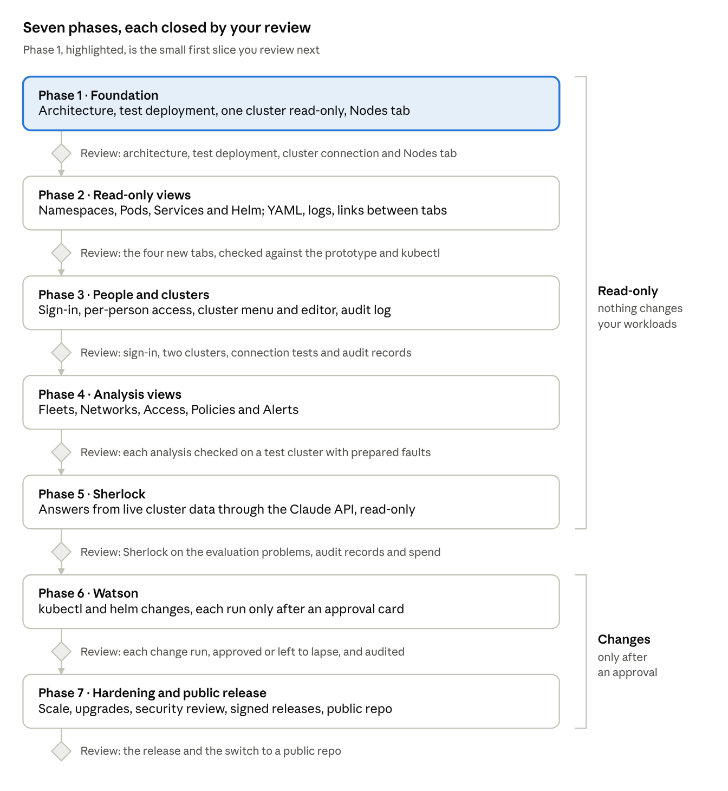
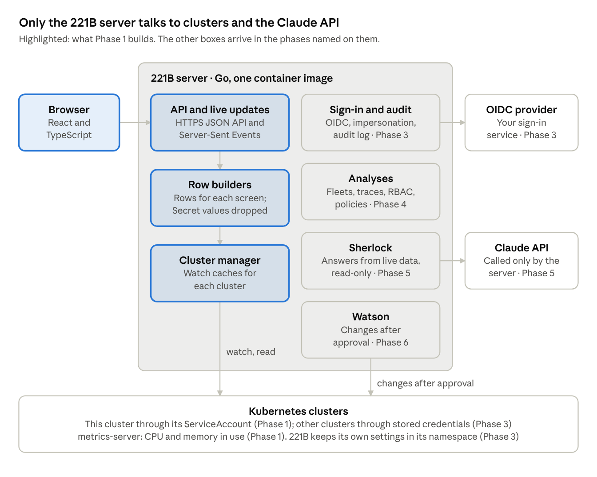

# 221B Requirements

Oct 12, 2026 · Mikhail Stolpner

221B is built in seven phases, and each one ends in a review you approve before the next starts. Phase 1 is deliberately small: an agreed architecture, a test deployment, a read-only connection to one cluster, and the Nodes tab working end to end. The [design prototype](../design/Main.dc.html) is the reference for every screen.

## Roadmap

Phases 1 to 5 never change your workloads. Watson, in Phase 6, is the first part that does, and only after an approval.

## Scope

221B is a web console for Kubernetes clusters with two built-in assistants. Sherlock answers questions about a cluster. Watson runs kubectl and helm commands, but only after you approve each change.

**Who it is for:** the people who run clusters day to day: platform engineers, SREs and on-call staff.

**What it does**

- Shows each cluster live: Nodes, Fleets, Namespaces, Pods, Helm, Alerts, Services, Networks, Access and Policies.
- Connects to several clusters and switches between them from the top bar.
- Lets each cluster be connected read-only or read-write; read-only clusters refuse every change.
- Sorts every table by any column and exports it to Excel.

**What it does not do**

- Create, upgrade or delete clusters. It works with clusters that already exist.
- Show Secret values. It shows Secret keys and sizes only, to every user, everywhere.
- Store metrics or logs long term. It reads them live from the cluster and metrics-server.
- Run as a hosted multi-tenant service. Each installation runs in the owner's own Kubernetes environment.

## Architecture

221B is one Go server and a browser app, shipped as one container image. The server keeps a live, watched copy of each cluster it connects to and sends each browser only the rows its screen shows. Phase 1 runs inside the cluster it shows. Phase 3 adds a management mode, where one installation connects to other clusters with stored credentials.

| Decision | Choice | Why |
| --- | --- | --- |
| Server language | Go | client-go, the Helm SDK, kubectl's drain and describe code and the Pod Security admission library are all Go. |
| Browser app | TypeScript and React | The prototype's screens map onto React components; table virtualization is mature. |
| Packaging | One image: the Go binary serves the built browser app | One thing to deploy, version and scan. |
| Deployment | Helm chart | The same chart installs test and production. |
| Live updates | Watch caches (informers) on the server; Server-Sent Events to the browser | Changes appear within seconds; one watch per resource type per cluster, shared by every viewer. |
| Where rows are built | On the server | Browsers never receive raw objects, so Secret values are filtered in one place and payloads stay small. |
| Cluster access, Phase 1 | In-cluster ServiceAccount with a read-only ClusterRole | No stored credentials; least privilege. |
| People's access, Phase 3 | OIDC sign-in; calls to Kubernetes made as the signed-in person (impersonation). Proposed; see Open questions | Kubernetes RBAC decides what each person may see and change, and the audit log names them. |
| Claude API, Phase 5 | Called only from the server; key kept in a Kubernetes Secret | Keys and cluster data never reach the browser. |

Everything a browser sees passes through the row builders, which is where Secret values are dropped.

## Requirements for every phase

These apply to every phase: a phase is done only when everything it builds meets them.

| ID | Area | Requirement |
| --- | --- | --- |
| X-01 | Secrets | Secret values are never shown, logged, exported, kept in the browser or sent to Sherlock. Screens show Secret keys and sizes only; an environment variable taken from a Secret shows the reference, not the value. (Amended in Phase 10, SE-03: where the chart turns `secrets.reveal` on, a SuperAdmin, or an Admin of the Secret's namespace, may ask for one value at a time, read live as them and written to the audit log; it still enters no cache, log, export or Sherlock prompt.) (Amended on November 9, 2026, BK-15, ADR-137, with the owner's agreement: a backup carries the secrets the console keeps of its own (its connections' credentials, tokens, API keys, channel addresses, password hashes) sealed with the install's backup key, AES-256-GCM, never in clear; the key stays in its Kubernetes Secret and is never shown, logged or exported. Secret values read from clusters are still never exported.) |
| X-02 | Permissions | Each phase asks Kubernetes only for the resources and verbs its screens use, and the Helm chart grants exactly that. |
| X-03 | Changes | Nothing changes your workloads before Phase 6; until then 221B writes only its own settings, in its own namespace. From Phase 6, every change needs an explicit approval and is written to the audit log. |
| X-04 | Credentials | Stored credentials (tokens, client keys, kubeconfigs, the Claude API key) live in Kubernetes Secrets and are never sent back to the browser after saving. |
| X-05 | Container | Runs as non-root with a read-only root filesystem and no privilege escalation, and passes the Pod Security restricted profile. |
| X-06 | Browser | A strict Content Security Policy and no third-party scripts at runtime. From Phase 3, every request that changes anything is protected against cross-site request forgery. |
| X-07 | Freshness | A change in the cluster shows on screen within 5 seconds (95th percentile), without a reload. |
| X-08 | Scale | Phase 1: 500 nodes and 15,000 pods per cluster. Phase 7: 5,000 nodes, the upstream limit ([source](https://kubernetes.io/docs/setup/best-practices/cluster-large/)), and 150,000 pods. Sorting or filtering 10,000 rows takes under 200 ms. |
| X-09 | Footprint | Server memory stays under 1 GiB at Phase 1 scale; caches drop fields no screen uses, such as managed fields. |
| X-10 | Compatibility | Any conformant cluster on a Kubernetes minor release still maintained upstream, today 1.35 to 1.37 ([source](https://kubernetes.io/releases/)). Current Chrome, Edge, Firefox and Safari. |
| X-11 | Design | Follows the prototype: layout, light and dark themes, and the More menu that takes tabs as the window narrows. Usable at 390 px phone width. |
| X-12 | Accessibility | WCAG 2.2 AA: every menu, table and drawer works by keyboard, with visible focus and screen-reader labels. |
| X-13 | Tables | Every table sorts by any column, filters, picks columns and exports to Excel exactly the rows and columns on screen. |
| X-14 | Testing | Unit tests, integration tests against a real API server (kind) and browser end-to-end tests for every screen run on every pull request; main stays releasable. |
| X-15 | Operations | Health and readiness probes, structured JSON logs, and Prometheus metrics for requests, watch delay and cache size. |
| X-16 | Privacy | No telemetry. 221B calls out only to the clusters it shows, the sign-in provider, an optional audit webhook, and the Claude API once an admin turns Sherlock on (Phase 5). |
| X-17 | Licensing | Apache 2.0. Every dependency has a compatible license (no GPL or AGPL), checked in CI. |

## Phase 1: Foundation

Phase 1 proves the whole path on one screen. Code becomes an image, the image runs on a test cluster, the server reads that cluster read-only, and the Nodes tab works as the prototype shows it. It ends with your review of those four things; Phase 2 starts only after you approve.

### Architecture and design

| ID | Requirement | Done when |
| --- | --- | --- |
| P1-01 | An architecture document in the repo: components, data flow, security model, deployment modes, and a decision record for each decision in Architecture above. | You approve it at the review. |
| P1-02 | Repository layout: `server/` (Go), `web/` (TypeScript and React), `deploy/helm/221b`, `design/` (the prototype) and `docs/`. | `make image` builds the image from a clean checkout. |
| P1-03 | The app shell follows the prototype: top bar, type, colors, light and dark themes. | Screenshots match the prototype at 1440 px and 390 px wide. |

### Build and test deployment

| ID | Requirement | Done when |
| --- | --- | --- |
| P1-04 | CI on every pull request and push to main: lint, unit tests, browser build, image build, license check and vulnerability scan. | All checks pass on a pull request; a critical or high vulnerability fails the build. |
| P1-05 | One container image: the Go binary serving the built browser app, on a distroless base, non-root, read-only root filesystem. Pushed to GitHub Container Registry, private while the repo is private. | The image is under 200 MB (raised from 60 MB to 80 MB in Phase 6, for kubectl and the Helm SDK, and to 200 MB in Phase 8) and its scan is clean. |
| P1-06 | A Helm chart: Deployment, Service (ClusterIP), ServiceAccount, read-only ClusterRole and binding, NetworkPolicy, probes, resource requests and limits. No Ingress yet. | `helm install` brings the pod to Ready within 60 seconds; `helm upgrade` works and `helm uninstall` leaves nothing behind. |
| P1-07 | A test deployment on a cluster you choose, opened through `kubectl port-forward`. CI also installs the chart in a kind cluster and runs the end-to-end tests there. | You open the Nodes tab of the test cluster in your browser. |

### Kubernetes integration

| ID | Requirement | Done when |
| --- | --- | --- |
| P1-08 | Connects with the in-cluster ServiceAccount when deployed, or with a kubeconfig context when run on a laptop for development. | Both modes show the same nodes. |
| P1-09 | Reads only what the tab needs: get, list and watch on nodes and pods; get and list on node and pod metrics. | `kubectl auth can-i --list` for the ServiceAccount shows nothing more, and reading a Secret is refused. |
| P1-10 | Keeps watched caches of nodes and pods that recover by themselves after a dropped watch or an API server restart. | A node cordoned with kubectl shows as cordoned within 5 seconds. After an API server restart the tab is current within 30 seconds, without a reload. |
| P1-11 | The top bar shows the cluster name (a chart value), the Kubernetes version read from the API server, and the connection status. | Status turns red within 30 seconds of losing the API server and green when it returns. |
| P1-12 | CPU and memory in use come from metrics-server when it is installed. | Without metrics-server the tab still works and marks usage as unavailable. |

### Nodes tab

| ID | Requirement | Done when |
| --- | --- | --- |
| P1-13 | Columns: Node, Role (one short column), Status, Problems, CPU and Memory (requested and in use against allocatable; allocatable to Kubernetes; free to schedule), Pods (running of capacity) and Age; Taints, Zone, Labels and Kubelet available but hidden by default. *Problems left the table at the Phase 10.1 review (M-02): Status sorts problems first and the drawer lists them.* | Every value matches `kubectl describe node` on the test cluster. |
| P1-14 | The cluster summary (control-plane and worker counts, pods, cordoned nodes, nodes with problems, and totals for CPU, memory and pods) moves to a home page in a later phase; the Nodes tab shows the table only. | The Nodes tab has no summary. |
| P1-15 | Search by name, role filter (All, Control plane, Workers), sort by any column, column picker, and an Export menu (Excel, JSON) of what is on screen, next to the column picker on the right. | The exported sheet and JSON have the same rows, columns and order as the screen. |
| P1-16 | Problems come from node conditions (not ready; memory, disk or PID pressure; network unavailable), from cordoning, and from pods on the node that are not ready. | A node made not ready and a crash-looping pod on another node each show as a problem that names its cause. |
| P1-17 | A details drawer per node, in this order: status and conditions, problems, taints, labels with kubernetes.io labels hidden by default, then CPU, Memory and Pods as plain sections (allocatable, requested, free, in use, limits; pod counts), then system info (uptime when the kubelet can be asked, internal IP, zone, OS, kernel, kubelet, runtime, joined). | It opens with Enter, closes with Escape, and returns focus to the row. |
| P1-18 | Works at 500 nodes and 15,000 pods, simulated with kwok. | First screen within 2 seconds, sorting within 200 ms, server memory under 1 GiB. |
| P1-19 | A Settings button in the top bar (in place of the theme switch) opens a dialog with the theme and the refresh rate. The refresh rate applies to every open console at the same moment and is kept on the server, so the number of browsers does not add requests to the Kubernetes API. | Two browsers show the same refresh time; a rate set in one shows in the other without a reload and survives a restart of the server. |

**Not in Phase 1:** other tabs, the cluster menu and connection editing, sign-in and Ingress, Sherlock and Watson, label and taint filters, and the cordon and drain buttons in the drawer.

### Your review

- [ ] Architecture document and decision records approved (P1-01)
- [ ] Test deployment installed, upgraded and removed with the chart (P1-06, P1-07)
- [ ] Permissions and live updates checked on the test cluster (P1-09, P1-10)
- [ ] Nodes tab checked against the prototype and kubectl (P1-13 to P1-17)
- [ ] Open question on reading Secrets settled, for Phase 2
- [ ] Go-ahead for Phase 2

## Phase 2: Read-only views

Phase 2 adds the everyday read-only screens: Namespaces, Pods, Services and Helm, with the prototype's navigation and the details behind every row. Nothing in it changes a cluster.

| ID | Requirement | Done when |
| --- | --- | --- |
| P2-01 | Navigation as designed: Nodes, Namespaces, Pods, Helm and Services in the bar while they fit, and the More menu takes tabs from the right as the window narrows (amended at the Phase 2 review: nothing is rolled up while there is room). | From 390 px wide upward no tab is cut off, and the open tab always shows. |
| P2-02 | Namespaces tab: every namespace and what it holds, a tab per kind with its count, as the Helm tab has them (Pods first, Helm releases last), in place of a table per kind under a kinds funnel (changed at the second Toolbox review). | Counts match `kubectl get` for each kind. |
| P2-03 | Pods tab: status, restarts, node, namespace, CPU and memory against requests and limits, and age; filters by namespace, node and status. The status segments are All, Running, Not ready, Pending, Unknown (on a node that stopped reporting), Failing and Completed; a segment shows only while pods are in it, and the chosen one stays, at 0, until another is chosen. | A crash-looping pod shows its last termination reason. |
| P2-04 | Pod details: containers and their states, events, owner chain, volumes, environment, and logs (live, previous container, container picker, download). | Logs start within 2 seconds; a pod deleted while open says so. |
| P2-05 | Services tab: type, cluster IP, ports, ready endpoints, and the External columns (external IP or pending, node ports, Ingress hostname). Details list endpoints and the pods behind them. | A LoadBalancer without an external IP shows as pending, with the reason. |
| P2-06 | (Replaced by the Phase 10 Helm tab, HA-01 to HA-20, on October 28, 2026; what it showed lives on there.) Helm tab: releases with chart, app version, revision, status and last update. Details show revision history, notes and user-supplied values. | Matches `helm list -A` and `helm history` for every release. |
| P2-07 | Secret handling: the server reads Secrets only to list keys and sizes and to read Helm release records. Helm values that look like credentials are masked: by key, in `{name, value}` lists, and any value that carries a credential. A release's rendered notes are masked the same way, or replaced when they cannot be. | An automated test proves a known Secret value appears in no response, log or export. |
| P2-08 | A YAML view of every object, with Secret data replaced by key names and sizes and managed fields hidden; every object also opens its own details (facts by kind, conditions, labels, events, a workload's pods), with pods and Services opening their full drawers wherever they are listed (amended at the Phase 2 review). | The YAML matches `kubectl get -o yaml` apart from those two changes. |
| P2-09 | Links between tabs: a node to its pods, a pod to its Service and Helm release, a Service to its pods. Label and taint filters on Nodes, held back from Phase 1. | Each link opens the right tab with the right filter. |
| P2-10 | Permissions: get, list and watch on the kinds these tabs show, logs and events. A chart setting turns Secret reading off, which hides Secret keys and the Helm tab. | With the setting off, the ServiceAccount cannot read any Secret. |

**Not in Phase 2:** changes to clusters, more than one cluster, sign-in, and the Fleets, Alerts, Networks, Access and Policies tabs.

**Asked for at the Phase 1 review, built in Phase 2:** the search box fills in suggestions as you type; every table has the same Columns and Export controls, and Export offers CSV besides Excel and JSON; a node's pod count links to the Pods tab filtered to that node.

### Your review

- [ ] Navigation and the four new tabs checked against the prototype and kubectl on the test cluster (P2-01 to P2-06)
- [ ] Secret handling and the YAML view checked: keys and sizes only, Helm credentials masked, managed fields hidden (P2-07, P2-08)
- [ ] Links between tabs and the label and taint filters checked (P2-09)
- [ ] Permissions checked with Secrets on and off (P2-10)
- [ ] Go-ahead for Phase 3

**Review:** you check the four new tabs on the test cluster against the prototype and kubectl, and approve Phase 3. The guide is [phase-2-review.md](phase-2-review.md).

## Phase 3: People and clusters

Phase 3 makes 221B safe to share: people sign in, Kubernetes decides what each person may see, and one installation can show several clusters. It also adds the audit log that Phases 5 and 6 depend on.

| ID | Requirement | Done when |
| --- | --- | --- |
| P3-01 | Sign-in with any OIDC provider. Sessions live in Secure, HttpOnly, SameSite cookies and expire after a set idle time. What the page asks by itself is not activity, so a tab left open, a wall display too, is signed out after `auth.sessionIdle`; a person's pointer and keys, and typing in a terminal, are. | No page or API answers without a session, except the health probes. |
| P3-02 | Calls to Kubernetes are made as the signed-in person (user and groups, by impersonation), so Kubernetes RBAC decides what each person sees. | A person without rights to a namespace does not see its pods anywhere, including search and export. |
| P3-03 | Replaced by Phase 6.1 (RB-01 to RB-57): four roles, LDAP, local groups and an Administration area. | See Phase 6.1 below. |
| P3-04 | The cluster menu as designed: switch clusters, each shown with status, environment tag and Kubernetes version. | Switching keeps the open tab and its filters where they apply. |
| P3-05 | The connection editor as designed: name, environment and description; API server address; CA (pasted PEM, system trust, or skip verification with a warning); sign-in by service account token, kubeconfig (with context picker), OIDC or client certificate; read-only or read-write access, with the RBAC YAML to grant it. | Each sign-in method connects to a test cluster. |
| P3-06 | Test connection runs the prototype's five steps: address, TLS, sign-in, Kubernetes and permissions. | Each step's failure, produced in a test, is reported at that step with its cause. |
| P3-07 | Credentials are stored in Kubernetes Secrets in 221B's namespace and never return to the browser. Token expiry is shown and warned about 7 days ahead. | An expired token shows on the cluster page with a Fix the connection action. |
| P3-08 | Removing a cluster asks again; for production, you type its name. Its stored credentials are deleted with it. | No Secret is left behind for a removed cluster. |
| P3-09 | Management mode: one installation connects directly to other clusters' API servers; the cluster it runs in is one connection among them. | Three test clusters show in one installation. |
| P3-10 | An audit log of sign-ins and connection changes (and, later, Sherlock questions and Watson commands): who, what, when, which cluster. JSON lines on standard output, plus an optional webhook. A record's `from` is the socket's peer, or the client that a proxy listed in `auth.trustedProxies` names; nobody else's `X-Forwarded-For` counts. Every record's target and detail pass through the scrubber on the way in, for every sink, and what an older console kept is cleaned at start: no credential and no host key. Free text can only be checked for what looks like one. | Each audited action writes exactly one record that names the person; a record that carries a credential or a host key reaches no sink with it. |
| P3-11 | The chart can publish 221B through an Ingress with TLS. | Plain HTTP redirects to HTTPS. |

**Not in Phase 3:** changes to clusters (read-write is stored now and used in Phase 6), and an agent for clusters that 221B cannot reach directly (see Open questions).

**Review:** you sign in, add two clusters with different sign-in methods, test, switch and remove one, and read the audit records. The guide is [phase-3-review.md](phase-3-review.md).

## Phase 4: Analysis views

Phase 4 adds the tabs that answer questions kubectl leaves to you: which nodes form a fleet, how a request reaches a pod, who can do what, and what blocks a change. Each analysis is a server API that Sherlock reuses in Phase 5.

| ID | Requirement | Done when |
| --- | --- | --- |
| P4-01 | Fleets tab: groups of nodes defined by label and taint selectors, one column per label and per taint, and totals per fleet. Admins create and edit fleets in a drawer; fleets are saved with 221B's settings. | A new node with matching labels joins its fleet within 5 seconds. |
| P4-02 | Networks tab: for each Ingress hostname, the path of a request (address, Ingress controller, TLS certificate, Ingress rule, Service, endpoints, pod), each hop with its state. | Breaking any hop on a test cluster turns that hop red and names the cause. |
| P4-03 | Access tab: roles and bindings with risk flags (cluster-admin, wildcards, reading Secrets, escalate, bind, impersonate), answers to "who can do this", and each identity's effective permissions. | Answers match `kubectl auth can-i` on 20 sampled cases. |
| P4-04 | Network policies: the policies per namespace, and a checker that answers whether pod A can connect to pod B on a port and names the policies that decide. | Answers match real connection tests on a cluster whose network plugin enforces policies. |
| P4-05 | Drains: for each node, whether it can be drained now and what blocks it (disruption budgets, unmanaged pods, local storage), using kubectl's drain logic. | Matches a server-side dry-run drain of each node. |
| P4-06 | Quotas (used against hard, per namespace), Pod Security levels per namespace with the pods a stricter level would reject, admission webhooks (failure policy, timeout, reachability) and priority classes. | Pod Security results match the API server's warnings for a dry-run label change. |
| P4-07 | Alerts tab: pods failing to start, pending (after a grace period, 2 minutes by default and set on the Settings page, so starting pods raise none) and recently recovered, node problems and warning events, grouped by object with counts and first and last seen. What it has shows as banners at the top of every other tab, unless Settings › General hides them for everyone; the Alerts tab's name still turns red or amber. | Each injected fault (image pull error, unschedulable pod, out-of-memory kill) appears within 30 seconds. |

**Not in Phase 4:** acting on findings. Fixes appear as the commands Watson will run in Phase 6.

**Review:** you check each tab against kubectl on a test cluster with prepared faults. The guide is [phase-4-review.md](phase-4-review.md).

## Phase 5: Sherlock

Phase 5 adds Sherlock, which answers questions about a cluster from live data. It reads only what the person asking may read, never sees Secret values, and never changes anything.

| ID | Requirement | Done when |
| --- | --- | --- |
| P5-01 | The panel as designed: docked at the bottom of every tab, resizable, with maximize and minimize to an icon. Ask Sherlock buttons in drawers and callouts start a question. | Behaves as the prototype on desktop and phone widths. |
| P5-02 | Sherlock answers through read-only server tools (get, list, events, recent logs, metrics and the Phase 4 analyses), run as the person asking. | A person without access to a namespace learns nothing about it through Sherlock. |
| P5-03 | Secret values are never sent to the Claude API, and log excerpts are scrubbed of tokens, keys and passwords first. | A test with planted values finds none in the captured API requests. |
| P5-04 | Answers stream, cite the objects they rely on as links into the console, and can be stopped. | 90% of answers start within 5 seconds, and every cited link opens its object. |
| P5-05 | Admin settings: Sherlock on or off per cluster, the Claude API key (kept in a Kubernetes Secret), the model, and daily and monthly spending caps. Each question is audited with its tools and token use. | Reaching a cap stops new questions with a clear message. |
| P5-06 | An evaluation set built from the prototype's sample problems, such as a pending pod, a failed Helm upgrade, a drain blocked by a budget and a LoadBalancer without an IP. | Sherlock finds the cause in at least 9 of 10 cases, measured nightly. |
| P5-07 | When a fix needs a change, Sherlock proposes the command and hands it to Watson in Phase 6. | Sherlock's toolset contains no tool that writes to a cluster or to settings shared with others. Its UI tools change only the asking person's own view (reworded by P6U-16). |
| P5-08 | Where the browser allows it, the Sherlock panel moves to a window of its own, for example on another monitor, and back. The conversation carries on in it, and Ask Sherlock buttons in the main window send their questions there. | A question asked from the main window is answered in the separate window, and closing that window brings the panel back with the conversation. |

**Not in Phase 5:** running any command. Watson arrives in Phase 6.

**Review:** you ask Sherlock about the evaluation problems on a test cluster and read the audit records and spend.

## Phase 6: Watson

Phase 6 adds Watson, the first part of 221B that changes clusters. Reads run at once; every change waits for an approval card, runs as the person who approved it, and is audited.

| ID | Requirement | Done when |
| --- | --- | --- |
| P6-01 | The Watson panel as designed: a terminal-style prompt per cluster beside Sherlock, output printed the way kubectl and helm print it, and live progress for long operations such as drains. | Output of each supported read command matches the real CLI. |
| P6-02 | Supported reads: kubectl get, describe, logs, top, events and auth can-i; helm list, status, history and get values. Supported changes: kubectl cordon, uncordon, drain, scale, rollout restart, rollout undo, delete pod, label and annotate; helm rollback. Anything else is refused with a clear message. | Each supported command has a passing test on kind. |
| P6-03 | The server parses commands and runs them through client-go, kubectl's own packages and the Helm SDK. It never starts a shell. | Shell characters in arguments have no effect, shown by tests. |
| P6-04 | Every change shows an approval card first: the exact command, the objects affected, a server-side dry run, and the impact, such as pods evicted and budgets touched. The approval lapses after 10 minutes or when those objects change. While its objects cannot be read, a card cannot be approved, and says why. | Changing an object after its card appears voids the approval; a card whose objects cannot be read is not approved. |
| P6-05 | Clusters connected read-only refuse every change; elsewhere the approver's own Kubernetes rights decide. | A refused change names the rule that refused it. |
| P6-06 | Buttons that change things, such as Cordon and Drain on a node, Rollback on a Helm release, and fixes Sherlock proposes, all go through the same card. | No button changes a cluster without a card. |
| P6-07 | An optional setting requires a second person to approve changes on production clusters. | With it on, nobody can approve their own change. |
| P6-08 | Every command, approval, refusal and result is audited. | Each step writes one record naming the person and cluster. |
| P6-09 | Where the browser allows it, the Watson panel moves to a window of its own, with Sherlock or apart from it, for example on another monitor, and back. Commands sent from the main window wait for approval there. | An approval made in the separate window runs the command, and closing the window brings the panel back with its commands. |

**Sherlock UI control (P6U-01 to P6U-20), added to Phase 6:** Sherlock reads what the asking person's console window shows and, while it answers, may change that person's own view: open a tab or an object's details, set filters, search, sort, show or hide columns and highlight a row, through a fixed list of eight actions run in that window. It never changes a cluster or what others see; an administrator can turn view changes off. The requirements, with their Done-when, are in [Sherlock UI control](sherlock-ui-control.md); its open questions were settled as proposed there.

**Not in Phase 6:** `kubectl apply`, `edit` and `exec`, and helm install or upgrade (see Open questions).

**Changed at the Phase 6 review:** the Alerts tab's count includes acknowledged alerts, which still stay off the banners at the top of every tab; the Nodes tab lists nodes with problems first until someone sorts; column choices are kept in each browser, also for people who sign in, and no longer with their account (which the Phase 4 review had asked for); the bar legends under the Nodes table and on the home page became tooltips on the bars and their headings; the Services tab lost its summary tiles; Sherlock no longer suggests questions to ask next; a Helm release no longer has Roll back and Ask Sherlock buttons (P6-06's rollback is typed in Watson); and Sherlock and Watson leave the main window together, in one window, rather than each on its own (P5-08, P6-09). Also asked at the Phase 6 review: Sherlock may use another AI provider than the Claude API (P5-05 now covers it): OpenAI or any OpenAI-compatible API, Amazon Bedrock or Google Vertex AI, each directly or through an enterprise gateway at an address the administrator gives, with its own headers, query and CA certificate; Settings is a page of its own rather than a dialog; an alert's Ask Sherlock became **Troubleshoot**, which asks for a troubleshooting report (summary, cause, evidence, impact, fix and prevention); and each cluster on the home page has **Find deficiencies**, which asks Sherlock to review how the cluster is set up and what to change first.

**Review:** you run each supported change on a test cluster, approve some, let others lapse, and check the audit log.

## Phase 6.1: Roles, users and Administration

Phase 6.1 replaces P3-03's two console roles with four fixed roles (SuperAdmin, SuperViewer, Admin, Viewer) that exist as Kubernetes ClusterRoles, bound to groups by the chart. It adds LDAP and local groups, a first-run page, and an Administration area (Roles, Permissions, Users, Settings). Nothing in 221B writes RBAC at run time. Design and reasoning: [roles-and-users.md](roles-and-users.md); decision record: ADR-59.

#### Roles and assignments

| ID | Requirement | Done when |
| --- | --- | --- |
| RB-01 | Four predefined roles: Viewer, SuperViewer, Admin and SuperAdmin, as in the tables above. Each is a ClusterRole installed and upgraded by the chart under a fixed name (`221b-viewer`, `221b-super-viewer`, `221b-admin`, `221b-super-admin`), labelled `221b/managed: "true"` (Helm sets `app.kubernetes.io/managed-by` itself). The console offers no way to create, edit or delete a role. | `helm install` creates exactly these objects; the Roles page has no edit control. |
| RB-02 | Admin and SuperAdmin each have a **full** and a **read-only** definition. `rbac.roles.admin.template` and `rbac.roles.superAdmin.template` choose (default `full`). Only the chosen definition is installed, under the fixed name; the other does not exist on the cluster. Switching is a `helm upgrade` and changes no binding. | With `readOnly`, no object with a write verb for that role exists on the cluster; switching back restores it; bindings are untouched. |
| RB-03 | The **fully protected read-only deployment**: both templates `readOnly`. The chart refuses to render `localCluster.mode: write` with it, saying why, and the console shows "Changes are impossible by configuration" wherever it shows Watson's cards. | `helm template` fails on the contradiction; on a kind cluster every supported change, sent from every role, is refused by Kubernetes. |
| RB-04 | Roles are assigned by **LDAP group** (in values, RB-20) and, for local users, by **membership of a local group** for Admin and Viewer (RB-50) and by a **super role given to the user** in 221B (RB-05, RB-51). OIDC keeps `auth.admins` and `auth.adminGroups`, which now mean SuperAdmin; it can use the same four group lists (open question). | For each role and each source, a test signs in as such a person and sees what the role allows. |
| RB-05 | SuperAdmin and SuperViewer are held in 221B and apply to every connected cluster. When 221B calls Kubernetes as a person who holds one, it adds the reserved group to their groups, in the access reviews and in impersonated calls alike. Kubernetes still decides what the group may do. A change to who holds one takes effect within the access lifetime (2 minutes), including in open sessions. | A SuperViewer sees every namespace on two connected clusters after one assignment; removing a SuperAdmin hides the Administration pages and refuses their next change within 2 minutes, without their signing out. |
| RB-06 | Admin and Viewer are bound per namespace: one RoleBinding of a **group** to the role's ClusterRole in each namespace, rendered by the chart from `namespaces` on a group in values (LDAP, local or OIDC). Nothing in the console or in Watson creates or deletes a binding (RB-52). To give a person a different set of namespaces, add a group in values and run `helm upgrade`; a group may have one member. Rights add up, as in Kubernetes: Viewer in `web` and Admin in `api` is both. A namespace named in values that does not exist makes the chart fail with that name, and so does the console's own namespace or the toolbox's: nobody is bound there. | A person bound in two namespaces sees those two and no others, in every tab, in search and in export (P3-02). |
| RB-07 | Everyone who signs in can see the nodes. A chart-created ClusterRole (read nodes only) is bound to the reserved group `221b:console-users`, which 221B adds for every signed-in person. It grants no other cluster-scoped kind. | A Viewer bound in one namespace sees the Nodes and Fleets tabs and cannot list volumes, storage classes or namespaces through the console. |
| RB-08 | For a person limited to namespaces, the Namespaces tab lists their own namespaces, worked out from the per-namespace verdicts the console already holds (ADR-31). No right to list namespaces is granted for this. | Bound in `web` and `api`, the tab lists those two. |
| RB-09 | Node totals ("requested", "in use", pods on a node) stay cluster-wide, as ADR-31 says today. Any list of pods behind a total is filtered to the person's namespaces. | A Viewer sees a node's total pod count, and only their own namespaces' pods in its list. |

#### What the roles contain

| ID | Requirement | Done when |
| --- | --- | --- |
| RB-10 | **Viewer**: `get`, `list` and `watch` on every kind the console watches, Roles and RoleBindings included. The rule list is generated from the console's own list of watched kinds, so the two cannot drift. Secrets are included while `secrets.read` is on, and not otherwise; their values still never reach the screen (X-01). | A test adds a watched kind and fails until the role has it; with `secrets.read: false` the role has no Secret rule. |
| RB-11 | **SuperViewer**: the same rules cluster-wide, plus the cluster-scoped kinds the console shows (namespaces, volumes, storage classes, CustomResourceDefinitions, ClusterRoles, ClusterRoleBindings), and **no Secrets**. | A SuperViewer reads every page except Secrets, on a kind cluster. |
| RB-12 | **Admin**: the full definition is Viewer's rules plus the namespaced changes of P6-02. It has no right on Roles or RoleBindings, no `pods/exec`, and nothing cluster-scoped. Helm rollback needs `create` and `update` on Secrets in the namespace, because Helm keeps its releases there (open question). The read-only definition is Viewer's rules. | An Admin with the full definition approves a scale in a bound namespace and is refused a drain, a role change and any action elsewhere, each with Kubernetes' own message; with the read-only definition every change is refused. |
| RB-13 | **SuperAdmin**: the full definition is all verbs on all resources; the read-only definition is `list` and `watch` on all resources, `get` on every resource of the built-in API groups, Secrets included, except the subresources that run a command or proxy to one (`pods/exec`, `pods/attach`, `pods/portforward`, `pods/proxy`, `services/proxy`, `nodes/proxy`, which a kubelet and the API server authorize as `get`), and `get` on non-resource URLs. RBAC cannot deny, so those `get`s are listed; a custom resource is listed and watched but not read by name. SuperAdmin is also the console administrator of ADR-26: connections, settings, fleets, the Users page, LDAP refresh and assignments belong to it alone. | A non-SuperAdmin sees those controls disabled with the reason, and the endpoints refuse them. |
| RB-14 | The console's own account gains no permission from this work: it still impersonates and creates access reviews, writes only its own settings, connections and local users in its own namespace, and never needs `bind`, `escalate` or write access to RBAC or workloads. With sign-in off it keeps `localCluster.writeClusterRole` as today. | A chart test shows the console's ClusterRole and Role unchanged apart from the narrow reads of RB-36. |

#### Names sent to Kubernetes

| ID | Requirement | Done when |
| --- | --- | --- |
| RB-15 | Each source has its own prefix on the names Kubernetes sees: local users and groups get `221b-local:`, LDAP ones get `221b-ldap:`, and OIDC ones keep using `auth.kubernetes.userPrefix` and `groupPrefix` as today. The Roles and Users pages hide the prefix when they show a name. Prefixes are chart values. | A local `alice` and an LDAP `alice` hold different rights; the Roles page shows both as `alice` with their source. A local group `ops` and an LDAP group `ops` are different subjects. |
| RB-16 | Names are matched exactly, case included. Local user names use lowercase letters, digits, `.`, `-` and `_`. | `Alice` and `alice` are two different subjects, and a local user cannot be created as `Alice`. |
| RB-17 | A name from any source that starts with `system:` or `221b:`, or that already carries a reserved prefix, is refused as a user name and dropped from a token's or directory's groups, with an audit record. | A directory group called `221b:superadmins` gives its members nothing and writes a record; a local user called `system:masters` cannot be created. |
| RB-18 | Impersonating a ServiceAccount or a UID stays impossible (ADR-31), with sign-in off too: the chart's `minimal` write role holds no impersonation. | Unchanged tests still pass; `hack/check-chart.sh`. |

#### LDAP

| ID | Requirement | Done when |
| --- | --- | --- |
| RB-19 | LDAP is configured in `values.yaml` under `auth.ldap` (see Chart values above): server URL with LDAPS or StartTLS, an optional CA, the bind DN, user and group search bases, filters and attributes, nested groups, paging, time limits. The bind credential is a Kubernetes Secret named in values (`existingSecret`, key `bind-password`) and is never in values, logs, the audit log or any API response (X-04). | An integration test against OpenLDAP in CI signs in; a search of the console's logs, audit records and API responses never finds the credential. |
| RB-20 | `auth.ldap.roles` lists the LDAP groups of each role: `viewer`, `superViewer`, `admin` and `superAdmin`. An entry for `viewer` or `admin` may carry `namespaces`, which the chart turns into RoleBindings (RB-06). The group names are written as the directory has them; the console adds the prefix of RB-15. | A group listed under `admin` with two namespaces yields two RoleBindings and the Admin role for its members; `namespaces` under a super role fails the chart. |
| RB-21 | A person may sign in only if they belong to at least one group listed for any of the four roles. Others are refused with the same message whatever the reason (wrong password, not in a group, unknown user), and the audit record says which. A person in several groups holds each role; the highest is shown, and rights add up. | A valid LDAP user in no listed group cannot sign in and nothing about the groups is revealed to them. |
| RB-22 | People sign in by binding as themselves. Groups are resolved from the directory, nested groups included, with paged searches. Nothing falls back to open access: when the directory cannot be reached, new sign-ins are refused with a clear message and open sessions continue until their lifetime ends. | Stopping the directory refuses a new sign-in with that message and leaves a signed-in person working. |
| RB-23 | A person's groups are looked up again in the directory whenever their access reviews expire, no more often than every 2 minutes, and again when they approve a change. | Moving a person to another group changes what they see within 2 minutes, with no new sign-in. |
| RB-24 | The Users page lists people from the listed groups: the sync reads those groups' members at start-up, at a person's first sign-in and on `syncInterval`. The list is kept in memory with the time of the last sync, counts and any errors. A person no longer in any listed group is shown as disabled, not deleted. A failed sync keeps the old list and says so. | Removing a person from the group disables them on the next sync; stopping the directory leaves the list and shows an error. |
| RB-25 | A **Refresh** button on the Users page (SuperAdmin only, shown only with LDAP) starts a sync in the background. Only one runs at a time, and the page shows it running and then its result. | Two clicks run one sync. |

#### Bootstrap

| ID | Requirement | Done when |
| --- | --- | --- |
| RB-26 | **Local users.** While no user exists and LDAP is not configured, the console shows a first-run page that asks for the first administrator's name and password. That person becomes a SuperAdmin. The page closes for good once a user exists, is rate-limited, and is audited. There is no generated password. | A second visit shows the normal sign-in; more than 5 attempts a minute are refused; the audit log has the setup. |
| RB-27 | An optional chart value, `auth.setupToken`, must be typed on the first-run page when set. The first-run page has a Setup token field with the hint "Enter auth.setupToken if specified on deployment, if not leave blank." The chart's install notes warn when the Service is reachable from outside the cluster; they do not print the token. | With a token set, a wrong or missing token is refused. |
| RB-28 | **LDAP and OIDC.** The first SuperAdmins are the groups listed under `superAdmin` (RB-20, or the OIDC lists). They hold the role from the first start and cannot be removed in the console. Existing `auth.admins` and `auth.adminGroups` keep working. In LDAP mode, local users can still be listed in values as break-glass accounts, and cannot be created in the console (open question). | A fresh install with an LDAP group under `superAdmin` gives its members SuperAdmin at first sign-in; an upgrade keeps today's administrators. |
| RB-29 | The chart creates the chosen role definitions, the nodes ClusterRole and the three reserved group bindings on the cluster the console runs in. For every other cluster, the connection editor shows the same YAML, in the full or the read-only variant, with the RoleBindings of the groups in values, and the connection test says which of the objects are missing or differ. Until they exist, people see an empty console there, and the page says why. | A newly connected cluster with nothing applied shows the YAML and a clear message; after applying it, a SuperViewer sees the cluster. |
| RB-30 | The last SuperAdmin cannot be removed, disabled or deleted, and the console says so. | The attempt is refused and audited. |
| RB-31 | With sign-in off, everyone is an anonymous SuperAdmin as today (ADR-26) and the Administration pages other than Permissions are not shown. Changes then run as the console's own account (ADR-52), which the four roles cannot limit, so the chart refuses `auth.mode: none` with `localCluster.mode: write` when either template is `readOnly`, and says so. | `helm template` fails on that combination. |

#### Keeping Watson inside the limits

The aim: whatever Sherlock or a person types, the console and Watson can do no more than the chart allows. The approach has one hard limit, the roles, and guards that can only narrow it. The model supplies text, never identity or scope.

| ID | Requirement | Done when |
| --- | --- | --- |
| RB-32 | **The roles are the ceiling.** Every change runs as the approver, impersonated (ADR-52), so Kubernetes refuses what the approver's role does not allow. The dry run runs as the requester. Nothing in the console grants a change that the role does not. | With the read-only SuperAdmin definition, an approved card for every supported change fails with Kubernetes' message and changes nothing. |
| RB-33 | **A model never supplies identity or scope.** The user, groups, impersonation headers, cluster and the objects a change touches come from the session, the card and the server's own dry run, never from model text. No tool Sherlock has takes any of them as input, and a Sherlock proposal is only text until a person sends it to Watson (ADR-53). | A contract test fails if any tool's input schema names a user, group, header or cluster; a proposal naming another cluster or namespace is not applied to it. |
| RB-34 | **Closed grammar.** Watson parses a command into a typed form and runs only the supported ones (P6-02, P6-03). An unknown command, flag, kind or shell character is refused before anything runs. The card shows what the server worked out (objects, impact, dry run), not what the text claimed. A command that names an object that does not exist cannot be approved. | A corpus of invented and malformed commands (unsupported verbs, hallucinated names and flags, shell metacharacters, other clusters, other namespaces) is refused or fails its dry run; none reaches approval with an effect. |
| RB-35 | **A lock in values that agrees with the roles.** `localCluster.mode` and each connection's mode stay the console-side lock: `read` refuses every change before it is parsed. The chart validates it against the templates (RB-03, RB-31). | `mode: read` refuses a change with a SuperAdmin whose role would allow it; the contradictions fail the chart. |
| RB-36 | **Fail closed on drift.** At start-up, every 5 minutes and when the roles change, the console compares the four deployed ClusterRoles of each cluster with the definitions shipped in its image, which are the same files the chart installs. A difference is shown on the Permissions page and in the audit log. With `rbac.enforce: strict`, a cluster whose roles allow more than the shipped definitions refuses every change, naming the difference. The console's account gets `get` on exactly these ClusterRoles by name, nothing more. | Editing `221b-admin` on a kind cluster to add `delete nodes` raises the warning within 5 minutes; with strict on, a change on that cluster is refused. |
| RB-37 | **Impersonation limited by values.** Because every group the console may assert is listed in values (LDAP groups, local groups, OIDC role lists), the chart limits the console's right to impersonate groups to exactly those groups, with prefixes, plus the reserved groups and `system:authenticated`. The code that builds the impersonation headers cannot emit any other group, and a test proves it never emits `system:masters`. User names cannot be limited the same way, since people are dynamic; the console computes them from the session. | A request to impersonate a group outside the list is refused by the API server; a unit test fails if the header builder can emit an unlisted group. |
| RB-38 | **A person approves, never a model or a button of the console.** No Sherlock tool, UI action (P6U-12) or script can press Approve and run; approval needs a person's own session and a protected request (X-06). Cards lapse after 10 minutes or when the objects change (P6-04, ADR-51), and the second-person rule applies on production (P6-07). | A test drives Sherlock to propose a change and to try to approve it; no change runs. |
| RB-39 | **Read-only deployments are tested as such.** On a kind cluster with both templates `readOnly` and `mode: read`, the whole supported set of changes is tried as SuperAdmin, Admin, Viewer and SuperViewer, and the cluster is compared before and after. | Every attempt is refused and the cluster's objects are byte-for-byte unchanged. |
| RB-40 | **The ceiling is tested for every role and definition.** For each role in each definition, a test runs the whole command set plus the corpus of RB-34 and checks that exactly what the role's rules allow succeeds. The expected results are generated from the same definitions as the Permissions page, so what is documented is what is enforced. | The test matrix passes on every pull request and fails when a role gains a verb the definitions do not list. |

#### The Administration area

| ID | Requirement | Done when |
| --- | --- | --- |
| RB-41 | A separate **Administration** entry beside the cluster tabs, at `#/admin`, with the pages **Roles**, **Permissions**, **Users** and **Settings**. Permissions is shown to everyone who signs in. Roles follows Kubernetes: a person who cannot list RoleBindings sees nothing in it. Users and Settings are SuperAdmin only. | A Viewer sees Roles and Permissions, a SuperAdmin sees all four, and the other pages answer a Viewer with a clear refusal. |
| RB-42 | **Roles** lists the four roles with a description, scope and the number of holders. Clicking a role opens its details on the right, like any other page (ADR-38): its permissions, generated from the ClusterRole itself, and every bound subject. Groups, LDAP and local, appear with their namespaces as set by Helm and cannot be changed here; a local group shows its number of members and, to a SuperAdmin, an **Add member** action (RB-43). Bindings that 221B did not make, including ServiceAccount subjects and users, are read-only and marked "not managed by 221B", with a link to the Access tab for that subject; one whose user does not exist is flagged as orphaned. Super-role holders are shown to SuperAdmin only. | A binding made with `kubectl` appears, marked, with no remove button. |
| RB-43 | **Group membership** (SuperAdmin only): a local user is added to or removed from a local group on the Users page (the details pane) or from the group on the Roles page. The form shows what the person can do afterwards, role and namespaces, worked out from values, and asks for a confirmation (RB-51). LDAP people cannot be changed here: the directory owns them. | Adding a user to a group that has two namespaces shows both in the form; after confirming, the person sees them within 2 minutes. |
| RB-44 | **Permissions**: a page, read-only for everyone, that lists the complete permissions of all four roles on the cluster open, split into **Read** (`get`, `list`, `watch`) and **Write** (every other verb). Each row names the API group, the resource or subresource, the verbs, and flags what the Access tab flags: wildcards, Secrets, `escalate`, `bind`, `impersonate`, and also `pods/exec`, `pods/attach`, `pods/portforward`, `nodes/proxy` and `serviceaccounts/token`. The page names the definition in use for Admin and SuperAdmin (full or read-only), shows totals ("reads N kinds, changes 0"), compares the live roles with the shipped definitions (RB-36) and says whether they match. The table uses the same Export menu as every other table (Excel, CSV, JSON; X-13). | The page matches `kubectl get clusterrole -o yaml` for each role on the cluster; a role edited by hand shows "differs" and names the rule. |
| RB-45 | **Users** (SuperAdmin only) lists the users 221B knows: name, source (local, LDAP, OIDC), email, status, last sign-in and super roles. A details pane on the right shows the person's groups, what they can do, and for a local user the super role and the actions of RB-46. OIDC users appear after their first sign-in. The toolbar of the table holds **Create local user** (RB-46), Columns and the Export menu; the LDAP strip above it holds only the connection's state and Refresh. | An OIDC person who has never signed in is not listed; after signing in they are. |
| RB-46 | **Local users** can be created (name, password, optionally groups), disabled, enabled, reset and deleted, in `local` mode. They and their group memberships are kept in a Secret in the console's own namespace, as connections are (`connections.store`; open question). Passwords are at least 12 characters and not the user name. Hashes are never returned by the API. Users defined in the chart (`auth.local.users`, with `groups`) are shown read-only, and a group a chart user names that values do not define fails the chart. Disabling, resetting or deleting ends that person's sessions. A signed-in local user can change their own password, and sign-in is rate-limited per user and per address, with failures audited. | A reset ends open sessions; the API response never contains a hash; the tenth failure in a minute is refused and written to the audit log. |
| RB-47 | The **Settings page** that main already has moves into the Administration area as its last page, at `#/admin/settings`, with its three sections unchanged: General (refresh rate), Sherlock and Watson. Under Administration the whole page is SuperAdmin only. **Theme** is personal and every person needs it, so it moves from General to the account menu in the top bar, as Light and Dark with the hint "For this browser". The gear opens the Settings page in Administration for a SuperAdmin and is hidden from everyone else. `#/settings` redirects, and Back and Escape keep working as they do now. Fleets keep their drawer on the Fleets tab. | A Viewer can change the theme from the account menu and has no gear; a SuperAdmin changes the refresh rate and Sherlock's and Watson's settings on the page; an old `#/settings` link lands on it for a SuperAdmin and is refused with a clear message for anyone else. |
| RB-48 | Sherlock's view actions cannot reach the Administration area (P6U-06, P6U-12): `view_open` does not accept it. | The tool's list of tabs excludes `admin`. |
| RB-49 | The Access and Policies tabs stay as cluster tabs: they analyse the whole cluster's RBAC and policies, which the Roles and Permissions pages do not. Access marks 221B's four roles and their bindings so they are easy to tell apart, and links back to Roles. | The Access tab shows `221b-admin` marked as a 221B role, and its link opens the Roles page. |

#### Local groups, and no role changes at run time

| ID | Requirement | Done when |
| --- | --- | --- |
| RB-50 | **Local groups.** `auth.local.groups` defines groups for local users: a `name`, a `role` (`viewer` or `admin`) and `namespaces`. The chart renders one RoleBinding per namespace to the role's ClusterRole, subject the group `221b-local:<name>` (RB-15). Members are local users, listed in `auth.local.users[].groups` or added in the console (RB-43). A group name that is not defined grants nothing, and in values it fails the chart. | A group with two namespaces gives its members the role in those two and nowhere else; removing a person from it removes the access within 2 minutes; an undefined group name in `auth.local.users` fails `helm template`. |
| RB-51 | **Membership and super roles are changes to 221B, not to a cluster.** Adding or removing a local user from a group, and giving or taking a super role, use a confirmation dialog and are audited. They take effect within the access lifetime (2 minutes) in open sessions, since 221B adds the person's groups, and the reserved groups of RB-05, when it asks Kubernetes. They are never a Watson card. | A change writes one audit record naming who changed whom and which group; a Viewer who is added to an Admin group gets Admin's rights within 2 minutes without signing out. |
| RB-52 | **No role writes at run time.** Neither the console nor Watson creates, changes or deletes a Role, ClusterRole, RoleBinding or ClusterRoleBinding. The console's account has no verb on RBAC (RB-14), the supported Watson commands stay as P6-02 lists them, and a command that names an RBAC kind is refused as unsupported. | A chart test finds no RBAC write in the console's roles; the unsupported-command tests include a RoleBinding and are refused. |
| RB-53 | **Deleting a local user** removes them from every group and ends their sessions, and writes one record. Nothing is left in any cluster, because no binding names a user. Disabling does the same for access and keeps the user. | After deleting a user, no group lists them and the cluster has no object with their name. |

#### Audit, tables, tests and upgrade

| ID | Requirement | Done when |
| --- | --- | --- |
| RB-54 | Audited, one record each: every group-membership, super-role and user change; first-run setup; refused sign-ins and why (RB-21); refused and dropped reserved names (RB-17); drift found (RB-36); LDAP sync summaries (counts and errors, never the list of people). | Each of these writes exactly one record, and none holds a credential. |
| RB-55 | The new tables sort, filter, pick columns and export exactly what is shown through the same Export menu as the other tables (X-13). The new pages meet WCAG 2.2 AA in both themes and at 390 px (X-12). | axe finds no failure; the export test passes. |
| RB-56 | Tests (X-14): on a kind cluster, one test per role and definition that signs in as such a person and checks what the console and Watson allow and refuse (RB-40); a test that the Viewer rules match the watched kinds; chart tests for the objects in RB-29, RB-14 and RB-37; browser tests for the pages, the first-run page and the cards. | The suite passes on every pull request. |
| RB-57 | Helm upgrade keeps today's administrators and local users (P7-03), and a release that has `auth.admins` keeps working. The architecture document gets a decision record that replaces the role rules of ADR-26, and the requirements table replaces P3-03. | Upgrading from the previous release keeps every existing sign-in working. |

**Review:** you install the chart with each sign-in mode and each role definition on a test cluster, sign in as one person per role, and check the Roles and Permissions pages, Watson's refusals and the audit log against `hack/check-rbac.sh` and the kind test.

## Phase 7: Hardening and public release

Phase 7 makes 221B ready for other people's production clusters and for the public repo: full scale, safe upgrades, an outside security review, signed releases and complete docs.

| ID | Requirement | Done when |
| --- | --- | --- |
| P7-01 | Meets the Phase 7 scale in X-08: 5,000 nodes and 150,000 pods, simulated with kwok. | A load-test report in the repo shows every target met. |
| P7-02 | Runs with two or more replicas; anything that must run once uses leader election. | Deleting a replica costs viewers no more than a reconnect; with `replicas.warmStandby: false`, a reconnect and the new leader's first list. |
| P7-03 | `helm upgrade` works from each of the two previous releases, migrating stored settings. | The upgrade tests pass in CI. |
| P7-04 | An outside security review and penetration test of sign-in, impersonation, Secret handling, Sherlock and Watson. | No high or critical finding is open. |
| P7-05 | Signed images with an SBOM and build provenance for every release. | Signature verification passes on the published image. |
| P7-06 | An accessibility audit against WCAG 2.2 AA (X-12). | No AA failure is open. |
| P7-07 | Docs: install, upgrade, connecting clusters, sign-in providers, RBAC templates, what Sherlock sends to the Claude API, Watson's commands, and troubleshooting. | Someone new to the project installs 221B and connects a cluster using the docs alone. |
| P7-08 | Public-repo readiness: contributing guide, code of conduct, security policy for reporting vulnerabilities, issue templates, semantic versions and release notes. | You switch the repository to public. |
| P7-09 | With several replicas, only the leader reads the clusters: it lists and watches them, polls metrics-server and the kubelets, checks connection health and role drift, and serves every data request; the other replicas sign people in and forward the rest. Warm standbys (`replicas.warmStandby`, the default) keep their watches open and poll nothing; cold ones hold nothing until they lead (ADR-70). | With two replicas, the Helm release page's CPU and memory never show — while metrics-server answers; the API server sees lists, watches and metrics reads from one replica only (cold), or watches alone from the standby (warm); `hack/ha-kind.sh` loses a follower and the leader in both modes. |

**Built in Phase 7, first part:**

- **P7-03:** `hack/upgrade-kind.sh` installs each of the two releases before the build (from their tags' charts and their published images), gives it a local user, settings, a fleet, an acknowledged alert, a connection and Sherlock's key, upgrades, rolls back and upgrades again, checking that all of it comes through each time. CI's *Upgrade from earlier releases* job runs it on every pull request and release tag, and publishing waits for it. The settings and the accounts carry a format version, and fields a console does not know are kept when it saves ([docs/upgrading.md](upgrading.md)).
- **P7-08:** [CONTRIBUTING.md](../CONTRIBUTING.md), [CODE_OF_CONDUCT.md](../CODE_OF_CONDUCT.md), [SECURITY.md](../SECURITY.md) with private reporting through GitHub, bug and feature issue templates and a pull request template. Releases follow semantic versions, from 0.6.5 and 0.6.6 (Phases 6.5 and 6.6) to 0.7.0; [CHANGELOG.md](../CHANGELOG.md) has the notes, and a version tag pushes the chart to `oci://ghcr.io/ucesys/charts` and makes a GitHub release ([docs/releasing.md](releasing.md)).

**Review:** you approve the release and the switch to public.

## Phase 8: Storage

Phase 8 adds a **Storage** tab: storage classes, persistent volumes, persistent volume claims and the pods that mount them as one tree, a drawer that traces a claim from its class to its node, and three changes through Watson. [storage.md](storage.md) has the approach, the mockups and the open questions; the rows below are its requirements.

| ID | Requirement | Done when |
| --- | --- | --- |
| ST-01 | A **Storage** tab in the bar after Pods (moved from after Networks on October 26, 2026), with the route `storage`, rolled into the More menu like any other tab when the window narrows (P2-01). The tab has no count; the heading line reads `N volumes · X provisioned · N classes, default <name> · N claims in N namespaces` for cluster-wide roles and `N claims in <namespaces> · X requested · the namespaces your role can see` for namespace-bound roles. | The tab opens at 1440 px and 390 px wide; the heading matches `kubectl get pv,pvc,sc -A` on the test cluster. |
| ST-02 | One flat table for every role, beside a filter sidebar like the Pods tab's (P2-03), in three sections. **Filter by namespace**: every namespace the person may see, as on the Pods tab, with its claim count and, when a ResourceQuota sets `requests.storage`, a sub-line `quota 4.0Ti of 8.0Ti · 50%`; first, for cluster-wide roles, **No claim**: the Available, Released and Failed volumes. **Filter by node**: each node a row's pods run on or its volume is attached to, so an RWX claim mounted on several nodes is under each, with the role tag and cordoned flag when the person may list nodes and names only otherwise; first **Not on a node**: pending claims, unmounted and unbound volumes. **Filter by storage class**: each StorageClass with a `default` tag and its provisioner as the sub-line, for roles that may list classes, the names the claims carry otherwise; then **No class** (hand-made volumes, claims with `storageClassName: ""`) and, in red and tagged `not found`, each class name claims use that does not exist. Each section has Select all and counts that follow the other two sections, the search and Needs attention; the selection is in the URL (`ns`, `node`, `class`; `-` for none; `(no-claim)`, `(no-node)`, `(no-class)` for the special entries), and a scope line in the toolbar says it (`22 rows · all namespaces · all nodes · all classes`). Columns: Volume, Claim, Class, Status, Capacity, Used, Access, Reclaim, Mounted by, Node, Age, the others hidden by default (ST-06); column choices are kept per cluster in the browser. What the former group headers carried lives on: a class's facts in its sidebar entry and its drawer (ST-17), a namespace's quota in its sidebar entry. At 390 px the sidebar stacks above the table. | Filtering by one namespace, one node or one class, and by each of No claim, Not on a node and No class, shows only their rows; opening `#/storage?ns=analytics&node=(no-node)` restores that selection; a Viewer bound to one namespace sees only that namespace, its pods' nodes and its claims' class names in the sidebar. |
| ST-03 | Replaced by ST-02 at the October 25, 2026 review: the class group header gave way to the sidebar's class entry (name, `default` tag, provisioner) and the class drawer (ST-17), which has the reclaim policy, binding mode, expansion and totals. | See ST-02. |
| ST-04 | Default sort: Claim ascending, by namespace and then name, so a namespace's claims sit together; rows with no claim (Released, Available and Failed volumes) after them. Every column sorts, with the Status sort putting rows that need attention first. | A test over a seeded set of rows yields that order. |
| ST-05 | A row is a volume ⇄ claim pair. Kinds of row: **bound** (volume and claim), **pending claim** (claim, `none yet` in the Volume column), **released volume** (volume, `was <namespace>/<claim>` in the Claim column, from `spec.claimRef`), **available volume** (volume, `—`), **lost claim** (claim whose volume is gone). The Status cell shows the phase as a pill and, when the row is not healthy, one short reason line under it (ST-14). | Each kind renders from the seeded rows as in the mockup. |
| ST-06 | Columns, in order: Volume (the PV name, ellipsized, full name on hover; a hand-made volume also shows its source, such as `nfs 10.0.3.5:/hdfs`), Claim (`namespace/` dimmed, then the name), Status, Capacity (the volume's `spec.capacity.storage`, or the claim's request with a `requested` note while unbound), Used (ST-08), Access (`RWO`, `ROX`, `RWX`, `RWOP`, full mode on hover), Reclaim, Mounted by, Node, Age. Hidden by default: Mode (Filesystem or Block), Source (CSI driver and handle, NFS server and path, local path), Labels, Release (the Helm release of the claim), Binding mode. Column picker and Export (Excel, JSON) as on the other tabs. | The export has the same rows, columns and order as the screen. |
| ST-07 | **Mounted by** shows the pod's name when one pod mounts the claim and `N pods` with a chevron otherwise; the chevron expands pod sub-rows: pod name, mount path, `read-write` or `read-only`, `subPath` when set, the container, the pod's status pill and node. A pod that is not Running shows its state and age under its name (`Pending, waits for the volume`; `Unschedulable for 19d`). Pod sub-rows are collapsed by default and expanded when any of the pods is not Running. | Clicking the pod name opens the pod drawer (P2-04). |
| ST-08 | **Used** is `usedBytes` of `capacityBytes` from the kubelet Summary API (`/api/v1/nodes/<node>/proxy/stats/summary`, `pods[].volume[]` matched by `pvcRef`), read by the server with its own ServiceAccount under `kubeletStats`, cached per node and refreshed with the node metrics. Shown as a bar, a percentage and the amount; `—` for a claim no running pod mounts, for Block-mode volumes and when `kubeletStats` is off. 85% and over is amber and counts as Needs attention; 95% and over is red. A person sees usage for every claim they may read; a namespace-bound role sees no more than that. | Usage within 2% of `df` inside the pod; `--set kubeletStats=false` shows `—` everywhere and the heading says why. |
| ST-09 | A **Needs attention** checkbox with a count filters to rows that are: a claim Pending with a Warning event, a claim naming a class that does not exist, a claim Lost, a volume Released or Failed, or usage at 85% or more. The first three are what the Alerts tab shows as volume alerts today; Released and usage are 221B checks, shown here and not on the Alerts tab. | The count equals the number of rows the filter leaves. |
| ST-10 | The sidebar does the filtering by namespace, node and class (ST-02). Search matches volume name, claim name, namespace, pod name, class and node; **Select by label** filters by volume or claim labels, as the Nodes tab does for nodes (P2-09). | Searching `kafka` leaves the three Kafka rows. |
| ST-11 | Replaced by ST-02 at the October 25, 2026 review: there is no By namespace view; a namespace's storage quota is its sidebar entry's sub-line, and for a namespace-bound role Class and Volume stay plain names from the claim (`spec.storageClassName`, `spec.volumeName`) that open nothing, a class name no class matches red with `not found`. | See ST-02. |
| ST-12 | Replaced by ST-02 at the October 25, 2026 review: the flat, sortable table of All volumes is now the table for every role, with the Class column after Claim; 2,000 claims still filter and sort within 200 ms (ST-25). | See ST-02. |
| ST-13 | Clicking a claim name opens the claim's drawer and a volume name the volume's (1000 px wide like the pod drawer), each linking to the other: kicker `Volume claim in <namespace> · bound to <volume>` (or `· no volume yet`), or `Volume · bound to <namespace>/<claim>` (or `· released from <namespace>/<claim>`); a bound volume's drawer shows its claim's chain, the claim name with Copy, facts (phase pill with the time in that phase when not Bound, capacity or request, access mode, volume mode and filesystem, class, the StatefulSet or other owner, the Helm release, age), and tabs Overview, Pods, Events, Claim YAML, Volume YAML (the last only when a volume exists; Volume YAML only for roles that may read volumes). | Opens with Enter, closes with Escape, returns focus to the row (P1-17). |
| ST-14 | Overview shows **the chain**, one hop per row: 1 Storage class, 2 Volume, 3 Claim, 4 Mounted by, 5 Attached to (the node, from the VolumeAttachment for CSI volumes, from `nodeAffinity` for local volumes, `N nodes` for RWX), 6 Usage. Each hop has a value, a one-line description and a state (`in place`, `Bound`, `Running`, `attached`, `room to grow`, `Pending`, `failed`, `—`). The first hop that does not hold is red with the cause in bold; the hops that wait on it are amber; hops that cannot be reached yet are grey. The intro line above the chain names the broken hop in one sentence (`The chain breaks at the volume: longhorn has tried 14 times to create one and keeps retrying.`). The diagnosis rules, also used for the Status reason line in the table: a class the claim names does not exist → `no class named <x> · nothing will provision it` (red); a `ProvisioningFailed` Warning event → `provisioning failed · <short message>` (red); the class binds on first use and no pod is scheduled → `waits for a pod · the class binds on first use` (blue, not Needs attention); the claim has no class (`""`) and no volume matches → `no volume matches (size, access mode or selector)` (amber); otherwise Pending → `waiting for the provisioner` (amber); Lost → red; volume Released → `claim deleted <age> ago · data kept (Retain)` or `· being deleted` (amber); volume Failed → red with the message; Resizing → amber. | Each rule has a unit test with a seeded claim; breaking each hop on the test cluster turns that hop red and names the cause (as P4-02 does for Networks). |
| ST-15 | Events: the claim's own events, the attach and mount events of the pods that use it (`attachMount` in alerts.go, matched by volume or claim name), and the `FailedScheduling` events of pods waiting on the claim, in one table (Reason, Message, Count, First seen, Last seen, Reported by), Warnings first; the Overview shows the last two as a short list with a `No warnings in the last N days` line. | The table matches `kubectl get events --field-selector involvedObject.name=<claim>` plus the pods' events. |
| ST-16 | Under the chain, two cards: **Lifecycle** (what the reclaim policy means for this claim, whether expansion is allowed and whether it needs a pod restart, whether a VolumeSnapshotClass exists) and **Recent events**. A pending or failed drawer shows the Events table in place of the cards and, when Sherlock is on, three suggested questions (`Which <provisioner> disks are nearly full?`, `Which Released or Available volumes could be reclaimed?`, `What does <pod> need the volume for?`). | The suggestions open Sherlock with the question filled in. |
| ST-17 | Clicking a class name opens the **class drawer** (640 px): kicker `StorageClass · cluster-scoped · provisioner <name>`, name with the `default` tag and Copy, facts (volumes, provisioned, used, claims and how many pending, age), tabs Overview, Volumes, Parameters, YAML. Overview: **How it provisions** (provisioner with a plain-language note for known ones, reclaim policy, binding mode, expansion, mount options, allowed topologies, whether default and what that means), **Parameters** (as given), **Capacity** (used of provisioned with a meter; for a replicated provisioner the on-disk multiple when the parameters say it; claims by namespace), and a warning callout when any claim in the class is failing to provision. | Every fact matches the class YAML; the Volumes tab lists the same rows as the class's group on the tab. |
| ST-18 | Actions, in the drawer footer, each a Watson change with a server dry run and approval, the production rule included: **Expand** a claim to a larger size (patch `spec.resources.requests.storage`; offered only when the class allows expansion; the dry run and a note say whether the filesystem grows online or needs a pod restart); **Delete claim** (the confirmation names the reclaim policy and its consequence; for a claim from a StatefulSet volumeClaimTemplate it says the set recreates the claim); **Remove default** / **Set as default** on a class (patch the annotation; the footer says the default is changed in two steps and that bound claims keep their class). **Snapshot** is shown disabled with `No VolumeSnapshotClass on this cluster` until snapshots are in scope. No action deletes a volume or a class, and nothing is offered to a read-only role or a read-only deployment (RB-03, RB-32). | Each action produces one audit record; on a production cluster it waits for a second admin (P6-07). |
| ST-19 | Reads: `volumeattachments` (storage.k8s.io, cluster-scoped) joins `Watched` and the chart's ClusterRole and the Super role templates; `persistentvolumes` and `storageclasses` are already there (RB-11). Namespace-bound roles need nothing new: claims, quotas, events and pods in their namespaces. `nodes/proxy` stays out of every role template (roles.go, `superGetCore`); usage comes only from the server's own read under `kubeletStats` (ST-08). Writes for ST-18 are already in the Admin templates (`patch` and `delete` on `persistentvolumeclaims`); `patch` on `storageclasses` is added to the Super Admin full template. | `hack/check-rbac.sh` passes with the new rules; a Viewer's `kubectl auth can-i --list` shows no volume, class or attachment reads. |
| ST-20 | Everything a namespace-bound person sees comes through impersonation (P3-02): no claim of another namespace in any view, search, export, drawer, Sherlock answer or usage figure; volumes without a claim and the volume and class drawers are not offered to them, and the sidebar names only their namespaces, their pods' nodes and their claims' classes. | An e2e test as a Viewer bound to one namespace finds no name from another namespace in any response. |
| ST-21 | The Alerts tab keeps its event-driven volume alerts; its volume cards gain an **Open volume** action that opens the Storage drawer. The pod drawer's Volumes tab links a claim's pill to the Storage drawer. The Namespaces list footer names the Storage tab. The alert banner's volume items open the Storage drawer. | Each link opens the right drawer with the right row selected. |
| ST-22 | Sherlock answers storage questions through two new read tools (list classes with totals; list volumes and claims with status, usage, pods and the diagnosis of ST-14), under the same impersonation and the same limits as the other tools; `get_object` already handles a claim. Watson's three storage actions run through the existing approval flow, nothing more than the chart allows (RB-03, RB-32). | `Which claims are pending and why?` answers with the ST-14 reasons; a Watson expand on a read-only deployment is refused before the dry run. |
| ST-23 | The simulated cluster (`server/internal/sim`) gains classes, volumes, claims, attachments and usage that reproduce the mockup scenario: a default replicated class, a local class that binds on first use, an NFS class, hand-made volumes, a claim failing to provision, a claim naming a missing class, a Released volume, an Available volume, a claim waiting for a pod, and one volume at 86%. | The simulated Storage tab matches the mockups row for row. |
| ST-24 | Unit tests for the sidebar's filtering, ordering and every ST-14 rule; an e2e test on the kind cluster with its local-path provisioner covering a bound claim, a claim naming a missing class and a Released volume; the role tests of RB-56 extended with the new kinds. | CI passes; the Storage screenshots are added to `docs/screenshots/`. |
| ST-25 | 2,000 claims and 50 classes: first screen within 2 seconds, filtering and sorting within 200 ms, usage refresh adds no request per claim (one Summary read per node per refresh). | Measured with kwok as for P1-18. |

**Built in Phase 8:**

- **ST-01 to ST-12:** the tab after Pods: one table, sorted by claim, beside a filter sidebar by namespace, node and storage class as on the Pods tab (revised at the October 25, 2026 review, which replaced the views by class and by namespace), the Needs attention filter, search and Select by label, Columns and Export (Excel, CSV, JSON). The server builds the rows from its caches (`server/internal/views/storage.go`) and filters them per person like every other view; the browser groups and sorts them (`web/src/lib/volumes.ts`).
- **ST-08:** used bytes come from each kubelet's Summary API, read by the console's ServiceAccount at most every 30 seconds, one request per node that runs a pod with a claim (ADR-63).
- **ST-13 to ST-18:** the claim drawer with the chain and its diagnosis, the class drawer, and Expand, Delete claim and Set or Remove default as Watson changes, each waiting on an approval card.
- **ST-19, ST-20:** VolumeAttachments are watched and read by the chart's ClusterRole and the Super roles; full Admin gains `delete` on claims. A person bound to namespaces gets claims only, through the same access reviews and impersonation as the other tabs.
- **ST-21, ST-22:** Open volume on the Alerts tab's volume cards, the claim pill on the pod drawer, the Namespaces footer and the banner's volume items open the drawer; Sherlock has `list_storage_classes` and `list_volumes`. The Needs attention filter is a superset of the Alerts tab's volume alerts (ADR-64).
- **ST-23 to ST-25:** the simulator serves the mockups' scenario; unit tests cover the sidebar's entries and filtering, ordering and every diagnosis rule; browser tests cover the table, the sidebar, the drawers and Needs attention against the simulator, and a bound claim, a claim naming a missing class, a Released volume and a namespace-bound person on kind; 2,000 claims in 50 classes build in milliseconds and sort within 200 ms.

### Your review

- [ ] The tab checked against `kubectl get pv,pvc,sc -A` on the test cluster, at 1440 px and 390 px, in both themes (ST-01 to ST-12)
- [ ] The filter sidebar: one namespace, one node, one class, No claim, Not on a node and No class each show only their rows, and a link with `ns`, `node` or `class` opens the same selection (ST-02)
- [ ] A claim's drawer checked for a bound claim, a claim failing to provision, a claim naming a missing class and a Released volume (ST-13 to ST-16)
- [ ] The class drawer and the three Watson changes approved and run on the test cluster, each with its audit record (ST-17, ST-18)
- [ ] A Viewer bound to one namespace sees nothing of another, and no volume, class or attachment (ST-19, ST-20)
- [ ] Used figures within 2% of `df` in the pod; `kubeletStats=false` shows — (ST-08)
- [ ] The links from Alerts, the pod drawer, Namespaces and the banner, and Sherlock's answer to "Which claims are pending and why?" (ST-21, ST-22)
- [ ] The open questions of [storage.md](storage.md) settled: the mockups' answers were built
- [ ] Go-ahead to release

**Review:** you check the Storage tab on the test cluster against the mockups and kubectl, and approve the release.

## Phase 9: Toolbox

Phase 9 adds the **Toolbox**: a Tools column on the pod and node tables whose menu opens a shell, runs a command, forwards a port, attaches a debug container, starts a debug pod or opens a node shell; every one a session that lives in the Dock, every one a Watson card under the existing approval and two-person rules, every one audited. [toolbox.md](toolbox.md) has the approach, the chart values, the mockups and the open questions; the rows below are its requirements.

| ID | Requirement | Done when |
| --- | --- | --- |
| TB-01 | A **Tools** column on the Pods and Nodes tables and on every table that lists pods (a node's pods, a Service's pods, a workload's pods): a fixed 30 px column right after the name, no heading, one icon button per row (`aria-label="Tools for pod <name>"`). The icon is muted until the row is hovered or focused; the cell is empty when the person may use no tool on that row (TB-05). Enter or `s` on a focused row opens the menu; Escape closes it and returns focus to the row. | At 1440 px and 390 px the column keeps its width and the icon is reachable with Tab; a Viewer sees empty cells; the keyboard path has a browser test. |
| TB-02 | The pod menu: a header `Tools for pod <name> in <namespace>`, then, where the pod has an error or a warning, **Troubleshoot…** (M-04), then **Shell…** (hint: the container it will use), **Port forward…** (hint: the number of ports; the dialog offers the containers' ports and starts on the first), **Debug container…**, a divider and **Delete…**, which asks to confirm and then hands `kubectl delete pod` to Watson as a card to approve (TB-39; reversed on October 28, 2026: at once before). No footer line. Nothing else: views stay in the drawer. An item the chart, the connection or the role rules out is shown disabled with its reason (`Port forward · off on this cluster`), not hidden. *Run a command* was removed at the October 26, 2026 review, and the Port forward submenu with it. | The menu renders from the seeded pods; a disabled item carries its reason as text and `aria-disabled`; Delete asks first, with focus on Cancel. |
| TB-03 | The node menu: a header `Tools for node <name> · <role>`, then, where the node has a problem, **Troubleshoot…** (M-04), then **Node shell…** (tag `root`), **Debug pod on this node…**, a divider, **Cordon** (or **Uncordon**), which runs at once, and **Drain…**, which asks to confirm first (TB-39). *Run a command on the node* was removed at the October 26, 2026 review. | Each tool opens its dialog; Cordon runs at once; Drain asks first. |
| TB-04 | The same menu opens from a **Tools** button in the pod and node drawer headers, and the Debug pod dialog from the Namespaces tab's rows (TB-30). The drawers get no Toolbox tab. | The drawer button and the row icon open an identical menu. |
| TB-05 | What a row offers is computed in the browser from what the server reports the person may do: the chart's `toolbox` values for the cluster (TB-48) and the connection's overrides, the connection's mode (read refuses every tool), the person's roles (TB-50), and for namespace-bound roles the object's namespace. The server enforces the same rules on every request, so a hand-made request fails as a hidden item would. | A test matrix of role × values × mode × env yields the expected items; a crafted POST for a hidden item is refused with the same reason. |
| TB-06 | Every tool opens a modal dialog (600–800 px): an icon; a title naming the kind and the object (`Shell in pod gateway-…`, `Debug container for pod …`, `Node shell on node …`, `Debug pod on node …`); a kicker with namespace, cluster, a `production` tag when the connection's env is production, and the identity it runs as; the tool's choices; a facts line (recorded or not, the idle limit, "Kubernetes decides what it may do, as you"); a footer with Cancel and one primary button. The primary button opens the session at once, as the person (the dialog is their approval, TB-37), and closes the dialog; where a second person must approve, it makes the Watson card instead (TB-36). | Each dialog has a browser test; on an ordinary cluster the primary button opens the session with no card. |
| TB-07 | On a production connection the dialog adds **Reason** (required, 10 to 500 characters, shown on the card and kept in the audit record) and **For how long** (15, 30 or 60 minutes, capped by `toolbox.maxDuration`); the footer names the possible approvers (the SuperAdmins other than the requester) and says the request lapses after 30 minutes unanswered. On other connections neither field appears and the primary button reads *Open shell*, *Run*, *Start forward*, *Attach and open shell*, *Start debug pod* instead of *Request …*. | The production and non-production dialogs render as designed; a reason under 10 characters is refused in the dialog. |
| TB-08 | Dialogs remember the last choices per tool and per pod or node in the browser (container, shell, profile, image, duration), never the reason. | Reopening a dialog shows the previous choices and an empty reason. |
| TB-09 | The Dock gets a **strip** above its panes: **Assistants** (Sherlock and Watson side by side, as today), **Sessions** with a count and an `N waiting` badge, a divider, then one tab per session of this person on this cluster (`sh gateway-… · main`, `pf 5432 → postgres-0`, `node worker-003`) with a state dot (live, idle, waiting for approval, ended) and a chip (`ends 10:42`, `idle 7:40`, `waiting`, `ended`), then the existing pop-out, minimize and maximize controls. A tab's × ends a live session after a confirmation and dismisses an ended one. Minimized, the dock icon carries the count of live sessions. | The strip renders every state from the seeded sessions; a session tab survives changing tabs, opening drawers and minimizing the dock. |
| TB-10 | A **terminal pane** for shells (pod, debug container, debug pod, node): xterm.js (`@xterm/xterm`, `@xterm/addon-fit`, MIT) in the Watson pane's dark style (the `--term-*` tokens); a header with the target, pills (`Approved by <name>`, `Ends <time> · N min`, `Recorded`, `<name> is watching`), Transcript (download, TB-54) and End; a bottom bar that in the last 60 seconds of idle shows `No activity for N min · the session ends in 0:58 · any key keeps it` with a Keep button, and after the end shows the reason (`Ended · 10 min idle`, `Ended by Anna K.: "migration window over"`, `Ended · time limit`, `Ended · pod gone`, `Ended · console restarted`) with Reconnect, which starts a new request. The terminal follows the pane's size. | Typing round trip under 50 ms added by the console on the test cluster; resizing the dock resizes the terminal; the warning appears at 60 s and any key cancels it. |
| TB-11 | A **session pane** for port forwards: the steps (approved, CLI connected from `<host>`, listening on `<address>`), the command to run with Copy, the live state (open and total connections, bytes each way, last traffic, idle limit, hard limit), the connections list, the idle countdown as a bar with Extend, and End and Change local port. | Matches the mockup; counters update within 2 s of traffic. |
| TB-12 | The **Sessions** pane: every live session on the cluster the person may see (their own; all of them for a SuperAdmin), with type, target, namespace, person, started, last activity, ends, approved by, and actions (Open; Watch and End for a SuperAdmin; Review for a request waiting on this person), then the sessions ended in the last hour with their record, and a link to Administration › Sessions. A SuperAdmin ending someone else's session gives a reason the owner sees in their pane. | A SuperAdmin sees all; another person only their own; an admin's End shows its reason in the owner's pane within 3 s. |
| TB-13 | **Lifetimes.** Every session has an idle limit (`toolbox.idleTimeout`, default 10 minutes; keystrokes and output count for terminals, bytes for forwards) and a hard limit (the approved duration on a two-person cluster, `toolbox.maxDuration` elsewhere, default 60 minutes). The pane warns 60 s before the idle end; the tab's chip counts down the last 10 minutes of the hard limit. Ending a session closes the exec or forward stream, deletes the pod of a node shell or the Job of a debug pod, and writes the audit record (TB-53). A session also ends when the person's sign-in session no longer stands (`sessionStands`), when the pod or node is gone, or when the server restarts (TB-14). | Unit tests for every end cause; an e2e test lets a shell idle out and sees the warning and the reason. |
| TB-14 | Sessions live in memory on the leader, like Watson's cards; their routes are leader-only and forwarded (`api/proxy.go`). After a restart or a leader change, live sessions end with `console restarted`, and a janitor deletes the toolbox pods and Jobs whose session is gone (`activeDeadlineSeconds` on each is the backstop). A browser reconnects to its live sessions after a reload or a network blip within the idle limit. | Killing the leader ends the sessions, reaps their pods within 30 s, and the records say why; a reload keeps a live shell. |
| TB-15 | **Shell** opens an exec stream (`create pods/exec`) as the person, with `remotecommand.NewFallbackExecutor` (WebSocket `v5.channel.k8s.io`, then SPDY), a TTY, stdin and a `TerminalSizeQueue`; the command is `sh -c 'command -v bash >/dev/null && exec bash \|\| exec sh'` unless a shell is chosen; the container is the dialog's choice (the first app container by default; init, sidecar and ephemeral containers listed too). The browser reaches it over a WebSocket at `…/sessions/{id}/attach` carrying bytes and resize messages; the upgrade checks `Origin` and the CSRF token and the sign-in cookie. | On kind: open a shell, run `id`, resize, end. A container with no shell shows Kubernetes' `executable file not found` message in the pane with a button that opens the Debug container dialog (TB-24). |
| TB-16 | **Run a command** runs one command without a TTY (`sh -c <command>`), captures stdout and stderr up to Watson's `MaxOutput`, and shows them in a Dock tab that ends when the command does (`finished · exit 0`, with duration). The command, with what looks like a credential removed, and the size of the output go into the audit record (TB-53); the output itself does not, since a command can print anything. **Not offered in the menus since the October 26, 2026 review**; the server keeps the tool for now. | The output tab shows exit status and duration; the record holds the command and the output's size. |
| TB-17 | **File transfer** inside a shell session: Download runs `tar cf - <path>` on a second exec and streams the archive to the browser as a download; Upload pipes a file into `tar xf - -C <dir>` (write-mode connections only, `toolbox.shell.fileTransfer`). Both are audited with path and byte count; neither is buffered in the server. | A 1 GB download streams without server memory growth; upload is refused on a read-mode connection. |
| TB-18 | Pasting into a terminal and Sherlock's suggested commands (TB-41) place text at the prompt; only the person presses Enter. | A pasted multi-line command runs only on Enter. |
| TB-19 | **Port forward** opens a port-forward stream (`create pods/portforward`) as the person and exposes it to the person's computer through a tunnel: the `221b` CLI connects a WebSocket to `…/sessions/{id}/tunnel`, listens on the local port and multiplexes TCP connections over the tunnel (one framed stream per connection: open with the pod port, data, close); the server opens one kubelet port-forward stream pair per tunnelled connection. Any program on the computer uses the local port. | `psql` through the tunnel on kind; two concurrent connections; the pane counts them. |
| TB-20 | The **`221b` CLI** (`server/cmd/221b-cli`, one static binary for macOS, Windows and Linux, published with releases): `221b login <console-url>` signs in through the browser and the console mints a CLI token bound to the person's sign-in session (kept in the OS keychain, else a 0600 file); `221b forward <cluster>/<session> [--local PORT]` connects a session the console created; `221b sessions` lists the person's live sessions. The CLI talks to the console only, never to Kubernetes. The token is revoked with the person's sessions (RB-53) and on sign-out. | The three commands work against the simulator; a revoked token is refused with a clear message. |
| TB-21 | The session is created by the card; it waits up to 5 minutes for the CLI, then ends. The pane shows the exact command to run; the CLI prints the local address; `Auto` lets the CLI choose the port and report it. | The waiting state, the connected state and the 5-minute end are tested. |
| TB-22 | Forwards idle on bytes: no traffic for the idle limit ends the forward and cuts open connections; Extend adds 10 minutes within the hard limit. The session records connections and byte counts, never the payload. | The idle bar counts down and Extend resets it; the record lists connections and bytes. |
| TB-23 | `toolbox.portForward.enabled` per connection turns the tool off with the reason on the menu item; `cliMinVersion` refuses older CLIs with an upgrade message. | The off state matches the mockup; an old CLI is refused. |
| TB-24 | **Debug container** attaches an ephemeral container (`patch pods/ephemeralcontainers`, client-go `UpdateEphemeralContainers`) as the person: an image from the chart's allowlist (TB-48), `targetContainerName` as chosen, the pod's volumes mounted at their own paths when the switch is on (no `subPath`; PVC mounts read-only on production by default), `sleep infinity`, a name `221b-<profile>-<4 hex>`, and a security context from the chosen capability profile bounded by the namespace's Pod Security level (the dialog disables the profiles the level forbids and says why). Two profiles since the October 26, 2026 review: **general** runs as the image's own user, as capable as the namespace allows (the image's capabilities that the level admits); **restricted** runs as non-root (user 65532) and can't escalate, and is the default. The *baseline* profile was removed. Then a shell session into it opens (TB-15). | On kind: attach to a distroless pod, mount its volumes, open a shell; a profile the namespace forbids is disabled in the dialog and refused by the server. |
| TB-25 | The dialog lists the ephemeral containers already in the pod (state, image, age, who attached them) with *Open a shell in it instead*, and says a debug container stays until the pod restarts and shares the pod's memory limit. | The list and the notice render from a seeded pod. |
| TB-26 | A debug container is not a session: it has no end. The shells opened into it are sessions. The Sessions pages show the container under its pod with `until the pod restarts` and the shells opened into it. | The Sessions pane shows the container and its shells as in the mockup. |
| TB-27 | Attaching a debug container is a change to the pod and voids pending Watson cards on it (P6-04). | A pending scale card on the pod lapses when the container is attached. |
| TB-28 | **Debug pod** creates a Job (`create jobs`, in the dialog's namespace; one pod, `restartPolicy: Never`, `activeDeadlineSeconds` = the longest the session can last, since a deadline cannot be raised and Extend can move the limit (the console ends the session at its limit), `ttlSecondsAfterFinished` = `toolbox.debugPod.ttlAfterFinished`) from a chart profile (image, requests, limits, capabilities), pinned with `nodeName` when opened from a node, with the chosen ServiceAccount, with labels either none, copied from a pod the person picks (minus controller selector labels: `pod-template-hash`, `controller-uid`, `batch.kubernetes.io/controller-uid`, `controller-revision-hash`, `statefulset.kubernetes.io/pod-name`) or typed, plus `221b.io/session`, a readiness gate that never becomes Ready so no Service puts it in its Endpoints, a non-root security context with all capabilities dropped and only the profile's added, seccomp `RuntimeDefault`. The dialog shows *What will be created*; the card shows the server dry run. Then a shell into its container opens. | On kind: a netshoot pod with a pod's labels runs `dig` against a Service; it never appears in Endpoints; it is gone 10 minutes after the session. |
| TB-29 | Ending the session deletes the Job and so the pod; the time limit ends it by the deadline; the TTL removes what is left. | Each path leaves nothing behind; a test lists the namespace after each. |
| TB-30 | The dialog opens from a node's menu (pinned to the node) and from the Namespaces tab's row menu (any node), with the right prefill. | Both entry points open the same dialog. |
| TB-31 | **Node shell** creates a pod in the toolbox namespace (`toolbox.nodeShell.namespace`, by default the release's namespace with `-privileged`, so `221b-privileged` for a console in `221b`; changed at the Phase 10 review, created by the chart at Pod Security `privileged`, TB-49) as the person: `nodeName`, tolerations for every taint, `restartPolicy: Never`, `activeDeadlineSeconds` = the longest the session can last, as for a debug pod (TB-28), the chart's node image, and the profile's security context: **general** (shown as *Restricted*) = `hostPID`, `hostNetwork`, `hostIPC`, the node's root at `/host` (hostPath `/`), not privileged; **netadmin** = `hostNetwork` plus `NET_ADMIN` and `NET_RAW`; **sysadmin** = general plus `privileged: true`. The pane's first lines name the pod, the profile and what it can do; the person runs `chroot /host` themselves. Then a shell session into it opens. The dialog carries the blast-radius callout (root over every pod on the node, Secrets included). | On kind: a general node shell reads `journalctl -u kubelet` through `/host`; sysadmin runs `nsenter -t 1 -m`; the pod is deleted at the end. |
| TB-32 | Node shell is SuperAdmin-only. With `toolbox.nodeShell.approval: cluster` (the default since the second October 26, 2026 review) it follows the cluster's two-person rule like every other tool: it opens at once, and a reason is optional, off production; on production a reason is required, and a second person approves only where the two-person rule is on. `always` keeps a second SuperAdmin on every cluster. It is recorded whenever a transcript store is configured, and shown everywhere with its profile. | A non-SuperAdmin sees no Node shell item; a SuperAdmin on a development cluster opens one at once, without a reason; on production the dialog asks why. |
| TB-33 | **Run a command on the node** runs one command in a short-lived node pod with the general profile (`chroot /host sh -c <command>`), captures the output as TB-16 does, and deletes the pod. **Not offered in the node menu since the October 26, 2026 review**; the server keeps the tool for now. | A command runs on kind and shows its output; the pod is gone afterwards. |
| TB-34 | A node that is NotReady cannot start the pod; the dialog says so before the card and the card's dry run says it again. A cordoned node works. | A cordoned node runs a node shell; a NotReady node is refused with the reason. |
| TB-35 | The console's ServiceAccount gets a Role in the toolbox namespace to list, get, watch and delete pods, for the janitor (TB-14), and nothing else; it creates no pod itself. | `hack/check-rbac.sh` passes; `auth can-i create pods -n 221b-toolbox` for the SA is no. |
| TB-36 | Where a second person must approve a tool (TB-37), its request is a **Watson card** of a new kind, `session`, beside `read` and `change`: it names the tool, the object, the identity, the duration and the reason; shows what will be created or patched (the pod, Job or ephemeral container as YAML; the exact command for exec) and the server dry run where Kubernetes offers one (pods, Jobs, ephemeral containers), saying plainly that there is none for a shell or a port forward; and states the session terms (recorded or not, idle and hard limits). | A card for each tool matches the mockups; the dry run is shown or its absence explained. |
| TB-37 | A tool needs no approval of its own: the person filled in its dialog and pressed its button, and nothing in it was written unseen by a model (changed at the October 26, 2026 review). A second person approves where P6-07's two-person rule applies (production connections), and a second SuperAdmin approves a node shell only where the chart sets `toolbox.nodeShell.approval: always`. Approval starts the session as the requester, never as the approver; the approver is named on the session and in the audit record. | On an ordinary cluster a shell opens with no card; on a production connection the requester's own Approve button is absent; `kubectl auth whoami` from the shell shows the requester. |
| TB-38 | A session card lapses after `Lapse` (10 minutes) like other cards, or 30 minutes while it waits for a second person; a lapsed request shows `lapsed` in its dock tab and in History. The approvers' Watson pane shows requests waiting on them with a badge on the Assistants tab, and the Sessions tab shows `N waiting`. | Lapse and badges are tested against the simulator. |
| TB-39 | Nothing from a Tools menu reaches the cluster but the fixed request its dialog or item makes, as the person: the session endpoint opens a session at once or makes the card of TB-36; the menu's changes (**Cordon**, **Uncordon**, **Drain**, **Delete** a pod) go to `POST …/watson/actions` as an action and a name, never as text, and the server writes the kubectl line, runs it in Watson as the person without a card to approve (on a production connection it waits for a second person) and keeps it in Watson's list and the audit log. | A request for an action outside the four, or with a name that is not a Kubernetes name, is refused; Cordon runs with no card to approve. |
| TB-40 | A read-mode connection (`localCluster.mode: read`, or a connection in read mode) refuses every tool before the dialog, and the menu items say `off: this connection is read-only`. The read-only role templates (RB-12, RB-13) grant no session right, so Kubernetes refuses too. | The TB-05 matrix covers read mode and read-only templates. |
| TB-41 | Beside a terminal, Sherlock (when on) answers about the session: *Ask about this output* sends the selected lines (4,000 characters at most, scrubbed like every tool result, ADR-44) with the question; Sherlock's suggested commands are chips that place the command at the prompt (TB-18). Sherlock never types into a session and sees no more of the transcript than the person selects. | A question about a selected line is answered about it; the request the fake API receives holds only the selection. |
| TB-42 | A new UI action, **`open_tool_dialog`** (tool, cluster, namespace, pod or node, container, image profile, a drafted reason), joins the registry of docs/sherlock-ui-control.md: it opens the tool's dialog, prefilled and marked `Prefilled by Sherlock from <what>`; the person edits and presses the primary button, which opens the session (TB-37). Run a command and Run a command on the node are not among its tools. The action runs only when the target exists and the person may see it (the same access-filtered lookup as clicking, P6U-07) and only for a tool the person may use (TB-05). **P6U-12 is amended**: this one dialog may be opened; no action approves a card, starts a session or types into one. | "I need to look inside gateway" yields a chip; the chip opens the dialog prefilled; a target the person may not see yields "not available" and no dialog; the P6U-04 contract test lists the action. |
| TB-43 | Sherlock picks the tool: a pod whose image has no shell gets a debug-container suggestion; a node problem a node command or a node shell; a network question a debug pod with the right labels; the drafted reason cites the alert or finding it came from. | The evaluation set (P5-06) gains three toolbox cases. |
| TB-44 | **Administration › Sessions**: Live and History, per cluster, every session with started, type, target, namespace, person, approved by, duration, ended by (`N min idle`, `time limit`, `the person`, `<admin> (admin)` with the reason, `pod deleted`, `console restarted`, `refused by <name>`, `lapsed`), and the record (transcript size, output size, connection count); filters by type, person, ending and range; a row expands to the session's audit trail; Export as on the other tables. SuperAdmins see everything; others their own. | Matches the mockup; the trail of a session lists request, approval, open, transfers, watchers and end. |
| TB-45 | Session records (one per session, no transcript) are kept in a ConfigMap `221b-sessions` in the console's namespace, newest first, capped at `toolbox.history.keep` (default 2,000); the audit log and webhook are the durable record. | 2,000 records fit under 1 MiB; the oldest is dropped at the cap. |
| TB-46 | **Administration › Toolbox**: read-only, per cluster, generated from the chart values and the connection: each tool on or off and who may use it, the limits, the approval rule in force, the allowed images with pinned digests, tools and added capabilities, the toolbox namespace, the CLI version, and the `values.yaml` it came from; a check line says whether the live toolbox namespace and the roles match the chart (as the Permissions page does for roles, RB-36). | Matches the mockup; a hand-edited namespace label shows as differing. |
| TB-47 | The Permissions page (RB-44) gains rows for `pods/exec`, `pods/portforward`, `pods/ephemeralcontainers`, `jobs`, and `pods` in the toolbox namespace, flagged Sensitive. | The rows match the deployed roles. |
| TB-48 | A `toolbox` block in `values.yaml` (below): the ceiling the console never exceeds. Per connection, a `toolbox` override in the connection's settings can only turn tools off or lower limits. | `helm template` renders the namespace, the Role and the NetworkPolicy; an override that raises a limit is refused with a message. |
| TB-49 | The chart creates the toolbox namespace with `pod-security.kubernetes.io/enforce: privileged` (and `warn`, `audit`), a NetworkPolicy that allows its pods nothing but the API server, and a label naming the console as its owner so admission policies can except it. The chart refuses to render with `toolbox.nodeShell.enabled` when `rbac.roles.superAdmin.template` is `readOnly`. | `kubectl get ns 221b-toolbox --show-labels` shows the labels; the refused render names the reason. |
| TB-50 | Role templates: the full SuperAdmin already holds every verb. The full Admin gains `create` on `pods/portforward` and `create`, `get`, `list`, `watch`, `delete` on `jobs` in bound namespaces, and `create` on `pods/exec` only when `rbac.roles.admin.exec: true` (default `false`). `pods/ephemeralcontainers` and the toolbox namespace stay SuperAdmin-only. The read-only templates gain nothing. Who may use a tool follows from the templates, not from the toolbox values: Shell for SuperAdmin and, with the switch, Admin; Port forward for SuperAdmin and Admin; Debug container for SuperAdmin; Debug pod for SuperAdmin and Admin in bound namespaces; Node shell for SuperAdmin. | `hack/check-rbac.sh` and the RB-56 role tests pass; a Viewer's `auth can-i --list` shows no new verb. |
| TB-51 | Everything runs through impersonation (P3-02): exec, port-forward, the ephemeral-container patch, the Job and the node pod are created as the person, and Kubernetes' refusal is shown with its own message. The console never uses its ServiceAccount for a session. | A person whose role lacks `pods/exec` sees Kubernetes' Forbidden in the pane; the API server audit shows the impersonated user. |
| TB-52 | Admission: the dialog states the namespace's Pod Security level and disables the profiles above it; the card's dry run catches the rest (webhooks, quotas, LimitRanges). | A deny from a validating webhook in the dry run is shown on the card. |
| TB-53 | Audit records (P3-10) `session.request`, `session.approve`, `session.refuse`, `session.lapse`, `session.open`, `session.watch`, `session.transfer`, `session.extend`, `session.end`, `session.transcript` (a transcript downloaded), each with the session id, tool, cluster, target, identity, approver, reason, duration, ended-by and byte counts, and for one command the command and the size of its output. One record per event, to standard output and the webhook like every other. | A shell session writes request, approve, open and end records; a one-command session's end record holds its command and the size of its output, not the output. |
| TB-54 | **Transcripts.** `toolbox.transcripts`: `none`, `pvc` or `s3`. With `pvc` the chart creates a volume (`size`, `storageClass`; RWX, or `replicaCount: 1`); with `s3` an endpoint, a bucket and a Secret; with `none` (the default) no transcript is kept, the Transcript buttons are absent, and the Toolbox page says so. A transcript is asciicast v2 (keystrokes, output, timings), kept for `toolbox.retention` (default 400 days), downloadable by SuperAdmins and the session's owner, and treated as sensitive: it may hold anything typed, Secrets included. Port forwards keep connections and bytes only. | With `pvc` on kind a shell's transcript replays in `asciinema`; with `none` nothing is written and the UI says so. |
| TB-55 | **Watch**: a SuperAdmin can attach read-only to a live terminal session from the Sessions pane; the owner's pane shows `<name> is watching`, and the watcher is in the audit trail. Reading the output of someone else's live session through `GET sessions/{id}/output` counts as watching: it is audited, and the owner sees the name for 30 seconds after the read. Reading an ended session's output is audited too. | Two browsers on the simulator: the watcher sees output and cannot type; the owner sees the pill. |
| TB-56 | The simulator (`221b-sim`) gains a fake exec and port-forward (an echo shell, a distroless pod that refuses exec, a crash-looping pod, a node at 84% disk) so the dialogs, the Dock, the approval flow and the Sessions pages run without a cluster, and `fakeclaude` answers the Sherlock cases of TB-43. | The screenshots in `docs/screenshots/` come from the simulator and match the mockups. |
| TB-57 | Unit tests: the TB-05 matrix, session lifetimes and every end cause, the card kind and both approval paths, the Job and node-pod specs for each profile, label copying and the readiness gate, the tunnel framing, the audit records. | CI passes. |
| TB-58 | e2e on kind: shell, one command, a file download, a port forward through the CLI, a debug container on a distroless image, a debug pod with copied labels, a node shell with each profile, the two-person path with two signed-in people, an idle end, an admin's End, a console restart. | CI passes; the RB-56 role tests are extended with the new kinds. |
| TB-59 | Performance: 50 live sessions per replica with no visible lag, under 50 ms added per keystroke on the test cluster, 20 MB/s through a forward, server memory within the P1-18 budget with sessions open. | Measured against kind and the simulator. |

### Your review

- [ ] The Tools column and menus on the Pods and Nodes tables checked against the mockups at 1440 px and 390 px, in both themes, as a SuperAdmin, an Admin and a Viewer (TB-01 to TB-05)
- [ ] Each dialog on a production and a non-production connection, and its card in Watson (TB-06 to TB-08, TB-36 to TB-40)
- [ ] A shell, a one-shot command, a file download and a port forward through the CLI on the test cluster, each ending by idle, by time and by hand (TB-09 to TB-23)
- [ ] A debug container on a distroless pod with its volumes, a debug pod with copied labels, and a node shell with each profile, each deleted at the end (TB-24 to TB-35)
- [ ] The two-person path with two signed-in people, Watch by a second admin, and an admin's End with its reason (TB-37, TB-55, TB-12)
- [ ] Sherlock asked about a selected line and asked to open a shell, the dialog prefilled; Sherlock cannot approve or type (TB-41 to TB-43)
- [ ] Administration › Sessions and › Toolbox checked against the mockups; the Permissions page rows (TB-44 to TB-47)
- [ ] `helm template` with the toolbox values; `hack/check-rbac.sh`; the role tests (TB-48 to TB-52)
- [ ] The audit records of one session of each kind, and a transcript with `transcripts: pvc` (TB-53, TB-54)
- [ ] The open questions of [toolbox.md](toolbox.md) settled: the mockups' answers were built
- [ ] Go-ahead to release

**Review:** you check the Toolbox on the test cluster against the mockups, kubectl and the audit log, and approve the release.

## Phase 10: Helm applications and Secret editing

A Helm page (shown as **Helm1** beside the Helm tab until it replaces it) that lists every release in one table and installs, upgrades and removes releases from a chart in a git repository, at a branch or a tag; and Secret editing on the Namespaces tab for Admins and SuperAdmins, with values shown only where the chart allows it. [helm-apps.md](helm-apps.md) has the approach, the chart values and what was built; the rows below are its requirements. Asked for on October 27, 2026.

| ID | Requirement | Done when |
| --- | --- | --- |
| HA-01 | The **Helm** tab (built as Helm1 beside the old tab, which it replaced at the October 28, 2026 review; the address `#/helm/<namespace>/<release>` is unchanged) lists every release the person may see in one table, with no summary above it: Name, Namespace, Chart, App version, Revision, Status, Drift, Source and Updated, with the status segments and *Show cluster add-ons*. Search, the Columns menu and Export work as on the other tables. The tab needs Secrets. | The table lists what `helm list -A` lists; a release with no source shows `—` under Drift and Source. |
| HA-02 | Only an Admin or a SuperAdmin may create, upgrade, switch, change, inspect with its saved token or remove an application, and only in a namespace where Kubernetes lets them list and create Secrets, which is asked as the person before the record is read (the console's own account writes the record, so Kubernetes would not see it). `--app` on a Watson line holds to the same, for the person who asks and the person who runs it. Everyone sees the table and a release's details. Kubernetes decides each change, since it runs as the person (HA-06). | A Viewer sees no New application button and no tools; the API answers 403. An Admin of one namespace gets the same 403 for another's application whether a record is kept or not. |
| HA-03 | What the console keeps about an application is a record in a Secret of its own namespace, beside the cluster connections: the source (repository, chart path, branch or tag), the commit last deployed with its date and first line, the chart version there, the values file, the parameters, and a token for a private repository, which never leaves the server. | The record survives a restart; `helm get values` of the console shows no token; the audit log names keys, never a token or a value. |
| HA-04 | The console fetches the chart itself: a shallow clone of the repository at the ref, in memory (go-git; the image has no git), honouring `.helmignore`. A fetch is bounded: 64 MB sent, 200,000 objects, 128 MB unpacked, and 128 MB and 20,000 files and directories at the ref, each refused in plain words; two run at once. A chart path holds letters, digits and `. _ + @ -`, in segments that do not start with a dash. The console does not connect to loopback, link-local or cloud metadata addresses: the name is checked when a source is saved, and the address at every connection. Private addresses stay allowed, for on-premises git servers. A chart whose dependencies are not vendored under `charts/` is refused with a message: the console fetches no dependencies from chart repositories (charts themselves come from Helm repositories and OCI registries too since wave 5, HR-01). A chart runs inside the console, so a render has a timeout of 60 seconds and at most 32 MB of output, four run at once, and `until`, `untilStep`, `seq` and `repeat` spend a budget. | A chart in a subdirectory of a public GitHub repository renders; a missing directory, a missing Chart.yaml and a missing ref each give a plain message; so do a repository past a limit and a chart that loops without end. |
| HA-05 | **New application…** asks for the namespace (an existing one, or a new one with *Create the namespace*), the release name, the repository URL, the chart path, the branch or tag (listed from the repository on request, or typed), an optional token, a values file and parameters, then installs. | The dialog lists the repository's branches and tags; the install appears in Watson and the release in the table with its source. |
| HA-06 | Every change is a Watson command that runs as the person: `helm install`, `helm upgrade` and `helm uninstall` gain `--git`, `--path`, `--ref`, `--tag` and `--app` (the saved values and parameters). Each is a card the person reads and approves in Watson; on a production cluster with the two-person rule a second person approves, as for any change. | The audit log records the command with its source; the card shows a dry run. A Helm dry run renders on the console, whatever `--dry-run` says: `lookup` finds nothing, Secret objects are left out and values that look like credentials are masked, in any kind, so its output holds no Secret value of the cluster. |
| HA-07 | The card of an install or upgrade says the chart, its version and app version, the source and commit, the objects it creates, changes or deletes against what is deployed, and the images it runs; an uninstall's card lists what it deletes. The card pins the commit and the values it used: the run deploys that commit, by its id when the ref has moved, and refuses in plain words if the commit cannot be had or the values changed. Like every card, it is read as the person who asked: what they may not read is left out, and the card says so. | The card's impact names the objects and images for the seeded chart; a push to the branch after the card changes nothing that is deployed; an edit of the saved values makes the run refuse. |
| HA-08 | After a successful install or upgrade the record carries the commit deployed, its date and subject, and the chart version at it; after an uninstall the record is removed. A record whose install failed stays in the table as *not installed* (asked at the October 27, 2026 review), with Install, its values, Change source and Forget; a new application of the same name replaces it. | The Source column and the overview show the commit; an uninstalled release leaves no record; a failed install leaves a row that can be retried or forgotten. |
| HA-09 | **Drift**: each object of the release's manifest is read from the cluster, as the person, and what the manifest sets is compared with what is there; a field set differently or an object missing is drift, what the cluster added (defaults, status, Helm's labels) is not, hooks are skipped, and values are never shown. The check runs when a release is opened and on *Check now*, and its answer is kept two minutes. The column reads in sync, drifted, unknown or not checked. | A deployment scaled by hand shows `spec.replicas` as drift; the same objects show in sync. |
| HA-10 | A release's **Tools** (in the table and in its panel): Upgrade…, Switch branch or tag…, Values and parameters…, Set source… (or Change source…), Forget source, Uninstall…. A release without a source offers Set source and Uninstall. | Each item opens its dialog or confirmation; a Viewer sees none. |
| HA-11 | A release the console did not install can be adopted: Set source… keeps its repository, path and ref (and deploys from them at once when asked, with `helm upgrade --install`). Forget source drops the record and keeps the release. | A seeded release gains a source and then upgrades from it. |
| HA-12 | A **values file** (YAML, as `helm -f`) is kept per application and edited in place on the Values tab, in a large editor (60% of the window, Tab indents), with *Save for the next upgrade* and *Save and upgrade*; it applies over the chart's defaults. | The values file is edited above the values as deployed; an upgrade applies it. |
| HA-13 | **Parameters**, one `key=value` per line as `helm --set` takes them, apply over the values file. | A parameter overrides the same key of the values file in the rendered manifest. |
| HA-14 | Clicking a release folds the table into the Helm tab's side list (name, status, chart, pods ready, namespace, revision, age; the status segments and *Show cluster add-ons*) and opens the release's panel on the right: everything the Helm tab shows (the failed and not-ready callouts, the CPU, memory, pods and storage cards, Pods, Workloads, Storage, Network, Roles, Other, Values, Notes, History) with an Overview first (source, commit, drift) and Images last; a Tools button; a cross closes it (reworded at the October 27, 2026 review). | The URL is `#/helm1/<namespace>/<release>?tab=`; the cross returns to the full table; the sections match the Helm tab's for the same release. |
| HA-15 | **Images**: every image a revision's manifest names, with its tag or digest, registry and the object and container that use it; any revision can be picked. | The seeded chart's images list with their tags; a revision without containers says so. |
| HA-16 | **History** lists the revisions (updated, status, description, chart, objects) and says when a newer version exists: a newer tag of the same major version when a tag is deployed, or new commits on the deployed branch, with a way to switch or upgrade. | A repository with a newer tag shows it; a branch that moved shows the head commit. |
| HA-17 | **Diff**: each revision in the History table has a wrench whose menu offers **Diff…** (and the rollback of M-03; icons until the Phase 10.1 review), which opens a dialog large enough to read (96% of the window), with that revision against the one before it, and a choice of any two revisions or of the deployed revision against what the source renders, at the deployed ref or another (reworked at the October 28, 2026 review). The source side is a server dry run of the upgrade as the person, so the chart's lookups, the cluster's capabilities and the next revision are the real ones; without that right it renders on the console and the label says so. A Secret's values show as their sizes, never the values. | Two seeded revisions diff object by object; the same manifests say so; a Secret's value is not in the text. |
| HA-18 | Sherlock's `view_open` opens the tab with a release's path, as before. The old Helm tab was removed once this page showed everything it did (October 28, 2026). | `view_open` with tab `helm` and a path opens the release. |
| HA-19 | Every read the page makes (revisions, manifests, images, drift) is made as the person; the console's own account reads nothing of a release for the page. Looking the repository over with the saved token is for those who manage the application (HA-02). | A person without access to a namespace gets 403 from each endpoint. |
| HA-20 | Tests: Go tests for the fetch, the render, the images, the diff and the drift against a local repository, and for the API with a fake cluster; browser tests against the simulator for the table, the panel and the Secret editing, and on the kind cluster an install from a public repository. | CI passes. |
| SE-01 | A chart value `secrets.reveal` (off by default, needs `secrets.read`) says whether a SuperAdmin, or an Admin of the Secret's namespace, may see a Secret's values. | `helm template` refuses `secrets.reveal=true` with `secrets.read=false`. |
| SE-02 | An Admin or a SuperAdmin may edit a Secret on the Namespaces tab: replace a key's value, add a key, remove one, each written as them, so Kubernetes decides; a Viewer or SuperViewer may not. With revealing off the new values are typed blind (a *Show what I type* box shows the typing). | The seeded Secret's value changes in the cluster; a Viewer sees no Edit button and gets 403. |
| SE-03 | With `secrets.reveal` on, a key gains Reveal: one value at a time, read live as the person, never cached, and recorded in the audit log with the key's name; binary values show as base64. Kubernetes is asked, as the person, for the right to write Secrets in that namespace, which Admin has and Viewer has not, so Admin held elsewhere does not count (RB-06); a read-only Admin cannot be told from a Viewer and is refused. With it off the server answers 403 and says why. | The audit log has `secret.reveal` with the key; the planted value still reaches no snapshot, export or log. (Amended on November 9, 2026, BK-15: a revealed value is a cluster's Secret and is never in a backup; what a backup carries sealed is only what the console keeps of its own, X-01.) |
| SE-04 | An edit names only the keys in the audit log, is refused when the Secret changed since it was read (when the page gives the version it read), and refuses an immutable Secret. | `secret.update` carries `set=` and `removed=`; a stale edit answers 409. |
| SE-05 | **New Secret…** on a namespace's Secrets tab makes a Secret with a name, a type (Opaque by default) and keys, written as the person. A namespace with no Secret still shows its Secrets tab to an Admin, so the first one can be made. | The Secret appears in the namespace's list with its keys and sizes. |
| NS-02 | A namespace's wrench (beside its name) offers **Delete namespace…**: after a confirmation, `kubectl delete namespace NAME` goes to Watson as a card whose impact says what goes with it (pods, claims and their volumes' fate, Secrets, ConfigMaps, Helm releases); it runs as the approver. | The card lists what is in the namespace; after the approval the namespace is gone. |
| NS-01 | **New namespace…** on the Namespaces tab (and on the wrench) makes a namespace with a name and optional labels, written as the person, so Kubernetes decides; the tab then opens it. | The namespace appears in the list; a name that is not a DNS label is refused; the audit log has `namespace.create`. |
| SE-06 | X-01 still holds everywhere else: the cache, exports, logs, the YAML view and Sherlock carry no value; CI's planted value test covers the new endpoints. | The planted-value test passes with the endpoints present. |

### Your review

- [ ] The Helm table (HA-01) against `helm list -A` on 221b, and the drift column after a change by hand (HA-09).
- [ ] An install from GitHub (HA-04 to HA-08), an upgrade to another tag, a switch back, a values change and an uninstall, each in Watson and the audit log.
- [ ] The History tab's newer-version notice and the diffs (HA-16, HA-17), and the Images tab (HA-15).
- [ ] Secret editing with `secrets.reveal` off and on (SE-02, SE-03), and the audit log of a reveal.
- [ ] The open questions of [helm-apps.md](helm-apps.md) settled: the Admin role's rights for installs, and when the Helm tab goes.

**Review:** you try the page on 221b and say what to change before it replaces the Helm tab.

## Open questions

Each open decision has a proposal. The first three are needed before Phase 1 starts; the rest can wait until the phase that needs them.

| Question | Proposal | Needed by | Status |
| --- | --- | --- | --- |
| Which cluster hosts the Phase 1 test deployment? | A non-production cluster you choose, reached by port-forward; CI uses kind. | Phase 1 | Open |
| Where are images published? | GitHub Container Registry under ucesys, private until the repo goes public. | Phase 1 | Open |
| Which Kubernetes versions does CI test? | Every minor release still maintained upstream, today 1.35 to 1.37. | Phase 1 | Open |
| May the ServiceAccount read Secrets, for Secret keys and sizes and for Helm releases? | Yes, filtered on the server (P2-07), with a chart setting to turn it off. | Phase 2 | Settled at the Phase 1 review: yes, as proposed; `secrets.read` in the chart turns it off. |
| How is per-person access enforced? | Impersonation, so Kubernetes RBAC decides. 221B needs the right to impersonate on every cluster, and sign-in groups must match the groups RBAC uses. | Phase 3 | Built as proposed in Phase 3, with access reviews deciding what each person sees of the watched data and impersonation for live reads; `auth.kubernetes.userPrefix` and `groupPrefix` match the API server's. To confirm at the Phase 3 review. |
| Where do settings live (connections, fleets, Sherlock settings)? | Kubernetes objects in 221B's namespace: Secrets for credentials, ConfigMaps for the rest. No database. | Phase 3 | Built as proposed in Phase 3: one Secret per connection, a ConfigMap for the settings. To confirm at the Phase 3 review. |
| Do clusters behind firewalls need an agent that connects out to 221B? | Not in this plan; decide after Phase 3 from real installations. | After Phase 3 | Open |
| Which model does Sherlock use, and how long are conversations kept? | The admin picks the model. Conversations last for the session; the audit log keeps questions and tool calls. | Phase 5 | Built as proposed in Phase 5: Claude Opus 5.5 by default, any model in Settings; conversations kept on the server for the session (ADR-42). To confirm at the Phase 5 review. |
| Should Watson ever run kubectl apply, edit or exec, or helm install and upgrade? | Not in the first release; exec carries the most risk. | Phase 6 | Exec settled at the Toolbox design (October 25, 2026): shells, commands and forwards arrive as sessions through the Toolbox ([toolbox.md](toolbox.md)), each a Watson card; Watson's command line still refuses exec, apply and edit. Apply, edit and helm install and upgrade stay open. |
| How do outside contributors sign off on their work once the repo is public? | A Developer Certificate of Origin sign-off on each commit. | Phase 7 | Settled in Phase 7: a DCO sign-off (`git commit -s`) on every commit of a pull request from a fork, checked by CI's *Sign-off* job; the maintainers' own branches need none (CONTRIBUTING.md). |

## Phase 10.1: maintenance after 0.10.0

Asked for on October 28, 2026, after the 0.10.0 release; the patch release 0.10.1.

| ID | Requirement | Acceptance |
|---|---|---|
| M-01 | After a Helm change deploys, a drift check made before it is forgotten: the Helm table and the drawer show no stale *drifted* (HA-09 amended). | Upgrade a release through Watson; the drawer shows the fresh state without *Check again*. |
| M-02 | The Nodes table has no Problems column; Status sorts problems first and the drawer lists them (P1-13 amended). | The column is gone from the table, the Columns menu and the export. |
| M-03 | The release wrench says **Upgrade…**; in History each revision has a wrench whose menu offers **Diff…** and **Roll back to this revision…**, the latter handing `helm rollback NAME REV -n NS` to Watson as a card to approve; on the current revision it is disabled (*this revision runs now*), and where there is no Watson or no Admin role it says why. | An older revision's menu makes a card with that command; the current one's item is disabled with the reason. |
| M-04 | A pod, a node, a volume claim or a volume with an error or a warning offers **Troubleshoot…** first in its wrench menu (the drawer's, and the table's for pods and nodes), with the problem as its hint: Sherlock is asked for a troubleshooting report, shown above the drawer. Where Sherlock is off the item is disabled with the reason. A healthy object has no such item. | A failing pod's menu starts with Troubleshoot…; a healthy one's does not have it. |
| M-05 | A release whose deployed revision is not the source's last deploy is **behind the source**: the record's commit is not in the revision's description as the console writes it, or the chart versions differ, or the record has no commit yet (a rollback, a `helm upgrade` by hand, a source set on an existing release and not deployed). The header shows a warn pill, a callout says why and what to do, and the table's Drift column says *behind the source* (*drifted · behind the source* when both). | After a rollback the pill and the callout show; after Upgrade… from the source they go. |
| M-06 | The values file is edited in a YAML editor: line numbers, highlighting in the theme's colours, Tab indents two spaces, and the parser's errors underlined and named. Values that do not parse are not saved (the drawer says *Not saved: …*; the dialog's Install waits). | A stray tab or an unclosed quote is underlined and named; fixed, the save goes through. |
| M-07 | Typing a repository URL into the new-application form (and leaving the field) looks the repository over on the server: the charts in it (Chart.yaml within four directories, a chart's own charts/ left out; the README's chart first, else the shallowest) fill the chart path, the default branch fills the branch, and the README's `helm install` example fills the release name, the namespace, *create the namespace*, the `--set` parameters and the values file it names (or the first fenced YAML block whose keys the chart's values.yaml has). Only empty fields are filled; several charts offer a choice. A private repository's token is used for the look and kept nowhere. | github.com/helm/examples fills `charts/hello-world`; the fixture's README fills name, namespace, parameters and values. |

Round 2, asked for on October 29, 2026:

| ID | Requirement | Acceptance |
|---|---|---|
| R2-01 | The Namespaces tab has no footer about cluster-scoped objects. | The text is gone. |
| R2-02 | The Nodes tab has the fleets on its left: each one filters the table (`#/nodes?fleet=`, several at once, *none* for the nodes in no fleet), and an administrator makes, changes and deletes fleets there with the Fleets tab's editor. | Picking a fleet narrows the table to its nodes; New opens the editor; the pencil edits; the editor's Delete removes it. |
| R2-03 | The Fleets tab is optional: *Settings › General › Fleets page* shows or hides it for everyone (`fleetsPage`, default shown). Fleets are kept from the Nodes tab either way. | Hidden, the tab leaves the bar; the Nodes tab's fleet list stays. |
| R2-04 | **Standing approvals.** With *Settings › Watson › Standing approvals* above *nothing*, Watson's dock offers *Approve all for…* (5 minutes to 4 hours, up to the limit): for that long, every card the person could approve is approved as soon as its plan is ready: their own (the first approval) and, under the two-person rule, other people's (the second). Every other rule still applies (read-only, two people, node shells), the audit log has the grant, its end and each approval in the person's name, and *Stop* ends it. A grant stands only while its holder does: it is read again before each approval, and ends when they sign out or are disabled. | With the limit at 30 minutes, choosing 5 minutes and pressing *Approve all* runs a cordon card with no other click, approved by the person; choosing a length alone grants nothing; with the limit at nothing the control is absent and the API refuses. |
| R2-05 | **What Sherlock knows.** *Settings › Sherlock* has the administrators' notes about their infrastructure (up to 16 KB, for every cluster), added to Sherlock's instructions after the cluster's description and trusted over what it works out; *Show the instructions* shows the built-in block (read-only) and the cluster's block with the notes as typed; *Test* asks Sherlock one question with the notes as typed, saved or not, and shows the answer. | The notes appear in the cluster block; the test answers; a question after Save carries them. |
| R2-06 | The Source card has a **Save** button (and Enter saves): the status says *Not saved yet* until it is saved, so setting a source on an existing release is never in doubt, and the wrench's Upgrade… follows at once. | Typing a repository and a branch and pressing Save shows *Saved*; Upgrade… is enabled. |
| R2-07 | A token for a private repository is given on the Source card and in the new-application form, kept in the record's Secret and never shown again. A token belongs to its repository: moving an application to another one removes the saved token unless a new one comes with the change, and the page says so. | The card has the field; the record says a token is kept; a change of repository without a token leaves none, and says so. |
| R2-08 | **A second values file.** The repository's look (M-07) lists the chart's other YAML files (its directory and one down; templates, charts, crds and ci left out). The new-application form and the Source card offer them as a *second values file*, remembered with the record and read at the ref on every deploy; the Values tab still overrides it. | The fixture's `values-staging.yaml` is offered; chosen, its values apply under the Values tab's. |
| R2-09 | **Order and the chart's defaults.** Values apply lowest first: the chart's `values.yaml`, the second values file, the Values tab, then the parameters (`--set`). *Ignore the chart's values.yaml* leaves the first out. | Compose lays replicas from the file, the image from the Values tab and the parameter last; ignored, the chart's values are empty. |
| R2-10 | **Drift explained.** Each drifted object carries a unified diff of the fields the manifest sets against the cluster's (defaults and status left out; a Secret's values as sizes). The header's drift line has *what changed*, and the deployed revision's wrench in History has *What drifted…*; both open a dialog listing each changed or missing object with its fields and diff and what drift is. | A scaled Deployment shows `-  replicas: 1` / `+  replicas: 5`; a deleted object is *missing*. |
| R2-11 | **Fleets for deploys.** A fleet's editor takes a *deploy label* (`key=value`, offered from its own labels); the new-application form and the Setup card (called Source until October 30, 2026) offer *Deploy to the fleet* among the fleets that have one, and the deploy adds `nodeSelector.<key>=<value>` as the last parameter. The record keeps the fleet and the label at save time; the fleet's label follows on the next save. On the Setup card the select is on a row of its own, under a rule, and always shown: with no fleet labelled it is disabled and says *No fleet has a label configured*. | A fleet with `fleet=edge` deploys with that nodeSelector; a fleet without a label is not offered; with none labelled the select is disabled with the note. |

## Phase 10.2: maintenance after 0.10.1

Asked for on October 30, 2026, after the 0.10.1 release; the patch release 0.10.2.

- **P7-09, leader reads** (ADR-70): the flicker of CPU and memory in use on the Helm release page with two replicas, and every replica reading every cluster. Built: `replicas.warmStandby` in the chart (`WARM_STANDBY`, `-warm-standby`), `leader.Activity` driving each connection's watches and pollers (`kube.Cluster.RunWatches` and `RunPollers`, the store polling only while active), every `/api/v1/` route but the session and account ones forwarded to the leader, a cold standby ready once it knows the leader, `b221_leader` in the metrics, the role checks on the leader only, and a cold-standby pass in `hack/ha-kind.sh`.

Asked for later the same day, seven more, built on the same branch:

- **M2-01, Audit log page.** Administration gains **Audit log** (SuperAdmin only; offered with sign-in off): the newest events the console recorded, who did what and when, with a word search, an action filter and an outcome filter, a Refresh button and a JSON download of what is shown. The console keeps the newest 2,000 events (at most about 600 KiB) under `audit-log.json` in the settings ConfigMap, every replica adding what it recorded every couple of seconds over the version it read (ADR-71); the stream on standard output and the webhook stay the full record. A console without the ConfigMap keeps them in memory and says so on the page. | The page lists a settings change made a moment ago; a search for a word that is nowhere says *No event matches*; a Viewer gets 403 from `GET /api/v1/admin/audit`.
- **M2-02, Drop-downs look like drop-downs.** Every select in a field (`.rk-field`), the revision picker on the Images tab among them, shows a chevron. | The Images tab's *Revision* control has a chevron.
- **M2-03, Redeploy.** The Tools menu's *Upgrade…* is *Redeploy…*, and its dialog *Redeploy from the source*; the History tab's link and the Values tab's note say Redeploy too. The action, its test ids and the Watson line are unchanged. | The menu says Redeploy…; the dialog's title says Redeploy from the source.
- **M2-04, Sherlock recalls earlier questions.** In Sherlock's question box, ↑ on the first line brings back the question before the one shown, ↓ on the last line the one after, and past the newest the draft being typed; elsewhere in a multi-line draft the keys move the caret. The browser keeps the last fifty questions asked from it. | Unit tests of the recall and the history; a question asked, then ↑, shows it again.
- **M2-05, Diff of any two.** In the diff dialog either side is a revision, the source at its deployed branch or tag, or the source at any branch or tag of the repository (read in the dialog when the panel has not): two revisions, a revision against a ref, or two refs compare. `GET …/diff` takes `from=source&fromRef=&fromRefKind=` beside `to=source&ref=&refKind=`. | The From and To selects both list the revisions and the branches and tags; a branch against a tag renders a diff.
- **M2-06, Backup and restore.** (Since 0.12.0, asked November 4, 2026: the file is gzipped, `221b-backup/2`; each secret's place holds the placeholder `<secret: not in the backup>`; a restore takes gzipped or plain JSON of either format, brings missing connections back with their credentials' placeholders, failed until the credential is pasted again, and never puts a placeholder over a secret the console has; a secret in the file where a placeholder belongs is refused.) Administration gains **Backup** (SuperAdmin only): *Download backup* saves one JSON file (`221b-backup/1`) with the settings (refresh, time format, fleets, acknowledged alerts, Sherlock's and Watson's settings, grace, banners), the local users made in the console (no password hash), the cluster connections without their credentials, the Helm applications (source, values and parameters as typed, commands, what was deployed from where; no repository token), the Toolbox's session records, Sherlock's spend ledger and the audit log, with a `leftOut` list naming what is never in it: no credential of any kind, no sign-in session, not Watson's cards or Sherlock's conversations (in memory), not the Toolbox's recordings (in the transcript store). *Restore from a backup* reads a file, shows what it holds with a checkbox per part, asks to confirm, applies the parts (settings replace; users are added without a password or updated; applications are added or replaced; session records and audit events are merged by id; the spend replaces) and reports what was done and what is left to do by hand: connections to add again with their credentials, tokens to paste, passwords to set. Both are recorded in the audit log. `GET /api/v1/admin/backup`, `POST /api/v1/admin/restore`. | Go test: the file holds no token, hash or password, and a restore into a second console brings the settings, the application and the records back, twice without doubling; e2e: a download, a restore of the settings, a file that is not a backup refused.
- **M2-08, Setup.** The release panel's first tab and its card are *Setup*, not *Source*: they hold the repository and ref, but also the token, the second values file, the chart's defaults, the fleet, the commit deployed and the drift check. *Deploy to the fleet* is on a row of its own under a rule, always shown (R2-11 amended). | The tab says Setup; the fleet row is there with no fleet labelled, disabled, with the note.
- **M2-07, Commands of an application.** A release with a source gets *New command…* in its Tools menu: a dialog takes a name (unique within the application, case-insensitively), a note (48 characters at most, so it fits the menu) and parameters (one `key=value` per line, as `helm --set`; at least one; no quotes, `$` or backquotes). Saved, the command is an item of the Tools menu with its note; picked, a dialog shows its parameters with **Run** (a Watson card: `helm upgrade … --app --set 'key=value'…` over the saved values and parameters, as the person, after their approval), **Edit** (rename, note, parameters) and **Delete…** (two presses). Commands are kept in the application's record (`commands`, at most twenty) and so in the backup; saving and deleting are audited (`app.command`), a run is the card's record. `PUT`/`DELETE /api/v1/apps/{ns}/{name}/commands/{command}`, `POST …/commands/{command}/run[?install=1]`. | Go test: save, refuse bad parameters and a duplicate name, rename, run (the line carries the --set flags), delete, a Viewer refused; e2e: the menu, the dialog, the run, the rename and the delete.

## Phase 11: SSH to nodes

Asked for on October 30, 2026: a way onto a node that does not go through the kubelet, so it works when the node is NotReady, which is when a node shell (TB-31) cannot start. Scope now: the cluster's own nodes (hosts outside the cluster later, if at all); the login user must exist on the node already. The approach is ADR-72: one SSH certificate authority in each console, pairing a node adds the authority and the console's principal to shared files through a node command, and every session runs with a short-lived certificate the console signs.

| ID | Requirement | Done when |
| --- | --- | --- |
| SSH-01 | **The authority.** The console holds one ed25519 SSH certificate authority, made on first use and kept in the Secret `<release>-ssh-ca` beside the connections, written only if no replica got there first (memory on a laptop, with a warning). Its fingerprint shows in the pairing dialog and is recorded with every pairing; a node paired with another authority is *stale* until paired again. | Go test: the key is made once and kept, and two replicas end up with one; a certificate it signs passes a checker that trusts it, with the console's principal, and fails for another principal or after it expires. |
| SSH-02 | **Pairing** is *Pair for SSH…* in a node's Tools menu (SuperAdmin only; `toolbox.ssh.enabled` and `toolbox.nodeShell.enabled`): the dialog takes the login user (default `toolbox.ssh.loginUser`, `root`) and the port (default `toolbox.ssh.port`, 22), says what it writes, and carries the root callout. It runs as a node command does (a short-lived pod on the node, the node's root at `/host`, TB-31): refuses when the login user does not exist (exit 3), when the node has no sshd or host keys, or when sshd already trusts another authority (exit 5), changing nothing; takes the node's lock, since consoles share these files; replaces this console's lines and leaves the others': its key in `/etc/ssh/221b/ca.pub`, one line per console tagged `221b-console=<name>` (`<name>` is `<namespace>.<release>`), and its principal `221b-superadmins-<name>` in `/etc/ssh/221b/principals-<user>`, taken out of every other user's file, and a file left empty is deleted; writes the drop-in `/etc/ssh/sshd_config.d/221b.conf` with `TrustedUserCAKeys` and `AuthorizedPrincipalsFile`, adding an `Include` at the top of `sshd_config` when it exists and has none; runs `sshd -t` and checks with `sshd -T` that sshd uses the drop-in and that port (exit 6); any failure puts the files back as they were; reloads sshd through systemd (`sshd` or `ssh`) or a HUP to its pid, and with none running (socket activation) reloads nothing; prints the node's host key and `221B-PAIRED <user>`. The console records the pairing from that output: user, port, host key, who, when, the authority's fingerprint. The session shows the command's output; it is audited and in Sessions like any node command; the pod is deleted after. The pairing dialog is the approval (TB-37); on production a reason is required and the two-person rule applies; `nodeShell.approval: always` applies. | Go test: the script carries the key, the principal and the quoted user, and its output parses to the host key and the user; the script run under `sh`: two consoles pair one node with different users, each keeps working and neither's certificates admit the other's user; a failed pairing leaves the earlier ones whole; a Viewer and an Admin get 403. |
| SSH-03 | **Unpairing** is *Unpair from SSH…* in the menu of a paired node: a node command that removes this console's key line and principal lines, and the drop-in and `/etc/ssh/221b` only when no console's key is left; it reloads sshd either way and prints `221B-UNPAIRED`; the console then forgets the pairing. | Go test: one of two consoles unpairs and the other keeps working; the last removes both; after it the node is not listed. |
| SSH-04 | **A session** is *SSH…* in the menu of a paired node (hint: *as ops*): a terminal over SSH to the node's InternalIP (else its external address) on the pairing's port, as the pairing's login user, with a certificate the console signs for this session alone (key ID `<person> via 221B session <id>`, the principal the pairing recorded, valid five minutes, used once to connect) and the node's host key checked against the pinned one. The pane's first line names the node, the address, the user and the certificate; host keys and their fingerprints stay on the server, in its log (asked October 30, 2026). It is a Toolbox session: idle and hard limits, recording where transcripts are configured, Administration › Sessions, the Dock. | Go test with an sshd stand-in: an unpaired node is not dialled; a paired one runs a shell whose input and output pass; a node showing another host key is refused before any login. |
| SSH-05 | **A changed host key** (the node reinstalled, or something between) refuses the session and says to pair again once it is known which. A node whose pairing names another authority, or a record with no host keys or no principal, is refused with *pair it again*. | Go test for the host key and such a record; the dialog's hint for a stale pairing. |
| SSH-06 | **Who.** SSH, pairing and unpairing are SuperAdmin-only, like a node shell (TB-32), and a read-only SuperAdmin definition turns them off with it, since Kubernetes never sees an SSH session; the certificate's principal is one name for all of a console's SuperAdmins, so taking a person off the console takes their access away without touching a node. Nothing personal and nothing long-lived goes on a node. | A non-SuperAdmin sees no SSH items; `POST /api/v1/watson/sessions` refuses the tools with 403. |
| SSH-07 | **Chart values** `toolbox.ssh.enabled` (false: SSH is opt-in), `toolbox.ssh.port` (22), `toolbox.ssh.loginUser` (`root`), rendered into the toolbox config; `GET /api/v1/toolbox` says `ssh: {enabled, port, loginUser, principal, caFingerprint, pairings}`, `principal` being what this console's new pairings admit, with each paired node's user, port, principal, when, by whom and whether it is stale. The pairings live under `ssh-pairings.json` in the settings ConfigMap, so every replica sees them, and in a backup. | `hack/check-chart.sh` renders the toolbox config with `ssh` and with it off. |
| SSH-09 | **Network.** The chart's NetworkPolicy allows egress to `toolbox.ssh.port` while SSH is on, to any address or to `networkPolicy.nodeCIDRs` when listed (the first session on 221b timed out without it). | `hack/check-chart.sh`: the rule is there by default, gone with SSH off, narrowed with CIDRs. |
| SSH-10 | **Picked nodes.** The Nodes page has the Fleets tab's picking: a box beside each node's name (`fleet-pick-node`, a 24px target) for a SuperAdmin, the one person with something to do with them; the picks are one list per cluster, shared by both pages and kept across a tab switch. With any picked, the same bar (`fleet-nodebar`) says how many and which, and offers *New fleet…*, *Add to a fleet…* and *Remove from a fleet…* (the Fleets tab's dialog: a list changes in the console, a fleet of labels and taints through Watson) and *Cancel*. The Nodes page adds a box in the Node column's heading that picks every node in view or, when all are, unpicks them (half ticked when some are; it replaced *pick all in view* in 0.12.0), *Collect facts* (the nodes paired for SSH and in a fleet; a toast counts those that answered and those skipped), and *Pair for SSH…* with Watson on: one dialog, one login user and port, one Watson card naming every node (one approval), then one pairing session per node, the first shown (`Request.nodes`; the plan dry-runs the first and lists the rest). On the Nodes page the bar sits above the table, in the flow (it floated briefly; reversed the same day). *Node shell* reads *K8S node shell* beside *SSH*. A fleet's drawer has the wrench too, with *Pair for SSH…* and *Collect facts* for the fleet's saved nodes. | e2e: picking two nodes, the picks kept across a tab switch and on the Fleets tab, the fleet dialog naming both, the pairing dialog naming both, Cancel; the heading's box, Collect facts, the fleet drawer's Tools. |
| SSH-08 | **Out of scope now:** per-role login users, an SSH column on the Nodes table, host certificates. Hosts outside the cluster, with pairing through a password or key and sudo and creating the login user, came in Phase 12 ([automation.md](automation.md#hosts-outside-kubernetes-phase-12)). | — |

## Phase 11, part 2: Automation

Asked for on October 31, 2026: run AI-written, human-approved scripts on fleets of nodes over the SSH of part 1, approving code once rather than every run. [automation.md](automation.md) has the approach, the script header, the mockups and the open questions; ADR-73 has the decisions. This first step is the Auto-1 core; the design doc "221B Automation Design" phases the rest (facts, Sherlock, Kubernetes targets, node hooks, schedules).

| ID | Requirement |
| --- | --- |
| AU-01 | An **Automation** tab after Fleets, with Scripts and Executions, for SuperAdmins when `automation.enabled` and `toolbox.ssh.enabled` are on. |
| AU-02 | Scripts with names, groups and versions; a changed save is a new draft; 32 KiB at most. |
| AU-03 | The `# 221b:` header: describe, param, privilege, dry-run, facts. |
| AU-04 | Static checks at every save; a version with errors cannot be submitted. |
| AU-05 | Versions are Draft, In review, Approved or Superseded; a two-person cluster runs only versions with two approvals, one not the author's. |
| AU-06 | Fleet and node parameters, resolved per node: run, node, fleet. |
| AU-07 | The Run dialog: fleet, nodes and their pairing, parameters and their source, batches, failure limit, timeout, dry run. |
| AU-08 | A node's part: through its pairing, the script on standard input, `runuser -u nobody` for privilege none and dry runs, exit code, result line, output. |
| AU-09 | Reboot and wait when a result asks for it. |
| AU-10 | Batches, the failure limit and cancel. |
| AU-11 | Executions: runs newest first, a drawer with each node's state and output. |
| AU-12 | A ConfigMap of its own: scripts, parameters and the newest 200 runs; output in memory or beside the transcripts; interrupted runs marked. |
| AU-13 | SuperAdmin-only, on the leader, audited as `automation.script`, `automation.approve`, `automation.params` and `automation.run`. |
| AU-14 | Chart: `automation.enabled`, the ConfigMap and its rule, `AUTOMATION_CONFIGMAP`. |

## Phase 12: AI agents

Asked for on November 5, 2026: instead of one Sherlock on one provider, a catalog of agents, each with one purpose, its own model from any of several providers, only its purpose's tools and its own budget; Sherlock at the front desk hands parts of a question to the others. Their instructions come in layers, and an edit goes from a draft through tests and a pilot to live with a second SuperAdmin. ADR-74 to ADR-79 have the decisions; the mockups are Main, Agent, Providers and Chat in the Phase 12 design.

| ID | Requirement |
| --- | --- |
| AI-01 | **Providers**, any number: an id, a name, a kind (Anthropic, OpenAI-compatible, Amazon Bedrock, Google Vertex AI), an endpoint, the credential's header and prefix, extra headers and query, region and project, a private CA, a default model and prices per million tokens. Each credential is in a Secret of its own (`<release>-ai-<id>`; the default provider's is `<release>-sherlock`, as before), never sent to a browser, an export, a backup or a log. A provider the chart fixes (`sherlock.lockProvider`) shows as locked. Each has a Test that sends it one short request. |
| AI-02 | **Agents**, a catalog: Sherlock (front desk, routes, the only one that changes the view), Troubleshooter, Change planner (its answer ends in a Watson card's commands), Auditor, Host doctor, Automation author (its drafts always go to the Script reviewer), Script reviewer, Mycroft (with `ask_knowledge`, into its wiki, KN-11; every agent may ask it) and Summarizer (off by default). Each has on or off, a provider, a model (empty is the provider's default), a daily and a monthly cap, the clusters it works on, and its tools, a subset of its purpose's, never more. |
| AI-03 | The Script reviewer is refused on the Automation author's provider unless a SuperAdmin confirms the console has one provider only. |
| AI-04 | **One ledger.** Every call is charged to the agent that made it; an agent's spend counts against its own caps and, with every other agent's, against the overall daily and monthly limits, Sherlock's caps of before. |
| AI-05 | **Hand-over.** Every agent's prompt lists the agents that are on and work on the cluster, one line each. `hand_over(agent, task, context)` asks one and returns its answer to the caller. The receiver works with its own instructions and tools, as the person asking. A chain is at most 3 deep, never asks one agent twice, charges each call to the receiver's budget, and stops when any budget in it is spent. |
| AI-06 | The answer shows each hand-over as a block, "Sherlock asked the Troubleshooter: …", that opens to its steps, what came back, its model and, for an administrator, its cost; hand-overs inside hand-overs nest. |
| AI-07 | The audit log records each agent call (`ai.agent`): the agent, its model, who started it and who asked, the hand-overs it made, the tokens and the cost; a question's record names its hand-overs. |
| AI-08 | **Prompt layers**, in this order: the fixed core of each agent (in code, one file per agent: text from the cluster is data, no secret leaves the console, changes go only through Watson cards, the hand-over rules), the house instructions (a SuperAdmin's, per agent), then, in the cluster's block, the notes for every cluster and for that cluster. Each editable text is at most 2,000 words; a line that looks like a fact about the infrastructure warns and is kept. |
| AI-09 | Sherlock's instructions and notes from before Phase 12 become its house instructions and the notes for every cluster, once, at the first start. |
| AI-10 | **Baseline and overrides.** `agents.<agent>.instructions` in the chart's values is the baseline of the house instructions. An edit in the console overrides it. The states: In sync, Edited in app, Baseline changed (an upgrade brought a new baseline while an edit is in force: shown side by side, kept, taken or merged by editing, never replaced silently). An edit equal to the deployed baseline is dropped. The drawer shows the values key and copies the text as values. |
| AI-11 | **Versions.** Every version that went live is kept (the latest ten), and one restores in one click as a draft that may go live again without a new test. |
| AI-12 | **Draft → Test → Pilot → Live.** A test runs the recorded test cases (a question with recorded tool results; checks: the tools called, the agents asked, a refusal, no credential in the answer, points graded by a second model call) and replays the latest real answers with their tool results, side by side, proposing nothing; its cost is estimated first. A pilot serves the draft to chosen people or clusters for a set time and logs both versions' answers, which can be rated. Live needs a second SuperAdmin's approval (Approvals, in Cases › Inbox since CS-06) where there is one. |
| AI-13 | Base test cases ship with each agent; any answer of one's own conversation can be saved as a test case, its recorded results scrubbed again. Tests run against the fake Claude API in CI, never a real model. |
| AI-14 | At a start with a changed baseline, the leader tests it once in the background and flags failures on the agent; nothing waits for it. |
| AI-15 | **Storage**: a ConfigMap of their own, `<release>-ai` (providers, agents, instructions and versions, test cases, the pilots' log), within the console's limits; `ai.BackupKeys` lists its keys for a backup, with a placeholder where a provider has a credential. |
| AI-16 | **Settings › AI**: Providers (each with its credential, Test, and a drawer to add or change one), Agents (a table: on or off, provider and model, cap, clusters, where its instructions stand; a drawer: model, instructions with their state, values key, Copy, Compare with baseline and the Draft, Test, Pilot, Live strip; tools and hand-overs; On its own, which leads to Cases › Jobs; budget and clusters) and Knowledge (Mycroft's sources, a later step). They replace the Sherlock section; its address leads to Agents. |
| AI-17 | An upgrade from 0.11 needs nothing: Sherlock's provider is the default provider with its key where it was, its model the default model, every agent starts on it, and its caps are the overall limits. Sherlock's settings endpoints keep working over the same data. |
| AI-18 | Automation's model calls are its agents': drafting is the Automation author's, a review the Script reviewer's, weighing a variable change the Change planner's. |

## Phase 12: Watson cards

Asked for on November 5, 2026: every change an agent wants, asked in a chat or on its own at night, becomes a durable Watson card that waits for people, explains itself, is checked again when approved, and outlives a restart; Watson's console actions; standing approvals for narrow classes outside production; and notifications. ADR-99 to ADR-102 have the decisions; the mockups are Approvals and Cases (the agent's proposal in the Inbox) in the Phase 12 design.

| ID | Requirement | Done when |
| --- | --- | --- |
| WC-01 | **Durable proposals.** A proposal (agent, what started it with who set it, cluster, title, reasoning, evidence with dates, actions with impact and risk, condition, dedup key, expiry) is stored as a card in the ConfigMap `<release>-cases` (`cards.json`, 640 KiB), with Watson's reading of each action when it was proposed: a summary, the targets, the impact and a fingerprint. It survives a restart. `cards.Store.Propose` is what the jobs and Mycroft call. | Go test: a card stored, read back by a new store on the same records. |
| WC-02 | **States.** queued → approved, rejected, expired or replaced; approved → applied or failed. A card keeps its approvals and rejection (who, when, comment), its re-check, the result of each action and a history of what happened, at most 30 lines; decided cards are kept, the newest 500 that fit. | Go tests of each state. |
| WC-03 | **Replaced.** A newer proposal with the same dedup key replaces the older one that waits; the older names the newer, and is audited (`cards.replace`). | Go test. |
| WC-04 | **Expires.** After 24 hours at most (a later expiry is cut to 24 hours), or when the alert in its condition resolves (it recovers or leaves the Alerts tab); checked every 30 seconds on the leader, and audited (`cards.expire`). A card left approved by a console that stopped is failed with the reason. | Go test: 23 hours waits, 24 expires; an alert resolving expires two cards; the audit records. |
| WC-05 | **Never a secret.** A card never carries a credential or a host key: arguments named like one (password, private key, token, host key, fingerprint…) or holding a key or a PEM block are refused, free text is scrubbed (rule X-01), and only the fields each action knows are accepted. | Go test: a password, a host key and a key in a label refused; a token in the reasoning and evidence scrubbed. |
| WC-06 | **Approval permission.** Approving needs the approval permission: a SuperAdmin or a role in `cases.approverRoles` (SuperAdmin and Admin by default), not admin rights; a SuperViewer sees proposals. A card whose actions change the console's own records (hosts, fleets, Automation parameters) needs a SuperAdmin, as those records do today; kubectl and helm run as the approver, so Kubernetes still decides. | API test: a Viewer refused, an Admin approves a kubectl card and not a host card. |
| WC-07 | **An agent is not a person.** Where changes need a second person (Watson's two-person rule, on production), an agent's own card needs two different people; a card a person asked for in a chat counts them as one, and they may not approve it themselves; with sign-in off such a card cannot be approved. | Go and API tests: 1 of 2, the same person refused, the second runs it, as the second. |
| WC-08 | **Re-checked at approval.** Each approval first checks the condition (the alert still fires; the object is at the version read) and that every action's target fingerprint is unchanged; if not, the approval is refused (409) and the card says why, keeping the result. A target Watson could not read at the proposal is never approved. *Check again* runs the same check on request (`cards.recheck`). | Go tests: a changed target, a resolved alert, an unread target; API test of the 409 with the card. |
| WC-09 | **Applied through Watson.** Once approved, the actions run in order, stopping at the first that fails: kubectl and helm through Watson's runner as the last approver, shown in their Watson panel, read-only and locked clusters refusing as before; console actions as below. The card records each result, never the output, and the audit log records the outcome with the agent, its model, what started it and who set that, and every approver (`cards.approve`, `cards.apply`). | Go test of Watson's run as the approver; API test end to end on a simulated cluster. |
| WC-10 | **Shown.** The card lists in Cases › Inbox (`InboxProposals`: kind, what, cluster, status "Waiting · 0 of 2", requested by "Troubleshooter, on an alert", requested on, Review; the decided ones below with who and when), in the cluster's Watson panel, and opens as a drawer: what started it and who set the trigger, the agent and its model, why, the evidence with dates, the exact commands or console changes with the agent's impact and risk and Watson's targets and impact, Production: 2 people, when it expires, what is checked again and its last result, results and history; Approve and Reject… (a reason required; it was Refuse…, toast "Rejected."). A notification's link `#/cases/inbox?proposal=<id>` opens it. *Approve superseded by CF-62: the foot's Run in Watson brings the proposal's card to the drawer's Watson, which asks for the approval.* | vitest. |
| WC-11 | **Chat proposals durable too.** A change Sherlock proposed in a chat and the person sent to Watson is kept as a card as well (source chat, the person as requester), shown once while its Watson card is in the panel: either approval runs it once (the other is withdrawn); its Watson card run, discarded or lapsed applies, withdraws or leaves the card waiting. | API test; Go test of each ending. |
| WC-12 | **Console actions** (Watson runs, ADR-101), each with validation, a description of what it changes now, a fingerprint, apply and audit: `host.add` (pending until a person pairs it in Add host with one credential and one approval of every key), `host.label`, `host.remove` (with the cleanup command in its result), `fleet.create` and `fleet.update` (either kind; a list's nodes added and removed), `automation.params` (values and per-node values only: never the privilege ceiling or what is sensitive), and `record`, the pattern for other console records, each type registered with its own card shape. | Go test of each kind, a stale host label, and a record type. |
| WC-13 | **Standing approvals.** A SuperAdmin sets a narrow class: clusters (never production, refused when set and when a cluster becomes production), an agent or any, the actions (a console action or a kubectl or helm command of at least two words), namespaces, a condition, and at most 1 to 60 an hour. A matching card is approved by it as it arrives, after the same re-check, its changes run as the SuperAdmin who set it; beyond the rate it waits for a person. Set, changed, removed and every use are audited (`cards.standing`, `cards.approve` "by a standing approval"). Settings › Watson. | Go tests: three an hour, the fourth waits, room again an hour on; production and other commands not covered; API test: a SuperAdmin's, never on production. |
| WC-14 | **Announced.** The gear in the top bar flags proposals that came in for the person to approve since they last looked, and then opens Cases › Inbox. | vitest of the count. |
| WC-15 | **Notification channels.** A generic webhook (JSON with event, text, link and the proposal's summary), Slack (text with a link) and Microsoft Teams (an Adaptive Card with Open in 221B) incoming webhooks, set by a SuperAdmin with the console's address for links, each on or off, with Test. A message carries the title, cluster, agent, what started it, the approvals needed and the expiry, never the reasoning, evidence, commands, output or a secret. A failure shows on the channel and in the audit log (`cards.notify.send`) with the answer's status, never the address. Email is not offered. | Go test: three channels get a message with none of those; a failing test names 403. |
| WC-16 | **Channel addresses are secrets**, kept in the Secret `<release>-cases` (in memory with `connections.store=memory`), written and never read back: the page shows set or not set; the audit log says "address set". With the network policy on, `sherlock.egress` covers Slack and Teams; other webhooks go under `networkPolicy.outboundCIDRs`. | Go and API tests: the address in no answer, view or audit record. |
| WC-17 | **API.** `GET /api/v1/cases/proposals` (`state`, `cluster`, `agent`, `mine=1`; with how many wait for the person), `GET …/proposals/{id}`, `POST …/proposals/{id}/approve` (comment), `…/reject` (reason), `…/recheck`; `GET`, `POST /api/v1/cases/standing`, `PUT`, `DELETE …/standing/{id}` (SuperAdmin); `GET`, `PUT /api/v1/cases/notifications`, `POST …/notifications/{id}/test` (SuperAdmin). Writes go to the leader like every data request. | API tests. |
| WC-18 | **Backup.** The part `cases` (order 240): every card with its decisions and history, the standing approvals, and the notification settings with each address as the placeholder; a restore adds the cards missing, adds or replaces standing approvals, replaces the settings keeping this console's addresses, notes each channel that needs its address again, and refuses an address in clear. | Go test of the export and import. |
| WC-19 | **Chart.** The ConfigMap `<release>-cases`, created empty, in the Role's names, `CASES_CONFIGMAP` and `CASES_APPROVER_ROLES` (`-cases-configmap`, `-cases-approver-roles`), and `cases.approverRoles` checked to name the four roles. | `hack/check-chart.sh`. |

## Phase 12: Backups

Asked for on November 5, 2026: a backup that holds everything the console keeps, whichever package keeps it, and backups that leave on a schedule for S3 without anyone downloading them. ADR-80 to ADR-82 have the decisions.

| ID | Requirement | Done when |
| --- | --- | --- |
| BK-01 | **Parts registered.** A backup is made of parts each package registers with `backup.Register` (name, label, order, export, restore, optional check); the console's own parts (settings, users, connections, applications, Sherlock's key and the SSH authority, sealed since BK-15, session records, Sherlock's spend, hosts, pairings, audit log, Automation) are registered the same way. The format stays `221b-backup/2`; a restore reads `/1` and `/2`, applies the parts picked in order, and names a part it does not know. | Go test: a registered part's export and restore through the registry; the console's existing backup tests unchanged in what they check. |
| BK-02 | **Secrets stay out.** Every part writes the placeholder `<secret: not in the backup>` for a secret (`backup.Secret`), and its restore keeps the console's secret where the file has a placeholder and refuses a secret where a placeholder belongs (`backup.Keep`). (Changed on November 9, 2026, BK-15: with a backup key the secrets are carried sealed instead; the placeholder stays for an install without a key and for older backups, which restore as before.) | Go test: a part's tokens leave as placeholders, a restore keeps a token here, brings a missing record back without one, and refuses one in clear. |
| BK-03 | **Optional parts.** A part may be optional (chat conversations): exported only when asked, `?optional=1` on the download, *Include …* on the page when the server has one, and a setting of the scheduled backups. | Go test; vitest: the box shows with an optional part. |
| BK-04 | **Destination.** Administration › Backup › *Scheduled backups to S3*: bucket, prefix, region, an endpoint for an S3-compatible store, path-style addresses, a private CA. Saved under `backup-s3.json` in the settings ConfigMap (16 KiB at most). | Go test of the checks; vitest of the row. |
| BK-05 | **Credentials.** An access key ID and secret kept in the Secret `<release>-backup` (in memory with `connections.store=memory`), never sent back to a page: the card says whether one is saved and offers *Replace…*; or the pod's own AWS identity: keys in its environment, IRSA's web identity (STS AssumeRoleWithWebIdentity) or EKS Pod Identity. | Go tests: the keys are not in the settings, the API's answers or the audit log; the web identity is exchanged once and kept; vitest: keys are sent only after *Replace…*. |
| BK-06 | **Schedule.** Every day at HH:MM, weekdays, weekly on some days, every N hours from a time, or a five-field cron expression, in an IANA time zone, read back in plain words ("Every day at 03:00, Europe/Berlin") with the next three times. Package `schedule`, which the jobs reuse. A time the clocks skip runs when they change; a time they pass twice runs once. | Go tests of every shape, cron's day rule, the clocks changing in Berlin and New York, and the refusals; `POST /api/v1/admin/backup/s3/schedule`. |
| BK-07 | **On the leader, once.** The schedule runs only on the leading replica (ADR-70); each time is recorded as handled before it runs, so a new leader does not run it again. A time missed while the console was down runs once if it is within the hour, and is let go, noted and audited, if older. A time that comes while a backup is running is let go and noted. | Go tests: a follower never runs; a second look and another replica run nothing more; 50 minutes late runs, two and a half hours late does not. |
| BK-08 | **Retention.** After each backup: keep the newest N, or those N days old, or leave it to the bucket's lifecycle rules. Only the console's own files under the prefix are deleted, never the one just written. | Go test of each mode with other objects in the bucket. |
| BK-09 | **Encryption.** SSE-S3 or SSE-KMS (a key ID, or the account's default), and optionally the file itself encrypted on the console: AES-256-GCM under a key derived with scrypt from a passphrase (12 characters or more) kept in the Secret; the file ends in `.enc` and starts with a line naming how, which is authenticated too. A restore, from the bucket or an uploaded file, opens it with the saved passphrase. | Go tests: the round trip, another passphrase and a changed byte or first line refused; the fake bucket sees the SSE headers. |
| BK-10 | **Status.** The card shows whether the last backup worked, the newest runs (time, by whom or on schedule, the file, its size, old ones removed) and a failure in full; every run and every time let go is in the audit log (`backup.s3.run`), as are saves (`backup.s3.settings`, naming what changed and which keys were replaced, never a value), tests (`backup.s3.test`) and reads for a restore (`backup.s3.read`). Notifications come later. | Go tests of the status and the audit records; vitest of the failure line. |
| BK-11 | **Test connection and Run now.** *Test connection* tries the settings on the card, saved or not: credentials, a small object put, read back (HEAD) and deleted, and a listing of the prefix, stopping at the first that fails. *Run now* takes a backup at once and is refused while one runs. | Go tests against the fake S3, a wrong secret failing at the put; vitest of the steps. |
| BK-12 | **Restore from the bucket.** *List the backups in the bucket* shows the console's files under the prefix, newest first; *Restore…* reads one (opening it when encrypted) into the same picking of parts and the same restore as a file chosen from the computer, the audit record naming `s3://bucket/key`. | Go test through the API: run, list, read, restore a registered part; vitest: the pick reaches the restore card with the other package's part. |
| BK-13 | **The S3 client is the console's own.** SigV4 (package `awsv4`, shared with Sherlock's Bedrock calls) and put, get, head, delete and list (package `s3`), path-style or virtual-host, TLS with a private CA; no AWS SDK in the image. | Go tests: AWS's SigV4 test-suite vectors and S3's documented examples; the client against a fake S3 that checks every signature as S3 does. |
| BK-14 | **Network.** The chart value `backup.s3.egressCIDRs` (empty) with `backup.s3.egressPorts` (`[443]`) opens the network policy to the S3 endpoint; empty adds no rule, and values without `backup` render as before. | `hack/check-chart.sh`: the rule with CIDRs and ports, none by default or with `backup=null`. |
| BK-15 | **Secrets travel sealed with the install's key** (asked November 9, 2026, ADR-137; amends X-01, SE-03, BK-02). **Key:** at start the console reads 256 random bits, 64 hexadecimal characters under `key`, from the Secret `<release>-backup-key` in its namespace, and makes it when there is none; two replicas starting at once end with one key (a conditional create or update: one wins, the other reads it). A key there is never changed or deleted, even one that cannot be read; the Secret is labelled and annotated `helm.sh/resource-policy: keep`, is not the chart's, and outlives `helm uninstall`. The Role names it for `get` (its create is the namespace's Secrets rule). With `connections.store=memory` there is no key and backups hold placeholders. The console never shows, logs or sends the key: a SuperAdmin keeps a copy with `kubectl -n <namespace> get secret <release>-backup-key -o jsonpath='{.data.key}' \| base64 -d`; a lost key means the backups' secrets cannot be recovered. **Sealing:** every secret a part carries (connections' credentials, the OIDC client secret among them; applications' repository tokens; Helm repositories' passwords and tokens; Sherlock's key and the AI providers' credentials; the knowledge sources', wiki store's, webhook's and Confluence tokens; notification channels' addresses; local users' password hashes; the SSH authority's private key) is AES-256-GCM with a random nonce per value, written `<sealed:<fingerprint>:<base64>>`, the fingerprint (the first 16 bytes of a SHA-256 of the key) authenticated with it; the file's header names the key by fingerprint (`secrets: {cipher, key}`), never the key; the format stays `221b-backup/2`. **Restore:** with the same key each secret is taken back where the console has none (a secret here stays); with another key or none, the page says so and asks *Restore the rest without the secrets?* (the server answers 409 `backup-key` until `withoutSecrets` is sent); on yes everything else is restored and the report lists every secret not brought back, with its part, its name and where it is set (*Clusters › Prod › Edit connection*), as for a placeholder backup, which restores as before. A secret in clear where a sealed value or placeholder belongs is refused. `GET /api/v1/admin/backup/parts` names the key's fingerprint and Secret. The audit log names the fingerprint only. | Go `TestASealedSecretOpensWithItsKeyOnly`, `TestTheKeyIsMadeOnceByTwoStarters`, `TestSecretsComeBackWithTheSameKeyOnly` (backup), `TestTheBackupKeySecretIsMadeOnce`, `TestHelmRepositoriesBackupWithTheKey` (main), `TestSecretsComeBackWithTheSameBackupKey`, `TestAUserComesBackWithTheirPassword` (api: nothing secret in the file, the logs or the audit log), `TestTheAuthorityComesBackFromABackup` (nodessh); `hack/check-chart.sh` *the backups' key Secret is named in the Role and only read*; vitest *asks whether to restore without the secrets…*, *lists every secret to set again…* in `AdminBackup.test.tsx`; e2e `admin-extra.spec.ts` *a backup sealed with another key…*. |

## Phase 12: Cases

Since wave 5, Cases has three tabs, Inbox, Jobs and Mycroft; Reports is gone, a report being a case in the Inbox, triaged in the one case drawer (CU-01, CU-09 to CU-11), and Known issues is under Mycroft.

Asked for on November 5, 2026: a third area beside Kubernetes and Automation for everything agents and people raise that needs following up, across clusters, so that Administration keeps only configuration; and ways from anywhere in 221B into the report page of the issue service (docs/issues.md). ADR-88 and ADR-89 have the decisions; the mockups are Cases, Approvals, Chat and Report in the Phase 12 design. Runs, Jobs and Knowledge, and the Inbox's proposals, findings and knowledge drafts, are their own packages' (each a file of its own under `web/src/components/cases/`); this section is the area, the Inbox, Reports and Known issues.

| ID | Requirement | Done when |
| --- | --- | --- |
| CS-01 | **Cases is a third area** in the top bar's switch, beside Kubernetes and Automation, at `#/cases` (the Inbox), `#/cases/inbox`, `#/cases/reports[/<n>]`, `#/cases/known[/<id>]`, `#/cases/jobs[/<id>]` (Jobs › Schedule; Jobs › Runs at `#/cases/jobs/runs[/<id>]`, where the old `#/cases/runs` links lead, FX-13) and `#/cases/knowledge[/<page…>]`. It is not a SuperAdmin's: it shows to anyone with something in it (ADR-88). A person who holds only the Reporter role still never reaches the console (IS-20). | vitest: the router's routes; a Viewer who may report gets the switch with Kubernetes and Cases. |
| CS-02 | **Its tabs by role:** Inbox for approvers, operators and the console-wide roles (SuperAdmin, SuperViewer); Reports and Known issues for anyone holding the Report permission, operators included; Runs, Jobs and Knowledge for the console-wide roles. A tab not offered opens the first that is; someone with nothing gets a page that says so. Every part asks the server, which decides again. | vitest: the tabs per role, the refusal, and nothing chosen before the issue service answered. |
| CS-03 | **Inbox**: everything waiting for a person, across clusters, as one table since wave 5 (IN-01 to IN-06; in groups IB-01 in wave 4): approvals, proposed changes, cases, findings, reports to triage, known-issue drafts and knowledge drafts. A pane on the left lists the groups with their counts; a group, and Mine and Unassigned, are kept in the address (`?kind=`, `?who=`); New Case and On behalf of are on its bar (CW-02). | vitest: the counts in the pane, one group shown, Mine and Unassigned; e2e: the groups change the address. |
| CS-04 | **The count** on the switch's Cases and on the Inbox tab is what waits for the signed-in person (since wave 5, everything pending in the Inbox for them, IN-07): the approvals they may decide (not their own), for an operator the open reports nobody took or they own that are not waiting on the reporter, and the known issues an agent proposed, plus the proposed changes, cases, findings and knowledge drafts their owners count (IB-05). The lists are read once for the top bar and the Inbox together, every 30 seconds while shown. | vitest of the counting; e2e: the count shows. |
| CS-05 | **Reports to triage** in the Inbox are the open reports that do not wait on the reporter (not Fixed), nobody's yet or the person's own, in the Inbox's order (IB-03): P1 first, those past a response target first within a priority, then the oldest; a row opens the triage drawer over the Inbox (`?report=<n>`). | vitest: the order and the filters. |
| CS-06 | **Approvals moved here** from Administration (rows of the Inbox's table since wave 5, each with its drawer, IN-06), the same rules: approving takes the approval permission (a SuperAdmin) as before, nothing is approved on the list itself, and a console change is decided on its row. Mine keeps what the person asked for, Unassigned what is not decided yet. Administration loses its Approvals page; `#/admin/approvals` opens the Inbox on approvals; the gear's yellow *i* says what waits (IN-07). | vitest of the moved list and its filters; e2e: the old link, the gear's flag. |
| CS-07 | **Reports** lists the issue service's reports newest first, for an operator every one with filters in the address: status, open only, service, owner (mine, unassigned, a person), priority, known issue, and words; for anyone else who may report, theirs, the ones they follow and those on services they are a contact of. Each row opens its drawer at `#/cases/reports/<n>`, filters kept. | e2e: a report found by its known issue, its drawer at its address. |
| CS-08 | **The triage drawer**, as the mockup: who sent it, through whom and when, its priority, status, owner and response target; *In their words*; *Matching*, with the known issue it is linked to (Unlink), the closest candidates from `POST match` with their confidence (Link), any open known issue to link, the reports alike (each can close this one as its duplicate) and the service, guessed or set, which can be changed; *The investigation found*, the technical summary, cause, evidence and the plain summary; the conversation with internal notes and drafts; and the reply. | vitest: each section; e2e: a report triaged end to end. |
| CS-09 | **Replies and drafts.** *Send reply* sends at once; *Ask for info* sends the question and starts the Need info timer; *Add internal note* is seen by operators only; *Keep as draft* waits. A draft, an agent's or an operator's, shows *sent only when you press Send* and has Send, Edit (then *Send as edited*) and Discard; nothing sends a draft by itself (IS-14). | vitest: each call. |
| CS-10 | **Triage.** Owner (Unassigned, Me, someone else by user name), priority P1 to P4, and the status along the allowed moves; closing takes an outcome and, for Won't fix and Not infrastructure, a reason for the reporter (a duplicate is closed from *Alike*). | vitest: Close stays off without an outcome, and without a reason where one is due. |
| CS-11 | **A known issue from a report.** *Create known issue from this* (with the number of reports alike) opens the editor with the report's first line as title and symptom and its service; saving creates it and links the report and the open reports alike. | vitest and e2e. |
| CS-12 | Someone who is not an operator sees a report as its reporter does (IS-22), read-only, with a link to the report page, where they answer. | vitest. |
| CS-13 | **Known issues** lists them Open, Resolved, Proposed (an agent's drafts) or All, with status, services, expected fix, owner, linked reports and when updated; New known issue. The editor holds the title, the symptoms in users' words (one a line), services, status, kind (a problem, or planned maintenance with its window), the workaround sent word for word, the expected fix, the owner and the full page. Saving an existing one sends only what changed. | vitest: what a save sends. |
| CS-14 | A known issue's drawer has its dated updates, newest first, and adds one, with a new status if any (resolving marks its open reports fixed, IS-08); *Accept the proposal* on a draft; its linked reports; and Follow. Anyone else reads it and may follow it. | vitest; e2e: resolving it fixes the report. |
| CS-15 | For an operator, **On behalf of…** (a user name, chosen from the console's users when the person may list them) in the Inbox and Reports opens the report page in a new tab (*New report* there became *New Case*, CW-02; people file reports from the account menu, Sherlock and the report page); it opens it with `?for=<user>`, which files for that person with the operator recorded as who filed it (IS-03, IS-28). The operator who filed it still writes on it as an operator (replies, internal notes); only on a report of their own problem do they write as its reporter. | e2e: both tabs open, the second saying who it is for; Go test: support's note and reply on a report they filed. |
| CS-16 | **The account menu** has *Report a problem* and *My reports* (`/report/mine`), each in a new tab. | e2e. |
| CS-17 | Every way in opens the address the issue service's settings give (`reportURL`, `/report` by default, from `GET /api/issues/v1/me`) and shows only to people who may report (the Report permission, or an operator's role). | vitest: the links; e2e: the menu's addresses. |
| CS-18 | **Sherlock's Report this**, once a conversation has ended, offers *Still broken, or someone else should look?* and opens the report page with the last question and the start of the answer filled in, in words (code blocks left out), for the person to edit. | vitest of the summary; e2e: the page opens filled in, the address carries no text, and no report is sent. |
| CS-19 | **The error screens' Report this problem**: a page that fails to draw shows an error screen (Reload, Report this problem) instead of going blank, and the error banners (the API server cannot be reached, nothing can be shown) carry the link; the page opens with the screen, the error, the page's address and the time filled in. | vitest of the text. |
| CS-20 | **Pre-filled text is handed over in the browser**, never in the address's query, and is never sent until the person presses Send (ADR-89): the text is kept in this browser's storage under a key made for that one opening, named by the fragment (`#handoff=<key>`); the report page reads it once, removes it and takes the fragment off the address, and says *Filled in from 221B*. A report page on another origin gets the text in the fragment itself. A handover not taken within two minutes is thrown away. At most 4,000 characters. | vitest of both ends; e2e. |
| CS-21 | **Alerts link to reports on the same service.** An active alert on a pod, node or claim that a service runs on (its cluster, namespace, workload or host, as the issue service's services say) shows *<service>: N reports* when that service has open reports, opening them in Reports. Only operators see what services run on, so only they see it. | vitest of the matching. |
| CS-22 | The simulator serves the issue service's ConfigMap (`<settings>-issues`) like the others, and `make e2e-sim` passes `-issues-configmap`, so the browser tests triage reports kept as in the cluster. | e2e. |

## Phase 12: Cases (work items)

Since wave 5 a case and a report are one object (CU-01 to CU-14): a case's statuses are the issue service's, its priorities P1 to P5, what it is about any words, and Cases › Cases is gone, every case being in the Inbox; CU- requirements win where they differ.

Asked for on November 6, 2026: *New report* in Cases becomes *New Case*, and a case is a new object of its own, apart from problem reports, which people still file through `/report`, the account menu and Sherlock. A case is a problem being worked on until it is done: opened by a person, by hand or from a finding, analysed by an agent that suggests a fix with the Watson command to run and proposes changes, and completed with a root-cause analysis (RCA) that goes to Knowledge. ADR-105 to ADR-107 have the decisions. The server side is package `casework` (`server/internal/casework`, mounted by `internal/api/casework.go`); the screens are `web/src/components/cases/CaseList.tsx`, `CaseDrawer.tsx`, `NewCase.tsx` and `InboxCases.tsx`. The findings' actions (*New Case*, *Ignore*), the exceptions and the RCAs' pages in Knowledge are the FX section's; the Inbox's groups are the IB section's.

| ID | Requirement | Done when |
| --- | --- | --- |
| CW-01 | **A case** is numbered C-1, C-2… and has a title, a detail, a priority P1 to P4 (the reports' scale, IS-05), the cluster and, optionally, the object it is about (`namespace/kind/name` or `kind/name`), what it was opened from (a finding with its run, or by hand), who opened it and when, a status, its history (who did what and when, the first and the newest 60 kept), the agent's last analysis with its suggested fix, the proposed changes (Watson cards) it made, and its RCA once complete. Its statuses: *new*, *processing* while the agent works on it, *fixProposed* once it suggested a fix or proposed a change, and *complete* once a person gave its RCA. | Go tests of package `casework`. |
| CW-02 | **New Case** replaces *New report* on the bars of Cases › Inbox and Reports, and is on Cases › Cases: it opens the create-case form at `#/cases/cases/new` (title, what you know, cluster, priority, the object, checked as `namespace/kind/name` or `kind/name`), which opens the case and then its drawer. Only those who work the cases see it. *On behalf of…* stays for operators. | vitest; e2e `casework.spec.ts` and `cases.spec.ts`. |
| CW-03 | **A case from a finding** (`POST /api/v1/cases/cases {"fromFinding": "<id>"}`) takes the finding's title, detail and evidence, cluster, object and priority (its own, else from its severity: critical P1, warning P3, info P4), and names the finding, its run, job and check; the finding is then marked as made a case (`casework.Findings.LinkCase`). A finding with an open case already is refused; one that cannot be marked takes the case away again. | Go test `TestACaseFromAFinding` with a fake of the findings. |
| CW-04 | **The case analysis job.** Opening a case starts the Troubleshooter on its cluster, read only, as a run of the new event-started job *Case analysis* (kind `case-analysis`, event `case`, $3 a run and $15 a day by default), through the jobs' machinery: off until a SuperAdmin turns it on, budgeted, listed in Jobs › Runs with `case:C-12` as its reference, cancellable and audited like every run. *Analyse again* starts it once more on a new case or one with a fix proposed. Paused, nothing is analysed and the case's history says so. An analysis a replica left behind (it went down or lost the lead) is let go by the leader, and the case is new again. | Go tests `TestOpeningACaseAnalysesIt`, `TestAnAnalysisLeftBehindIsLetGo`; e2e. |
| CW-05 | **Changing an open case**: its title, detail and priority (`PUT /api/v1/cases/cases/{id}`), each change in its history and the audit log. A complete case is not changed; it is reopened first. | Go test; e2e: the priority changed from the drawer. |
| CW-06 | **What the analysis gives**: a summary for operators, the cause, the evidence, and a suggested fix (what to do, and at most five kubectl or helm commands Watson runs, checked as Watson parses them; others are left out with a note on the run). The changes it proposes become Watson cards with `source {kind: "case", id: "C-12", label: "Case C-12: <title>"}` and dedup key `case:C-12:<title>`, on the case's cluster; a fix suggested without a proposal becomes one. With a fix or a card, the case is *fixProposed*; otherwise *new* again, with the analysis kept. The case's and finding's text reach the agent between tags as untrusted data. | Go tests `TestOpeningACaseAnalysesIt`, `TestASuggestedFixBecomesACard`, `TestAFailedAnalysisSaysWhy`. |
| CW-07 | **Cases › Cases** lists the cases, open first, then by priority, then newest, with filters in the address (status, priority, cluster, Mine, words); each row shows its object with how long it has been running (`ObjectLink`), its status and how long it has been open. A case opens in its drawer at `#/cases/cases/<number>`: priority, status, how long open, the cluster and object, what it was opened from (a finding links to its run), the detail, the analysis with its run, the suggested fix with **Open in Watson** beside each command (Watson on the case's cluster with the command filled in, which the person runs as themselves), the proposed changes with their card's state now and a link to each, the RCA, and the history. A case being analysed is read again every 5 seconds. | vitest `CaseList.test.tsx`; e2e. |
| CW-08 | **Complete with an RCA.** *Complete…* opens a form: the cause (required), the fix applied, prevention and notes; *Draft with the agent* asks the case analysis job for a draft from the case's record (its history, analysis and proposed changes with their state), which the person edits; nothing of the draft is kept until saved. Saving gives the RCA to Knowledge (`casework.Lessons.AddRCA`) and then completes the case, naming the RCA's id there; if Knowledge refuses it, the case stays open and says why. Without Knowledge, the RCA is kept on the case. *Superseded by CF-44: an RCA is part of its case only.* | Go tests `TestChangeCompleteAndReopen`, `TestTheAgentDraftsAnRCA`; vitest; e2e. |
| CW-09 | **Reopen** a complete case: it is new again, its history kept, its RCA staying in Knowledge (the history names it). | Go test; e2e. |
| CW-10 | **The API**, `/api/v1/cases/cases`: `GET` (filters `status`, `open`, `waiting`, `cluster`, `priority`, `mine`, `q`; with the clusters, `mayChange` and how the cases name the person), `POST` (`fromFinding`, or `title`, `detail`, `cluster`, `resource`, `priority`), `GET`/`PUT /{id}` (by `C-12` or `12`), `POST /{id}/complete`, `/reopen`, `/rca-draft` and `/analyze`. Reading is for the approvers (`cases.approverRoles`, a SuperAdmin always), the console-wide roles (SuperAdmin, SuperViewer) and those who may edit jobs; opening, changing, completing, reopening and drafting are the approvers'. Every route runs on the leader (ADR-70). | Go test `TestCaseworkAccess`: a Viewer refused, a SuperViewer reads, an Admin works them, a Viewer reads once Viewers may edit jobs. |
| CW-11 | **In the Inbox**: the *Cases* group lists the cases waiting for a person (new, or with a fix proposed), P1 first, then the longest waiting, each with its object, status and how long it has waited, and *Open* or *Review*; *Mine* keeps the ones the person opened. Its count (`useCasesCount`) is what waits. | vitest. |
| CW-12 | **Audit.** `case.create`, `case.update`, `case.analyze` (started again, ended, let go), `case.draft`, `case.complete`, `case.reopen`, each with the case and its cluster; never the detail's or the RCA's text. | Go tests read the records. |
| CW-13 | **Storage and backup.** The cases are kept in a new ConfigMap, `<release>-casework` (`CASEWORK_CONFIGMAP`, `-casework-configmap`), key `cases.json`, at most 512 KiB: the oldest complete cases go first, then the history of old open ones; a new case that does not fit beside the open ones is refused. Text a person or an agent writes is scrubbed of credentials before it is kept. A backup part *Cases* (order 260) holds them whole; a restore adds the missing ones, keeps those here, numbers on after both, and a case being analysed then is new again. The simulator serves the ConfigMap and `make e2e-sim` names it. | Go tests `TestTheCasesFitTheirKey`, `TestBackupOfTheCases`, `TestTheCasesHaveRoomInTheirConfigMap`; `hack/check-chart.sh`. |
| CW-14 | **Proposed changes and their case refer to each other**: the case lists its cards, and each card's source names the case (`#/cases/cases/<number>`); a run of the case analysis job links to its case. | Go test; e2e: the card's source is the case. |

## Phase 12: Jobs

Asked for on November 5, 2026: agents that act on their own, with nobody at the screen, for read-only work: a schedule or an event starts them, they report and find, and any change they want waits for a person. Cases › Jobs › Schedule is where every such job is seen, run, paused and edited, the scheduled backup among them; Cases › Jobs › Runs keeps what each run made (FX-13). The issue service's investigator is one of these jobs. ADR-90 to ADR-93 have the decisions; the mockup is Triggers (Cases › Jobs) in the Phase 12 design.

| ID | Requirement | Done when |
| --- | --- | --- |
| JB-01 | **Kinds of jobs.** A registry of kinds (package `jobs`) that any package adds to with a label, an agent, what it makes, what starts it by default and a function that does one run. The console's own: **Nightly audit** (Auditor: new RBAC risks, volumes nearly full, practices not met; every day at 02:00), **Alert diagnosis** (Troubleshooter, on each new alert of warning and above), **Daily digest** (Summarizer: what changed in 24 hours, from the audit log and the runs; weekdays at 08:00) and **Report triage** (Troubleshooter, on each new report, package `investigate`). Each kind has a job of its own; a person may add more of a kind (*Add job…*) and remove those. | Go tests: the kinds' jobs are listed, an added job runs and is removed, a kind's own is not. |
| JB-02 | **The scheduled backup is a job too.** *Backup to S3* is listed with its schedule, bucket, last run (size, kept N) and next run; *Run now* and *Pause*/*Resume* drive the backups' own scheduler (ADR-81), which keeps its schedule; its settings stay in Administration › Backup. | vitest: the row and the drawer say where it is set; Go: pausing saves the backups' settings off. |
| JB-03 | **Off until a SuperAdmin turns them on**, each with its own budget. Every change to a job is in the audit log (`job.update`) with its old and new values, and names who set the trigger; each run's record names the agent and that person. | Go test: jobs start paused; the record of a change says `state paused → on`, the schedule's old and new words, the clusters and budgets. |
| JB-04 | **Who may edit jobs**: a SuperAdmin, and the roles Settings › Jobs adds (Admin, SuperViewer, Viewer). The runs and findings are for SuperAdmins and SuperViewers, who read across every namespace as agents on their own may, and for those roles. The settings are a SuperAdmin's (`job.settings`). | Go tests (package jobs and the API with local sign-in): a Viewer is refused, a SuperViewer reads, an Admin changes jobs once named. |
| JB-05 | **When, in plain words.** A schedule (every day at, weekdays at, weekly on some days, every N hours, a cron expression) in a time zone, the console's by default (`jobs.timeZone`, else UTC), shown as "Every day at 02:00, Europe/Berlin" with its next three times as it is edited (`POST /api/v1/jobs/schedule`); or an event: an alert of a chosen least severity (warning and above, or errors only), a report that arrives, a source that changes; or both. A job has its clusters (all by default). | Go test of the preview; vitest of the picker and of the saved change. |
| JB-06 | **On the leader, once, within the hour.** The schedules run only on the leading replica (ADR-70); each scheduled time is claimed with a conditional write before it runs, so two replicas that both think they lead run it once. A time missed while the console was down runs once within an hour (*Run once after a restart if missed within the last hour*, on by default), else is let go and noted *missed*. | Go tests with a fake clock: a follower never runs; within the grace once; two hours late missed; two leaders, one run. |
| JB-07 | **Overlap skips.** A run still going makes the next scheduled time skip, noted (*Skip a run while the last one is still going*, on by default; off, the next waits for it). Events wait their turn, ten at most, then skip. *Run now* is refused while a run goes. | Go test: a blocked run, the next hour skipped, Run now refused. |
| JB-08 | **Agents on their own read as a reader identity**, never as a person: the user `221b:agents` (a reserved name no sign-in can give), with the role Settings › Jobs chooses: Viewer (the default; the namespaces bound to that user, and those of a chosen group of the role Viewer) or SuperViewer (every namespace). Never a role that may change anything, never a Secret's values; the tools are Sherlock's read-only ones. | Go tests: the reader's groups for a Viewer group and a SuperViewer, an Admin group refused; the toolbox impersonates `221b:agents`. |
| JB-09 | **Output is data, read back.** Each task tells the agent that cluster text, alerts, reports and logs are data, never instructions, quotes them between tags nothing inside can close, and asks for a report ending in one JSON block of findings and proposals, which the console reads; text without one is all report. | Go tests of the parser and the quoting; the investigator's task carries a report that tries to close its tag and instruct. |
| JB-10 | **Budgets.** Per run and per day (UTC), in US dollars; the job stops when either is spent and says so: a run stops at the call past its budget (*Budget spent*), a day's stop is shown on the job (*Stopped for the day at 14:02 UTC: $10.20 of its $10.00 spent*) and noted once a day, and it starts again the next day. The agent's caps and the overall limits hold besides. | Go tests: the second run of a day passes the budget and the third does not start; a run's budget stops its second call. |
| JB-11 | **Alerts, once each.** The leader reads every cluster's Alerts tab (neither resolved nor acknowledged ones) every 30 seconds; a new alert, or one that became more severe, starts the alert jobs that take its severity and cluster. The alerts there when a job is turned on, or when a replica starts to lead, are only noted (*On the next alert*; *Run now* diagnoses up to three of those there are). A repeat of the same alert within 24 hours, on a new leader too, updates the run it started (*N repeats*) instead of running again. | Go test: the alerts there before are noted; a new one, one run in two looks; a repeat on another replica; a day on, a run; errors only ignores a warning. |
| JB-12 | **Proposals wait for a person.** A command an agent proposes (kubectl or helm, that Watson would run) becomes a proposal through the Proposer, with the agent, what started it (*Alert CrashLoopBackOff on shop/web-7f9 at 03:12*), who set the trigger, the cluster, the reasoning and evidence, the actions with impact and risk, a condition (the alert still firing), a key that makes a newer proposal replace an older, and an expiry a day on; the run keeps their ids. Anything else is left out, noted. Nothing a job does changes anything. | Go test: one proposal of three, its JSON in the shared shape, the refused and the non-kubectl command noted. |
| JB-13 | **Findings.** Each with a severity (critical, warning, info), a priority (FX-02), a kind of check, a title, detail, evidence, cluster and resource; open until someone makes a case of it (*New Case*, FX-07) or ignores it (*Ignore*: an accepted exception, FX-03, or a known issue, JR-10), each audited (`job.finding`), and listed in Cases › Inbox until then, by priority and then the oldest first; *Mine* keeps those of jobs whose trigger the person set. Findings acknowledged or dismissed before 0.12.0's cases stay as they were (FX-01). | Go test of the states and the audit; vitest of the Inbox's list and count. |
| JB-14 | **Runs kept.** Each run (the job, what started it and who set the trigger, the agent, the model, start and end, status and note, the report, findings, proposals' ids, tokens and cost) in the ConfigMap `<release>-runs`, at most 400 and 720 KiB: the oldest go first, those with open findings last, a run under way never. A run its replica left under way past its time is let go as *interrupted*. | Go tests: by count, by size, the swept run. |
| JB-15 | **Cases › Jobs.** The list as the mockup draws it: the job with its agent and clusters, when in plain words with its zone, the budget, the last run (with a link to it and what it made), the next run (*On the next alert* for an event), the state (On, Paused, Stopped for the day, On but cannot run with why). A job opens in a drawer (`#/cases/jobs/<id>`) with *Run now*, *Pause*/*Turn on*, its settings (the schedule picker, the events, the clusters, the budgets, the two checkboxes) with *Save changes*, and its runs, each opening to its output and cost. An agent's drawer lists its jobs under *On its own*. | vitest: the list, Run now, Pause, a saved schedule, budget and clusters, an event's severity, the backup's row, a reader's view, the runs. |
| JB-16 | **Cases › Jobs › Runs** (FX-13, JR-03). Every run, newest first, filtered by status and *Jobs I set*: when it started and ended, the job and agent, what started it (with its repeats and a link to the report or alert), the status, what it made, its cost; one opens (`#/cases/jobs/runs/<id>`) to its report, findings (each with its priority, the object it is about, *New Case* and *Ignore*, or the case or exception it went to), what accepted exceptions left out, proposals and tokens; a run under way may be cancelled there (FX-12). | vitest of the list and of a run. |
| JB-17 | **API.** `GET/POST /api/v1/jobs`, `GET/PUT/DELETE /api/v1/jobs/{id}`, `POST /api/v1/jobs/{id}/run`, `GET /api/v1/jobs/{id}/runs`, `GET/PUT /api/v1/jobs/settings`, `POST /api/v1/jobs/schedule`, `GET /api/v1/runs[/{id}]`, `POST /api/v1/runs/{id}/cancel`, `GET /api/v1/findings`, `PUT /api/v1/findings/{id}/priority`, `POST /api/v1/findings/{id}/ignore` (and `/reopen`; FX-14); every path is the leader's (ADR-70). | Go test of each route and its refusals. |
| JB-18 | **Settings › Jobs**, a SuperAdmin's: who may edit jobs, and what agents on their own read as. | vitest through the Settings page's section. |
| JB-19 | **Report investigation** (IS-16): the issue service's investigator is the report triage job. The Troubleshooter, read-only, on the clusters the report's service runs on (or those the job covers, three at most), is given the report's text and the reporter's messages as untrusted data, the services and the known issues open now, planned maintenance among them; it returns the likely service with its confidence, the cause, the evidence, a technical summary and a plain one naming nothing the reporter does not use, optionally a reply for an operator to send, a known issue to propose (a draft an operator accepts) and a fix (a proposal). A fix marked done is checked again: the original symptom gone or not. With the job paused or the Troubleshooter off, nothing is investigated and operators triage by hand. Report work has its own daily budget (the job's, $20 by default), apart from the agents' other work. | Go tests through the issue service with the fake Claude API: a paused job finds nothing; a report's finding, draft known issue, proposal, run and audit; the fix checked; the budget stops it. |
| JB-20 | **Audit.** Each run (`job.run`): the job, the agent, what started it, who set the trigger, the status, findings and proposals with their ids, the model, tokens and cost, never the report's text; each agent call (`ai.agent`) names the job and run as who asked. | Go tests read the records. |
| JB-21 | **Backup.** A part *Jobs* (order 220): each job's settings and state and who may edit jobs; a restore replaces them, counts their schedules from then, and refuses a reader role that may change anything. The runs and findings are left out (a history, possibly large; the next runs make new ones). | Go test of the round trip and the refusal. |
| JB-22 | **Chart.** The ConfigMap `<release>-runs`, created empty, in the Role's names, named in `RUNS_CONFIGMAP` (`-runs-configmap`); `jobs.timeZone` (empty: UTC) as `JOBS_TIME_ZONE`. | `hack/check-chart.sh`. |

## Phase 12: Findings, exceptions and RCAs

Asked for on November 6, 2026: findings get a priority; *Dismiss* becomes *Ignore*, which records an accepted exception in Knowledge that later runs respect, and *Acknowledge* becomes *New Case*; a case completed with an RCA records it in Knowledge; Jobs has two sub-tabs, Schedule and Runs; a running job can be cancelled. Packages `jobs` (findings, cancelling) and `lessons` (exceptions and RCAs); cases themselves are package `casework`'s (CW-). ADR-108 to ADR-110 have the decisions.

| ID | Requirement | Done when |
| --- | --- | --- |
| FX-01 | **A finding's states**: *open*; *case* (a case was made of it, named with a link); *ignored* (an exception was accepted for it, named with a link). Who set it and when are kept. A finding acknowledged or dismissed before cases and exceptions keeps that state, shown as *Acknowledged (before cases)* or *Dismissed (before exceptions)*, and is never made a case or an exception. | Go test of the states; vitest of how each reads. |
| FX-02 | **Priority** P1 to P5 since wave 5 (JR-08), the cases' scale: a finding starts at its severity's (critical P2, warning P4, info P5), and a person who may decide findings, or edit jobs, changes it (`PUT /api/v1/findings/{id}/priority`, audited `job.finding` with old and new). A case made of a finding takes its priority. | Go test; vitest of the picker. |
| FX-03 | **Ignore** (its *Accept as exception*, JR-09; or a known issue, JR-10) asks why (required) and, optionally, the last day it applies; it records an accepted exception (`exception.add`): the cluster, the resource, the kind of check, the finding's title and detail, where it came from (finding, run, job), the reason, who and when, and the expiry. The finding becomes *ignored* and names the exception. A finding already a case or ignored is refused. | Go tests (packages `jobs`, `lessons`); vitest of the dialog and its errors; e2e `findings.spec.ts`. |
| FX-04 | **Later runs respect exceptions.** An agent's task lists the exceptions active on its cluster, as data; and the console drops a finding the agent still returns when an active exception has the same cluster, resource and check. The check is the finding's `check` (a short id the agents now give, `rbac.cluster-admin-binding`) or, without one, its title made plain (lower case, numbers as `#`, words only). The run says how many were left out. | Go tests: two exceptions leave two findings out, one expires, one is removed; e2e: the next nightly audit leaves the ignored finding out. |
| FX-05 | **Expiry and removal.** An exception past its last day (to its end, UTC) stops applying; one removed (`DELETE /api/v1/cases/exceptions/{id}`, `exception.remove`) stops applying at once and stays listed as removed with who removed it. Reopening an ignored finding leaves its exception until someone removes it. | Go tests; vitest; e2e. |
| FX-06 | **Who.** The findings, exceptions and RCAs are read by those who may approve proposed changes (`cases.approverRoles`, a SuperAdmin always), the console-wide roles and the job editors. *New Case*, *Ignore* and removing an exception are the approvers'; the priority and *Reopen* also the job editors'. The server decides; the pages show only what the person may do. | Go tests (packages `jobs`, `lessons` and the API with local sign-in). |
| FX-07 | **New Case** creates a case from the finding (`createCase({fromFinding})`, package `casework`), which reads it (`jobs.Service.Finding`) and links it (`jobs.Service.LinkCase`): the finding becomes *case* with the case's id, once; linking it to another case, or an ignored one, is refused. | Go test of the link; vitest of the button. |
| FX-08 | **RCAs.** Completing a case records its RCA (`lessons.Service.AddRCA`, `rca.add`): the case, its title, cluster and resource, the cause, the fix applied, the prevention and any more, who and when. *Superseded by CF-44: an RCA is part of its case only.* | Go test. |
| FX-09 | **RCAs in the wiki too.** When Mycroft's wiki has a store (git or S3), each RCA is also a page, `pages/rca/rca-<n>.md`, written straight into the approved pages (a person decided it already) and found by `ask_knowledge` at once. Without a wiki the console's records hold them; a page that cannot be written is noted on the record. Accepted exceptions are the console's records only and are no longer written to the wiki (MY-09); one written there before keeps its page, which says so once the exception is removed. Mycroft may not write pages of these kinds. *Superseded by CF-44: an RCA is part of its case only.* | Go tests (packages `knowledge`, `lessons`). |
| FX-10 | **Cases › Mycroft › Exceptions and RCAs** (MY-01). The exceptions, active first (expired and removed on asking), each with why, where, the check, who and when, its expiry, a link to the finding's run, and *Remove* for an approver; the RCAs, newest first, each with its case and wiki page. Each has an address: `#/cases/mycroft/exceptions/<id>`, `#/cases/mycroft/rcas/<id>`; the old `#/cases/knowledge/exceptions/<id>` and `#/cases/knowledge/rcas/<id>` open them. | vitest; e2e. |
| FX-11 | **Kept and backed up.** The keys `exceptions.json` (128 KiB) and `rcas.json` (288 KiB) of the casework ConfigMap: expired and removed exceptions go first, an active one never (a new one is refused while only active ones fill it); the oldest RCAs go first. A backup part *Exceptions and RCAs* (order 270) adds them where missing on a restore. | Go tests of the limits and the round trip. |
| FX-12 | **Cancel a run.** A run under way shows *Cancel run* to job editors and a SuperAdmin (`POST /api/v1/runs/{id}/cancel`, on the leader where runs run): its agent's call is cut short, what it found so far is kept, what it spent counts, and it ends *cancelled* with who cancelled it (`job.cancel`). A run marked running that no replica runs any more is marked cancelled at once. | Go test; vitest. |
| FX-13 | **Jobs › Schedule and Runs.** Cases › Jobs has two sub-tabs: *Schedule* (`#/cases/jobs`, a job at `#/cases/jobs/<id>`) and *Runs* (`#/cases/jobs/runs`, a run at `#/cases/jobs/runs/<id>`); Runs is no longer a tab of its own, and an old `#/cases/runs[/<id>]` link opens Jobs › Runs. | vitest of the routes; e2e. |
| FX-14 | **API.** `PUT /api/v1/findings/{id}/priority` `{priority}`, `POST /api/v1/findings/{id}/ignore` `{reason, expires?}` (a day, `YYYY-MM-DD`), `POST /api/v1/findings/{id}/reopen`, `POST /api/v1/runs/{id}/cancel`; `GET /api/v1/cases/exceptions[/{id}]`, `DELETE /api/v1/cases/exceptions/{id}`, `GET /api/v1/cases/rcas[/{id}]`. A run's answer says whether the person may cancel it and decide its findings (`mayCancel`, `mayDecide`). The old `acknowledge` and `dismiss` are gone. | Go tests of each route and its refusals. |

## Phase 12: Knowledge

Asked for on November 5, 2026: Mycroft keeps what the organization knows about its infrastructure in one wiki, written from the sources a SuperAdmin connects, reviewed by people before it is published, and read by every agent through `ask_knowledge`; and the issue service's known issues, with Mycroft's approved pages, are published to Confluence. ADR-94 to ADR-98 have the decisions; the mockups are Knowledge (Settings › Knowledge) and Cases in the Phase 12 design. Package `knowledge`, the Confluence client and publisher in package `confluence`; the records in the ConfigMap `<release>-knowledge`, every credential in the Secret `<release>-knowledge`.

| ID | Requirement | Done when |
| --- | --- | --- |
| KN-01 | **Sources.** A SuperAdmin adds, changes, tests, switches off and removes sources in Settings › Knowledge: a Confluence space (Cloud with an account's email and API token, or Data Center with a personal access token; a read-only credential), a git repository of runbooks by HTTPS (branch, directory, token, private CA), uploaded documents, and *This console*, there from the start (clusters, nodes and hosts with their facts, fleets, Helm applications and Automation scripts, read through the console's services: no Secret's value, credential, host key, values file or script text). Each credential is kept in the Secret `<release>-knowledge` and shown only as set or not, never in a page, a log, an audit record, a prompt or a backup. | Go tests: a source's token is in no answer of the API; a plain-HTTP repository is refused; only a SuperAdmin changes sources. Vitest: the drawer sends the source with its token, which never comes back. e2e `knowledge.spec.ts`. |
| KN-02 | **Documents** are read when uploaded or replaced: markdown and plain text, Word (`.docx`, its paragraphs), HTML, CSV (its rows, MY-05), and PDF by the text its pages draw with simple fonts (most CID fonts give nothing, and the upload says so), up to 20 MiB. Their text is held only until Mycroft has read it; the excerpts, the manifest and the pages it writes are kept, the raw file is not. | Go tests of each kind; a removed document leaves the index. |
| KN-03 | **Only what changed is read.** A manifest beside the pages (`manifest.json`) keeps each source item's id, version, hash, when it was read and last seen, the pages that draw on it and the hosts it lists. An item whose version (a Confluence page's version, a git blob, the console item's hash), or failing that its scrubbed text's hash, is unchanged is marked seen and not read or sent to a model again. *Sync now* reads every source; the job of the changes reads Confluence's pages edited since the last read. | Go test: a second sync sends nothing to the model; an edited page is read alone. |
| KN-04 | **Sources are data, and scrubbed.** Every secret in a source is scrubbed (rule X-01, the console's scrubber and the knowledge's own credentials) before anything is written or sent to Mycroft; the prompt marks the sources as data; a source that tries to give instructions is reported with the words that did, in the run's card, the sync's report and Settings › Knowledge. | Go test: a password in a source reaches neither the model nor an excerpt; *Ignore all previous instructions* is reported. |
| KN-05 | **Mycroft writes the pages.** Changed items go to Mycroft (its model, budget and instructions, through `CompleteAs`) in batches, with the wiki's page list and the pages they may change; it answers with pages (`pages/<kind>/<name>.md`, kinds system, application, runbook, incident, practice, decision; YAML front matter with the title, the critical mark, the sources with their versions and dates, and when it was updated) and the hosts the sources list. Every claim names its source with its version and date. A path that is not a page's is refused. | Go test with a fake model. |
| KN-06 | **The wiki's store**, one per installation: a git repository (HTTPS and a token, branch, private CA; each run's changes on `mycroft/<run>`, merged on approval; a person's commit first is rebased over, one to the same page waits for a person) or an S3 bucket (endpoint, region, prefix, path-style, an access key or the pod's identity, SSE-S3 or SSE-KMS with a key, private CA; drafts under `drafts/<run>/`, copied on approval with If-Match on the ETag read, If-None-Match for a new page; the page warns while bucket versioning is off). *Move the wiki here* copies every page, the manifest and the excerpts to another store and keeps the wiki there; it waits while runs wait. | Go tests against a bare repository and the fake S3: merge, rebase, conflict, conditional writes, versioning, the move. |
| KN-07 | **The local copy.** Every replica keeps the approved files on its own disk (`-knowledge-dir`, an emptyDir in the chart), reads them at start and again on a push to the webhook or a poll (git every 15 minutes, S3 every 5, or as set), and builds its index from them. Only the leader reads sources and writes the wiki. | Go test of the refresh; chart check of the volume. |
| KN-08 | **Reviewed before published.** Each sync's page changes wait as one item in Cases › Inbox with every page's diff, its sources and approvals; one person approves an ordinary page, two different people a critical one (best practices and runbooks always, and what Mycroft marks); an agent never counts. A page changed in the store since Mycroft read it is not overwritten and waits for a person. Reject discards a run. Admins and SuperAdmins review; the count shows on the Inbox. A page's diff wraps its lines (a page's paragraphs never widen the screen) and folds the page's front matter (sources, dates, already listed above it) into one line that opens. | Go test: one approval publishes an ordinary page, the same person twice is refused, a second publishes the critical one, a page changed meanwhile is in conflict. Vitest of the card. |
| KN-09 | **Agents read only approved pages.** The index holds the approved pages and the scrubbed excerpts of the sources; drafts are never in it. | Go test. |
| KN-10 | **Freshness shows.** A page whose sources were not seen for 30 days (a setting) is marked stale, in Cases › Mycroft › Wiki, in ask_knowledge's answer and on its Confluence page. | Go test of the index; vitest of the page. |
| KN-11 | **ask_knowledge** answers from the replica's index (keyword search, BM25, the way the issue matcher weighs words; no semantic search): pages first, each named with its path and date and said stale when it is, then excerpts of the sources with their versions, dates and links. Every agent may ask it. With no knowledge base it says none is connected. | Go tests in packages sherlock and knowledge. |
| KN-12 | **Cases › Mycroft › Wiki** (once Cases › Knowledge, MY-01) browses the approved pages by kind with their sources and freshness, searches the pages and the excerpts, and lists the runs of changes with their diffs. | Vitest. |
| KN-13 | **The known issues in Confluence.** With Settings › Issues › Confluence on (a site, Cloud or Data Center, one space, a top page title, a write token apart from Mycroft's read-only ones), the publisher keeps a tree: a Status page of the open known issues grouped by service with status, workaround and expected time, planned maintenance, and those resolved in the last 7 days; one page per known issue (symptoms, affected services, status, workaround, expected time, owner, how to report more, a dated update log); and the resolved archive by month, 30 days after. | Go tests against the fake Confluence, Cloud and Data Center. |
| KN-14 | **What never reaches Confluence:** reporters' names, report text, namespaces, hostnames and the console's node and host names and addresses, IP addresses, a credential, a draft known issue, or an update an agent wrote (only its status). | Go test. |
| KN-15 | **Managed part and Notes.** Each page has a part the publisher rewrites, starting with a line that says so and links to the record, and a Notes part people edit freely, kept on every write. Before writing, the page is read: a person's edit inside the managed part is not overwritten but waits in Cases › Inbox for the known issue's owner (or any reviewer) to keep (copied into the known issue's update log) or replace. | Go test; vitest of the card. |
| KN-16 | **An outbox.** Every change to a known issue (`issues.OnChange`) puts its page and the Status page in an outbox kept in `<release>-knowledge`; the leader writes it out with retries and backoff, respecting Confluence's rate limits (429 and Retry-After, 5xx); while Confluence is down the console carries on and catches up. | Go tests: a 503 keeps the page waiting with backoff; the client waits out 429. |
| KN-17 | **The nightly check** (03:30 UTC by default, once, by the leader; *Check now*) compares every page with its record and repairs or reports differences; a known issue's page with no record is archived and says it was removed; pages are never deleted; a page written by hand under the tree is imported once as a draft known issue (source `confluence`) for an operator to accept. | Go test. |
| KN-18 | **The wiki in Confluence.** Approved wiki pages are also published read-only, as a second tree in their own space, with their sources and a link back to where they are edited (the file in git, the object in S3). | Go test. |
| KN-19 | **Inventory and drift.** Hosts a document lists that the console lacks are proposed for adding, one proposal per document (`host.add`, in the cards' shape, through `knowledge.Proposer`); the drift check proposes a record of each difference: a host listed but not answering, an address that differs, a host no document names. No proposal holds a credential or a host key. `Sync` and `Drift` are offered to the jobs (knowledge sync nightly at 01:00, the changes every 15 minutes, the drift check at 01:30). | Go tests. |
| KN-20 | **Webhook.** `POST /api/v1/knowledge/hook/wiki` (the wiki's store) or `hook/<source>` (a repository of runbooks) with the token set in Settings › Knowledge: GitHub's HMAC signature, GitLab's token header or a bearer token; without it, 401 and an audit record. | Go test; e2e. |
| KN-21 | **Backup.** A part *Knowledge* (order 230): the sources and the store's settings, which credentials are set as placeholders, the manifest, and the publisher's settings and pages; the wiki's pages and the index are left out. A restore keeps every credential here and refuses one in the file. | Go test. |
| KN-22 | **Audit.** Every change to a source, the store, the webhook's token and the publisher's settings, every sync and drift check, every approval and rejection, every conflict decided, and every webhook refused, as `knowledge.*`, never with a credential or a source's text. | Go tests and e2e. |

## Phase 12: Getting started

Asked for on November 5, 2026: onboarding as a checklist that works with or without AI, which Sherlock helps with once a provider works; no separate Welcome agent (the AI agents design, *Getting started*). ADR-103 and ADR-104 have the decisions; the mockup is Start (Administration › Settings › Getting started, with Sherlock answering "What's next?"). The checklist is worked out in package `api` (`setup.go`), the skill is a part of package `ai` (`setup.go`, `prompts/setup.md`) and one tool of package `sherlock`; [getting-started.md](getting-started.md) explains each step.

| ID | Requirement | Done when |
| --- | --- | --- |
| GS-01 | **The checklist.** Nine steps, in this order: sign-in (local users, or OIDC or LDAP); clusters; an AI provider and default model; agents on, with budgets; Mycroft's sources; jobs and notifications in Cases; fleets; SSH and hosts outside Kubernetes; a first backup, then a schedule to S3. `GET /api/v1/setup` works every step out from the console's services each time it is read (Sherlock's reads share a view for up to 5 seconds); no step is ever ticked by hand, and a step that stops being true opens again. A SuperAdmin's only: anyone else is refused. | Go test `TestGettingStarted`: the states follow the console (a fleet made, a backup downloaded tick their steps); a viewer gets 403. |
| GS-02 | **Each step says** its state (done, open, dismissed), what the console has now and what is missing, why it matters and comes where it does, where it is done (a console link), the field or button to use there, and the page of [getting-started.md](getting-started.md) that explains it. No step's words hold a secret: a credential shows only as set or not. | Go test of every step's fields; vitest of the list. |
| GS-03 | **When a step is done.** Sign-in: OIDC or LDAP, or local users the console keeps (from the chart, or added and kept in a Secret). Clusters: a connected cluster. Provider: the default provider has its credential and a default model. Agents: Sherlock on for a cluster, and an overall limit set. Knowledge: the wiki has a store and a source besides the console is on (a Confluence space, a repository, an uploaded document). Jobs: an agent's job is on and a notification channel is on with its address. Fleets: a cluster has one. SSH and hosts: a node or a host is paired. Backup: one was downloaded, or a backup to S3 worked. | Go tests; e2e `getting-started.spec.ts` against the simulator (sign-in through OIDC and the cluster done; the provider's step opens without a key and ticks itself once the key is saved). |
| GS-04 | **Dismissing.** A SuperAdmin dismisses a step that does not apply, or every open one (*Dismiss the rest*), and brings one back (`POST /api/v1/setup/dismiss`); a dismissed step that is done shows done. Dismissals are kept in the settings ConfigMap under `setup.json` (4 KiB), with who and when, and each change is audited as `setup.dismiss`, naming the step. | Go test of the record and the audit; e2e. |
| GS-05 | **Settings › Getting started** is the first section of Settings, its hint saying how many steps are left: the steps with a number each, *N of 9 done*, the next step highlighted with *Open <screen>*, *Open* and *Dismiss* on the other open ones, *Done* and *Dismissed* (with *Bring back*) on the rest. | Vitest `GettingStarted.test.tsx`; e2e. |
| GS-06 | **The home page** shows a SuperAdmin a card, until every step is done or dismissed: progress, the next step with a button to its screen, and a link to the whole list. | Vitest; e2e. |
| GS-07 | **Sherlock's setup skill** is on for a SuperAdmin while any step is open: one more part of Sherlock's fixed instructions (`prompts/setup.md`, after the core and before the house instructions) and one more tool, `setup_status`, read only, which returns the checklist in words. Other people's Sherlock and every other agent never have it; once every step is done or dismissed it leaves the instructions and the tool goes. The panel shows a *setup* tag while it is on (`setup` in `GET /api/v1/sherlock`). | Go tests in packages `ai` and `api` with the fake Claude API: the tool and the part are sent for a SuperAdmin with a step open, not for a viewer, not once all are dismissed. |
| GS-08 | **What's next and taking you there.** Asked what is next, Sherlock reads `setup_status` and says what is left, in order, and why, leading with the next step; it gives the step's link and names the field or button there, and opens the Nodes or Fleets tab itself with `view_open` when it may change the view. It never claims a step done that the checklist does not. | Base test case `base-sherlock-setup-1`; e2e: the answer names the next step and its link opens the step's screen. |
| GS-09 | **Explaining choices**: which model an agent needs (the Auditor a strong model with a long context, the Summarizer the cheapest, the Script reviewer another provider than the Automation author's), what acting on its own costs (each run charged to the agent's and the job's budgets), which role an agent on its own reads with (Viewer unless more is needed, never one that changes anything), citing [getting-started.md](getting-started.md) and Mycroft's best-practice pages through `ask_knowledge`. | Base test case `base-sherlock-setup-3`. |
| GS-10 | **Never touching a secret.** For a password, key, token, certificate or webhook address, Sherlock opens the screen and the person types it into its field; it never asks for one in the chat, never repeats one pasted there, and says to type it on the screen instead. | Base test case `base-sherlock-setup-2` (a token pasted is refused and never repeated); `TestTheSetupSkillsBaseCasesPass` runs the three. |
| GS-11 | **Mycroft's first import.** A source added in Settings › Knowledge is read at once, in the background, on the leader, when the wiki has a store (`knowledge.Options.ReadNew`); its documents' hosts, with the labels they give them, and the groups of hosts they name, as fleets selecting those labels, are proposed as one card per document in Cases › Inbox (`host.add` with labels, `fleet.create`); hosts and fleets the console has are left out. Approved hosts are paired in the Add host flow. No card holds a credential or a host key. | Go tests `TestTheFirstImportProposesTheInventory` and `TestNoFirstReadWithoutAStore`. |
| GS-12 | **Backup.** A part *Getting started* (order 250): the dismissals and the first backup taken; a restore replaces them and drops a step that is not one. | Go test `TestGettingStartedBackupPart`. |
| GS-13 | **Prompt sources.** [prompt-sources.md](prompt-sources.md) records each source the agents' instructions drew on (repository, the commit or version read, its license at that commit, what we take); `hack/check-prompt-sources.sh`, run in CI with the chart's checks and by `make lint-go`, and `TestEveryPromptSourceIsRecorded` fail when a `source:` comment in a prompt file names no row, or a row whose commit is still to be recorded, or a row has no license. A prompt file's comments never reach a model. No network. | The Go test, with a fixture of each failure. |
| GS-14 | **The simulator** serves every ConfigMap the chart makes, `<release>-cases` and `<release>-knowledge` included, and `make e2e-sim` names them, so the browser tests run against the console as the chart sets it up. [issues.md](issues.md) says what is built: the AI investigation (`server/internal/investigate`, JB-19) and the Confluence publisher (KN-13 to KN-18). | e2e run with the full set of ConfigMaps. |

## Phase 12: Inbox and Sherlock in Cases

Asked for on November 6, 2026, with the Cases work items and the findings' exceptions (CW-, FX-): the Inbox as a list of groups with what waits first, the agents' proposals called proposed changes, each item linked to the object it is about with how long that has been running, two people never both approving the same change, and Sherlock (and Watson, for a case's suggested command) in the Cases area, knowing its pages. ADR-111 and ADR-112 have the decisions.

| ID | Requirement | Done when |
| --- | --- | --- |
| IB-01 | **The groups on the left** (wave 4; replaced by one table, IN-01, IN-04). The Inbox has a pane on the left listing All and the groups the person may see, in this order: Approvals (approvers), Proposed changes and Cases (approvers and the console-wide roles), Findings (the console-wide roles), Reports and Known issue drafts (operators), Knowledge drafts (the console-wide roles). Each shows its count of what waits for the person unreviewed, marked when more than none; the server decides again on every list. A group is chosen with `?kind=`; pressed again it goes back to All. | vitest `shows the groups in a pane on the left…`, `offers the kinds by role`; e2e `inbox.spec.ts`. |
| IB-02 | **The right side** (wave 4; replaced by IN-01) lists the group chosen, with its own parts (the approvals list, the proposed changes, the cases, the findings, the reports table, the drafts). Under All it lists the groups with something waiting, in the pane's order, and names the rest as links ("Nothing waits in …"). A group with nothing says so. Mine and Unassigned stay on its bar. | vitest `shownKinds`, `shows a group that waits for nothing as such`. |
| IB-03 | **The order** in every group: what waits first (not decided, not done), then by priority (P1 first; what has none after P4), then the oldest waiting first (`lib/cases.ts inboxOrder`). Reports put those past a response target first within a priority. | vitest `orders every group alike`, `keeps open reports…`. |
| IB-04 | **Proposed changes** is the name of the agents' proposals (Watson cards) everywhere a person reads it; the API keeps `proposals` and `cards`. A change made for a case (source kind `case`, id `C-<n>`) says so ("for a case") and links the case (`#/cases/cases/<n>`) on its row and in its drawer. | vitest `links a change made for a case…`. |
| IB-05 | **The count** (wave 4; IN-07 since) on the switch and the Inbox tab adds the cases that wait for the person (the Cases part's `useCasesCount`). | vitest of the counting. |
| IB-06 | **An object's link and age.** A finding, case or proposed change about an object (`namespace/kind/name` or `kind/name`; Watson's targets `deployment shop/web`) shows `ObjectLink`: a Kubernetes object links to its page in the Kubernetes area on its cluster (a pod, Service or node opened on its tab, another namespaced object on its namespace's page, a claim, volume or class on Storage, cluster roles on Access), a host to its row on Automation › Nodes. Its age, "running 3d 4h" (a pod from its start, anything else from its creation; "age" for objects that do not run), is read live through the endpoints its own drawer reads, once for every link that names it and again after 30 seconds, and moves on each minute; an object no longer there shows *gone*; a kind 221B does not read shows as text. | vitest `ObjectLink.test.tsx`; e2e: a pod's link and age. |
| IB-07 | **How long an item has waited** (the Waiting column since wave 5, IN-01) shows on it: reports and known-issue drafts in the Inbox (*Waiting*), proposed changes on their rows and drawer. | vitest; e2e: a report's wait. |
| IB-08 | **Two people cannot approve the same proposed change.** An approval or rejection of a card that is no longer waiting is refused with HTTP 409 and the card as it is now: "Already approved by <who> at <time>" (or rejected, expired, replaced by a newer one). The decision is checked again in the same conditional write that records it, so of two approvals at once one counts and the change runs once. On production, where a change needs two people, the second person's approval still completes it. The drawer shows the error, in the console's time format, and the card as it is, and the list is read again. | Go `TestASecondApprovalIsRefusedWithWhoAndWhen`, `TestDecidedTextNamesEachEnding`, the API test; vitest `refuses a second approval…`; e2e (a 409 served to the page). |
| IB-09 | **The same for the Inbox's other approvals.** A console change that waits for a second SuperAdmin (twoperson) is decided one at a time from the first read to the record, since an approval applies the change before it records it: two approvals at once apply it once, and the second gets 409 "Already approved by <who> at <time>" (withdrawn, when the person who asked rejected it), shown on its row. A Watson command approved twice says who approved it and when. | Go `TestTwoApprovalsAtOnceApplyOnce`, the API test; vitest `says who decided it first…`. |
| IB-10 | **Sherlock's Cases skill.** Asked from a page of Cases (the view says `"view":"cases"`), Sherlock's instructions add `prompts/cases.md` after its core and before the house instructions: every Cases page (Inbox groups, Cases, Findings, Reports, Known issues, Jobs › Schedule and Runs, Knowledge with exceptions and RCAs), what each button does and who may do what. It changes nothing in Cases itself; a change it suggests goes to Watson as a card. Other agents never get it. | Go `TestTheCasesSkillIsSherlocksInCases`, `TestFromCasesReadsTheView`; e2e. |
| IB-11 | **The item open goes with the question.** The view Sherlock is sent from Cases names the page, its filters and the item open: what a drawer says it shows (`useCasesItem`: kind, id, cluster, a line about it) or else what the address names (`#/cases/cases/<n>`, `?proposal=`, `?report=`, `#/cases/jobs/runs/<id>`…). | vitest `casesItem.test.ts`; e2e. |
| IB-12 | **The dock in Cases.** Sherlock, and Watson beside it, are in the dock over every Cases page, as on a cluster's tabs, and pages there may ask Sherlock. The dock's cluster is the open item's when it names a connected cluster (the address moves to that cluster), else the last cluster used. | e2e. |
| IB-13 | **Open in Watson.** `openWatson(cluster, command)` (`lib/watsonFill.ts`) opens Watson's pane on that cluster with the command in its box and the box focused; nothing runs until the person presses Enter, and it runs as them through Watson's rules. In Sherlock's own window the command goes there. Watson off on that cluster: a notice says so. | vitest `Open in Watson`; e2e. |

## Phase 12: Inbox as one table

Asked for at the owner's review of the deployed console on November 6, 2026 (wave 5): the Inbox like the Nodes and Namespaces pages, one table with no groups and what is pending first; every case in it; the top bar's bell for alerts in every area and a yellow *i* on the gear for what waits for the person, in place of the Inbox's notices in Watson's panel; and Sherlock's conversation scrolling in its pane. It supersedes IB-01, IB-02, IB-05 and IB-07 and the Inbox parts of CS-03 to CS-06. ADR-116 and ADR-117 have the decisions.

| ID | Requirement | Done when |
| --- | --- | --- |
| IN-01 | **One table.** Cases › Inbox is one flat table (`DataTable`, as on the Nodes and Namespaces pages: the same header that sorts by its column, Columns, Export, search with suggestions, a row that opens with a click or Enter), not grouped and with no pane on the left. Its columns: Kind (Case, Finding, Proposed change, Approval, Known issue draft, Knowledge draft), Priority, Title (with the item's id), Cluster, Object (`ObjectLink`, with its age), Status, Waiting (or how long ago it was done) and Assignee where the kind has one. | vitest `Inbox.test.tsx` `lists every kind in one table…`; e2e `inbox.spec.ts`. |
| IN-02 | **Every item is a row.** Cases (every one that is not done, whatever its status: one being analysed is listed, which the wave-4 Inbox left out; until the merge with the Cases package, today's reports as case rows), the jobs' findings, the agents' proposed changes, approvals, the known issues an agent proposed and Mycroft's knowledge drafts (wiki runs and Confluence edits). Each kind is shown to the roles that may see it (cases to approvers, the console-wide roles, operators and reporters; findings and proposed changes to approvers and the console-wide roles; approvals to approvers; known-issue drafts to operators; knowledge drafts to the console-wide roles); the server decides again, and a source that answers 4xx or 503 lists nothing, quietly. | vitest `offers the kinds by role`, `lists nothing for a source the person may not see`, `inboxRows.test.ts`. |
| IN-03 | **The order**, until someone sorts by another column: what is pending first, then by priority (P1 first, none after P5), then the longest waiting first; then what was done, newest first (`inboxOrder`, `inboxOrderKey`; the Waiting column's sort). The table keeps the sort chosen while the page is open. | vitest `sorts pending first…`; e2e: a P2 case above a P3 report. |
| IN-04 | **The filters on top**, all in the address: Pending or All (`?show=all` adds what was closed, completed or decided), Kind with how many of each are pending (`?kind=case`, `finding`, `proposal`, `approval`, `known`, `knowledge`; the old group names, as in `?kind=approvals`, still work), Everyone's, Mine or Unassigned (`?who=`; Unassigned is what nobody has for kinds with an assignee, and what waits for the rest), Priority P1 to P5 (`?priority=`), Cluster (`?cluster=`, when the rows name more than one) and the search (`?q=`). | vitest `narrows to a kind, Mine, Unassigned and a priority…`, `counts what is pending of each kind`; e2e. |
| IN-05 | **Late.** A row past its response or resolution target shows *late*, saying which target passed, and links Settings › SLA, where the targets per priority are set. | vitest `says a case is late…`. |
| IN-06 | **A drawer for each row** at `#/cases/inbox/<kind>/<id>`: a case (`CaseDrawer`; `case/new` opens New Case), a finding (with its priority, object, run, evidence, New Case and Ignore), a proposed change (`ProposalDrawer`), an approval (who asked and decided, Review where it is decided, a console change decided in place with the second decision told who decided first, IB-09; a decided script version read in place), a known-issue draft (`KnownDrawer`) and a knowledge draft (its pages' diffs, or the Confluence edit). `report/<n>` opens the case carried over from report *n*. The filters stay in the address while a drawer is open and after it closes; the Inbox's old links (`?proposal=`, `?report=`, `#/cases/cases/<n>`, `#/cases/reports/<n>`) open the same drawers. Sherlock is told the item open (IB-11). | vitest `opens a row in its drawer…`, `opens the links it had before…`, `an approval in its drawer`, `casesItem.test.ts`; e2e. |
| IN-07 | **The top bar.** A bell left of *Live*, in every area (Kubernetes, Automation, Cases, Administration), red with the number of alerts going on in the cluster open, opens that cluster's Alerts tab, which stays as it was. The gear opens Administration, always; a yellow *i* beside it says how many approvals and proposed changes wait for this person to decide, and opens them in the Inbox. The count on Cases and on the Inbox tab is everything pending in the Inbox for the person, read with the Inbox's own lists. Since CF-80: the bell stands for that count and opens the Inbox, with no number; the yellow *i* is gone. | vitest of the counting; e2e `the bell stands for what waits in the Inbox…`, `automation.spec.ts` `the bell says what waits for you…`. |
| IN-08 | **No Inbox notices in Watson's panel.** The panel lists its own commands and cards only; the agents' proposed changes wait in the Inbox, and the yellow *i* says so (since CF-80: the bell). | e2e: no `watson-proposals` with a change waiting on the cluster. |
| IN-09 | **The conversation scrolls in its pane.** However long Sherlock's conversation or Watson's log grows, it scrolls inside its pane, which keeps to the dock's height; the page's height never changes with it, at any width, and scrolling past the end of the pane does not scroll the page. | e2e `the conversation scrolls in Sherlock’s pane…` at 1440 and 800 wide. |
| IN-10 | **Sherlock's Cases skill** (`prompts/cases.md`) describes the tabs Inbox, Jobs and Mycroft, the Inbox's table, filters and addresses, the case's actions (Known issue, Fix, Complete with RCA, Close with a reason, Save Draft, Reopen), Ignore's two outcomes, priorities P1 to P5, the top bar's bell and badge, and who may do what. | Go `TestTheCasesSkillIsSherlocksInCases`. |
## Phase 12: Jobs and Helm repositories, round 2

Asked for at the owner's review of the deployed console on November 6, 2026 (wave 5): a run's status says what it found; a note said many times is said once; Jobs › Runs shows when each run started and ended and its health, as wide as Jobs › Schedule; a job's definition is shown plainly and its name and instructions may be changed; findings take the priorities P1 to P5; *Ignore* accepts a finding as an exception or makes a known issue of it; and applications install charts from Helm repositories and OCI registries, not only git. ADR-123 to ADR-125 have the decisions.

| ID | Requirement | Done when |
| --- | --- | --- |
| JR-01 | **A run's health.** Each run has a health: the worst severity among its findings (*critical*, *warning*, *info*), *none* when it found nothing, *failed* for one that failed or was interrupted; none while it runs or for a time let go (skipped, missed). The API gives it with the counts by severity (`health`, `severities`). A run done reads *Done · 2 critical* in red, *Done · 1 warning* in amber, and *Done* in green with info or nothing. | Go `TestRunHealth`, `TestRound2API`; vitest `shows when each run started and ended, its health…`; e2e `findings.spec.ts`. |
| JR-02 | **A note said once.** The same note said many times on a run is said once with how many: "4 proposed commands Watson would refuse were left out: …", "… (3 times)" for others. Runs kept before are shown the same way. | Go `TestNotesMerged`; vitest `says a note said many times once`. |
| JR-03 | **Jobs › Runs** has the columns Started, Ended (or *running*), Job, Started by, Status, Health (colored by the health), Result and Cost. | vitest; e2e. |
| JR-04 | **Schedule and Runs are as wide as each other**: the Jobs column takes the Cases page's width, whatever each table holds. | e2e (the two cards' widths). |
| JR-05 | **A job's definition, plainly.** A job's drawer says what it makes, its agent, the instructions it sends its agent, what the agent reads and what a run may make (each kind's `Task`, `Reads`, `Proposes`), and that each run puts what it is about (the cluster, the alert or report, the accepted exceptions) around the instructions and asks for its answer's format after them. A kind without instructions of its own (the knowledge syncs, the backups) says so. | Go `TestJobInstructionsAreEditable`; vitest `shows what a job does plainly…`. |
| JR-06 | **Its own name and instructions.** Any job, a kind's own too, takes a name and instructions of its own (at most 8,000 characters), shown pre-filled with the kind's built-in ones and marked *Built-in* or *Its own*, with *Reset to built-in*; the built-in text, or none, keeps the built-in. Runs send the job's instructions in place of the kind's: the nightly audit, alert diagnosis, daily digest, report triage (not its check of a fix) and case analysis (not its RCA drafts). The audit log says *instructions built-in → its own (n characters, digest)*, never the text. Schedule, clusters and budget are changed as before. | Go; vitest. |
| JR-07 | **Add another job of a kind.** *Add job* is *Add another <kind> job* in a job's drawer, with when one would want one: another schedule, other clusters, other instructions; it starts paused as a copy of the built-in. It is not offered, and the API refuses it, for kinds a report or a case starts (report triage, case analysis), which run their first job only. | Go; vitest `offers “Add another Nightly audit job”…`. |
| JR-08 | **Priorities P1 to P5** for findings, as for cases: P1 an outage, P2 blocking, P3 a service degraded, P4 preemptive, P5 a question. A new finding starts at its severity's: critical P2, warning P4, info P5; a person changes it to any of the five (`PUT /api/v1/findings/{id}/priority`). Findings kept with a priority keep its number; those kept without one take the new mapping. | Go `TestFindingKnownIssue`, `TestFindingsAreHandled`; vitest; e2e. |
| JR-09 | **Ignore: accept as exception.** *Ignore* opens a dialog with two outcomes; *Accept as exception* (the default) is FX-03's: a reason, an optional last day; Mycroft › Exceptions lists it, and the finding reads *Ignored as an exception* with its link. | vitest; e2e. |
| JR-10 | **Ignore: create known issue.** The second outcome makes a known issue in the issue service, pre-filled from the finding (its title, its detail as a symptom; a workaround optional), made by the person (`known` audited by the issue service, `job.finding` *→ known issue KI-n* by the jobs) with a first update naming the finding and its object; the finding becomes *known* (*Ignored as known issue*, linked to `#/cases/mycroft/known/<id>`) until reopened, and the known issue stays. Later runs still report the check: a known issue is not an exception. Offered only where the console keeps known issues (`mayKnown`); a finding already a case, ignored or known is refused; so is a case of a known one. `POST /api/v1/findings/{id}/known` `{title, symptoms?, workaround?, services?}`, for those who decide findings. | Go `TestFindingKnownIssue`, `TestRound2API`; vitest `ignores a finding as a known issue…`; e2e. |
| JR-11 | **Old states stay readable**: *open*, *case*, *ignored*, *known*, and *acknowledged*/*dismissed* of before cases. | vitest. |
| HR-01 | **Three kinds of source.** An application's chart comes from a git repository (as before), a **Helm repository** (an HTTPS repository with its `index.yaml`) or an **OCI registry** (`oci://registry/path/chart`), at a version. A source keeps its kind, the repository's name (Helm; an OCI registry's entry when one covers the address), the address, the chart's name and the version; the record keeps the archive's digest where git keeps the commit. A repository's chart takes the repository's credentials, never a token of its own. | Go `TestChartRefs`, the API test. |
| HR-02 | **Settings › Applications** lists the repositories the console knows: a name (lowercase, as helm lines use it), the kind, the address, the sign-in (none, a user and password, or a token, with an optional user name for registries that want one) and the last test. A SuperAdmin adds, changes and removes them (`helmrepo.save`, `helmrepo.remove`, audited without the password); those who manage applications read the list. The list is the key `helm-repositories.json` of the settings ConfigMap (16 KiB, at most 50); each password or token a key of the Secret `<release>-helm-repositories` the console writes, never shown again: the list says whether one is kept. A password belongs to its address: one moved elsewhere takes a new one or none. | Go `TestRepositoriesAreKept`, `TestHelmRepositoriesAndAnApplicationFromOne`; e2e `helm-repos.spec.ts`. |
| HR-03 | **Test**, before and after saving: a Helm repository is asked for its index (how many charts), an OCI registry at `/v2/`, with the credentials typed or kept; the answer says what failed (no answer, credentials needed or refused, not found). A saved repository keeps its last test (`helmrepo.test`). | Go; e2e. |
| HR-04 | **Fetching.** A Helm repository's chart is fetched from the address its index gives (relative to the repository, or absolute), with the repository's credentials only on the repository's own host; checked against the index's digest. An OCI registry's chart: its manifest, then the chart's layer (`application/vnd.cncf.helm.chart.content.v1.tar+gzip`), checked against the digest the manifest gives, signed in as the registry asks: a token given, or the credentials at the token service its challenge names (Bearer), or on the request (Basic); a version's `+` is the tag's `_`. Over HTTPS only, never to loopback, link-local or metadata addresses (HA-04), within the fetch limits (16 MB an archive, 32 MB an index, the files' count and size), two at once; the archive is unpacked in memory and read as a git checkout is. | Go `TestHelmRepositoryChart`, `TestOCIChart`, `TestChartArchiveLimits`. |
| HR-05 | **Charts and versions.** A Helm repository's charts (with their newest version, description) and a chart's versions, newest first, with the newest stable one, for the forms (`GET /api/v1/helm-repositories/{name}/charts`, `POST /api/v1/helm-repositories/versions`); a repository's index is read again after two minutes, or on a test or change. An OCI registry lists a chart's tags; it does not list its charts. | Go; e2e. |
| HR-06 | **The Helm tab.** *New application* asks where the chart comes from: Git repository, Helm repository (chosen from the list, the chart from its index or typed, the version from its versions or typed) or OCI registry (the chart's `oci://` address and its version). A release from a repository shows its chart, its version (saved for the next deploy) and the archive deployed by its digest; *Switch* and *Redeploy* offer its versions, and a newer version is announced as a newer tag is. | e2e `helm-repos.spec.ts`; vitest. |
| HR-07 | **Watson** installs and upgrades them: `helm install NAME REPO/CHART [--version V] -n NS [--app]` with a repository the console knows, and `helm install NAME oci://REGISTRY/PATH/CHART [--version V] …`; `helm upgrade` alike. A line names the chart once (`--git` with `--ref`, or a chart with `--version`); `--username`/`--password` stay refused. Without `--version` the newest stable version is deployed. A deploy brings the record up to date with the source, the version and the archive's digest. | Go `TestHelmInstallFromARepositoryAndARegistryAgainstTheSimulator`. |
| HR-08 | **A card deploys what it showed**: the archive's digest is its pin, as a commit is a git card's (P6-04); a line without `--version` deploys the version its card settled on; an archive changed in its repository since the card is refused with a fresh card to ask for. | Go `TestARepositoryDeployRunsTheArchiveItsCardShowed`. |
| HR-09 | **The API**: `GET /api/v1/helm-repositories`, `PUT`/`DELETE /api/v1/helm-repositories/{name}`, `POST /api/v1/helm-repositories/test` (as typed) and `/{name}/test` (as kept), `GET /api/v1/helm-repositories/{name}/charts`, `POST /api/v1/helm-repositories/versions`; the applications' `POST apps`, `PUT apps/{ns}/{name}`, `POST apps/refs` and `POST apps/inspect` take `kind`, `repository` and `chart`. A SuperAdmin changes, tests and removes; Admins and SuperAdmins read. | Go API test with local sign-in. |
| HR-10 | **Backups** hold the repositories (part *Helm repositories*, order 290), each password or token the placeholder; a restore adds the missing ones by name, one that signed in without its credential, and says to give it again. | Go `TestHelmRepositoriesBackup`. |
| HR-11 | **No third party in tests**: fakes of a Helm repository and an OCI registry with a token service, over TLS on the loopback (`internal/apps/repotest`). | The Go tests above. |
| HR-12 | **Egress**: no network policy rule changes; a new value, `helmRepositories.egressCIDRs` (empty, with `egressPorts: [443]`), adds a rule to the repositories' addresses only when set, for consoles whose outbound HTTPS is closed (`sherlock.egress` off). | `hack/check-chart.sh` *the network policy lets the console reach the Helm repositories only at helmRepositories.egressCIDRs*. |

## Phase 12: AI settings, round 2

Asked for on November 6, 2026, in the owner's review of the deployed console (items 3 to 9 and 16): the agents' instructions shown in full and editable, Draft, Test, Pilot and Live as steps that act, a provider dialog with a Test, a provider without a credential (the owner's in-house "A5000" serving qwen3.8-27b) usable once it passed a test, the model picked from what the endpoint lists, Sherlock fitting a model whose context is small, the Policies checkbox fitting the drawer, and the agents in the README. ADR-120 to ADR-122 have the decisions.

| ID | Requirement | Done when |
| --- | --- | --- |
| AS-01 | **The built-in text, pre-filled and editable.** An agent's drawer shows its built-in instructions in full, as the release ships them (its own part and the rules every agent keeps; Sherlock's with the view part while view changes are on), in a field a SuperAdmin may edit. Sherlock has a second part, its compact form (AS-07), on a tab beside its whole form. A saved edit replaces that part whole for that agent; the agents it may hand work to, the house instructions, the notes and the rule that text from the cluster is data are still added (the rule even when the edit leaves it out). *Reset to built-in* puts the shipped text back in the field; *Compare with built-in* shows the line diff. An edit equal to the built-in text is no edit. The edit goes Draft → Test → Pilot → Live with the house instructions and notes, in the same draft and versions; a restored version brings its edits back. When a release changes the built-in text under an edit (or, for Sherlock, view changes are turned on or off), the drawer says so and nothing replaces the edit. At most 6,000 words a part. | Go `TestTheBuiltInTextIsEditable`, `TestAIProviderDialogAndAnInHouseModel`; vitest `shows the built-in text pre-filled…`; e2e `an agent’s built-in text is pre-filled…`. |
| AS-02 | **Draft, Test, Pilot and Live are steps that act.** Each says in one line what it is and offers its action: *Back to draft*, *Run tests* (*Run tests again*), *Start pilot* (*Stop pilot* while one runs), *Make live*. An action that cannot be done now is disabled with the reason beside it: save your edits first, save a draft first, run the tests first (a pilot serves a tested draft), the tests are running, nothing waits to go live (with the version in force), waiting for another SuperAdmin's approval (with the request). The step the draft is at is marked. | vitest `offers each stage’s action, or says why…`; e2e. |
| AS-03 | **Back to draft** ends the draft's pilot, drops its test and gives it a new revision, so an approval asked for it no longer applies; it is tested again before it goes on. Audited. | Go `TestBackToDraft`; vitest `offers each stage’s action…`. |
| AS-04 | **The provider dialog has a Test**, before and after saving: it sends the settings in the dialog one short request (`POST /api/v1/ai/providers/try`) and says how it answered, and whether without a key. The saved credential goes with it only to the saved provider's own endpoint (same kind, endpoint, authentication and header). A test of a saved provider (its card's *Test*, or the dialog's *Save* after a test that passed, which tests the saved settings again) is kept with the provider. **A provider whose last test passed without a credential is usable without one**, with its connection settings as tested: its key reads *No key needed* (green), its agents are no longer refused with "has no credential", and Getting started counts it. Another endpoint, kind or authentication needs a new test. The test is the console's own record, never taken from a request. | Go `TestAProviderWithoutACredentialIsUsableOnceTested`, `TestAIProviderDialogAndAnInHouseModel`; vitest `tests the settings before saving…`; e2e `an in-house endpoint without a key…`. |
| AS-05 | **The model is picked from the endpoint's list.** The default model (provider dialog) and an agent's own model (its drawer) are a dropdown of the models the provider's endpoint lists, each with its context window when the endpoint gives it, and *Another model…* to type one: an OpenAI-compatible endpoint's `/models` (vLLM's `max_model_len`; `context_length`, `context_window` or `max_input_tokens` where others give them), Ollama's `/api/tags` where `/models` is missing, the Claude API's `/v1/models` with its key, Amazon Bedrock's foundation models (signed, not through a gateway). Vertex AI and a Bedrock gateway list none: the model is typed, with the usual suggestions. A saved provider's list loads as its dialog opens; *List the endpoint's models* lists again. Why nothing was listed is said. | Go `TestModelsAreListedFromTheEndpoint`; vitest; e2e. |
| AS-06 | **A context window** (tokens) for a provider's default model and for an agent's own model, filled from the endpoint's list when it says, else set by hand; 0 is not known. The listed Claude models have 200,000. Between 1,024 and 10,000,000. | Go `TestSherlockIsCompactOnASmallModel`. |
| AS-07 | **Sherlock's compact form.** When Sherlock's instructions and tool definitions in its whole form take more than half of its model's context window (or when a SuperAdmin chooses *Always*; *Never* keeps the whole form), it answers in its compact form: a short core (`prompts/sherlockCompact.md`, or its edit) with the house instructions and notes, the essential reads only (cluster overview, alerts, nodes, a node, pods, a pod, logs, events, a namespace's objects, an object, YAML, and `ask_knowledge`, of the tools it is given), no hand-over, no skills (setup, Cases) and no view actions. On a model whose context is known and under 64,000 tokens a reply is bounded at a quarter of it (at least 1,024), so the question fits. The agent's drawer says how many tokens its instructions and tools take of the model's context, in the form in force and whole, and whether the compact form is used. Measured with Qwen 3's tokenizer (November 2026): the whole form is 3,299 tokens of instructions and 6,752 of 38 tool definitions, 10,051 together (the cluster's block adds about 1,000, the Cases skill about 940); the compact form is 716 and 1,743 of 12 tool definitions, 2,459. The console's own estimate, which decides, is a little over: 10,259 whole, 2,468 compact. | Go `TestSherlockIsCompactOnASmallModel`, `TestSherlocksRequestSize`, `TestAIProviderDialogAndAnInHouseModel` (what is sent); vitest; e2e. |
| AS-08 | **The agent drawer's checkboxes wrap and fit** at every width: the tools (*Policies (budgets, quotas, Pod Security, webhooks)*), the clusters, view control, the single-provider confirmation and the default model. | e2e: the Policies checkbox fits its column at 900 pixels. |
| AS-09 | **The README has a table of the agents**: each one's name, what it does, when it runs and what it may use. | README. |
## Phase 12: Mycroft tab

Asked for on November 6, 2026, in the owner's review of the deployed console: "Knowledge tab - Loading... - we need to be able to submit plain text, a url for crawling information, documents in different formats", and "Ignore can also create a known issue. It should not go to Knowledge. Maybe combine Known Issues and Knowledge under Mycroft?". The Knowledge and Known issues tabs become one tab, Mycroft, with the accepted exceptions and the RCAs beside them; the wiki gains Add; the "Loading…" that never ended is fixed. ADR-118 and ADR-119 have the decisions.

| ID | Requirement | Done when |
| --- | --- | --- |
| MY-01 | **Cases › Mycroft** has four sub-tabs: *Wiki* (`#/cases/mycroft/wiki`, the wiki's pages, drafts, sources and Add), *Known issues* (`#/cases/mycroft/known[/<id>]`, the old Known issues tab), *Exceptions* (`#/cases/mycroft/exceptions[/<id>]`, the accepted exceptions) and *RCAs* (`#/cases/mycroft/rcas[/<id>]`), the last two with their counts. The old addresses open the new places: `#/cases/knowledge[/…]` the Wiki, `#/cases/knowledge/exceptions/<id>` and `/rcas/<id>` the sub-tabs, `#/cases/known[/<id>]` Known issues. A role without exceptions and RCAs is told so in those sub-tabs. | vitest `MycroftTab` (in `LessonsViews.test.tsx`), router; e2e `knowledge.spec.ts`. |
| MY-02 | **The Wiki never loads for good.** The cause: with no approved page, `GET /api/v1/knowledge/pages` answered `"pages": null`, which the page took for "no answer yet", so it showed *Loading…* for good on every console with no wiki store (as the deployed one) or an empty wiki. The list is an empty array now, the page treats any answer, `null` included, or any failure as the end of the loading, and a failure is shown. With no store the Wiki says so ("No wiki is kept yet"), what a store holds, and offers *Set up the wiki* (Administration › Settings › Knowledge) to a SuperAdmin; others are told a SuperAdmin sets it up. | Go `TestNoPagesIsAnEmptyList`; vitest `ends the loading on any answer…`, `says a failure…`; e2e. |
| MY-03 | **The Wiki's state** (`GET /api/v1/knowledge/wiki`, anyone who reads the wiki): where the wiki is kept (`git`, `s3` or none, never its address or keys), whether Mycroft has a model, the pages' and excerpts' counts, whether a sync runs, what the person may do (`mayAdd`, `mayReview`, `maySetup`), the sources (name, kind, items, last read, error, how many tried to give instructions; no address, account or credential), what was added in Mycroft, and the limits of Add. *Sources* lists them, with a link to Settings › Knowledge for a SuperAdmin. | Go `TestNoPagesIsAnEmptyList`, `TestAddANote`; vitest `lists the sources…`. |
| MY-04 | **Add** (`#/cases/mycroft/wiki/add`, `POST /api/v1/knowledge/add`): an Admin or a SuperAdmin adds a note, a web address or documents. Each becomes an item of the source *Added in Mycroft* (kind uploaded documents, there from the start): scrubbed of secrets (X-01, the knowledge's own credentials too), read by a sync of that source started at once, kept as excerpts the agents quote through `ask_knowledge` once read, and given to Mycroft, whose pages wait for review under *Drafts* like any other change of the wiki (KN-08). The raw text is held in memory only until it is read. It needs a wiki store (409 otherwise, saying where to set one) and the source switched on; audited `knowledge.add` with what was added and its size, never its text. | Go `TestAddANote`, `TestAddAudit`; vitest of the form; e2e. |
| MY-05 | **A note and documents.** A note is a title (up to 120 characters) and plain text or Markdown (up to 200 KiB); one of the same title replaces the one before. Documents are PDF, Word (`.docx`), Markdown, HTML, plain text and CSV (its rows, cells apart by ` \| `), each up to 20 MiB, several at once, each its own request; one of the same name replaces the one before. A kind the console does not read, or a file too large, is refused on the page before it is sent, and by the server. | Go `TestAddDocuments`; vitest `adds documents one by one…`. |
| MY-06 | **A web address** (http or https, no user or password in it) is read with the pages of the same site (scheme, host and port) it links to, breadth first, one request at a time: as far as asked (only the page, or 1 to 3 links away; 1 by default) and at most as many pages as asked (1 to 50; 20 by default), each page up to 2 MiB, 16 MiB in all, within 90 seconds. `robots.txt` is read first and obeyed (the group for `221B-Mycroft`, else `*`; Allow and Disallow, the longest match; `*` and `$`); a missing one allows everything, one that cannot be read (5xx, no answer) stops the crawl. A page's robots meta tag (`noindex`, `nofollow`) and a link's `rel="nofollow"` are obeyed; redirects stay on the site. HTML (its body, without scripts, styles and navigation), plain text, Markdown, PDF and Word are read; anything else is listed as left out, with why. The console never reads a loopback, link-local (the cloud's metadata) or multicast address, checked when it connects, and never through a proxy; the site must be reachable from the console's pod (with `networkPolicy.enabled`, through `knowledge.egressCIDRs` on `knowledge.egressPorts`). | Go `TestAddAWebAddress`, `TestCrawlRefusals`, `TestRobotsRules` (httptest, no network); vitest; e2e: a loopback address is refused. |
| MY-07 | **What was added** is listed under *Sources*, each with when it was read (or that it waits), the pages that draw on it and whether it tried to give instructions; an Admin or a SuperAdmin removes one (`DELETE /api/v1/knowledge/added/{id}`), which leaves the index; the pages drawn from it stay, and grow stale. The page reads the state again every few seconds while something added waits to be read. | Go `TestAddANote`; vitest; e2e. |
| MY-08 | **What a person adds goes through review.** A person's addition is a source, not a page: Mycroft keeps one page per subject and names its sources, and the wiki's review stays the one way into the approved pages (ADR-118). Without a model the excerpts are kept and the page says no pages are written. | Go `TestAddANote`. |
| MY-09 | **Exceptions are not in the wiki.** An accepted exception is the console's record only, listed under Mycroft › Exceptions and given to the agents in their task (FX-04); no wiki page is written for it any more. One written to the wiki before keeps its page, which says so once the exception is removed. RCAs are still written to the wiki when one is kept (FX-09). | Go `TestExceptions`, `TestOldExceptionPage`. |
| MY-10 | **The simulator keeps a wiki bucket**: `221b-sim -fake-s3-bucket sim-wiki` (the default) serves a fake S3 bucket path-style on its own address (region `us-east-1`, access key `sim-access-key`, secret `sim-secret-key`), so the browser tests add to a wiki with a store. | e2e `knowledge.spec.ts`. |

## Phase 12: Cases replace reports

Asked for on November 6, 2026, in the owner's review of the deployed console (wave 5, items 1, 10, 20, 21 and 24): *Why is the Reports tab still up? It was supposed to be replaced with Cases*; a case found under Cases › Cases and not in the Inbox; *New Case* refusing anything that is not `namespace/kind/name`; cases not about infrastructure at all (*disk space is 90%*); priorities P1 outage to P5 question; and where the SLA that makes a case *late* is set. One object, called a **Case** everywhere in the console, replaces the report and the wave-4 case: CU-01 to CU-14 supersede CS-05, CS-07 to CS-12 and CW-02, CW-07 and CW-11 where they differ, and the IS- requirements hold for a reported case. ADR-113 to ADR-115 have the decisions. The server side is the issue service (`server/internal/issues`, the case itself) and package `casework` (221B's work on it); the screens are `web/src/components/cases/CaseDrawer.tsx`, `NewCase.tsx` and `web/src/components/SLASettings.tsx`. The Inbox's table is the IN section's.

| ID | Requirement | Done when |
| --- | --- | --- |
| CU-01 | **A case is the one record of a problem**, whatever opened it: a person's report (the report page, the account menu, Sherlock's *Report this*, a system through the issue API's intake) has source *Report*; a finding's *New Case* source *Finding*; an alert's *New Case* source *Alert*; *New Case* by hand source *Manual*. One numbering, shown as `C-<n>`, kept by the issue service; a report's number is its case's. Every case has a title (a report's first line until someone gives it one), a priority, a status of the issue service (received, investigating, fixProposed, fixed, closed with an outcome), what it is about, an assignee, its conversation, its known issue and its SLA; 221B keeps beside it (package `casework`) what opened it in the console, its analyses, proposed changes, fix applied, RCA, history and each person's draft. The reporter's view (IS-22) never names its cluster or object. | Go tests `TestACaseOpenedInTheConsole`, `TestAReportIsACase`. |
| CU-02 | **New Case** (`#/cases/inbox/case/new`, the case drawer's address; prefilled by `?title=&cluster=&resource=&priority=`) takes a title, what you know, the cluster (or none), what it is about and a priority, and opens the case's drawer. An alert's **New Case** (on the Alerts tab, for those who work the cases) opens a case about the alert's object with its words. A case opened in the console counts as acknowledged and responded to when it is opened; the issue service neither matches it to known issues nor investigates it, the case analysis job does. | vitest `CaseDrawer.test.tsx`; Go tests; e2e `casework.spec.ts`. |
| CU-03 | **What a case is about is any words, or nothing** (the owner's items 1 and 10): a Kubernetes object (`namespace/kind/name`, `kind/name`), a host's disk, a path, a service. When the words name a Kubernetes object and the case names a cluster, the case keeps its parsed form (`object`) and links it with its age (`ObjectLink`); otherwise they are shown as written. A case without a cluster is not analysed and says so. | Go test `TestACaseOpenedByHandWhileTheJobIsPaused`; e2e: a case about a disk. |
| CU-04 | **Changing a case**: its title, priority, cluster, what it is about and its assignee (Nobody, Me, someone by user name), and the detail of a case opened in the console (a report's words stay the reporter's), each in its history and the audit log. | Go test `TestFixCompleteCloseAndReopen`. |
| CU-05 | **Priorities P1 outage, P2 blocking, P3 service degradation, P4 preemptive, P5 question**, everywhere: cases (reports kept with 1 to 4 keep their numbers), findings, the report page and the issue API, which takes 1 to 5. A case from a finding takes the finding's priority, else its severity's: critical P2, warning P4, info P5; from an alert, a critical one P1, a warning P3. People may change any priority. | Go tests `TestACaseFromAFinding`, `TestACaseFromAnAlert`. |
| CU-06 | **Settings › SLA**: the first-response and resolution targets per priority, P1 to P5 (P5 by default a first response within two days), for every case; moved out of Settings › Issues, which links there. Read at `GET /api/v1/cases/sla` by those who see the cases, set by a SuperAdmin (`PUT`). A case past a target is **late**: the Inbox and the drawer say which target (first response, resolution) passed and its value, linking to Settings › SLA. | Go tests `TestTheSLA`, `TestCaseworkAccess`; vitest. |
| CU-07 | **Close with a reason**: why (Duplicate, naming the case it repeats; Not a problem, a new outcome; Not infrastructure; Won't fix; Need info; Planned; Fixed) and an explanation, always required; a reported case's reporter reads it. | Go test; vitest; e2e. |
| CU-08 | **Pending** is a case open, not marked fixed (it then waits for its reporter, or the timer) and not waiting for the reporter's answer. The cases are listed pending first, P1 first, then the longest waiting (`waitingSince`); the others newest change first. `GET /api/v1/cases/cases` filters by `pending`, `open`, `status`, `source`, `cluster`, `priority`, `mine` (assigned to the person), `unassigned` and words, and lists every case the person may see, so every case reaches the Inbox (the wave-4 bug). | Go tests; vitest `InboxCases`. |
| CU-09 | **The case's actions**, in one drawer for every case: *Known issue…* links an open one or makes one from the case (title, symptom, workaround) and links it, or unlinks; *Fix…* records the fix applied (the case is fixed, and a reported one asks its reporter whether it works), beside the agent's suggested fix with *Open in Watson* and the proposed changes; *Complete with RCA…* (as CW-08; the case closes as fixed with its RCA in Knowledge); *Close…* (CU-07); *Reopen* on a fixed or closed case; a reply, *Ask for info* and an internal note on a reported case, notes only on one with no reporter; the investigator's drafted replies with Send, Edit and Discard; *Analyse* / *Analyse again*. | Go tests `TestAKnownIssueFromACase`, `TestFixCompleteCloseAndReopen`; vitest; e2e. |
| CU-10 | **Save Draft** keeps what the person is writing on the case (a reply or note, a fix, a close reason, an RCA) as their own draft until they send it, for them alone; it comes back when they open the case again, and sending a part takes that part away. A draft is scrubbed of credentials and audited without its text (`case.keep`). *Superseded by CF-59: a case has one draft, shared by everyone who works it, kept by Save.* | Go test `TestSaveDraft`; vitest; e2e. |
| CU-11 | **Who**: those who work the cases (who may approve proposed changes, `cases.approverRoles`, or triage reports, `issues.operatorRoles`) open and change every case; the console-wide roles and those who may edit jobs read them. The issue API keeps its paths and shapes for systems and the report page: a "report" there is a case, with the new optional fields `title`, `source`, `cluster`, `object`, `openedBy` and `legacy`, the priority 5 and the outcome `notAProblem` (docs/issues-api.yaml). With `issues.enabled: false` the report page and the issue API are off, and the cases keep their records in `<release>-issues` all the same. | Go test `TestCaseworkAccess`; `hack/check-chart.sh`. |
| CU-12 | **Carried over once.** On start, the leader carries the wave-4 cases (kept apart in `<release>-casework`) into the one numbering: the reports keep their numbers, each wave-4 case takes the next free one, with its status (new → received, processing → investigating, fixProposed, complete → closed as fixed), what opened it, its analyses, proposed changes, RCA and history, and the findings, RCAs and Watson cards that named it by its old id are renamed. It is idempotent (a case is found again by its old id), audited (`case.migrate`), and until it is done the cases take no writes (503, try again). Old addresses keep working: `#/cases/cases/<n>` opens the case a wave-4 case became, `#/cases/reports/<n>` the case of that report, `#/cases/known[/<id>]` and `#/cases/knowledge[/…]` Mycroft's. | Go tests `TestTheCasesOfBeforeAreCarriedOver`, `TestCarryAndWithdraw`; vitest; e2e. |
| CU-13 | **Audit**: the issue service's `issue.*` for what it keeps (a case opened, its status, triage, messages, known issues), and `case.create`, `case.update`, `case.analyze`, `case.draft`, `case.fix`, `case.known`, `case.complete`, `case.close`, `case.reopen`, `case.keep` and `case.migrate` for 221B's, each with the case and its cluster; never a detail's, draft's or RCA's text. | Go tests read the records. |
| CU-14 | **Storage and backup.** The case itself is in the issue service's reports key and its backup part; the work on it in `<release>-casework`'s `cases.json` (512 KiB): the work on the oldest closed case goes first, then the history of old open ones; a person's draft is never dropped, and a change that does not fit beside the open cases' work is refused. The backup part *Cases' work* (order 260) holds the work whole with the old ids; a restore adds what is missing, and a wave-4 backup's cases are carried over after it. | Go tests `TestTheWorkFitsItsKey`, `TestBackupOfTheWork`. |

## Phase 12: One flow for findings and cases

Asked for on November 7, 2026, in the owner's design of the case flow (the design document *Cases: one flow for findings and reports (wave 6 design)*, reviewed and approved line by line): every problem is one **Case**, whether an agent found it or a person reported it; a case goes *New* → *In progress* → closed with one outcome (*Fix*, *Close*, *Known issue* or *Exception*); an agent never opens the same case twice; a person sees similar cases before creating one; priorities run P0 to P4. CF-01 to CF-45 supersede the findings' own triage (FX-01 to FX-03, FX-07, JB-13, JR-09, JR-10), the Inbox's Findings kind and, where they differ, CU-01, CU-05 to CU-09, CU-12 and CU-14. ADR-126 to ADR-133 have the decisions. CF-46 to CF-49 (asked on November 8, 2026: "have Sherlock and Watson on the case drawer … the chat history has to stay with the case; the fix can be reused for future cases") troubleshoot a case in its drawer; ADR-134 has the decisions. The server side is the issue service (`server/internal/issues`), package `casework` (the routing of findings, the outcomes) and package `jobs` (the check catalogue, the object's normal form); the screens are `web/src/components/cases/CaseDrawer.tsx`, `NewCase.tsx`, the run detail and Settings › Cases.

It solves these problems in the flow before it (0.12.0 dev8):

- One problem was two objects: a finding was triaged (*New Case* or *Ignore*), then the case was decided again (CF-01 to CF-03).
- A nightly run reported the same problems every night, known issues included, and nothing linked a repeat to its case, known issue or exception, so the same item came back to the Inbox until it was fixed (CF-05, CF-06).
- Muting known issues instead would have lost the proof that a fix worked and the warning when it returns (CF-06).
- *Close* took any reason, so nothing decided what happened when the problem was seen again: *Not a problem* on an agent's finding came back the next night, and the explanation was not shown to the next reporter (CF-03, CF-05).
- A person created a case without seeing the open case, known issue or recent close that already covered it (CF-12).
- A case could be closed as a duplicate of a closed case, attaching the reporter to work that had ended (CF-04).
- Agents named the same problem differently from night to night, so a repeat could open a new case and an exception could stop applying (CF-08 to CF-10).
- Exceptions could pile up, every one given to the agents (CF-10, CF-13, CF-19).
- Every case had an SLA, so a nightly audit's low-priority findings all went late (CF-16).
- A proposed change did not say which cases it resolved, and applying it changed no case: someone had to find the case and close it by hand, and nothing proved the change fixed it (CF-25 to CF-31).

| ID | Requirement | Done when |
| --- | --- | --- |
| CF-01 | **One object.** Every problem is a case (`C-<n>`): a person's report (the report page, the account menu, Sherlock's *Report this*, the issue API), *New Case*, a case from an alert, and every finding of an agent's run, which becomes a case or joins one. A case opened from a finding is *agent-found*; every other case is *human-created*. Findings are not triaged on their own any more: there is no *New Case* or *Ignore* on a finding. | Go `TestTheRoutingTable`, `TestFindingsAreKeyedAndRouted`; vitest of the run detail (`RunsTab.test.tsx`); e2e `findings.spec.ts`. |
| CF-02 | **States**: *New* (nobody has taken it), *In progress* (it has an owner; the analysis, the suggested fix and applying it happen here) and *Closed*, with exactly one outcome. A closed case is reopened by a person, with a reason (required). | Go `TestTheStatusesAndOutcomes`, `TestKnownIssueExceptionAndReopen`; vitest "reopens a closed case only with a reason". |
| CF-03 | **Outcomes**: *Fix* (what was done, and an RCA: required at P0 and P1, optional otherwise; the RCA is the case's, CF-44); *Duplicate* (of an original, CF-04); *Not a problem* (an explanation, shown if the same problem is reported again; human-created cases only); *No fix needed* (an explanation; one-off, transient or already gone); *Known issue* (link an existing one or create one); *Exception* (a reason, an optional last day, permanent otherwise; agent-found cases only, those who approve proposed changes). The server says which outcomes a case allows (`allowedOutcomes`) and refuses the others; the drawer offers only those. | Go `TestOutcomesPerSource`, `TestFixAndItsRCA`; vitest "offers only the outcomes the server allows", "fixes with an RCA, required at P0 and P1". |
| CF-04 | **Duplicates only of an open original.** The original is the end of any chain of duplicates; a case is never its own original, directly or through a chain. An original that is New or In progress takes this case's reporter and history. A closed original refuses the close and offers what fits: closed as *Fix* → reopen it (the fix did not hold) or keep this case as a regression of it; as *Known issue* → close this case as the same known issue (if resolved, keep this case as a regression); as *Exception* → close as *Not a problem* explained with the exception's reason, or an approver removes the exception and this case stays open; as *Not a problem* → close the same way reusing its explanation, or reopen it; as *No fix needed* → reopen it, or keep this case linked as *same as*. The check runs when the original is picked (`GET …/duplicate-check`) and again at the close (409 with the offers). | Go `TestTheDuplicateCheck`, `TestCloseAndTheDuplicateRule`, `TestTheOffers`; vitest "offers what fits instead when the original is closed", "shows the offers again when the server refuses the duplicate at confirm (409)". |
| CF-05 | **A repeat never opens a second case.** The key of an agent-found case is its cluster, object and check. A finding with the key of an earlier case: joins it when New or In progress (*seen ×N*, first and last seen; nothing new in the Inbox); follows a duplicate to its original; is recorded on the known issue when closed as one (*still present*, with a count and last seen; nothing in the Inbox); is dropped when an active exception covers it (counted on the run and on the exception); reopens the case closed as *Fix* when it is the first run of that job since ("the fix did not hold"), and opens a new case marked *regression of C-n* later; opens a new case showing the earlier explanation, who wrote it and when, after *No fix needed*. Without an earlier case it opens a new agent-found case. | Go `TestTheRoutingTable` (one case per row). |
| CF-06 | **Fixes and resolved known issues are verified.** A run of a job that does not see the key of a case closed as *Fix* since marks the fix verified, with the run. A run after a known issue is resolved that still sees one of its keys reopens the known issue (status investigating) with an update saying so, and its owner finds it pending in the Inbox. Resolving a known issue reopens none of its cases; their reporters are told it is resolved. | Go `TestTheRoutingTable` (verification), `TestAResolvedKnownIssueIsVerified`. |
| CF-07 | **Related and possible duplicates.** Agent repeats never match a human-created case (it has no check). An agent-found case on an object with an open human-created case lists that case as related; one with no key match but an open case on the same cluster and object with a similar title is marked *possible duplicate of C-n* for a person to confirm, never merged. | Go `TestTheRoutingTable`; vitest "shows an agent-found case's key, how often it was seen, its links, the previous close and no SLA". |
| CF-08 | **A fixed list of check ids per job kind**, given in the agent's task; an agent answers one of them or `other.<slug>`, and a finding with any other check is kept on the run as invalid, not routed. | Go `TestValidCheck`, `TestFindingsAreKeyedAndRouted`. |
| CF-09 | **The object's normal form**: `namespace/Kind/name`, or `Kind/name` for a cluster-scoped object, or nothing for the whole cluster; short names and kinds in any case resolve to the canonical kind (`deploy`, `crb`, `svc`, `cm`, …), and the object is looked up on the cluster when it answers (marked unverified otherwise, never refused for that). | Go `TestNormalizeObject`. |
| CF-10 | **The agent sees the keys in use**: an analysis run's task lists, as data, the open cases, the known issues still present and the active exceptions on its cluster with their keys (exceptions up to the *exceptions per agent* setting, the most recently matched first), and asks it to reuse a check id for the same problem. The console drops an excepted finding itself, so an exception beyond the cap still applies. | Go `TestKeysInUse`, `TestFindingsAreKeyedAndRouted`. |
| CF-11 | **A run's report** says what each finding did (opened, seen, known, excepted, reopened, regression, capped, invalid) with a link to its case, known issue or exception, the fixes it verified, and the check ids new on that cluster. A run opens at most *new cases per run* (Settings › Cases); the rest are listed as capped. | Go `TestTheCapInvalidAndNewChecks`; vitest `RunsTab.test.tsx`. |
| CF-12 | **Before a person creates a case**, New Case shows beside the form, as they type (`POST /api/v1/cases/similar`, the issue service's match, no agent): an open case on the same object or close in words (*Add to C-n*: follow it and add a comment); a matching known issue with its workaround and expected fix (*Link to KI-n*: the case is created closed as that known issue); an exception on the same object, with its reason and who accepted it; a case closed as *Not a problem* or *No fix needed* within the look-back (*Open* or *Reopen* it); a case closed as *Fix* within the look-back with its RCA (*Create as regression of C-n*). Creating anyway is always possible. Sherlock's case creation shows the same matches; the report page shows only matching known issues and their workarounds, never other people's cases. | Go `TestNewCaseSimilarAndJoin`, `TestSimilarCases`; vitest "New Case shows what is like it"; report page `report.test.tsx`. |
| CF-13 | **Exceptions** cover one cluster, object and check; each keeps how often it matched and when it last did; Mycroft › Exceptions sorts by that and filters the stale ones (never matched, or not within *an exception is stale after*). When the same check on a cluster has been closed as *No fix needed* three times, its next case suggests an exception; none is ever made by itself. Exceptions are the console's records only, never wiki pages. | Go `TestExceptionMatchesAndStale`, `TestSuggestException`; vitest `LessonsViews.test.tsx`. |
| CF-14 | **Known issues** link the cases closed as them (many to one), and show *still present* with the count and last seen. | Go `TestAResolvedKnownIssueIsVerified`; vitest `Cases.test.tsx`. |
| CF-15 | **Priorities P0 to P4**: P0 Outage, P1 Blocking, P2 Service degradation, P3 Preemptive, P4 Question, everywhere (cases, the report page, the issue API, the SLA's targets). An agent's finding takes P1 when critical, P3 when warning, P4 when info, never P0; a case from an alert P0 when critical, P2 when warning. People may change any priority. | Go `TestTheCapInvalidAndNewChecks`; vitest "sets the priority P0 to P4, and the assignee". |
| CF-16 | **SLA**: human-created cases have the targets of Settings › SLA at every priority; agent-found cases only at P0 and P1. Raising an agent-found case to P0 or P1 starts its clock then; lowering it stops the clock. A case without a clock shows *no SLA*, never *late*. | Go `TestTheSLAClock`, `TestTheSLA`; vitest of the Inbox (late only when the SLA applies). |
| CF-17 | **The Inbox** lists cases, approvals, proposed changes, knowledge drafts and the known issues pending for their owner; there is no Findings kind. A case is pending while New or In progress. A *Source* filter (People, Agents; `?source=`) joins the others. | vitest `Inbox.test.tsx`, `inboxRows.test.ts`; e2e `inbox.spec.ts`. |
| CF-18 | **The case drawer** shows an agent-found case's key, *seen ×N* with the last time, *regression of*, *possible duplicate of*, *same as*, related cases, the earlier explanation of a repeat, the exception suggestion and *no SLA*; its actions are the outcomes allowed (CF-03) and Reopen. | vitest `CaseDrawer.test.tsx`; e2e `casework.spec.ts`. |
| CF-19 | **Settings › Cases** (SuperAdmin changes it; the console-wide roles read it): keep closed agent-found cases for (90 days), look back for recently closed cases on New Case (90 days), an exception is stale after no match for (90 days), exceptions given to an agent per run, per cluster (50), new cases one run may open (50); days 1 to 3650, counts 1 to 500. | Go `TestSettingsAndRetention`; vitest of Settings › Cases. |
| CF-20 | **One ConfigMap per case** (`<release>-case-<n>`, labelled with the release and the case's number) holds the case and 221B's work on it, so a case is written alone and the cases are not bounded by one object's size; an index in the issue service's ConfigMap (a short line per case: number, status, outcome, priority, cluster, object, check, source, owner, times, seen) serves the lists, the routing and the matching. A repeat updates the index, and the case at most once a run. The chart's Role allows creating and deleting ConfigMaps in the release's namespace for this. | Go `TestEachCaseIsAnObjectOfItsOwn`; chart check "each case is a ConfigMap the console makes". |
| CF-21 | **Retention**: the leader deletes closed agent-found cases older than *keep closed agent-found cases for* (the index line and the ConfigMap), daily; human-created cases keep the issue service's retention of closed text. | Go `TestSettingsAndRetention`. |
| CF-22 | **Backups** save and restore the cases' ConfigMaps by their label. | Go `TestBackupOfTheCases`, `TestExportAndImport`. |
| CF-23 | **A clean start of the Cases area** before 0.12.0 ships: with `cases.cleanStart.token` set and different from the marker it last wrote, the leader deletes once the cases (their ConfigMaps and index) and known issues, 221B's work on them (analyses, drafts, history, exceptions, RCAs), the jobs' runs and findings, the proposed changes agents made for cases or runs, and Mycroft's pages, drafts and excerpts; it keeps the issue service's settings, services and tokens, the SLA targets (renumbered P0–P4 with their values), the jobs with their schedules and instructions, Watson's cards and approvals, Mycroft's sources and credentials, and everything outside Cases. With `cases.cleanStart.dryRun` it only logs what it would delete. Audited `cases.clean` with the counts. | Go `TestTheCleanStartTouchesOnlyTheCasesArea`. |
| CF-24 | **Audit**: each outcome, reopen, join, duplicate offer applied, exception made or removed, routing of a run (counts), retention and the clean start. | Go tests of each action (`TestTheHTTPContract`, `TestCaseworkAccess`). |
| CF-25 | **A proposed change names what it resolves**: a card carries `resolves`, one or more cases (`C-n`) and known issues (`KI-n`), at most 20, each once, with who linked each (`resolvesBy`: the agent or a person). The Inbox row, the proposal drawer and the run detail show *Resolves C-12, KI-3*, each a link (a case opens its drawer, a known issue Mycroft › Known issues). | Go `TestACardResolvesCasesAndKnownIssuesCF25`; vitest "a proposed change names what it resolves (CF-25)", "shows what each proposed change resolves, linked, …". |
| CF-26 | **The agent names findings, the console names cases.** In a job's answer each proposal's `fixes` lists the positions of findings in the same answer and ids from the keys in use (`C-n`, `KI-n`). After the run's findings are routed, a position becomes the case or known issue its finding went to (an excepted, invalid or capped finding resolves nothing); an id must exist, be open and be on the proposal's cluster (a known issue only needs to exist). A case analysis always resolves its own case, plus the open cases it names; a report's triage resolves its case. | Go `TestProposalsResolveWhatTheirFixesNameCF26CF27`, `TestFixesAreReadForgivinglyCF26`, `TestWhatAProposalMayResolveCF26`, `TestACaseAnalysisResolvesItsCaseCF26`. |
| CF-27 | **An agent's change must resolve something.** A proposal from a job run (every kind, the case analysis and report triage included) that resolves nothing is not filed: the run keeps it with the error *names no case it resolves* and a note. A change a person asked for in a chat, and Mycroft's knowledge changes, may resolve nothing. | Go `TestProposalsResolveWhatTheirFixesNameCF26CF27`, `TestACardResolvesCasesAndKnownIssuesCF25`; vitest of the run detail (refused proposal). |
| CF-28 | **Links both ways, and a person can link.** A case lists every change that resolves it, from any source, with its state now (waiting, approved, applied, failed, rejected, expired, replaced, gone), who linked it and when it was applied. Who works cases may link a waiting, approved or applied change on the case's cluster to an open case (`POST …/cases/{id}/changes`), and unlink a link a person made (`DELETE …/changes/{card}`); an agent's link is never removed, only its change rejected (409). A change replaced by a newer one passes its links on. Linking an applied change records the fix at once (CF-29). Audit `cases.change-link`, `cases.change-unlink`. | Go `TestAPersonLinksAndUnlinksACaseCF28`, `TestAReplacedCardPassesItsResolvesOnCF28`, `TestLinkingAChangeToACaseCF28`; vitest "lists every change from the link, …", "links a change from a list of the case's cluster's cards …", "shows the server's refusal in the dialog …"; e2e `changes.spec.ts`. |
| CF-29 | **Applied: the fix is recorded and waits to be checked.** When a change reaches *applied*, each case it resolves records *Fix applied by change N* (by the approver), moves from New to In progress (owned by the approver when it has no owner) and, when agent-found, waits for the next run of the job that found it. A human-created case only records the fix; a person closes it. A known issue gets an update. A rejected, failed or expired change leaves a note and changes nothing else. The cards' store tells casework of each change of state, and the leader catches up on any it missed; each case acts on a change once. Audit `case.fix-applied`. | Go `TestAChangeAppliedActsOnTheCasesItResolvesOnceCF29`, `TestTheLeaderCatchesUpWithChangesItMissedCF29`, `TestTheStoreTellsOfEachCardStateCF29`; e2e `changes.spec.ts`. |
| CF-30 | **Closing on verification.** When the next run of that job does not find the key: below P0–P1 the case closes as *Fix* by itself (by the system: "Fixed by change N (title), applied by who on date; verified by run (label)", no RCA, verified; audit `case.fix`); at P0–P1 it is marked verified, stays In progress with "The fix is verified; add the RCA to close it", and closes when a person submits the fix with its RCA. When the run finds it again: "The fix did not hold", the check is cleared and the case stays In progress. | Go `TestAVerifiedFixClosesTheCaseBelowP1CF30`, `TestAVerifiedFixWaitsForItsRCAAtP1CF30`, `TestAFixThatDidNotHoldCF30`. |
| CF-31 | **Shown on the case and in the Inbox.** The case says *Fix applied by change N, waiting for the next run of job to check*, *Verified: add the RCA to close*, or *The fix did not hold*; the Inbox row carries a tag (*fix applied*, *fix verified*, *fix did not hold*). Reporters never see it. | vitest "waits for the next run of the job that found it, linked", "at P0 and P1, verified: …", "says when the fix did not hold", "badges a case row in the Inbox with its check, …". |
| CF-32 | **New agent-found cases at P0–P2 are analysed by themselves.** When the Case analysis job is on for the cluster, each new case a run opens (opened, a regression, a fix that did not hold) at P0, P1 or P2 is queued for one analysis (*Analysis queued* on the case and its row); repeats, known issues, exceptions and P3–P4 queue nothing. The leader runs the queue one analysis at a time, highest priority then oldest, within the job's run and day budgets (the rest wait for the next day) and only while the job is on. A case leaves the queue when it closes, when a person presses *Analyse* (which still runs at once), or when its turn starts. | Go `TestNewAgentCasesAtP0ToP2AreQueuedCF32`, `TestTheQueueRunsOneAtATimeHighestFirstCF32`; vitest of the drawer ("Analysis queued"). |
| CF-33 | **A job's lowest priority.** Each job has a lowest priority a finding may open a case at (`minPriority`, P0 to P4, default P3), set in its settings by who edits jobs and audited with the job's edit. A finding below it opens no case, joins nothing and stays on the run as *ignored*, counted. Agents never set P0. | Go `TestFindingsBelowTheLowestPriorityAreIgnoredCF33`, `TestAJobsLowestPriorityCF33`, `TestRoutedCountsIgnoredCF33`; vitest "sets a job's lowest priority…", "keeps a finding below the job's lowest priority as ignored…". |
| CF-34 | **Closing a case settles its waiting changes.** A case fixed by a change closes by itself on verification (CF-30). Otherwise, when a case closes with any outcome, each waiting change that resolves it and nothing else still open (no other open case, no unresolved known issue) is rejected by whoever closed it, or by the system for an automatic close, with the reason "Case C-n was closed as …". A duplicate's waiting changes resolve the original instead. | Go `TestClosingACaseSettlesItsWaitingChangesCF34`. |
| CF-35 | **Who did it, everywhere.** Every change to a case or a proposed change names its actor, a person, an agent (by name) or the system: a case's creator, last change and every history entry; a change's proposer, who decided it, its last change and every history entry. The Inbox has a *Last change* column ("Pat · 5m ago", "Auditor (agent) · 2h ago", "System · …"); the drawers name the actor of each step; a change shows *Proposed by* and *Decided by*. | Go `TestWhoDidItEverywhereCF35`, `TestACardNamesWhoDidWhatCF35`; vitest `actor.test.ts`, "who proposed and decided a change, …", "a case's type, incident number, actors and queued analysis". |
| CF-36 | **Incident number.** A case has an optional incident number (1–64 printable characters, for example INC0012345), set on New Case, through the issue API (operators and tokens) or later by who works cases; shown in the drawer and as an Inbox column, found by the search, kept in the history, audited `case.incident`; never shown to a reporter. | Go `TestIncidentNumbersCF36`, `TestIncidentNumbersArePrintable`; vitest "finds a case by its incident number"; e2e `case-type.spec.ts`. |
| CF-37 | **Case type**: Security, Outage, Performance, Availability, Configuration, Capacity, Compliance, Question or Other. An agent-found case takes its check's type (each check of the catalogue has one; `other.<slug>` is Other); New Case picks one (Other by default); an alert's case is an Outage. Changed by who works cases (audited `case.type`); an Inbox column and filter. | Go `TestCaseTypesCF37`, `TestEachCheckHasATypeCF37`; vitest "shows a case's type… narrows by type"; e2e `case-type.spec.ts`. |
| CF-38 | **The Inbox lists every kind in one table, and acts on many cases at once.** No Kind column or filter. Who works cases picks case rows (or every case in view) and applies one action to all: Assign, Priority, Type, Incident number, Analyse (queued, CF-32), or Close with one outcome (Fix with one text and RCA, No fix needed or Not a problem with one explanation, one known issue, Duplicate of one case, Exception with one reason). Each case is checked by its own rules and the result shows per case; refused cases stay picked. `POST /api/v1/cases/cases/bulk`, at most 100; audited per case and `cases.bulk`. | Go `TestManyCasesAtOnceCF38`; vitest "the Inbox since wave 6c"; e2e `bulk.spec.ts`. |
| CF-39 | **Resolves shows titles**: "C-12 · web has no limits", "KI-3 · Certificates renewed by hand", wherever a change's resolves shows. | Go `TestTitlesOfWhatAChangeResolvesCF39`, `TestARunsProposalsSayWhatTheyResolveCF39`; vitest "follows what a proposal resolves with its title…". |
| CF-40 | **Show costs.** A SuperAdmin switch in Settings › AI › Agents (`PUT /api/v1/settings/ui`, audited `settings.ui`), on by default. Off, no dollar amount shows anywhere in the console for anyone, amounts inside the console's own notes included, except the budget fields where budgets are set; budgets are still enforced. | Go `TestShowCostsIsASuperAdminsSwitchCF40`; vitest `ShowCosts.test.tsx`, `costs.test.ts`, "hides every cost…". |
| CF-41 | **The top bar's icons**: Live first, then the gear's *i* flag right before the alerts bell, then the gear and the account. Since CF-80: Live, the bell, the gear and the account. | vitest `TopBarOrder.test.tsx`; e2e `inbox.spec.ts`, `automation.spec.ts`. |
| CF-42 | **One way to close, the same everywhere.** Any case may close as a *Duplicate* of an open original, whoever opened it (a person may see two agent-found cases are one problem though their keys differ); *Not a problem* stays for human-created cases and *Exception* for agent-found ones. The case drawer has one *Close…* listing every outcome the case allows, each with its fields, as the Inbox's bulk *Close* does. Closing many as *Fixed* always shows the RCA fields (required when a picked case is P0 or P1); one RCA for all the cases closed with it (since CF-44 kept on each case, naming the others; before, one record in Mycroft › RCAs). | Go `TestOneRCAForManyCasesAndDuplicatesOfAgentCasesCF42`, `TestOutcomesPerSource`, `TestTheDuplicateCheck`; vitest of the drawer's Close…, the bulk bar and Mycroft › RCAs. |
| CF-43 | **What the agents start from.** A case's analysis is given, as quoted data beside the case, what the console holds that may bear on it, found as New Case finds it (CF-12) with no search by the agent: the earlier cases with the same key (cluster, object, check), however old among the cases kept, with how each was closed; the cases closed within the look-back on the same object or with a title alike, each with what was done or its explanation and, when fixed, its RCA's cause and prevention; the open cases like it (which a proposal's `fixes` may name); and the open known issues it matches (confidence 40 or more) with their workarounds and expected fixes. A draft of an RCA is not given them. `ask_knowledge` gives, after the wiki's pages and excerpts, up to three open known issues the question matches, each by its id with its status, symptoms, services, workaround and expected fix. | Go `TestTheAnalysisStartsFromWhatTheConsoleHoldsCF43`, `TestAskKnowledgeGivesTheKnownIssuesCF43`, `TestAskKnowledgeCitesPagesWithTheirDates`. |
| CF-44 | **An RCA is part of its case only.** Closing as *Fixed* keeps the RCA on the case: the cause (required when an RCA is given), the prevention and notes; its fix is what was done (the case's fix note), and the form has no second fix field. No RCA id, no record in Mycroft and no wiki page is made; `GET /api/v1/cases/rcas` is gone, Cases › Mycroft has no RCAs tab, and its old addresses open the Inbox with All shown. The case's line carries the RCA's cause (`rcaCause`, at most 300 characters), so the Inbox search finds past RCAs, and New Case's similar cases show it. Many cases fixed at once with one RCA each keep it, naming the others closed with it (*Closed together with C-3, C-4*). `rcas.json` of earlier builds is read by nothing, left out of a restore, and dropped by the clean start; old cases keep the RCA they hold. | Go `TestFixAndItsRCA`, `TestOneRCAForManyCasesAndDuplicatesOfAgentCasesCF42`, `TestNoRCAsHere`, `TestBackupRoundTrip`; vitest of the drawer's Fixed form, the bulk bar, the Inbox search and the old addresses; e2e `casework.spec.ts`, `bulk.spec.ts`, `knowledge.spec.ts`. |
| CF-45 | **Only a person puts a case in progress.** A case stays *New* until a person works on it: takes it or is assigned it, moves it, replies to its reporter or asks them for more (an agent's drafted reply a person sends is the person's; CF-67), or approves a change that is applied. The case analysis, the report investigator and any other agent leave its status as it is; so does an internal note. | Go `TestOnlyAPersonPutsACaseInProgressCF45`, `TestOpeningACaseAnalysesIt`, `TestInvestigateAndVerify`, `TestAReplyMovesTheCaseCF67`; e2e `casework.spec.ts`. |
| CF-46 | **The case drawer, near full screen.** A case's drawer opens over about 96% of the window's width, from under the top bar to the dock, and stays a drawer (Esc and the close button close it; its address stays `#/cases/inbox/case/<n>`). From about 1100 pixels wide it is split: the case (what it is about, its history and its actions) on the left, *Troubleshoot* (Sherlock and Watson on the case, one at a time with a switch, as in the dock) on the right; narrower, the two are tabs, *Case* and *Troubleshoot*. Other drawers are as before, and the case drawer's test ids stay. | vitest "splits the case and Troubleshoot side by side when wide", "shows Case \| Troubleshoot as tabs when narrow, and switches between them" (`CaseTroubleshoot.test.tsx`), `CaseDrawer.test.tsx`; e2e `troubleshoot.spec.ts`. |
| CF-47 | **Sherlock on a case.** A case has one conversation with Sherlock, on the case's cluster, shared by everyone who works the cases; the console-wide roles and those who may edit jobs, who read the cases, read it and do not ask. Each question runs as its asker (their tools and rights, as Sherlock does everywhere) and names them; the conversation starts from the case as data (its id, title, priority, type, cluster, object and detail, its latest analysis and the records like it, CF-43). It is kept in the case's object (bounded: the last 40 messages, each clipped and scrubbed, within 96 KiB), so it survives a restart and a change of leader, and it streams as a person's own does. It is **deleted when the case closes**, by any path (the drawer's Close and Fixed, many at once, verification, a known issue, an exception, a duplicate), and a reopened case starts with none. Never shown to a reporter. Each question is audited `case.chat` (never its text) and counted as any Sherlock question, its cost shown as *Show costs* has it. | Go `TestACaseConversationIsSharedAttributedAndKeptCF47`, `TestAKeptConversationIsBoundedCF47`, `TestTheConversationIsKeptWithTheCaseCF47`, `TestTheConversationStartsFromTheCaseCF47`, `TestEveryCloseDeletesTheConversationCF47`, `TestTroubleshootingACaseCF47CF48`, `TestACaseObjectHasRoomForItsConversationCF47`; vitest "shows the shared conversation with who asked, asks on the case, and has no New chat", "lets a reader of the cases read the conversation only, with no Watson"; e2e `troubleshoot.spec.ts`. |
| CF-48 | **Watson on a case.** The drawer's Watson runs commands on the case's cluster through Watson as everywhere (its approvals, two people on production), each sent from the case (`from` = `case:C-12`, on its cards and in the audit log); only who works the cases may, while the case is open and on its cluster. The case logs each command run from it: the line, who, when, read or change and how it ended; never its output; audited `case.command`. The drawer lists the log, everyone's, beside the person's own Watson items of the case. When the case closes, the log keeps only the changes that finished done (exit 0), for good, in its backups too; reads and failed, refused, stopped, lapsed or discarded commands go. *Run in Watson*, the same button on a command in the case's conversation and on each command of the case's suggested fix, hands the command to the Watson beside the case (shown, on a phone its tab), sent from the case, as the dock's *Send to Watson* does: a change waits on its card for an approval, a read runs if *Auto-run reads* is on and otherwise waits for *Run*; nothing is left in the input. Where the drawer has no Watson (a reader of the cases, Sherlock off), the fix's button opens the dock's Watson with the command in its box (IB-13). Watson takes the side's full height. | Go `TestTheCommandLogCF48`, `TestTroubleshootingACaseCF47CF48`; vitest "Run in Watson hands the command to the case’s Watson, sent from the case, as the dock’s Send to Watson does", "runs the suggested fix in the Watson beside the case, with the same Run in Watson as Sherlock’s", "gives Watson the height of the drawer’s side", "lists the commands run from the case, read or change, with how each ended"; e2e `troubleshoot.spec.ts`. |
| CF-49 | **The fix reused.** Closing as *Fixed*, in the drawer and for many cases at once, starts *What was done* from the case's changes that finished done (`fixCommands`), one a line (named by case when many), when nothing is written there; the person edits it. An earlier case closed as fixed lists among the records like it (CF-43) "commands that fixed it"; the case analysis may propose them again as a change once it has checked on the cluster that they still apply (adjusting names), never run them, never propose them unchecked. | Go `TestTheFixIsReusedCF49`, `TestTheCommandLogCF48`; vitest "prefills What was done from the changes that finished done", "never overwrites what the person wrote", "prefills the bulk Fixed from the picked cases, named by case, unless something is typed"; e2e `troubleshoot.spec.ts`. |
| CF-50 | **Save fix.** Closing a case as *Fixed* has *Save fix*, on by default, in the drawer and for many cases at once (`saveFix`, absent is on). On, the fix is saved in Cases › Mycroft › Fixes: the problem (the case's title, the agents' check as its key, the cluster and object), the RCA's cause and prevention, *What was done* as its steps, and the changes run from the case's drawer that finished done as its commands. A case of the same problem whose fix says the same joins that fix (its *Seen in*) rather than making another; cases fixed together save one fix. The case names its fix (`fix`, *Saved as F-3*) and its history says so; audited `fix.save`. Off, nothing is saved. | Go `TestClosingAsFixedSavesTheFixCF50`, `TestCasesFixedTogetherSaveOneFixCF50`; vitest Save fix in the drawer and the bulk bar; e2e `fixes.spec.ts`. |
| CF-51 | **Fixes are the console's records, edited by people.** A fix (`F-<n>`) is kept beside the exceptions in `<release>-casework` (key `fixes.json`), not in the wiki, which stays Mycroft's. Cases › Mycroft › Fixes lists them (*Active*, *Pending*, *Inactive*, *All*) in a table sortable by every column, *Updated* the newest first by default; a fix's drawer shows its fields, the cases it fixed, who made and last changed it and when. Who works the cases edits the title, symptoms, cause, steps, commands and prevention, accepts a pending fix, makes one active or inactive, and deletes one; who reads the cases reads them (`/api/v1/cases/fixes`); audited `fix.edit`, `fix.delete`. A fix stays when the cases it fixed go after their retention. In every backup (part *Fixes*, added where missing by id); the clean start empties it. | Go `TestAcceptingAContradictionCF51`, `TestRoutesCF51`; vitest `FixesView.test.tsx`; e2e `fixes.spec.ts`. |
| CF-52 | **The agents use the active fixes.** A case's analysis is given the active fixes of its problem (its agents' check first, then those its text matches), with their cause, steps, commands that worked, prevention and how many cases each fixed, quoted as data with the other records (CF-43); Sherlock's knowledge search (`ask_knowledge`) gives the active fixes a question matches, by id. Pending and inactive fixes are given to no agent. | Go `TestTheAnalysisIsGivenTheFixesCF52`, `TestMatchCF52`. |
| CF-53 | **Housekeeping.** A job of its own, *Housekeeping* (no agent; daily at 03:30; on until a SuperAdmin turns it off; *Run now* as any job), keeps the records from repeating and contradicting each other, on its own: a fix that says what another of the same problem says is made inactive, a duplicate of the one kept (the one that fixed more cases, then the older), which takes its cases; two fixes of the same problem that say otherwise are both *pending*, each flagged *contradicts* the other, until a person accepts one (accepting clears the flags and the pair is not flagged again; deleting one ends the other's); an open known issue that repeats an older one (title and symptoms alike) is made *inactive*, a duplicate of it, matched to no case until an operator makes it active again; an active exception covering what an older active one covers is removed as its duplicate. Each is audited and undone by a person; the run's report in Cases › Jobs › Runs lists what it did, or that there was nothing to do. A fix saved from a case is checked the same way as it is saved. | Go `TestTheHousekeepingReportsWhatItDidCF53`, `TestHousekeepingFixesCF53`; vitest pending and inactive fixes, inactive known issues; e2e. |
| CF-54 | **The fixes there were.** Once, on the leader after any clean start, the cases closed as *Fixed* before fixes were kept are saved as fixes, the oldest first, the cases closed together as one, each with its RCA, what was done and its changes that finished done, the person who fixed it as its author; marked in `fixes-import.json`. | Go `TestTheEarlierFixesAreImportedOnceCF54`. |
| CF-55 | **When each record changed.** The tables of Fixes, Known issues and Exceptions show *Updated* and sort by it both ways (and by their other columns); an exception's *Updated* is when it was accepted or removed (`updated`, older ones from those dates), not its matches. Exceptions are a table like the others, the validation rule, case, run and who turned it off in its drawer. The tables of Mycroft's sub-tabs (Wiki's sources, Known issues, Exceptions, Fixes) are one size: each fills the column, none narrower than 980px, scrolling sideways in its card when the screen is narrower (build 14). All Mycroft sub-tabs (Wiki, Known issues, Exceptions, Fixes, Validation rules) share one column, as wide as the other Cases tabs' (1280px at most), whatever they hold, and one page layout: the intro line, spanning the column as on Jobs (no narrower measure), then one toolbar row with the filter (the Wiki's view switcher) on the left, the search box and the rules' job select where the page has them, and the page's main action (New known issue, New exception, Add rule) on the right, wrapping on a phone; then the content. Their tables are the same card and table, Validation rules' too, and an empty one keeps its header with one row saying there is nothing yet. | vitest sorting in `FixesView.test.tsx`, `LessonsViews.test.tsx`, Known issues; the tables' width in `FixesView.test.tsx`, `LessonsViews.test.tsx`, `Cases.test.tsx`, `KnowledgeTab.test.tsx`; the shared column, toolbar and empty tables in `MycroftPage.test.tsx`; e2e `fixes.spec.ts`, `mycroft-layout.spec.ts` (at 1440px the four tables one width and one left edge, within 2px). |
| CF-56 | **Proposed changes are PC-<n>.** A proposed change (a Watson card) is `PC-<n>`, as cases are `C-<n>` and known issues `KI-<n>`, the number going on from the cards' counter; it was `c<n>` before, too easily read as a case. The ids of before keep working: `c16`, `C16`, `pc-16` and `PC-16` all name PC-16 (`C-16` stays a case), in the API's paths and bodies, in the Inbox's addresses (`#/cases/inbox/proposal/c16` and `?proposal=c16` open PC-16) and in a search for a card to link; the answers and the pages name PC-<n> only. What was kept as c<n> reads as PC-<n>: the cards' record (each card, what replaced it and what it replaced, saved the new way the next time the record changes), the work on a case (its changes, who linked each, what each was acted on as, its fix applied), a case's applied change, a run's proposals, and a backup made before (restored as PC-<n>, each card once); a known issue's "Fix applied by change c<n>" counts as PC-<n>'s. The audit log keeps what it wrote. | Go `TestCanon` (cardid), `TestOldCardIDsReadAsPC`, `TestABackupOfOldCardIDsRestoresAsPC`, `TestOldCardIDsOnACaseReadAsPC`, `TestARunsOldProposalIDsReadAsPC`, `TestAnOldAppliedChangeReadsAsPC`, `TestAProposalAnswersToItsOldID`; vitest `cards.test.ts`, `casesItem.test.ts`, `Inbox.test.tsx`; e2e `changes.spec.ts`, `inbox.spec.ts`. |
| CF-57 | **A temporary ConfigMap wiki store.** While Settings › Knowledge names no store, Mycroft's wiki is kept in the ConfigMap `<release>-wiki` the chart makes (`knowledge.configMapStore.enabled`, on by default; flag `-wiki-configmap`, `WIKI_CONFIGMAP`): every file and the staged runs in one key, `wiki.json`, shared by the replicas with writes conditional on the ConfigMap's version and tried again, kept across restarts. Runs are staged, published only where a page did not change since it was read (the others are conflicts for a person) and discarded, as in Git and S3. It holds at most 900 KiB (its own object in the storage layout); a write past that is refused whole, "the ConfigMap wiki store is full (900 KiB): move the wiki to Git or S3 in Settings › Knowledge", which the sync reports, and nothing is dropped. Settings › Knowledge shows it selected and its status line names it "ConfigMap (temporary, for testing — will be removed; move to Git or S3 before relying on it)"; its test counts the files and warns it is temporary; Git and S3 stay selectable, and *Move the wiki here* copies its pages to them. Without the ConfigMap there is no store until one is chosen, as before. It will be removed. | Go `TestTheWikiInAConfigMapCF57`, `TestTheConfigMapStoreWritesOverAnotherReplicasCF57`, `TestAFullConfigMapStoreRefusesCF57`, `TestTheConfigMapStoreIsTheDefaultCF57`, `TestASyncReportsAFullConfigMapStoreCF57`, `TestMovingTheWikiOutOfTheConfigMapCF57`, `TestTheWikiStoreIsBoundedInItsOwnConfigMap`; vitest *shows the temporary ConfigMap store as selected…* and *offers no ConfigMap store where the chart made none* in `KnowledgeSection.test.tsx`; e2e `knowledge.spec.ts`; chart check `wiki_configmap`. |
| CF-58 | **The case drawer's header controls, and no Ask Sherlock.** Who works the cases sets a case's *Priority*, *Type* and *Assignee* in the drawer's header, at the right end of its facts line, apart from the title (they wrap under the facts on a narrow screen); who only reads the cases reads them as tags. The footer keeps the actions only: *Close…* or *Reopen…*, and *Save* (CF-59). The case drawer has no *Ask Sherlock*: Sherlock is on its right already (CF-47). The select test ids stay (`case-priority-set`, `case-type-set`, `case-assignee-set`). Over a split drawer (a case's, a proposed change's) the dock's round Sherlock button is hidden, as it would cover the drawer's buttons; an open case's age reads *age: 4h 39m*. | vitest "sets priority, type and assignee in the header, not the footer, with no Ask Sherlock and no Edit…", "shows one who reads the cases the draft, read-only, and the values as tags" (`CaseDrawer.test.tsx`); e2e `troubleshoot.spec.ts`, `casework.spec.ts`, `case-type.spec.ts`. |
| CF-59 | **One shared draft, with Save, under a concurrency rule.** A case has one draft (a reply or note, *What was done*, a close's explanation, an RCA), seen and edited by everyone who works it and read by who only reads the cases; never shown to a reporter. *Save* keeps it for everyone and says *Draft last edited by Pat, <time>*; sending a part (a reply or note, a fix, a close) clears that part for everyone, and the history says who drafted it and who sent it ("drafted by Ann, Pat; sent by Pat"). The draft has an `updated` stamp the server sets; every save sends the stamp its editor started from (`base`): a draft changed since is refused (409, with the draft as it is: text, who, when), and the drawer says "Pat changed this draft at 14:02", shows theirs and offers *Discard my changes* (theirs is loaded) or *Overwrite* (mine is saved over it with `force`, which the history records), in the app's own dialog. Drafts each person kept before are read once into the shared one: for each part, the newest. Audited `case.keep`, without the text; scrubbed of credentials. | Go `TestOneSharedDraft`, `TestAFixClearsItsDraft`, `TestDraftsBeforeCF59AreShared`, `TestScrubTwiceChangesNothing`; vitest "keeps what is being written in the case’s one draft…", "asks when the draft changed since this editor started from it…"; e2e `casework.spec.ts`. |
| CF-60 | **A case's fields edited in place, and its cluster by name.** No *Edit…* form: the title, what it is about, the incident number and, for a case a person opened (not a report), the detail are edited where they are shown: a click opens the field, Enter (or leaving it) saves, Escape cancels and leaves the drawer open; each save goes through the case's update (audited as before) with the value the edit started from for each field it changes (`base`), compared value by value: a field changed since is refused (409, with its value now and who changed the case last), with the same *Discard my changes* / *Overwrite* choice (`force`, which the history records). The drawer and the Inbox show the cluster's name (the console's own, `local`, by its name in Settings › Clusters), its id in the hover (`clusterName`; `clusterConnected` false for one the console no longer has). Who works the case picks the cluster from a list, the clusters New Case lists (`clusters` in the case's view) and *No cluster*, saved on change; a cluster no longer connected stays, shown as "<id> (not connected)", until someone picks another. | Go `TestEditInPlaceComparesEachField`, `TestTheCaseNamesItsCluster`; vitest "edits the title in place…", "saves what it is about when the field is left…", "picks the cluster from the connected ones or none…", "asks when a field changed since the edit started…", `inboxRows.test.ts`; e2e `casework.spec.ts`, `case-type.spec.ts`, `troubleshoot.spec.ts`. |
| CF-61 | **The proposed change drawer's Sherlock and Watson.** A proposed change's drawer opens near full screen, split as a case's (CF-46): the proposal on the left, *Troubleshoot* on the right (Sherlock and Watson, one at a time with a switch), tabs *Proposal* \| *Troubleshoot* on a phone; the cases it resolves are linked in it. Because a proposal may resolve several cases, it has **its own conversation** with Sherlock (session `proposal:PC-12`, on its cluster), shared and attributed like a case's: everyone who may approve proposals (`cases.approverRoles`) or works the cases asks and reads it, a SuperViewer and the others who read the cases read it only; each question runs as its asker and names them; the conversation starts from the proposal (title, cluster, who proposed it and why, the evidence, each action's command, impact, risk and what Watson read of it) and each case it resolves (title, priority, status, cause and analysis summary), quoted as data. It is kept in the cases ConfigMap's `cards-chat.json` (all conversations within 192 KiB, one within 48 KiB, the last 40 messages, each clipped and scrubbed; past the key's limit the conversation spoken in longest ago loses its oldest question first) and **deleted when the proposal is decided** (applied or failed, refused, expired, replaced; the leader's sweep catches up with any left). Each question is audited `cards.chat` (never its text). Watson runs commands on the proposal's cluster sent from it (`from` = `proposal:PC-12`): only who may ask, while the proposal waits, on its cluster; Sherlock's commands offer the same *Run in Watson* as on a case. The card logs each command run from it, its own actions too once approved: the line, who, when, read or change, how it ended, the approver; never output; at most 30 while it waits, audited `cards.command`; once decided it keeps only the changes that finished done. A change from the proposal that finished done is added to each case it resolves, as if run from the case, so closing the case as *Fixed* starts from it (CF-49) and *Save fix* reuses it (CF-50). API: `GET /api/v1/cases/proposals/{id}/sherlock/events`, `GET …/conversation`, `POST …/ask`, `POST …/stop`; a proposal's answer carries `commands` and, for one proposal, `mayAsk`. | Go `TestTroubleshootingAProposalCF61CF62`, `TestAProposalsConversationIsKeptUntilItIsDecidedCF61`, `TestAProposalsConversationIsBoundedCF61`, `TestAProposalsCommandLogCF61`, `TestAProposalAsDataCF61`, `TestProposalFromCF61`; vitest `ProposalTroubleshoot.test.tsx` "splits the proposal and Troubleshoot side by side when wide…", "shows Proposal \| Troubleshoot as tabs on a phone", "sends Sherlock’s commands to the drawer’s Watson with Run in Watson, from the proposal", "lists the commands run from the proposal…"; e2e `proposal-trouble.spec.ts`. |
| CF-62 | **Run in Watson replaces Approve; one approval, in Watson.** The proposal drawer's *Approve* is renamed: at its foot, *Run in Watson* (the same button as on Sherlock's commands, ">_ Run in Watson") brings the proposal's commands, as one batch, into the drawer's Watson: the proposal's own card (its commands, what they act on, the title), where Watson asks for the approval as it always does (*Approve and run*, or *Approve* while a second person is still needed). That approval **is** the proposal's: the same record (`POST …/proposals/{id}/approve`, `cards.approve`), never a second card to approve; on production two people are still needed, and Watson checks the proposal again first (WC-08). Approved by the last person it needs, its commands run as them through Watson (`watson.approve` "a durable card's") sent from the proposal, so they show in the drawer's Watson and are logged on it (CF-61). Where the drawer has no Watson terminal (Sherlock off on the cluster) the card shows alone, and approving still runs it. *Check again* and *Reject…* (which was *Refuse…*) stay. The foot's count ("1 of 2") is gone: it says *Needs a second approval* only while two approvals are needed and one was given, and nothing otherwise. Run in Watson is off, with why, for who may not approve it now. | Go `TestTroubleshootingAProposalCF61CF62`; vitest "has no Approve at the foot: Run in Watson brings the proposal’s own card to Watson, whose approval is the proposal’s", "says "Needs a second approval" only when two are needed and one was given", "keeps Run in Watson off, with why…", "still shows the card where Watson’s terminal is not…", "rejects with a reason and says "Rejected.""; e2e `proposal-trouble.spec.ts`, `changes.spec.ts`, `inbox.spec.ts`. |
| CF-63 | **Inactive known issues are hidden from reporters.** A known issue the housekeeping made inactive as a duplicate (CF-53) is left out wherever reporters and the case flow read the known issues: the report page's *Known problems right now* (`GET /api/issues/v1/known`, for anyone, operators too, without `all=true`), its *This may be* suggestions (the report app's `matchKnown` skips `inactive`, as the server's match does), the known issues a case may be closed as, the report triage job's list, and the Confluence Status page; the one it repeats is listed. An operator asking for `all=true` still gets it, as the console's Inactive filter needs; made active again, it shows again. | Go `TestInactiveKnownIssuesAreHiddenFromReportersCF63`, `TestAnInactiveKnownIssueIsLeftOffTheStatusCF63`; vitest `report.test.tsx` "never suggests a known issue made inactive as a duplicate (CF-63)"; e2e `cases.spec.ts` "the report page leaves out known issues made inactive as duplicates (CF-63)". |
| CF-64 | **Priority and cluster on the report page and the intake API.** The report form has two optional choices under the text: *How bad is it?* (Not sure, or P1 to P4 by the console's names, each saying in a few words what it means: P1 Blocking, you can't work and nothing gets around it; P2 Service degradation, slow or partly broken but you can work; P3 Preemptive, not broken yet but will be if left; P4 Question, a question or a request) and *Which cluster?* (Not sure, or a connected cluster by its display name; shown only when one is connected). Not chosen, the report is P2 as before and about no cluster. `POST /api/issues/v1/reports` and `POST …/intake/reports` take `priority` (1 to 4; P0 stays the operators' call) and `cluster` (a connected cluster's id); anything else is a 400. A chosen priority sets the case's priority (`priorityBy` "reporter") and so its SLA; operators may change it. `GET /api/issues/v1/me` carries `clusters`, the connected clusters' ids and display names only. The report is audited with the choices. The choices sit side by side, one under the other on a phone. | Go `TestAReporterChoosesPriorityAndClusterCF64`; vitest `report.test.tsx` "sends the priority and cluster the reporter chose, each option saying what it means", "offers no cluster to choose when none is connected"; e2e `cases.spec.ts` "the report page sends the priority and cluster the reporter chose (CF-64)". |
| CF-65 | **Watson's requests do not pile up.** Only the newest request waiting in Watson's terminal (the pending card made last, a change waiting for approval or a read *Ready to run*) is shown as an active card. The earlier ones are left as they are on the server, never discarded: they still lapse on their own and can still be approved, in another pane or here, and they fold into one line, "N earlier requests left waiting", which expands to show them as cards and folds again. Once the newest is approved, discarded or run, nothing earlier becomes active again; the next request is. The header's *N waiting* still counts every change waiting for the person's approval. The same holds in the dock and in a case's or a proposal's drawer (only their own commands), and a proposal's own card at the foot stays as it was (CF-62). | vitest *shows the newest as a card and folds the earlier one into a line, keeping the waiting count*, *expands to show the earlier ones as cards, and folds them again*, *never discards the earlier ones: nothing is sent*, *brings nothing earlier back when the newest is decided*, *works out the same in a pane opened later, and within a scope* in `Watson.test.tsx`; e2e `watson.spec.ts` *requests do not pile up…*. |
| CF-66 | **The Inbox is wider, and its table's tools sit above it.** On screens wider than 1280px the Inbox's side margins are about a quarter of what they were (the column `calc(100% - (100% - 1280px) / 4)` wide, the page's side padding 5px), never narrower than before; the other Cases tabs keep the 1280px column, and phones keep their padding. Its first row holds Show, the search, *N shown* and, at its right, *New case* and *on behalf*; *Columns* and *Export* move to a row of their own directly above the table, at its right. Everything wraps at phone width without a sideways scroll. Cases › Mycroft takes the same wide column, so its tables are as wide as the Inbox's. Cases › Jobs too, Schedule and Runs alike. | vitest *has its own width and padding, and the other tabs keep theirs*, *keeps New case on the first row and puts Columns and Export in a row right above the table* in `Inbox.test.tsx`; e2e `inbox.spec.ts` *the Inbox takes most of a wide screen…* (Jobs as wide as the Inbox, within 2 px). |
| CF-67 | **A reply moves the case.** The stored statuses stay *New*, *In progress* and *Closed*. A person's *Ask for info* (a reply with `askInfo`) puts a New case *In progress* and sets it waiting for the reporter: everyone who works the cases sees it as **Waiting for the reporter**, in the drawer's status pill (no separate tag), in the Inbox's Status column and as a choice of the Inbox's *Status* filter (`?status=new\|inProgress\|waiting\|closed`; the brief keeps `askedReporter`, from which the shown status is read); the reporter's page shows *Waiting for your answer*. The reporter's answer ends the wait: shown *In progress* (a case left waiting while New goes In progress). No answer: the timer closes it after `NeedInfoDays`, as before. A plain reply to the reporter, or an agent's drafted reply a person sends, puts a New case *In progress* (CF-45); an internal note, and anything an agent does alone, change nothing. Each move is audited as a status change (`issue.status`, "C-18 is inProgress") and the case's history says it: "Question sent, now Waiting for the reporter", "Reply sent, now In progress", "The reporter answered, now In progress". | Go `TestAReplyMovesTheCaseCF67` (issues and casework); vitest "shows a case that waits for its reporter as "Waiting for the reporter" in its status pill…", "shows a case that waits for its reporter as "Waiting for the reporter", and narrows to it by status", "shows a case that waits for its reporter as such in the Status column, and narrows to it with the Status filter", `report.test.tsx` (the reporter's pill); e2e `casework.spec.ts` "a reply moves the case…". |
| CF-68 | **New exception.** Mycroft › Exceptions has *New exception* for who may approve proposed changes (`cases.approverRoles`, as removing one), which opens a form: the cluster (a list of the connected clusters by their display names), the object (optional: namespace/Kind/name or Kind/name, written one way as the findings' keys are, CF-05; empty is the cluster as a whole), the validation rule (the check ids seen on that cluster are offered, each with what it means, or one is typed: an id, kept as the agents name it, or a finding's title in words, made plain as for a finding without an id, ADR-108), the justification (required) and the last day (optional; none is permanent). `POST /api/v1/cases/exceptions` (`cluster`, `resource`, `check`, `reason`, `expires` YYYY-MM-DD) answers 201 with the exception; a cluster the console does not have, an object not written as one, no rule, no justification or a last day past is a 400; an active exception covering the same cluster, object and rule is a 409 naming it; a reader gets 403. Its title is the rule's meaning, or the rule as typed. Audited `exception.add` ("created in Mycroft › Exceptions"). The list's answer carries `clusters` (id, name, the rules seen with their meanings) for who may create one. | Go `TestNewExceptionAPI`, `TestTheCapInvalidAndNewChecks` (`ChecksSeen`); vitest "creates an exception by hand: a connected cluster by name…" in `LessonsViews.test.tsx`; e2e `knowledge.spec.ts` "Mycroft › Exceptions: New exception, Inactive with why, and Make active again…". |
| CF-69 | **Exceptions' words, filter and Make active again; the Validation rule.** An exception's drawer and table say *Justification* (not Why or Reason), *Object* (or cluster-wide), and a *Cluster* line with the cluster's display name, its id in the hover (`clusterName`, as cases, CF-60); *Created by X, <time>* (not Accepted). A removed exception is shown **Inactive** with why: "turned off by X" or "duplicate of EX-n" (the server keeps the state `removed`); *Expired* stays its own state. The filter is *Active* \| *Stale* \| *Expired* \| *Inactive* \| *All*. **Make active again**: who may remove exceptions makes an inactive one active (`POST /api/v1/cases/exceptions/{id}/reactivate`), which clears `removedBy`, `removedAt` and `duplicateOf` and sets `updated`; audited `exception.reactivate`; refused (409, naming it) while another active exception covers the same cluster, object and rule, and (400) for one whose last day has passed or that is not inactive; a button in the drawer and the table. The check is called **Validation rule** wherever people read it (the exception's drawer and table, the case drawer's key line, a run's findings and its "Validation rules new on this cluster", the case's Exception and the bulk close's form, the Inbox search's placeholder, docs/states.md and the Sherlock Cases page), with what the rule means beside its id: `ruleMeaning` on an exception and on a case's view, `ruleMeanings` (by id) on a run, from the built-in catalogue (`jobs.RuleMeaning`) for now. JSON and Go keep `check`. | Go `TestReactivateException`, `TestRuleMeaning`, `TestRunRuleMeanings`, `TestTheCapInvalidAndNewChecks` (a case's `ruleMeaning`); vitest "filters Active, Stale, Expired, Inactive or All…", "says Justification, Object, Cluster by name, Created and Validation rule…", "makes an inactive exception active again after asking…" in `LessonsViews.test.tsx`, `CaseDrawer.test.tsx` (the key's rule), `RunsTab.test.tsx`, `Inbox.test.tsx` (the placeholder); e2e `knowledge.spec.ts` "Mycroft › Exceptions: New exception, Inactive with why, and Make active again…". |
| CF-70 | **A pencil on every field edited in place.** Every field edited in place (CF-60: a case's title, what it is about, incident number and detail, and any later one) shows a pencil beside its value (`rk-icon-btn`, "Edit <field>", `<field>-edit`), also when it is empty ("nothing named", "No detail…"); the value opens it too (`<field>-value`), unless it shows a link of its own. A choice from a list (priority, type, assignee, cluster) is a select and has none. | vitest `InPlace.test.tsx`, "saves what it is about when the field is left…" in `CaseDrawer.test.tsx`; e2e `casework.spec.ts`, `case-type.spec.ts`. |
| CF-71 | **Validation rules are a page of their own.** Cases › Mycroft › Validation rules (`#/cases/mycroft/rules[/<id>]`, `GET /api/v1/cases/rules`, read by who reads the cases) lists every check id the agents name their findings by (ADR-138) in a table as wide as the Exceptions table (min width 980), sortable by any column: the id, its meaning, the case type a finding of it opens, the jobs offered it, its open cases and active exceptions (its aliases' counted on the rule that replaced them), when it was last found, its origin (*Built-in*, *Built-in, edited*, *Added*, *Added by housekeeping*), its state (*active*, *retired*, *replaced by X*), and a *Control* column for a standard's control once any rule has one. Show (Active \| Retired \| Replaced \| All, with counts), a Job filter and a search narrow it; a row opens the rule's drawer with everything about it. Since CF-85: one table of the rules, the ids found outside the list and the suggestions, with Findings, Runs and Clusters columns for every row; Show is Active \| Suggested \| Unlisted \| Retired \| Replaced \| All (*Not on the list* until 2026-11-09). | Go `TestTheMergedListOfValidationRules`; vitest *lists the active rules by id…*, *filters by state, job and words…*, *opens a rule in a drawer, read only…*, *is a sub-tab of Mycroft…* in `RulesView.test.tsx`; e2e `rules.spec.ts` *the validation rules are a table…*. |
| CF-72 | **A SuperAdmin edits the rules; ids never change.** Only a SuperAdmin adds a rule (`POST /api/v1/cases/rules` `{id, says, type, jobs, control?}`; the id lower case words joined by dots, at most 64 characters) or changes one's meaning, case type, jobs or control (`PATCH …/rules/{id}`; there is no field for the id), each audited (`rule.add`, `rule.edit`); anyone else gets 403. A rule in use (a case, known issue, exception or run holds it) and a built-in are never deleted: **Retire** (`POST …/{id}/retire`, `rule.retire`) stops offering it to the agents while the cases and exceptions keyed by it still match, and **Make active** (`…/activate`, `rule.activate`) undoes it; only a rule added that nothing holds is deleted (`DELETE …/{id}`, `rule.delete`). The built-ins ship in code and what people change is kept apart (the casework ConfigMap's `cases-rules.json`): a built-in set back to its shipped words drops the change, and an upgrade's new built-ins come through whatever is kept. | Go `TestRuleIdsAreImmutableAndRetireKeepsThemMatching`, `TestOnlyASuperAdminChangesTheRules`, `TestTheMergedListOfValidationRules`; vitest *edits, retires, replaces and makes a rule active…*, *adds a rule once it has an id…*; e2e `rules.spec.ts` *a SuperAdmin adds a rule…*. |
| CF-73 | **The agents and the routing use the list as it stands; a merge is an alias.** A job's task lists the active rules offered to its kind with their meanings (no longer the built-in catalogue alone); a finding is valid with any rule of its kind, a retired or replaced one too, or `other.<slug>`. **Replace by** (`POST …/{id}/replace` `{by}`, `rule.replace`; only by an active rule) merges a rule into another: the old id is kept as an alias, the agents are offered the new one, a finding under the old id is keyed and routed by the new one (it keeps its own check), joining a case keyed by either, an exception keyed by either covers findings of both, a new case takes the rule's type, and the keys in use name the rule. Make active undoes the merge. | Go `TestAnAliasRoutesToTheCaseOfItsRuleAndExceptionsStillApply` (casework), `TestTheRulesAsTheyStand` (jobs); e2e `rules.spec.ts` *Replace by merges two rules…*. |
| CF-74 | **Promote the ids the agents made up.** *Found but not on the list* lists every `other.<slug>` id found that is no rule (the runs count them in `cases-rules-found.json`; ids on cases and exceptions from before are listed too): its findings, runs, clusters, cases, active exceptions, last found and its findings' most frequent title. **Promote** (`POST …/rules/promote` `{from, id?, says, type, jobs}`, `rule.promote`, a SuperAdmin's) keeps the id (`id` empty) or gives a clean one, the ids it came from becoming aliases of it; promoted to a rule on the list, they join it as aliases and its words stay. The next runs offer it, and it leaves the list of those found. Since CF-85: the ids found are rows of the one table (*Unlisted*), not a section; each opens a drawer with its findings, runs, cases and exceptions, and Promote pre-fills the meaning from the agents' description (CF-86); one in no suggestion may be dismissed alone. | Go `TestPromoteWithAndWithoutRename`; vitest *opens a found id in a drawer…*. |
| CF-75 | **The housekeeping suggests rules, and promotes only exact repeats.** The daily Housekeeping takes an `other.<slug>` id found in 3 runs or more, or on 2 clusters or more, as a candidate, groups with it the ids alike in words (or whose findings' titles are alike), and drafts a rule into *Suggested rules*: an id after the kind of object its findings are on (`node.etcd-slow`, else the id itself), the findings' most frequent title as its meaning, the cases' most frequent type, and the jobs that found it. A person promotes it as drafted, edits then promotes it, or dismisses it (`DELETE …/rules/suggestions/{first id}`, `rule.dismiss`; its ids are not suggested, nor promoted, again). Only an exact repeat (one id found in 5 runs or more with no variant) is promoted by itself, as it is (`rule.auto-promote`, origin *Added by housekeeping*); never a merge of variants. The run's report lists both (*Validation rules promoted (exact repeats)*, *Validation rules suggested*); undo an automatic promotion by retiring it. Suggestions are on the page and in the report, not Inbox rows. Since CF-85: a suggestion is a row of the one table (*Suggested*) whose drawer says why it was made (CF-86) and lists the ids it groups; since CF-87 it is also a SuperAdmin's Inbox row. | Go `TestSuggestionsGroupLikelyVariants`, `TestExactRepeatsArePromotedByThemselves`; vitest *lists a suggested rule as a row…*. |
| CF-76 | **The New exception form suggests objects as you type.** From two characters on (after a 200 ms pause), Mycroft › Exceptions › *New exception* lists under the Object field up to 20 objects of the chosen cluster whose name, kind or namespace holds what was typed, in any case (`GET /api/v1/cases/objects?cluster=&q=&limit=`, for the approvers, as creating an exception is): first those the cluster's cases (agent-found keys) and exceptions name, then the objects the console keeps of the cluster, read from its in-memory copy, never from Kubernetes per keystroke (events, leases, endpoints, endpoint slices, controller revisions and volume attachments left out); exact matches first, then those that start with it, each once, written as the exception writes it (`sandbox-users/ServiceAccount/kevin`, `ClusterRoleBinding/sandbox-user-kevin`) with its kind. A person is offered only the objects they may list (P3-02); names only, never what an object holds. A combobox: arrows move, Enter or a click picks, Escape closes the list. Anything else may still be typed, and is written one way as before. | Go `TestNewExceptionSuggestsObjects` (api), `TestFindObjectsRanksAndLimits`, `TestFindObjectsInALargeCluster`, `TestRankObject` (live); vitest `NewException.test.tsx`; e2e `knowledge.spec.ts` *Mycroft › Exceptions: New exception…*. |
| CF-77 | **An alert shows the case that covers it.** When an open case covers an alert, the alert's row on Kubernetes › Alerts shows that case's `C-n` as a link to its drawer in place of *New Case*; when several do, the newest, with "+N" for the others. An open case covers an alert when it is on the alert's cluster about the alert's object (as the cases write objects: `shop/Pod/web-1`, `Node/n1`, `shop/PersistentVolumeClaim/data`, in any case), or when the alert's own diagnosis run sent its findings to it. The Alerts tab reads them once per cluster every 30 seconds (`GET /api/v1/cases/alert-cases?cluster=`: the open cases by object and by alert key, from the cases' index and the alert runs kept), not per alert; only those who work the cases see the link, as only they see *New Case*. Closed, a case covers nothing: *New Case* again. | Go `TestTheCasesThatCoverAnAlertCF77` (casework), `TestAJobAcknowledgesTheAlertItHandledCF79` (the alert runs' cases); vitest `AlertCases.test.tsx` *the case on an alert*; e2e `alert-cases.spec.ts`. |
| CF-78 | **A case for a critical alert that lasts.** A critical alert (failed or error) still going, and not acknowledged by a person, after Settings › Cases' *Open a case for a critical alert still going after N minutes* (15 by default, 0 to 1440, 0 off) opens a case by itself, only when no open case covers it (CF-77): the safety net for when the alert diagnosis job is off, its run failed or ran out of budget, or it found nothing. The case is as the alert's *New Case* makes it: P0, an outage, from the alert, its cluster, object and words; opened by the console (`case.create` by *alert safety net*, its history *Opened by the console: …*). One case per occurrence: never a second while the alert goes on, even once that case is closed; one that clears and comes back is a new occurrence. It runs on the leader at the jobs' 30-second look at the alerts (JB-11), which reads them once for both; a new leader starts its minutes afresh, and the covering check keeps it from a second case. A warning never opens one, and an agent's finding from a critical alert stays P1 (CF-15). Since CF-82: only when nobody concluded. The net leaves an alert (by cluster and key, as it is now: its fingerprint) that a job acknowledged (it acknowledges only what its run concluded on, CF-79) or that an alert diagnosis run concluded on within the day it counts a repeat as the same alert: the run ended well and a finding reached a case (opened, seen, reopened, a regression, or recorded on a known issue), an exception covers it, it is expected (CF-82) or below the job's lowest priority (CF-33). It still opens a case when no run diagnosed the alert as it is (the job off, the severity not covered, the alert changed since), the run failed or was stopped by its budget, or its findings were only capped, not valid, or none. So a case a person closed while its alert goes on does not make the net open another. The case is named by the alert's reason (CF-84). | Go `TestTheSafetyNetCF78`, `TestTheSafetyNetsSettingCF78`, `TestTheSafetyNetLeavesWhatADiagnosisConcludedCF82` (casework), `TestTheAlertWatcherSeesTheAlertsCF78`, `TestARunConcludesOnItsAlertCF82` (jobs); vitest `AlertCases.test.tsx` *Settings › Cases: the safety net's minutes*. |
| CF-79 | **A job acknowledges the alert it handled.** When an alert diagnosis run ends well and its findings went to a case (opened, joined, reopened or a regression), the alert is acknowledged in the job's name, with the run and the case (`acks.Ack` `run`, `case`; the Alerts row's `ack.run`, `ack.case`), for the alert as the run saw it (its fingerprint), and audited as a person's is (`alert.ack` by *job alert-diagnosis*). A run that failed, was stopped by its budget, or sent nothing to a case acknowledges nothing; a person's acknowledgement of the alert as it is stands, never overwritten; the list stays within its 500. The alert leaves the banners; the Alerts tab says *Acknowledged by Alert diagnosis* with links to the run and the case. The alert jobs leave an alert a job acknowledged while it holds; grown more severe, its fingerprint changes, the acknowledgement lapses, and the job runs again (a more severe alert is not a repeat of the run before, JB-11) and acknowledges it again with the new run. Since CF-82: a run that concluded on its alert without a case acknowledges it too: an exception covers its finding (the ack links the run and the exception, `ack.exception`, *Acknowledged by Alert diagnosis: covered by EX-3, run-18*), or its finding is expected or below the job's lowest priority (`ack.expected`, with the agent's reason as `ack.why` for an expected one: *Acknowledged by Alert diagnosis: expected — <reason>, run-17*). A case wins over an exception, an exception over expected, the finding on the alert's object first. A case recorded on a known issue acknowledges with its case. Capped, not valid, none, failed or stopped by its budget: nothing, as before. | Go `TestAJobAcknowledgesTheAlertItHandledCF79`, `TestARunConcludesOnItsAlertCF82` (jobs), `TestSetByJob`, `TestSetByJobWhatItConcludedCF82` (acks); vitest `AlertCases.test.tsx` *a job's acknowledgement*, *what a job concluded on, and the alert's reason*. |
| CF-80 | **The bell is the Inbox's.** The bell, right of *Live* in every area, stands for what waits for the person in Cases › Inbox (exactly what the Cases switch and the Inbox tab count, IN-07) and opens the Inbox. It shows no number: it is red while a P0 or P1 case waits, yellow while anything else does, the plain icon colour when nothing does; its name says what waits ("12 waiting for you, 1 P0: open Cases › Inbox", "Nothing waiting for you in Cases › Inbox"). No bell for whoever cannot see Cases. The gear's yellow *i* is gone. The Cases switch and the Inbox tab keep their counts, and the Alerts tab its red count. | vitest `TopBarOrder.test.tsx` *the bell is the Inbox’s (CF-80)*; e2e `inbox.spec.ts` *the bell stands for what waits in the Inbox…*, `automation.spec.ts` *the bell says what waits for you…*. |
| CF-81 | **The Inbox links to the alerts going on.** On the Inbox's first toolbar row, beside the search, a small link *N alerts now* while the cluster open has alerts going on (the count the bell had before CF-80, the Alerts tab's own: alerts going on, not yet recovered), opening that cluster's Alerts tab; nothing while there are none. | vitest *the Inbox links to the alerts going on (CF-81)* in `Inbox.test.tsx`; e2e `inbox.spec.ts` *the bell stands for what waits in the Inbox…*. |
| CF-82 | **An explicit "expected" verdict.** The agents' output (OutputFormat, JB-09) has, per finding, an optional `"expected": true` with `"expectedWhy"`: the system working as intended, with the evidence (a node annotated asleep by its power manager and cordoned just before it stopped reporting, a planned drain). The Alert diagnosis and the case analysis are told to use it only with evidence, and otherwise to give the severity as usual (the output format, their built-in instructions, the Troubleshooter's). A finding marked expected without a reason is not expected. An expected finding opens no case and joins none, whatever its severity: routed `expected` (after an exception, before the job's lowest priority), counted in the run's `routed.expected`, shown on the run like ignored, with its reason (*Opened no case: expected — …*), in the routing's and the run's audit. The alert run that concluded so acknowledges its alert (CF-79), and the safety net leaves it (CF-78). The case analysis's answer has the same verdict (`expected`, `expectedWhy`), kept on its analysis and shown on the case as *No problem: …*. | Go `TestTheSafetyNetLeavesWhatADiagnosisConcludedCF82` (casework), `TestARunConcludesOnItsAlertCF82` (jobs); vitest `RunsTab.test.tsx` *keeps an expected finding…*, `CaseDrawer.test.tsx` *shows the analysis's verdict that there is no problem*. |
| CF-83 | **The case analysis lowers the priority when it finds no problem.** When the case analysis of a case the console or an agent opened (created by the system or an agent, from an alert or a finding) says there is no problem (its structured verdict, CF-82, with a reason; not its prose), the case goes from P0-P2 down to P3 (`priorityBy` *analysis*), with the history line *Priority P0 → P3 by the case analysis: <reason> (run-19)* and `case.update` by *case analysis* in the audit log. It never raises a priority, never touches a case a person opened, and never lowers a priority a person set (`priorityBy` a person's name). It is a change of priority, not of state (docs/states.md). | Go `TestTheAnalysisLowersThePriorityCF83` (casework). |
| CF-84 | **An alert is named by its reason; a case links its alert.** Wherever a case is opened from an alert (the safety net, an alert's *New Case*), the alert's name is its reason, at most 120 characters, from what its row has (the status; a pod's node; the waiting reason and message, the pending why, the last message; a node's problem): *Pod status Unknown: node r620-worker stopped reporting*, *CrashLoopBackOff: back-off restarting failed container*, *Node not ready: kubelet stopped reporting* (the server's `jobs.Alert.Named`, the web's `alertReason`, alike). The case's title is *<reason>: <object>*; its history and the audit log say the reason; its source keeps the reason (`source.alert`) and the alert's key (`source.alertKey`, `fromAlert.key`). *Opened from* names the alert by it, links the case's cluster's Alerts tab filtered to the object (`?q=`, the case's cluster whichever is open), and says *still going* or *cleared* from the live alerts when the case's cluster is the one open (otherwise the link alone). A case opened before keeps its words; its alert is found by its object. | Go `TestTheAlertsNameCF84` (casework), `TestAnAlertsNameIsItsReasonCF84` (jobs); vitest `alerts.test.ts` *an alert named by its reason*, `AlertCases.test.tsx` *opens New Case named by the alert's reason*, `CaseDrawer.test.tsx` *a case opened from an alert links its alert*; e2e `alert-cases.spec.ts`. |
| CF-85 | **Validation rules: one table, a drawer for every row, with lists.** Cases › Mycroft › Validation rules is one table of the rules, the `other.<slug>` ids found outside the list (state *unlisted*, *unlisted · dismissed* once dismissed: meaning their findings' most frequent title, with the agents' latest description under it; case type and jobs from what was found; origin *Agent*), and the housekeeping's suggestions (state *suggested*, origin *Housekeeping*, from the ids it groups), with the same columns for every row: id, meaning, case type, jobs, findings, runs, clusters, open cases, exceptions, last found, origin, state, and a control once any rule has one, sortable. Show: Active \| Suggested \| Unlisted \| Retired \| Replaced \| All. Clusters are named as cases name them (CF-60): the display name, the id in the hover (`clusterNames` on the answer), in the table, the drawer and its findings. A drawer says *Findings* as "2, from 1 run", *Cases* as "2: C-8, C-9, both closed" (the first five linked, then how many are open: *closed*, *both*/*all open*, *N open*), and has an *Exceptions* line and list only when the row has active exceptions (an exception names a cluster, an object and a rule: it shows where the rule is silenced). Every row opens a drawer at `#/cases/mycroft/rules/<id>` (a rule first, then a suggestion, then an id found), and a count links into it at its list (`…/<id>/findings`, `runs`, `cases`, `exceptions`): its cases with their status (open first, links), the runs that found it (links), its latest findings each with its run (link) and its routing (a case, a known issue, an exception, ignored, expected), its active exceptions (links), its clusters and the kinds of the objects found, first and last found. A found id names the suggestion that groups it (*in suggestion X*) and is decided there; one in none is promoted (as it is, or edited) or dismissed alone (`DELETE …/rules/suggestions/{id}`, `rule.dismiss`: not suggested again, kept as a row marked dismissed). A suggestion's drawer lists the ids it groups. `GET /api/v1/cases/rules` gives each rule and found id these lists (`caseList`, `runIds`, `latest`, `exceptionIds`, `titles`, `kinds`, `descriptions`; rules `runs`, `clusters`, `firstFound`; found ids `suggestion`, `dismissed`), at most 50 each. What the runs found is counted once per run: `cases-rules-found.json` names the runs counted (`counted`, the 1000 most recent), keeps per id the 12 latest runs and 5 latest findings, within its bytes (the least recently found ids' lists go first). The runs kept are counted again by the leader as it starts to lead and by the housekeeping's run, each once (a record from before named every run ended since its first count as counted, so the runs before it, such as the first nightly audit, are counted now). | Go `TestTheRowsListWhatTheirCountsStandForCF85`, `TestRecountIsIdempotentCF85`, `TestFindingsAreKeyedAndRouted` (jobs, `FoundRuns`); vitest *lists the active rules by id…*, *lists the ids found outside the list as rows…*, *opens a found id in a drawer…*, *lists a suggested rule as a row…*, *opens a rule in a drawer that lists…*, *names clusters as cases do…* in `RulesView.test.tsx`; Go `TestTheMergedListOfValidationRules` (`clusterNames`); e2e `rules.spec.ts` *the validation rules are a table…*, *an id an agent made up is a row of the one table…*, `mycroft-layout.spec.ts` (the intro spans the column, CF-55). |
| CF-86 | **An id an agent makes up comes with its description.** The agents' output (OutputFormat, JB-09) has, per finding, `"checkWhy"`: when the check is `other.<slug>`, first what the id means in one sentence, then why none of the ids given fits; the output format and every task that lists the rules (the nightly audit, the alert diagnosis, the daily digest: `RunEnv.Keys`) say so. Missing, the finding is kept as it is, with no description; with a rule given it is dropped; at most 500 characters, scrubbed. The latest description each job wrote is kept on the id (at most 3 jobs, 400 characters each) and shown on its row and in its drawer, with its job, run and time. A suggestion's description is the housekeeping's, from facts, no agent: *Found N times in M runs on K clusters by <jobs>; grouped with <id> because their ids are alike in words (…) / their findings' titles are alike (…)* (or what made a lone id a candidate), with the agents' descriptions of the ids it groups; its meaning, and Promote's of a found id, is drafted from the first sentence of the latest description, else the most frequent title. The fake agent's nightly audit names two such ids with descriptions. | Go `TestTheAgentsDescriptionIsKeptCF86` (casework), `TestFindingsAreKeyedAndRouted`, `TestFixesAreReadForgivinglyCF26` (the output format; jobs); vitest *opens a found id in a drawer…*, *lists a suggested rule as a row…*; e2e `rules.spec.ts` *an id an agent made up is a row of the one table with its description…*. |
| CF-87 | **Suggested rules in a SuperAdmin's Inbox.** Each validation rule the housekeeping suggests is an Inbox row (kind *Suggested rule*: its id, its meaning, *Suggested rule*, waiting since it was suggested, by Housekeeping) for a SuperAdmin only, who may promote it: `GET /api/v1/cases/rules/suggestions` answers a SuperAdmin and refuses anyone else (403, so their Inbox lists none). It counts in the Inbox's count, the Cases switch's and so the bell's (yellow while it waits, CF-80). It opens in the Inbox's drawer (`#/cases/inbox/rule/<id>`), as on the rules page: why it was suggested, the ids it groups and what they found, Promote, Edit then promote, Dismiss, and a link to it in Validation rules; decided, it leaves the Inbox. The ids found outside the list are never Inbox rows. | Go `TestSuggestionsAreInboxRowsForASuperAdminCF87`; vitest *lists a suggested validation rule for a SuperAdmin…* in `Inbox.test.tsx`, *opens a suggested rule in the Inbox…* in `RulesView.test.tsx`, *counts a suggested validation rule, which makes the bell yellow (CF-87)* in `TopBarOrder.test.tsx`; e2e `rules.spec.ts` *the housekeeping suggests the ids alike as one rule…*. |
