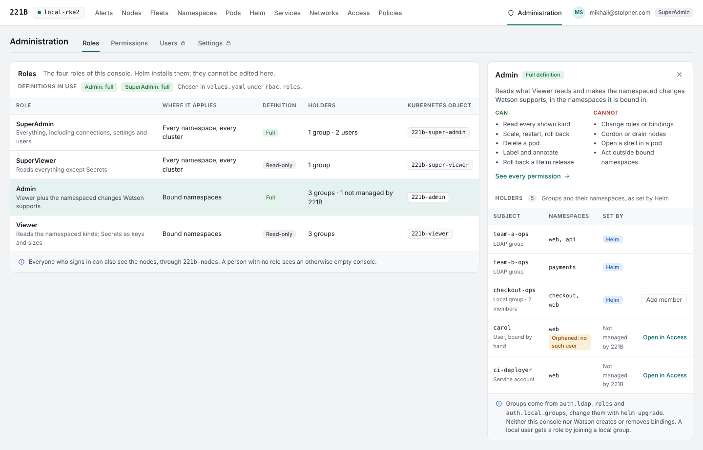
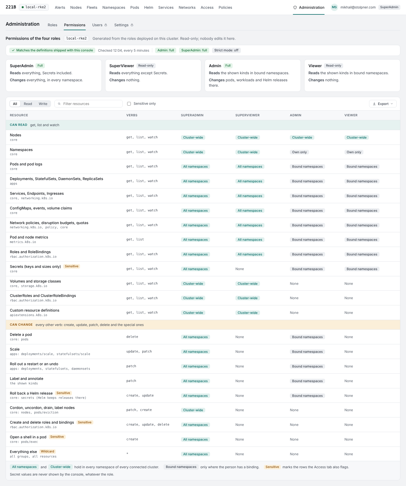
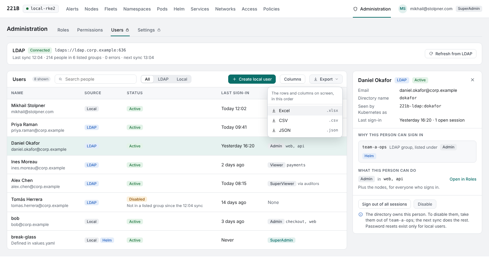
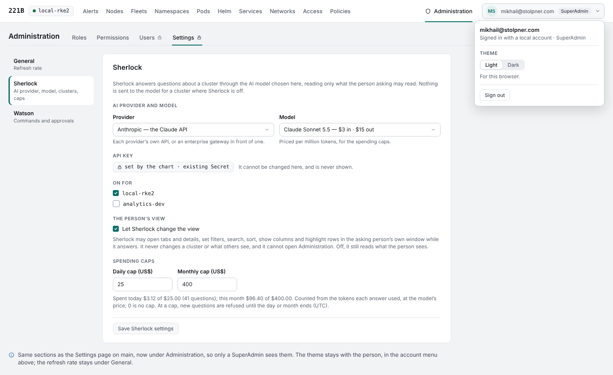
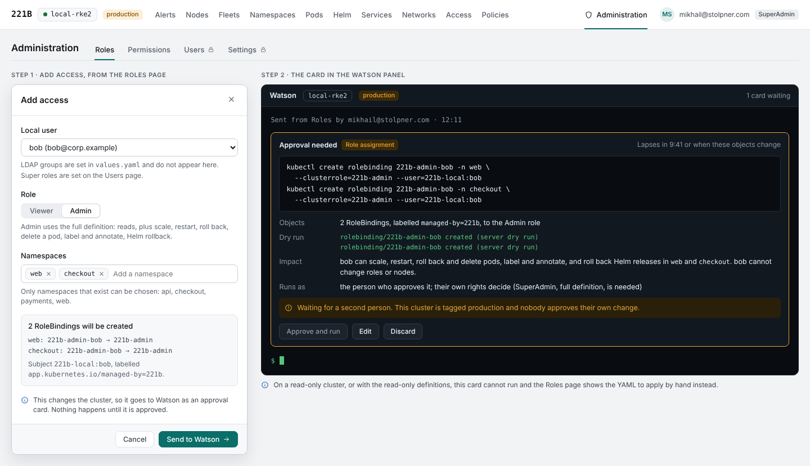
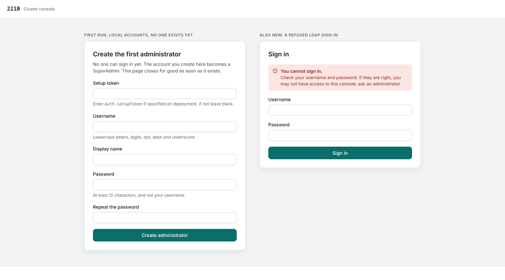

# Roles, users and the Administration area: requirements

Oct 16, 2026 · Mikhail Stolpner · **Draft 4, implemented on branch `Phase-6.1-Auth`. Merged into the requirements list as Phase 6.1 and decided in ADR-59.**

A new set of requirements for who may do what in 221B, written against `main` at commit `369950d`, which has Phase 6 merged. It replaces P3-03 ("two console roles") and the role rules of ADR-26, and should be done before the Phase 7 security review (P7-04). The requirement IDs start with RB so they cannot clash with the phase numbers; they fold into the requirements list when this is merged.

## Scope

Today there are two console roles, decided from the sign-in provider's claims (`auth.admins`, `auth.adminGroups`), and what a person sees in a cluster is Kubernetes RBAC, applied by impersonation (ADR-31). Watson's ceiling is `localCluster.mode` (`read` or `write`). This document adds:

- **Four predefined roles:** Viewer, SuperViewer, Admin and SuperAdmin. Viewer and Admin are limited to namespaces.
- **Two definitions each for Admin and SuperAdmin**, full and read-only, chosen in `values.yaml`, so a deployment can be protected against any change.
- **Local groups** for local users, defined in `values.yaml` like LDAP groups, so that no role binding is ever written at run time.
- **LDAP** for sign-in and roles: the LDAP groups of each role are listed in `values.yaml`, the bind credential is a Kubernetes Secret, and only members of a listed group may sign in.
- **An Administration area** that holds Roles, Permissions, Users and Settings.
- **A way to keep Watson and the console inside the limits** the chart sets, whatever a model writes.
- **Bootstrap** of the first administrator, with and without LDAP.

**What it does not do.** There are no custom roles and no role editor, no namespaced Roles of your own, no "all namespaces" scope for Admin, and no change to how Sherlock or Watson run (both stay as the person, ADR-31 and ADR-52).

## Approach

| Decision | Choice | Why |
| --- | --- | --- |
| Where permissions live | In Kubernetes: ClusterRoles installed by Helm under fixed names, bound with RoleBindings and ClusterRoleBindings | Kubernetes stays the one source of truth (ADR-31: "Kubernetes' answer, not a copy of RBAC kept in the console"). |
| Who may define roles | Nobody, in the console. The roles come with the chart and are read-only | Removes the YAML and visual editors, can-i greying and escalation-prevention questions. |
| The limit on what can be done | **The four roles themselves.** What Kubernetes lets a person do is the ceiling; the console adds guards that can only narrow it | One mechanism to reason about and test, and it holds whatever a model produces. See [Keeping Watson inside the limits](#keeping-watson-inside-the-limits). |
| Full and read-only definitions | Admin and SuperAdmin each exist in two versions; only the chosen one is installed | A read-only deployment has no full role on the cluster that anyone could bind. |
| How the two "Super" roles reach Kubernetes | 221B keeps who holds them and adds a reserved group (`221b:superadmins`, `221b:superviewers`) when it calls Kubernetes as that person. The chart binds each group once | The first user, whose name is not known until first sign-in, needs no binding written at that moment, and one assignment works on every cluster. |
| How Admin and Viewer reach Kubernetes | One RoleBinding per namespace, the subject always a **group**, rendered by the chart from `values.yaml`. Nothing writes a binding at run time | The scope is exactly what Kubernetes shows, a deployment is fully declarative, and neither the console nor Watson needs a right on RBAC. |
| How local users get Admin or Viewer | By membership of a **local group** defined in values (`auth.local.groups`: a name, a role and namespaces). Who is in a group is held in 221B and changed by a SuperAdmin on the Users page | A user name is only a string to Kubernetes, and a group is bound once at deployment, exactly like an LDAP group. |
| LDAP | Roles by group, listed in `values.yaml`; membership of a listed group is the right to sign in | The directory stays the owner of who is in a group; Helm owns which groups mean what. |

**Alternatives considered.**

- *Custom roles with a YAML and visual editor.* Rejected as too complex for version 1.
- *Roles enforced inside the console, not in Kubernetes.* Rejected: a second copy of RBAC that can drift, and `kubectl` users on the same cluster would not be covered.
- *A separate allow-list of Watson commands in values as the limit.* Rejected as the primary limit: it would be a second definition of what each role may do. The roles are the limit; the existing `mode` stays as a console-side lock.
- *A RoleBinding per local user, written at run time through a Watson card (draft 3).* Rejected: it is the only place the console would write RBAC, it needs a narrow Watson ability for RoleBindings, it makes local users work differently from LDAP groups, and a read-only deployment would need an exception. A local group of one person gives the same result.
- *Making a binding for the first user at first sign-in.* Rejected: it needs the console's account to hold `create` on ClusterRoleBindings and `bind` on the admin role, so a compromised console could bind anyone.
- *A namespaced Role of your own, or Admin for "all namespaces".* Deferred; the data model leaves room for both.

## The four roles

| Role | Can do | Where | Kubernetes object | Assigned |
| --- | --- | --- | --- | --- |
| **SuperAdmin** | Everything: all reads, every change Watson supports, node operations, connections, settings, fleets, assignments and users | Every namespace, every connected cluster | ClusterRole `221b-super-admin` (full or read-only), bound to the group `221b:superadmins` | In 221B: LDAP groups and local users |
| **SuperViewer** | Read everything except Secrets, including cluster-scoped kinds and RBAC | Every namespace, every connected cluster | ClusterRole `221b-super-viewer`, bound to `221b:superviewers` | In 221B: LDAP groups and local users |
| **Admin** | Read what Viewer reads, and (full definition) make the namespaced changes Watson supports | The namespaces it is bound in | ClusterRole `221b-admin` (full or read-only), bound by RoleBindings | A group (LDAP, local or OIDC) with namespaces, in values |
| **Viewer** | Read the namespaced kinds the console shows, Secrets included as keys and sizes (X-01), and Roles and RoleBindings | The namespaces it is bound in | ClusterRole `221b-viewer`, bound by RoleBindings | A group (LDAP, local or OIDC) with namespaces, in values |

Everyone who signs in also gets the nodes (RB-07). A person with no assignment sees an empty console.

**How a person gets a role.** Every route ends in a group, so Kubernetes only ever sees groups bound once by Helm.

| Source | SuperAdmin and SuperViewer | Admin and Viewer |
| --- | --- | --- |
| LDAP | Groups under `superAdmin` and `superViewer` in `auth.ldap.roles` | Groups under `admin` and `viewer`, each with `namespaces` |
| Local user | Given to the user in 221B, on the Users page | Member of a local group defined in `auth.local.groups`, with a role and `namespaces` |
| OIDC | The group lists or `auth.admins` (open question) | Groups with `namespaces`, under `auth.oidc.roles` (open question) |

### What each role may do

| Ability | SuperAdmin | SuperViewer | Admin | Viewer |
| --- | --- | --- | --- | --- |
| See nodes, node totals and fleets | Yes | Yes | Yes | Yes |
| See namespaces, volumes, storage classes and other cluster-scoped kinds | All | All | Own namespaces only | Own namespaces only |
| Read workloads, services, events, logs and the other namespaced kinds | All namespaces | All namespaces | Bound namespaces | Bound namespaces |
| See Secret keys and sizes (when `secrets.read` is on) | Yes | No | Yes, in bound namespaces | Yes, in bound namespaces |
| Prepare a Watson card | Yes | Yes | Yes | Yes |
| Approve a change (ADR-52: the approver's own rights decide) | Any, full definition only | No | Namespaced changes in bound namespaces, full definition only | No |
| Node operations: cordon, uncordon, drain, label, annotate and taint nodes | Full definition only | No | No | No |
| Create, change or remove roles and bindings | Not in the console: they come from the chart (RB-06, RB-52) | No | No | No |
| Connections, settings and fleets (ADR-26, ADR-32) | Yes | No | No | No |
| Users page, LDAP refresh, local users, group memberships and super roles | Yes | No | No | No |
| See the Permissions page | Yes | Yes | Yes | Yes |
| Use Sherlock | Yes | Yes | Yes | Yes |

Sherlock answers as the person (P5-02), so it sees exactly what the table says and no more.

### The two definitions of Admin and SuperAdmin

| Role | Full | Read-only |
| --- | --- | --- |
| **Admin** | Viewer's reads, plus scale, rollout restart and undo, delete pod, label and annotate, and Helm rollback (the namespaced changes of P6-02) | Exactly Viewer's rights. The role still exists, so assignments do not change when you switch. |
| **SuperAdmin** | All verbs on all resources, in every namespace and cluster-scoped (`*`) | `get`, `list` and `watch` on all resources, and `get` on the non-resource URLs. No other verb. |

Choosing the read-only definition for both roles gives the **fully protected read-only deployment**: no identity 221B can send to Kubernetes holds a write right, so no change can be made through the console, and Watson's cards fail with Kubernetes' own refusal even if the console's own lock were bypassed.

## Chart values

```yaml
rbac:
  roles:
    admin:
      template: full        # full | readOnly
    superAdmin:
      template: full        # full | readOnly

auth:
  mode: ldap                # oidc | local | ldap | none
  ldap:
    url: ldaps://ldap.corp.example:636
    startTLS: false
    caSecret: ""            # optional Secret holding the CA bundle
    bindDN: cn=221b,ou=service,dc=corp,dc=example
    existingSecret: 221b-ldap   # key: bind-password
    userSearch:  { baseDN: ou=people,dc=corp,dc=example, filter: "(uid={username})", usernameAttr: uid, emailAttr: mail, nameAttr: cn }
    groupSearch: { baseDN: ou=groups,dc=corp,dc=example, nameAttr: cn, nested: true }
    syncInterval: 1h
    roles:
      viewer:      [ { group: team-a-readers, namespaces: [web, api] } ]
      admin:       [ { group: team-a-ops,     namespaces: [web, api] } ]
      superViewer: [ { group: auditors } ]
      superAdmin:  [ { group: platform-admins } ]
  local:
    groups:                 # for local users; members are kept in 221B
      - { name: web-readers,  role: viewer, namespaces: [web] }
      - { name: checkout-ops, role: admin,  namespaces: [checkout, web] }
```

The names are a starting point for design. `namespaces` is allowed only under `viewer` and `admin`, and `role` of a local group is `viewer` or `admin`.

## What exists today

Read from the branch, because it decides how big the change is:

- **Console roles** are two, decided at sign-in and kept in the session: an administrator is a username or subject in `auth.admins`, or a group in `auth.adminGroups`. A change takes effect at the next sign-in (ADR-26). With sign-in off, everyone is an anonymous administrator.
- **What a person sees** comes from one shared cache filtered per person by `SubjectAccessReview`s for their user and groups, one verdict per resource and namespace, renewed every 2 minutes (`accessTTL`). Logs and YAML are read with impersonation headers. `system:authenticated` is added to their groups, and `auth.kubernetes.userPrefix` and `groupPrefix` match what the API server's OIDC setup puts before names (ADR-31). The console's account may impersonate users and groups, never ServiceAccounts or UIDs.
- **Aggregate counts**, such as a node's pods, stay cluster-wide (ADR-31). Node rows have the pods of hidden namespaces removed from their problems.
- **Changes** run as the person who approves, impersonated; the dry run runs as the requester (ADR-52). `localCluster.mode: read` (the default) refuses every change before it is parsed; other clusters set `mode` per connection. The browser's only way to change a cluster is a Watson card (ADR-53). Watson supports no `apply`, `edit` or `exec` (P6-02).
- **Sign-in** is OIDC, local accounts (hashes in values or a Secret, with `groups`), or none. LDAP is not implemented. Sessions live in server memory. Local accounts can be listed in values; with sign-in off, changes run as the console's own account, bound to `localCluster.writeClusterRole` (default `edit`).
- **Settings** is a page of its own at `#/settings/<section>` (`SettingsPage.tsx`), opened from the gear in the top bar, with Back and Escape returning to where it was opened. Its sections are **General** (Theme, kept in this browser, and Refresh rate, kept on the server; everyone sees it, an administrator changes the rate), **Sherlock** (AI provider and model, credential, clusters, the person's view, spending caps) and **Watson** (the second-person rule). Sherlock and Watson are shown to administrators only (P3-03).
- **Tables export** through one Export menu (`ExportMenu.tsx`): a button with a chevron that opens a list of Excel, CSV and JSON for the rows and columns on screen.
- **The Access and Policies tabs** (P4-03, P4-04, P4-06) are cluster analyses: every role and binding with risk flags and "who can do this", and network policies, quotas, Pod Security and admission webhooks.

## Requirements

These apply on top of the requirements for every phase (X-01 to X-17). Those that matter most here: X-01 (Secret values are never shown), X-02 (the chart grants only what screens use), X-03 (changes need a card), X-04 (credentials live in Secrets), X-06 (requests that change anything are protected), X-12 (accessibility), X-13 (tables) and X-14 (tests).

### Roles and assignments

| ID | Requirement | Done when |
| --- | --- | --- |
| RB-01 | Four predefined roles: Viewer, SuperViewer, Admin and SuperAdmin, as in the tables above. Each is a ClusterRole installed and upgraded by the chart under a fixed name (`221b-viewer`, `221b-super-viewer`, `221b-admin`, `221b-super-admin`), labelled `221b/managed: "true"` (Helm sets `app.kubernetes.io/managed-by` itself). The console offers no way to create, edit or delete a role. | `helm install` creates exactly these objects; the Roles page has no edit control. |
| RB-02 | Admin and SuperAdmin each have a **full** and a **read-only** definition. `rbac.roles.admin.template` and `rbac.roles.superAdmin.template` choose (default `full`). Only the chosen definition is installed, under the fixed name; the other does not exist on the cluster. Switching is a `helm upgrade` and changes no binding. | With `readOnly`, no object with a write verb for that role exists on the cluster; switching back restores it; bindings are untouched. |
| RB-03 | The **fully protected read-only deployment**: both templates `readOnly`. The chart refuses to render `localCluster.mode: write` with it, saying why, and the console shows "Changes are impossible by configuration" wherever it shows Watson's cards. | `helm template` fails on the contradiction; on a kind cluster every supported change, sent from every role, is refused by Kubernetes. |
| RB-04 | Roles are assigned by **LDAP group** (in values, RB-20) and, for local users, by **membership of a local group** for Admin and Viewer (RB-50) and by a **super role given to the user** in 221B (RB-05, RB-51). OIDC keeps `auth.admins` and `auth.adminGroups`, which now mean SuperAdmin; it can use the same four group lists (open question). | For each role and each source, a test signs in as such a person and sees what the role allows. |
| RB-05 | SuperAdmin and SuperViewer are held in 221B and apply to every connected cluster. When 221B calls Kubernetes as a person who holds one, it adds the reserved group to their groups, in the access reviews and in impersonated calls alike. Kubernetes still decides what the group may do. A change to who holds one takes effect within the access lifetime (2 minutes), including in open sessions. | A SuperViewer sees every namespace on two connected clusters after one assignment; removing a SuperAdmin hides the Administration pages and refuses their next change within 2 minutes, without their signing out. |
| RB-06 | Admin and Viewer are bound per namespace: one RoleBinding of a **group** to the role's ClusterRole in each namespace, rendered by the chart from `namespaces` on a group in values (LDAP, local or OIDC). Nothing in the console or in Watson creates or deletes a binding (RB-52). To give a person a different set of namespaces, add a group in values and run `helm upgrade`; a group may have one member. Rights add up, as in Kubernetes: Viewer in `web` and Admin in `api` is both. A namespace named in values that does not exist makes the chart fail with that name. | A person bound in two namespaces sees those two and no others, in every tab, in search and in export (P3-02). |
| RB-07 | Everyone who signs in can see the nodes. A chart-created ClusterRole (read nodes only) is bound to the reserved group `221b:console-users`, which 221B adds for every signed-in person. It grants no other cluster-scoped kind. | A Viewer bound in one namespace sees the Nodes and Fleets tabs and cannot list volumes, storage classes or namespaces through the console. |
| RB-08 | For a person limited to namespaces, the Namespaces tab lists their own namespaces, worked out from the per-namespace verdicts the console already holds (ADR-31). No right to list namespaces is granted for this. | Bound in `web` and `api`, the tab lists those two. |
| RB-09 | Node totals ("requested", "in use", pods on a node) stay cluster-wide, as ADR-31 says today. Any list of pods behind a total is filtered to the person's namespaces. | A Viewer sees a node's total pod count, and only their own namespaces' pods in its list. |

### What the roles contain

| ID | Requirement | Done when |
| --- | --- | --- |
| RB-10 | **Viewer**: `get`, `list` and `watch` on every kind the console watches, Roles and RoleBindings included. The rule list is generated from the console's own list of watched kinds, so the two cannot drift. Secrets are included while `secrets.read` is on, and not otherwise; their values still never reach the screen (X-01). | A test adds a watched kind and fails until the role has it; with `secrets.read: false` the role has no Secret rule. |
| RB-11 | **SuperViewer**: the same rules cluster-wide, plus the cluster-scoped kinds the console shows (namespaces, volumes, storage classes, CustomResourceDefinitions, ClusterRoles, ClusterRoleBindings), and **no Secrets**. | A SuperViewer reads every page except Secrets, on a kind cluster. |
| RB-12 | **Admin**: the full definition is Viewer's rules plus the namespaced changes of P6-02. It has no right on Roles or RoleBindings, no `pods/exec`, and nothing cluster-scoped. Helm rollback needs `create` and `update` on Secrets in the namespace, because Helm keeps its releases there (open question). The read-only definition is Viewer's rules. | An Admin with the full definition approves a scale in a bound namespace and is refused a drain, a role change and any action elsewhere, each with Kubernetes' own message; with the read-only definition every change is refused. |
| RB-13 | **SuperAdmin**: the full definition is all verbs on all resources; the read-only definition is `list` and `watch` on all resources, `get` on every resource of the built-in API groups, Secrets included, except the subresources that run a command or proxy to one (`pods/exec`, `pods/attach`, `pods/portforward`, `pods/proxy`, `services/proxy`, `nodes/proxy`, which a kubelet and the API server authorize as `get`), and `get` on non-resource URLs. RBAC cannot deny, so those `get`s are listed; a custom resource is listed and watched but not read by name. SuperAdmin is also the console administrator of ADR-26: connections, settings, fleets, the Users page, LDAP refresh and assignments belong to it alone. | A non-SuperAdmin sees those controls disabled with the reason, and the endpoints refuse them. |
| RB-14 | The console's own account gains no permission from this work: it still impersonates and creates access reviews, writes only its own settings, connections and local users in its own namespace, and never needs `bind`, `escalate` or write access to RBAC or workloads. With sign-in off it keeps `localCluster.writeClusterRole` as today. | A chart test shows the console's ClusterRole and Role unchanged apart from the narrow reads of RB-36. |

### Names sent to Kubernetes

| ID | Requirement | Done when |
| --- | --- | --- |
| RB-15 | Each source has its own prefix on the names Kubernetes sees: local users and groups get `221b-local:`, LDAP ones get `221b-ldap:`, and OIDC ones keep using `auth.kubernetes.userPrefix` and `groupPrefix` as today. The Roles and Users pages hide the prefix when they show a name. Prefixes are chart values. | A local `alice` and an LDAP `alice` hold different rights; the Roles page shows both as `alice` with their source. A local group `ops` and an LDAP group `ops` are different subjects. |
| RB-16 | Names are matched exactly, case included. Local user names use lowercase letters, digits, `.`, `-` and `_`. | `Alice` and `alice` are two different subjects, and a local user cannot be created as `Alice`. |
| RB-17 | A name from any source that starts with `system:` or `221b:`, or that already carries a reserved prefix, is refused as a user name and dropped from a token's or directory's groups, with an audit record. | A directory group called `221b:superadmins` gives its members nothing and writes a record; a local user called `system:masters` cannot be created. |
| RB-18 | Impersonating a ServiceAccount or a UID stays impossible (ADR-31). | Unchanged tests still pass. |

### LDAP

| ID | Requirement | Done when |
| --- | --- | --- |
| RB-19 | LDAP is configured in `values.yaml` under `auth.ldap` (see Chart values above): server URL with LDAPS or StartTLS, an optional CA, the bind DN, user and group search bases, filters and attributes, nested groups, paging, time limits. The bind credential is a Kubernetes Secret named in values (`existingSecret`, key `bind-password`) and is never in values, logs, the audit log or any API response (X-04). | An integration test against OpenLDAP in CI signs in; a search of the console's logs, audit records and API responses never finds the credential. |
| RB-20 | `auth.ldap.roles` lists the LDAP groups of each role: `viewer`, `superViewer`, `admin` and `superAdmin`. An entry for `viewer` or `admin` may carry `namespaces`, which the chart turns into RoleBindings (RB-06). The group names are written as the directory has them; the console adds the prefix of RB-15. | A group listed under `admin` with two namespaces yields two RoleBindings and the Admin role for its members; `namespaces` under a super role fails the chart. |
| RB-21 | A person may sign in only if they belong to at least one group listed for any of the four roles. Others are refused with the same message whatever the reason (wrong password, not in a group, unknown user), and the audit record says which. A person in several groups holds each role; the highest is shown, and rights add up. | A valid LDAP user in no listed group cannot sign in and nothing about the groups is revealed to them. |
| RB-22 | People sign in by binding as themselves. Groups are resolved from the directory, nested groups included, with paged searches. Nothing falls back to open access: when the directory cannot be reached, new sign-ins are refused with a clear message and open sessions continue until their lifetime ends. | Stopping the directory refuses a new sign-in with that message and leaves a signed-in person working. |
| RB-23 | A person's groups are looked up again in the directory whenever their access reviews expire, no more often than every 2 minutes, and again when they approve a change. | Moving a person to another group changes what they see within 2 minutes, with no new sign-in. |
| RB-24 | The Users page lists people from the listed groups: the sync reads those groups' members at start-up, at a person's first sign-in and on `syncInterval`. The list is kept in memory with the time of the last sync, counts and any errors. A person no longer in any listed group is shown as disabled, not deleted. A failed sync keeps the old list and says so. | Removing a person from the group disables them on the next sync; stopping the directory leaves the list and shows an error. |
| RB-25 | A **Refresh** button on the Users page (SuperAdmin only, shown only with LDAP) starts a sync in the background. Only one runs at a time, and the page shows it running and then its result. | Two clicks run one sync. |

### Bootstrap

| ID | Requirement | Done when |
| --- | --- | --- |
| RB-26 | **Local users.** While no user exists and LDAP is not configured, the console shows a first-run page that asks for the first administrator's name and password. That person becomes a SuperAdmin. The page closes for good once a user exists, is rate-limited, and is audited. There is no generated password. | A second visit shows the normal sign-in; more than 5 attempts a minute are refused; the audit log has the setup. |
| RB-27 | An optional chart value, `auth.setupToken`, must be typed on the first-run page when set. The first-run page has a Setup token field with the hint "Enter auth.setupToken if specified on deployment, if not leave blank." The chart's install notes warn when the Service is reachable from outside the cluster; they do not print the token. | With a token set, a wrong or missing token is refused. |
| RB-28 | **LDAP and OIDC.** The first SuperAdmins are the groups listed under `superAdmin` (RB-20, or the OIDC lists). They hold the role from the first start and cannot be removed in the console. Existing `auth.admins` and `auth.adminGroups` keep working. In LDAP mode, local users can still be listed in values as break-glass accounts, and cannot be created in the console (open question). | A fresh install with an LDAP group under `superAdmin` gives its members SuperAdmin at first sign-in; an upgrade keeps today's administrators. |
| RB-29 | The chart creates the chosen role definitions, the nodes ClusterRole and the three reserved group bindings on the cluster the console runs in. For every other cluster, the connection editor shows the same YAML, in the full or the read-only variant, with the RoleBindings of the groups in values, and the connection test says which of the objects are missing or differ. Until they exist, people see an empty console there, and the page says why. | A newly connected cluster with nothing applied shows the YAML and a clear message; after applying it, a SuperViewer sees the cluster. |
| RB-30 | The last SuperAdmin cannot be removed, disabled or deleted, and the console says so. | The attempt is refused and audited. |
| RB-31 | With sign-in off, everyone is an anonymous SuperAdmin as today (ADR-26) and the Administration pages other than Permissions are not shown. Changes then run as the console's own account (ADR-52), which the four roles cannot limit, so the chart refuses `auth.mode: none` with `localCluster.mode: write` when either template is `readOnly`, and says so. | `helm template` fails on that combination. |

### Keeping Watson inside the limits

The aim: whatever Sherlock or a person types, the console and Watson can do no more than the chart allows. The approach has one hard limit, the roles, and guards that can only narrow it. The model supplies text, never identity or scope.

| ID | Requirement | Done when |
| --- | --- | --- |
| RB-32 | **The roles are the ceiling.** Every change runs as the approver, impersonated (ADR-52), so Kubernetes refuses what the approver's role does not allow. The dry run runs as the requester. Nothing in the console grants a change that the role does not. | With the read-only SuperAdmin definition, an approved card for every supported change fails with Kubernetes' message and changes nothing. |
| RB-33 | **A model never supplies identity or scope.** The user, groups, impersonation headers, cluster and the objects a change touches come from the session, the card and the server's own dry run, never from model text. No tool Sherlock has takes any of them as input, and a Sherlock proposal is only text until a person sends it to Watson (ADR-53). | A contract test fails if any tool's input schema names a user, group, header or cluster; a proposal naming another cluster or namespace is not applied to it. |
| RB-34 | **Closed grammar.** Watson parses a command into a typed form and runs only the supported ones (P6-02, P6-03). An unknown command, flag, kind or shell character is refused before anything runs. The card shows what the server worked out (objects, impact, dry run), not what the text claimed. A command that names an object that does not exist cannot be approved. | A corpus of invented and malformed commands (unsupported verbs, hallucinated names and flags, shell metacharacters, other clusters, other namespaces) is refused or fails its dry run; none reaches approval with an effect. |
| RB-35 | **A lock in values that agrees with the roles.** `localCluster.mode` and each connection's mode stay the console-side lock: `read` refuses every change before it is parsed. The chart validates it against the templates (RB-03, RB-31). | `mode: read` refuses a change with a SuperAdmin whose role would allow it; the contradictions fail the chart. |
| RB-36 | **Fail closed on drift.** At start-up, every 5 minutes and when the roles change, the console compares the four deployed ClusterRoles of each cluster with the definitions shipped in its image, which are the same files the chart installs. A difference is shown on the Permissions page and in the audit log. With `rbac.enforce: strict`, a cluster whose roles allow more than the shipped definitions refuses every change, naming the difference. The console's account gets `get` on exactly these ClusterRoles by name, nothing more. | Editing `221b-admin` on a kind cluster to add `delete nodes` raises the warning within 5 minutes; with strict on, a change on that cluster is refused. |
| RB-37 | **Impersonation limited by values.** Because every group the console may assert is listed in values (LDAP groups, local groups, OIDC role lists), the chart limits the console's right to impersonate groups to exactly those groups, with prefixes, plus the reserved groups and `system:authenticated`. The code that builds the impersonation headers cannot emit any other group, and a test proves it never emits `system:masters`. User names cannot be limited the same way, since people are dynamic; the console computes them from the session. | A request to impersonate a group outside the list is refused by the API server; a unit test fails if the header builder can emit an unlisted group. |
| RB-38 | **A person approves, never a model or a button of the console.** No Sherlock tool, UI action (P6U-12) or script can press Approve and run; approval needs a person's own session and a protected request (X-06). Cards lapse after 10 minutes or when the objects change (P6-04, ADR-51), and the second-person rule applies on production (P6-07). | A test drives Sherlock to propose a change and to try to approve it; no change runs. |
| RB-39 | **Read-only deployments are tested as such.** On a kind cluster with both templates `readOnly` and `mode: read`, the whole supported set of changes is tried as SuperAdmin, Admin, Viewer and SuperViewer, and the cluster is compared before and after. | Every attempt is refused and the cluster's objects are byte-for-byte unchanged. |
| RB-40 | **The ceiling is tested for every role and definition.** For each role in each definition, a test runs the whole command set plus the corpus of RB-34 and checks that exactly what the role's rules allow succeeds. The expected results are generated from the same definitions as the Permissions page, so what is documented is what is enforced. | The test matrix passes on every pull request and fails when a role gains a verb the definitions do not list. |

### The Administration area

| ID | Requirement | Done when |
| --- | --- | --- |
| RB-41 | A separate **Administration** entry beside the cluster tabs, at `#/admin`, with the pages **Roles**, **Permissions**, **Users** and **Settings**. Permissions is shown to everyone who signs in. Roles follows Kubernetes: a person who cannot list RoleBindings sees nothing in it. Users and Settings are SuperAdmin only. | A Viewer sees Roles and Permissions, a SuperAdmin sees all four, and the other pages answer a Viewer with a clear refusal. |
| RB-42 | **Roles** lists the four roles with a description, scope and the number of holders. Clicking a role opens its details on the right, like any other page (ADR-38): its permissions, generated from the ClusterRole itself, and every bound subject. Groups, LDAP and local, appear with their namespaces as set by Helm and cannot be changed here; a local group shows its number of members and, to a SuperAdmin, an **Add member** action (RB-43). Bindings that 221B did not make, including ServiceAccount subjects and users, are read-only and marked "not managed by 221B", with a link to the Access tab for that subject; one whose user does not exist is flagged as orphaned. Super-role holders are shown to SuperAdmin only. | A binding made with `kubectl` appears, marked, with no remove button. |
| RB-43 | **Group membership** (SuperAdmin only): a local user is added to or removed from a local group on the Users page (the details pane) or from the group on the Roles page. The form shows what the person can do afterwards, role and namespaces, worked out from values, and asks for a confirmation (RB-51). LDAP people cannot be changed here: the directory owns them. | Adding a user to a group that has two namespaces shows both in the form; after confirming, the person sees them within 2 minutes. |
| RB-44 | **Permissions**: a page, read-only for everyone, that lists the complete permissions of all four roles on the cluster open, split into **Read** (`get`, `list`, `watch`) and **Write** (every other verb). Each row names the API group, the resource or subresource, the verbs, and flags what the Access tab flags: wildcards, Secrets, `escalate`, `bind`, `impersonate`, and also `pods/exec`, `pods/attach`, `pods/portforward`, `nodes/proxy` and `serviceaccounts/token`. The page names the definition in use for Admin and SuperAdmin (full or read-only), shows totals ("reads N kinds, changes 0"), compares the live roles with the shipped definitions (RB-36) and says whether they match. The table uses the same Export menu as every other table (Excel, CSV, JSON; X-13). | The page matches `kubectl get clusterrole -o yaml` for each role on the cluster; a role edited by hand shows "differs" and names the rule. |
| RB-45 | **Users** (SuperAdmin only) lists the users 221B knows: name, source (local, LDAP, OIDC), email, status, last sign-in and super roles. A details pane on the right shows the person's groups, what they can do, and for a local user the super role and the actions of RB-46. OIDC users appear after their first sign-in. The toolbar of the table holds **Create local user** (RB-46), Columns and the Export menu; the LDAP strip above it holds only the connection's state and Refresh. | An OIDC person who has never signed in is not listed; after signing in they are. |
| RB-46 | **Local users** can be created (name, password, optionally groups), disabled, enabled, reset and deleted, in `local` mode. They and their group memberships are kept in a Secret in the console's own namespace, as connections are (`connections.store`; open question). Passwords are at least 12 characters and not the user name. Hashes are never returned by the API. Users defined in the chart (`auth.local.users`, with `groups`) are shown read-only, and a group a chart user names that values do not define fails the chart. Disabling, resetting or deleting ends that person's sessions. A signed-in local user can change their own password, and sign-in is rate-limited per user and per address, with failures audited. | A reset ends open sessions; the API response never contains a hash; the tenth failure in a minute is refused and written to the audit log. |
| RB-47 | The **Settings page** that main already has moves into the Administration area as its last page, at `#/admin/settings`, with its three sections unchanged: General (refresh rate), Sherlock and Watson. Under Administration the whole page is SuperAdmin only. **Theme** is personal and every person needs it, so it moves from General to the account menu in the top bar, as Light and Dark with the hint "For this browser". The gear opens the Settings page in Administration for a SuperAdmin and is hidden from everyone else. `#/settings` redirects, and Back and Escape keep working as they do now. Fleets keep their drawer on the Fleets tab. | A Viewer can change the theme from the account menu and has no gear; a SuperAdmin changes the refresh rate and Sherlock's and Watson's settings on the page; an old `#/settings` link lands on it for a SuperAdmin and is refused with a clear message for anyone else. |
| RB-48 | Sherlock's view actions cannot reach the Administration area (P6U-06, P6U-12): `view_open` does not accept it. | The tool's list of tabs excludes `admin`. |
| RB-49 | The Access and Policies tabs stay as cluster tabs: they analyse the whole cluster's RBAC and policies, which the Roles and Permissions pages do not. Access marks 221B's four roles and their bindings so they are easy to tell apart, and links back to Roles. | The Access tab shows `221b-admin` marked as a 221B role, and its link opens the Roles page. |

### Local groups, and no role changes at run time

| ID | Requirement | Done when |
| --- | --- | --- |
| RB-50 | **Local groups.** `auth.local.groups` defines groups for local users: a `name`, a `role` (`viewer` or `admin`) and `namespaces`. The chart renders one RoleBinding per namespace to the role's ClusterRole, subject the group `221b-local:<name>` (RB-15). Members are local users, listed in `auth.local.users[].groups` or added in the console (RB-43). A group name that is not defined grants nothing, and in values it fails the chart. | A group with two namespaces gives its members the role in those two and nowhere else; removing a person from it removes the access within 2 minutes; an undefined group name in `auth.local.users` fails `helm template`. |
| RB-51 | **Membership and super roles are changes to 221B, not to a cluster.** Adding or removing a local user from a group, and giving or taking a super role, use a confirmation dialog and are audited. They take effect within the access lifetime (2 minutes) in open sessions, since 221B adds the person's groups, and the reserved groups of RB-05, when it asks Kubernetes. They are never a Watson card. | A change writes one audit record naming who changed whom and which group; a Viewer who is added to an Admin group gets Admin's rights within 2 minutes without signing out. |
| RB-52 | **No role writes at run time.** Neither the console nor Watson creates, changes or deletes a Role, ClusterRole, RoleBinding or ClusterRoleBinding. The console's account has no verb on RBAC (RB-14), the supported Watson commands stay as P6-02 lists them, and a command that names an RBAC kind is refused as unsupported. | A chart test finds no RBAC write in the console's roles; the unsupported-command tests include a RoleBinding and are refused. |
| RB-53 | **Deleting a local user** removes them from every group and ends their sessions, and writes one record. Nothing is left in any cluster, because no binding names a user. Disabling does the same for access and keeps the user. | After deleting a user, no group lists them and the cluster has no object with their name. |

### Audit, tables, tests and upgrade

| ID | Requirement | Done when |
| --- | --- | --- |
| RB-54 | Audited, one record each: every group-membership, super-role and user change; first-run setup; refused sign-ins and why (RB-21); refused and dropped reserved names (RB-17); drift found (RB-36); LDAP sync summaries (counts and errors, never the list of people). | Each of these writes exactly one record, and none holds a credential. |
| RB-55 | The new tables sort, filter, pick columns and export exactly what is shown through the same Export menu as the other tables (X-13). The new pages meet WCAG 2.2 AA in both themes and at 390 px (X-12). | axe finds no failure; the export test passes. |
| RB-56 | Tests (X-14): on a kind cluster, one test per role and definition that signs in as such a person and checks what the console and Watson allow and refuse (RB-40); a test that the Viewer rules match the watched kinds; chart tests for the objects in RB-29, RB-14 and RB-37; browser tests for the pages, the first-run page and the cards. | The suite passes on every pull request. |
| RB-57 | Helm upgrade keeps today's administrators and local users (P7-03), and a release that has `auth.admins` keeps working. The architecture document gets a decision record that replaces the role rules of ADR-26, and the requirements table replaces P3-03. | Upgrading from the previous release keeps every existing sign-in working. |

## Notes on what this does not change

- **The console can impersonate users.** Its account must be able to impersonate any user name, because people are dynamic, so a compromised console can act as any identity whose rights it knows. RB-37 narrows the groups it may claim but cannot narrow the users. The roles still limit what each of its identities may do, and the console never holds a write right of its own.
- **Anything outside the four roles is outside this limit.** A person with a direct `cluster-admin` binding of their own, or a ServiceAccount token, is not limited by the roles. The Roles page and the Access tab show such bindings; they cannot stop them.
- **Why SuperViewer has no Secrets.** The console never shows Secret values (X-01), so the concern is Kubernetes-side: for people who sign in with a provider that a cluster also trusts, the same rights work in `kubectl`, and read access to every Secret on a cluster is close to administrator access. For local and LDAP users the identity exists only through 221B.
- **Admin cannot drain.** Nodes are cluster-scoped, so a namespace-bound role cannot hold node operations. Cordon, uncordon, drain and node labels are SuperAdmin only in this version.

## Where the work lands

- **Chart.** The role definitions (full and read-only), the nodes ClusterRole, the reserved group bindings, local groups and RoleBindings rendered from values, the limit on impersonated groups, LDAP values, validation of contradictions, the Secret reference, install notes.
- **Server.** Users and sign-in (local users, first-run, LDAP, sync), group membership and super roles, the reserved-name rules, group lookup on the access lifetime, the drift check, the audit records, and endpoints for Roles, Permissions, Users and Settings.
- **Browser.** The Administration area (a new view in `lib/router.ts`), the Roles, Permissions, Users and Settings pages with their details panes, the add-to-group form, the first-run page, the YAML in the connection editor, and moving the Settings page (`SettingsPage.tsx`, route `settings`) into the Administration area, with the theme going to the account menu.
- **Docs.** A decision record, the requirements table, and the install and sign-in guides (P7-07).

## Not in this document

- Custom roles, a role editor and namespaced Roles of your own.
- Admin for all namespaces, and a node-operator role.
- Moving cluster connections (add, edit, remove) into the Administration area; they keep the cluster page and menu.
- An audit-log viewer and authentication settings in the Administration area, which can follow.
- Per-cluster role names, and ServiceAccount users.
- A binding for one person alone, written at run time. A local group of one does it.

## Open questions

| Question | Proposal | Status |
| --- | --- | --- |
| Groups for Admin and Viewer carry `namespaces` in values and the chart renders the RoleBindings (RB-06, RB-20, RB-50), for LDAP and local groups alike. Anyone needing their own set of namespaces gets a group of one. Accepted? | Yes. It keeps the console's account free of RBAC writes and makes a deployment fully declarative. A namespace that does not exist at install time fails the chart. | Agreed in review |
| Does the read-only SuperAdmin definition include Secrets (RB-13)? | Yes, the same reads as the full one. Anyone who must not read Secrets is a SuperViewer. | Open |
| Does `rbac.enforce: strict` (RB-36) default to on? | Off by default with a warning; recommended for read-only deployments. | Open |
| Can OIDC use the same four group lists as LDAP? | Yes, under `auth.oidc.roles`, with `auth.admins` and `auth.adminGroups` as aliases for SuperAdmin. | Open |
| In LDAP mode, may chart-defined local users exist as break-glass accounts? | Yes, from values only, never created in the console. | Open |
| Where are console-created local users and their group memberships kept (RB-46)? | In a Secret of the console's own namespace, like connections; with `connections.store: memory` they are lost on restart, so `auth.local.users` in values stay the way to keep break-glass accounts. | Open |
| Helm rollback writes release Secrets, so full Admin needs `create` and `update` on Secrets in its namespaces (RB-12). Accept that, or leave Helm rollback to SuperAdmin? | Accept, and say so in the role's description. Admin can already restart and delete anything in the namespace. | Open |
| Should a node operator role (cordon, drain) exist later for people who are not SuperAdmin? | Not now. | Open |
| Does granting SuperAdmin to a local user need a second person when any cluster is production (P6-07)? | Yes for SuperAdmin, no for SuperViewer. | Open |
| Do OIDC group changes need to reach open sessions? | At next sign-in, unless the provider supports refresh. | Open |
| Are the prefixes `221b-local:` and `221b-ldap:`, and `221b:` for the reserved groups, right? Is `auth.setupToken` wanted? | Yes to both. | Open |
| Should the Access tab be renamed to avoid confusion with the Administration pages? | Rename it "RBAC". | Open |
| Settings was made a page of its own at the Phase 6 review so that Sherlock's and Watson's settings had room. Does it still move under Administration, with only the theme leaving for the account menu (RB-47)? | Yes: one place for everything an administrator changes, and Viewers lose nothing they use. | Open |
| How does the installer learn `auth.setupToken`? | They choose it in values or an existing Secret. If left empty, the chart generates one into a Secret and the install notes print the `kubectl get secret` command, never the token. | Open |

## Design

A prototype of the new pages, at 1440 px in the light theme. The HTML of each page is in `docs/design/roles-and-users/` and opens in a browser as it is.

| | |
|---|---|
|  |  |
| Roles (RB-42): the four roles, the groups that hold each, and bindings not managed by 221B | Permissions (RB-44): what each role may read and change, with the Export menu |
|  |  |
| Users (RB-45, RB-46): a local user's groups and super role, with Create local user and the Export menu in the table toolbar | Settings (RB-47): the page on main, moved under Administration, with the theme in the account menu |
|  |  |
| Add a member to a local group, its confirmation and the audit record (RB-43, RB-51) | First run and a refused LDAP sign-in (RB-26, RB-27, RB-21) |

## Your review

- [ ] The four roles, the two definitions and the read-only deployment (the tables above, RB-01 to RB-03, RB-10 to RB-13)
- [ ] LDAP: values shape, login rule, groups and sync (RB-19 to RB-25)
- [ ] Keeping Watson inside the limits (RB-32 to RB-40)
- [ ] Super roles, names and bootstrap (RB-05, RB-15 to RB-17, RB-26 to RB-31)
- [ ] The Administration area, the Permissions page and moving Settings (RB-41 to RB-49)
- [ ] Local groups and no role writes at run time (RB-50 to RB-53)
- [ ] The open questions
- [ ] Go-ahead to write it into the requirements and build it
