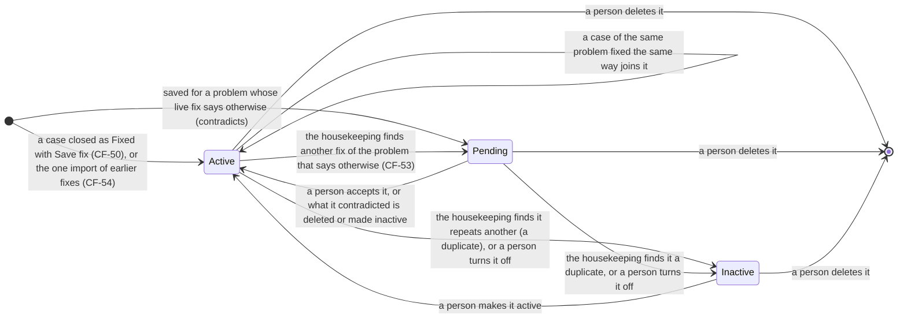
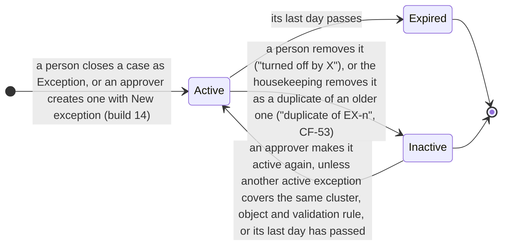
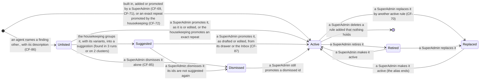
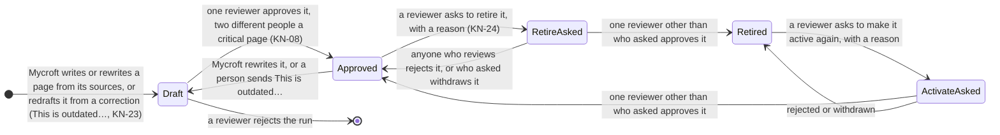

# How the records change state

The states of the records the AIOps area keeps, and what moves each one: a
person, an agent, a job, the daily housekeeping or a timer. Drawn from the
code of 0.12.0 (Phase 12, wave 6 and after); the requirements are named on
the arrows where one rules the step.

## Cases

A case has three stored states: New, In progress and Closed. "Waiting for
the reporter" is what people see while a case is In progress and someone
asked its reporter a question (CF-67); it is a mark on the case, not a
fourth state.

```mermaid
stateDiagram-v2
    direction LR
    [*] --> New: opened by a person (New Case), a report (/report, the intake API), or an agent's finding or alert; or the console, for a critical alert still going after N minutes that no case covers and no diagnosis concluded on (CF-78, CF-82)
    New --> InProgress: a person takes it, is assigned it, replies or asks the reporter (CF-45, CF-67), or a change they approved is applied
    state InProgress {
        direction LR
        Working: In progress
        Waiting: Waiting for the reporter (shown)
        Working --> Waiting: a person asks the reporter for info
        Waiting --> Working: the reporter answers
    }
    New --> Closed: a person closes it with an outcome
    InProgress --> Closed: a person closes it with an outcome
    Waiting --> Closed: timer, no answer for 5 days (Settings › Issues), as no action needed
    InProgress --> Closed: an agent-found case below P1 whose applied fix the next run no longer sees: closed as fixed by the console (CF-30)
    Closed --> New: reopened (a person with a reason, its reporter, or the next run of its job finding it again after a fix: the fix did not hold, CF-30)
    Closed --> InProgress: reopened the same ways, when it has an assignee
    Closed --> [*]: an agent-found case is deleted after 90 days (Settings › Cases); a person's keeps its record, its text dropped after the retention
```

The outcomes of a close: Fixed (with Save fix, CF-50; an RCA at P0-P1),
Duplicate (of an open original), No action needed (since CF-90: it replaces
Not a problem and No fix needed, for every case; a case stored with either
reads as it), Known issue, Exception. A finding of a closed case found
again: a duplicate's goes to its original; a known issue's counts as still
present on the known issue; a fixed one (not waiting for verification) opens
a new case, a regression of it; a no-action-needed one opens a new case
with the earlier explanation.

A case the console or an agent opened (from an alert or a finding, at
P0-P2, its priority not set by a person) goes down to P3 when its analysis
says there is no problem, the system working as intended (CF-83): a change
of priority, recorded in its history and the audit log, not a change of
state; the case stays New or In progress until a person closes it. An
agent's finding marked expected opens no case at all (CF-82).

Agent-found cases fixed by an applied change are verified by the next run of
their job (CF-30): not seen → closed as fixed below P1, or marked verified
and left In progress at P0-P1 until a person gives the RCA; seen again → the
fix did not hold, and it stays open (or is reopened).

## Proposed changes (PC-n)

```mermaid
stateDiagram-v2
    direction LR
    [*] --> Queued: an agent proposes it (a run, a case analysis, report triage)
    Queued --> Queued: Check again re-plans it; one of two approvals given (production)
    Queued --> Approved: Run in Watson, then the card's approval in Watson; on production, the second person's (CF-62)
    Approved --> Applied: Watson ran every action, each finished done
    Approved --> Failed: an action failed ("action 2 of 3 failed")
    Queued --> Rejected: a person rejects it with a reason, or closing the only case it was for (CF-34)
    Queued --> Expired: its expiry passes
    Queued --> Replaced: an agent proposes a newer one for the same thing
    Applied --> [*]
    Failed --> [*]
    Rejected --> [*]
    Expired --> [*]
    Replaced --> [*]
```

A proposed change's own conversation is deleted when it leaves Queued
(CF-61); its command log stays with it, and its changes that finished done
go to the cases it was for.

## Fixes (F-n)



Only active fixes reach the agents (CF-52).

## Known issues (KI-n)

```mermaid
stateDiagram-v2
    direction LR
    [*] --> Investigating: an operator writes it
    [*] --> Proposed: an agent or Confluence proposes it (a draft)
    Proposed --> Investigating: an operator accepts it
    Investigating --> Identified: an operator
    Identified --> FixInProgress: an operator
    Investigating --> Resolved: an operator
    Identified --> Resolved: an operator
    FixInProgress --> Resolved: an operator; the cases closed as it are told
    Resolved --> Investigating: an operator, or an agent still sees it after it was resolved (reopened, waiting for its owner)
    Investigating --> Inactive: the housekeeping finds it repeats an older open one (CF-53)
    Identified --> Inactive: the housekeeping
    FixInProgress --> Inactive: the housekeeping
    Inactive --> Investigating: an operator makes it active (its status kept)
    Proposed --> [*]: an operator deletes it
    Resolved --> [*]: an operator deletes it
```



Inactive known issues match no case and are hidden from reporters (CF-63);
the operators' Inactive filter lists them. An operator may set any status
directly; the arrows show the usual order.

## Exceptions (EX-n)



An exception covers one cluster, one object (or the cluster as a whole)
and one validation rule (the agents' check id, or a finding's title made
plain). An active exception that matched nothing for the days Settings ›
Cases names is marked stale, a flag, not a state; it still applies until
removed. Inactive is shown with why it is inactive; the API keeps the state
`removed`.

## Validation rules



Only active rules are offered to the agents. A retired rule's findings are
still valid and still match its cases and exceptions; a replaced rule's id
is an alias: its findings route by the rule that replaced it. An id never
changes, and a built-in or a rule in use is never deleted.

Since CF-85 the unlisted ids and the suggestions are rows of the same
table, under Show's *Unlisted* and *Suggested*; a dismissed id stays an
unlisted row, its tag *unlisted · dismissed*. A suggestion is drafted
again by every housekeeping run, so it leaves Suggested when promoted,
dismissed, or no longer a candidate; it waits in a SuperAdmin's Inbox
while it is Suggested (CF-87).

## Wiki pages



A request waits in AIOps › Inbox as a wiki row; the one who asked never
approves their own (403), and an agent never counts. A retired page is out
of every replica's index, so no agent reads it, and its file stays in the
store: a page is never deleted. Mycroft is told which pages are retired; a
change it writes to one anyway is *held* in its run, shown but never
published, and so is a waiting draft of a page retired before its approval.
A correction waits on its page (*Correction sent … by …*) until its redraft
is approved or rejected.
