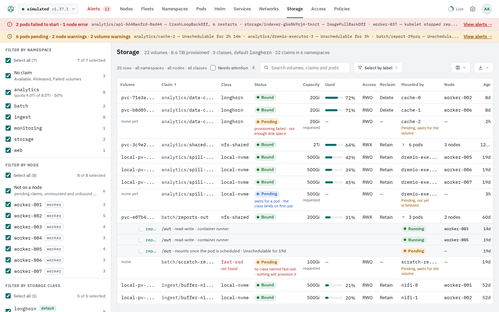
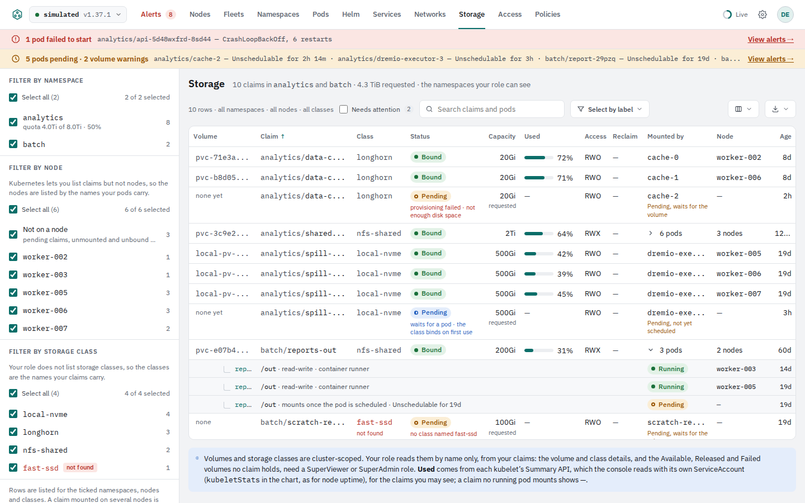
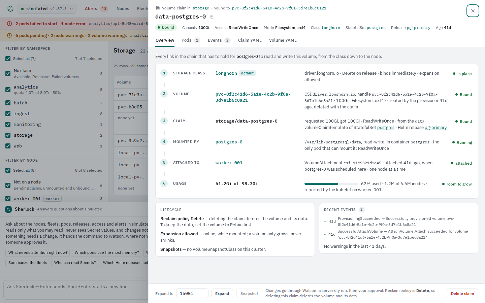
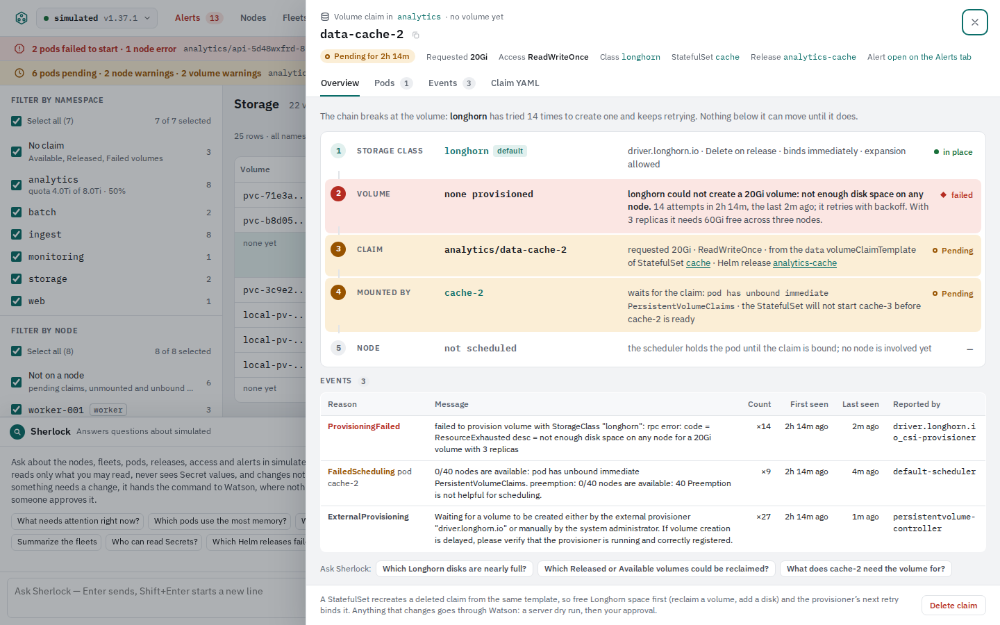
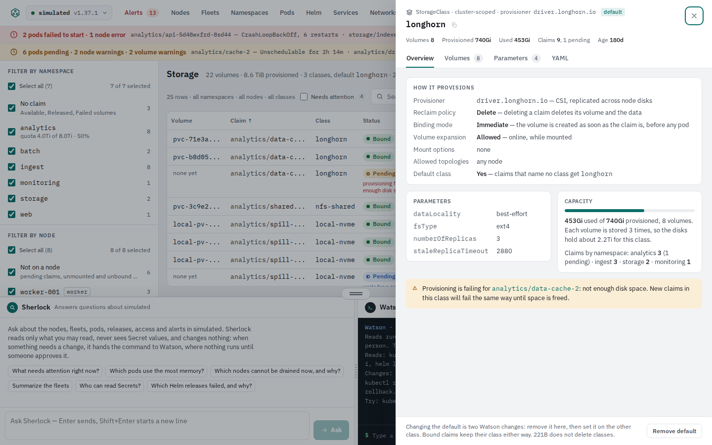

# Storage tab: requirements

A Storage tab for 221B: storage classes, persistent volumes, persistent volume claims and the pods that mount them, shown as one tree rather than three lists, with a details drawer that traces the whole chain from the class to the node. Designed on the canvas "221B Storage design" on October 24–25, 2026; the summary tiles were removed at that review. The mockups are in `docs/design/storage/` and rendered in the Design section below.

## Scope

In:

- A top-level **Storage** tab, after Networks.
- StorageClasses, PersistentVolumes, PersistentVolumeClaims, VolumeAttachments, the pods that mount each claim, ResourceQuota storage limits, and used bytes from each kubelet's Summary API.
- One table of the same rows for every role, filtered by namespace, node and storage class in a sidebar as on the Pods tab (three grouped views until the October 25, 2026 review), a details drawer for a claim or volume, a details drawer for a class, and three changes through Watson: expand a claim, delete a claim, change the default class.

Out, for now:

- VolumeSnapshots and VolumeSnapshotClasses (the drawer shows a disabled Snapshot action; it becomes live in a later phase).
- CSIDriver and CSINode objects, generic ephemeral volumes, and ConfigMap, Secret, emptyDir and hostPath volumes, which stay on the pod drawer's Volumes tab.
- Creating classes or volumes, and deleting volumes or classes from the console.

## Approach

Revised at the October 25, 2026 review: grouping by class and by namespace gave way to one flat table beside a filter sidebar by namespace, node and storage class, as on the Pods tab (ST-02). The paragraphs below are the first design's reasoning; what they say of the class and the hand-made and missing classes now lives in the sidebar's class section and the class drawer.

**One tree.** A volume and its claim are a pair, so they share one row; rows are grouped under their storage class; a row expands to the pods that mount it. The group header carries what an operator reads off a class before anything else: provisioner, reclaim policy, binding mode, expansion, whether it is the default, and totals (volumes, provisioned, used, claims in trouble).

**Why the class is the top of the tree and not a page of its own.** A cluster has a handful of classes and hundreds of claims; a Classes page would be five rows. Grouping by class also shows two things a flat list hides: volumes with no class (made by hand; nothing provisions or deletes them) and claims naming a class that does not exist (Kubernetes reports those only as a `ProvisioningFailed` event on the claim).

**The drawer is the Networks trace, drawn for a volume.** Class → volume → claim → mounted by → attached to → usage, one hop per row, each with its state; a broken hop is red and names the cause, the hops below it are amber. The pending case reads from the drawer alone: what failed, how often, what is waiting on it, and what to do.

**Roles fall out of RB-07 and RB-11.** Volumes and classes are cluster-scoped. A Viewer or Admin bound to namespaces gets the same page with the By class view disabled: the claims of their namespaces, the class and the volume as names from the claim itself, and a quota meter per namespace instead of cluster totals. No second design.

**Changes go through Watson,** as everywhere: a server dry run, approval, and the production rule (P6) for production clusters.

## What exists today

- `server/internal/views/alerts.go`: `claimAlert`, `ClaimsOf` and `attachMount` already build an alert row per claim with its pods, its attach and mount events, `Resizing`, capacity and requested size. The Storage tab reuses this for the event-driven part of "Needs attention".
- `server/internal/roles/roles.go` `Watched`: `persistentvolumeclaims`, `resourcequotas`, `events` and `statefulsets` (namespaced), `persistentvolumes` and `storageclasses` (cluster-scoped) are already watched. `volumeattachments` (storage.k8s.io) is not.
- `server/internal/kube/boot.go` (ADR-17): the server already reads each kubelet's Summary API through the API server's node proxy with its own ServiceAccount when `kubeletStats` is on. The same response carries per-volume `usedBytes`, `capacityBytes`, `availableBytes` and inode counts, keyed by `pvcRef`.
- `web/src/components/PodPanel.tsx`: the pod drawer's Volumes tab shows a claim's phase, capacity and class as a pill.
- `web/src/components/NamespacesTab.tsx`: the list footer says that persistent volumes and storage classes belong to no namespace and points nowhere; it should point to the Storage tab.
- `docs/requirements.md` RB-07 and RB-11: namespace-bound roles cannot list volumes or storage classes; the Super roles read them.

## Requirements

### The tab

| ID | Requirement | Acceptance |
|---|---|---|
| ST-01 | A **Storage** tab in the bar after Networks, with the route `storage`, rolled into the More menu like any other tab when the window narrows (P2-01). The tab has no count; the heading line reads `N volumes · X provisioned · N classes, default <name> · N claims in N namespaces` for cluster-wide roles and `N claims in <namespaces> · X requested · the namespaces your role can see` for namespace-bound roles. | The tab opens at 1440 px and 390 px wide; the heading matches `kubectl get pv,pvc,sc -A` on the test cluster. |
| ST-02 | One flat table for every role, beside a filter sidebar like the Pods tab's (P2-03), in three sections. **Filter by namespace**: each namespace with a claim the person may see, with its claim count and, when a ResourceQuota sets `requests.storage`, a sub-line `quota 4.0Ti of 8.0Ti · 50%`; first, for cluster-wide roles, **No claim**: the Available, Released and Failed volumes. **Filter by node**: each node a row's pods run on or its volume is attached to, so an RWX claim mounted on several nodes is under each, with the role tag and cordoned flag when the person may list nodes and names only otherwise; first **Not on a node**: pending claims, unmounted and unbound volumes. **Filter by storage class**: each StorageClass with a `default` tag and its provisioner as the sub-line, for roles that may list classes, the names the claims carry otherwise; then **No class** (hand-made volumes, claims with `storageClassName: ""`) and, in red and tagged `not found`, each class name claims use that does not exist. Each section has Select all, an only button and counts that follow the other two sections, the search and Needs attention; the selection is in the URL (`ns`, `node`, `class`; `-` for none; `(no-claim)`, `(no-node)`, `(no-class)` for the special entries), and a scope line in the toolbar says it (`22 rows · all namespaces · all nodes · all classes`). Columns: Volume, Claim, Class, Status, Capacity, Used, Access, Reclaim, Mounted by, Node, Age, the others hidden by default (ST-06); column choices are kept per cluster in the browser. What the former group headers carried lives on: a class's facts in its sidebar entry and its drawer (ST-17), a namespace's quota in its sidebar entry. At 390 px the sidebar stacks above the table. | Filtering by one namespace, one node or one class, and by each of No claim, Not on a node and No class, shows only their rows; opening `#/storage?ns=analytics&node=(no-node)` restores that selection; a Viewer bound to one namespace sees only that namespace, its pods' nodes and its claims' class names in the sidebar. |
| ST-03 | Replaced by ST-02 at the October 25, 2026 review: the class group header gave way to the sidebar's class entry (name, `default` tag, provisioner) and the class drawer (ST-17), which has the reclaim policy, binding mode, expansion and totals. | See ST-02. |
| ST-04 | Default sort: Claim ascending, by namespace and then name, so a namespace's claims sit together; rows with no claim (Released, Available and Failed volumes) after them. Every column sorts, with the Status sort putting rows that need attention first. | A test over a seeded set of rows yields that order. |
| ST-05 | A row is a volume ⇄ claim pair. Kinds of row: **bound** (volume and claim), **pending claim** (claim, `none yet` in the Volume column), **released volume** (volume, `was <namespace>/<claim>` in the Claim column, from `spec.claimRef`), **available volume** (volume, `—`), **lost claim** (claim whose volume is gone). The Status cell shows the phase as a pill and, when the row is not healthy, one short reason line under it (ST-14). | Each kind renders from the seeded rows as in the mockup. |
| ST-06 | Columns, in order: Volume (the PV name, ellipsized, full name on hover; a hand-made volume also shows its source, such as `nfs 10.0.3.5:/hdfs`), Claim (`namespace/` dimmed, then the name), Status, Capacity (the volume's `spec.capacity.storage`, or the claim's request with a `requested` note while unbound), Used (ST-08), Access (`RWO`, `ROX`, `RWX`, `RWOP`, full mode on hover), Reclaim, Mounted by, Node, Age. Hidden by default: Mode (Filesystem or Block), Source (CSI driver and handle, NFS server and path, local path), Labels, Release (the Helm release of the claim), Binding mode. Column picker and Export (Excel, JSON) as on the other tabs. | The export has the same rows, columns and order as the screen. |
| ST-07 | **Mounted by** shows the pod's name when one pod mounts the claim and `N pods` with a chevron otherwise; the chevron expands pod sub-rows: pod name, mount path, `read-write` or `read-only`, `subPath` when set, the container, the pod's status pill and node. A pod that is not Running shows its state and age under its name (`Pending, waits for the volume`; `Unschedulable for 19d`). Pod sub-rows are collapsed by default and expanded when any of the pods is not Running. | Clicking the pod name opens the pod drawer (P2-04). |
| ST-08 | **Used** is `usedBytes` of `capacityBytes` from the kubelet Summary API (`/api/v1/nodes/<node>/proxy/stats/summary`, `pods[].volume[]` matched by `pvcRef`), read by the server with its own ServiceAccount under `kubeletStats`, cached per node and refreshed with the node metrics. Shown as a bar, a percentage and the amount; `—` for a claim no running pod mounts, for Block-mode volumes and when `kubeletStats` is off. 85% and over is amber and counts as Needs attention; 95% and over is red. A person sees usage for every claim they may read; a namespace-bound role sees no more than that. | Usage within 2% of `df` inside the pod; `--set kubeletStats=false` shows `—` everywhere and the heading says why. |
| ST-09 | A **Needs attention** checkbox with a count filters to rows that are: a claim Pending with a Warning event, a claim naming a class that does not exist, a claim Lost, a volume Released or Failed, or usage at 85% or more. The first three are what the Alerts tab shows as volume alerts today; Released and usage are 221B checks, shown here and not on the Alerts tab. | The count equals the number of rows the filter leaves. |
| ST-10 | The sidebar does the filtering by namespace, node and class (ST-02). Search matches volume name, claim name, namespace, pod name, class and node; **Select by label** filters by volume or claim labels, as the Nodes tab does for nodes (P2-09). | Searching `kafka` leaves the three Kafka rows. |
| ST-11 | Replaced by ST-02 at the October 25, 2026 review: there is no By namespace view; a namespace's storage quota is its sidebar entry's sub-line, and for a namespace-bound role Class and Volume stay plain names from the claim (`spec.storageClassName`, `spec.volumeName`) that open nothing, a class name no class matches red with `not found`. | See ST-02. |
| ST-12 | Replaced by ST-02 at the October 25, 2026 review: the flat, sortable table of All volumes is now the table for every role, with the Class column after Claim; 2,000 claims still filter and sort within 200 ms (ST-25). | See ST-02. |

### The details drawers

| ID | Requirement | Acceptance |
|---|---|---|
| ST-13 | Clicking a volume or claim name opens one drawer for the pair (1000 px wide like the pod drawer): kicker `Volume claim in <namespace> · bound to <volume>` (or `· no volume yet`, or `Volume <name> · released from <namespace>/<claim>`), the claim name with Copy, facts (phase pill with the time in that phase when not Bound, capacity or request, access mode, volume mode and filesystem, class, the StatefulSet or other owner, the Helm release, age), and tabs Overview, Pods, Events, Claim YAML, Volume YAML (the last only when a volume exists; Volume YAML only for roles that may read volumes). | Opens with Enter, closes with Escape, returns focus to the row (P1-17). |
| ST-14 | Overview shows **the chain**, one hop per row: 1 Storage class, 2 Volume, 3 Claim, 4 Mounted by, 5 Attached to (the node, from the VolumeAttachment for CSI volumes, from `nodeAffinity` for local volumes, `N nodes` for RWX), 6 Usage. Each hop has a value, a one-line description and a state (`in place`, `Bound`, `Running`, `attached`, `room to grow`, `Pending`, `failed`, `—`). The first hop that does not hold is red with the cause in bold; the hops that wait on it are amber; hops that cannot be reached yet are grey. The intro line above the chain names the broken hop in one sentence (`The chain breaks at the volume: longhorn has tried 14 times to create one and keeps retrying.`). The diagnosis rules, also used for the Status reason line in the table: a class the claim names does not exist → `no class named <x> · nothing will provision it` (red); a `ProvisioningFailed` Warning event → `provisioning failed · <short message>` (red); the class binds on first use and no pod is scheduled → `waits for a pod · the class binds on first use` (blue, not Needs attention); the claim has no class (`""`) and no volume matches → `no volume matches (size, access mode or selector)` (amber); otherwise Pending → `waiting for the provisioner` (amber); Lost → red; volume Released → `claim deleted <age> ago · data kept (Retain)` or `· being deleted` (amber); volume Failed → red with the message; Resizing → amber. | Each rule has a unit test with a seeded claim; breaking each hop on the test cluster turns that hop red and names the cause (as P4-02 does for Networks). |
| ST-15 | Events: the claim's own events, the attach and mount events of the pods that use it (`attachMount` in alerts.go, matched by volume or claim name), and the `FailedScheduling` events of pods waiting on the claim, in one table (Reason, Message, Count, First seen, Last seen, Reported by), Warnings first; the Overview shows the last two as a short list with a `No warnings in the last N days` line. | The table matches `kubectl get events --field-selector involvedObject.name=<claim>` plus the pods' events. |
| ST-16 | Under the chain, two cards: **Lifecycle** (what the reclaim policy means for this claim, whether expansion is allowed and whether it needs a pod restart, whether a VolumeSnapshotClass exists) and **Recent events**. A pending or failed drawer shows the Events table in place of the cards and, when Sherlock is on, three suggested questions (`Which <provisioner> disks are nearly full?`, `Which Released or Available volumes could be reclaimed?`, `What does <pod> need the volume for?`). | The suggestions open Sherlock with the question filled in. |
| ST-17 | Clicking a class name opens the **class drawer** (640 px): kicker `StorageClass · cluster-scoped · provisioner <name>`, name with the `default` tag and Copy, facts (volumes, provisioned, used, claims and how many pending, age), tabs Overview, Volumes, Parameters, YAML. Overview: **How it provisions** (provisioner with a plain-language note for known ones, reclaim policy, binding mode, expansion, mount options, allowed topologies, whether default and what that means), **Parameters** (as given), **Capacity** (used of provisioned with a meter; for a replicated provisioner the on-disk multiple when the parameters say it; claims by namespace), and a warning callout when any claim in the class is failing to provision. | Every fact matches the class YAML; the Volumes tab lists the same rows as the class's group on the tab. |
| ST-18 | Actions, in the drawer footer, each a Watson change with a server dry run and approval, the production rule included: **Expand** a claim to a larger size (patch `spec.resources.requests.storage`; offered only when the class allows expansion; the dry run and a note say whether the filesystem grows online or needs a pod restart); **Delete claim** (the confirmation names the reclaim policy and its consequence; for a claim from a StatefulSet volumeClaimTemplate it says the set recreates the claim); **Remove default** / **Set as default** on a class (patch the annotation; the footer says the default is changed in two steps and that bound claims keep their class). **Snapshot** is shown disabled with `No VolumeSnapshotClass on this cluster` until snapshots are in scope. No action deletes a volume or a class, and nothing is offered to a read-only role or a read-only deployment (RB-03, RB-32). | Each action produces one audit record; on a production cluster it waits for a second admin (P6-07). |

### Permissions

| ID | Requirement | Acceptance |
|---|---|---|
| ST-19 | Reads: `volumeattachments` (storage.k8s.io, cluster-scoped) joins `Watched` and the chart's ClusterRole and the Super role templates; `persistentvolumes` and `storageclasses` are already there (RB-11). Namespace-bound roles need nothing new: claims, quotas, events and pods in their namespaces. `nodes/proxy` stays out of every role template (roles.go, `superGetCore`); usage comes only from the server's own read under `kubeletStats` (ST-08). Writes for ST-18 are already in the Admin templates (`patch` and `delete` on `persistentvolumeclaims`); `patch` on `storageclasses` is added to the Super Admin full template. | `hack/check-rbac.sh` passes with the new rules; a Viewer's `kubectl auth can-i --list` shows no volume, class or attachment reads. |
| ST-20 | Everything a namespace-bound person sees comes through impersonation (P3-02): no claim of another namespace in any view, search, export, drawer, Sherlock answer or usage figure; volumes without a claim and the volume and class drawers are not offered to them, and the sidebar names only their namespaces, their pods' nodes and their claims' classes. | An e2e test as a Viewer bound to one namespace finds no name from another namespace in any response. |

### Alerts, links, Sherlock

| ID | Requirement | Acceptance |
|---|---|---|
| ST-21 | The Alerts tab keeps its event-driven volume alerts; its volume cards gain an **Open volume** action that opens the Storage drawer. The pod drawer's Volumes tab links a claim's pill to the Storage drawer. The Namespaces list footer names the Storage tab. The alert banner's volume items open the Storage drawer. | Each link opens the right drawer with the right row selected. |
| ST-22 | Sherlock answers storage questions through two new read tools (list classes with totals; list volumes and claims with status, usage, pods and the diagnosis of ST-14), under the same impersonation and the same limits as the other tools; `get_object` already handles a claim. Watson's three storage actions run through the existing approval flow, nothing more than the chart allows (RB-03, RB-32). | `Which claims are pending and why?` answers with the ST-14 reasons; a Watson expand on a read-only deployment is refused before the dry run. |

### Simulation, tests, performance

| ID | Requirement | Acceptance |
|---|---|---|
| ST-23 | The simulated cluster (`server/internal/sim`) gains classes, volumes, claims, attachments and usage that reproduce the mockup scenario: a default replicated class, a local class that binds on first use, an NFS class, hand-made volumes, a claim failing to provision, a claim naming a missing class, a Released volume, an Available volume, a claim waiting for a pod, and one volume at 86%. | The simulated Storage tab matches the mockups row for row. |
| ST-24 | Unit tests for the sidebar's filtering, ordering and every ST-14 rule; an e2e test on the kind cluster with its local-path provisioner covering a bound claim, a claim naming a missing class and a Released volume; the role tests of RB-56 extended with the new kinds. | CI passes; the Storage screenshots are added to `docs/screenshots/`. |
| ST-25 | 2,000 claims and 50 classes: first screen within 2 seconds, filtering and sorting within 200 ms, usage refresh adds no request per claim (one Summary read per node per refresh). | Measured with kwok as for P1-18. |

## Where the work lands

- `server/internal/views/storage.go` (new): the tree model (groups, rows, diagnosis), built from the caches; reuses `claimAlert`, `ClaimsOf` and `attachMount` from `alerts.go`.
- `server/internal/kube`: an informer for `volumeattachments`; `kinds.go` entries for PersistentVolume, StorageClass and VolumeAttachment so the YAML view and `get_object` cover them; the Summary API reader of `boot.go` extended to keep per-volume stats.
- `server/internal/api`: `storage` endpoints under both `/api/v1/` and `/api/v1/clusters/{cluster}/` like the other views; two Sherlock tools in `sherlock_tools.go`; three Watson actions.
- `server/internal/roles/roles.go` and `deploy/helm/221b/templates/rbac.yaml`: the new kind, the `patch` on storage classes for the full Super Admin template.
- `web/src/lib/router.ts`: the `storage` tab; `web/src/components/StorageTab.tsx`, `StoragePanel.tsx` (claim or volume drawer), `StorageClassPanel.tsx`; `web/src/columns/storage.tsx`; the links in `AlertsTab.tsx`, `PodPanel.tsx`, `NamespacesTab.tsx` and `Banners.tsx`.
- `web/src/styles/design.css`: the few classes the mockups add (`st-*` in `docs/design/storage/storage.css`), renamed to the `rk-` prefix as they come in.
- `docs/requirements.md`: the ST rows under a new phase; `docs/screenshots/storage.png`.

## Open questions

| Question | The mockup's answer | Status |
|---|---|---|
| Does a namespace-bound role see usage? It comes from the server's own kubelet read, not from anything the person may read themselves. | Yes, for the claims they may read: used bytes are no more sensitive than the capacity they already see. One line to change if not. | Open |
| Are the 85% and 95% thresholds chart values or constants? | Constants in the first version. | Open |
| Should class-not-found, Released and nearly-full rows also appear on the Alerts tab? | No: the Alerts tab stays event-driven; the Storage tab's Needs attention is the superset. | Open |
| Which tab does Storage displace into the More menu at narrow widths? | The bar order is Alerts, Nodes, Fleets, Namespaces, Pods, Helm, Services, Networks, Storage, Access, Policies; More takes from the right as before. | Open |
| Expanded by default, or collapsed, for a cluster with 50 classes? | Expanded, up to 12 groups; collapsed beyond that, the groups with Needs attention rows open. | Moot since the October 25, 2026 review: there are no groups (ST-02). |
| Does the pod drawer's Volumes tab stay as it is, or gain the chain? | It stays; its claim pill links to the Storage drawer. | Open |

## Design

The pages at 1440 px in the light theme, from the simulator (`make screenshots`). The first design, with groups by class and by namespace, is kept as the record of what was reviewed: its HTML in `docs/design/storage/` and its renders in `docs/images/storage/`.

| | |
|---|---|
|  |  |
| The table beside the filter sidebar, as a SuperAdmin (ST-02 to ST-10): every namespace with its quota, No claim, the nodes with Not on a node, every class with No class and the missing fast-ssd; the claim failing to provision, pod sub-rows and the claim naming a missing class | As a Viewer bound to analytics and batch (ST-02, ST-20): their claims only, their namespaces, their pods' nodes by name and their claims' classes in the sidebar, class and volume as names |
|  |  |
| The drawer for a bound claim (ST-13, ST-14, ST-16, ST-18): the six hops all green, Lifecycle and Recent events, Expand and Delete claim through Watson | The drawer for a claim the provisioner cannot satisfy: the volume hop red with the cause, the claim and pod hops waiting, the events, Sherlock's suggestions |
|  | |
| The class drawer (ST-17, ST-18): how it provisions, parameters, capacity, the warning that provisioning is failing, Remove default through Watson; its Volumes tab links to the table filtered to the class | |

## Your review

| Date | Note |
|---|---|
| 2026-10-25 | Summary tiles removed from the top of every screen; the heading line stays. |
| 2026-10-25 | Grouping by class and by namespace replaced by one flat table, sorted by claim, beside a filter sidebar like the Pods tab's: Filter by namespace (with No claim and each namespace's quota), Filter by node (with Not on a node) and Filter by storage class (with No class and the missing classes). ST-02 rewritten; ST-03, ST-11 and ST-12 replaced by it; ST-04 and ST-10 adjusted. The Namespaces tab, the node drawer and the class drawer link to the table filtered. |
