# Toolbox: requirements

A Toolbox for 221B: a shell, a single command, a port forward and a debug container for a pod; a node shell, a single command and a debug pod for a node. Each is a **session** that lives in the Dock beside Sherlock and Watson, each starts as a **Watson card**, and each is audited from request to end. Designed on the canvas "221B Toolbox design" on October 24–25, 2026. At the review the drawer's Toolbox tab was replaced by a **Tools column** on the pod and node tables, with a menu and a dialog per tool; a Dock launcher was dropped; Sherlock was asked to open the dialogs, prefilled; "Copy of this pod" was taken out of scope. The mockups are in `docs/design/toolbox/` and rendered in the Design section below.

## Scope

In:

- A Tools column on the Pods and Nodes tables and on every table that lists pods (a node's pods, a Service's pods, a workload's pods), with one menu and one dialog per tool.
- Pod tools: **Shell**, **Run a command**, **Port forward** (through a small `221b` CLI on the person's computer), **Debug container** (an ephemeral container from an allowlisted image, with the pod's volumes).
- Node tools: **Node shell** (a privileged pod on the node, three profiles), **Run a command on the node**, **Debug pod on this node** (a Job from an allowlisted image). Debug pod also from a namespace.
- Sessions in the Dock: a strip of session tabs, a terminal pane, a port-forward pane, a Sessions pane listing every live session on the cluster; idle and hard limits; End, Extend, Watch.
- Every tool as a Watson card of a new kind, `session`, under the existing approval and two-person rules.
- Sherlock: answers about a session's selected output, and a UI action that opens a tool's dialog prefilled.
- Administration › Sessions (live and history, with each session's audit trail) and Administration › Toolbox (read-only, from the chart values).
- Chart values for the whole of it, role-template changes, a toolbox namespace, audit records, optional transcripts.

Out, for now:

- **Copy of this pod** (`kubectl debug --copy-to`): dropped at the review; the sections on labels, volumes and ServiceAccount identity in the conversation notes apply when it returns.
- A file browser over a pod's volumes (its own design; it rides on the same exec session), a command palette, `pods/attach`, port-forward to a Service, an in-browser HTTP proxy to a pod port, Windows nodes (HostProcess containers), node shells on clusters that forbid host namespaces (GKE Autopilot, Fargate).
- Changing toolbox values from the console: they are a ceiling in the chart, read-only in Administration.

## Approach

| Decision | Choice | Why |
| --- | --- | --- |
| Where a tool is launched | A Tools icon in a 30 px column after the pod or node name, a menu, then a dialog; the same menu from a button in the drawer header; the drawer gets no Toolbox tab | Tools are verbs; the drawer is a reading surface and modal, and it hid the Dock where the session appears. |
| Where a session lives | A tab in the Dock, next to Sherlock and Watson; a Sessions tab lists everything live on the cluster | The Dock already survives navigation, resizes, maximizes and pops out; a session must outlive the row it started from. |
| How a tool reaches the cluster | Only through a Watson card (kind `session`): the dialog collects parameters and makes the card; the card is where approval happens | P6-04, P6-06 and X-03: nothing changes a cluster without a card. One audit path and one approval policy for commands, changes and sessions alike. |
| Who approves | P6-05 and P6-07 unchanged: the requester on an ordinary cluster, a second SuperAdmin where the two-person rule applies (production connections); node shell always a second SuperAdmin | No new policy to explain; the connection's `env` already says what production is. |
| What a shell card says | The session terms, not a command: who, where, as whom, how long, recorded; the card says there is no dry run for a shell | What happens inside a shell cannot be predicted; the recording is the record. One-shot commands, pods, Jobs and ephemeral containers do dry-run and say so. |
| How port forward reaches the laptop | A `221b` CLI opens the local port and tunnels to the console, which runs the forward as the person | A browser cannot open a local port; any program on the computer can then use it, and the console still owns, limits, ends and audits the session. |
| How a distroless pod gets a shell | An ephemeral container from an allowlisted image, with the pod's volumes mounted at their own paths and, with `targetContainerName`, the target's processes | `kubectl exec` runs what is in the image; a distroless image has no shell. The API, unlike `kubectl debug`, lets the console mount the volumes. |
| What a node shell is | A pod in a chart-made namespace at Pod Security `privileged`, pinned to the node, host namespaces and `/host`, deleted at the end; SuperAdmin-only, always two people, always recorded when recording is on | Root on a node is root over every pod on it; on a control-plane node it is root over the cluster. |
| What the chart decides | A `toolbox` block: which tools, for whom, which images (digest-pinned), which limits, which namespace; connections can only turn off or lower | The console never widens its own limits, whatever an assistant suggests (RB-03, RB-32). |
| What Sherlock may do | Answer about selected output; open a tool's dialog prefilled, through one new UI action; never approve a card, never type into a session | The person stays the one who sends; P6U-12 is amended for this one dialog and nothing else. |
| As whom everything runs | The signed-in person, impersonated (P3-02): exec, port-forward, the ephemeral-container patch, the Job, the node pod; Kubernetes decides and its refusal is shown | No new rights for the console's ServiceAccount beyond a janitor Role in the toolbox namespace. |
| Where sessions live in the server | In memory on the leader, like Watson's cards; their routes are leader-only; a restart ends them and a janitor reaps their pods | Matches ADR-42's placement of the assistants; a session is a process, not data. |
| What is kept | Session records in a capped ConfigMap for the History page; the audit log and webhook as the durable record; transcripts only with a configured store | The console has no database (Phase 3); transcripts can be large and sensitive, so they need a volume or an object store that the operator chooses. |

## What exists today

- `server/internal/kube/logs.go` `Logs`: a pod's log stream opened through the API server as the person (`c.as(p)`, P3-02). An exec stream is the same shape: the person's impersonated REST config (`kube/person.go`, `Person.ImpersonationGroups`) with `k8s.io/client-go/tools/remotecommand` instead of `GetLogs`.
- `server/internal/api/stream.go`: `serveStream`, the per-replica stream cap (`MaxStreams`), and `sessionStands`, which ends a stream when the person's sign-in session no longer stands (RB-05, RB-46, RB-53). Sessions reuse `sessionStands` at their heartbeats.
- `server/internal/watson/service.go`: cards with `Lapse` (10 minutes), `CheckEvery`, `MaxOutput`, `Keep`, `MaxItems`, the `TwoPerson func(Cluster) bool` rule, statuses including `lapsed`, and a `Run` hook tests replace. `kubectl.go` runs kubectl in-process (cobra) and refuses `exec` (P6-02). The `session` card kind lands here.
- `server/internal/clusters/spec.go`: a connection's `Env` (`production`, `staging`, `development`, `other`) and its mode (read or write); `localCluster.mode` for the cluster the console runs in. The two-person rule reads `Env`.
- `server/internal/roles/roles.go`: the four role templates. The full Admin has no `pods/exec` (RB-12); the read-only SuperAdmin excludes `pods/exec`, `pods/attach`, `pods/portforward`, `pods/proxy`, `services/proxy`, `nodes/proxy` (RB-13); `roles.go` already names `pods/exec` among the special subresources. `rbac.go` flags `create pods/exec` as `PowerExec` on the Access tab, and the Permissions page flags `pods/exec`, `pods/attach`, `pods/portforward`, `nodes/proxy` (RB-44).
- `server/internal/audit/audit.go`: one JSON record per action, to standard output and the webhook (P3-10), with named actions and outcomes. The session actions join the list.
- `server/internal/api/proxy.go`: Sherlock's and Watson's routes are leader-only and forwarded to the leader (`leaderOnly`, the Lease in `deploy/helm/221b/templates/lease.yaml`). Session routes join `leaderOnly`.
- `web/src/components/Dock.tsx`: the dock with modes open, max and min, Sherlock and Watson side by side with a movable split, the shared `assistants/events` stream (stream.go), and the pop-out window (P5-08, P6-09). The strip and the session panes are added here.
- `web/src/components/PodPanel.tsx` and `NodePanel.tsx`: the drawers whose headers gain a Tools button; `DataTable.tsx` and `web/src/columns/*`: where the Tools column is defined.
- `docs/sherlock-ui-control.md`: the fixed registry of UI actions (P6U-04), the contract test, and P6U-12, which today forbids opening any dialog; the amendment is in TB-42.
- `deploy/helm/221b/values.yaml`: `localCluster.mode`, `rbac.roles.{admin,superAdmin}.template` (full or readOnly), `rbac.enforce`, `audit.webhook`, `networkPolicy`, `replicaCount`. The `toolbox` block is new.

## Requirements

### The Tools column and menu

| ID | Requirement | Acceptance |
|---|---|---|
| TB-01 | A **Tools** column on the Pods and Nodes tables and on every table that lists pods (a node's pods, a Service's pods, a workload's pods): a fixed 30 px column right after the name, no heading, one icon button per row (`aria-label="Tools for pod <name>"`). The icon is muted until the row is hovered or focused; the cell is empty when the person may use no tool on that row (TB-05). Enter or `s` on a focused row opens the menu; Escape closes it and returns focus to the row. | At 1440 px and 390 px the column keeps its width and the icon is reachable with Tab; a Viewer sees empty cells; the keyboard path has a browser test. |
| TB-02 | The pod menu: a header `Tools for pod <name> in <namespace>`, then **Shell…** (hint: the container and shell it will use), **Run a command…**, **Port forward ▸** (a submenu of the containers' ports with name and container, then `Another port…`), **Debug container…**, and a footer line `Every item makes a Watson card; sessions open in the dock.` Nothing else: views stay in the drawer. An item the chart, the connection or the role rules out is shown disabled with its reason (`Port forward · off on this cluster`), not hidden. | The menu renders from the seeded pods as in the mockup; a disabled item carries its reason as text and `aria-disabled`. |
| TB-03 | The node menu: a header `Tools for node <name> · <role> · N pods · <problem>`, then **Node shell…** (tag `root`), **Run a command ▸** (a submenu of the chart's quick commands, then `Another command…`), **Debug pod on this node…**, a divider, **Cordon…** and **Drain…**, which create their Watson card straight from the menu as the drawer's buttons do (P6-06). | Each item opens its dialog or card; Cordon and Drain produce the same `change` card the Watson command line does. |
| TB-04 | The same menu opens from a **Tools** button in the pod and node drawer headers, and the Debug pod dialog from the Namespaces tab's rows (TB-30). The drawers get no Toolbox tab. | The drawer button and the row icon open an identical menu. |
| TB-05 | What a row offers is computed in the browser from what the server reports the person may do: the chart's `toolbox` values for the cluster (TB-48) and the connection's overrides, the connection's mode (read refuses every tool), the person's roles (TB-50), and for namespace-bound roles the object's namespace. The server enforces the same rules on every request, so a hand-made request fails as a hidden item would. | A test matrix of role × values × mode × env yields the expected items; a crafted POST for a hidden item is refused with the same reason. |

### Dialogs

| ID | Requirement | Acceptance |
|---|---|---|
| TB-06 | Every tool opens a modal dialog (600–800 px): an icon; a title naming the kind and the object (`Shell in pod gateway-…`, `Debug container for pod …`, `Node shell on node …`, `Debug pod on node …`); a kicker with namespace, cluster, a `production` tag when the connection's env is production, and the identity it runs as; the tool's choices; a facts line (recorded or not, the idle limit, "Kubernetes decides what it may do, as you"); a footer with a hint, Cancel and one primary button. The primary button creates the Watson card (TB-36) and closes the dialog; it never runs anything. | Each dialog has a browser test; the primary button produces exactly one new card and no request to the cluster. |
| TB-07 | On a production connection the dialog adds **Reason** (required, 10 to 500 characters, shown on the card and kept in the audit record) and **For how long** (15, 30 or 60 minutes, capped by `toolbox.maxDuration`); the footer names the possible approvers (the SuperAdmins other than the requester) and says the request lapses after 30 minutes unanswered. On other connections neither field appears and the primary button reads *Open shell*, *Run*, *Start forward*, *Attach and open shell*, *Start debug pod* instead of *Request …*. | The production and non-production dialogs render as designed; a reason under 10 characters is refused in the dialog. |
| TB-08 | Dialogs remember the last choices per tool and per pod or node in the browser (container, shell, profile, image, duration), never the reason. | Reopening a dialog shows the previous choices and an empty reason. |

### Sessions in the Dock

| ID | Requirement | Acceptance |
|---|---|---|
| TB-09 | The Dock gets a **strip** above its panes: **Assistants** (Sherlock and Watson side by side, as today), **Sessions** with a count and an `N waiting` badge, a divider, then one tab per session of this person on this cluster (`sh gateway-… · main`, `pf 5432 → postgres-0`, `node worker-003`) with a state dot (live, idle, waiting for approval, ended) and a chip (`ends 10:42`, `idle 7:40`, `waiting`, `ended`), then the existing pop-out, minimize and maximize controls. A tab's × ends a live session after a confirmation and dismisses an ended one. Minimized, the dock icon carries the count of live sessions. | The strip renders every state from the seeded sessions; a session tab survives changing tabs, opening drawers and minimizing the dock. |
| TB-10 | A **terminal pane** for shells (pod, debug container, debug pod, node): xterm.js (`@xterm/xterm`, `@xterm/addon-fit`, MIT) in the Watson pane's dark style (the `--term-*` tokens); a header with the target, pills (`Approved by <name>`, `Ends <time> · N min`, `Recorded`, `<name> is watching`), Transcript (download, TB-54) and End; a bottom bar that in the last 60 seconds of idle shows `No activity for N min · the session ends in 0:58 · any key keeps it` with a Keep button, and after the end shows the reason (`Ended · 10 min idle`, `Ended by Anna K.: "migration window over"`, `Ended · time limit`, `Ended · pod gone`, `Ended · console restarted`) with Reconnect, which starts a new request. The terminal follows the pane's size. | Typing round trip under 50 ms added by the console on the test cluster; resizing the dock resizes the terminal; the warning appears at 60 s and any key cancels it. |
| TB-11 | A **session pane** for port forwards: the steps (approved, CLI connected from `<host>`, listening on `<address>`), the command to run with Copy, the live state (open and total connections, bytes each way, last traffic, idle limit, hard limit), the connections list, the idle countdown as a bar with Extend, and End and Change local port. | Matches the mockup; counters update within 2 s of traffic. |
| TB-12 | The **Sessions** pane: every live session on the cluster the person may see (their own; all of them for a SuperAdmin), with type, target, namespace, person, started, last activity, ends, approved by, and actions (Open; Watch and End for a SuperAdmin; Review for a request waiting on this person), then the sessions ended in the last hour with their record, and a link to Administration › Sessions. A SuperAdmin ending someone else's session gives a reason the owner sees in their pane. | A SuperAdmin sees all; another person only their own; an admin's End shows its reason in the owner's pane within 3 s. |
| TB-13 | **Lifetimes.** Every session has an idle limit (`toolbox.idleTimeout`, default 10 minutes; keystrokes and output count for terminals, bytes for forwards) and a hard limit (the approved duration on a two-person cluster, `toolbox.maxDuration` elsewhere, default 60 minutes). The pane warns 60 s before the idle end; the tab's chip counts down the last 10 minutes of the hard limit. Ending a session closes the exec or forward stream, deletes the pod of a node shell or the Job of a debug pod, and writes the audit record (TB-53). A session also ends when the person's sign-in session no longer stands (`sessionStands`), when the pod or node is gone, or when the server restarts (TB-14). | Unit tests for every end cause; an e2e test lets a shell idle out and sees the warning and the reason. |
| TB-14 | Sessions live in memory on the leader, like Watson's cards; their routes are leader-only and forwarded (`api/proxy.go`). After a restart or a leader change, live sessions end with `console restarted`, and a janitor deletes the toolbox pods and Jobs whose session is gone (`activeDeadlineSeconds` on each is the backstop). A browser reconnects to its live sessions after a reload or a network blip within the idle limit. | Killing the leader ends the sessions, reaps their pods within 30 s, and the records say why; a reload keeps a live shell. |

### Shell and one command

| ID | Requirement | Acceptance |
|---|---|---|
| TB-15 | **Shell** opens an exec stream (`create pods/exec`) as the person, with `remotecommand.NewFallbackExecutor` (WebSocket `v5.channel.k8s.io`, then SPDY), a TTY, stdin and a `TerminalSizeQueue`; the command is `sh -c 'command -v bash >/dev/null && exec bash \|\| exec sh'` unless a shell is chosen; the container is the dialog's choice (the first app container by default; init, sidecar and ephemeral containers listed too). The browser reaches it over a WebSocket at `…/sessions/{id}/attach` carrying bytes and resize messages; the upgrade checks `Origin` and the CSRF token and the sign-in cookie. | On kind: open a shell, run `id`, resize, end. A container with no shell shows Kubernetes' `executable file not found` message in the pane with a button that opens the Debug container dialog (TB-24). |
| TB-16 | **Run a command** runs one command without a TTY (`sh -c <command>`; `argv` when the dialog's *no shell* switch is on), captures stdout and stderr up to Watson's `MaxOutput`, and shows them in a Dock tab that ends when the command does (`finished · exit 0`, with duration). The exact command and the output go into the audit record (TB-53). The chart's quick commands for pods are offered as chips in the dialog. | The output tab shows exit status and duration; the record holds the command and the first `MaxOutput` bytes. |
| TB-17 | **File transfer** inside a shell session: Download runs `tar cf - <path>` on a second exec and streams the archive to the browser as a download; Upload pipes a file into `tar xf - -C <dir>` (write-mode connections only, `toolbox.shell.fileTransfer`). Both are audited with path and byte count; neither is buffered in the server. | A 1 GB download streams without server memory growth; upload is refused on a read-mode connection. |
| TB-18 | Pasting into a terminal and Sherlock's suggested commands (TB-41) place text at the prompt; only the person presses Enter. | A pasted multi-line command runs only on Enter. |

### Port forward and the CLI

| ID | Requirement | Acceptance |
|---|---|---|
| TB-19 | **Port forward** opens a port-forward stream (`create pods/portforward`) as the person and exposes it to the person's computer through a tunnel: the `221b` CLI connects a WebSocket to `…/sessions/{id}/tunnel`, listens on the local port and multiplexes TCP connections over the tunnel (one framed stream per connection: open with the pod port, data, close); the server opens one kubelet port-forward stream pair per tunnelled connection. Any program on the computer uses the local port. | `psql` through the tunnel on kind; two concurrent connections; the pane counts them. |
| TB-20 | The **`221b` CLI** (`server/cmd/221b-cli`, one static binary for macOS, Windows and Linux, published with releases): `221b login <console-url>` signs in through the browser and the console mints a CLI token bound to the person's sign-in session (kept in the OS keychain, else a 0600 file); `221b forward <cluster>/<session> [--local PORT]` connects a session the console created; `221b sessions` lists the person's live sessions. The CLI talks to the console only, never to Kubernetes. The token is revoked with the person's sessions (RB-53) and on sign-out. | The three commands work against the simulator; a revoked token is refused with a clear message. |
| TB-21 | The session is created by the card; it waits up to 5 minutes for the CLI, then ends. The pane shows the exact command to run; the CLI prints the local address; `Auto` lets the CLI choose the port and report it. | The waiting state, the connected state and the 5-minute end are tested. |
| TB-22 | Forwards idle on bytes: no traffic for the idle limit ends the forward and cuts open connections; Extend adds 10 minutes within the hard limit. The session records connections and byte counts, never the payload. | The idle bar counts down and Extend resets it; the record lists connections and bytes. |
| TB-23 | `toolbox.portForward.enabled` per connection turns the tool off with the reason on the menu item; `cliMinVersion` refuses older CLIs with an upgrade message. | The off state matches the mockup; an old CLI is refused. |

### Debug container

| ID | Requirement | Acceptance |
|---|---|---|
| TB-24 | **Debug container** attaches an ephemeral container (`patch pods/ephemeralcontainers`, client-go `UpdateEphemeralContainers`) as the person: an image from the chart's allowlist (TB-48), `targetContainerName` as chosen, the pod's volumes mounted at their own paths when the switch is on (no `subPath`; PVC mounts read-only on production by default), `sleep infinity`, a name `221b-<profile>-<4 hex>`, and a security context from the chosen capability profile bounded by the namespace's Pod Security level (the dialog disables the profiles the level forbids and says why). Then a shell session into it opens (TB-15). | On kind: attach to a distroless pod, mount its volumes, open a shell; a profile the namespace forbids is disabled in the dialog and refused by the server. |
| TB-25 | The dialog lists the ephemeral containers already in the pod (state, image, age, who attached them) with *Open a shell in it instead*, and says a debug container stays until the pod restarts and shares the pod's memory limit. | The list and the notice render from a seeded pod. |
| TB-26 | A debug container is not a session: it has no end. The shells opened into it are sessions. The Sessions pages show the container under its pod with `until the pod restarts` and the shells opened into it. | The Sessions pane shows the container and its shells as in the mockup. |
| TB-27 | Attaching a debug container is a change to the pod and voids pending Watson cards on it (P6-04). | A pending scale card on the pod lapses when the container is attached. |

### Debug pod

| ID | Requirement | Acceptance |
|---|---|---|
| TB-28 | **Debug pod** creates a Job (`create jobs`, in the dialog's namespace; one pod, `restartPolicy: Never`, `activeDeadlineSeconds` = the duration, `ttlSecondsAfterFinished` = `toolbox.debugPod.ttlAfterFinished`) from a chart profile (image, requests, limits, capabilities), pinned with `nodeName` when opened from a node, with the chosen ServiceAccount, with labels either none, copied from a pod the person picks (minus controller selector labels: `pod-template-hash`, `controller-uid`, `batch.kubernetes.io/controller-uid`, `controller-revision-hash`, `statefulset.kubernetes.io/pod-name`) or typed, plus `221b.io/session`, a readiness gate that never becomes Ready so no Service puts it in its Endpoints, a non-root security context with all capabilities dropped and only the profile's added, seccomp `RuntimeDefault`. The dialog shows *What will be created*; the card shows the server dry run. Then a shell into its container opens. | On kind: a netshoot pod with a pod's labels runs `dig` against a Service; it never appears in Endpoints; it is gone 10 minutes after the session. |
| TB-29 | Ending the session deletes the Job and so the pod; the time limit ends it by the deadline; the TTL removes what is left. | Each path leaves nothing behind; a test lists the namespace after each. |
| TB-30 | The dialog opens from a node's menu (pinned to the node) and from the Namespaces tab's row menu (any node), with the right prefill. | Both entry points open the same dialog. |

### Node shell and node commands

| ID | Requirement | Acceptance |
|---|---|---|
| TB-31 | **Node shell** creates a pod in the toolbox namespace (`toolbox.nodeShell.namespace`, default `221b-toolbox`, created by the chart at Pod Security `privileged`, TB-49) as the person: `nodeName`, tolerations for every taint, `restartPolicy: Never`, `activeDeadlineSeconds` = the duration, the chart's node image, and the profile's security context: **general** = `hostPID`, `hostNetwork`, `hostIPC`, the node's root at `/host` (hostPath `/`), not privileged; **netadmin** = `hostNetwork` plus `NET_ADMIN` and `NET_RAW`; **sysadmin** = general plus `privileged: true`. The pane's first lines name the pod, the profile and what it can do; the person runs `chroot /host` themselves. Then a shell session into it opens. The dialog carries the blast-radius callout (root over every pod on the node, Secrets included). | On kind: a general node shell reads `journalctl -u kubelet` through `/host`; sysadmin runs `nsenter -t 1 -m`; the pod is deleted at the end. |
| TB-32 | Node shell is SuperAdmin-only and, with `toolbox.nodeShell.approval: always` (the default), waits for a second SuperAdmin on every cluster, whatever its env; it is recorded whenever a transcript store is configured, and shown everywhere with its profile. | A non-SuperAdmin sees no Node shell item; a SuperAdmin on a development cluster still waits for a second person. |
| TB-33 | **Run a command on the node** runs one command in a short-lived node pod with the general profile (`chroot /host sh -c <command>`), captures the output as TB-16 does, and deletes the pod; the chart's quick commands (`journalctl -u kubelet -n 200`, `df -h /var/lib/containerd /var/log /`, `crictl ps -a --state exited`, `dmesg -T \| tail -n 100`) are the submenu. | Each quick command runs on kind and shows its output; the pod is gone afterwards. |
| TB-34 | A node that is NotReady cannot start the pod; the dialog says so before the card and the card's dry run says it again. A cordoned node works. | A cordoned node runs a node shell; a NotReady node is refused with the reason. |
| TB-35 | The console's ServiceAccount gets a Role in the toolbox namespace to list, get, watch and delete pods, for the janitor (TB-14), and nothing else; it creates no pod itself. | `hack/check-rbac.sh` passes; `auth can-i create pods -n 221b-toolbox` for the SA is no. |

### Watson cards and approval

| ID | Requirement | Acceptance |
|---|---|---|
| TB-36 | Every tool is a **Watson card** of a new kind, `session`, beside `read` and `change`: it names the tool, the object, the identity, the duration and the reason when given; shows what will be created or patched (the pod, Job or ephemeral container as YAML; the exact command for exec) and the server dry run where Kubernetes offers one (pods, Jobs, ephemeral containers), saying plainly that there is none for a shell or a port forward; and states the session terms (recorded or not, idle and hard limits). | A card for each tool matches the mockups; the dry run is shown or its absence explained. |
| TB-37 | Approval is P6-05 and P6-07 unchanged: the requester approves their own card where the two-person rule does not apply; where it does, a second SuperAdmin does (*Approve for 30 min*, *Approve for 15 min*, *Refuse…* with a reason). Approval starts the session as the requester, never as the approver; the approver is named on the session and in the audit record. | On a production connection the requester's own Approve button is absent; `kubectl auth whoami` from the shell shows the requester. |
| TB-38 | A session card lapses after `Lapse` (10 minutes) like other cards, or 30 minutes while it waits for a second person; a lapsed request shows `lapsed` in its dock tab and in History. The approvers' Watson pane shows requests waiting on them with a badge on the Assistants tab, and the Sessions tab shows `N waiting`. | Lapse and badges are tested against the simulator. |
| TB-39 | Nothing from a Tools menu reaches the cluster except through a card: the session endpoints accept only a card that is approved, not yet started and owned by the requester. Cordon and Drain from the node menu create the same `change` card the command line does. | Attaching to an unapproved card is refused; the Cordon item produces a `kubectl cordon` card. |
| TB-40 | A read-mode connection (`localCluster.mode: read`, or a connection in read mode) refuses every tool before the dialog, and the menu items say `off: this connection is read-only`. The read-only role templates (RB-12, RB-13) grant no session right, so Kubernetes refuses too. | The TB-05 matrix covers read mode and read-only templates. |

### Sherlock

| ID | Requirement | Acceptance |
|---|---|---|
| TB-41 | Beside a terminal, Sherlock (when on) answers about the session: *Ask about this output* sends the selected lines (4,000 characters at most, scrubbed like every tool result, ADR-44) with the question; Sherlock's suggested commands are chips that place the command at the prompt (TB-18). Sherlock never types into a session and sees no more of the transcript than the person selects. | A question about a selected line is answered about it; the request the fake API receives holds only the selection. |
| TB-42 | A new UI action, **`open_tool_dialog`** (tool, cluster, namespace, pod or node, container, image profile, a drafted reason), joins the registry of docs/sherlock-ui-control.md: it opens the tool's dialog, prefilled and marked `Prefilled by Sherlock from <what>`; the person edits and presses the primary button, which makes the card as always. The action runs only when the target exists and the person may see it (the same access-filtered lookup as clicking, P6U-07) and only for a tool the person may use (TB-05). **P6U-12 is amended**: this one dialog may be opened; no action approves a card, starts a session or types into one. | "I need to look inside gateway" yields a chip; the chip opens the dialog prefilled; a target the person may not see yields "not available" and no dialog; the P6U-04 contract test lists the action. |
| TB-43 | Sherlock picks the tool: a pod whose image has no shell gets a debug-container suggestion; a node problem a node command or a node shell; a network question a debug pod with the right labels; the drafted reason cites the alert or finding it came from. | The evaluation set (P5-06) gains three toolbox cases. |

### Administration

| ID | Requirement | Acceptance |
|---|---|---|
| TB-44 | **Administration › Sessions**: Live and History, per cluster, every session with started, type, target, namespace, person, approved by, duration, ended by (`N min idle`, `time limit`, `the person`, `<admin> (admin)` with the reason, `pod deleted`, `console restarted`, `refused by <name>`, `lapsed`), and the record (transcript size, output size, connection count); filters by type, person, ending and range; a row expands to the session's audit trail; Export as on the other tables. SuperAdmins see everything; others their own. | Matches the mockup; the trail of a session lists request, approval, open, transfers, watchers and end. |
| TB-45 | Session records (one per session, no transcript) are kept in a ConfigMap `221b-sessions` in the console's namespace, newest first, capped at `toolbox.history.keep` (default 2,000); the audit log and webhook are the durable record. | 2,000 records fit under 1 MiB; the oldest is dropped at the cap. |
| TB-46 | **Administration › Toolbox**: read-only, per cluster, generated from the chart values and the connection: each tool on or off and who may use it, the limits, the approval rule in force, the allowed images with pinned digests, tools and added capabilities, the toolbox namespace, the CLI version, and the `values.yaml` it came from; a check line says whether the live toolbox namespace and the roles match the chart (as the Permissions page does for roles, RB-36). | Matches the mockup; a hand-edited namespace label shows as differing. |
| TB-47 | The Permissions page (RB-44) gains rows for `pods/exec`, `pods/portforward`, `pods/ephemeralcontainers`, `jobs`, and `pods` in the toolbox namespace, flagged Sensitive. | The rows match the deployed roles. |

### Chart values and permissions

| ID | Requirement | Acceptance |
|---|---|---|
| TB-48 | A `toolbox` block in `values.yaml` (below): the ceiling the console never exceeds. Per connection, a `toolbox` override in the connection's settings can only turn tools off or lower limits. | `helm template` renders the namespace, the Role and the NetworkPolicy; an override that raises a limit is refused with a message. |
| TB-49 | The chart creates the toolbox namespace with `pod-security.kubernetes.io/enforce: privileged` (and `warn`, `audit`), a NetworkPolicy that allows its pods nothing but the API server, and a label naming the console as its owner so admission policies can except it. The chart refuses to render with `toolbox.nodeShell.enabled` when `rbac.roles.superAdmin.template` is `readOnly`. | `kubectl get ns 221b-toolbox --show-labels` shows the labels; the refused render names the reason. |
| TB-50 | Role templates: the full SuperAdmin already holds every verb. The full Admin gains `create` on `pods/portforward` and `create`, `get`, `list`, `watch`, `delete` on `jobs` in bound namespaces, and `create` on `pods/exec` only when `rbac.roles.admin.exec: true` (default `false`). `pods/ephemeralcontainers` and the toolbox namespace stay SuperAdmin-only. The read-only templates gain nothing. Who may use a tool follows from the templates, not from the toolbox values: Shell for SuperAdmin and, with the switch, Admin; Port forward for SuperAdmin and Admin; Debug container for SuperAdmin; Debug pod for SuperAdmin and Admin in bound namespaces; Node shell for SuperAdmin. | `hack/check-rbac.sh` and the RB-56 role tests pass; a Viewer's `auth can-i --list` shows no new verb. |
| TB-51 | Everything runs through impersonation (P3-02): exec, port-forward, the ephemeral-container patch, the Job and the node pod are created as the person, and Kubernetes' refusal is shown with its own message. The console never uses its ServiceAccount for a session. | A person whose role lacks `pods/exec` sees Kubernetes' Forbidden in the pane; the API server audit shows the impersonated user. |
| TB-52 | Admission: the dialog states the namespace's Pod Security level and disables the profiles above it; the card's dry run catches the rest (webhooks, quotas, LimitRanges). | A deny from a validating webhook in the dry run is shown on the card. |

### Audit and recording

| ID | Requirement | Acceptance |
|---|---|---|
| TB-53 | Audit records (P3-10) `session.request`, `session.approve`, `session.refuse`, `session.lapse`, `session.open`, `session.watch`, `session.transfer`, `session.extend`, `session.end`, each with the session id, tool, cluster, target, identity, approver, reason, duration, ended-by and byte counts, and for one command the command and the first `MaxOutput` bytes of output. One record per event, to standard output and the webhook like every other. | A shell session writes request, approve, open and end records; a one-command session's end record holds its output. |
| TB-54 | **Transcripts.** `toolbox.transcripts`: `none`, `pvc` or `s3`. With `pvc` the chart creates a volume (`size`, `storageClass`; RWX, or `replicaCount: 1`); with `s3` an endpoint, a bucket and a Secret; with `none` (the default) no transcript is kept, the Transcript buttons are absent, and the Toolbox page says so. A transcript is asciicast v2 (keystrokes, output, timings), kept for `toolbox.retention` (default 400 days), downloadable by SuperAdmins and the session's owner, and treated as sensitive: it may hold anything typed, Secrets included. Port forwards keep connections and bytes only. | With `pvc` on kind a shell's transcript replays in `asciinema`; with `none` nothing is written and the UI says so. |
| TB-55 | **Watch**: a SuperAdmin can attach read-only to a live terminal session from the Sessions pane; the owner's pane shows `<name> is watching`, and the watcher is in the audit trail. | Two browsers on the simulator: the watcher sees output and cannot type; the owner sees the pill. |

### Simulation, tests, performance

| ID | Requirement | Acceptance |
|---|---|---|
| TB-56 | The simulator (`221b-sim`) gains a fake exec and port-forward (an echo shell, a distroless pod that refuses exec, a crash-looping pod, a node at 84% disk) so the dialogs, the Dock, the approval flow and the Sessions pages run without a cluster, and `fakeclaude` answers the Sherlock cases of TB-43. | The screenshots in `docs/screenshots/` come from the simulator and match the mockups. |
| TB-57 | Unit tests: the TB-05 matrix, session lifetimes and every end cause, the card kind and both approval paths, the Job and node-pod specs for each profile, label copying and the readiness gate, the tunnel framing, the audit records. | CI passes. |
| TB-58 | e2e on kind: shell, one command, a file download, a port forward through the CLI, a debug container on a distroless image, a debug pod with copied labels, a node shell with each profile, the two-person path with two signed-in people, an idle end, an admin's End, a console restart. | CI passes; the RB-56 role tests are extended with the new kinds. |
| TB-59 | Performance: 50 live sessions per replica with no visible lag, under 50 ms added per keystroke on the test cluster, 20 MB/s through a forward, server memory within the P1-18 budget with sessions open. | Measured against kind and the simulator. |

## Chart values

The ceiling. Everything here is read-only in the console; a person also needs the Kubernetes right, decided by impersonation, and the card's approval.

```yaml
toolbox:
  enabled: true
  idleTimeout: 10m            # no keystrokes, output or bytes for this long ends a session
  maxDuration: 60m            # the hard limit where no duration was approved
  transcripts: none           # none | pvc | s3 (TB-54)
  retention: 400d
  history:
    keep: 2000                # session records kept for Administration › Sessions
  shell:
    enabled: true
    oneCommand: true
    fileTransfer: true        # download and upload through a shell session
    quickCommands:
      - env
      - cat /proc/1/limits
      - ss -tlnp
  portForward:
    enabled: true
    cliMinVersion: 0.8.0
  debugContainer:
    enabled: true
    mountVolumes: true
    images: [general, network, toolbox]
  debugPod:
    enabled: true
    ttlAfterFinished: 10m
    profiles: [general, network, database]
  nodeShell:
    enabled: true
    namespace: 221b-toolbox   # created by the chart, Pod Security privileged
    image: node
    profiles: [general, netadmin, sysadmin]
    approval: always          # a second SuperAdmin on every cluster
    quickCommands:
      - journalctl -u kubelet -n 200
      - df -h /var/lib/containerd /var/log /
      - crictl ps -a --state exited
      - dmesg -T | tail -n 100
  images:                     # digest-pinned; a new tag is a chart upgrade
    general:  {image: busybox:1.37@sha256:…}
    network:  {image: nicolaka/netshoot:v0.14@sha256:…, caps: [NET_RAW, NET_ADMIN]}
    toolbox:  {image: ghcr.io/ucesys/221b-toolbox:0.1@sha256:…, caps: [SYS_PTRACE]}
    database: {image: ghcr.io/ucesys/221b-dbclients:0.1@sha256:…}
    node:     {image: ubuntu:24.04@sha256:…}

rbac:
  roles:
    admin:
      template: full
      exec: false             # Admin may open shells in bound namespaces
```

A connection's settings (Settings › Connections) may carry a `toolbox` override with the same keys; it can only turn a tool off or lower a limit.

## Where the work lands

- `server/internal/sessions` (new): the session model (kinds, states, limits, timers, the janitor), the builders for exec, port-forward, ephemeral container, Job and node pod, the tunnel framing, the transcript writers (`none`, `pvc`, `s3`), the records ConfigMap.
- `server/internal/watson`: the `session` card kind; approval starts the session; `TwoPerson` reused; `nodeShell.approval: always`.
- `server/internal/api`: `sessions.go` with the routes below under both bases, leader-only; `toolbox.go` (the effective values per cluster for TB-05 and TB-46); the CLI token routes beside the auth routes.
- `server/internal/kube`: `exec.go` (remotecommand, fallback executor, size queue), `portforward.go`, `ephemeral.go`, `toolboxpods.go` (Job and node pod specs per profile); `kinds.go` entries for Jobs if missing.
- `server/internal/roles`: the template changes of TB-50; `rbac.go`: power flags for the new verbs; the Permissions rows of TB-47.
- `server/internal/audit`: the actions of TB-53.
- `server/cmd/221b-cli` (new): `login`, `forward`, `sessions`; a `goreleaser` entry beside the server image.
- `deploy/helm/221b`: the `toolbox` block; `templates/toolbox-namespace.yaml`, `toolbox-role.yaml`, `toolbox-networkpolicy.yaml`; the role templates in `_roles.tpl`; the refusal of TB-49.
- `web/src/components`: `ToolsMenu.tsx`, `ToolDialog.tsx` with one body per tool, `Dock.tsx` (the strip and the session panes), `Terminal.tsx` (xterm.js), `ForwardPane.tsx`, `SessionsPane.tsx`, `AdminSessionsPage.tsx`, `AdminToolboxPage.tsx`; the Tools column in `DataTable.tsx` and `columns/*`; `lib/sherlock.ts` and the UI-action registry for `open_tool_dialog`; `api/sessions.ts`.
- `web/package.json`: `@xterm/xterm`, `@xterm/addon-fit` (MIT; the license check passes).
- `docs/requirements.md`: the TB rows under a new phase; `docs/sherlock-ui-control.md`: the action table row and the P6U-12 amendment; `docs/roles-and-users.md`: RB-12, RB-13, RB-44 touched by TB-47 and TB-50; `docs/architecture.md`: the decisions of the Approach table as ADRs.

### Endpoints

All under `/api/v1/` and `/api/v1/clusters/{cluster}/`, leader-only:

| Method and path | What |
| --- | --- |
| `GET sessions` | the live sessions the person may see; `?history=1` the records (TB-44) |
| `GET sessions/{id}` | one session's state |
| `GET sessions/{id}/attach` | WebSocket: terminal bytes in both directions, JSON resize messages (TB-15) |
| `GET sessions/{id}/watch` | WebSocket, output only, SuperAdmins (TB-55) |
| `GET sessions/{id}/tunnel` | WebSocket for the CLI: multiplexed TCP connections (TB-19) |
| `POST sessions/{id}/end`, `…/extend`, `…/keep` | end, extend by 10 minutes, reset the idle timer |
| `GET sessions/{id}/transfer?path=`, `PUT sessions/{id}/transfer?dir=` | download and upload (TB-17) |
| `GET sessions/{id}/transcript` | the asciicast (TB-54) |
| `GET toolbox` | the effective toolbox values for the cluster (TB-05, TB-46) |
| `POST watson/commands` | unchanged: a session card is submitted here with `kind: session` and the dialog's parameters |

## Open questions

| Question | The mockup's answer | Status |
|---|---|---|
| May Admin ever open a shell? | Not by default: `rbac.roles.admin.exec: false`; the switch adds `create pods/exec` to the full Admin template in bound namespaces. | Open |
| Transcripts by default? | `none`, because a transcript needs a volume or an object store the operator chooses; the mockup's Toolbox page showed `record`. With `none`, the Transcript buttons are absent and the page says so. | Open |
| Port forward on production: off, or approved like a shell? | Off, by the connection's override (`portForward.enabled: false`); the dev cluster has it on. Approving it like a shell is one line in TB-37. | Open |
| On a non-production cluster, may a one-container pod open its shell straight from the menu? | No: always the dialog, as decided at the review; the dialog is one Enter when nothing needs choosing. | Open |
| Cordon and Drain in the node menu? | Yes, as card makers, so every verb on a row is in one place; P6-06 already allows buttons that make cards. | Open |
| Do sessions follow the assistants into the popped-out window (P5-08)? | No: sessions stay in the main window's dock; the window shows Sherlock and Watson. | Open |
| Does the owner see that an admin is watching? | Yes: a pill on the pane. | Open |
| Where do session records live for History? | A capped ConfigMap (2,000 records); the audit webhook keeps the rest. | Open |
| Which tables get the Tools column? | Pods and Nodes, and the pod lists of a node, a Service and a workload; Namespaces rows get Debug pod only. | Open |
| Is the one-command output a transcript? | No: it is kept in the audit record up to `MaxOutput`, whatever `transcripts` says. | Open |

## Design

The pages at 1440 px in the light theme. The HTML of each page is in `docs/design/toolbox/` and opens in a browser as it is; `toolbox.css` is the design system of `web/src/styles/design.css` plus the mockup frame and the `mk-*` classes of these pages. The dark theme is `data-theme="dark"` on the root element. The pages link to each other where a button leads somewhere.

| | |
|---|---|
| 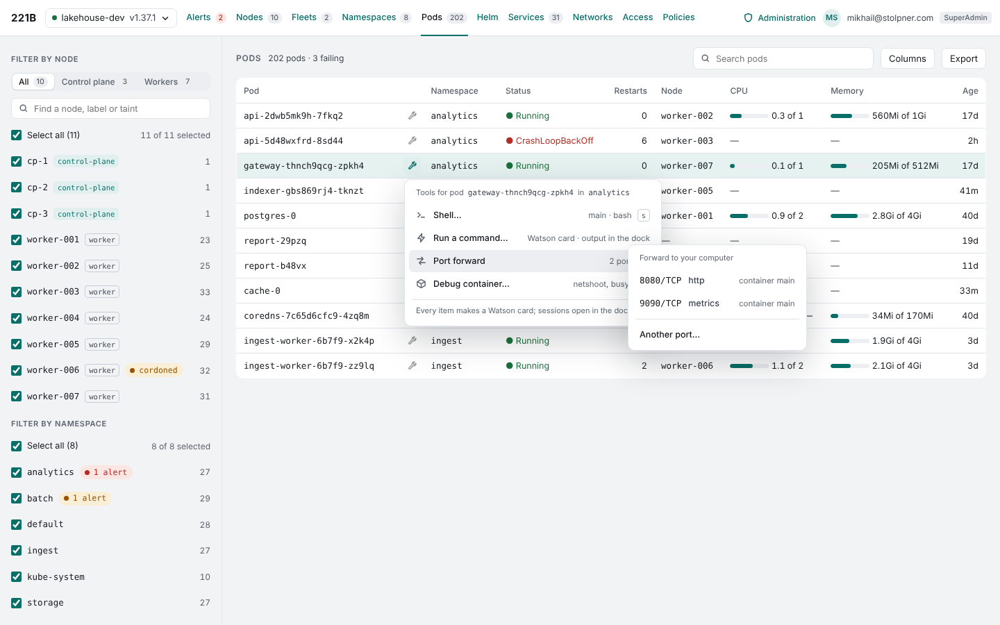 | 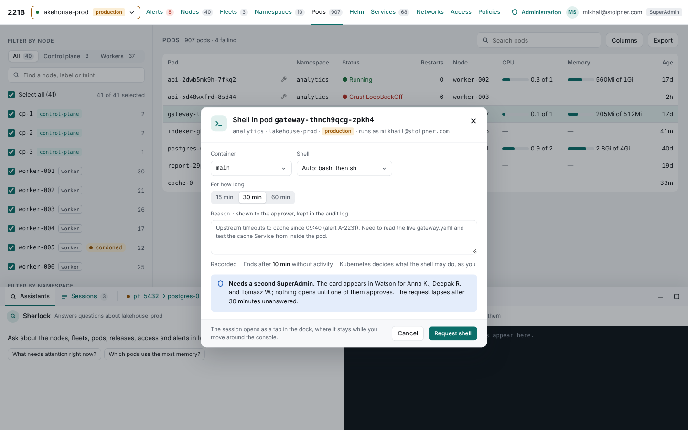 |
| Pods tab on a development cluster (TB-01, TB-02): the Tools column after the name, the menu open on `gateway-…` with the Port forward submenu | The Shell dialog on a production connection (TB-06, TB-07): container and shell, duration, reason, the second-admin notice; the dock dimmed beneath |
| 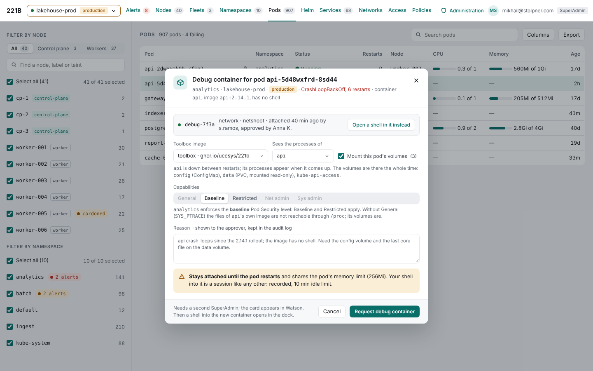 | 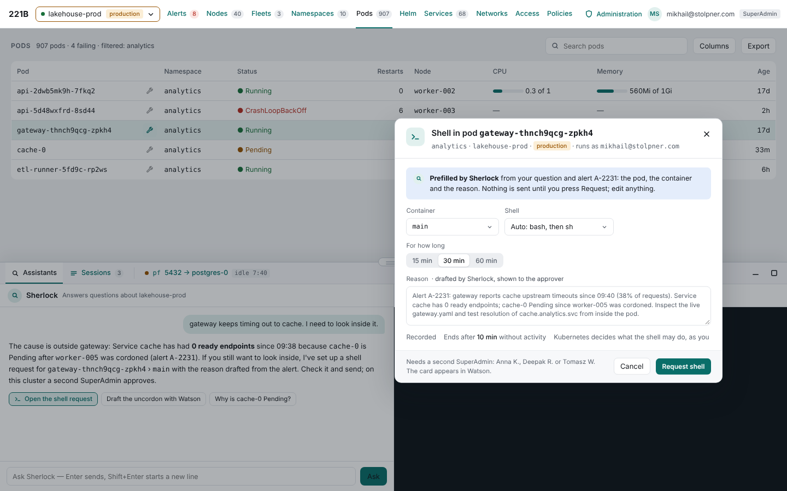 |
| Debug container for a crash-looping distroless pod (TB-24, TB-25): the container already attached, image profile, target, volumes, the capability profiles bounded by the namespace's Pod Security level | Sherlock's chip opened the Shell dialog prefilled with the pod, the container and a reason drafted from the alert (TB-42, TB-43) |
| 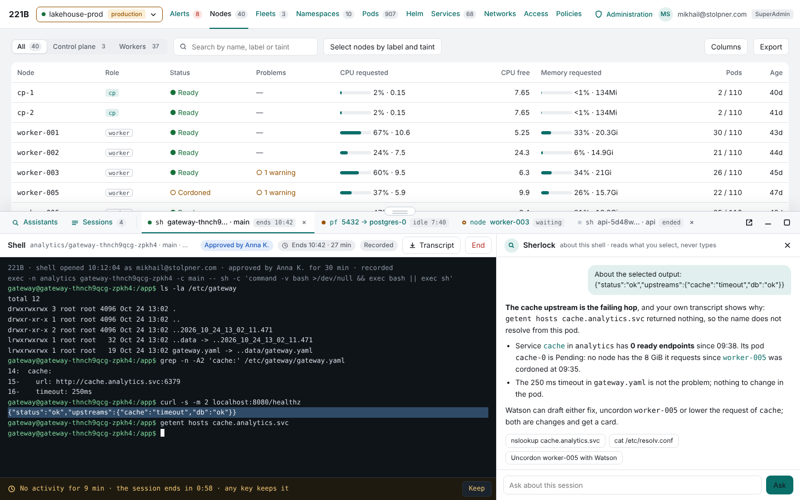 | 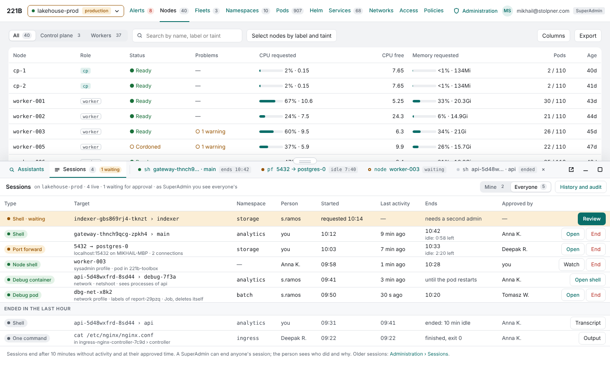 |
| The Dock strip and a shell session beside Sherlock (TB-09, TB-10, TB-41): the approver, the countdown, the idle warning, a selected line asked about | The Sessions pane (TB-12): every live session, a request waiting for review, the sessions ended in the last hour |
| 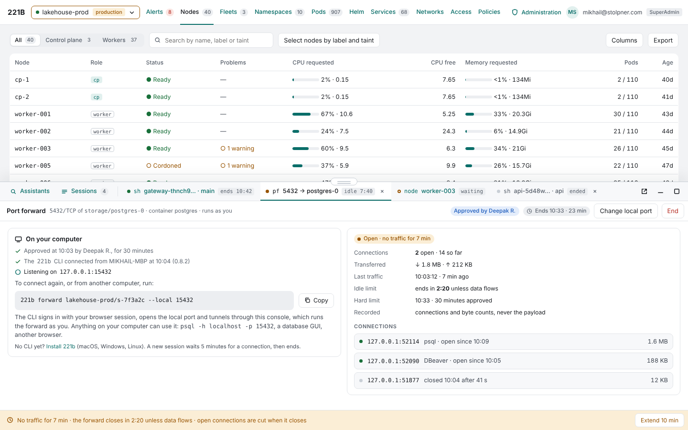 | 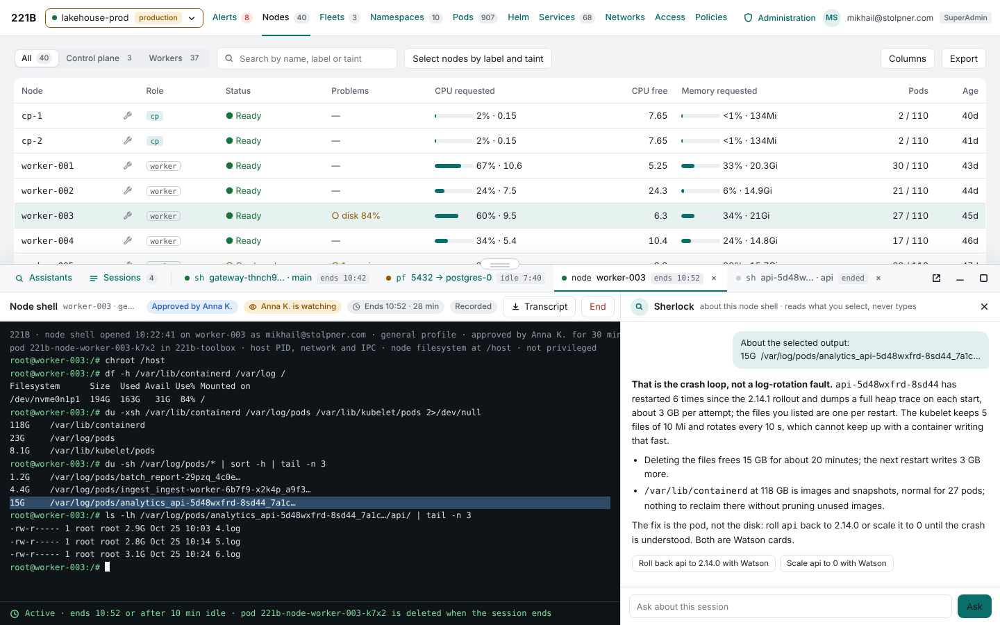 |
| A port forward (TB-11, TB-19 to TB-22): the CLI command, the local address, connections and bytes, the idle bar with Extend | A node shell (TB-31): the pod it runs in, `chroot /host`, the disk investigation, the approver watching |
| 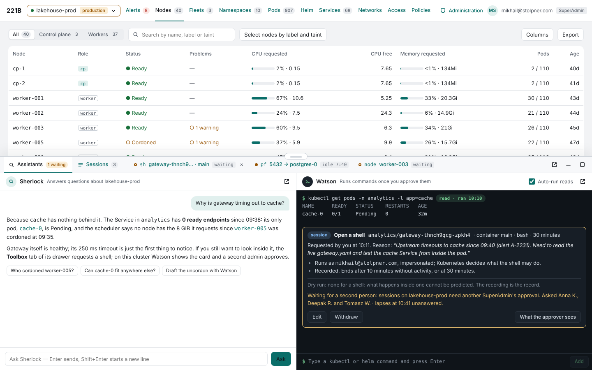 | 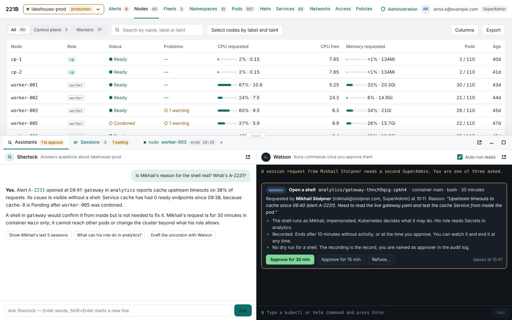 |
| The session card in Watson while it waits for a second person (TB-36 to TB-38) | The same card as the approver sees it: Approve for 30 or 15 minutes, Refuse, the lapse time |
| 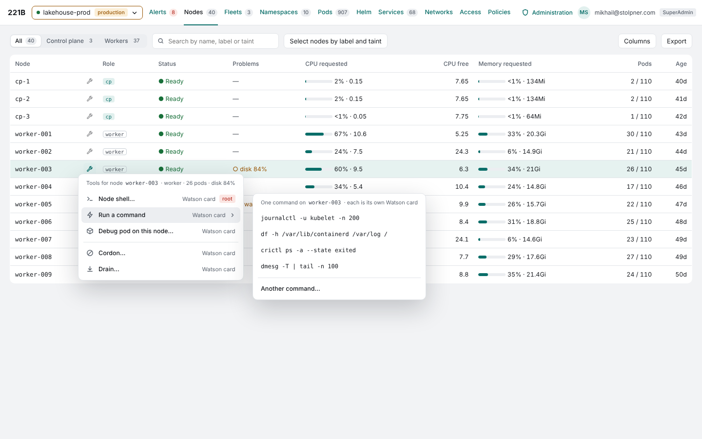 | 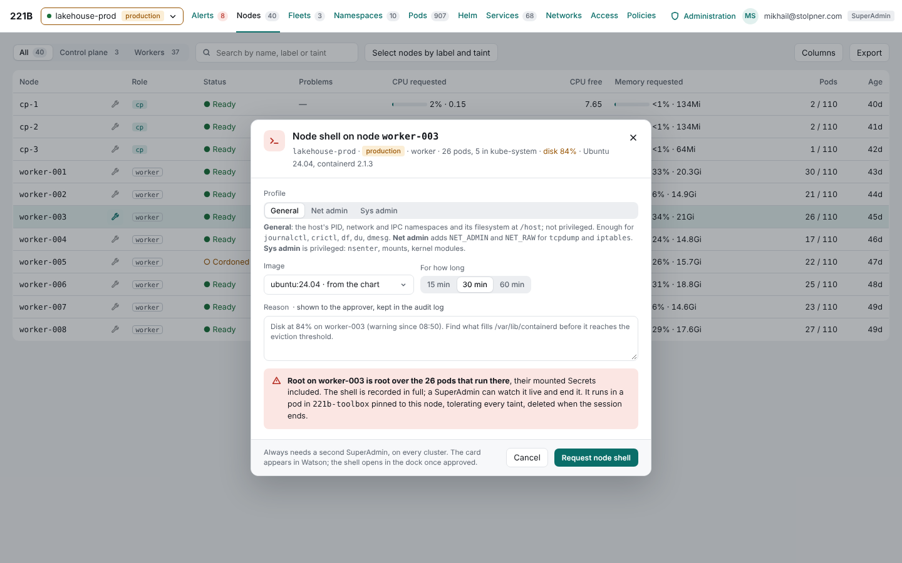 |
| Nodes tab (TB-03): the menu on `worker-003` with the Run a command submenu, Cordon and Drain as card makers | The Node shell dialog (TB-31, TB-32): the three profiles and what each adds, image, duration, reason, the blast-radius callout |
| 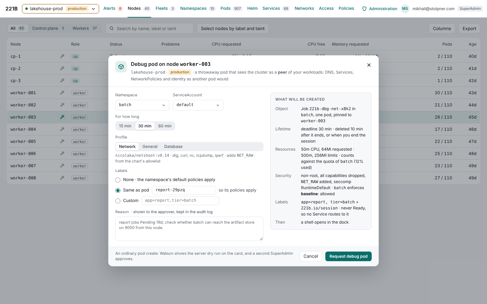 | |
| The Debug pod dialog from a node (TB-28, TB-30): namespace, ServiceAccount, profile, labels copied from a pod, and what will be created | |
| 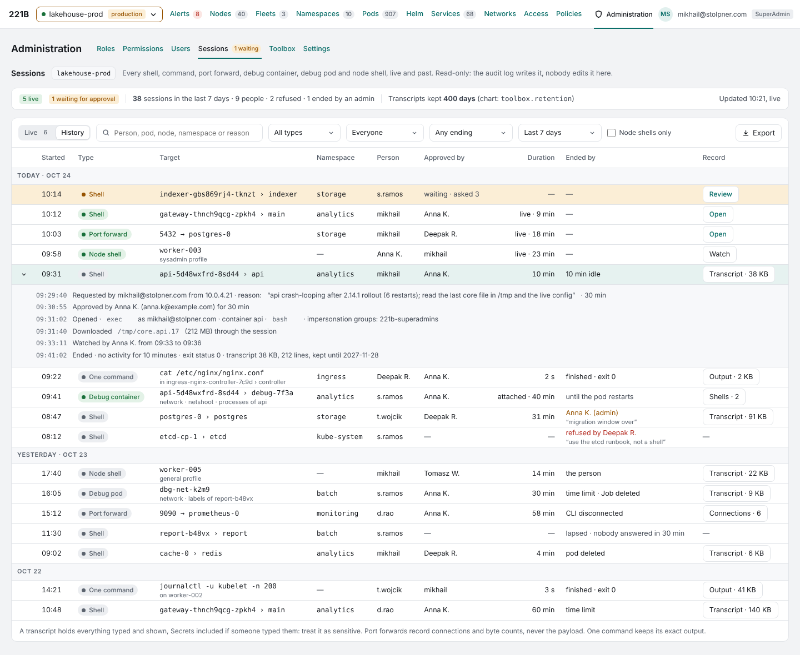 | 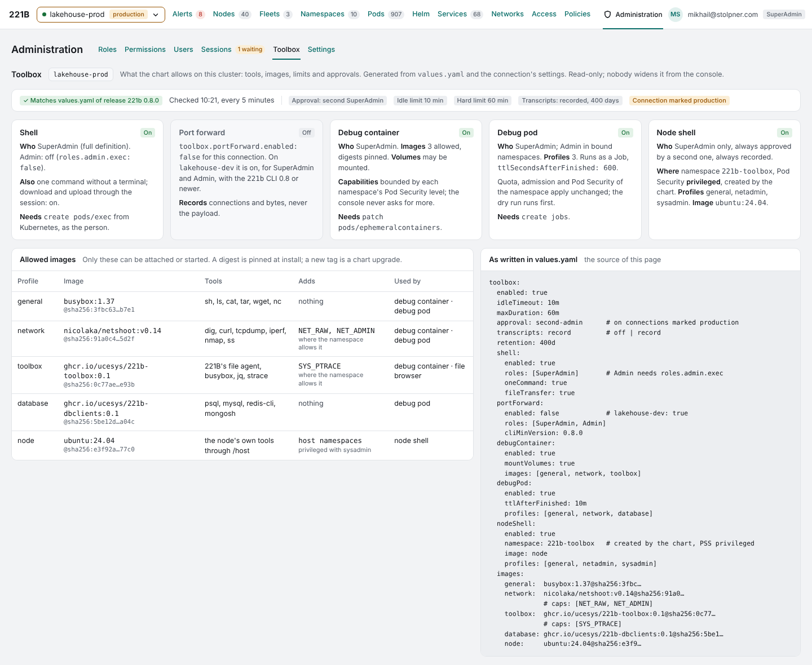 |
| Administration › Sessions (TB-44): live and history, every ending, one row expanded to its audit trail | Administration › Toolbox (TB-46): what the chart allows, the allowed images, the values it came from. The `roles:` lists and `approval:` key on this page are superseded by TB-50 and the values block above |

## As built

Built on `phase-9-tools` after the review above, server first, then the chart, the `221b` command and the browser. Tested with unit tests, the simulator (which now runs exec over WebSocket with a pretend shell, ephemeral containers, Jobs and bare pods, but not port forwards) and `web/e2e/toolbox.spec.ts`; not yet on kind or a real cluster.

| Area | As built | Differs from the requirements |
|---|---|---|
| Menus and dialogs (TB-01 to TB-07) | The Tools button sits in the name cell of the Pods and Nodes tables, so every table built from their columns has it. Pod menu: Shell, Run a command, Port forward (ports from the pod's spec), Debug container. Node menu: Node shell, Run a command (the chart's quick commands), Debug pod, Cordon or Uncordon and Drain as Watson cards. A dialog per tool; the reason and the approval note show only where a second person is needed. | No Debug pod on Namespaces rows yet. The dialog is always shown (the open question on one-container pods stays as answered). |
| Cards (TB-36 to TB-38) | `POST …/watson/sessions` makes a Watson card that names the targets, what it does, the server's dry run (or the access review where Kubernetes has none) and the YAML it creates. Approve and open; Discard. Waiting for a second person lapses after 30 minutes. | No "Approve for 15 minutes" or Refuse with a reason: the card is approved or discarded as Watson's other cards. |
| Sessions (TB-08 to TB-17) | Run as the person who asked, with their Kubernetes rights. A strip in the dock once there is a session: Assistants, Sessions, a tab per session. Terminals are xterm.js; idle warning with Keep; End; Extend in the last 15 minutes; an administrator's End asks for a reason the owner sees; SuperAdmins Watch, read-only, and the owner sees it. | xterm.js writes its theme into `<style>` elements, which the console's CSP refuses; the terminal mirrors them into constructed stylesheets. No paste guard yet (TB-18). |
| Port forward and the CLI (TB-19 to TB-23) | `221b forward <console> --cluster … --session … --token … [--local N]`, one static binary built by `make cli` and attached to releases for macOS, Linux and Windows. The token is the forward's own, shown only in its owner's pane, and ends with it. Development builds skip the minimum version. | No `221b login` or `221b sessions`, and no token in a keychain: the per-session token replaces them for now. |
| Debug tools (TB-24 to TB-30) | Ephemeral containers from allowlisted images, capabilities bounded by the namespace's Pod Security level, volumes mounted read-only by default. Debug pods as Jobs with a readiness gate that never passes, labels copied without controller labels, deleted with the session. | — |
| Node tools (TB-31 to TB-35) | Node shells with the general, netadmin and sysadmin profiles; one command on a node through `chroot /host`; a second SuperAdmin on every cluster by default. | The chart turns node shells off instead of refusing to render when SuperAdmin is read-only, so upgrades of such installs keep working. |
| Sherlock (TB-41 to TB-43) | `open_tool_dialog` joins the UI actions: it opens a tool's dialog filled in, marked as Sherlock's; the person sends it. | No *Ask about this output* beside a terminal yet; the evaluation cases are not written. |
| Administration (TB-44 to TB-46) | Sessions: open ones (with End) and the history, filterable. Toolbox: each tool here and why it is off, the limits, the approval rules, the images, the values. | No per-session audit trail expanded in the history; no check of the live namespace against the chart. |
| Chart and roles (TB-47 to TB-54) | The `toolbox` block, `rbac.roles.admin.exec`, the toolbox namespace at Pod Security privileged with a closed network policy, a volume for transcripts with `pvc`. Full Admin gains port forwards and Jobs; `pods/exec` behind the switch. | History is kept in the settings ConfigMap, 300 records by default, not a ConfigMap of its own. Transcripts are `none` or `pvc`; no `s3`. No per-connection override. No janitor: what a session creates has a deadline and is deleted when the session ends; a console that crashes leaves it until the deadline. |
| File transfer (TB-16) | — | Not built: `fileTransfer` is read but nothing offers it yet. |

The Toolbox needs Watson, which shows only where Sherlock is on (Phase 6.2). Where it is off, the Tools menu says why.

## Your review

| Date | Note |
|---|---|
| 2026-10-25 | Drawers found clunky: the Toolbox tab is replaced by a Tools column on the pod and node tables, a menu, and a dialog per tool. A Dock launcher is rejected as outside the console's workflow. Sherlock is to open the dialogs prefilled from context. Copy of this pod is out of scope. |
| 2026-10-25 | Logs, YAML, Events and Pods are removed from the menus: a Tools menu holds tools. Non-production dialogs carry no reason and no approval note. Titles name the kind of object. Any command issued from the UI, Drain included, goes through Watson. |
